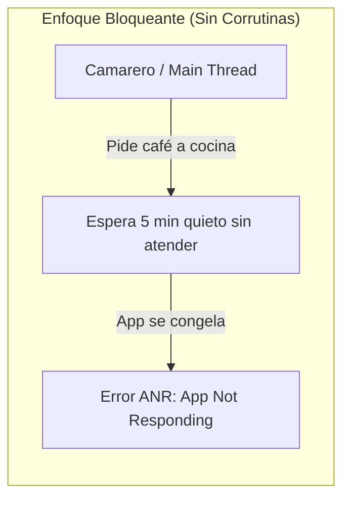
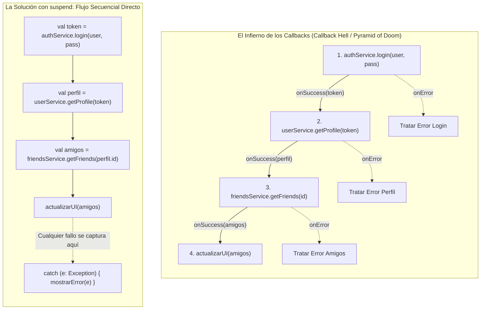
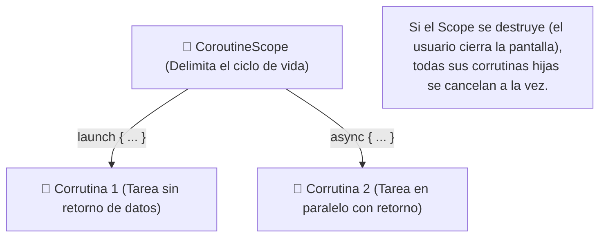
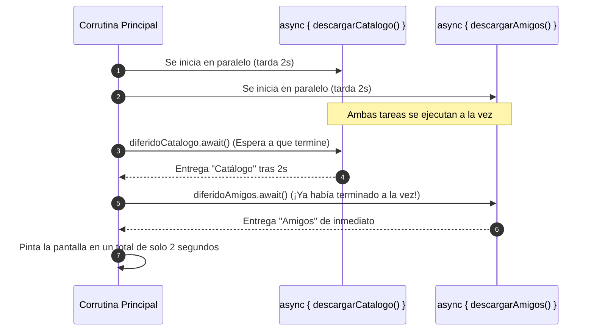

# Programación Asíncrona con Corrutinas en Kotlin

En el desarrollo de aplicaciones móviles, la **concurrencia asíncrona** es un requisito innegociable. Una aplicación móvil debe realizar operaciones que toman tiempo (descargar imágenes, consultar una API REST, leer una base de datos local SQLite/Room) sin **congelar jamás la pantalla** ni bloquear la interacción del usuario a 60 o 120 fotogramas por segundo.

Históricamente en Java y Android se utilizaban hilos manuales (`Thread`), manejadores (`Handler`), `AsyncTask` o complejas librerías de callbacks reactivos (`RxJava`). Kotlin revolucionó este panorama introduciendo las **corrutinas** (*Coroutines*): una solución elegante y ligera que permite escribir **código asíncrono no bloqueante con la misma sencillez y legibilidad que el código secuencial síncrono**.

---

## 1. La Analogía del Camarero: ¿Por qué bloquear un hilo es fatal?

Imagina un restaurante concurrido:



- **El Hilo Principal (*Main Thread* o Hilo de UI):** Es el **único camarero** del restaurante. Su trabajo vital es escuchar al usuario (toques en la pantalla, gestos, teclado) y redibujar los componentes visuales.

- **La Tarea Pesada:** Es un pedido complejo (por ejemplo, descargar el catálogo de juegos desde un servidor).

### El Enfoque Bloqueante (Sin Corrutinas)

Si el camarero toma el pedido, se mete a la cocina y se queda allí de pie 4 segundos esperando a que termine la máquina de café:

- Durante esos 4 segundos, **nadie atiende el comedor**.

- Si un cliente intenta pulsar un botón, la app no responde.

- El sistema operativo Android detecta que el hilo principal lleva más de 5 segundos sin procesar eventos y lanza el temido diálogo del sistema: **ANR (Application Not Responding)**, cerrando la app a la fuerza.

### El Enfoque con Corrutinas (No Bloqueante)
Con corrutinas, el camarero pasa la comanda a la cocina (lanza una corrutina en segundo plano) y **vuelve inmediatamente a la sala a seguir atendiendo a los clientes**. 
Cuando la cocina termina, la corrutina avisa al camarero, quien recoge el plato y lo entrega en la mesa sin haber dejado de atender la sala en ningún momento.

---

## 2. Corrutinas vs Hilos Tradicionales (*Threads*)

A menudo se confunden, pero su coste en recursos es drásticamente distinto:

| Característica | Hilo Tradicional (`Thread` del SO) | Corrutina de Kotlin |
| :--- | :--- | :--- |
| **Peso en memoria** | **Pesado** (consume ~1 MB de memoria de pila por hilo) | **Ultraligero** (consume unos pocos bytes en memoria) |
| **Creación** | Muy costosa (requiere intervención del kernel del SO) | Prácticamente instantánea (gestionada en espacio de usuario) |
| **Escalabilidad** | Crear 5.000 hilos colapsa la memoria de un teléfono móvil (`OutOfMemoryError`). | Puedes lanzar **100.000 corrutinas** simultáneamente sin problema. |
| **Concepto clave** | "Hilos de hardware/SO" | "Hilos virtuales cooperativos" que se ejecutan sobre un grupo de hilos reales. |

---

## 3. Funciones de Suspensión (`suspend fun`)

El bloque de construcción fundamental de las corrutinas es la palabra clave **`suspend`**.

Para entender por qué las funciones de suspensión supusieron una auténtica revolución en el desarrollo móvil y en la industria del software, es imprescindible recordar cómo se programaban las tareas asíncronas antes de su llegada.

### 3.1. ¿De Dónde Venimos? El Infierno de los Callbacks (*Callback Hell*)

En Java tradicional, JavaScript o en las primeras versiones de Android, una función que tardaba tiempo no podía devolver un valor directamente ni bloquear el hilo principal. La solución estándar era el uso de **callbacks** (o escuchadores/*listeners*): le pasabas a la función un objeto con métodos para que te avisara cuando la tarea terminase (`onSuccess` y `onError`).

El problema surgía cuando tenías que ejecutar **varias operaciones asíncronas encadenadas y dependientes**:

1. Autenticar al usuario con credenciales (`login`).

2. Con el `token` obtenido, descargar su perfil (`getProfile`).

3. Con el `id` del perfil, descargar su lista de amigos o compras (`getFriends`).

4. Con los datos finales, actualizar la interfaz de usuario.

En código tradicional, esto se traducía en la temida **Pirámide de la Perdición (*Pyramid of Doom*)**:

```kotlin
// ❌ EL INFIERNO DE LOS CALLBACKS (Código tradicional complejo y frágil)
authService.login(usuario, clave, object : AuthCallback {
    override fun onSuccess(token: String) {
        userService.getProfile(token, object : ProfileCallback {
            override fun onSuccess(perfil: UserProfile) {
                friendsService.getFriends(perfil.id, object : FriendsCallback {
                    override fun onSuccess(amigos: List<Friend>) {
                        actualizarUI(amigos) // ¡Por fin! 4 niveles de indentación
                    }
                    override fun onError(e: Exception) {
                        mostrarErrorAmigos(e) // Manejo de error Nivel 3
                    }
                })
            }
            override fun onError(e: Exception) {
                mostrarErrorPerfil(e) // Manejo de error Nivel 2
            }
        })
    }
    override fun onError(e: Exception) {
        mostrarErrorLogin(e) // Manejo de error Nivel 1
    }
})
```

#### Los 3 Graves Problemas de los Callbacks:

1. **Legibilidad destructiva:** El código se desplaza horizontalmente hacia la derecha de forma descontrolada (*Pyramid of Doom*), haciendo imposible seguir el flujo lógico natural.

2. **Fragmentación del manejo de errores:** No se puede usar un bloque `try-catch` estándar. Cada llamada anidada necesita su propio manejador de fallos (`onError`), duplicando código defensivo en cada nivel.

3. **Fugas de memoria (*Memory Leaks*) y falta de cancelación:** Si el usuario rota la pantalla o pulsa el botón "Atrás" mientras las peticiones 2 o 3 están en vuelo, los callbacks anidados siguen vivos en segundo plano. Cuando intentan actualizar la interfaz de una pantalla destruida, provocan el colapso de la aplicación (`NullPointerException` o `IllegalStateException`).



### 3.2. La Solución con `suspend`: Código Asíncrono con Sintaxis Secuencial

Una función marcada con la palabra clave **`suspend`** puede pausar su ejecución en segundo plano y reanudarse más tarde **sin bloquear el hilo de ejecución** y **sin requerir callbacks anidados**.

Mira exactamente el mismo caso anterior reescrito con funciones `suspend`:

```kotlin
// ✅ CON CORRUTINAS Y FUNCIONES SUSPEND (Limpio, secuencial y seguro)
try {
    val token = authService.login(usuario, clave)         // 1. Pausa y reanuda
    val perfil = userService.getProfile(token)            // 2. Pausa y reanuda
    val amigos = friendsService.getFriends(perfil.id)     // 3. Pausa y reanuda
    actualizarUI(amigos)                                  // 4. Se ejecuta al terminar
} catch (e: Exception) {
    mostrarError(e) // ¡Un único bloque centralizado para todos los errores!
}
```

#### ¿Qué ocurre por debajo? (La magia de la Suspensión)
Cuando el hilo principal llega a `authService.login()`, la corrutina **se suspende** (guarda su estado en memoria). El hilo principal queda inmediatamente libre para seguir respondiendo a los toques del usuario y pintar la pantalla a 60 fps. 

Cuando la respuesta HTTP llega del servidor, el motor de corrutinas "despierta" a la corrutina y reanuda la ejecución en la línea siguiente exactamente donde se quedó. Para el programador, el código se lee de arriba abajo como si fuera síncrono.

### 3.3. Comparativa: Callbacks Tradicionales vs. Funciones `suspend`

| Característica | Callbacks Tradicionales (Java / JS) | Funciones `suspend` (Kotlin Coroutines) |
| :--- | :--- | :--- |
| **Estructura del código** | Anidada en pirámide (*Pyramid of Doom*). | Lineal y secuencial de arriba abajo. |
| **Manejo de excepciones** | Métodos `onError` manuales y dispersos en cada capa. | Bloques `try-catch` estándar y centralizados. |
| **Cancelación** | Manual, complejísima y con alto riesgo de fugas de memoria (*leaks*). | Automática en cascada gracias a la **Concurrencia Estructurada**. |
| **Retorno de datos** | No pueden retornar valores (métodos `void` / `Unit`). | Devuelven tipos de datos directos (`String`, `User`, `List<T>`). |
| **Tareas en paralelo** | Requiere semáforos, contadores o `CountDownLatch`. | Trivial con `async { }` y `.await()`. |

### Ejemplo Práctico: Declaración de una Función `suspend`

```kotlin
import kotlinx.coroutines.delay

// 'delay' es una función de suspensión propia de Kotlin: pausa la corrutina sin congelar el hilo
suspend fun descargarDatosJuegos(): String {
    println("-> Iniciando descarga de catálogo en segundo plano...")
    delay(2000) // Simula una espera de red de 2 segundos de forma NO bloqueante
    return "Catálogo: 120 videojuegos disponibles"
}
```

!!! warning "Regla de compilación de funciones suspend"
    Una función `suspend` **solo puede ser invocada desde dentro de otra función de suspensión o desde el cuerpo de un constructor de corrutina (*Coroutine Builder*)**. Si intentas llamarla desde una función normal ordinaria, el compilador lanzará un error indicando que falta el contexto de corrutina.

---

## 4. Ámbitos y Constructores: `CoroutineScope` y *Builders*

En la sección anterior vimos que una función marcada con `suspend` puede pausarse y reanudarse sin bloquear el hilo. Pero surge una duda inmediata: **¿cómo y desde dónde llamamos a una función `suspend` por primera vez si estamos en código normal (por ejemplo, al pulsar un botón o al iniciar la app)?**

Para resolver esto, Kotlin utiliza dos conceptos inseparables: el **`CoroutineScope`** (el ámbito de vida) y los **Constructores de Corrutinas (*Coroutine Builders*)**.

---

### 4.1. ¿Qué es un `CoroutineScope` y cuál es su relación con los *Builders*?

Un **`CoroutineScope`** representa el **ámbito de vida** y la frontera de control de las corrutinas. 

> 👨‍👧‍👦 **Analogía Pedagógica:**  
> Piensa en el `CoroutineScope` como en una **oficina o departamento** de una empresa:
> 
> - La oficina (`CoroutineScope`) delimita el horario y el espacio de trabajo.
> - Los empleados que trabajan dentro son las **corrutinas**.
> - Si la oficina cierra sus puertas (por ejemplo, el usuario sale de la pantalla en la app), **todos los trabajos y tareas en marcha dentro de esa oficina se cancelan automáticamente**. Esto evita que sigan consumiendo batería, memoria o datos de red en segundo plano (principio de **Concurrencia Estructurada**).

Los **constructores (*builders*)**, como `launch` o `async`, son las herramientas o métodos que te permiten **crear un nuevo empleado (lanzar una corrutina)** dentro de esa oficina.

Técnicamente en Kotlin, `launch` y `async` son **funciones de extensión** de `CoroutineScope`:

```kotlin
// Solo pueden llamarse sobre un objeto CoroutineScope:
fun CoroutineScope.launch(...): Job
fun <T> CoroutineScope.async(...): Deferred<T>
```

Por eso, el compilador **no te permite** llamar a `launch { }` al aire de forma estática; siempre debes tener un `CoroutineScope` de referencia:



En Android no necesitas inventar scopes globales; utilizas los que provee el propio sistema adaptados al ciclo de vida:

- **`viewModelScope`:** Vive mientras el ViewModel esté activo en memoria.
- **`lifecycleScope`:** Atado al ciclo de vida de una pantalla o Activity.
- **`rememberCoroutineScope()`:** Para lanzar corrutinas desde eventos visuales en Jetpack Compose (por ejemplo, al pulsar un botón).

---

### 4.2. `launch`: Lanzar y Olvidar (*Fire and Forget*)

El constructor **`launch`** arranca una corrutina en segundo plano y devuelve inmediatamente un objeto **`Job`**.

Se utiliza cuando la corrutina tiene como objetivo realizar una acción en segundo plano y **no necesitamos que devuelva un dato directo al código que la invocó**.

**Casos típicos de uso:**
- Enviar analíticas o eventos a Firebase.
- Registrar una línea de log.
- Guardar o actualizar un registro en la base de datos local SQLite/Room.
- Actualizar el estado visual de la pantalla en un ViewModel (`_uiState.value = ...`).

```kotlin
import kotlinx.coroutines.*

fun main() = runBlocking {
    println("1. Antes de lanzar la corrutina")

    // launch arranca la tarea en segundo plano sin congelar la ejecución:
    val ticketTrabajo: Job = launch {
        println("2. Guardando datos en base de datos local...")
        delay(1000) // Simula la escritura en disco
        println("4. Guardado finalizado con éxito")
    }

    println("3. El código principal sigue adelante de inmediato")

    // Si queremos esperar explícitamente a que termine, usamos join() sobre el Job:
    ticketTrabajo.join()
    println("5. Fin del proceso")
}
```

**Salida en consola:**
```text
1. Antes de lanzar la corrutina
3. El código principal sigue adelante de inmediato
2. Guardando datos en base de datos local...
4. Guardado finalizado con éxito
5. Fin del proceso
```

---

### 4.3. Si una función `suspend` devuelve un valor, ¿cómo se recoge?

Aquí surge la duda más habitual: **"Si tengo una función `suspend` que devuelve un valor (como un `String`, un `Int` o un `Usuario`), ¿tengo que usar obligatoriamente `async`?"**

La respuesta es: **NO. En la inmensa mayoría de los casos cotidianos, NO necesitas `async`.**

Dentro de cualquier corrutina iniciada con `launch`, puedes invocar directamente a una función `suspend` y recoger su resultado en una variable normal con un simple `=` de asignación. La corrutina se pausará de forma transparente mientras espera el resultado y se reanudará cuando esté listo, **sin congelar la interfaz ni bloquear ningún hilo**.

#### Ejemplo: Llamada secuencial directa con valor de retorno

```kotlin
import kotlinx.coroutines.*

// Esta función suspend devuelve un valor (un String):
suspend fun descargarNombreUsuario(): String {
    delay(1000) // Simula una petición de red
    return "Mario_Bros"
}

// Esta función también devuelve un valor:
suspend fun consultarMonedas(usuario: String): Int {
    delay(500) // Simula una consulta a base de datos
    return 150
}

fun main() = runBlocking {
    // Dentro de una corrutina simplemente llamamos y asignamos:
    launch {
        println("Iniciando consulta...")

        val nombre = descargarNombreUsuario() // Espera 1 seg sin bloquear y guarda el resultado
        val monedas = consultarMonedas(nombre) // Espera 0.5 seg y guarda el resultado

        println("Usuario cargado: $nombre tiene $monedas monedas.")
    }
}
```

> 💡 **Regla de Oro en Android:**  
> Más del 90% del código que escribirás en tus ViewModels funciona exactamente así: un `viewModelScope.launch { ... }` dentro del cual llamas a funciones `suspend` del Repositorio de forma secuencial, limpia y directa.

---

### 4.4. ¿Cuándo y por qué usamos entonces `async` y `await`?

Si ya podemos recoger datos con llamadas directas, **¿para qué demonios sirve `async`?**

La respuesta es una sola palabra: **PARALELISMO**.

Imagina que para mostrar la pantalla de perfil necesitas consultar dos cosas distintas:
1. El catálogo de juegos (tarda 2 segundos).
2. La lista de amigos conectados (tarda 2 segundos).

Si las llamas secuencialmente una tras otra, el usuario esperará **4 segundos** (2 + 2). Pero esas dos peticiones son totalmente independientes entre sí: **¡podrían realizarse las dos a la vez!**

Para eso existe **`async`**: para disparar múltiples tareas a la vez en paralelo y esperar los resultados cuando los necesites.

#### ¿Cómo funciona `async`?
1. **`async { ... }`** arranca la tarea en segundo plano de inmediato y te devuelve un objeto **`Deferred<T>`** (una "promesa" de que habrá un resultado de tipo `T` en el futuro).
2. **`.await()`** es la función que te permite recoger ese valor. Si la tarea aún está en curso cuando llamas a `.await()`, la corrutina se pausa hasta que el dato esté listo.

#### Ejemplo Comparativo de Rendimiento

```kotlin
import kotlinx.coroutines.*
import kotlin.system.measureTimeMillis

suspend fun descargarCatalogo(): String {
    delay(2000) // Tarda 2 segundos
    return "Catálogo de 50 juegos"
}

suspend fun descargarAmigos(): String {
    delay(2000) // Tarda 2 segundos
    return "3 amigos conectados"
}

fun main() = runBlocking {
    println("--- Enfoque Concurrente con async en paralelo ---")
    val tiempo = measureTimeMillis {
        // 1. Disparamos ambas peticiones A LA VEZ en segundo plano:
        val diferidoCatalogo: Deferred<String> = async { descargarCatalogo() }
        val diferidoAmigos: Deferred<String> = async { descargarAmigos() }

        // 2. Esperamos los resultados:
        val catalogo = diferidoCatalogo.await()
        val amigos = diferidoAmigos.await()

        println("Resultado: $catalogo | $amigos")
    }

    println("Tiempo total transcurrido: $tiempo ms (¡Solo ~2 segundos, no 4!)")
}
```



---

### 4.5. El Gran Error de Principiante: El "Falso Paralelismo"

Un fallo muy habitual entre los alumnos es escribir esto:

```kotlin
// ❌ ERROR TÍPICO: Llamar a .await() inmediatamente
val catalogo = async { descargarCatalogo() }.await() // Se detiene y espera 2 segundos aquí...
val amigos = async { descargarAmigos() }.await()     // ...y no arranca esta hasta que termina la primera

// ¡Tiempo total = 4 segundos! Has perdido todas las ventajas del paralelismo.
```

**La regla para usar `async` correctamente es:**
1. Dispara primero **todas** las tareas con `async`.
2. Espera y recoge los resultados con `.await()` **al final**.

---

### 4.6. ¿Qué es `runBlocking` y por qué lo vemos en los ejemplos?

En casi todos los ejemplos de código verás `fun main() = runBlocking { ... }`.

- En una aplicación de consola estándar, cuando la función `main` llega al final, el programa se cierra inmediatamente, matando cualquier corrutina que estuviera en curso en segundo plano.
- **`runBlocking`** es un constructor especial que **bloquea el hilo actual del sistema** hasta que la corrutina y todas sus hijas terminen. Así evitamos que el programa de consola se cierre antes de tiempo.

!!! danger "⚠️ Peligro: ¡PROHIBIDO usar `runBlocking` en la interfaz de Android!"
    En Android **nunca** debes usar `runBlocking` en el hilo principal ni en componentes visuales.
    
    Si usas `runBlocking` en Android, congelarás la pantalla por completo, el usuario no podrá interactuar y el sistema operativo forzará el cierre de la app mostrando el error **ANR (Application Not Responding)**.
    
    En Android siempre debes usar constructores no bloqueantes como `viewModelScope.launch { ... }` o `LaunchedEffect`.

---

### 4.7. Resumen Práctico de Decisión

| Situación | Qué debes usar | Ejemplo |
| :--- | :--- | :--- |
| **Quiero ejecutar una tarea en segundo plano sin retorno directo (guardar en BD, analítica, actualizar UI)** | `launch` | `viewModelScope.launch { repo.guardar(item) }` |
| **Quiero llamar a una función `suspend` y recoger su resultado** | Llamada directa dentro de un `launch` | `viewModelScope.launch { val data = repo.cargar() }` |
| **Tengo dos o más peticiones independientes y quiero ejecutarlas a la vez para ahorrar tiempo** | `async` + `.await()` | `val d1 = async { ... }; val d2 = async { ... }; d1.await(); d2.await()` |
| **Estoy en una función `main()` de consola o en un test unitario rápido** | `runBlocking` | `fun main() = runBlocking { ... }` |


## 5. Despachadores en Android (*Dispatchers*)

Un **Dispatcher** indica en qué grupo de hilos (*Thread Pool*) debe ejecutarse una corrutina determinada:

| Despachador | Diseñado para | Ejemplos en Android |
| :--- | :--- | :--- |
| **`Dispatchers.Main`** | Operaciones exclusivas de Interfaz de Usuario (hilo principal). | Actualizar estados de Jetpack Compose, animaciones, navegación. |
| **`Dispatchers.IO`** | Operaciones de Entrada/Salida bloqueantes fuera de CPU. | Consultas SQL con Room, peticiones HTTP de red, lectura/escritura de ficheros. |
| **`Dispatchers.Default`** | Tareas intensivas en cómputo de procesador. | Parseo de JSONs masivos, ordenación de listas gigantescas, compresión o filtros de imagen. |

### Cambio de Contexto Seguro con `withContext`
Permite cambiar temporalmente de hilo para una operación pesada y regresar automáticamente al hilo original:

```kotlin
import kotlinx.coroutines.*

suspend fun cargarCatalogoYActualizarUi() {
    // 1. Cambiamos al hilo de Entrada/Salida para descargar
    val datos = withContext(Dispatchers.IO) {
        println("Descargando en hilo de red: ${Thread.currentThread().name}")
        delay(1500)
        listOf("Metroid", "Pokemon", "Zelda")
    }

    // 2. Al salir de withContext, volvemos automáticamente al hilo original (Main)
    println("Actualizando pantalla en Compose con: $datos")
}
```

---

## 6. Manejo de Errores con `try-catch`

A diferencia de los callbacks antiguos donde las excepciones se perdían entre hilos, en las corrutinas puedes capturar errores de operaciones asíncronas con la sintaxis clásica de `try-catch`:

```kotlin
import kotlinx.coroutines.*

suspend fun descargarConFalloSeguro() {
    try {
        withContext(Dispatchers.IO) {
            delay(1000)
            throw java.io.IOException("Error 503: Servidor de GameVault no disponible")
        }
    } catch (e: java.io.IOException) {
        println("Error capturado limpiamente: ${e.message}")
        // Aquí actualizamos el UiState a CatalogoUiState.Error(...)
    }
}
```

---

## 7. Retos Prácticos

### 🟢 Reto 1: Saludo con retardo (Básico)
Crea una función de suspensión `saludarConRetardo(nombre: String, tiempoMs: Long)` que imprima "Iniciando espera...", espere el tiempo indicado usando `delay()` y luego imprima "¡Hola, $nombre!". Pruébala dentro de un bloque `runBlocking`.

??? tip "Ver solución"
    ```kotlin
    import kotlinx.coroutines.*

    suspend fun saludarConRetardo(nombre: String, tiempoMs: Long) {
        println("Iniciando espera para $nombre...")
        delay(tiempoMs)
        println("¡Hola, $nombre tras ${tiempoMs}ms!")
    }

    fun main() = runBlocking {
        saludarConRetardo("Mario", 1000)
    }
    ```

### 🟡 Reto 2: Descargas concurrentes con `async` (Intermedio)
Simula la carga de un juego descargando en paralelo sus texturas (demora 1.5 s) y sus sonidos (demora 1.0 s). Mide el tiempo total demostrando que no supera los 1.6 segundos al ejecutarse en paralelo.

??? tip "Ver solución"
    ```kotlin
    import kotlinx.coroutines.*

    suspend fun cargarTexturas(): String {
        delay(1500)
        return "Texturas 4K"
    }

    suspend fun cargarSonidos(): String {
        delay(1000)
        return "Efectos SFX"
    }

    fun main() = runBlocking {
        val inicio = System.currentTimeMillis()

        val texturas = async { cargarTexturas() }
        val sonidos = async { cargarSonidos() }

        println("Recursos listos: ${texturas.await()} y ${sonidos.await()}")
        val totalMs = System.currentTimeMillis() - inicio
        println("Tiempo total en paralelo: $totalMs ms (menos de 2 segundos)")
    }
    ```
