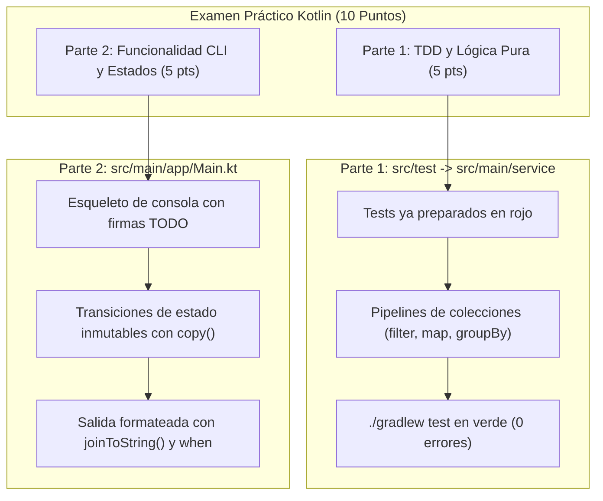

# Guía Modelo: Examen Práctico Resuelto (HeroAcademy)

Esta guía explica la metodología, estructura y mentalidad necesarias para superar con éxito los **simulacros y el examen práctico de Kotlin** en el módulo de PMDM.

El objetivo central de la prueba es demostrar la transición desde la **programación imperativa tradicional** (Java de 1º de DAM) hacia el **paradigma declarativo moderno** basado en **pipelines de colecciones**, inmutabilidad y pruebas unitarias automatizadas (**TDD**).

---

## 1. Estructura de la Evaluación (50% TDD / 50% Funcionalidad)

Cada prueba práctica consta de dos bloques independientes y complementarios:



---

## 2. El Cambio de Mentalidad: De Imperativo a Declarativo (Pipelines)

En 1º de DAM estabas acostumbrado a ordenar a la máquina paso a paso cómo mover punteros y variables en memoria:

```kotlin
// ❌ ESTILO IMPERATIVO (1º DAM - Penalizado en este examen)
fun obtenerNombresMagosViejos(heroes: List<Heroe>): List<String> {
    val resultado = ArrayList<String>()
    for (i in 0 until heroes.size) {
        val h = heroes[i]
        if (h.rol == RolHeroe.MAGO && h.nivel >= 5) {
            resultado.add(h.nombre.uppercase())
        }
    }
    return resultado
}
```

En Kotlin moderno y en el desarrollo Android reactivo con **Jetpack Compose**, el código describe **qué transformación se aplica al dato**, encadenando operaciones puras e inmutables:

```kotlin
// ✅ ESTILO DECLARATIVO (PMDM - Kotlin Moderno)
fun obtenerNombresMagos(heroes: List<Heroe>): List<String> =
    heroes
        .filter { it.rol == RolHeroe.MAGO && it.nivel >= 5 }
        .sortedByDescending { it.poder }
        .map { it.nombre.uppercase() }
```

!!! warning "Criterio de Corrección: Rúbrica Anti-Imperativo"
    El uso innecesario de bucles imperativos tradicionales (`for`, `while`) junto con acumuladores mutables (`var`, `mutableListOf()` + `.add()`) en ejercicios de procesamiento de colecciones supondrá una penalización del 50% de la nota de ese ejercicio, aun cuando el test unitario resulte en verde.

---

## 3. Dominio de Ejemplo: HeroAcademy

El proyecto modelo toma como referencia una academia de héroes donde se gestionan alumnos, especialidades y mentores.

### 3.1. Modelo de Datos (`model/Heroe.kt`)

```kotlin
package model

enum class RolHeroe {
    GUERRERO,
    MAGO,
    EXPLORADOR,
    SANADOR
}

data class Heroe(
    val id: String,
    val nombre: String,
    val rol: RolHeroe,
    val nivel: Int,
    val poder: Int,
    val mentor: String? = null // Nullable: puede no tener mentor asignado
)

sealed interface AccionResultado {
    data class Exito(val mensaje: String, val heroeActualizado: Heroe) : AccionResultado
    data class Error(val motivo: String) : AccionResultado
}
```

---

## 4. PARTE 1 (TDD): Los 5 Pipelines Fundamentales

En esta parte el alumno recibe el archivo de tests unitarios completamente programado. Su labor es abrir la clase de servicio y sustituir los bloques `TODO(...)` por pipelines limpios.

### 4.1. Pipeline 1: Filtrado, Ordenación y Mapeo

El contrato exige obtener los nombres en mayúsculas de los héroes de un rol concreto cuyo nivel sea superior o igual al mínimo, ordenados de mayor a menor poder.

```kotlin
// En src/main/kotlin/service/HeroeService.kt
fun obtenerNombresHeroesDestacados(
    heroes: List<Heroe>,
    rolBuscado: RolHeroe,
    nivelMinimo: Int
): List<String> =
    heroes
        .filter { it.rol == rolBuscado && it.nivel >= nivelMinimo }
        .sortedByDescending { it.poder }
        .map { it.nombre.uppercase() }
```

El test unitario que lo verifica en `HeroeServiceTest.kt`:

```kotlin
@Test
fun `obtenerNombresHeroesDestacados filtra por rol, nivel minimo y ordena por poder descendente`() {
    val resultado = service.obtenerNombresHeroesDestacados(
        heroes = heroesMuestra,
        rolBuscado = RolHeroe.MAGO,
        nivelMinimo = 5
    )

    // Magos con nivel >= 5 en la muestra:
    // Vex (nivel 7, poder 110)
    // Aria (nivel 5, poder 85)
    val esperado = listOf("VEX", "ARIA")
    assertEquals(esperado, resultado)
}
```

---

### 4.2. Pipeline 2: Agregación Numérica Segura

Calcular la media de poder del escuadrón protegiendo el caso extremo de lista vacía.

```kotlin
fun calcularPoderMedio(heroes: List<Heroe>): Double {
    if (heroes.isEmpty()) return 0.0
    return heroes.map { it.poder }.average()
}
```

---

### 4.3. Pipeline 3: Agrupación y Reducción por Clave (`groupBy -> mapValues`)

Transformar una lista de elementos en un mapa analítico con el recuento por especialidad.

```kotlin
fun contarHeroesPorRol(heroes: List<Heroe>): Map<RolHeroe, Int> =
    heroes
        .groupBy { it.rol }
        .mapValues { (_, listaDeRol) -> listaDeRol.size }
```

---

### 4.4. Pipeline 4: Null-Safety con `mapNotNull`

Extraer los nombres únicos de mentores activos, omitiendo automáticamente a los alumnos sin mentor (`null`) y eliminando duplicados.

```kotlin
fun obtenerMentoresUnicos(heroes: List<Heroe>): List<String> =
    heroes
        .mapNotNull { it.mentor }
        .distinct()
        .sorted()
```

---

### 4.5. Pipeline 5: Búsqueda con Verificación Segura

Localizar a un héroe por su identificador ignorando mayúsculas y minúsculas, gestionando posibles entradas nulas o vacías.

```kotlin
fun buscarHeroePorId(heroes: List<Heroe>, idBuscado: String?): Heroe? {
    if (idBuscado.isNullOrBlank()) return null
    return heroes.find { it.id.equals(idBuscado.trim(), ignoreCase = true) }
}
```

---

## 5. PARTE 2: Funcionalidad CLI y Estados Inmutables (`Main.kt`)

En la segunda parte no hay tests unitarios predefinidos, sino una especificación de funcionalidad ejecutable en consola.

### 5.1. Formateo Tabular con `joinToString()`

Para construir tablas o listados legibles en la terminal no se utilizan bucles `for` que van imprimiendo línea por línea. Se construye una única cadena inmutable:

```kotlin
fun generarInformeHeroes(heroes: List<Heroe>): String {
    val cabecera = "ID    | NOMBRE     | ROL        | NIVEL | PODER | MENTOR\n" +
                   "------------------------------------------------------------------"

    val filas = heroes.joinToString("\n") { h ->
        val mentorTexto = h.mentor ?: "(Sin mentor)"
        "%-5s | %-10s | %-10s | %-5d | %-5d | %s".format(
            h.id,
            h.nombre,
            h.rol.name,
            h.nivel,
            h.poder,
            mentorTexto
        )
    }

    return "$cabecera\n$filas"
}
```

---

### 5.2. Mutación Inmutable de Estado con `.copy()`

En lugar de reasignar variables mutables de un objeto, se generan nuevas instancias preservando la inmutabilidad:

```kotlin
fun promocionarHeroe(heroe: Heroe, nuevoNivel: Int, incrementoPoder: Int): AccionResultado {
    if (nuevoNivel <= heroe.nivel) {
        return AccionResultado.Error(
            "El nuevo nivel ($nuevoNivel) debe ser estrictamente superior al actual (${heroe.nivel})"
        )
    }

    // Se clona el objeto original inmutable con las propiedades modificadas
    val heroePromocionado = heroe.copy(
        nivel = nuevoNivel,
        poder = heroe.poder + incrementoPoder
    )

    return AccionResultado.Exito(
        mensaje = "¡${heroe.nombre} asciende con éxito al nivel $nuevoNivel!",
        heroeActualizado = heroePromocionado
    )
}
```

---

### 5.3. Control de Flujo Exhaustivo con `when`

Manejo de resultados tipados mediante `sealed interface`:

```kotlin
fun mostrarResultado(resultado: AccionResultado) {
    when (resultado) {
        is AccionResultado.Exito -> {
            println("✅ ÉXITO: ${resultado.mensaje}")
            println("   -> Poder final: ${resultado.heroeActualizado.poder} pts")
        }
        is AccionResultado.Error -> {
            println("❌ RECHAZADO: ${resultado.motivo}")
        }
    }
}
```

---

## 6. Salida de Consola Esperada

Al ejecutar `./gradlew run` o lanzar `fun main()`, la consola debe mostrar:

```text
==========================================================
          🏛️  HERO ACADEMY DASHBOARD (KOTLIN)             
==========================================================

--- 1. TABLÓN OFICIAL DE ALUMNOS (PIPELINE FORMAT) ---
ID    | NOMBRE     | ROL        | NIVEL | PODER | MENTOR
------------------------------------------------------------------
H01   | Aria       | MAGO       | 5     | 85    | Gandalf
H02   | Thorin     | GUERRERO   | 8     | 120   | (Sin mentor)
H03   | Kael       | MAGO       | 3     | 45    | Gandalf
H04   | Lyra       | SANADOR    | 6     | 95    | Elrond
H05   | Vex        | MAGO       | 7     | 110   | Saruman
H06   | Brom       | GUERRERO   | 4     | 70    | (Sin mentor)

--- 2. ANÁLISIS RÁPIDO DE LA ACADEMIA ---
-> Poder medio del escuadrón: 87,50 pts
-> Mentores activos: Elrond, Gandalf, Saruman
-> Distribución por roles: {MAGO=3, GUERRERO=2, SANADOR=1}
-> Magos de élite (niv >= 5): [VEX, ARIA]

--- 3. SIMULACIÓN DE PROMOCIÓN DE RANGO (IMMUTABLE STATE) ---
✅ ÉXITO: ¡Aria asciende con éxito al nivel 6!
   -> Poder final: 105 pts
❌ RECHAZADO: El nuevo nivel (4) debe ser estrictamente superior al actual (5)
```

---

## 7. Dónde Encontrar el Código Fuente Completo

El proyecto Gradle listo para abrir en IntelliJ IDEA se encuentra en:

- Acceso al proyecto: [proyecto](../../../../_res/00-ejemplo-modelo-resuelto.zip)
- Para compilar y verificar tests desde la terminal:
  ```bash
  cd .exams/00-ejemplo-modelo-resuelto
  ./gradlew test run
  ```
