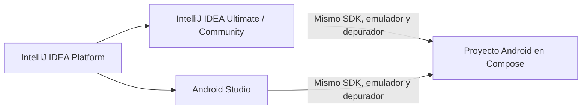
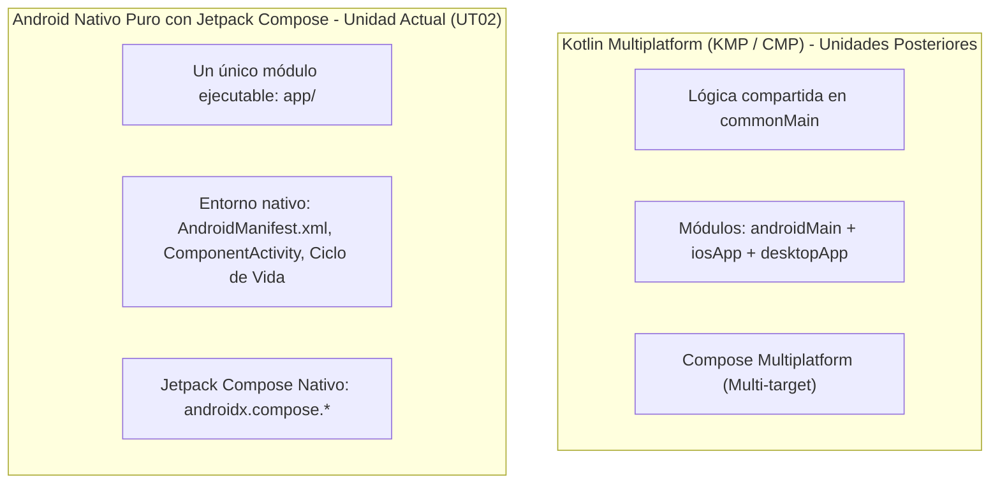
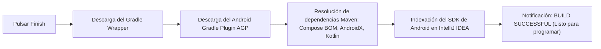
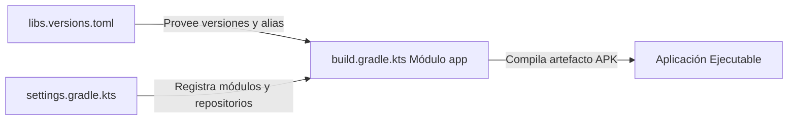

# **2.1 Primeros pasos y Proyecto de Laboratorio (`pmdm-lab-ut02`)**

En este apartado configuraremos el entorno de trabajo oficial para Android y crearemos el proyecto unificado de la unidad: **`pmdm-lab-ut02`**. A través de este proyecto aprenderemos a estructurar código nativo moderno, gestionar dependencias con Gradle y sentar las bases para todos los ejercicios del tema.

---

## 1. Entorno de Desarrollo: IntelliJ IDEA para Desarrollo Móvil

En este módulo utilizaremos **IntelliJ IDEA** como nuestro entorno de desarrollo principal para programar en Kotlin, construir aplicaciones Android y preparar el terreno hacia Kotlin Multiplatform (KMP).

Como se analiza en detalle en la [Guía de Configuración de IntelliJ IDEA para Desarrollo Móvil](../00-android/00-ide-intellij/index.md), **Android Studio está construido por Google sobre la base de código abierto de IntelliJ IDEA**. Ambos entornos comparten el mismo motor de compilación, el mismo depurador, los mismos atajos de teclado y el soporte oficial para el Android SDK y emuladores.



### 1.1. Requisitos Previos en IntelliJ IDEA

Antes de crear tu primer proyecto, asegúrate de haber seguido los pasos de configuración explicados en la [guía de IntelliJ IDEA](../00-android/00-ide-intellij/index.md):

- **Licencia Educativa Gratuita:** Los alumnos de Formación Profesional disponen de acceso gratuito a **IntelliJ IDEA Ultimate** mediante el [JetBrains Student Pack](https://www.jetbrains.com/community/education/#students).
- **Plugins Esenciales Activados:**

    - *Android* (incluido y activado por defecto en IntelliJ).
    - *Android Design Tools* (para renderizado de `@Preview` y vistas previas de Compose).

- **Android SDK y Platform-Tools:** Configurados desde el menú *Tools > Android > SDK Manager* de IntelliJ.

### 1.2. Configuración del Dispositivo de Pruebas

Para ejecutar y depurar nuestras aplicaciones disponemos de dos alternativas:

1. **Dispositivo Físico (Recomendado por consumo de recursos):**

    - Habilita las **Opciones de desarrollador** en tu teléfono (pulsando 7 veces seguidas sobre *Número de compilación* en los ajustes del sistema).
    - Activa la casilla **Depuración por USB**.
    - Conecta el dispositivo mediante cable y acepta el aviso de autorización RSA. Aparecerá de inmediato en la barra superior de dispositivos de IntelliJ IDEA.

2. **Emulador Android (AVD):**

    - Abre el **Device Manager** desde el menú lateral derecho o en *Tools > Android > Device Manager*.
    - Crea un dispositivo virtual seleccionando un perfil de hardware estándar (por ejemplo, *Pixel 8*).
    - Descarga una imagen de sistema (*System Image*) con **Google APIs** reciente (API 34 o 35) de arquitectura coincidente con tu equipo (`arm64-v8a` para procesadores ARM / Apple Silicon o `x86_64` para Intel/AMD).

??? tip "Guía paso a paso: Cómo crear y configurar el Emulador AVD en IntelliJ IDEA"

    Sigue estos pasos dentro de **IntelliJ IDEA** para disponer de un emulador listo para las prácticas:

    1. **Abrir el Device Manager:**
       - Ve al menú superior: **Tools > Android > Device Manager** (o pulsa sobre el icono del teléfono en la barra lateral derecha de herramientas).

    2. **Crear un nuevo dispositivo virtual:**
       - Haz clic en el botón **+ Create Virtual Device** (o *Create Device*).

    3. **Seleccionar el perfil de hardware:**
       - En la categoría **Phone**, elige un dispositivo estándar con Google Play Services (por ejemplo, **Pixel 8** o **Pixel 7**).
       - Pulsa en **Next**.

    4. **Descargar y seleccionar la Imagen del Sistema (System Image):**
       - Selecciona la pestaña **Recommended**.
       - Elige una versión reciente de Android: **API 34 (UpsideDownCake)** o **API 35 (VanillaIceCream)**.
       - **Atención a la arquitectura de tu procesador:**
           - Si tu ordenador tiene **Apple Silicon (M1/M2/M3/M4)** o procesador ARM: selecciona la imagen con ABI **`arm64-v8a`**.
           - Si tu ordenador tiene procesador **Intel o AMD**: selecciona la imagen con ABI **`x86_64`**.
       - Si aparece el enlace *Download* al lado de la versión, pulsa sobre él y espera a que descargue los archivos.
       - Pulsa en **Next**.

    5. **Ajustes de Rendimiento y Finalización:**
       - Puedes dejar el nombre predeterminado (ej: *Pixel 8 API 34*).
       - Despliega las opciones avanzadas (*Show Advanced Settings*):
           - **Memory and Storage:** Asigna al menos **2048 MB** (2 GB) de RAM.
           - **Emulated Performance:** Asegúrate de que *Graphics* esté en **Automatic** o **Hardware - GLES 2.0** para aprovechar la aceleración gráfica de tu tarjeta.
       - Pulsa en **Finish**.

    6. **Arranque del emulador:**
       - En la lista del *Device Manager*, pulsa el icono de **Play** (▶) del dispositivo creado.
       - El emulador arrancará y estará listo para recibir instalaciones de tu app desde el botón **Run** (▶) de IntelliJ IDEA.

---

## 2. Creación del Primer Proyecto Android con Jetpack Compose en IntelliJ IDEA

### 2.1. Aclaración Conceptual: Android Nativo Puro frente a Kotlin Multiplatform (KMP)

Cuando inicias IntelliJ IDEA con los plugins de desarrollo móvil instalados, es posible que observes generadores tanto para proyectos **Android** como para **Kotlin Multiplatform (KMP)**.

Antes de crear el proyecto, es fundamental tener claro el alcance técnico y pedagógico de esta unidad:



- **¿Por qué empezamos con Android Nativo puro?**  
  Para aprender a programar en dispositivos móviles, es indispensable dominar primero los fundamentos que gobiernan el sistema operativo Android: cómo gestiona el sistema el ciclo de vida de una pantalla (`ComponentActivity`), cómo se registran componentes y permisos en el `AndroidManifest.xml`, cómo opera el sistema de recursos (`res/`), cómo depurar con `Logcat` y cómo se construye la interfaz declarativa moderna mediante **Jetpack Compose** (`androidx.compose.*`).

- **¿Por qué NO utilizamos KMP en este tema?**  
  Kotlin Multiplatform (KMP) y Compose Multiplatform (CMP) son tecnologías extraordinarias que estudiaremos más adelante en el curso. Sin embargo, un proyecto KMP introduce una arquitectura modular más compleja (`shared/`, `composeApp/`, `iosApp/`, fuentes en `commonMain`, `androidMain`, etc.) que añadiría una barrera de complejidad innecesaria en este momento inicial.  
  
  En esta unidad nos centramos al 100% en el **ecosistema Android nativo**, garantizando que los cimientos de la arquitectura móvil queden perfectamente consolidados antes de dar el salto a arquitecturas multiplataforma.

---

### 2.2. Guía Paso a Paso en el Asistente `New Project` de IntelliJ IDEA

Sigue detalladamente estos pasos dentro de **IntelliJ IDEA**:

1. **Abrir el asistente de creación:**

    - Inicia **IntelliJ IDEA**.
    - En la pantalla de bienvenida pulsa sobre el botón **New Project** (o si ya tienes un proyecto abierto, dirígete al menú superior: `File` → `New` → `Project...`).

2. **Seleccionar la categoría Android:**

    - En la columna lateral izquierda de generadores, haz clic sobre la categoría **Android** (identificada con el logotipo oficial del robot de Android).

    !!! warning "¡Atención: No selecciones 'Kotlin' ni 'Kotlin Multiplatform'!"
        No elijas las categorías *Kotlin* (que genera programas de consola de escritorio para la JVM) ni *Kotlin Multiplatform* (KMP). Selecciona exclusivamente **Android**.

3. **Seleccionar la plantilla de Jetpack Compose (`Empty Activity`):**

    - En la galería de plantillas para *Phone and Tablet*, selecciona **Empty Activity**.

    !!! important "Diferencia Crucial: `Empty Activity` vs `Empty Views Activity`"
        En el catálogo de plantillas de Android encontrarás nombres similares que no deben confundirse:

        - **`Empty Activity` (Plantilla Oficial para Compose - SELECCIONA ESTA):**  
          Muestra el logotipo de Jetpack Compose en su miniatura. Genera un proyecto moderno basado en funciones `@Composable`, hereda de `ComponentActivity`, utiliza `setContent { ... }` y aplica el sistema de diseño Material 3.
        - **`Empty Views Activity` (Plantilla Antigua basada en XML - NO SELECCIONAR):**  
          Genera una aplicación clásica basada en el sistema obsoleto de archivos XML en `res/layout/`, hereda de `AppCompatActivity` y requiere vinculación manual mediante `findViewById`. **No la utilizaremos en este módulo.**
        - **`No Activity`:**  
          Crea el proyecto sin ninguna pantalla inicial, lo que exigiría configurar el `AndroidManifest.xml` y la Activity a mano desde cero.

    - Pulsa en **Next**.

4. **Configurar los Parámetros del Proyecto:**

    En la siguiente ventana de configuración, establece con precisión los siguientes valores:

    - **Name:** `pmdm-lab-ut02`  
      Es el nombre identificativo de la aplicación que se mostrará en la barra de títulos del IDE y en el lanzador del dispositivo.
    - **Package name:** `com.dam.pmdmlab`  
      El nombre de paquete en notación de dominio inverso (ej. `com.<centro_o_alumno>.<proyecto>`). Este valor define tanto el paquete raíz de código Kotlin como el `applicationId` y `namespace` únicos de tu aplicación ante el sistema Android.
    - **Save location:** Tu directorio de prácticas habitual en el disco duro local.

        !!! danger "Precaución con la ruta de guardado"
            - **Utiliza siempre un disco SSD local** (ej: `C:\Users\<Usuario>\Proyectos\` en Windows o `/Users/<Usuario>/Proyectos/` en macOS).
            - **Evita carpetas sincronizadas en la nube** (como OneDrive, Dropbox, Google Drive o iCloud) o unidades de red compartidas: sus bloqueos automáticos de sincronización de archivos entran en conflicto constante con los bloqueos de caché de Gradle, provocando errores de compilación aleatorios.
            - **Evita rutas con tildes, espacios o caracteres especiales.**

    - **Language:** `Kotlin` *(el estándar oficial único para desarrollo moderno)*.
    - **Minimum SDK:** `API 26: Android 8.0 (Oreo)` o superior.  

        !!! info "¿Por qué seleccionamos API 26 como mínimo?"
            Seleccionar API 26 cubre más del **95% de los dispositivos Android activos** en todo el mundo y nos proporciona compatibilidad nativa con las APIs modernas de fecha y hora de Java 8 (`java.time`) y streams sin necesidad de activar librerías de desugaring complejas en Gradle.

    - **Build configuration language:** `Kotlin DSL (build.gradle.kts)`.  
      Es el estándar oficial moderno promovido por Google y JetBrains. Ofrece tipado estático, autocompletado en el IDE, detección de errores en tiempo de edición y generación del Catálogo de Versiones centralizado (`libs.versions.toml`).

5. **Finalización y Creación:**

    - Revisa los valores introducidos y pulsa en el botón **Finish** (o *Create*).

---

### 2.3. El Primer Proceso de Sincronización e Indexación de Gradle

Nada más pulsar en *Finish*, IntelliJ IDEA abrirá la ventana del proyecto y comenzará a ejecutar tareas automáticas en segundo plano:



1. **Gradle Wrapper en acción:**  
   Si es la primera vez que abres un proyecto con esta versión de Gradle, el ejecutable descargará de los servidores oficiales la distribución exacta de Gradle configurada.

2. **Resolución de librerías del Catálogo de Versiones:**  
   Gradle conectará con los repositorios `google()` y `mavenCentral()` para descargar las librerías del Bill of Materials (BOM) de Compose, Material 3 y las extensiones de ciclo de vida.

3. **Indexación y análisis de símbolos:**  
   IntelliJ IDEA indexará las clases del SDK de Android para habilitar el autocompletado de código (`Ctrl + Espacio` o `Cmd + Espacio`), la navegación a declaraciones y el análisis de errores en tiempo real.

!!! tip "Paciencia durante la primera sincronización"
    La primera sincronización en una máquina limpia puede tardar entre 2 y 5 minutos dependiendo de la velocidad de tu conexión a Internet, ya que se deben descargar las dependencias base de Android.  
    
    Puedes observar el progreso abriendo la pestaña inferior **Build** o mirando la barra de estado inferior derecha de IntelliJ. **No cierres el IDE ni desconectes la red mientras veas la barra de progreso activa.**  
    
    Una vez terminado, verás el mensaje verde `BUILD SUCCESSFUL`.

---

### 2.4. Verificación de la Creación (Sanity Check de Jetpack Compose)

Antes de empezar a escribir código, tómate un minuto para comprobar que el asistente ha configurado tu proyecto efectivamente como una aplicación nativa moderna de Jetpack Compose:

1. **Revisa `app/build.gradle.kts`:**  
   Ábrelo desde el árbol de proyecto y verifica que contiene la propiedad `compose = true`:
   ```kotlin
   buildFeatures {
       compose = true
   }
   ```
   Y que en el bloque de dependencias se incluye el Bill of Materials de Compose (`libs.androidx.compose.bom`).

2. **Revisa `MainActivity.kt`:**  
   Localízalo en `app/src/main/java/com/dam/pmdmlab/MainActivity.kt`. Debe tener un aspecto similar a:
   ```kotlin
   package com.dam.pmdmlab

   import android.os.Bundle
   import androidx.activity.ComponentActivity
   import androidx.activity.compose.setContent
   import androidx.compose.foundation.layout.fillMaxSize
   import androidx.compose.material3.MaterialTheme
   import androidx.compose.material3.Surface
   import androidx.compose.material3.Text
   import androidx.compose.runtime.Composable
   import androidx.compose.ui.Modifier
   import androidx.compose.ui.tooling.preview.Preview
   import com.dam.pmdmlab.ui.theme.PMDMLabTheme

   class MainActivity : ComponentActivity() {
       override fun onCreate(savedInstanceState: Bundle?) {
           super.onCreate(savedInstanceState)
           setContent {
               PMDMLabTheme {
                   Surface(
                       modifier = Modifier.fillMaxSize(),
                       color = MaterialTheme.colorScheme.background
                   ) {
                       Greeting("Android")
                   }
               }
           }
       }
   }

   @Composable
   fun Greeting(name: String, modifier: Modifier = Modifier) {
       Text(
           text = "Hello $name!",
           modifier = modifier
       )
   }

   @Preview(showBackground = true)
   @Composable
   fun GreetingPreview() {
       PMDMLabTheme {
           Greeting("Android")
       }
   }
   ```
    
    - Observa que hereda de **`ComponentActivity`** (no de `AppCompatActivity`).
    - Utiliza **`setContent { ... }`** en lugar del antiguo `setContentView(R.layout...)`.
    - Utiliza la anotación **`@Composable`** para definir la interfaz y **`@Preview`** para la vista previa.

3. **Verifica la ausencia de layouts XML:**  
   Despliega la carpeta `app/src/main/res/`. Comprueba que **NO existe la carpeta `layout/`**. Toda la interfaz se define mediante código Kotlin.

4. **Verifica la carpeta de temas de Compose:**  
   En `app/src/main/java/com/dam/pmdmlab/ui/theme/` encontrarás tres archivos clave generados por la plantilla de Material Design 3:

    - `Color.kt`: Paleta de colores primarios, secundarios y tonos neutros.
    - `Type.kt`: Definición tipográfica de títulos, textos de cuerpo y etiquetas.
    - `Theme.kt`: Componible contenedor que aplica el esquema claro u oscuro dinámicamente.

---

### 2.5. Primera Ejecución de Prueba en el Dispositivo

Para asegurarte de que la cadena de herramientas está completamente operativa:

1. **Selecciona tu dispositivo de destino:**  
   En la barra de herramientas superior de IntelliJ IDEA, despliega el selector de dispositivos (junto al botón de ejecución) y elige:

    - Tu **Emulador AVD** (por ejemplo, *Pixel 8 API 34*, arrancado previamente desde el *Device Manager*).
    - O tu **teléfono físico** conectado por USB (con la depuración USB autorizada).

2. **Ejecuta la aplicación:**  
   Pulsa sobre el icono de **Run 'app'** (icono triangular verde ▶ o atajo `Shift + F10` en Windows/Linux, `Ctrl + R` en macOS).

3. **Resultado esperado:**  
   Gradle compilará el código, empaquetará el archivo APK, lo transmitirá al dispositivo mediante `adb` y lo lanzará en pantalla mostrando el texto: **"Hello Android!"**.

---

## 3. Anatomía de un Proyecto Android Moderno

Al abrir un proyecto en IntelliJ IDEA (o Android Studio), el selector superior del panel lateral izquierdo permite alternar a la vista **Android**, ofreciendo una representación lógica y limpia del proyecto:

```
pmdm-lab-ut02/
├── app/
│   ├── manifests/
│   │   └── AndroidManifest.xml
│   ├── java/ (o kotlin/)
│   │   └── com/dam/pmdmlab/
│   │       ├── MainActivity.kt
│   │       └── ui/
│   │           └── theme/
│   └── res/
│       ├── drawable/
│       ├── values/
│       │   ├── strings.xml
│       │   └── colors.xml
│       └── xml/
└── Gradle Scripts/
    ├── build.gradle.kts (Project)
    ├── build.gradle.kts (Module: app)
    ├── settings.gradle.kts
    └── libs.versions.toml
```

### 3.1. El Archivo `AndroidManifest.xml`

Es el documento de configuración central exigido por el sistema operativo Android. Declara:

- El nombre del paquete y la identidad de la aplicación.
- Los componentes principales (Activities, Services, BroadcastReceivers).
- Los permisos necesarios (acceso a Internet, cámara, almacenamiento, etc.).
- La **Activity principal** que el lanzador del sistema debe iniciar cuando el usuario pulsa el icono de la app:

```xml
<activity
    android:name=".MainActivity"
    android:exported="true"
    android:label="@string/app_name"
    android:theme="@style/Theme.Pmdmlabut02">
    <intent-filter>
        <action android:name="android.intent.action.MAIN" />
        <category android:name="android.intent.category.LAUNCHER" />
    </intent-filter>
</activity>
```

!!! info "La etiqueta `android:exported`"

    Desde Android 12 (API 31), cualquier componente que contenga un `<intent-filter>` debe declarar explícitamente `android:exported="true"` para permitir que el lanzador del sistema operativo pueda iniciarlo desde fuera del proceso.

### 3.2. Código Fuente y Recursos en Compose

- **Código Kotlin (`java/`):** Contiene la lógica, actividades y funciones componibles.
- **Recursos (`res/`):**
  - `drawable/`: Iconos en formato vectorial XML (*Vector Drawables*) e imágenes rasterizadas.
  - `values/strings.xml`: Cadenas de texto internacionalizadas. Es una buena práctica no incluir textos estáticos a fuego (*hardcoded*) en el código.
  
!!! warning "¡Adiós a la carpeta `res/layout/`!"

    En proyectos clásicos de Android, las interfaces se definían mediante archivos XML en `res/layout/` y se vinculaban con `findViewById`. En **Jetpack Compose** esa carpeta **no existe ni se utiliza**; las interfaces de usuario se programan de forma nativa e íntegra en funciones de Kotlin.

---

## 4. Sistema de Compilación: Gradle con Kotlin DSL

El sistema de compilación oficial en Android es **Gradle**. En proyectos modernos, los scripts de construcción se escriben en **Kotlin DSL** (`.gradle.kts`) en lugar del antiguo lenguaje Groovy, y las dependencias se centralizan en el **Catálogo de Versiones** (`libs.versions.toml`).



### 4.1. El Catálogo de Versiones (`gradle/libs.versions.toml`)

Este archivo evita que tengamos versiones duplicadas o dispersas por distintos módulos. Se organiza en tres bloques principales:

- `[versions]`: Define los números de versión de las librerías, del compilador y de los plugins.
- `[libraries]`: Define las dependencias individuales asociándolas a las versiones anteriores.
- `[plugins]`: Define los plugins de compilación de Android y Kotlin.

He aquí el catálogo estándar para nuestro laboratorio:

```toml
[versions]
agp = "8.7.0"
kotlin = "2.0.20"
coreKtx = "1.13.1"
lifecycleRuntimeKtx = "2.8.6"
activityCompose = "1.9.2"
composeBom = "2024.09.03"

[libraries]
androidx-core-ktx = { group = "androidx.core", name = "core-ktx", version.ref = "coreKtx" }
androidx-lifecycle-runtime-ktx = { group = "androidx.lifecycle", name = "lifecycle-runtime-ktx", version.ref = "lifecycleRuntimeKtx" }
androidx-activity-compose = { group = "androidx.activity", name = "activity-compose", version.ref = "activityCompose" }

# Bill of Materials (BOM) de Jetpack Compose: gestiona versiones compatibles
androidx-compose-bom = { group = "androidx.compose", name = "compose-bom", version.ref = "composeBom" }
androidx-ui = { group = "androidx.compose.ui", name = "ui" }
androidx-ui-graphics = { group = "androidx.compose.ui", name = "ui-graphics" }
androidx-ui-tooling = { group = "androidx.compose.ui", name = "ui-tooling" }
androidx-ui-tooling-preview = { group = "androidx.compose.ui", name = "ui-tooling-preview" }
androidx-material3 = { group = "androidx.compose.material3", name = "material3" }

[plugins]
android-application = { id = "com.android.application", version.ref = "agp" }
kotlin-android = { id = "org.jetbrains.kotlin.android", version.ref = "kotlin" }
kotlin-compose = { id = "org.jetbrains.kotlin.plugin.compose", version.ref = "kotlin" }
```

### 4.2. Configuración del Módulo de la App (`app/build.gradle.kts`)

Este archivo aplica los plugins y consume las librerías declaradas en el catálogo de versiones:

```kotlin
plugins {
    alias(libs.plugins.android.application)
    alias(libs.plugins.kotlin.android)
    alias(libs.plugins.kotlin.compose)
}

android {
    namespace = "com.dam.pmdmlab"
    compileSdk = 34

    defaultConfig {
        applicationId = "com.dam.pmdmlab"
        minSdk = 26
        targetSdk = 34
        versionCode = 1
        versionName = "1.0"
    }

    buildFeatures {
        compose = true
    }
}

dependencies {
    implementation(libs.androidx.core.ktx)
    implementation(libs.androidx.lifecycle.runtime.ktx)
    implementation(libs.androidx.activity.compose)

    // Al importar el BOM, el resto de dependencias de Compose NO necesitan indicar versión
    implementation(platform(libs.androidx.compose.bom))
    implementation(libs.androidx.ui)
    implementation(libs.androidx.ui.graphics)
    implementation(libs.androidx.ui.tooling.preview)
    implementation(libs.androidx.material3)

    // Herramientas de depuración solo activas en modo Debug
    debugImplementation(libs.androidx.ui.tooling)
}
```

### 4.3. Cómo Añadir Nuevas Dependencias Durante el Curso

Cuando una práctica específica requiera una funcionalidad que no viene en el catálogo inicial (por ejemplo, el paquete completo de iconos de Material Design), el procedimiento es siempre el mismo:

1. **Declarar la librería en `gradle/libs.versions.toml`:**

    Localiza la sección `[libraries]` y añade la nueva referencia:
    ```toml
    [libraries]
    androidx-material-icons-extended = { group = "androidx.compose.material", name = "material-icons-extended" }
    ```

2. **Invocar la dependencia en `app/build.gradle.kts`:**

    Dentro del bloque `dependencies { ... }`:
    ```kotlin
    dependencies {
        // ... dependencias anteriores
        implementation(libs.androidx.material.icons.extended)
    }
    ```

3. **Sincronizar el proyecto (*Sync Now*):**

    Pulsa en la barra flotante de notificación superior que muestra IntelliJ IDEA con el botón **Sync Now** o haz clic en el icono de recarga de Gradle (*Reload All Gradle Projects*) en la pestaña lateral derecha de herramientas de Gradle. Gradle descargará e indexará los paquetes correspondientes.

---

## 5. Puesta en Marcha y Estructura del Laboratorio `pmdm-lab-ut02`

Para evitar crear múltiples proyectos sueltos, utilizaremos la aplicación recién creada para albergar todos los ejercicios prácticos de este tema mediante un menú selector de retos.

### 5.1. Estructura de Paquetes Modular para Codelabs y Retos

Organiza el directorio `app/src/main/java/com/dam/pmdmlab/` creando los siguientes paquetes:

```
com.dam.pmdmlab/
├── MainActivity.kt               // Punto de entrada del sistema
├── PantallaReto.kt               // Enums de navegación (PantallaReto, CategoriaReto)
├── codelabs/                     // Codelabs guiados y formativos
│   ├── codelab01_ciclovida/      // Codelab 1: Ciclo de Vida y Logs en Logcat
│   ├── codelab02_contador/       // Codelab 2: Contador Incremental y Recomposición
│   ├── codelab03_tarjeta/        // Codelab 3: Tarjeta de Presentación y Previews
│   ├── codelab04_dados/          // Codelab 4: Lanzador de Dados e Interactividad
│   └── codelab05_semaforo/       // Codelab 5: Semáforo Inteligente y Máquinas de Estados
├── retos/                        // Retos autónomos para el alumno
│   ├── reto01_limonada/          // Reto Autónomo 1: El Juego de la Limonada
│   └── reto02_marcador/          // Reto Autónomo 2: Marcador Deportivo de Baloncesto
└── ui/
    ├── theme/                   // Colores, tipografía y tema visual (M3)
    └── menu/
        └── LabMenuScreen.kt     // Pantalla de catálogo para acceder a cada práctica
```

### 5.2. Hoja de Ruta de la Unidad

Con el proyecto creado y configurado, en los siguientes apartados avanzaremos paso a paso:

1. **[2.2 Ciclo de Vida de una Aplicación Android](./2.2-ciclo-vida-app.md):**  
   Comprenderemos los estados de la Activity, instrumentaremos trazas con `Logcat` y aprenderemos la diferencia entre `remember` y `rememberSaveable`.

2. **[2.3 Primera Aplicación y Metodología @Preview](./2.3-primera-app.md):**  
   Construiremos nuestros primeros componibles interactivos separando componentes *Stateful* de *Stateless* y dominaremos el renderizado instantáneo con `@Preview`.

3. **[2.4 Laboratorio de Prácticas y Codelabs](./2.4-laboratorio-retos.md):**  
   Desarrollaremos los 5 codelabs guiados y los retos autónomos directamente dentro de este proyecto modular.
