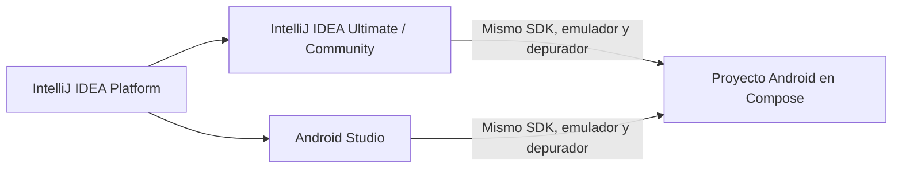
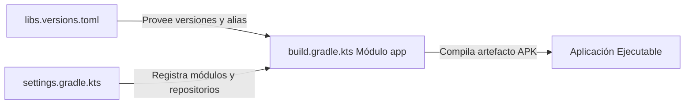

# **2.1 Primeros pasos y Proyecto de Laboratorio (`pmdm-lab-ut02`)**

En este apartado configuraremos el entorno de trabajo oficial para Android y crearemos el proyecto unificado de la unidad: **`pmdm-lab-ut02`**. A través de este proyecto aprenderemos a estructurar código nativo moderno, gestionar dependencias con Gradle y sentar las bases para todos los ejercicios del tema.

---

## 1. Entorno de Desarrollo: IntelliJ IDEA para Desarrollo Móvil

En este módulo utilizaremos **IntelliJ IDEA** como nuestro entorno de desarrollo principal para programar en Kotlin, construir aplicaciones Android y preparar el terreno hacia Kotlin Multiplatform (KMP).

Como se analiza en detalle en la [Guía de Configuración de IntelliJ IDEA para Desarrollo Móvil](../00-android/00-ide-intellij/index.md), **Android Studio está construido por Google sobre la base de código abierto de IntelliJ IDEA**. Ambos entornos comparten el mismo motor de compilación, el mismo depurador, los mismos atajos de teclado y el soporte oficial para el Android SDK y emuladores.



### 1.1. Requisitos Previos en IntelliJ IDEA

Antes de crear tu primer proyecto, asegúrate de haber seguido los pasos de configuración explicados en la [guía de IntelliJ IDEA](../00-android/00-ide-intellij/index.md):

- **Licencia Educativa Gratuita:** Los alumnos de Formación Profesional disponen de acceso gratuito a **IntelliJ IDEA Ultimate** mediante el [JetBrains Student Pack](https://www.jetbrains.com/community/education/#students).
- **Plugins Esenciales Activados:**
  - *Android* (incluido y activado por defecto en IntelliJ).
  - *Android Design Tools* (para renderizado de `@Preview` y vistas previas de Compose).
- **Android SDK y Platform-Tools:** Configurados desde el menú *Tools > Android > SDK Manager* de IntelliJ.

### 1.2. Configuración del Dispositivo de Pruebas

Para ejecutar y depurar nuestras aplicaciones disponemos de dos alternativas:

1. **Dispositivo Físico (Recomendado por consumo de recursos):**
   - Habilita las **Opciones de desarrollador** en tu teléfono (pulsando 7 veces seguidas sobre *Número de compilación* en los ajustes del sistema).
   - Activa la casilla **Depuración por USB**.
   - Conecta el dispositivo mediante cable y acepta el aviso de autorización RSA. Aparecerá de inmediato en la barra superior de dispositivos de IntelliJ IDEA.

2. **Emulador Android (AVD):**
   - Abre el **Device Manager** desde el menú lateral derecho o en *Tools > Android > Device Manager*.
   - Crea un dispositivo virtual seleccionando un perfil de hardware estándar (por ejemplo, *Pixel 8*).
   - Descarga una imagen de sistema (*System Image*) con **Google APIs** reciente (API 34 o 35) de arquitectura coincidente con tu equipo (`arm64-v8a` para procesadores ARM / Apple Silicon o `x86_64` para Intel/AMD).

??? tip "Guía paso a paso: Cómo crear y configurar el Emulador AVD en IntelliJ IDEA"

    Sigue estos pasos dentro de **IntelliJ IDEA** para disponer de un emulador listo para las prácticas:

    1. **Abrir el Device Manager:**
       - Ve al menú superior: **Tools > Android > Device Manager** (o pulsa sobre el icono del teléfono en la barra lateral derecha de herramientas).

    2. **Crear un nuevo dispositivo virtual:**
       - Haz clic en el botón **+ Create Virtual Device** (o *Create Device*).

    3. **Seleccionar el perfil de hardware:**
       - En la categoría **Phone**, elige un dispositivo estándar con Google Play Services (por ejemplo, **Pixel 8** o **Pixel 7**).
       - Pulsa en **Next**.

    4. **Descargar y seleccionar la Imagen del Sistema (System Image):**
       - Selecciona la pestaña **Recommended**.
       - Elige una versión reciente de Android: **API 34 (UpsideDownCake)** o **API 35 (VanillaIceCream)**.
       - **Atención a la arquitectura de tu procesador:**
           - Si tu ordenador tiene **Apple Silicon (M1/M2/M3/M4)** o procesador ARM: selecciona la imagen con ABI **`arm64-v8a`**.
           - Si tu ordenador tiene procesador **Intel o AMD**: selecciona la imagen con ABI **`x86_64`**.
       - Si aparece el enlace *Download* al lado de la versión, pulsa sobre él y espera a que descargue los archivos.
       - Pulsa en **Next**.

    5. **Ajustes de Rendimiento y Finalización:**
       - Puedes dejar el nombre predeterminado (ej: *Pixel 8 API 34*).
       - Despliega las opciones avanzadas (*Show Advanced Settings*):
           - **Memory and Storage:** Asigna al menos **2048 MB** (2 GB) de RAM.
           - **Emulated Performance:** Asegúrate de que *Graphics* esté en **Automatic** o **Hardware - GLES 2.0** para aprovechar la aceleración gráfica de tu tarjeta.
       - Pulsa en **Finish**.

    6. **Arranque del emulador:**
       - En la lista del *Device Manager*, pulsa el icono de **Play** (▶) del dispositivo creado.
       - El emulador arrancará y estará listo para recibir instalaciones de tu app desde el botón **Run** (▶) de IntelliJ IDEA.

---

## 2. Anatomía de un Proyecto Android Moderno

Al abrir un proyecto en IntelliJ IDEA (o Android Studio), el selector superior del panel lateral izquierdo permite alternar a la vista **Android**, ofreciendo una representación lógica y limpia del proyecto:

```
pmdm-lab-ut02/
├── app/
│   ├── manifests/
│   │   └── AndroidManifest.xml
│   ├── java/ (o kotlin/)
│   │   └── com/dam/pmdmlab/
│   │       ├── MainActivity.kt
│   │       └── ui/
│   │           └── theme/
│   └── res/
│       ├── drawable/
│       ├── values/
│       │   ├── strings.xml
│       │   └── colors.xml
│       └── xml/
└── Gradle Scripts/
    ├── build.gradle.kts (Project)
    ├── build.gradle.kts (Module: app)
    ├── settings.gradle.kts
    └── libs.versions.toml
```

### 2.1. El Archivo `AndroidManifest.xml`

Es el documento de configuración central exigido por el sistema operativo Android. Declara:

- El nombre del paquete y la identidad de la aplicación.
- Los componentes principales (Activities, Services, BroadcastReceivers).
- Los permisos necesarios (acceso a Internet, cámara, almacenamiento, etc.).
- La **Activity principal** que el lanzador del sistema debe iniciar cuando el usuario pulsa el icono de la app:

```xml
<activity
    android:name=".MainActivity"
    android:exported="true"
    android:label="@string/app_name"
    android:theme="@style/Theme.Pmdmlabut02">
    <intent-filter>
        <action android:name="android.intent.action.MAIN" />
        <category android:name="android.intent.category.LAUNCHER" />
    </intent-filter>
</activity>
```

!!! info "La etiqueta `android:exported`"

    Desde Android 12 (API 31), cualquier componente que contenga un `<intent-filter>` debe declarar explícitamente `android:exported="true"` para permitir que el lanzador del sistema operativo pueda iniciarlo desde fuera del proceso.

### 2.2. Código Fuente y Recursos en Compose

- **Código Kotlin (`java/`):** Contiene la lógica, actividades y funciones componibles.
- **Recursos (`res/`):**
  - `drawable/`: Iconos en formato vectorial XML (*Vector Drawables*) e imágenes rasterizadas.
  - `values/strings.xml`: Cadenas de texto internacionalizadas. Es una buena práctica no incluir textos estáticos a fuego (*hardcoded*) en el código.
  
!!! warning "¡Adiós a la carpeta `res/layout/`!"

    En proyectos clásicos de Android, las interfaces se definían mediante archivos XML en `res/layout/` y se vinculaban con `findViewById`. En **Jetpack Compose** esa carpeta **no existe ni se utiliza**; las interfaces de usuario se programan de forma nativa e íntegra en funciones de Kotlin.

---

## 3. Sistema de Compilación: Gradle con Kotlin DSL

El sistema de compilación oficial en Android es **Gradle**. En proyectos modernos, los scripts de construcción se escriben en **Kotlin DSL** (`.gradle.kts`) en lugar del antiguo lenguaje Groovy, y las dependencias se centralizan en el **Catálogo de Versiones** (`libs.versions.toml`).



### 3.1. El Catálogo de Versiones (`gradle/libs.versions.toml`)

Este archivo evita que tengamos versiones duplicadas o dispersas por distintos módulos. Se organiza en tres bloques principales:

- `[versions]`: Define los números de versión de las librerías, del compilador y de los plugins.
- `[libraries]`: Define las dependencias individuales asociándolas a las versiones anteriores.
- `[plugins]`: Define los plugins de compilación de Android y Kotlin.

He aquí el catálogo estándar para nuestro laboratorio:

```toml
[versions]
agp = "8.7.0"
kotlin = "2.0.20"
coreKtx = "1.13.1"
lifecycleRuntimeKtx = "2.8.6"
activityCompose = "1.9.2"
composeBom = "2024.09.03"

[libraries]
androidx-core-ktx = { group = "androidx.core", name = "core-ktx", version.ref = "coreKtx" }
androidx-lifecycle-runtime-ktx = { group = "androidx.lifecycle", name = "lifecycle-runtime-ktx", version.ref = "lifecycleRuntimeKtx" }
androidx-activity-compose = { group = "androidx.activity", name = "activity-compose", version.ref = "activityCompose" }

# Bill of Materials (BOM) de Jetpack Compose: gestiona versiones compatibles
androidx-compose-bom = { group = "androidx.compose", name = "compose-bom", version.ref = "composeBom" }
androidx-ui = { group = "androidx.compose.ui", name = "ui" }
androidx-ui-graphics = { group = "androidx.compose.ui", name = "ui-graphics" }
androidx-ui-tooling = { group = "androidx.compose.ui", name = "ui-tooling" }
androidx-ui-tooling-preview = { group = "androidx.compose.ui", name = "ui-tooling-preview" }
androidx-material3 = { group = "androidx.compose.material3", name = "material3" }

[plugins]
android-application = { id = "com.android.application", version.ref = "agp" }
kotlin-android = { id = "org.jetbrains.kotlin.android", version.ref = "kotlin" }
kotlin-compose = { id = "org.jetbrains.kotlin.plugin.compose", version.ref = "kotlin" }
```

### 3.2. Configuración del Módulo de la App (`app/build.gradle.kts`)

Este archivo aplica los plugins y consume las librerías declaradas en el catálogo de versiones:

```kotlin
plugins {
    alias(libs.plugins.android.application)
    alias(libs.plugins.kotlin.android)
    alias(libs.plugins.kotlin.compose)
}

android {
    namespace = "com.dam.pmdmlab"
    compileSdk = 34

    defaultConfig {
        applicationId = "com.dam.pmdmlab"
        minSdk = 26
        targetSdk = 34
        versionCode = 1
        versionName = "1.0"
    }

    buildFeatures {
        compose = true
    }
}

dependencies {
    implementation(libs.androidx.core.ktx)
    implementation(libs.androidx.lifecycle.runtime.ktx)
    implementation(libs.androidx.activity.compose)

    // Al importar el BOM, el resto de dependencias de Compose NO necesitan indicar versión
    implementation(platform(libs.androidx.compose.bom))
    implementation(libs.androidx.ui)
    implementation(libs.androidx.ui.graphics)
    implementation(libs.androidx.ui.tooling.preview)
    implementation(libs.androidx.material3)

    // Herramientas de depuración solo activas en modo Debug
    debugImplementation(libs.androidx.ui.tooling)
}
```

---

## 4. Cómo Añadir Nuevas Dependencias Durante el Curso

Cuando una práctica específica requiera una funcionalidad que no viene en el catálogo inicial (por ejemplo, el paquete completo de iconos de Material Design), el procedimiento es siempre el mismo:

1. **Declarar la librería en `gradle/libs.versions.toml`:**
   Localiza la sección `[libraries]` y añade la nueva referencia:
   ```toml
   [libraries]
   androidx-material-icons-extended = { group = "androidx.compose.material", name = "material-icons-extended" }
   ```

2. **Invocar la dependencia en `app/build.gradle.kts`:**
   Dentro del bloque `dependencies { ... }`:
   ```kotlin
   dependencies {
       // ... dependencias anteriores
       implementation(libs.androidx.material.icons.extended)
   }
   ```

3. **Sincronizar el proyecto (*Sync Now*):**
   Pulsa en la barra flotante de notificación superior que muestra IntelliJ IDEA con el botón **Sync Now** o haz clic en el icono de recarga de Gradle (*Reload All Gradle Projects*) en la pestaña lateral derecha de herramientas de Gradle. Gradle descargará e indexará los paquetes correspondientes.

---

## 5. Puesta en Marcha del Proyecto `pmdm-lab-ut02`

Para evitar crear múltiples proyectos sueltos, crearemos una única aplicación que contendrá todos los ejercicios prácticos de este tema mediante un menú selector de retos.

### 5.1. Creación del Proyecto en IntelliJ IDEA

1. Abre **IntelliJ IDEA** y selecciona **New Project**.
2. En el panel izquierdo de generadores, selecciona la categoría **Android**.
3. Selecciona la plantilla **Empty Activity** (con soporte nativo para Jetpack Compose).
4. Configura los parámetros:

   - **Name:** `pmdm-lab-ut02`
   - **Package name:** `com.dam.pmdmlab`
   - **Save location:** Tu directorio de prácticas habitual.
   - **Language:** Kotlin.
   - **Minimum SDK:** API 26 (Android 8.0) o superior.
   - **Build configuration language:** Kotlin DSL (`build.gradle.kts`).
   
5. Pulsa en **Finish** (o *Create*) y espera a que la primera sincronización de Gradle finalice con éxito.

### 5.2. Estructura de Paquetes Recomendada

Organiza el directorio `app/src/main/java/com/dam/pmdmlab/` creando los siguientes paquetes:

```
com.dam.pmdmlab/
├── MainActivity.kt               // Punto de entrada del sistema
├── ui/
│   ├── theme/                   // Colores, tipografía y tema visual
│   ├── menu/
│   │   └── LabMenuScreen.kt     // Pantalla con botones para acceder a cada reto
│   └── retos/
│       ├── reto01_ciclovida/    // Práctica de Ciclo de Vida y Logs
│       └── reto02_tarjeta/      // Práctica de Presentación y Previews
```

En los siguientes apartados implementaremos el ciclo de vida, las pantallas y los componibles que integrarán este laboratorio.
