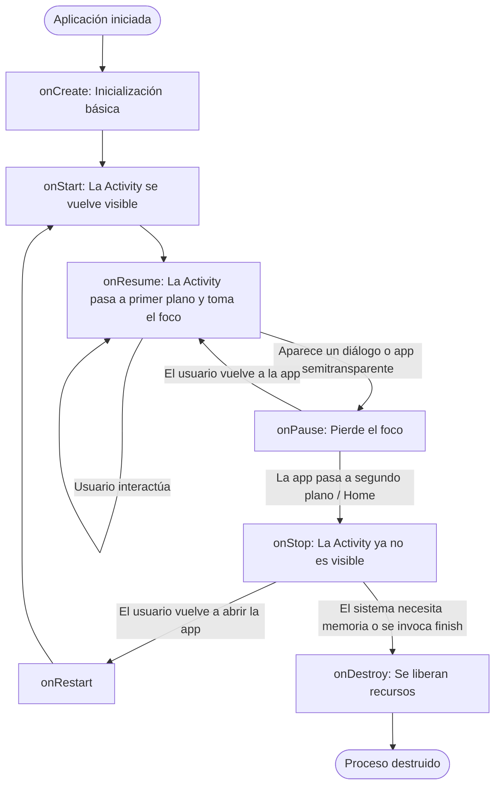
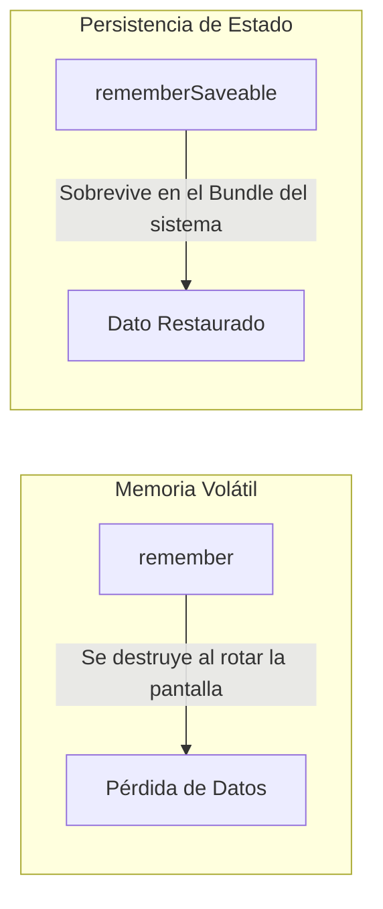

# **2.2 Ciclo de vida de una aplicación Android moderna**

A diferencia de un programa de consola o una aplicación de escritorio tradicional que cuenta con un único punto de entrada `main()` predecible, una aplicación Android está sujeta al control dinámico del sistema operativo. Android puede pausar, detener o destruir componentes de nuestra aplicación en cualquier momento para liberar memoria RAM o gestionar llamadas entrantes.

Comprender el ciclo de vida de una **Activity** y cómo interactúa con el árbol de componibles de **Jetpack Compose** es indispensable para evitar fugas de memoria y pérdidas accidentales de datos del usuario.

---

## 1. La Activity en el Ecosistema Moderno

Una **Activity** representa una única ventana o superficie gráfica donde el usuario interactúa con la aplicación. En el paradigma tradicional basado en XML se utilizaban múltiples Activities o Fragmentos para navegar entre pantallas. 

En la arquitectura moderna recomendada por Google, se adopta el patrón **Single-Activity Architecture**: la aplicación cuenta con una única Activity principal (`MainActivity`), y toda la navegación e interfaces se gestionan como funciones componibles declarativas de Compose.

### De `AppCompatActivity` a `ComponentActivity`

Históricamente, las aplicaciones Android heredaban de `AppCompatActivity` para dar soporte a temas antiguos yActionBar. En Compose moderno se hereda directamente de **`ComponentActivity`**, la cual proporciona soporte nativo para `setContent { ... }` y los componentes de arquitectura modernos:

=== "Moderno (Jetpack Compose)"

    ```kotlin
    package com.dam.pmdmlab

    import android.os.Bundle
    import androidx.activity.ComponentActivity
    import androidx.activity.compose.setContent
    import com.dam.pmdmlab.ui.theme.PMDMLabTheme

    class MainActivity : ComponentActivity() {
        override fun onCreate(savedInstanceState: Bundle?) {
            super.onCreate(savedInstanceState)
            // setContent enlaza directamente el árbol de Compose a la Activity
            setContent {
                PMDMLabTheme {
                    // Aquí se inserta el Composable raíz de la app
                }
            }
        }
    }
    ```

=== "Histórico / Obsoleto (XML Views)"

    ```kotlin
    // NO UTILIZAR: Patrón imperativo antiguo
    class MainActivity : AppCompatActivity() {
        override fun onCreate(savedInstanceState: Bundle?) {
            super.onCreate(savedInstanceState)
            setContentView(R.layout.activity_main) // Inflaba un layout XML
            val miBoton = findViewById<Button>(R.id.miBoton) // Búsqueda manual de vistas
        }
    }
    ```

---

## 2. Estados y Métodos del Ciclo de Vida de la Activity

Una Activity transita por una máquina de estados gestionada por el sistema operativo:



### Descripción de los Métodos del Ciclo de Vida

- **`onCreate()`:** Se ejecuta una sola vez cuando la Activity se instancia en memoria. Aquí se configura la interfaz con `setContent { ... }` y se inicializan recursos estáticos.
- **`onStart()`:** La Activity se vuelve visible en pantalla para el usuario, aunque todavía no tiene el foco para interactuar con ella.
- **`onResume()`:** La Activity pasa a primer plano (*foreground*) y adquiere el foco interactivo completo. Es el momento idóneo para reanudar animaciones o la captura de sensores.
- **`onPause()`:** La Activity pierde el foco interactivo parcial (por ejemplo, al abrir el menú de aplicaciones recientes o aparecer un diálogo modal del sistema). Debe pausar operaciones que consuman CPU intensiva.
- **`onStop()`:** La Activity deja de ser completamente visible porque el usuario ha pulsado el botón *Home* o ha cambiado de aplicación.
- **`onDestroy()`:** Se invoca antes de que la Activity sea destruida por completo (porque el usuario pulsó *Atrás* para salir o porque el sistema necesita memoria RAM urgentemente).

---

## 3. Depuración del Ciclo de Vida con Logcat

Para inspeccionar la ejecución de nuestra aplicación en tiempo real utilizamos la clase `android.util.Log` y la herramienta **Logcat** integrada en IntelliJ IDEA (pestaña inferior *Logcat*):

```kotlin
import android.util.Log

class MainActivity : ComponentActivity() {

    companion object {
        private const val TAG = "CicloVidaDemo"
    }

    override fun onCreate(savedInstanceState: Bundle?) {
        super.onCreate(savedInstanceState)
        Log.d(TAG, "onCreate: Activity creada")
    }

    override fun onStart() {
        super.onStart()
        Log.d(TAG, "onStart: Activity visible")
    }

    override fun onResume() {
        super.onResume()
        Log.d(TAG, "onResume: Activity en primer plano con foco")
    }

    override fun onPause() {
        super.onPause()
        Log.d(TAG, "onPause: Activity perdiendo el foco")
    }

    override fun onStop() {
        super.onStop()
        Log.d(TAG, "onStop: Activity en segundo plano (no visible)")
    }

    override fun onDestroy() {
        super.onDestroy()
        Log.d(TAG, "onDestroy: Activity destruida")
    }
}
```

!!! tip "Filtrar mensajes en Logcat"

    En la pestaña inferior **Logcat** de IntelliJ IDEA, escribe en la barra de búsqueda: `tag:CicloVidaDemo`. Esto ocultará los miles de mensajes internos del sistema operativo y mostrará exclusivamente los logs de tu aplicación.

---

## 4. El Ciclo de Vida desde la Perspectiva de Jetpack Compose

En Compose existen dos conceptos cruciales que cambian radicalmente la forma de pensar sobre el ciclo de vida:

### 4.1. Recomposición vs Ciclo de Vida del Sistema

- **Recomposición:** Es el proceso interno mediante el cual Compose vuelve a ejecutar únicamente las funciones `@Composable` que leen un estado que ha cambiado. La Activity **no se reinicia ni se destruye**. Es una operación ligera y reactiva en memoria.
- **Cambio de Configuración (Rotación de Pantalla):** Cuando el usuario gira el teléfono entre orientación vertical y horizontal, el sistema operativo Android **destruye y recrea la Activity por completo** (`onPause` -> `onStop` -> `onDestroy` -> `onCreate`).



### 4.2. `remember` vs `rememberSaveable`

Este es el primer gran reto que afrontan los desarrolladores noveles en Compose:

- **`remember { mutableStateOf(...) }`:** Conserva el valor únicamente durante las **recomposiciones** normales de la pantalla. Si el usuario rota el dispositivo, la Activity se destruye y el valor vuelve a su estado inicial por defecto.
- **`rememberSaveable { mutableStateOf(...) }`:** Guarda automáticamente el valor en el `Bundle` de estado guardado de Android. Cuando la Activity se destruye por rotación o por presión de memoria del sistema, el valor **se recupera y sobrevive de forma transparente**.

```kotlin
// Este valor volverá a 0 si el usuario gira el dispositivo
var contadorVolatil by remember { mutableIntStateOf(0) }

// Este valor conservará la cuenta intacta incluso al rotar la pantalla
var contadorPersistente by rememberSaveable { mutableIntStateOf(0) }
```

---

## 5. Práctica de Laboratorio: Codelab 1

Para experimentar en primera persona con la instrumentación de logs en el ciclo de vida, la herramienta Logcat y el contraste entre `remember` y `rememberSaveable` ante rotaciones de pantalla, realiza el primer codelab guiado del proyecto `pmdm-lab-ut02`:

!!! tip "Codelab 1: Ciclo de Vida en Android y Depuración con Logcat"

    En este codelab paso a paso aprenderás a:

    - Instrumentar los métodos del ciclo de vida en `MainActivity.kt` (`onCreate`, `onStart`, `onResume`, `onPause`, `onStop`, `onDestroy`) mediante `Log.d` y etiquetas `TAG` idiomáticas con `companion object`.
    - Configurar y dominar los filtros de la consola **Logcat** en IntelliJ IDEA / Android Studio (`tag:CicloVidaDemo`, severidad *Debug*).
    - Desarrollar la pantalla `CicloVidaScreen` aplicando el patrón arquitectónico profesional **Stateless Content** (`CicloVidaContent`) vs **Stateful Screen** (`CicloVidaScreen`).
    - Ejecutar dos experimentos de depuración en el emulador: navegación a segundo plano con el botón Home y cambio de configuración rotando el dispositivo.

    👉 **[Acceder al Codelab 1: Ciclo de Vida en Android y Depuración con Logcat](./codelabs/01-ciclo-vida-logcat.md)**

