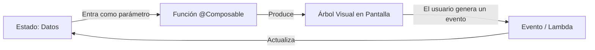
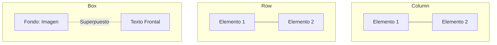
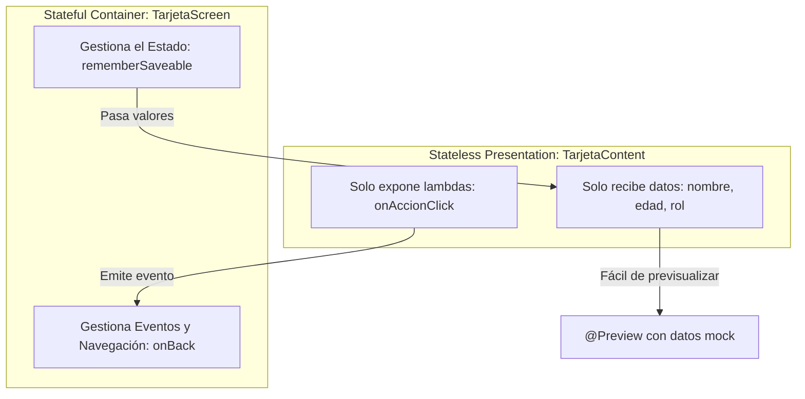

# **2.3 Primera aplicación y Metodología @Preview en Compose**

En este apartado construiremos nuestra primera interfaz interactiva utilizando las herramientas declarativas de Jetpack Compose. Aprenderemos uno de los patrones arquitectónicos más importantes del desarrollo frontend moderno: la separación entre **pantallas con estado (*Stateful*)** y **componentes de presentación sin estado (*Stateless*)**, así como el uso intensivo de la anotación **`@Preview`** para acelerar el desarrollo sin depender constantemente del emulador.

---

## 1. El Paradigma Declarativo: `UI = f(State)`

En los sistemas tradicionales imperativos (como las vistas XML de Android o el DOM en JavaScript estándar), el programador debía obtener una referencia al elemento visual mediante su identificador y mutar sus propiedades manualmente:

```kotlin
// Paradigma IMPERATIVO (antiguo): Propenso a inconsistencias y nulos
miBoton.setOnClickListener {
    miTexto.text = "Has pulsado el botón"
    miTexto.setTextColor(Color.RED)
}
```

En **Jetpack Compose**, la interfaz de usuario se concibe como una función matemática directa del estado actual de la aplicación:

> **UI = f(State)**



Cuando el estado cambia, el compilador ejecuta de forma inteligente la **recomposición**: vuelve a invocar las funciones `@Composable` necesarias para actualizar los píxeles en pantalla con los nuevos valores, sin que tengamos que modificar vistas manualmente.

---

## 2. Anatomía de una Función Composable

Una función componible es una función estándar de Kotlin anotada con **`@Composable`**:

- No devuelve ningún valor (`Unit`).
- Puede emitir elementos visuales en pantalla (`Text`, `Button`, `Image`).
- Puede invocar a otras funciones componibles dentro de su cuerpo.
- Solo puede ser ejecutada dentro de otra función componible o dentro del bloque `setContent { ... }` de una Activity.

```kotlin
@Composable
fun Saludo(nombre: String, modifier: Modifier = Modifier) {
    Text(
        text = "¡Hola, $nombre!",
        modifier = modifier
    )
}
```

!!! tip "La convención del `Modifier`"

    Siempre que crees una función componible reutilizable, incluye como último parámetro opcional un `modifier: Modifier = Modifier`. Esto permite que quien invoque el componente pueda personalizar su tamaño, espaciado exterior (*padding*) o comportamiento sin romper la encapsulación interna.

### 2.1. Contenedores de Disposición Básicos y Modificadores

Para colocar varios elementos en pantalla de forma ordenada, Compose proporciona tres contenedores esenciales:

- **`Column`:** Apila sus elementos hijos en una columna vertical, de arriba a abajo.
- **`Row`:** Alinea sus elementos hijos en una fila horizontal, de izquierda a derecha.
- **`Box`:** Superpone los elementos unos encima de otros en capas (el primer elemento queda al fondo y los siguientes se colocan encima).
- **`Spacer`:** Se utiliza entre elementos para generar huecos de separación vacíos con un tamaño específico (ej: `Spacer(modifier = Modifier.height(16.dp))`).



#### ¿Qué es un `Modifier`?

Los **Modificadores** (`Modifier`) son la herramienta fundamental de Compose para alterar la apariencia y el comportamiento de cualquier componible. Permiten:

- **Ajustar dimensiones:** `Modifier.fillMaxSize()` (ocupa toda la pantalla), `Modifier.fillMaxWidth()` (ocupa todo el ancho), `Modifier.size(64.dp)`.
- **Añadir espaciado interior (*padding*):** `Modifier.padding(16.dp)` (separa el contenido del borde).
- **Controlar alineaciones:** `horizontalAlignment = Alignment.CenterHorizontally`, `verticalArrangement = Arrangement.Center`.

!!! info "Ampliación de Conceptos: Diseño y Modificadores"

    En este tema utilizamos `Column`, `Row` y `Modifier` de forma intuitiva para organizar los elementos visuales de nuestras primeras pantallas.
    
    Para consultar la documentación exhaustiva sobre la anatomía interna de los modificadores, su orden de encadenamiento y contenedores avanzados, puedes revisar los apuntes de referencia: **[Funciones Componibles y Modificadores](../00-android/00-compose/21-composable-functions.md)**.
    
    El diseño profundo de interfaces, navegación y el sistema completo de **Material Design 3** se profundizarán a partir de la **UT3: Interfaz de Usuario**.

---

## 3. Patrón de Diseño: Stateful Screen vs Stateless Content

Para crear código limpio, mantenible y testeable, es una regla de oro separar cada pantalla en dos componentes complementarios:



### 3.1. Componente de Contenido (*Stateless Content*)
- **No almacena estado interno mutable.** Recibe todos los datos que necesita pintar a través de sus argumentos.
- **No ejecuta lógica de negocio directa.** Cuando el usuario interactúa (por ejemplo, pulsa un botón), emite un evento hacia arriba mediante una función lambda (`() -> Unit`).
- **Ventaja fundamental:** Es 100% predecible y se puede previsualizar en IntelliJ IDEA al instante pasando datos de prueba (*mock data*).

### 3.2. Pantalla Contenedora (*Stateful Screen*)
- Aloja la llamada a `remember` o `rememberSaveable` (o a un *ViewModel* en temas avanzados).
- Conecta los eventos del usuario con los cambios de estado.
- Maneja la navegación y la interacción con el sistema.

---

## 4. El Patrón de Ranuras (*Slot APIs*) y el Concepto de `content`

Muchas veces queremos construir componentes genéricos que sirvan como envoltorio visual (por ejemplo, una tarjeta con borde elegante o una cabecera con botón de retroceso) pero cuyo contenido interno varíe.

Para ello, utilizamos el patrón **Slot API**, donde pasamos un parámetro de tipo función componible: `content: @Composable () -> Unit`:

```kotlin
@Composable
fun MarcoElegante(
    titulo: String,
    modifier: Modifier = Modifier,
    content: @Composable () -> Unit // Parámetro slot
) {
    Card(modifier = modifier.padding(8.dp)) {
        Column(modifier = Modifier.padding(16.dp)) {
            Text(text = titulo, style = MaterialTheme.typography.titleMedium)
            Spacer(modifier = Modifier.height(8.dp))
            // Se inserta aquí el contenido dinámico pasado por el llamador
            content()
        }
    }
}
```

---

## 5. Dominio de la Anotación `@Preview`

La anotación `@Preview` es una de las mayores ventajas de Jetpack Compose frente al desarrollo móvil clásico. Permite renderizar y probar componentes directamente en el editor de IntelliJ IDEA sin necesidad de compilar la app completa ni arrancar el emulador.

### 5.1. Previews Múltiples con Datos Mock

Al separar nuestro componente en un *Content Stateless*, podemos crear tantas vistas previas como estados posibles tenga la pantalla:

```kotlin
// Preview estándar en Modo Claro
@Preview(name = "Usuario Estándar", showBackground = true)
@Composable
private fun PerfilNormalPreview() {
    PMDMLabTheme {
        TarjetaPerfilContent(
            nombre = "Carlos García",
            rol = "Estudiante 2º DAM",
            nivelExperiencia = 1,
            onSubirNivel = {}
        )
    }
}

// Preview en Modo Oscuro con datos diferentes
@Preview(
    name = "Usuario Avanzado - Modo Oscuro",
    showBackground = true,
    uiMode = android.content.res.Configuration.UI_MODE_NIGHT_YES
)
@Composable
private fun PerfilAvanzadoDarkPreview() {
    PMDMLabTheme {
        TarjetaPerfilContent(
            nombre = "Elena Martínez",
            rol = "Arquitecta de Software",
            nivelExperiencia = 99,
            onSubirNivel = {}
        )
    }
}
```

### 5.2. Modo Interactivo de la Preview (*Interactive Mode*)

En la esquina superior de cada panel de vista previa en IntelliJ IDEA encontrarás el icono de **Interactive Mode** (con forma de mano o de rayo/play).

Al activarlo:
- El lienzo de la vista previa deja de ser una imagen estática.
- Puedes hacer clic sobre botones, escribir en campos de texto y observar animaciones y cambios de estado locales.
- **Todo se ejecuta en tiempo real en la JVM de tu ordenador**, ahorrándote minutos de espera en el emulador.

---

## 6. Práctica Guiada 2: Tarjeta Interactiva con Previews

Vamos a incorporar el segundo reto al proyecto `pmdm-lab-ut02`.

Crea el archivo `app/src/main/java/com/dam/pmdmlab/ui/retos/reto02_tarjeta/TarjetaPresentacionScreen.kt`:

```kotlin
package com.dam.pmdmlab.ui.retos.reto02_tarjeta

import androidx.compose.foundation.layout.Arrangement
import androidx.compose.foundation.layout.Column
import androidx.compose.foundation.layout.Row
import androidx.compose.foundation.layout.Spacer
import androidx.compose.foundation.layout.fillMaxSize
import androidx.compose.foundation.layout.fillMaxWidth
import androidx.compose.foundation.layout.height
import androidx.compose.foundation.layout.padding
import androidx.compose.foundation.layout.width
import androidx.compose.material3.Button
import androidx.compose.material3.Card
import androidx.compose.material3.CardDefaults
import androidx.compose.material3.MaterialTheme
import androidx.compose.material3.OutlinedButton
import androidx.compose.material3.Surface
import androidx.compose.material3.Text
import androidx.compose.runtime.Composable
import androidx.compose.runtime.getValue
import androidx.compose.runtime.mutableIntStateOf
import androidx.compose.runtime.saveable.rememberSaveable
import androidx.compose.runtime.setValue
import androidx.compose.ui.Alignment
import androidx.compose.ui.Modifier
import androidx.compose.ui.tooling.preview.Preview
import androidx.compose.ui.unit.dp

// ============================================================================
// 1. COMPONENTE DE PRESENTACIÓN (STATELESS CONTENT)
// ============================================================================
@Composable
fun TarjetaPresentacionContent(
    nombre: String,
    especialidad: String,
    contadorProyectos: Int,
    onSumarProyecto: () -> Unit,
    onReiniciar: () -> Unit,
    onBack: () -> Unit,
    modifier: Modifier = Modifier
) {
    Column(
        modifier = modifier
            .fillMaxSize()
            .padding(16.dp),
        horizontalAlignment = Alignment.CenterHorizontally,
        verticalArrangement = Arrangement.Center
    ) {
        Card(
            modifier = Modifier.fillMaxWidth(0.9f),
            elevation = CardDefaults.cardElevation(defaultElevation = 6.dp)
        ) {
            Column(
                modifier = Modifier.padding(20.dp),
                horizontalAlignment = Alignment.CenterHorizontally
            ) {
                Text(
                    text = nombre,
                    style = MaterialTheme.typography.headlineMedium
                )
                Text(
                    text = especialidad,
                    style = MaterialTheme.typography.bodyMedium,
                    color = MaterialTheme.colorScheme.secondary
                )

                Spacer(modifier = Modifier.height(16.dp))

                Surface(
                    color = MaterialTheme.colorScheme.primaryContainer,
                    shape = MaterialTheme.shapes.small
                ) {
                    Text(
                        text = "Proyectos completados: $contadorProyectos",
                        modifier = Modifier.padding(horizontal = 12.dp, vertical = 6.dp),
                        style = MaterialTheme.typography.labelLarge
                    )
                }

                Spacer(modifier = Modifier.height(20.dp))

                Row(
                    modifier = Modifier.fillMaxWidth(),
                    horizontalArrangement = Arrangement.SpaceEvenly
                ) {
                    Button(onClick = onSumarProyecto) {
                        Text("+1 Proyecto")
                    }
                    OutlinedButton(onClick = onReiniciar) {
                        Text("Reiniciar")
                    }
                }
            }
        }

        Spacer(modifier = Modifier.height(32.dp))

        OutlinedButton(onClick = onBack) {
            Text("Volver al Menú Principal")
        }
    }
}

// ============================================================================
// 2. VISTAS PREVIAS (@PREVIEW) CON DATOS MOCK
// ============================================================================
@Preview(name = "Tarjeta Inicial - Claro", showBackground = true)
@Composable
private fun TarjetaPresentacionPreviewInicial() {
    Surface {
        TarjetaPresentacionContent(
            nombre = "Ada Lovelace",
            especialidad = "Desarrolladora Kotlin",
            contadorProyectos = 0,
            onSumarProyecto = {},
            onReiniciar = {},
            onBack = {}
        )
    }
}

@Preview(name = "Tarjeta Activa - Varios Proyectos", showBackground = true)
@Composable
private fun TarjetaPresentacionPreviewConDatos() {
    Surface {
        TarjetaPresentacionContent(
            nombre = "Alan Turing",
            especialidad = "Ingeniero de Sistemas",
            contadorProyectos = 12,
            onSumarProyecto = {},
            onReiniciar = {},
            onBack = {}
        )
    }
}

// ============================================================================
// 3. PANTALLA CONTENEDORA (STATEFUL SCREEN)
// ============================================================================
@Composable
fun TarjetaPresentacionScreen(
    onBack: () -> Unit,
    modifier: Modifier = Modifier
) {
    // El estado sobrevive a giros de pantalla gracias a rememberSaveable
    var proyectos by rememberSaveable { mutableIntStateOf(0) }

    TarjetaPresentacionContent(
        nombre = "Mi Nombre de Alumno",
        especialidad = "Estudiante 2º DAM - PMDM",
        contadorProyectos = proyectos,
        onSumarProyecto = { proyectos++ },
        onReiniciar = { proyectos = 0 },
        onBack = onBack,
        modifier = modifier
    )
}
```

---

!!! info "Nota Pedagógica sobre el Diseño Visual"

    En esta práctica hemos utilizado componentes de interfaz elementales (`Card`, `Text`, `Button`, `Surface`) para ilustrar el paso de datos y las previews. 
    
    El catálogo completo de componentes de diseño, sistemas tipográficos avanzados, paletas dinámicas de color con **Material Design 3 (Material You)** y maquetaciones adaptativas para tablets y pantallas plegables se estudiará exhaustivamente en la **UT3: Interfaz de Usuario**.