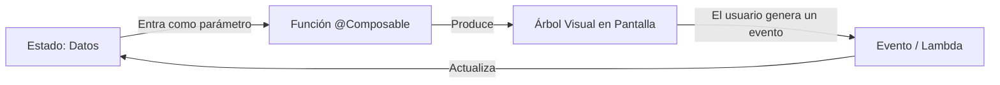
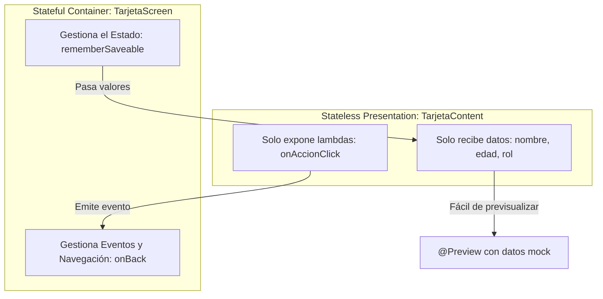

# **2.3 Primera aplicación y Metodología @Preview en Compose**

En este apartado construiremos nuestra primera interfaz interactiva utilizando las herramientas declarativas de Jetpack Compose. Aprenderemos uno de los patrones arquitectónicos más importantes del desarrollo frontend moderno: la separación entre **pantallas con estado (*Stateful*)** y **componentes de presentación sin estado (*Stateless*)**, así como el uso intensivo de la anotación **`@Preview`** para acelerar el desarrollo sin depender constantemente del emulador.

---

## 1. El Paradigma Declarativo: `UI = f(State)`

En los sistemas tradicionales imperativos (como las vistas XML de Android o el DOM en JavaScript estándar), el programador debía obtener una referencia al elemento visual mediante su identificador y mutar sus propiedades manualmente:

```kotlin
// Paradigma IMPERATIVO (antiguo): Propenso a inconsistencias y nulos
miBoton.setOnClickListener {
    miTexto.text = "Has pulsado el botón"
    miTexto.setTextColor(Color.RED)
}
```

En **Jetpack Compose**, la interfaz de usuario se concibe como una función matemática directa del estado actual de la aplicación:

> **UI = f(State)**



Cuando el estado cambia, el compilador ejecuta de forma inteligente la **recomposición**: vuelve a invocar las funciones `@Composable` necesarias para actualizar los píxeles en pantalla con los nuevos valores, sin que tengamos que modificar vistas manualmente.

---

## 2. Anatomía de una Función Composable

Una función componible es una función estándar de Kotlin anotada con **`@Composable`**:

- No devuelve ningún valor (`Unit`).
- Puede emitir elementos visuales en pantalla (`Text`, `Button`, `Image`).
- Puede invocar a otras funciones componibles dentro de su cuerpo.
- Solo puede ser ejecutada dentro de otra función componible o dentro del bloque `setContent { ... }` de una Activity.

```kotlin
@Composable
fun Saludo(nombre: String, modifier: Modifier = Modifier) {
    Text(
        text = "¡Hola, $nombre!",
        modifier = modifier
    )
}
```

!!! tip "La convención del `Modifier`"

    Siempre que crees una función componible reutilizable, incluye un `modifier: Modifier = Modifier` como **primer parámetro opcional** (después de los obligatorios) y aplícalo al elemento raíz. Esto permite que quien invoque el componente pueda personalizar su tamaño, espaciado exterior (*padding*) o comportamiento sin romper la encapsulación interna.

### 2.1. Contenedores de Disposición Básicos y Modificadores

Para colocar varios elementos en pantalla, Compose ofrece tres contenedores esenciales y un mecanismo para configurarlos:

- **`Column`:** apila sus hijos en vertical, de arriba a abajo.
- **`Row`:** coloca sus hijos en horizontal, de izquierda a derecha.
- **`Box`:** superpone sus hijos en capas; el primero queda al fondo.
- **`Modifier`:** cadena de decoradores que da tamaño, espaciado, fondo, borde o interacción a cualquier composable. **El orden de la cadena cambia el resultado.**

```kotlin
Column(
    modifier = Modifier.fillMaxSize().padding(16.dp),
    verticalArrangement = Arrangement.spacedBy(8.dp),
    horizontalAlignment = Alignment.CenterHorizontally
) {
    Text("¡Hola, Compose!")
    Row(horizontalArrangement = Arrangement.spacedBy(8.dp)) {
        Button(onClick = {}) { Text("Aceptar") }
        OutlinedButton(onClick = {}) { Text("Cancelar") }
    }
}
```

!!! example "Apartado dedicado con playgrounds interactivos"
    Todos estos conceptos se explican paso a paso en **[2.3.1 Maquetación básica: `Column`, `Row`, `Box` y `Modifier`](./2.3.1-layouts-modificadores.md)**: ejes principal y cruzado, `Arrangement` y `Alignment`, `weight` y `Spacer`, el orden de los modificadores, errores frecuentes y retos. Incluye dos playgrounds para experimentar con las alineaciones y con las cadenas de modificadores directamente en el navegador.

---

## 3. Patrón de Diseño: Stateful Screen vs Stateless Content

Para crear código limpio, mantenible y testeable, es una regla de oro separar cada pantalla en dos componentes complementarios:



### 3.1. Componente de Contenido (*Stateless Content*)
- **No almacena estado interno mutable.** Recibe todos los datos que necesita pintar a través de sus argumentos.
- **No ejecuta lógica de negocio directa.** Cuando el usuario interactúa (por ejemplo, pulsa un botón), emite un evento hacia arriba mediante una función lambda (`() -> Unit`).
- **Ventaja fundamental:** Es 100% predecible y se puede previsualizar en IntelliJ IDEA al instante pasando datos de prueba (*mock data*).

### 3.2. Pantalla Contenedora (*Stateful Screen*)
- Aloja la llamada a `remember` o `rememberSaveable` (o a un *ViewModel* en temas avanzados).
- Conecta los eventos del usuario con los cambios de estado.
- Maneja la navegación y la interacción con el sistema.

---

## 4. El Patrón de Ranuras (*Slot APIs*) y el Concepto de `content`

Muchas veces queremos construir componentes genéricos que sirvan como envoltorio visual (por ejemplo, una tarjeta con borde elegante o una cabecera con botón de retroceso) pero cuyo contenido interno varíe.

Para ello, utilizamos el patrón **Slot API**, donde pasamos un parámetro de tipo función componible: `content: @Composable () -> Unit`:

```kotlin
@Composable
fun MarcoElegante(
    titulo: String,
    modifier: Modifier = Modifier,
    content: @Composable () -> Unit // Parámetro slot
) {
    Card(modifier = modifier.padding(8.dp)) {
        Column(modifier = Modifier.padding(16.dp)) {
            Text(text = titulo, style = MaterialTheme.typography.titleMedium)
            Spacer(modifier = Modifier.height(8.dp))
            // Se inserta aquí el contenido dinámico pasado por el llamador
            content()
        }
    }
}
```

---

## 5. Dominio de la Anotación `@Preview`

La anotación `@Preview` es una de las mayores ventajas de Jetpack Compose frente al desarrollo móvil clásico. Permite renderizar y probar componentes directamente en el editor de IntelliJ IDEA sin necesidad de compilar la app completa ni arrancar el emulador.

### 5.1. Previews Múltiples con Datos Mock

Al separar nuestro componente en un *Content Stateless*, podemos crear tantas vistas previas como estados posibles tenga la pantalla:

```kotlin
// Preview estándar en Modo Claro
@Preview(name = "Usuario Estándar", showBackground = true)
@Composable
private fun PerfilNormalPreview() {
    PMDMLabTheme {
        TarjetaPerfilContent(
            nombre = "Carlos García",
            rol = "Estudiante 2º DAM",
            nivelExperiencia = 1,
            onSubirNivel = {}
        )
    }
}

// Preview en Modo Oscuro con datos diferentes
@Preview(
    name = "Usuario Avanzado - Modo Oscuro",
    showBackground = true,
    uiMode = android.content.res.Configuration.UI_MODE_NIGHT_YES
)
@Composable
private fun PerfilAvanzadoDarkPreview() {
    PMDMLabTheme {
        TarjetaPerfilContent(
            nombre = "Elena Martínez",
            rol = "Arquitecta de Software",
            nivelExperiencia = 99,
            onSubirNivel = {}
        )
    }
}
```

### 5.2. Modo Interactivo de la Preview (*Interactive Mode*)

En la esquina superior de cada panel de vista previa en IntelliJ IDEA encontrarás el icono de **Interactive Mode** (con forma de mano o de rayo/play).

Al activarlo:
- El lienzo de la vista previa deja de ser una imagen estática.
- Puedes hacer clic sobre botones, escribir en campos de texto y observar animaciones y cambios de estado locales.
- **Todo se ejecuta en tiempo real en la JVM de tu ordenador**, ahorrándote minutos de espera en el emulador.

---

## 6. Prácticas de Laboratorio: Codelabs 2 y 3

Para consolidar la teoría de este apartado mediante ejercicios guiados paso a paso en el proyecto `pmdm-lab-ut02`:

1. **[Codelab 2: Mi Primer Composable: Contador de Clics y Recomposición](./codelabs/02-contador-incremental.md):**  
   Comprueba por qué una variable normal de Kotlin no actualiza la pantalla, aprende a usar `mutableIntStateOf`, `rememberSaveable`, la delegación `by` y a deshabilitar botones condicionalmente con `enabled`.

2. **[Codelab 3: Tarjeta de Presentación y Metodología @Preview](./codelabs/03-tarjeta-presentacion.md):**  
   Aprende a maquetar una tarjeta profesional usando `Column`, `Row`, `Card`, `Surface` y `Spacer`, separando el contenido visual (*Stateless*) de su contenedor (*Stateful*), y explorando vistas previas múltiples con datos mock y modo oscuro.

---

## 7. Itinerario de Prácticas y Siguientes Pasos

Una vez asimilados los conceptos fundamentales de los apartados 2.1, 2.2 y 2.3, continúa consolidando tus competencias en el **[2.4 Laboratorio de Prácticas y Codelabs](./2.4-laboratorio-retos.md)** del proyecto `pmdm-lab-ut02`:

- **[Codelab 4: Lanzador de Dados (*Dice Roller*) e Interactividad](./codelabs/04-dado-interactivo.md):** Dominio de eventos en `Button`, generación de números aleatorios con `(1..6).random()` y contadores de tiradas acumuladas.
- **[Codelab 5: Semáforo Inteligente y Máquinas de Estados](./codelabs/05-semaforo-estados.md):** Modelado formal de estados discretos con `enum class`, figuras geométricas circulares (`CircleShape`) y cambios de opacidad lumínica reactiva (`alpha`).
- **Retos Autónomos sin resolver:** Demuestra tu autonomía resolviendo la **Lemonade App** y el **Marcador Deportivo de Baloncesto**.

---

## 8. Recursos y Enlaces a la Documentación Oficial de Android

Para seguir profundizando en la maquetación declarativa y las buenas prácticas oficiales de Google, consulta los siguientes recursos:

=== "Diseño y Maquetación (Layouts)"

    - [Documentación oficial de Jetpack Compose Layouts](https://developer.android.com/develop/ui/compose/layouts/basics?hl=es-419): Fundamentos de `Column`, `Row`, `Box` y jerarquías visuales en Android.
    - [API de `androidx.compose.foundation.layout`](https://developer.android.com/reference/kotlin/androidx/compose/foundation/layout/package-summary): Paquete oficial con todos los contenedores y scopes de maquetación (`ColumnScope`, `RowScope`, `BoxScope`).
    - [Alineación y Distribución (`Alignment` y `Arrangement`)](https://developer.android.com/develop/ui/compose/layouts/basics?hl=es-419#alignment-arrangement): Cómo espaciar y posicionar elementos dentro de filas y columnas.
    - [Líneas de alineación personalizadas](https://developer.android.com/develop/ui/compose/layouts/alignment-lines?hl=es-419): Control fino del alineamiento relativo entre elementos de texto y gráficos.

=== "Modificadores (Modifiers)"

    - [Guía oficial de Modificadores en Compose](https://developer.android.com/develop/ui/compose/modifiers?hl=es-419): Concepto, reglas de uso y orden de encadenamiento.
    - [Lista de Modificadores Comunes](https://developer.android.com/develop/ui/compose/modifiers-list?hl=es-419): Referencia rápida de modificadores visuales, táctiles y de scroll.
    - [API de `androidx.compose.ui.Modifier`](https://developer.android.com/reference/kotlin/androidx/compose/ui/Modifier): Documentación formal de la interfaz `Modifier` y métodos de composición (`then`).

=== "Metodología @Preview y Estados"

    - [Herramientas de Previsualización (@Preview)](https://developer.android.com/develop/ui/compose/tooling/previews?hl=es-419): Vistas previas en IntelliJ IDEA y Android Studio, modos interactivos y parámetros.
    - [Pensar en Compose (*Mental Model*)](https://developer.android.com/develop/ui/compose/mental-model?hl=es-419): El cambio de paradigma declarativo y el flujo de recomposición.
    - [Elevación de Estado (*State Hoisting*)](https://developer.android.com/develop/ui/compose/state?hl=es-419#state-hoisting): Patrón de separación entre componentes contenedores con estado y componentes de presentación sin estado.