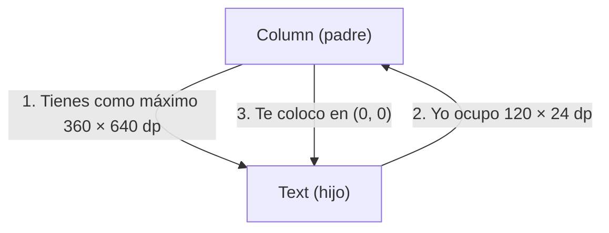
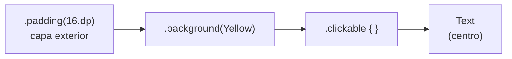

# **2.3.1 Maquetación básica: `Column`, `Row`, `Box` y `Modifier`**

En el apartado anterior escribimos nuestras primeras funciones `@Composable`. Ahora vamos a aprender a **colocarlas en pantalla**: una debajo de otra, una al lado de otra o una encima de otra, alineadas y separadas como queramos.

Para ello solo necesitamos cuatro piezas: los contenedores **`Column`**, **`Row`** y **`Box`**, y los **modificadores (`Modifier`)**. Con ellas se construye cualquier pantalla: las listas, las tarjetas y los formularios de las próximas unidades no son más que combinaciones de estas piezas.

Este apartado incluye dos **playgrounds interactivos**. Puedes cambiar los parámetros y ver al momento el resultado y el código Kotlin equivalente, sin abrir el IDE.

---

## 1. Cómo coloca Compose los elementos

Antes de ver cada contenedor conviene entender la idea que hay detrás. Compose recorre el árbol de composables y, para cada nodo, hace tres cosas:

1. **El padre le dice al hijo cuánto espacio tiene** (las *restricciones*: ancho y alto mínimo y máximo).

2. **El hijo decide su tamaño** dentro de esos límites y se lo comunica al padre.

3. **El padre coloca al hijo** en una posición concreta.



De aquí sale una consecuencia importante que repetiremos varias veces: **por defecto, un contenedor ocupa solo lo que ocupan sus hijos**. Si quieres que una `Column` ocupe toda la pantalla, tienes que pedírselo con un modificador como `Modifier.fillMaxSize()`.

---

## 2. `Column`: elementos uno debajo de otro

`Column` apila a sus hijos en vertical, en el orden en que los escribes.

```kotlin
@Composable
fun FichaContacto() {
    Column {
        Text("Ana García")
        Text("Desarrolladora Android")
        Text("ana@ejemplo.com")
    }
}
```

Su firma tiene dos parámetros de colocación, además del `modifier`:

```kotlin
Column(
    modifier = Modifier.fillMaxSize(),
    verticalArrangement = Arrangement.Top,        // reparto en vertical (por defecto Top)
    horizontalAlignment = Alignment.Start         // alineación en horizontal (por defecto Start)
) {
    // hijos
}
```

### Eje principal y eje cruzado

La clave para no confundirse es pensar en **ejes**:

- El **eje principal** es la dirección en la que se apilan los hijos. En una `Column` es el vertical.
- El **eje cruzado** es el perpendicular. En una `Column` es el horizontal.

Cada eje tiene su propio parámetro, y por eso tienen nombres distintos:

| Parámetro | Eje | Qué hace | Valores |
|---|---|---|---|
| `verticalArrangement` | Principal (↕) | **Reparte** el espacio sobrante entre los hijos | `Top`, `Center`, `Bottom`, `SpaceBetween`, `SpaceAround`, `SpaceEvenly`, `spacedBy(8.dp)` |
| `horizontalAlignment` | Cruzado (↔) | **Alinea** cada hijo dentro del ancho de la columna | `Start`, `CenterHorizontally`, `End` |


Los tres valores `Space…` se diferencian en dónde ponen el espacio libre:

- `SpaceBetween`: todo el espacio va **entre** los hijos; el primero y el último quedan pegados a los bordes.
- `SpaceAround`: cada hijo tiene el mismo espacio a cada lado, así que en los extremos queda **la mitad** que entre dos hijos.
- `SpaceEvenly`: el espacio es **idéntico** entre hijos y en los extremos.
- `spacedBy(8.dp)`: separación fija entre hijos, sin repartir nada más. Es la forma recomendada de separar elementos, en lugar de poner `Spacer` o `padding` a cada uno.

---

## 3. `Row`: elementos uno al lado de otro

`Row` funciona exactamente igual que `Column`, pero con los ejes intercambiados: el principal es el horizontal y el cruzado, el vertical.

```kotlin
@Composable
fun BarraValoracion() {
    Row(
        modifier = Modifier.fillMaxWidth(),
        horizontalArrangement = Arrangement.SpaceBetween,
        verticalAlignment = Alignment.CenterVertically
    ) {
        Text("Valoración")
        Text("★★★★☆")
    }
}
```

| Parámetro | Eje | Valores |
|---|---|---|
| `horizontalArrangement` | Principal (↔) | `Start`, `Center`, `End`, `SpaceBetween`, `SpaceAround`, `SpaceEvenly`, `spacedBy(8.dp)` |
| `verticalAlignment` | Cruzado (↕) | `Top`, `CenterVertically`, `Bottom` |


!!! tip "Truco para recordar los nombres"
    Si el parámetro trabaja **en el mismo sentido** que el contenedor, se llama *Arrangement* (reparte). Si trabaja **en el sentido contrario**, se llama *Alignment* (alinea). Por eso en una `Column` el `Alignment` es horizontal y en una `Row` es vertical.

---

## 4. `Box`: elementos uno encima de otro

`Box` superpone a sus hijos en capas: **el primero queda al fondo y el último, delante**. Se usa para poner un texto sobre una imagen, una insignia sobre un avatar o un indicador de carga en el centro de la pantalla.

```kotlin
@Composable
fun AvatarConInsignia() {
    Box(contentAlignment = Alignment.Center) {
        Image(
            painter = painterResource(R.drawable.avatar),
            contentDescription = "Foto de perfil",
            modifier = Modifier
                .size(72.dp)
                .clip(CircleShape)
        )
        Badge(
            modifier = Modifier.align(Alignment.BottomEnd)  // solo este hijo
        ) {
            Text("3")
        }
    }
}
```

- `contentAlignment` coloca **a todos los hijos** en una de estas 9 posiciones: `TopStart`, `TopCenter`, `TopEnd`, `CenterStart`, `Center`, `CenterEnd`, `BottomStart`, `BottomCenter` y `BottomEnd`. Por defecto es `TopStart`.
- `Modifier.align(...)`, aplicado a un hijo concreto, cambia la posición **solo de ese hijo**.

---

## 5. Repartir el espacio: `weight` y `Spacer`

Dentro de una `Row` o una `Column` puedes pedir que un hijo **se quede con el espacio sobrante** usando `Modifier.weight()`:

```kotlin
Row(modifier = Modifier.fillMaxWidth()) {
    Button(onClick = {}, modifier = Modifier.weight(1f)) { Text("Cancelar") }
    Button(onClick = {}, modifier = Modifier.weight(2f)) { Text("Aceptar") }
}
```

Primero se miden los hijos **sin** `weight`. Después, el espacio que queda se reparte entre los que **sí** lo tienen, en proporción a su valor. En el ejemplo, «Aceptar» ocupa el doble que «Cancelar».

`Spacer` es un composable vacío que solo ocupa espacio. Combinado con `weight`, sirve para **empujar** elementos hacia los extremos:

```kotlin
Row(
    modifier = Modifier.fillMaxWidth(),
    verticalAlignment = Alignment.CenterVertically
) {
    Icon(Icons.Default.Person, contentDescription = null)
    Text("Mi perfil")
    Spacer(modifier = Modifier.weight(1f))   // ocupa todo el hueco central
    Icon(Icons.Default.Settings, contentDescription = "Ajustes")
}
```

!!! info "¿Por qué `weight` no aparece fuera de una `Row` o una `Column`?"
    `weight()` y `align()` son modificadores que **solo existen dentro del contenedor que los entiende**: Compose los ofrece a través de `RowScope`, `ColumnScope` y `BoxScope`. Si escribes `Modifier.weight(1f)` fuera de una `Row` o `Column`, el código no compila. Lo explicamos a fondo en el manual: [Layout Scopes](../00-android/00-compose/21-composable-functions.md#los-layout-scopes-rowscope-columnscope-y-boxscope).

---

## 6. Playground de contenedores

Experimenta con los tres contenedores. Cada caja (A, B, C, D) tiene un tamaño distinto para que se aprecie la alineación; en el código aparece como un composable de ejemplo llamado `Caja`.

<div class="cpg" data-cpg="layout"></div>

Cosas que conviene probar:

- Elige `SpaceBetween` y cambia el tamaño del contenedor a **«Se ajusta al contenido»**. ¿Por qué deja de notarse?
- Pon `weight(1f)` a la caja B. ¿Qué pasa con el `Arrangement`?
- En un `Row`, dale a la caja C `fillMaxHeight()`.
- Cambia a `Box`, elige `contentAlignment = Center` y después mueve solo la caja D con `align(TopEnd)`.

---

## 7. ¿Qué es un `Modifier`?

Un **modificador** es un objeto que **decora o configura** un composable: le da tamaño, espaciado, fondo, borde, forma o comportamiento al pulsarlo. Todos los composables de Compose aceptan un parámetro `modifier`.

Los modificadores **se encadenan** con puntos, empezando siempre por el objeto `Modifier`:

```kotlin
Text(
    text = "Hola",
    modifier = Modifier
        .padding(16.dp)
        .background(Color.Yellow)
        .clickable { /* acción */ }
)
```

### Modificadores más habituales

| Categoría | Modificador | Para qué sirve |
|---|---|---|
| **Tamaño** | `size(64.dp)`, `width(…)`, `height(…)` | Tamaño fijo |
| | `fillMaxSize()`, `fillMaxWidth()`, `fillMaxHeight()` | Ocupar todo el espacio disponible (admiten una fracción: `fillMaxWidth(0.5f)`) |
| | `wrapContentSize()` | Ocupar solo lo que necesite el contenido |
| **Espaciado** | `padding(16.dp)` | Espacio alrededor del contenido |
| | `padding(horizontal = 16.dp, vertical = 8.dp)` | Espacio distinto por ejes |
| **Dibujo** | `background(Color.Yellow)` | Color de fondo |
| | `border(2.dp, Color.Black)` | Borde |
| | `clip(RoundedCornerShape(8.dp))`, `clip(CircleShape)` | Recortar con una forma |
| | `alpha(0.5f)`, `rotate(15f)`, `scale(1.2f)` | Transparencia y transformaciones |
| **Posición** | `offset(x = 8.dp, y = 8.dp)` | Desplazar al dibujar, sin mover a los demás |
| **Interacción** | `clickable { … }` | Responder a una pulsación |
| | `verticalScroll(rememberScrollState())` | Permitir desplazamiento |
| **Del contenedor** | `weight(1f)`, `align(…)` | Solo dentro de `Row`, `Column` o `Box` |

!!! note "En Compose no existe el «margen»"
    Si vienes de HTML/CSS o de XML, echarás de menos `margin`. En Compose solo hay `padding`, y **el orden** en que lo pones decide si se comporta como espacio interior o como margen exterior. Lo vemos en el siguiente punto.

---

## 8. El orden de los modificadores importa

Esta es la idea más importante del apartado. **Cada modificador envuelve a todos los que vienen detrás.** El primero de la cadena es la capa más exterior, y el composable queda en el centro.



Veamos tres casos que se repiten constantemente:

=== "padding y background"

    ```kotlin
    // Fondo DENTRO del padding: el padding actúa como margen
    Modifier
        .padding(16.dp)
        .background(Color.Yellow)

    // Fondo FUERA del padding: el padding actúa como relleno interior
    Modifier
        .background(Color.Yellow)
        .padding(16.dp)
    ```

    En el primer caso, primero se reservan 16 dp transparentes y después se pinta el fondo en lo que queda. En el segundo, el fondo se pinta en todo el espacio y después el contenido se separa 16 dp del borde.

=== "clickable y padding"

    ```kotlin
    // La zona pulsable INCLUYE el padding (más fácil de pulsar)
    Modifier
        .clickable { }
        .padding(16.dp)

    // La zona pulsable EXCLUYE el padding (solo se puede pulsar el texto)
    Modifier
        .padding(16.dp)
        .clickable { }
    ```

    Para botones y elementos de lista casi siempre interesa el primero: un objetivo táctil grande. Google recomienda que cualquier zona pulsable mida **al menos 48 × 48 dp**.

=== "clip y background"

    ```kotlin
    // Fondo con esquinas redondeadas
    Modifier
        .clip(RoundedCornerShape(16.dp))
        .background(Color.Cyan)

    // Fondo cuadrado: el clip llega tarde, el fondo ya está pintado
    Modifier
        .background(Color.Cyan)
        .clip(RoundedCornerShape(16.dp))
    ```

    `clip` recorta todo lo que viene **después**. Por eso tiene que ir antes que el fondo. Como alternativa, `background` acepta directamente una forma: `.background(Color.Cyan, RoundedCornerShape(16.dp))`.

---

## 9. Playground de modificadores

Construye tu propia cadena: añade modificadores, cámbiales el valor y **reordénalos con las flechas** para ver cómo cambia el resultado. La línea discontinua marca el espacio que ocupa el `Text` en el layout.

<div class="cpg" data-cpg="modifiers"></div>

Retos rápidos con el playground:

1. Partiendo de «Padding interno», consigue el mismo resultado que «Margen exterior» **sin añadir ni quitar** nada, solo reordenando.

2. Con «Área táctil», pasa el ratón por encima. Después baja `clickable` al final de la cadena. ¿Qué parte se puede pulsar ahora?

3. Añade `offset` y `rotate`. Fíjate en que la línea discontinua **no se mueve**: estos modificadores cambian dónde se dibuja el elemento, pero no el espacio que ocupa, así que no empujan a sus vecinos.

4. Con «size antes de padding», cambia el orden a `padding` → `size`. ¿Por qué ahora el conjunto es más grande?

---

## 10. Buenas prácticas

1. **Todo composable reutilizable recibe un `modifier`.** Debe ser el **primer parámetro opcional**, con valor por defecto `Modifier`, y aplicarse al elemento raíz:

    ```kotlin
    @Composable
    fun TarjetaPerfil(
        nombre: String,                  // obligatorios primero
        modifier: Modifier = Modifier    // primer parámetro opcional
    ) {
        Column(modifier = modifier.padding(16.dp)) {   // 'modifier' en minúscula
            Text(nombre)
        }
    }
    ```

    Así, quien usa `TarjetaPerfil` puede decidir su tamaño o su posición (`Modifier.fillMaxWidth()`, `Modifier.weight(1f)`…) sin tocar su código.

2. **Separa con `Arrangement.spacedBy()`** en lugar de añadir `Spacer` o `padding` a cada hijo.

3. **Usa los colores y formas del tema** (`MaterialTheme.colorScheme.primary`) en lugar de colores fijos como `Color.Yellow`. Lo veremos en UT3; aquí usamos colores fijos solo para que los ejemplos se entiendan mejor.

---

## 11. Errores frecuentes

!!! warning "«He puesto `Arrangement.Center` y no se centra»"
    El contenedor se está ajustando a su contenido, así que no tiene espacio libre que repartir. Dale tamaño con `fillMaxSize()`, `fillMaxWidth()` o `fillMaxHeight()`, según el eje.

!!! warning "Aplicar `Modifier` en lugar de `modifier` en el elemento raíz"
    Dentro de un composable que recibe `modifier: Modifier = Modifier`, si en la raíz escribes `Modifier.padding(16.dp)` (con mayúscula) **ignoras** el modificador que te han pasado. Escribe `modifier.padding(16.dp)`.

!!! warning "`Unresolved reference: weight`"
    Estás usando `weight()` o `align()` fuera de la `Row`, `Column` o `Box` que lo proporciona, normalmente al extraer un hijo a su propia función. La solución es recibir un `modifier` por parámetro y aplicar el `weight` desde el contenedor.

!!! warning "Una `Column` con muchos elementos se corta"
    Una `Column` no se desplaza por sí sola. Para pocos elementos, añade `Modifier.verticalScroll(rememberScrollState())`. Para listas largas o de tamaño variable, usa `LazyColumn` (UT3).

---

## 12. Retos

Resuélvelos en el proyecto `pmdm-lab-ut02`. Usa `@Preview` para comprobar el resultado sin lanzar el emulador.

### 🟢 Básico: tarjeta de contacto

Crea un composable `TarjetaContacto(nombre: String, email: String, modifier: Modifier = Modifier)` con:

- Un fondo de color con esquinas redondeadas de 12 dp.
- 16 dp de relleno interior.
- El nombre y el email uno debajo del otro, separados 4 dp con `spacedBy`.

??? success "Solución"

    ```kotlin
    @Composable
    fun TarjetaContacto(
        nombre: String,
        email: String,
        modifier: Modifier = Modifier
    ) {
        Column(
            modifier = modifier
                .clip(RoundedCornerShape(12.dp))                       // 1. recorta las esquinas
                .background(MaterialTheme.colorScheme.primaryContainer) // 2. el fondo ya sale redondeado
                .padding(16.dp),                                       // 3. relleno interior
            verticalArrangement = Arrangement.spacedBy(4.dp)
        ) {
            Text(text = nombre, style = MaterialTheme.typography.titleMedium)
            Text(text = email, style = MaterialTheme.typography.bodyMedium)
        }
    }

    @Preview(showBackground = true)
    @Composable
    fun TarjetaContactoPreview() {
        TarjetaContacto(
            nombre = "Ana García",
            email = "ana@ejemplo.com",
            modifier = Modifier.padding(16.dp)
        )
    }
    ```

    Claves de la solución:

    - El orden `clip` → `background` → `padding` es el que da un fondo redondeado con el contenido separado del borde. Si pones `padding` antes que `background`, el relleno se convierte en margen.
    - Los modificadores se encadenan sobre `modifier` (minúscula), no sobre `Modifier`. Así, la *preview* puede añadir un margen exterior sin tocar el componente.
    - `spacedBy(4.dp)` separa los textos sin necesidad de `Spacer`.

### 🟡 Intermedio: barra de acciones

Crea una fila que ocupe todo el ancho con un icono a la izquierda, un título a continuación y dos iconos a la derecha. Los iconos de la derecha deben quedar pegados al borde **sin usar** `Arrangement.SpaceBetween`. Pista: `Spacer` + `weight`.

??? success "Solución"

    ```kotlin
    @Composable
    fun BarraAcciones(
        titulo: String,
        modifier: Modifier = Modifier
    ) {
        Row(
            modifier = modifier
                .fillMaxWidth()
                .padding(horizontal = 4.dp),
            verticalAlignment = Alignment.CenterVertically
        ) {
            IconButton(onClick = { /* abrir menú */ }) {
                Icon(Icons.Default.Menu, contentDescription = "Menú")
            }
            Text(text = titulo, style = MaterialTheme.typography.titleLarge)

            Spacer(modifier = Modifier.weight(1f))   // se queda con todo el hueco central

            IconButton(onClick = { /* buscar */ }) {
                Icon(Icons.Default.Search, contentDescription = "Buscar")
            }
            IconButton(onClick = { /* más opciones */ }) {
                Icon(Icons.Default.MoreVert, contentDescription = "Más opciones")
            }
        }
    }

    @Preview(showBackground = true)
    @Composable
    fun BarraAccionesPreview() {
        BarraAcciones(titulo = "Mis juegos")
    }
    ```

    Claves de la solución:

    - Los hijos sin `weight` (iconos y título) se miden primero. El `Spacer` con `weight(1f)` ocupa **todo** el espacio que sobra y empuja los dos últimos iconos al borde derecho.
    - `SpaceBetween` no serviría: repartiría el espacio entre los cinco elementos y el título quedaría en mitad de la barra.
    - `IconButton` da a cada icono una zona táctil de 48 × 48 dp. Con un `Icon` suelto y `clickable`, la zona sería del tamaño del dibujo (24 dp).
    - `verticalAlignment = Alignment.CenterVertically` alinea el texto con los iconos, que son más altos.

    !!! note "Si `Icons` no aparece"
        Las versiones recientes de Material 3 ya no incluyen los iconos por defecto. Si `Icons.Default.Menu` da error, añade la dependencia `androidx.compose.material:material-icons-core` al `build.gradle.kts` del módulo.

### 🔴 Avanzado: cabecera de perfil

Reproduce esta cabecera:

- Una imagen de fondo que ocupa todo el ancho y 180 dp de alto.
- Un avatar circular de 80 dp **superpuesto** en la esquina inferior izquierda de la imagen.
- Una insignia «PRO» sobre la esquina superior derecha del avatar.
- Debajo, el nombre del usuario y dos botones que se reparten el ancho al 50 %.

Extrae el avatar con su insignia a su propio composable reutilizable que reciba un `modifier`.

??? success "Solución"

    Necesitas dos imágenes en `res/drawable` (por ejemplo, `portada.jpg` y `avatar.jpg`). Sirve cualquier imagen.

    ```kotlin
    @Composable
    fun AvatarConInsignia(modifier: Modifier = Modifier) {
        Box(modifier = modifier) {
            // Capa 1 (fondo): la foto recortada en círculo
            Image(
                painter = painterResource(R.drawable.avatar),
                contentDescription = "Foto de perfil",
                contentScale = ContentScale.Crop,
                modifier = Modifier
                    .size(80.dp)
                    .clip(CircleShape)
                    .border(3.dp, MaterialTheme.colorScheme.surface, CircleShape)
            )
            // Capa 2 (delante): la insignia, colocada solo ella arriba a la derecha
            Text(
                text = "PRO",
                style = MaterialTheme.typography.labelSmall,
                color = MaterialTheme.colorScheme.onTertiary,
                modifier = Modifier
                    .align(Alignment.TopEnd)
                    .background(MaterialTheme.colorScheme.tertiary, RoundedCornerShape(50))
                    .padding(horizontal = 6.dp, vertical = 2.dp)
            )
        }
    }

    @Composable
    fun CabeceraPerfil(
        nombre: String,
        modifier: Modifier = Modifier
    ) {
        Column(modifier = modifier.fillMaxWidth()) {
            // Imagen de fondo con el avatar superpuesto
            Box(
                modifier = Modifier
                    .fillMaxWidth()
                    .height(180.dp)
            ) {
                Image(
                    painter = painterResource(R.drawable.portada),
                    contentDescription = null,          // decorativa
                    contentScale = ContentScale.Crop,
                    modifier = Modifier.matchParentSize()
                )
                AvatarConInsignia(
                    modifier = Modifier
                        .align(Alignment.BottomStart)
                        .padding(16.dp)
                )
            }

            Text(
                text = nombre,
                style = MaterialTheme.typography.titleLarge,
                modifier = Modifier.padding(16.dp)
            )

            // Dos botones al 50 %
            Row(
                modifier = Modifier
                    .fillMaxWidth()
                    .padding(horizontal = 16.dp),
                horizontalArrangement = Arrangement.spacedBy(8.dp)
            ) {
                Button(onClick = {}, modifier = Modifier.weight(1f)) { Text("Seguir") }
                OutlinedButton(onClick = {}, modifier = Modifier.weight(1f)) { Text("Mensaje") }
            }
        }
    }

    @Preview(showBackground = true)
    @Composable
    fun CabeceraPerfilPreview() {
        CabeceraPerfil(nombre = "Ana García")
    }
    ```

    Claves de la solución:

    - Hay **dos `Box`**: uno pone el avatar sobre la portada y otro, dentro de `AvatarConInsignia`, pone la insignia sobre la foto. En los dos, el primer hijo queda al fondo.
    - `align()` se aplica **desde fuera**: `CabeceraPerfil` decide dónde va el avatar pasándole un `modifier`. `AvatarConInsignia` no sabe que está dentro de un `Box`, y por eso se puede reutilizar en cualquier sitio.
    - `matchParentSize()` hace que la portada mida lo mismo que su `Box` (todo el ancho × 180 dp) sin intervenir en el cálculo de ese tamaño.
    - `ContentScale.Crop` rellena el hueco recortando la imagen en lugar de deformarla.
    - Los botones se reparten el ancho con `weight(1f)` cada uno; `spacedBy(8.dp)` deja el hueco entre ellos.

    !!! tip "Variante: avatar que sobresale de la portada"
        Es habitual que el avatar quede medio fuera de la imagen. Si lo intentas con `Modifier.offset(y = 40.dp)`, el avatar se dibuja más abajo, pero el `Text` del nombre **no se aparta** (como viste en el playground, `offset` no cambia el espacio que ocupa el elemento) y ambos se solapan. Para que funcione, añade también un espacio equivalente debajo de la portada; por ejemplo, `Spacer(Modifier.height(40.dp))` antes del nombre.

---

## 13. Para saber más

- **Manual de referencia:** [Funciones componibles y modificadores](../00-android/00-compose/21-composable-functions.md), incluidos los [Layout Scopes](../00-android/00-compose/21-composable-functions.md#los-layout-scopes-rowscope-columnscope-y-boxscope).
- **Documentación oficial de Google:**

    - [Conceptos básicos sobre el diseño en Compose](https://developer.android.com/develop/ui/compose/layouts/basics?hl=es-419)
    - [Modificadores de Compose](https://developer.android.com/develop/ui/compose/modifiers?hl=es-419)
    - [Lista de modificadores de Compose](https://developer.android.com/develop/ui/compose/modifiers-list?hl=es-419)
