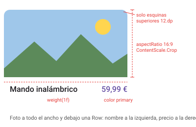
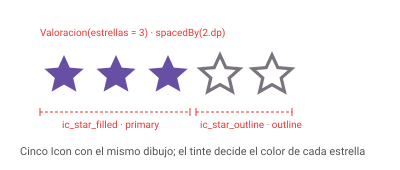
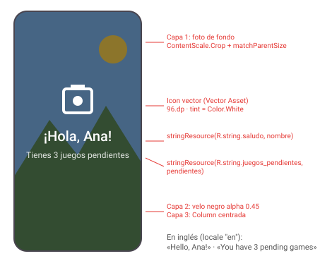

# **2.3.2 Imágenes, iconos y recursos**

Ya sabemos colocar elementos en pantalla. Ahora vamos a llenarlos de contenido visual: **fotos, ilustraciones e iconos**. Para ello necesitamos entender cómo organiza Android los **recursos** de una app, es decir, todo lo que no es código: imágenes, textos, colores o tipografías.

Al terminar este apartado sabrás:

- Dónde guardar cada tipo de recurso y cómo usarlo desde Compose con la clase `R`.
- Elegir entre una imagen de mapa de bits y un vector.
- Mostrar imágenes con `Image` y controlar cómo se adaptan a su hueco con `contentScale`.
- Usar iconos con `Icon` e importar los iconos oficiales de Material.

La creación del **icono de la app** para publicarla y la solución a los problemas más habituales con las herramientas de recursos del IDE están en el anexo [Iconos de la app y gestión de recursos](../00-android/anexos/a-iconos-app-recursos.md).

---

## 1. Los recursos de una app Android

Todo lo que no es código Kotlin vive en la carpeta **`app/src/main/res/`**, organizado en subcarpetas con nombres fijos:

| Carpeta | Contenido | Ejemplo |
|---|---|---|
| `drawable/` | Imágenes y vectores que usa la interfaz | `logo.xml`, `portada.webp` |
| `mipmap-…/` | **Solo** el icono de la app (lanzador) | `ic_launcher.webp` |
| `values/` | Valores simples en XML: textos, colores, dimensiones | `strings.xml`, `colors.xml` |
| `font/` | Tipografías | `roboto_bold.ttf` |
| `raw/` | Ficheros que se leen tal cual (audio, JSON…) | `sonido_click.mp3` |

### La clase `R`

Al compilar, Android genera automáticamente una clase llamada **`R`** con un identificador numérico para cada recurso. Desde el código nunca se usa la ruta del fichero, sino ese identificador:

```kotlin
painterResource(R.drawable.logo)          // res/drawable/logo.xml
stringResource(R.string.titulo_app)       // <string name="titulo_app"> en values/strings.xml
```

!!! warning "Reglas para nombrar recursos"
    El nombre del fichero se convierte en un identificador de Kotlin, así que:

    - Solo puede tener **minúsculas, números y guiones bajos**: `foto_perfil.png`.
    - No puede tener mayúsculas, espacios ni guiones: `FotoPerfil.png`, `foto perfil.png` y `foto-perfil.png` hacen que **falle la compilación**.
    - No puede empezar por un número.
    - La extensión no forma parte del nombre: `foto.png` y `foto.jpg` en la misma carpeta **chocan**.

    Por convención se usan prefijos: `ic_` para iconos, `img_` para fotos, `bg_` para fondos.

### Calificadores: un recurso, varias versiones

Una carpeta puede llevar un **calificador** detrás de un guion. Android elige automáticamente la versión que mejor encaja con el dispositivo:

- `values-en/strings.xml`: textos en inglés, para móviles configurados en ese idioma.
- `values-night/colors.xml`: colores para el modo oscuro.
- `drawable-xxhdpi/`: imágenes para pantallas de alta densidad.

El código no cambia: siempre se escribe `R.string.titulo_app`, y es el sistema quien decide qué fichero cargar.

---

## 2. Mapas de bits y vectores

Una imagen en Android puede ser de dos tipos:

| | **Mapa de bits** (PNG, JPG, WebP) | **Vector** (*Vector Drawable*, XML) |
|---|---|---|
| Qué guarda | Una cuadrícula de píxeles | Instrucciones de dibujo (líneas, curvas, rellenos) |
| Al ampliarla | Se pixela | Se ve nítida a cualquier tamaño |
| Peso | Crece con la resolución | Muy pequeño |
| Ideal para | **Fotografías** e ilustraciones complejas | **Iconos**, logotipos y gráficos planos |

!!! tip "Regla práctica"
    Iconos y logotipos, siempre en **vector**. Fotos, en **WebP** (pesa bastante menos que PNG o JPG con la misma calidad).

### Densidades de pantalla y `dp`

Los móviles tienen pantallas con distinta cantidad de píxeles por pulgada. Para que un elemento mida lo mismo en todos, en Compose las medidas se expresan en **`dp`** (*density-independent pixels*): 1 dp equivale a 1 píxel en una pantalla de referencia (`mdpi`) y a más píxeles en pantallas más densas.

| Calificador | Multiplicador | Un icono de 24 dp ocupa… |
|---|---|---|
| `mdpi` | × 1 | 24 × 24 px |
| `hdpi` | × 1,5 | 36 × 36 px |
| `xhdpi` | × 2 | 48 × 48 px |
| `xxhdpi` | × 3 | 72 × 72 px |
| `xxxhdpi` | × 4 | 96 × 96 px |

Un **vector** se dibuja a la resolución justa en cada pantalla, así que basta con un único fichero en `drawable/`. Un **mapa de bits** necesitaría una versión por densidad para verse nítido sin desperdiciar memoria; por eso los iconos se hacen en vector.

---

## 3. Mostrar imágenes con `Image`

El composable `Image` dibuja un recurso gráfico. Recibe un `painter`, que se obtiene con `painterResource()` a partir del identificador del recurso:

```kotlin
@Composable
fun PortadaJuego(modifier: Modifier = Modifier) {
    Image(
        painter = painterResource(R.drawable.portada_zelda),
        contentDescription = "Portada de The Legend of Zelda",
        contentScale = ContentScale.Crop,
        modifier = modifier
            .fillMaxWidth()
            .aspectRatio(16f / 9f)                 // alto = ancho × 9/16
            .clip(RoundedCornerShape(12.dp))
    )
}
```

### `contentDescription`: accesibilidad

`contentDescription` es el texto que lee en voz alta **TalkBack**, el lector de pantalla que usan las personas con discapacidad visual. Es un parámetro obligatorio para que no se olvide:

- Si la imagen **aporta información** (una portada, un gráfico, un botón con icono), describe qué muestra.
- Si es **decorativa** (un fondo, un adorno junto a un texto que ya lo dice todo), pasa `null` para que TalkBack la ignore.

### Tamaño y forma

`Image` acepta los mismos modificadores que cualquier composable. Los más habituales con imágenes son:

- `size()`, `fillMaxWidth()` y `aspectRatio()` para fijar el hueco que ocupa.
- `clip(CircleShape)` o `clip(RoundedCornerShape(12.dp))` para recortarla con una forma.
- `border(2.dp, color, CircleShape)` para añadir un borde que siga la misma forma.

### `contentScale`: cómo se adapta la imagen a su hueco

Lo normal es que la proporción de la imagen no coincida con la del hueco donde la colocas. `contentScale` decide qué hacer:

| Valor | Mantiene la proporción | Rellena todo el hueco | Recorta | Uso típico |
|---|:---:|:---:|:---:|---|
| `Fit` *(por defecto)* | ✅ | ❌ | ❌ | Logotipos o ilustraciones que deben verse completas |
| `Crop` | ✅ | ✅ | ✅ | **Fotos, portadas y avatares** |
| `FillBounds` | ❌ | ✅ | ❌ | Casi nunca: deforma la imagen |
| `FillWidth` / `FillHeight` | ✅ | En un eje | ✅ | Banners que deben ocupar todo el ancho o el alto |
| `Inside` | ✅ | ❌ | ❌ | Como `Fit`, pero sin ampliar imágenes pequeñas |
| `None` | ✅ | ❌ | ✅ | Mostrar la imagen a su tamaño original |

Compruébalo con el playground: la imagen original es apaisada (3:2) y tiene una diana en el centro y letras en las esquinas para que veas qué parte se pierde.

<div class="cpg" data-cpg="contentscale"></div>

Prueba, por ejemplo, a poner un avatar con `CircleShape` en el hueco cuadrado: con `Fit` aparecen franjas vacías y con `Crop` el círculo queda completo.

---

## 4. Iconos con `Icon`

Para iconos se usa `Icon` en lugar de `Image`. La diferencia es que **`Icon` colorea el dibujo** con un único color (el *tinte*), que por defecto es el color de contenido del lugar donde está (`LocalContentColor`). Así, el mismo icono se ve blanco sobre un botón relleno y oscuro sobre el fondo de la pantalla, y se adapta solo al modo oscuro.

```kotlin
// Tinte automático: toma el color del contenido que lo rodea
Icon(
    painter = painterResource(R.drawable.ic_favorite),
    contentDescription = "Favorito"
)

// Tinte explícito, tomado del tema
Icon(
    painter = painterResource(R.drawable.ic_favorite),
    contentDescription = "Favorito",
    tint = MaterialTheme.colorScheme.error,
    modifier = Modifier.size(32.dp)
)
```

| | `Image` | `Icon` |
|---|---|---|
| Colores | Los de la imagen original | Un único color (`tint`) |
| Tamaño por defecto | El de la imagen | 24 dp |
| Para | Fotos, ilustraciones, logotipos en color | Iconos de interfaz |

!!! tip "Iconos pulsables: `IconButton`"
    Si el icono es un botón, envuélvelo en `IconButton`. Le da una zona táctil de 48 × 48 dp y el efecto visual al pulsar:

    ```kotlin
    IconButton(onClick = { /* compartir */ }) {
        Icon(painterResource(R.drawable.ic_share), contentDescription = "Compartir")
    }
    ```

### De dónde sacar los iconos: Material Symbols

Google ofrece gratis miles de iconos con el estilo de Material Design: los **Material Symbols**. La forma recomendada de usarlos es descargarlos como **vectores XML** y guardarlos en `res/drawable`:

1. Entra en [fonts.google.com/icons](https://fonts.google.com/icons).

2. Elige el estilo (*Outlined*, *Rounded* o *Sharp*) y, si quieres, el grosor y si el icono va relleno.

3. Pulsa sobre el icono, abre la pestaña **Android** y descarga el fichero XML.

4. Copia el fichero en `app/src/main/res/drawable/` con un nombre válido, por ejemplo `ic_favorite.xml`.

5. Úsalo con `painterResource(R.drawable.ic_favorite)`.

También puedes importarlos desde el propio IDE: clic derecho sobre `res` → **New → Vector Asset** → *Clip art*. Ese mismo asistente convierte **ficheros SVG** propios (por ejemplo, un logotipo exportado desde Figma o Inkscape) a vector de Android.

!!! info "¿Y `Icons.Default.Favorite`?"
    En muchos tutoriales verás iconos como `Icons.Default.Favorite`. Vienen de las librerías `material-icons-core` y `material-icons-extended`, que **Google ya no actualiza** y que no se incluyen por defecto en los proyectos nuevos. Siguen funcionando si añades la dependencia, pero para iconos nuevos es preferible descargar los Material Symbols como acabamos de ver.

!!! warning "Si el asistente *Vector Asset* no aparece o está en gris"
    Es uno de los problemas más frecuentes en el aula. Las causas y soluciones están en el anexo: [Problemas con el Resource Manager y los asistentes](../00-android/anexos/a-iconos-app-recursos.md#4-solucion-de-problemas).

---

## 5. Textos y colores como recursos

Las imágenes no son los únicos recursos. Los **textos** de la interfaz también deben vivir fuera del código, en `res/values/strings.xml`, para poder traducir la app sin tocar Kotlin:

=== "values/strings.xml"

    ```xml
    <resources>
        <string name="app_name">Mi Biblioteca</string>
        <string name="saludo">¡Hola, %1$s!</string>
        <string name="juegos_pendientes">Tienes %1$d juegos pendientes</string>
    </resources>
    ```

=== "values-en/strings.xml"

    ```xml
    <resources>
        <string name="app_name">My Library</string>
        <string name="saludo">Hello, %1$s!</string>
        <string name="juegos_pendientes">You have %1$d pending games</string>
    </resources>
    ```

=== "Uso en Compose"

    ```kotlin
    Text(stringResource(R.string.saludo, "Ana"))           // %1$s → texto
    Text(stringResource(R.string.juegos_pendientes, 3))    // %1$d → número entero
    ```

Los marcadores `%1$s` (texto) y `%1$d` (número) se sustituyen por los argumentos en orden. Si el móvil está en inglés, Android usa automáticamente `values-en`.

Con los **colores** pasa algo parecido: existe `colorResource(R.color.mi_color)`, pero en Compose lo habitual es definirlos en el **tema de Material** (`MaterialTheme.colorScheme`), que veremos en UT3. Así cambian solos entre modo claro y oscuro.

---

## 6. Errores frecuentes

!!! warning "`R.drawable.mi_imagen` aparece en rojo"
    Revisa, por este orden:

    1. Que el nombre del fichero cumple las reglas (minúsculas, números y `_`).
    2. Que no has importado `android.R` en lugar del `R` de tu app. Busca en los `import` del fichero: debe ser el de tu paquete (por ejemplo, `com.dam.pmdmlab02.R`).
    3. Que el proyecto está sincronizado y compilado: **Build → Rebuild Project**.

    Si sigue fallando, consulta el anexo de [solución de problemas](../00-android/anexos/a-iconos-app-recursos.md#4-solucion-de-problemas).

!!! warning "La app se cierra con «Canvas: trying to draw too large bitmap»"
    Has metido una foto enorme (por ejemplo, de 4000 × 3000 px, sacada directamente del móvil) en `drawable/`. Android la carga entera en memoria aunque se muestre en pequeño y, además, la amplía porque trata esa carpeta como densidad `mdpi`. Redúcela antes de añadirla a la app (unos 1080 px de ancho suelen bastar) y conviértela a WebP.

!!! warning "`painterResource(R.mipmap.ic_launcher)` cierra la app"
    El icono de la app es un **icono adaptativo** (un tipo especial de recurso con capas) y `painterResource` no sabe dibujarlo. Si quieres mostrar el logotipo dentro de la app, crea un vector aparte en `drawable/` y usa ese.

!!! warning "El icono se ve como un cuadrado o una mancha de un solo color"
    Has usado `Icon` con una imagen a color: `Icon` pinta todo el dibujo con el tinte. Usa `Image` para imágenes en color, o `Icon(…, tint = Color.Unspecified)` si quieres conservar sus colores originales.

!!! warning "La imagen sale deformada o con franjas"
    Revisa el `contentScale`: `FillBounds` deforma y `Fit` deja franjas. Para fotos, casi siempre quieres `Crop`.

---

## 7. Retos

Resuélvelos en el proyecto `pmdm-lab-ut02`.

### 🟢 Básico: tarjeta de producto

Crea un composable `TarjetaProducto(nombre: String, precio: String, modifier: Modifier = Modifier)` con:

- Una foto que ocupe todo el ancho con proporción 16:9, recortada con `Crop` y con las esquinas superiores redondeadas.
- Debajo, el nombre y el precio en una fila: el nombre a la izquierda y el precio a la derecha.

**Resultado esperado** (referencia orientativa; las anotaciones en rojo no forman parte de la interfaz):

{ width="440" }

??? success "Solución"

    ```kotlin
    @Composable
    fun TarjetaProducto(
        nombre: String,
        precio: String,
        modifier: Modifier = Modifier
    ) {
        Column(modifier = modifier.width(280.dp)) {
            Image(
                painter = painterResource(R.drawable.img_producto),
                contentDescription = nombre,
                contentScale = ContentScale.Crop,
                modifier = Modifier
                    .fillMaxWidth()
                    .aspectRatio(16f / 9f)
                    .clip(RoundedCornerShape(topStart = 12.dp, topEnd = 12.dp))
            )
            Row(
                modifier = Modifier
                    .fillMaxWidth()
                    .padding(12.dp),
                verticalAlignment = Alignment.CenterVertically
            ) {
                Text(
                    text = nombre,
                    style = MaterialTheme.typography.titleMedium,
                    modifier = Modifier.weight(1f)
                )
                Text(
                    text = precio,
                    style = MaterialTheme.typography.titleMedium,
                    color = MaterialTheme.colorScheme.primary
                )
            }
        }
    }

    @Preview(showBackground = true)
    @Composable
    fun TarjetaProductoPreview() {
        TarjetaProducto(nombre = "Mando inalámbrico", precio = "59,99 €")
    }
    ```

    Claves de la solución:

    - `aspectRatio(16f / 9f)` calcula el alto a partir del ancho: la foto siempre tiene la misma proporción, sea cual sea el ancho de la tarjeta.
    - `RoundedCornerShape(topStart = …, topEnd = …)` redondea solo las esquinas de arriba.
    - El nombre lleva `weight(1f)`: ocupa todo el espacio libre y, si es muy largo, no empuja el precio fuera de la tarjeta.
    - `contentDescription = nombre`: la foto aporta información, así que se describe.

### 🟡 Intermedio: barra de valoración con iconos

Descarga de Material Symbols los iconos `star` (relleno) y `star` (sin relleno) y crea `Valoracion(estrellas: Int, modifier: Modifier = Modifier)`, que muestre 5 estrellas: las primeras `estrellas` rellenas y en el color primario del tema, y el resto sin relleno y en gris.

**Resultado esperado** (referencia orientativa; las anotaciones en rojo no forman parte de la interfaz):

{ width="440" }

??? success "Solución"

    Guarda los dos iconos como `res/drawable/ic_star_filled.xml` y `res/drawable/ic_star_outline.xml`.

    ```kotlin
    @Composable
    fun Valoracion(
        estrellas: Int,
        modifier: Modifier = Modifier
    ) {
        Row(
            modifier = modifier.semantics(mergeDescendants = true) {
                contentDescription = "Valoración: $estrellas de 5 estrellas"
            },
            horizontalArrangement = Arrangement.spacedBy(2.dp)
        ) {
            repeat(5) { indice ->
                val rellena = indice < estrellas
                Icon(
                    painter = painterResource(
                        if (rellena) R.drawable.ic_star_filled else R.drawable.ic_star_outline
                    ),
                    contentDescription = null,   // la fila completa ya tiene descripción
                    tint = if (rellena) MaterialTheme.colorScheme.primary
                           else MaterialTheme.colorScheme.outline
                )
            }
        }
    }

    @Preview(showBackground = true)
    @Composable
    fun ValoracionPreview() {
        Valoracion(estrellas = 3)
    }
    ```

    Claves de la solución:

    - `Icon` pinta cada estrella con el `tint`, así que el mismo dibujo sirve para cualquier color.
    - Los colores salen del tema (`primary`, `outline`), por lo que la valoración se adapta al modo oscuro.
    - Accesibilidad: en lugar de que TalkBack lea «estrella, estrella, estrella…», la fila entera tiene una única descripción y los iconos individuales llevan `contentDescription = null`.

### 🔴 Avanzado: pantalla de bienvenida bilingüe

Crea una pantalla `Bienvenida(nombre: String, pendientes: Int, modifier: Modifier = Modifier)` que:

- Tenga de fondo una foto a pantalla completa (`Crop`) con un velo oscuro semitransparente encima para que el texto se lea bien.
- Muestre, centrados, un logotipo en vector importado con *Vector Asset* (tintado en blanco), el saludo «¡Hola, Ana!» y el texto «Tienes 3 juegos pendientes».
- Tenga todos los textos en `strings.xml` con parámetros, traducidos al inglés en `values-en`.

Para comprobar la traducción, añade una segunda *preview* con `@Preview(locale = "en")`.

**Resultado esperado** (referencia orientativa; las anotaciones en rojo no forman parte de la interfaz):

{ width="460" }

??? success "Solución"

    Textos (los mismos del apartado 5):

    ```xml
    <!-- values/strings.xml -->
    <string name="saludo">¡Hola, %1$s!</string>
    <string name="juegos_pendientes">Tienes %1$d juegos pendientes</string>
    <string name="logo_app">Logotipo de Mi Biblioteca</string>

    <!-- values-en/strings.xml -->
    <string name="saludo">Hello, %1$s!</string>
    <string name="juegos_pendientes">You have %1$d pending games</string>
    <string name="logo_app">My Library logo</string>
    ```

    ```kotlin
    @Composable
    fun Bienvenida(
        nombre: String,
        pendientes: Int,
        modifier: Modifier = Modifier
    ) {
        Box(modifier = modifier.fillMaxSize()) {
            // Capa 1: foto de fondo (decorativa)
            Image(
                painter = painterResource(R.drawable.img_fondo_bienvenida),
                contentDescription = null,
                contentScale = ContentScale.Crop,
                modifier = Modifier.matchParentSize()
            )
            // Capa 2: velo oscuro para dar contraste al texto
            Box(
                modifier = Modifier
                    .matchParentSize()
                    .background(Color.Black.copy(alpha = 0.45f))
            )
            // Capa 3: contenido centrado
            Column(
                modifier = Modifier
                    .align(Alignment.Center)
                    .padding(24.dp),
                horizontalAlignment = Alignment.CenterHorizontally,
                verticalArrangement = Arrangement.spacedBy(12.dp)
            ) {
                Icon(
                    painter = painterResource(R.drawable.ic_logo),
                    contentDescription = stringResource(R.string.logo_app),
                    tint = Color.White,
                    modifier = Modifier.size(96.dp)
                )
                Text(
                    text = stringResource(R.string.saludo, nombre),
                    style = MaterialTheme.typography.headlineMedium,
                    color = Color.White
                )
                Text(
                    text = stringResource(R.string.juegos_pendientes, pendientes),
                    style = MaterialTheme.typography.bodyLarge,
                    color = Color.White.copy(alpha = 0.85f)
                )
            }
        }
    }

    @Preview(showSystemUi = true)
    @Composable
    fun BienvenidaPreview() {
        Bienvenida(nombre = "Ana", pendientes = 3)
    }

    @Preview(showSystemUi = true, locale = "en")
    @Composable
    fun BienvenidaInglesPreview() {
        Bienvenida(nombre = "Ana", pendientes = 3)
    }
    ```

    Claves de la solución:

    - Tres capas en un `Box`: foto, velo y contenido. El orden de los hijos decide qué queda delante.
    - `matchParentSize()` hace que la foto y el velo midan lo mismo que la pantalla.
    - `Color.Black.copy(alpha = 0.45f)` crea un negro semitransparente sin definir colores nuevos.
    - El logotipo es un vector, así que con `Icon` y `tint = Color.White` queda blanco y nítido a 96 dp. En este caso el blanco fijo es correcto: el fondo siempre es oscuro por el velo, esté el móvil en modo claro u oscuro.
    - `@Preview(locale = "en")` carga `values-en` en la vista previa: no hace falta cambiar el idioma del emulador para comprobar la traducción.

---

## 8. Para saber más

- **Anexo:** [Iconos de la app y gestión de recursos](../00-android/anexos/a-iconos-app-recursos.md): icono adaptativo, Image Asset Studio, icono para Google Play y solución de problemas.
- **Documentación oficial de Google:**

    - [Imágenes en Compose](https://developer.android.com/develop/ui/compose/graphics/images/loading?hl=es-419)
    - [Personalizar una imagen (`contentScale`, formas, filtros)](https://developer.android.com/develop/ui/compose/graphics/images/customize?hl=es-419)
    - [Material Symbols en Compose](https://developer.android.com/develop/ui/compose/graphics/images/material?hl=es-419)
    - [Descripción general de los recursos de la app](https://developer.android.com/guide/topics/resources/providing-resources?hl=es-419)
