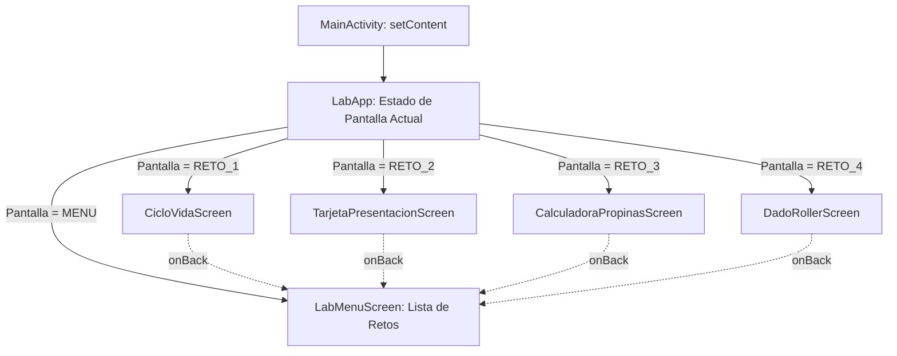

# **2.4 Laboratorio de Retos de la UT02 (`pmdm-lab-ut02`)**

El objetivo de este laboratorio es integrar de forma práctica todos los conceptos aprendidos a lo largo de la unidad en una única aplicación Android: **`pmdm-lab-ut02`**. Al centralizar el trabajo en un solo proyecto, evitarás sincronizaciones repetitivas de Gradle y mantendrás todo tu progreso organizado en un único repositorio Git.

---

## 1. Arquitectura del Proyecto de Prácticas

La aplicación cuenta con una pantalla principal (`LabMenuScreen`) que actúa como catálogo interactivo. Desde ella, el usuario puede seleccionar y abrir cualquiera de los retos desarrollados.



### 1.1. El Navegador Ligero (`MainActivity.kt`)

En lugar de introducir librerías de navegación complejas en esta primera toma de contacto, implementamos un conmutador de pantallas declarativo basado en un `enum` y la estructura `when` de Kotlin:

??? example "Ver código completo: MainActivity.kt (Navegador Ligero)"

    ```kotlin
    package com.dam.pmdmlab

    import android.os.Bundle
    import androidx.activity.ComponentActivity
    import androidx.activity.compose.setContent
    import androidx.compose.foundation.layout.fillMaxSize
    import androidx.compose.material3.MaterialTheme
    import androidx.compose.material3.Surface
    import androidx.compose.runtime.Composable
    import androidx.compose.runtime.getValue
    import androidx.compose.runtime.mutableStateOf
    import androidx.compose.runtime.saveable.rememberSaveable
    import androidx.compose.runtime.setValue
    import androidx.compose.ui.Modifier
    import com.dam.pmdmlab.ui.menu.LabMenuScreen
    import com.dam.pmdmlab.ui.retos.reto01_ciclovida.CicloVidaScreen
    import com.dam.pmdmlab.ui.retos.reto02_tarjeta.TarjetaPresentacionScreen
    import com.dam.pmdmlab.ui.retos.reto03_propinas.CalculadoraPropinasScreen
    import com.dam.pmdmlab.ui.retos.reto04_dados.DadoRollerScreen
    import com.dam.pmdmlab.ui.theme.PMDMLabTheme

    enum class PantallaReto(val titulo: String, val descripcion: String) {
        MENU("Catálogo de Retos", "Menú principal del laboratorio"),
        RETO_1("Reto 1: Ciclo de Vida", "Inspección de logs y remember vs rememberSaveable"),
        RETO_2("Reto 2: Tarjeta de Presentación", "Componibles, datos mock y previews múltiples"),
        RETO_3("Reto 3: Calculadora de Propinas", "Entrada de texto, estados reactivos y formateo"),
        RETO_4("Reto 4: Lanzador de Dados", "Generación pseudoaleatoria y estado de tiradas")
    }

    class MainActivity : ComponentActivity() {
        override fun onCreate(savedInstanceState: Bundle?) {
            super.onCreate(savedInstanceState)
            setContent {
                PMDMLabTheme {
                    Surface(
                        modifier = Modifier.fillMaxSize(),
                        color = MaterialTheme.colorScheme.background
                    ) {
                        LabApp()
                    }
                }
            }
        }
    }

    @Composable
    fun LabApp() {
        var pantallaActual by rememberSaveable { mutableStateOf(PantallaReto.MENU) }

        when (pantallaActual) {
            PantallaReto.MENU -> {
                LabMenuScreen(
                    onSeleccionarReto = { nuevoReto -> pantallaActual = nuevoReto }
                )
            }
            PantallaReto.RETO_1 -> {
                CicloVidaScreen(onBack = { pantallaActual = PantallaReto.MENU })
            }
            PantallaReto.RETO_2 -> {
                TarjetaPresentacionScreen(onBack = { pantallaActual = PantallaReto.MENU })
            }
            PantallaReto.RETO_3 -> {
                CalculadoraPropinasScreen(onBack = { pantallaActual = PantallaReto.MENU })
            }
            PantallaReto.RETO_4 -> {
                DadoRollerScreen(onBack = { pantallaActual = PantallaReto.MENU })
            }
        }
    }
    ```

### 1.2. La Pantalla de Menú (`LabMenuScreen.kt`)

Crea el archivo `app/src/main/java/com/dam/pmdmlab/ui/menu/LabMenuScreen.kt`:

??? example "Ver código completo: LabMenuScreen.kt (Menú del Catálogo)"

    ```kotlin
    package com.dam.pmdmlab.ui.menu

    import androidx.compose.foundation.clickable
    import androidx.compose.foundation.layout.Arrangement
    import androidx.compose.foundation.layout.Column
    import androidx.compose.foundation.layout.Spacer
    import androidx.compose.foundation.layout.fillMaxSize
    import androidx.compose.foundation.layout.fillMaxWidth
    import androidx.compose.foundation.layout.height
    import androidx.compose.foundation.layout.padding
    import androidx.compose.foundation.rememberScrollState
    import androidx.compose.foundation.verticalScroll
    import androidx.compose.material3.Card
    import androidx.compose.material3.CardDefaults
    import androidx.compose.material3.MaterialTheme
    import androidx.compose.material3.Surface
    import androidx.compose.material3.Text
    import androidx.compose.runtime.Composable
    import androidx.compose.ui.Modifier
    import androidx.compose.ui.tooling.preview.Preview
    import androidx.compose.ui.unit.dp
    import com.dam.pmdmlab.PantallaReto

    @Composable
    fun LabMenuScreen(
        onSeleccionarReto: (PantallaReto) -> Unit,
        modifier: Modifier = Modifier
    ) {
        Column(
            modifier = modifier
                .fillMaxSize()
                .verticalScroll(rememberScrollState())
                .padding(20.dp),
            verticalArrangement = Arrangement.spacedBy(16.dp)
        ) {
            Text(
                text = "PMDM Lab - UT02",
                style = MaterialTheme.typography.headlineMedium
            )
            Text(
                text = "Selecciona una práctica para probar su interfaz y comportamiento:",
                style = MaterialTheme.typography.bodyMedium,
                color = MaterialTheme.colorScheme.onSurfaceVariant
            )

            Spacer(modifier = Modifier.height(8.dp))

            // Excluimos la opción de menú para no enlazar hacia sí misma
            PantallaReto.entries.filter { it != PantallaReto.MENU }.forEach { reto ->
                ItemRetoCard(
                    reto = reto,
                    onClick = { onSeleccionarReto(reto) }
                )
            }
        }
    }

    @Composable
    private fun ItemRetoCard(
        reto: PantallaReto,
        onClick: () -> Unit,
        modifier: Modifier = Modifier
    ) {
        Card(
            modifier = modifier
                .fillMaxWidth()
                .clickable(onClick = onClick),
            colors = CardDefaults.cardColors(
                containerColor = MaterialTheme.colorScheme.surfaceVariant
            )
        ) {
            Column(modifier = Modifier.padding(16.dp)) {
                Text(
                    text = reto.titulo,
                    style = MaterialTheme.typography.titleMedium
                )
                Spacer(modifier = Modifier.height(4.dp))
                Text(
                    text = reto.descripcion,
                    style = MaterialTheme.typography.bodySmall
                )
            }
        }
    }

    @Preview(showBackground = true)
    @Composable
    private fun LabMenuScreenPreview() {
        Surface {
            LabMenuScreen(onSeleccionarReto = {})
        }
    }
    ```

---

## 2. Banco de Retos de la Unidad

Para completar el laboratorio debes implementar los siguientes 4 retos dentro del paquete `com.dam.pmdmlab.ui.retos/`:

### Reto 1: Ciclo de Vida y Persistencia de Estados
- **Paquete:** `ui.retos.reto01_ciclovida`
- **Objetivo:** Implementar la pantalla explicada en el [apartado 2.2](./2.2-ciclo-vida-app.md), añadiendo logs en `MainActivity` para verificar las transiciones de estado en Logcat y contrastando el comportamiento de `remember` vs `rememberSaveable` tras rotar la pantalla.

### Reto 2: Tarjeta de Presentación Interactiva y Previews
- **Paquete:** `ui.retos.reto02_tarjeta`
- **Objetivo:** Implementar la tarjeta descrita en el [apartado 2.3](./2.3-primera-app.md), aplicando estrictamente la separación entre `TarjetaPresentacionContent` (Stateless con 2 `@Preview` ricas) y `TarjetaPresentacionScreen` (Stateful).

### Reto 3: Calculadora de Propinas Reactiva
- **Paquete:** `ui.retos.reto03_propinas`
- **Requisitos:**

    - Diseña `CalculadoraPropinasContent` que reciba el importe introducido, el porcentaje seleccionado (10%, 15% o 20%) y el resultado calculado.
    - Un campo de texto `OutlinedTextField` para que el usuario escriba la cantidad de la cuenta.
    - Una fila de botones para conmutar el porcentaje deseado.
    - Una tarjeta destacada que muestre el desglose: propina y total a pagar.
    - Diseña al menos **dos `@Preview`** para el componente de presentación (por ejemplo: cuenta de 50.00€ con propina del 15%, y estado inicial con 0.00€).
    - La pantalla `CalculadoraPropinasScreen` debe usar `rememberSaveable` para que los datos no se borren si el usuario gira el teléfono.

### Reto 4: Lanzador de Dados (*Dice Roller*)
- **Paquete:** `ui.retos.reto04_dados`
- **Requisitos:**

    - Un generador de números aleatorios entre 1 y 6 al pulsar un botón "Lanzar Dado".
    - Una superficie visual que muestre el valor actual del dado y el histórico del número de lanzamientos totales efectuados.
    - Un botón secundario para "Reiniciar tiradas".
    - Separación rigurosa en componente *Stateless* con sus vistas previas correspondientes y componente contenedor *Stateful*.

---

## 3. Lista de Verificación de Calidad (*Checklist*)

Antes de dar por finalizado tu laboratorio, verifica los siguientes puntos:

- [ ] **Sincronización limpia de Gradle:** El proyecto compila sin errores ni dependencias sin resolver.
- [ ] **Separación Stateful vs Stateless:** Cada reto divide la pantalla en su contenedor (`...Screen`) y su componente visual puro (`...Content`).
- [ ] **Cobertura de Previews:** Cada archivo de reto incluye vistas previas funcionales con datos mock que se visualizan correctamente en el panel lateral de IntelliJ IDEA sin necesidad de emulador.
- [ ] **Resistencia ante giros de pantalla:** Todos los estados clave están almacenados con `rememberSaveable` y no se pierden al rotar el dispositivo.
- [ ] **Navegación fluida:** Desde cualquier reto se puede pulsar en "Volver" para regresar al catálogo principal de `LabMenuScreen`.
