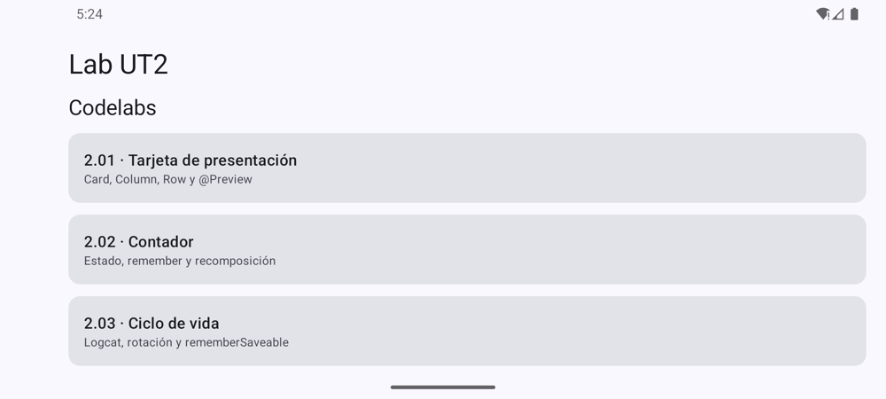
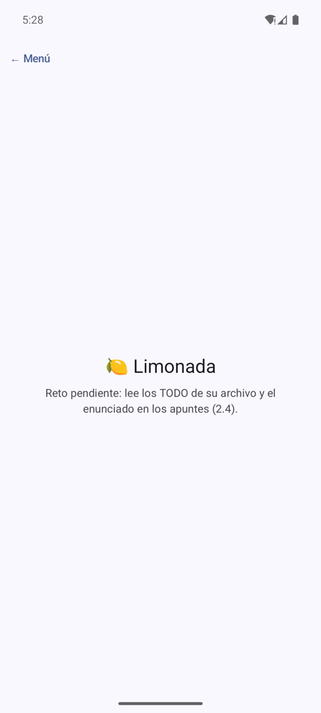
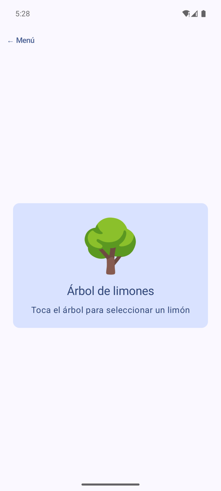
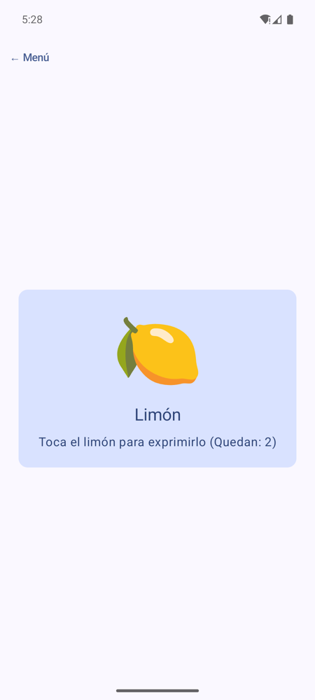
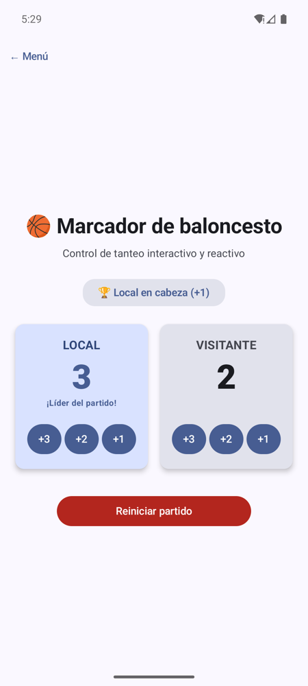

# **2.4 Laboratorio de Prácticas y Codelabs**

El laboratorio de la UT2 es **una sola app Android que crece codelab a codelab**. Empieza siendo la plantilla del curso y, en cinco codelabs guiados, se convierte en un catálogo de pantallas: una tarjeta de presentación, un contador, un experimento del ciclo de vida, un lanzador de dados y un semáforo. Cada codelab parte exactamente de donde terminó el anterior y añade una sola idea nueva. Después, dos **retos autónomos** te piden aplicar lo aprendido sin guía.

El laboratorio se divide en dos bloques:

1. **Codelabs guiados:** paso a paso, con la teoría, el código completo y un tag de Git con la solución.

2. **Retos autónomos:** un enunciado con requisitos y criterios de aceptación que resuelves por tu cuenta. La solución se publica en un tag aparte.

---

## 1. El Repositorio del Laboratorio

Todo el laboratorio vive en un repositorio de GitHub:

**[github.com/jssdocente/pmdm2627-lab-ut2](https://github.com/jssdocente/pmdm2627-lab-ut2)**

- **Punto de partida:** la plantilla `ProyectoComposeBase` del curso (IntelliJ IDEA 2026.2, AGP 9.1.1, compileSdk 37), con el paquete `com.pmdm.lab.ut2`.
- **Dos tags por codelab:** el de inicio (`c2.01-inicio`) y el de fin (`c2.01-fin`). El tag de fin de un codelab es el mismo commit que el de inicio del siguiente.
- **Dos tags por reto:** el de inicio (`r2.01-inicio`), con la pantalla vacía y los `TODO`, y el de la solución (`r2.01-solucion`).

| Codelab | Inicio | Fin |
| :--- | :--- | :--- |
| [2.01 · Tarjeta de presentación y `@Preview`](./codelabs/01-tarjeta-presentacion.md) | `c2.01-inicio` | `c2.01-fin` |
| [2.02 · Contador, estado y menú del laboratorio](./codelabs/02-contador-incremental.md) | `c2.02-inicio` | `c2.02-fin` |
| [2.03 · Ciclo de vida, Logcat y `rememberSaveable`](./codelabs/03-ciclo-vida-logcat.md) | `c2.03-inicio` | `c2.03-fin` |
| [2.04 · Lanzador de dados, imágenes y recursos](./codelabs/04-dado-interactivo.md) | `c2.04-inicio` | `c2.04-fin` |
| [2.05 · Semáforo y máquinas de estados](./codelabs/05-semaforo-estados.md) | `c2.05-inicio` | `c2.05-fin` |
| [Reto 2.01 · El juego de la limonada](#reto-201-el-juego-de-la-limonada) | `r2.01-inicio` | `r2.01-solucion` |
| [Reto 2.02 · Marcador de baloncesto](#reto-202-marcador-de-baloncesto) | `r2.02-inicio` | `r2.02-solucion` |

### 1.1. Descargarlo con Git (recomendado)

```bash
git clone https://github.com/jssdocente/pmdm2627-lab-ut2.git lab-ut2
cd lab-ut2
git checkout c2.01-inicio      # el punto de partida del primer codelab
git switch -c mi-lab           # tu rama para trabajar
```

Abre la carpeta `lab-ut2` en IntelliJ IDEA (*File › Open…*, la carpeta que contiene `settings.gradle.kts`). La configuración del SDK y del JDK es la misma que la de la plantilla; si algo falla, consulta su README.

Trabaja siempre en **tu rama**. Así, para cada codelab tienes dos opciones:

- **Seguir con tu código:** si terminaste el codelab anterior, continúa en tu rama.
- **Partir de la solución:** si te quedaste a medias, crea una rama nueva desde el tag de inicio: `git switch -c mi-lab-2.03 c2.03-inicio`.

Para comparar tu trabajo con la solución de un codelab:

```bash
git diff c2.03-fin            # qué te falta o qué has hecho distinto
```

!!! tip "Tags nuevos"
    Si las soluciones de los retos se publican después de que clonaras el repositorio, descárgalas con `git fetch --tags`.

### 1.2. Sin Git

En la página del repositorio, en **Tags**, cada tag se descarga como `.zip`. Descomprímelo en una ruta corta y sin acentos (por ejemplo `C:\PMDM\lab-ut2`), igual que la plantilla. Para el codelab siguiente, descarga su tag de inicio o sigue trabajando sobre tu carpeta.

---

## 2. Cómo está Organizado el Proyecto

Al terminar el último codelab, el proyecto tiene esta estructura:

```
com.pmdm.lab.ut2/
├── MainActivity.kt          // Ciclo de vida con logs y setContent { LabApp() }   (2.03)
├── LabApp.kt                // PantallaLab + navegación con when                  (2.02)
├── codelabs/
│   ├── codelab01_tarjeta/   // TarjetaPresentacion (2.01) y TarjetaScreen (2.02)
│   ├── codelab02_contador/  // ContadorContent y ContadorScreen                   (2.02)
│   ├── codelab03_ciclovida/ // remember frente a rememberSaveable                (2.03)
│   ├── codelab04_dados/     // Image, drawables y strings.xml                     (2.04)
│   └── codelab05_semaforo/  // FaseSemaforo como máquina de estados               (2.05)
├── retos/
│   ├── reto01_limonada/
│   └── reto02_marcador/
└── ui/
    ├── menu/LabMenuScreen.kt // Catálogo de pantallas                             (2.02)
    └── theme/                // LabUt2Theme (plantilla)
```

La navegación se construye en el [Codelab 2.02](./codelabs/02-contador-incremental.md#7-paso-4-el-menu-del-laboratorio): `LabApp` guarda en el estado qué pantalla se ve y un `when` decide cuál pintar.

<figure class="arq-fig">
--8<-- "docs/temas/02/codelabs/images/lab-navegacion.svg"
<figcaption><code>LabApp</code> guarda qué pantalla se ve; el menú y el botón de volver solo cambian ese estado.</figcaption>
</figure>

**Para añadir una pantalla** al laboratorio (lo harás en cada codelab desde el 2.03 y en los retos):

1. Añade una entrada a `enum class PantallaLab` en `LabApp.kt`, con su título y su descripción.

2. Añade su rama al `when` de `LabApp`, envuelta en `PantallaConVolver`.

El menú no se toca: recorre `PantallaLab.entries` y la nueva tarjeta aparece sola.

Todas las pantallas siguen el mismo patrón: un composable **sin estado** (`…Content`) que recibe los datos y avisa de los eventos con lambdas, y una pantalla **con estado** (`…Screen`) que guarda el estado con `rememberSaveable` y se lo pasa.

---

## 3. Los Codelabs Guiados

| Codelab | Qué aprendes | Sesión de clase |
| :--- | :--- | :--- |
| [**2.01 · Tarjeta de presentación**](./codelabs/01-tarjeta-presentacion.md) | `Column`, `Row`, `Card`, `Surface`, `Modifier`, componentes sin estado y varias `@Preview` (claro, oscuro, ancho fijo). | [2.01](./sesiones/s01-primer-contacto-compose.md) |
| [**2.02 · Contador y menú**](./codelabs/02-contador-incremental.md) | Por qué falla una variable normal, `mutableIntStateOf`, `remember`, delegado `by`, *state hoisting* (`Content`/`Screen`) y un menú que navega con estado. | [2.02](./sesiones/s02-estado-state-hoisting.md) |
| [**2.03 · Ciclo de vida**](./codelabs/03-ciclo-vida-logcat.md) | Métodos del ciclo de vida, `Log.d` y Logcat, recreación de la `Activity` al girar y `rememberSaveable`. | [2.02](./sesiones/s02-estado-state-hoisting.md) |
| [**2.04 · Lanzador de dados**](./codelabs/04-dado-interactivo.md) | `(1..6).random()`, `Image` y `painterResource`, drawables vectoriales, `strings.xml` con argumentos, `contentDescription` y un test unitario. | [2.03](./sesiones/s03-imagenes-iconos-recursos.md) |
| [**2.05 · Semáforo**](./codelabs/05-semaforo-estados.md) | `enum class` con propiedades como máquina de estados, `CircleShape`, una pantalla derivada de un solo estado y tests de las transiciones. | — |

---

## 4. Retos Autónomos

Los dos retos parten del laboratorio terminado. En el tag de inicio, cada reto ya tiene su entrada en el menú y su archivo con una pantalla provisional y una lista de `TODO`: tu trabajo es sustituirla por la solución.

```bash
git switch -c mi-reto-2.01 r2.01-inicio
```

Aquí **no tienes el código resuelto**: diseña la solución tú mismo a partir de la especificación. La solución de referencia está en los tags `r2.01-solucion` y `r2.02-solucion`; mírala solo después de entregar.

<div style="display: flex; flex-direction: row; justify-content: center; align-items: flex-start; gap: 1.5rem; flex-wrap: wrap; margin: 1.8rem 0;" markdown="1">

<figure style="margin: 0; text-align: center; max-width: 220px;" markdown="1">

{ style="border-radius: 8px; box-shadow: 0 4px 10px rgba(0,0,0,0.15); width: 100%; max-width: 210px;" }

<figcaption style="font-size: 0.85rem; margin-top: 0.5rem; color: var(--md-default-fg-color--light);"><strong>Figura 1:</strong> El menú en <code>r2.01-inicio</code>, con los dos retos al final.</figcaption>
</figure>

<figure style="margin: 0; text-align: center; max-width: 220px;" markdown="1">

{ style="border-radius: 8px; box-shadow: 0 4px 10px rgba(0,0,0,0.15); width: 100%; max-width: 210px;" }

<figcaption style="font-size: 0.85rem; margin-top: 0.5rem; color: var(--md-default-fg-color--light);"><strong>Figura 2:</strong> La pantalla provisional que sustituirás.</figcaption>
</figure>

</div>

---

### Reto 2.01 · El Juego de la Limonada

- **Tag de inicio:** `r2.01-inicio` · **Solución:** `r2.01-solucion`
- **Archivo:** `retos/reto01_limonada/Limonada.kt`

Inspirado en el clásico reto de los cursos de Google *Android Basics*, este ejercicio pone a prueba tu capacidad para gestionar una **máquina de estados secuencial con interacción**, como el semáforo del codelab 2.05, pero con un contador aleatorio dentro de una de las fases.

#### 1. Lógica de Estados y Comportamiento

La pantalla pasa por cuatro fases consecutivas. Cada pulsación sobre la tarjeta central hace avanzar el juego:

<figure class="arq-fig">
--8<-- "docs/temas/02/codelabs/images/r2.01-estados.svg"
<figcaption>Las cuatro fases del juego. La fase <code>LIMON</code> se repite hasta que no quedan exprimidos.</figcaption>
</figure>

1. **Fase 1, el árbol de limones.**

    - **Texto:** `"Toca el árbol para seleccionar un limón"`.
    - **Acción:** al pulsar, pasa a la fase 2 y calcula al azar cuántos exprimidos harán falta, entre 2 y 4, con `(2..4).random()`.

2. **Fase 2, el limón.**

    - **Texto:** `"Toca el limón para exprimirlo (Quedan: X)"`.
    - **Acción:** cada pulsación resta 1 a los exprimidos restantes. Al llegar a 0, pasa sola a la fase 3.

3. **Fase 3, el vaso lleno.**

    - **Texto:** `"Toca el vaso para beber tu limonada"`.
    - **Acción:** al pulsar, pasa a la fase 4.

4. **Fase 4, el vaso vacío.**

    - **Texto:** `"Toca el vaso vacío para volver a empezar"`.
    - **Acción:** al pulsar, vuelve a la fase 1.

<div style="display: flex; flex-direction: row; justify-content: center; align-items: flex-start; gap: 1rem; flex-wrap: wrap; margin: 1.8rem 0;" markdown="1">

<figure style="margin: 0; text-align: center; max-width: 220px;" markdown="1">

{ style="border-radius: 8px; box-shadow: 0 4px 10px rgba(0,0,0,0.15); width: 100%; max-width: 200px;" }

<figcaption style="font-size: 0.82rem; margin-top: 0.5rem; color: var(--md-default-fg-color--light);"><strong>Fase 1:</strong> el árbol de limones.</figcaption>
</figure>

<figure style="margin: 0; text-align: center; max-width: 220px;" markdown="1">

{ style="border-radius: 8px; box-shadow: 0 4px 10px rgba(0,0,0,0.15); width: 100%; max-width: 200px;" }

<figcaption style="font-size: 0.82rem; margin-top: 0.5rem; color: var(--md-default-fg-color--light);"><strong>Fase 2:</strong> el limón, con los exprimidos que quedan.</figcaption>
</figure>

</div>

La apariencia es libre: las figuras muestran una solución posible, con un emoji por fase. Puedes usar imágenes de `res/drawable` como en el codelab 2.04.

#### 2. Requisitos Técnicos Obligatorios

- Modelar las cuatro fases con un `enum class FaseLimonada`.
- Guardar la fase actual y los exprimidos restantes con **`rememberSaveable`**, para que el juego no se reinicie al girar el móvil.
- Separar **`LimonadaContent`** (sin estado) de **`LimonadaScreen`** (con estado).
- Al menos **4 `@Preview`**, una por fase.

---

### Reto 2.02 · Marcador de Baloncesto

- **Tag de inicio:** `r2.02-inicio` · **Solución:** `r2.02-solucion`
- **Archivo:** `retos/reto02_marcador/MarcadorBaloncesto.kt`

Este reto evalúa la gestión de **varios estados a la vez** y de valores que se **calculan** a partir de ellos en cada recomposición, como quién va ganando.

#### 1. Lógica de la Interfaz

<div style="display: flex; flex-direction: row; justify-content: center; align-items: flex-start; gap: 1.5rem; flex-wrap: wrap; margin: 1.8rem 0;" markdown="1">

<figure style="margin: 0; text-align: center; max-width: 260px;" markdown="1">

{ style="border-radius: 8px; box-shadow: 0 4px 10px rgba(0,0,0,0.15); width: 100%; max-width: 250px;" }

<figcaption style="font-size: 0.85rem; margin-top: 0.5rem; color: var(--md-default-fg-color--light);"><strong>Figura 3:</strong> El local en cabeza, con la etiqueta de líder.</figcaption>
</figure>

</div>

1. **Dos equipos en paralelo.**

    - El panel del equipo **local** y el del **visitante**, uno junto al otro en una `Row`.
    - Cada panel muestra el nombre del equipo y sus puntos en grande (`displayMedium`).

2. **Botones de anotación.** Cada equipo tiene tres botones:

    - **`+3`** (triple).
    - **`+2`** (canasta).
    - **`+1`** (tiro libre).

3. **Indicador de líder.**

    - Si el local tiene más puntos, bajo su marcador aparece la etiqueta `"¡Líder del partido!"`.
    - Si el visitante tiene más puntos, la etiqueta aparece bajo el suyo.
    - Si van empatados, se muestra en el centro el texto `"Partido empatado"`.

4. **Botón de reinicio.**

    - `"Reiniciar partido"` pone los dos marcadores a cero.
    - Está deshabilitado cuando el partido va 0-0.

#### 2. Requisitos Técnicos Obligatorios

- Guardar los puntos de cada equipo con `rememberSaveable { mutableIntStateOf(0) }`.
- Separar **`MarcadorBaloncestoContent`** (sin estado) de **`MarcadorBaloncestoScreen`** (con estado).
- Al menos **3 `@Preview`**:

    - Empate inicial (0-0).
    - Gana el local (por ejemplo, 68-52).
    - Gana el visitante (por ejemplo, 45-50).

---

## 5. Rúbrica de Evaluación

La práctica se califica sobre 10 puntos con esta rúbrica:

| Criterio | Peso | Excelente (100 %) | Aceptable (60 %) | Insuficiente (0 %) |
| :--- | :---: | :--- | :--- | :--- |
| **Separación sin estado / con estado** | **25 %** | Todas las pantallas separan el componente visual sin estado (`…Content`) de la pantalla con estado (`…Screen`). No hay estado en ningún `…Content`. | La mayoría de pantallas están separadas, pero algún `…Content` guarda estado. | No se separa: lógica e interfaz están en una sola función. |
| **Resistencia al giro (`rememberSaveable`)** | **25 %** | Todos los estados importantes (fases, contadores, marcadores, pantalla visible) sobreviven al girar el móvil. | Algunos estados se conservan y otros vuelven a su valor inicial. | Se usa `remember`: la app pierde los datos al girar. |
| **Vistas previas** | **20 %** | Todos los retos tienen previews que funcionan, con datos de prueba que cubren los estados representativos. | Hay previews, pero no cubren todos los estados. | No hay previews o no se renderizan. |
| **Resolución de los retos** | **20 %** | La limonada y el marcador cumplen al 100 % la especificación. | Funcionan, con errores en el azar de los exprimidos o en la detección del líder. | No están implementados o no compilan. |
| **Calidad de código y navegación** | **10 %** | Código limpio e idiomático, sin avisos del compilador; los retos se abren desde el menú y «atrás» vuelve a él. | Navegación correcta con pequeños descuidos de nombres o `import` sin usar. | El menú no abre los retos o la app se cierra al volver. |

---

## 6. Lista de Verificación Final

Antes de entregar, comprueba uno a uno estos puntos:

- [ ] **Gradle sincroniza y compila** sin errores (`./gradlew assembleDebug`).
- [ ] **Los tests pasan** (`./gradlew test`).
- [ ] **Ciclo de vida:** las trazas `Log.d` de `MainActivity` se ven en Logcat filtrando por `tag:CicloVidaLab`.
- [ ] **Separación:** todas las pantallas (`TarjetaScreen`, `ContadorScreen`, `CicloVidaScreen`, `DadoScreen`, `SemaforoScreen`, `LimonadaScreen`, `MarcadorBaloncestoScreen`) delegan el dibujo en un componente sin estado.
- [ ] **Previews:** al abrir cada archivo en IntelliJ IDEA, el panel de diseño muestra sus `@Preview`.
- [ ] **Giro:** al girar el emulador, ni el dado, ni el semáforo, ni la limonada, ni el marcador pierden sus valores, y la app sigue en la misma pantalla.
- [ ] **Navegación:** cada reto se abre desde `LabMenuScreen` y se vuelve al menú con `← Menú` o con el botón «atrás» del sistema.
