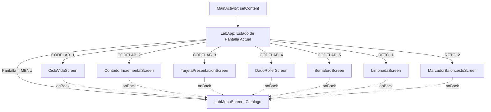
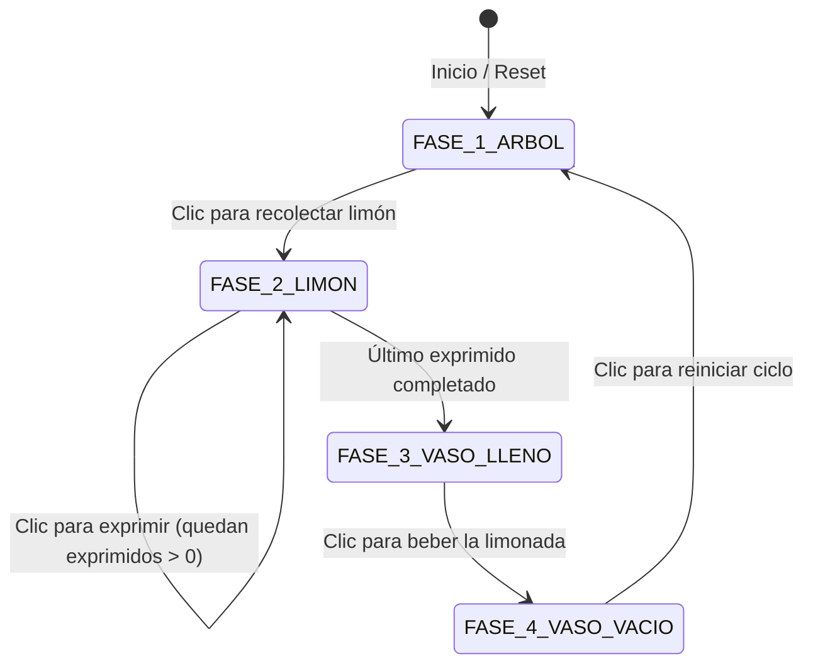
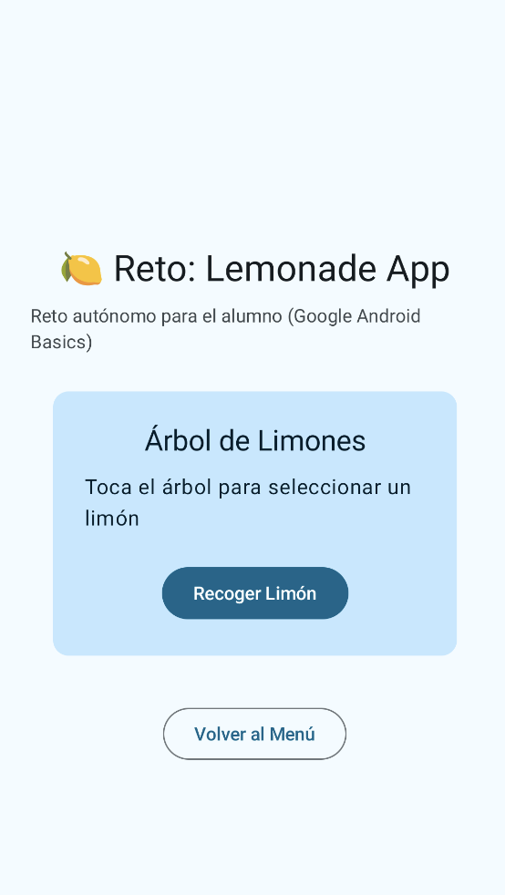
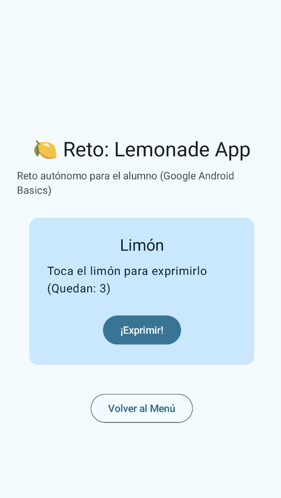
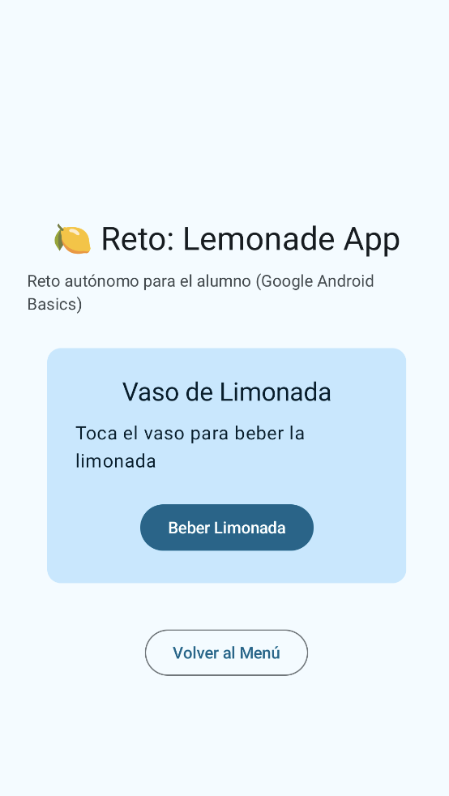
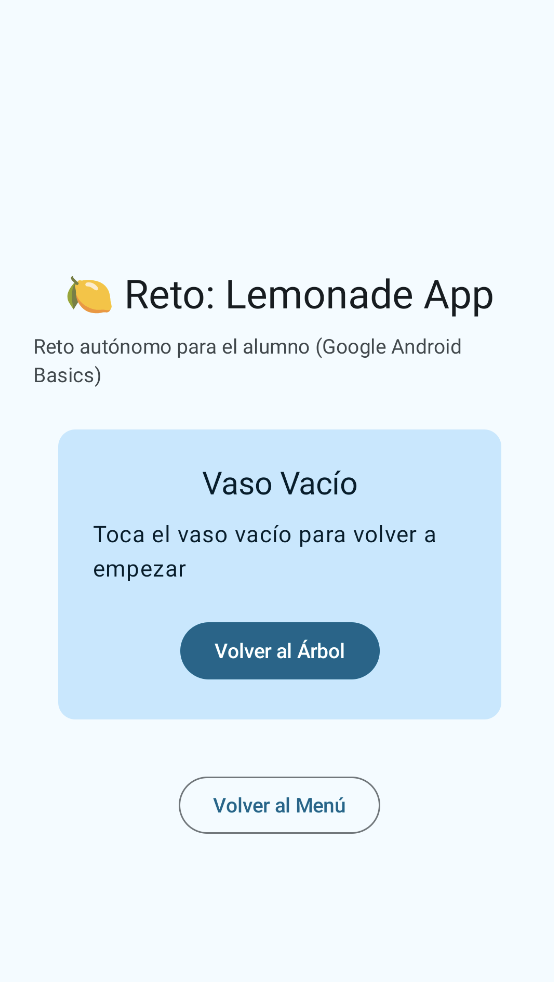
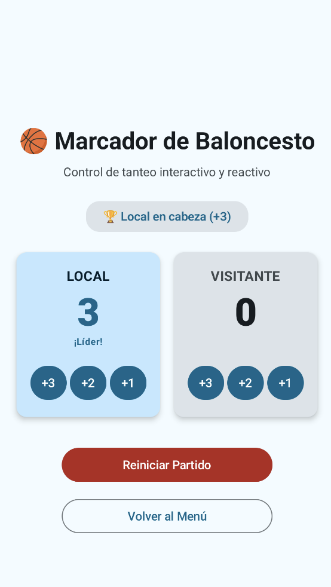
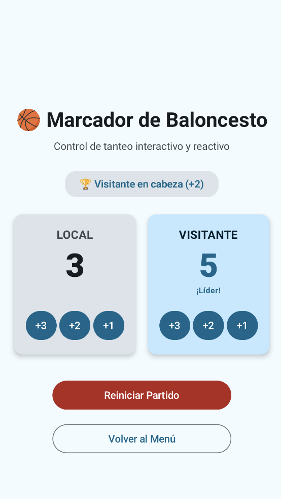

# **2.4 Laboratorio de Prácticas y Codelabs (`pmdm-lab-ut02`)**

El objetivo de este laboratorio es integrar de forma práctica todos los conceptos aprendidos a lo largo de la unidad en una única aplicación Android: **`pmdm-lab-ut02`**. Al centralizar el trabajo en un solo proyecto, evitarás sincronizaciones repetitivas de Gradle y mantendrás todo tu progreso organizado en un único repositorio Git.

!!! tip "Creación del Proyecto Base en IntelliJ IDEA"

    Si todavía no has creado el proyecto base de la aplicación, consulta y sigue con atención la guía paso a paso explicada en el apartado **[2.1 Primeros pasos y Creación del Proyecto en IntelliJ IDEA](./2.1-primeros-pasos.md#2-creacion-del-primer-proyecto-android-con-jetpack-compose-en-intellij-idea)**. Recuerda seleccionar la plantilla **Empty Activity** (con Compose) en la categoría **Android** nativa (sin KMP por el momento).

El laboratorio se divide en dos bloques formativos complementarios:

1. **Codelabs Guiados (Paso a paso):** Tutoriales exhaustivos con explicaciones teóricas, diagramas de flujo y soluciones completas para construir las bases de la interfaz declarativa y el ciclo de vida.
2. **Retos Autónomos (Sin resolver):** Problemas prácticos con especificación funcional completa, diagramas y criterios de aceptación para que apliques de forma independiente lo aprendido y demuestres tu dominio técnico.

---

## 1. Arquitectura del Proyecto de Prácticas

La aplicación cuenta con una pantalla principal (`LabMenuScreen`) que actúa como catálogo interactivo. Desde ella, el usuario puede seleccionar y abrir cualquiera de los codelabs guiados o retos desarrollados:



### 1.1. El Navegador Ligero (`MainActivity.kt`)

En lugar de introducir librerías de navegación complejas en esta primera toma de contacto, implementamos un conmutador de pantallas declarativo basado en un `enum` y la estructura `when` de Kotlin:

??? example "Ver código completo: MainActivity.kt (Navegador Ligero del Laboratorio)"

    ```kotlin
    package com.dam.pmdmlab

    import android.os.Bundle
    import android.util.Log
    import androidx.activity.ComponentActivity
    import androidx.activity.compose.setContent
    import androidx.compose.foundation.layout.fillMaxSize
    import androidx.compose.material3.MaterialTheme
    import androidx.compose.material3.Surface
    import androidx.compose.runtime.Composable
    import androidx.compose.runtime.getValue
    import androidx.compose.runtime.mutableStateOf
    import androidx.compose.runtime.saveable.rememberSaveable
    import androidx.compose.runtime.setValue
    import androidx.compose.ui.Modifier
    import androidx.compose.ui.tooling.preview.Preview
    import com.dam.pmdmlab.codelabs.codelab01_ciclovida.CicloVidaScreen
    import com.dam.pmdmlab.codelabs.codelab02_contador.ContadorIncrementalScreen
    import com.dam.pmdmlab.codelabs.codelab03_tarjeta.TarjetaPresentacionScreen
    import com.dam.pmdmlab.codelabs.codelab04_dados.DadoRollerScreen
    import com.dam.pmdmlab.codelabs.codelab05_semaforo.SemaforoScreen
    import com.dam.pmdmlab.ui.menu.LabMenuScreen
    import com.dam.pmdmlab.ui.theme.PMDMLabTheme

    enum class CategoriaReto {
        CODELAB_GUIADO,
        RETO_AUTONOMO
    }

    enum class PantallaReto(
        val titulo: String,
        val descripcion: String,
        val categoria: CategoriaReto
    ) {
        MENU("Catálogo de Prácticas", "Menú principal del laboratorio", CategoriaReto.CODELAB_GUIADO),

        // Codelabs Guiados
        CODELAB_1("Codelab 1: Ciclo de Vida", "Logs en Logcat y remember vs rememberSaveable", CategoriaReto.CODELAB_GUIADO),
        CODELAB_2("Codelab 2: Contador Incremental", "Estado mutable, recomposición y delegación con by", CategoriaReto.CODELAB_GUIADO),
        CODELAB_3("Codelab 3: Tarjeta y Previews", "Componibles, datos mock y vistas previas múltiples", CategoriaReto.CODELAB_GUIADO),
        CODELAB_4("Codelab 4: Lanzador de Dados", "Aleatoriedad, estado mutable y tiradas acumuladas", CategoriaReto.CODELAB_GUIADO),
        CODELAB_5("Codelab 5: Semáforo Inteligente", "Máquinas de estados discretos, formas y reactividad", CategoriaReto.CODELAB_GUIADO),

        // Retos Autónomos (para resolver por el alumno)
        RETO_1("Reto Autónomo 1: Lemonade App", "Máquina de 4 estados con exprimido interactivo", CategoriaReto.RETO_AUTONOMO),
        RETO_2("Reto Autónomo 2: Marcador Baloncesto", "Gestión de marcadores simultáneos y líder dinámico", CategoriaReto.RETO_AUTONOMO)
    }

    class MainActivity : ComponentActivity() {

        companion object {
            private const val TAG = "CicloVidaDemo"
        }

        override fun onCreate(savedInstanceState: Bundle?) {
            super.onCreate(savedInstanceState)
            Log.d(TAG, "===> onCreate: Activity creada.")

            setContent {
                PMDMLabTheme {
                    Surface(
                        modifier = Modifier.fillMaxSize(),
                        color = MaterialTheme.colorScheme.background
                    ) {
                        LabApp()
                    }
                }
            }
        }

        override fun onStart() {
            super.onStart()
            Log.d(TAG, "===> onStart: Activity visible.")
        }

        override fun onResume() {
            super.onResume()
            Log.d(TAG, "===> onResume: Activity interactiva.")
        }

        override fun onPause() {
            super.onPause()
            Log.d(TAG, "===> onPause: Activity en pausa.")
        }

        override fun onStop() {
            super.onStop()
            Log.d(TAG, "===> onStop: Activity detenida.")
        }

        override fun onDestroy() {
            super.onDestroy()
            Log.d(TAG, "===> onDestroy: Activity destruida.")
        }
    }

    @Composable
    fun LabApp() {
        var pantallaActual by rememberSaveable { mutableStateOf(PantallaReto.MENU) }

        when (pantallaActual) {
            PantallaReto.MENU -> {
                LabMenuScreen(
                    onSeleccionarReto = { nuevoReto -> pantallaActual = nuevoReto }
                )
            }
            PantallaReto.CODELAB_1 -> {
                CicloVidaScreen(onBack = { pantallaActual = PantallaReto.MENU })
            }
            PantallaReto.CODELAB_2 -> {
                ContadorIncrementalScreen(onBack = { pantallaActual = PantallaReto.MENU })
            }
            PantallaReto.CODELAB_3 -> {
                TarjetaPresentacionScreen(onBack = { pantallaActual = PantallaReto.MENU })
            }
            PantallaReto.CODELAB_4 -> {
                DadoRollerScreen(onBack = { pantallaActual = PantallaReto.MENU })
            }
            PantallaReto.CODELAB_5 -> {
                SemaforoScreen(onBack = { pantallaActual = PantallaReto.MENU })
            }
            PantallaReto.RETO_1 -> {
                // Implementado por el alumno: LimonadaScreen
                // LimonadaScreen(onBack = { pantallaActual = PantallaReto.MENU })
            }
            PantallaReto.RETO_2 -> {
                // Implementado por el alumno: MarcadorBaloncestoScreen
                // MarcadorBaloncestoScreen(onBack = { pantallaActual = PantallaReto.MENU })
            }
        }
    }
    ```

### 1.2. La Pantalla de Menú (`LabMenuScreen.kt`)

Crea el archivo `app/src/main/java/com/dam/pmdmlab/ui/menu/LabMenuScreen.kt`. Este componente agrupa las opciones en dos secciones claras:

??? example "Ver código completo: LabMenuScreen.kt (Menú del Catálogo)"

    ```kotlin
    package com.dam.pmdmlab.ui.menu

    import androidx.compose.foundation.clickable
    import androidx.compose.foundation.layout.Arrangement
    import androidx.compose.foundation.layout.Column
    import androidx.compose.foundation.layout.Spacer
    import androidx.compose.foundation.layout.fillMaxSize
    import androidx.compose.foundation.layout.fillMaxWidth
    import androidx.compose.foundation.layout.height
    import androidx.compose.foundation.layout.padding
    import androidx.compose.foundation.rememberScrollState
    import androidx.compose.foundation.verticalScroll
    import androidx.compose.material3.Card
    import androidx.compose.material3.CardDefaults
    import androidx.compose.material3.MaterialTheme
    import androidx.compose.material3.Surface
    import androidx.compose.material3.Text
    import androidx.compose.runtime.Composable
    import androidx.compose.ui.Modifier
    import androidx.compose.ui.tooling.preview.Preview
    import androidx.compose.ui.unit.dp
    import com.dam.pmdmlab.CategoriaReto
    import com.dam.pmdmlab.PantallaReto

    @Composable
    fun LabMenuScreen(
        onSeleccionarReto: (PantallaReto) -> Unit,
        modifier: Modifier = Modifier
    ) {
        Column(
            modifier = modifier
                .fillMaxSize()
                .verticalScroll(rememberScrollState())
                .padding(20.dp),
            verticalArrangement = Arrangement.spacedBy(16.dp)
        ) {
            Text(
                text = "PMDM Lab - UT02",
                style = MaterialTheme.typography.headlineMedium
            )
            Text(
                text = "Selecciona un codelab o un reto para probar su comportamiento interactivo:",
                style = MaterialTheme.typography.bodyMedium,
                color = MaterialTheme.colorScheme.onSurfaceVariant
            )

            Spacer(modifier = Modifier.height(8.dp))

            // Sección 1: Codelabs Guiados
            Text(
                text = "📚 Codelabs Guiados",
                style = MaterialTheme.typography.titleLarge
            )

            PantallaReto.entries
                .filter { it.categoria == CategoriaReto.CODELAB_GUIADO && it != PantallaReto.MENU }
                .forEach { reto ->
                    ItemRetoCard(reto = reto, onClick = { onSeleccionarReto(reto) })
                }

            Spacer(modifier = Modifier.height(8.dp))

            // Sección 2: Retos Autónomos
            Text(
                text = "🚀 Retos Autónomos (Para el Alumno)",
                style = MaterialTheme.typography.titleLarge
            )

            PantallaReto.entries
                .filter { it.categoria == CategoriaReto.RETO_AUTONOMO }
                .forEach { reto ->
                    ItemRetoCard(reto = reto, onClick = { onSeleccionarReto(reto) })
                }
        }
    }

    @Composable
    private fun ItemRetoCard(
        reto: PantallaReto,
        onClick: () -> Unit,
        modifier: Modifier = Modifier
    ) {
        Card(
            modifier = modifier
                .fillMaxWidth()
                .clickable(onClick = onClick),
            colors = CardDefaults.cardColors(
                containerColor = if (reto.categoria == CategoriaReto.CODELAB_GUIADO) {
                    MaterialTheme.colorScheme.surfaceVariant
                } else {
                    MaterialTheme.colorScheme.tertiaryContainer
                }
            )
        ) {
            Column(modifier = Modifier.padding(16.dp)) {
                Text(
                    text = reto.titulo,
                    style = MaterialTheme.typography.titleMedium
                )
                Spacer(modifier = Modifier.height(4.dp))
                Text(
                    text = reto.descripcion,
                    style = MaterialTheme.typography.bodySmall,
                    color = MaterialTheme.colorScheme.onSurfaceVariant
                )
            }
        }
    }

    @Preview(showBackground = true)
    @Composable
    private fun LabMenuScreenPreview() {
        Surface {
            LabMenuScreen(onSeleccionarReto = {})
        }
    }
    ```

---

## 2. Catálogo de Codelabs Guiados

A continuación tienes el listado de tutoriales paso a paso desarrollados en la unidad:

| Codelab | Contenido y Aprendizajes | Acceso |
| :--- | :--- | :--- |
| **Codelab 1** | **Ciclo de Vida y Logcat:** Inyección de trazas `Log.d`, filtros en IntelliJ IDEA y experimento de rotación (`remember` vs `rememberSaveable`). | [Ver Codelab 1](./codelabs/01-ciclo-vida-logcat.md) |
| **Codelab 2** | **Contador Incremental y Recomposición:** `Button`, `Text`, `mutableIntStateOf`, `remember`, delegados `by`, error de variable normal y reactividad. | [Ver Codelab 2](./codelabs/02-contador-incremental.md) |
| **Codelab 3** | **Tarjeta de Presentación y Previews:** Layouts con `Column`, `Row`, `Box` y `Spacer`. Arquitectura *Stateless* vs *Stateful* y vistas previas múltiples con datos mock. | [Ver Codelab 3](./codelabs/03-tarjeta-presentacion.md) |
| **Codelab 4** | **Lanzador de Dados (*Dice Roller*):** Aleatoriedad con `(1..6).random()`, interactividad con botones, contadores acumulados y reactividad. | [Ver Codelab 4](./codelabs/04-dado-interactivo.md) |
| **Codelab 5** | **Semáforo Inteligente y Máquinas de Estados:** Modelado formal con `enum class`, formas circulares (`CircleShape`), cambios de brillo/opacidad reactiva y modo noche. | [Ver Codelab 5](./codelabs/05-semaforo-estados.md) |

---

## 3. Banco de Retos Autónomos (Sin Resolver)

Para poner a prueba tus competencias, debes resolver e integrar en el proyecto los siguientes dos retos. A diferencia de los codelabs guiados, aquí **no dispones del código resuelto**: debes diseñarlo tú mismo siguiendo las especificaciones funcionales y técnicas.

---

### Reto Autónomo 1: El Juego de la Limonada (*Lemonade App*) 🍋

- **Paquete:** `com.dam.pmdmlab.retos.reto01_limonada`
- **Archivo principal:** `LimonadaScreen.kt`

Inspirado en el clásico reto de Google para Android Basics, este ejercicio pone a prueba tu capacidad para gestionar una **máquina de estados finita secuencial con interacción dinámica**.

#### 1. Lógica de Estados y Comportamiento

La aplicación transita por cuatro fases consecutivas:



1. **Fase 1: El Árbol de Limones**
   - **Texto:** `"Toca el árbol para seleccionar un limón"`
   - **Acción:** Al pulsar la tarjeta/botón, la app pasa a la Fase 2 y **calcula aleatoriamente un número de exprimidos necesarios entre 2 y 4** mediante `(2..4).random()`.

2. **Fase 2: El Limón para Exprimir**
   - **Texto:** `"Toca el limón para exprimirlo (Quedan: X)"`
   - **Acción:** Cada pulsación del usuario decrementa en 1 el contador de exprimidos restantes.
   - **Transición:** Cuando el contador llega a cero, avanza automáticamente a la Fase 3.

3. **Fase 3: El Vaso Lleno de Limonada**
   - **Texto:** `"Toca el vaso para beber tu limonada"`
   - **Acción:** Al pulsar, avanza a la Fase 4.

4. **Fase 4: El Vaso Vacío**
   - **Texto:** `"Toca el vaso vacío para volver a empezar"`
   - **Acción:** Al pulsar, reinicia el ciclo volviendo a la Fase 1.

<div style="display: flex; flex-direction: row; justify-content: center; align-items: flex-start; gap: 1rem; flex-wrap: wrap; margin: 1.8rem 0;" markdown="1">

<figure style="margin: 0; text-align: center; max-width: 220px;" markdown="1">

{ style="border-radius: 8px; box-shadow: 0 4px 10px rgba(0,0,0,0.15); width: 100%; max-width: 200px;" }

<figcaption style="font-size: 0.82rem; margin-top: 0.5rem; color: var(--md-default-fg-color--light);"><strong>Fase 1:</strong> Árbol de limones (seleccionar limón).</figcaption>
</figure>

<figure style="margin: 0; text-align: center; max-width: 220px;" markdown="1">

{ style="border-radius: 8px; box-shadow: 0 4px 10px rgba(0,0,0,0.15); width: 100%; max-width: 200px;" }

<figcaption style="font-size: 0.82rem; margin-top: 0.5rem; color: var(--md-default-fg-color--light);"><strong>Fase 2:</strong> Exprimir limón (cuenta atrás dinámica).</figcaption>
</figure>

<figure style="margin: 0; text-align: center; max-width: 220px;" markdown="1">

{ style="border-radius: 8px; box-shadow: 0 4px 10px rgba(0,0,0,0.15); width: 100%; max-width: 200px;" }

<figcaption style="font-size: 0.82rem; margin-top: 0.5rem; color: var(--md-default-fg-color--light);"><strong>Fase 3:</strong> Vaso lleno (beber limonada).</figcaption>
</figure>

<figure style="margin: 0; text-align: center; max-width: 220px;" markdown="1">

{ style="border-radius: 8px; box-shadow: 0 4px 10px rgba(0,0,0,0.15); width: 100%; max-width: 200px;" }

<figcaption style="font-size: 0.82rem; margin-top: 0.5rem; color: var(--md-default-fg-color--light);"><strong>Fase 4:</strong> Vaso vacío (reiniciar ciclo).</figcaption>
</figure>

</div>

#### 2. Requisitos Técnicos Obligatorios

- Modelar las cuatro fases mediante un `enum class FaseLimonada`.
- Almacenar tanto la fase actual como los exprimidos restantes con **`rememberSaveable`** para que el juego no se reinicie si el usuario gira el teléfono.
- Separación estricta entre **`LimonadaContent` (Stateless)** y **`LimonadaScreen` (Stateful)**.
- Diseñar al menos **4 `@Preview`** en IntelliJ IDEA, una para cada fase del juego.

---

### Reto Autónomo 2: Marcador Deportivo de Baloncesto (*Score Tracker*) 🏀

- **Paquete:** `com.dam.pmdmlab.retos.reto02_marcador`
- **Archivo principal:** `MarcadorBaloncestoScreen.kt`

Este reto evalúa la gestión de **múltiples estados numéricos simultáneos** y el cálculo reactivo derivado en tiempo real.

#### 1. Lógica de la Interfaz

<div style="display: flex; flex-direction: row; justify-content: center; align-items: flex-start; gap: 1.5rem; flex-wrap: wrap; margin: 1.8rem 0;" markdown="1">

<figure style="margin: 0; text-align: center; max-width: 260px;" markdown="1">

{ style="border-radius: 8px; box-shadow: 0 4px 10px rgba(0,0,0,0.15); width: 100%; max-width: 250px;" }

<figcaption style="font-size: 0.85rem; margin-top: 0.5rem; color: var(--md-default-fg-color--light);"><strong>Figura 1:</strong> Local en cabeza (+3) con badge de líder.</figcaption>
</figure>

<figure style="margin: 0; text-align: center; max-width: 260px;" markdown="1">

{ style="border-radius: 8px; box-shadow: 0 4px 10px rgba(0,0,0,0.15); width: 100%; max-width: 250px;" }

<figcaption style="font-size: 0.85rem; margin-top: 0.5rem; color: var(--md-default-fg-color--light);"><strong>Figura 2:</strong> Visitante en cabeza (+2) tras remontada.</figcaption>
</figure>

</div>

1. **Dos equipos en paralelo:**
   - Panel del **Equipo Local** y panel del **Equipo Visitante** distribuidos con un contenedor `Row`.
   - Cada equipo muestra su nombre y su puntuación actual con estilo tipográfico grande (`displayMedium`).

2. **Botonera de anotación:**
   - Cada equipo cuenta con tres botones independientes de puntuación:
     - **`+3 Puntos`** (Triple)
     - **`+2 Puntos`** (Canasta de campo)
     - **`+1 Punto`** (Tiro libre)

3. **Indicador dinámico de líder del partido:**
   - Si el equipo Local tiene más puntos: se muestra un badge o etiqueta `"¡Líder del partido!"` bajo su puntuación.
   - Si el equipo Visitante tiene más puntos: la etiqueta se muestra bajo el equipo visitante.
   - Si van empatados: se muestra un texto central `"Partido Empatado"`.

4. **Botón de Reinicio:**
   - Un botón `"Reiniciar Partido"` restablece las puntuaciones de ambos equipos a cero.
   - Debe estar deshabilitado si el partido ya está en 0-0.

#### 2. Requisitos Técnicos Obligatorios

- Almacenar los puntos del equipo local y del visitante con `rememberSaveable { mutableIntStateOf(0) }`.
- Separar la presentación pura (`MarcadorBaloncestoContent`) de la lógica contenedora (`MarcadorBaloncestoScreen`).
- Implementar **al menos 3 vistas `@Preview`**:
  - Estado inicial de empate (0 - 0).
  - Estado con victoria local (ej: 68 - 52).
  - Estado con victoria visitante (ej: 45 - 50).

---

## 4. Rúbrica de Evaluación

Para la calificación de esta práctica se aplicará la siguiente rúbrica sobre un total de 10 puntos:

| Criterio | Ponderación | Nivel Excelente (100%) | Nivel Aceptable (60%) | Nivel Insuficiente (0%) |
| :--- | :---: | :--- | :--- | :--- |
| **Separación Arquitectónica (Stateless vs Stateful)** | **25%** | Todas las pantallas dividen limpiamente el componente visual sin estado (`Content`) del contenedor con estado (`Screen`). No hay variables mutables en el `Content`. | La mayoría de pantallas están separadas, pero alguna retiene estado interno en el componente visual. | No se aplica la separación; la lógica y la UI están acopladas en una sola función. |
| **Resistencia a Giros (`rememberSaveable`)** | **25%** | Todos los estados clave (fases, contadores, puntuaciones) sobreviven íntegramente a rotaciones de pantalla en emulador o dispositivo. | Algunos estados se conservan pero otros vuelven a su valor inicial tras girar. | Se usa `remember` en lugar de `rememberSaveable`; la app pierde los datos al rotar. |
| **Cobertura de Previews múltiples** | **20%** | Todos los retos incluyen vistas previas funcionales en IntelliJ con datos mock, cubriendo estados iniciales, avanzados y variantes de sistema. | Existen vistas previas pero son mínimas o no muestran todos los estados representativos. | No se incluyen vistas previas o fallan al renderizar en IntelliJ IDEA. |
| **Resolución de Retos Autónomos** | **20%** | La *Lemonade App* y el *Marcador de Baloncesto* cumplen al 100% las especificaciones funcionales y lógicas descritas. | Los retos funcionan pero presentan errores en el cálculo aleatorio o la detección del líder. | No se han implementado o no compilan. |
| **Calidad de Código y Navegación** | **10%** | Código limpio, nombres idiomáticos en Kotlin, sin advertencias del compilador y navegación fluida desde el menú con botón de retorno. | Navegación funcional pero con pequeños descuidos de nombrado o imports innecesarios. | El menú no enlaza correctamente a los retos o la app colapsa al pulsar atrás. |

---

## 5. Lista de Verificación Final (*Checklist*)

Antes de dar por finalizada la entrega, comprueba uno a uno los siguientes puntos:

- [ ] **Sincronización limpia de Gradle:** El proyecto compila sin errores ni dependencias sin resolver.
- [ ] **Instrumentación de Ciclo de Vida:** Las llamadas `Log.d` en `MainActivity.kt` emiten correctamente trazas visibles en Logcat filtrando por `tag:CicloVidaDemo`.
- [ ] **Separación rigurosa:** Cada archivo de reto (`CicloVidaScreen`, `TarjetaPresentacionScreen`, `DadoRollerScreen`, `SemaforoScreen`, `LimonadaScreen`, `MarcadorBaloncestoScreen`) cuenta con su función `...Content` y su función `...Screen`.
- [ ] **Vistas previas funcionales:** Al abrir los archivos en IntelliJ IDEA, el panel lateral de diseño renderiza las vistas `@Preview` sin requerir compilar la app completa.
- [ ] **Resistencia ante rotación:** Al girar el dispositivo en el emulador, ni el dado, ni el semáforo, ni la limonada, ni el marcador de baloncesto pierden sus valores activos.
- [ ] **Navegación bidireccional:** Se puede acceder a cada reto desde `LabMenuScreen` y regresar limpiamente al catálogo pulsando "Volver".
