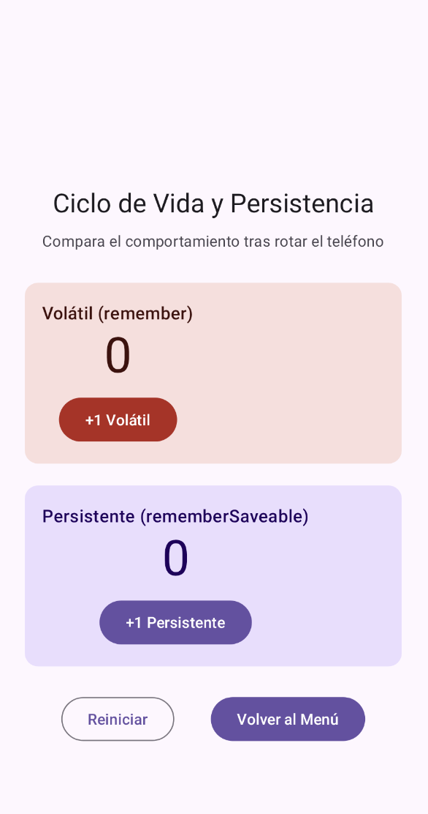
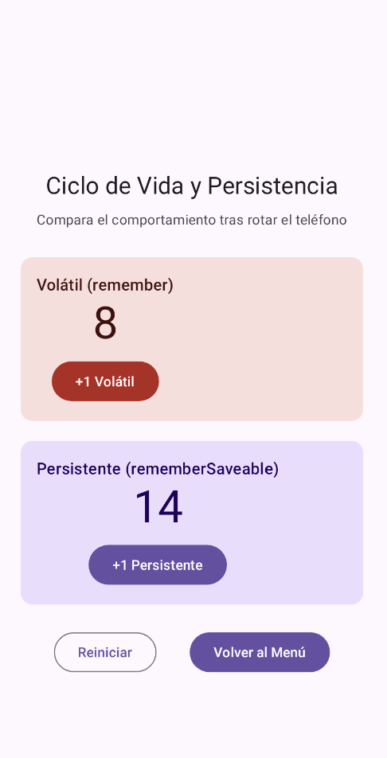
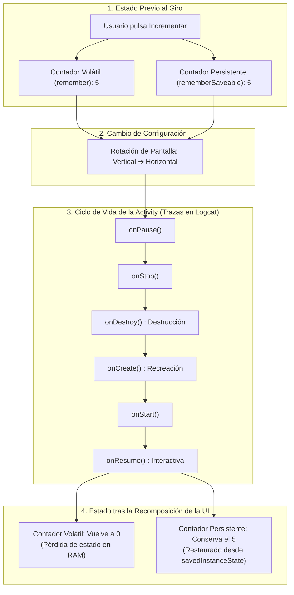
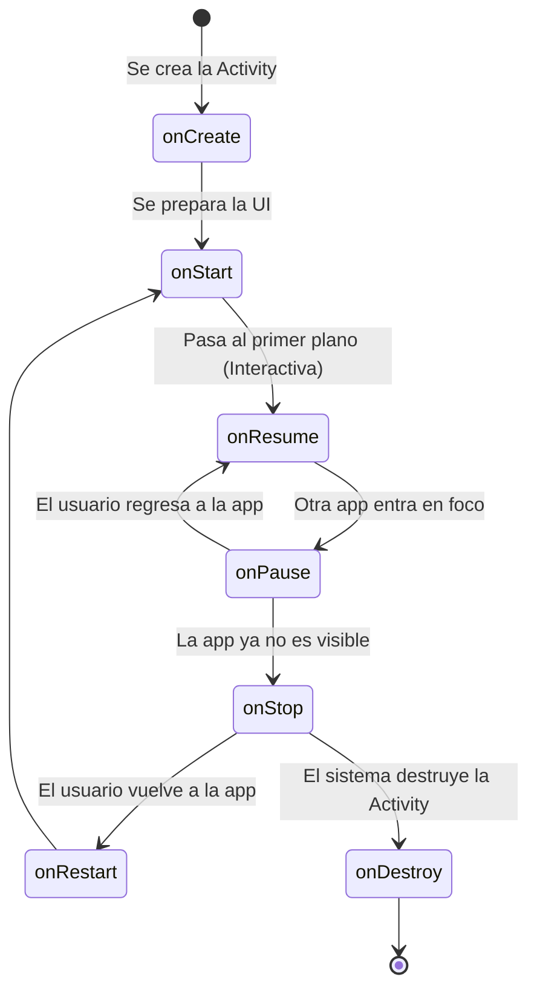

# **Codelab 1: Ciclo de Vida en Android y Depuración con Logcat**

En este codelab aprenderás de forma práctica cómo opera el ciclo de vida de una **Activity** en el sistema operativo Android y cómo interactúa con el árbol de componibles de **Jetpack Compose**.

Aprenderás a instrumentar tu aplicación con trazas de depuración profesionales utilizando la clase `Log`, a dominar la herramienta **Logcat** dentro de IntelliJ IDEA / Android Studio para filtrar mensajes, y a verificar experimentalmente la diferencia fundamental entre el almacenamiento volátil con `remember` y la persistencia ante cambios de configuración (como el giro de pantalla) con `rememberSaveable`.

---

## 1. ¿Qué vas a construir?

Construirás una pantalla de laboratorio interactiva (`CicloVidaScreen`) que contiene dos contadores independientes:

- **Contador volátil:** Gestionado mediante `remember`.
- **Contador persistente:** Gestionado mediante `rememberSaveable`.

Paralelamente, instrumentarás los métodos del ciclo de vida de tu `MainActivity` con trazas de `Log.d(...)`. Al rotar el emulador o dispositivo de vertical a horizontal, observarás en **Logcat** la destrucción y recreación de la Activity y verificarás en la interfaz cómo el contador volátil se reinicia a cero mientras que el contador persistente mantiene intacto su valor.

<div style="display: flex; flex-direction: row; justify-content: center; align-items: flex-start; gap: 1.5rem; flex-wrap: wrap; margin: 1.8rem 0;" markdown="1">

<figure style="margin: 0; text-align: center; max-width: 260px;" markdown="1">

{ style="border-radius: 8px; box-shadow: 0 4px 10px rgba(0,0,0,0.15); width: 100%; max-width: 250px;" }

<figcaption style="font-size: 0.85rem; margin-top: 0.5rem; color: var(--md-default-fg-color--light);"><strong>Figura 1:</strong> Estado inicial con ambos contadores en 0.</figcaption>
</figure>

<figure style="margin: 0; text-align: center; max-width: 260px;" markdown="1">

{ style="border-radius: 8px; box-shadow: 0 4px 10px rgba(0,0,0,0.15); width: 100%; max-width: 250px;" }

<figcaption style="font-size: 0.85rem; margin-top: 0.5rem; color: var(--md-default-fg-color--light);"><strong>Figura 2:</strong> Tras el giro, el persistente conserva su valor (14) y el volátil se reinicia.</figcaption>
</figure>

</div>



Al finalizar este codelab, serás capaz de:

- Sobrescribir e instrumentar los métodos del ciclo de vida de `ComponentActivity`.
- Utilizar `Log.d` y definir constantes `TAG` idiomáticas con `companion object`.
- Configurar y aplicar filtros avanzados en la herramienta **Logcat** de IntelliJ IDEA.
- Diferenciar el alcance de `remember` frente a `rememberSaveable`.
- Estructurar componibles siguiendo la separación *Stateless Content* vs *Stateful Screen*.

---

## 2. El Ciclo de Vida de la Activity en el Ecosistema Moderno

Una **Activity** es el componente del sistema operativo Android que proporciona una ventana en la que se dibuja la interfaz. A diferencia de un programa de consola que inicia en `main()` y finaliza al terminar sus instrucciones, una Activity pasa por diversos estados gestionados por el sistema ante eventos externos (llamadas entrantes, cambio a otra aplicación, rotación de pantalla o escasez de memoria).



### Tabla de Métodos del Ciclo de Vida

| Método | Momento de ejecución | ¿Cuándo se invoca? |
| :--- | :--- | :--- |
| **`onCreate()`** | Creación inicial | Al arrancar la Activity. Aquí se llama a `setContent { ... }` para enlazar Compose. |
| **`onStart()`** | Visibilidad inicial | La Activity pasa a ser visible para el usuario en pantalla. |
| **`onResume()`** | Interacción activa | La Activity está en primer plano y lista para recibir pulsaciones o gestos del usuario. |
| **`onPause()`** | Pérdida parcial de foco | Se abre un diálogo del sistema o se comparte pantalla. |
| **`onStop()`** | Ocultación completa | El usuario pulsa el botón *Home* o cambia a otra aplicación mediante la multitarea. |
| **`onDestroy()`** | Destrucción final | La Activity se elimina por completo (al cerrar la app o al rotar la pantalla). |

---

## 3. Paso 1: Instrumentar `MainActivity.kt` con Logs

Abre el archivo `MainActivity.kt` de tu proyecto `pmdm-lab-ut02` y sobrescribe los métodos del ciclo de vida para imprimir mensajes de depuración en la consola de Logcat.

Definiremos una etiqueta constante `TAG` dentro de un bloque `companion object` de Kotlin para identificar con precisión nuestros mensajes:

??? example "Ver código completo: MainActivity.kt instrumentado con ciclo de vida"

    ```kotlin
    package com.dam.pmdmlab

    import android.os.Bundle
    import android.util.Log
    import androidx.activity.ComponentActivity
    import androidx.activity.compose.setContent
    import androidx.compose.foundation.layout.fillMaxSize
    import androidx.compose.material3.MaterialTheme
    import androidx.compose.material3.Surface
    import androidx.compose.ui.Modifier
    import com.dam.pmdmlab.ui.theme.PMDMLabTheme

    class MainActivity : ComponentActivity() {

        companion object {
            private const val TAG = "CicloVidaDemo"
        }

        override fun onCreate(savedInstanceState: Bundle?) {
            super.onCreate(savedInstanceState)
            Log.d(TAG, "===> onCreate: La Activity se ha creado y configurado.")

            setContent {
                PMDMLabTheme {
                    Surface(
                        modifier = Modifier.fillMaxSize(),
                        color = MaterialTheme.colorScheme.background
                    ) {
                        LabApp()
                    }
                }
            }
        }

        override fun onStart() {
            super.onStart()
            Log.d(TAG, "===> onStart: La Activity es visible en pantalla.")
        }

        override fun onResume() {
            super.onResume()
            Log.d(TAG, "===> onResume: La Activity está en primer plano e interactiva.")
        }

        override fun onPause() {
            super.onPause()
            Log.d(TAG, "===> onPause: La Activity ha perdido el foco interactivo.")
        }

        override fun onStop() {
            super.onStop()
            Log.d(TAG, "===> onStop: La Activity ya no es visible (en segundo plano).")
        }

        override fun onRestart() {
            super.onRestart()
            Log.d(TAG, "===> onRestart: El usuario regresa a la Activity existente.")
        }

        override fun onDestroy() {
            super.onDestroy()
            Log.d(TAG, "===> onDestroy: La Activity va a ser destruida completamente.")
        }
    }
    ```

---

## 4. Paso 2: Dominar la Consola Logcat en IntelliJ IDEA

Para visualizar estos mensajes en tiempo real mientras ejecutas la aplicación:

1. **Abrir Logcat:** Pulsa en la pestaña **Logcat** ubicada en la barra de herramientas inferior de IntelliJ IDEA (o presiona el atajo ++alt+6++ en Windows/Linux o ++cmd+6++ en macOS).

2. **Seleccionar el dispositivo:** En el desplegable superior izquierdo, verifica que está seleccionado tu emulador o teléfono conectado.

3. **Filtrar por Tag:** En la caja de búsqueda de Logcat, escribe el filtro:

    ```text
    tag:CicloVidaDemo
    ```

    De este modo, Logcat ocultará los miles de mensajes del sistema operativo y mostrará exclusivamente los registros generados por tu aplicación.

4. **Nivel de severidad:** Asegúrate de que el filtro de nivel esté establecido en **Debug** (o *Verbose*). La llamada `Log.d` emite con nivel *Debug*.

---

## 5. Paso 3: Componente de Presentación (`CicloVidaContent`)

Creamos el archivo `app/src/main/java/com/dam/pmdmlab/codelabs/codelab01_ciclovida/CicloVidaScreen.kt`.

En primer lugar, implementamos el componente puramente visual (*Stateless Content*). Este componente:

- Recibe los valores de ambos contadores como argumentos inmutables (`Int`).
- Recibe lambdas para notificar las pulsaciones (`() -> Unit`).
- Es 100% predecible y puede previsualizarse en IntelliJ IDEA con datos de prueba (*mock data*).

```kotlin
@Composable
fun CicloVidaContent(
    cuentaVolatil: Int,
    cuentaGuardada: Int,
    onIncrementarVolatil: () -> Unit,
    onIncrementarGuardada: () -> Unit,
    onReiniciarTodo: () -> Unit,
    onBack: () -> Unit,
    modifier: Modifier = Modifier
) {
    Column(
        modifier = modifier
            .fillMaxSize()
            .padding(24.dp),
        horizontalAlignment = Alignment.CenterHorizontally,
        verticalArrangement = Arrangement.Center
    ) {
        Text(
            text = "Ciclo de Vida y Persistencia",
            style = MaterialTheme.typography.headlineSmall
        )

        Spacer(modifier = Modifier.height(8.dp))

        Text(
            text = "Compara el comportamiento tras rotar el teléfono",
            style = MaterialTheme.typography.bodyMedium,
            color = MaterialTheme.colorScheme.onSurfaceVariant
        )

        Spacer(modifier = Modifier.height(28.dp))

        // Tarjeta para el contador volátil (remember)
        Card(
            modifier = Modifier.fillMaxWidth(),
            colors = CardDefaults.cardColors(
                containerColor = MaterialTheme.colorScheme.errorContainer
            )
        ) {
            Column(
                modifier = Modifier.padding(16.dp),
                horizontalAlignment = Alignment.CenterHorizontally
            ) {
                Text(
                    text = "Volátil (remember)",
                    style = MaterialTheme.typography.titleMedium,
                    color = MaterialTheme.colorScheme.onErrorContainer
                )
                Text(
                    text = "$cuentaVolatil",
                    style = MaterialTheme.typography.displayMedium,
                    color = MaterialTheme.colorScheme.onErrorContainer
                )
                Spacer(modifier = Modifier.height(8.dp))
                Button(
                    onClick = onIncrementarVolatil,
                    colors = ButtonDefaults.buttonColors(
                        containerColor = MaterialTheme.colorScheme.error
                    )
                ) {
                    Text("+1 Volátil")
                }
            }
        }

        Spacer(modifier = Modifier.height(20.dp))

        // Tarjeta para el contador persistente (rememberSaveable)
        Card(
            modifier = Modifier.fillMaxWidth(),
            colors = CardDefaults.cardColors(
                containerColor = MaterialTheme.colorScheme.primaryContainer
            )
        ) {
            Column(
                modifier = Modifier.padding(16.dp),
                horizontalAlignment = Alignment.CenterHorizontally
            ) {
                Text(
                    text = "Persistente (rememberSaveable)",
                    style = MaterialTheme.typography.titleMedium,
                    color = MaterialTheme.colorScheme.onPrimaryContainer
                )
                Text(
                    text = "$cuentaGuardada",
                    style = MaterialTheme.typography.displayMedium,
                    color = MaterialTheme.colorScheme.onPrimaryContainer
                )
                Spacer(modifier = Modifier.height(8.dp))
                Button(onClick = onIncrementarGuardada) {
                    Text("+1 Persistente")
                }
            }
        }

        Spacer(modifier = Modifier.height(24.dp))

        Row(
            modifier = Modifier.fillMaxWidth(),
            horizontalArrangement = Arrangement.SpaceEvenly
        ) {
            OutlinedButton(onClick = onReiniciarTodo) {
                Text("Reiniciar")
            }
            Button(onClick = onBack) {
                Text("Volver al Menú")
            }
        }
    }
}
```

---

## 6. Paso 4: Contenedor con Estado (`CicloVidaScreen`) y Previews

A continuación, implementamos el contenedor con estado (*Stateful Screen*) en el mismo archivo, junto con sus vistas previas:

??? example "Ver código completo: CicloVidaScreen.kt con Stateless, Stateful y @Preview"

    ```kotlin
    package com.dam.pmdmlab.codelabs.codelab01_ciclovida

    import androidx.compose.foundation.layout.Arrangement
    import androidx.compose.foundation.layout.Column
    import androidx.compose.foundation.layout.Row
    import androidx.compose.foundation.layout.Spacer
    import androidx.compose.foundation.layout.fillMaxSize
    import androidx.compose.foundation.layout.fillMaxWidth
    import androidx.compose.foundation.layout.height
    import androidx.compose.foundation.layout.padding
    import androidx.compose.material3.Button
    import androidx.compose.material3.ButtonDefaults
    import androidx.compose.material3.Card
    import androidx.compose.material3.CardDefaults
    import androidx.compose.material3.MaterialTheme
    import androidx.compose.material3.OutlinedButton
    import androidx.compose.material3.Surface
    import androidx.compose.material3.Text
    import androidx.compose.runtime.Composable
    import androidx.compose.runtime.getValue
    import androidx.compose.runtime.mutableIntStateOf
    import androidx.compose.runtime.remember
    import androidx.compose.runtime.saveable.rememberSaveable
    import androidx.compose.runtime.setValue
    import androidx.compose.ui.Alignment
    import androidx.compose.ui.Modifier
    import androidx.compose.ui.tooling.preview.Preview
    import androidx.compose.ui.unit.dp

    // ============================================================================
    // 1. COMPONENTE DE PRESENTACIÓN (STATELESS CONTENT)
    // ============================================================================
    @Composable
    fun CicloVidaContent(
        cuentaVolatil: Int,
        cuentaGuardada: Int,
        onIncrementarVolatil: () -> Unit,
        onIncrementarGuardada: () -> Unit,
        onReiniciarTodo: () -> Unit,
        onBack: () -> Unit,
        modifier: Modifier = Modifier
    ) {
        Column(
            modifier = modifier
                .fillMaxSize()
                .padding(24.dp),
            horizontalAlignment = Alignment.CenterHorizontally,
            verticalArrangement = Arrangement.Center
        ) {
            Text(
                text = "Ciclo de Vida y Persistencia",
                style = MaterialTheme.typography.headlineSmall
            )

            Spacer(modifier = Modifier.height(8.dp))

            Text(
                text = "Compara el comportamiento tras rotar el teléfono",
                style = MaterialTheme.typography.bodyMedium,
                color = MaterialTheme.colorScheme.onSurfaceVariant
            )

            Spacer(modifier = Modifier.height(28.dp))

            Card(
                modifier = Modifier.fillMaxWidth(),
                colors = CardDefaults.cardColors(
                    containerColor = MaterialTheme.colorScheme.errorContainer
                )
            ) {
                Column(
                    modifier = Modifier.padding(16.dp),
                    horizontalAlignment = Alignment.CenterHorizontally
                ) {
                    Text(
                        text = "Volátil (remember)",
                        style = MaterialTheme.typography.titleMedium,
                        color = MaterialTheme.colorScheme.onErrorContainer
                    )
                    Text(
                        text = "$cuentaVolatil",
                        style = MaterialTheme.typography.displayMedium,
                        color = MaterialTheme.colorScheme.onErrorContainer
                    )
                    Spacer(modifier = Modifier.height(8.dp))
                    Button(
                        onClick = onIncrementarVolatil,
                        colors = ButtonDefaults.buttonColors(
                            containerColor = MaterialTheme.colorScheme.error
                        )
                    ) {
                        Text("+1 Volátil")
                    }
                }
            }

            Spacer(modifier = Modifier.height(20.dp))

            Card(
                modifier = Modifier.fillMaxWidth(),
                colors = CardDefaults.cardColors(
                    containerColor = MaterialTheme.colorScheme.primaryContainer
                )
            ) {
                Column(
                    modifier = Modifier.padding(16.dp),
                    horizontalAlignment = Alignment.CenterHorizontally
                ) {
                    Text(
                        text = "Persistente (rememberSaveable)",
                        style = MaterialTheme.typography.titleMedium,
                        color = MaterialTheme.colorScheme.onPrimaryContainer
                    )
                    Text(
                        text = "$cuentaGuardada",
                        style = MaterialTheme.typography.displayMedium,
                        color = MaterialTheme.colorScheme.onPrimaryContainer
                    )
                    Spacer(modifier = Modifier.height(8.dp))
                    Button(onClick = onIncrementarGuardada) {
                        Text("+1 Persistente")
                    }
                }
            }

            Spacer(modifier = Modifier.height(24.dp))

            Row(
                modifier = Modifier.fillMaxWidth(),
                horizontalArrangement = Arrangement.SpaceEvenly
            ) {
                OutlinedButton(onClick = onReiniciarTodo) {
                    Text("Reiniciar")
                }
                Button(onClick = onBack) {
                    Text("Volver al Menú")
                }
            }
        }
    }

    // ============================================================================
    // 2. VISTAS PREVIAS (@PREVIEW) CON DATOS MOCK
    // ============================================================================
    @Preview(name = "CicloVida - Estado Inicial", showBackground = true)
    @Composable
    private fun CicloVidaPreviewInicial() {
        Surface {
            CicloVidaContent(
                cuentaVolatil = 0,
                cuentaGuardada = 0,
                onIncrementarVolatil = {},
                onIncrementarGuardada = {},
                onReiniciarTodo = {},
                onBack = {}
            )
        }
    }

    @Preview(name = "CicloVida - Contadores Avanzados", showBackground = true)
    @Composable
    private fun CicloVidaPreviewConValores() {
        Surface {
            CicloVidaContent(
                cuentaVolatil = 8,
                cuentaGuardada = 14,
                onIncrementarVolatil = {},
                onIncrementarGuardada = {},
                onReiniciarTodo = {},
                onBack = {}
            )
        }
    }

    // ============================================================================
    // 3. PANTALLA CONTENEDORA (STATEFUL SCREEN)
    // ============================================================================
    @Composable
    fun CicloVidaScreen(
        onBack: () -> Unit,
        modifier: Modifier = Modifier
    ) {
        // Estado volátil: se reinicia con cualquier recreación de la Activity
        var cuentaVolatil by remember { mutableIntStateOf(0) }

        // Estado persistente: sobrevive a rotaciones y cambios de configuración
        var cuentaGuardada by rememberSaveable { mutableIntStateOf(0) }

        CicloVidaContent(
            cuentaVolatil = cuentaVolatil,
            cuentaGuardada = cuentaGuardada,
            onIncrementarVolatil = { cuentaVolatil++ },
            onIncrementarGuardada = { cuentaGuardada++ },
            onReiniciarTodo = {
                cuentaVolatil = 0
                cuentaGuardada = 0
            },
            onBack = onBack,
            modifier = modifier
        )
    }
    ```

---

## 7. Paso 5: Experimentos de Depuración en el Dispositivo

Ejecuta la aplicación en tu emulador o dispositivo físico y sigue estos dos experimentos guiados:

### Experimento 1: Segundo Plano y Retorno (Botón Home)

1. Abre la pestaña **Logcat** en IntelliJ y filtra por `tag:CicloVidaDemo`.
2. Pulsa el botón **Home** (círculo) del emulador para volver a la pantalla de inicio del sistema.
3. Observa en Logcat la secuencia:
   ```text
   ===> onPause: La Activity ha perdido el foco interactivo.
   ===> onStop: La Activity ya no es visible (en segundo plano).
   ```
4. Abre de nuevo tu aplicación desde el cajón de aplicaciones o la multitarea.
5. Observa la secuencia de retorno:
   ```text
   ===> onRestart: El usuario regresa a la Activity existente.
   ===> onStart: La Activity es visible en pantalla.
   ===> onResume: La Activity está en primer plano e interactiva.
   ```
   *Conclusión:* La Activity no se destruyó; permaneció en memoria RAM en segundo plano y se reanudó sin pérdida de ningún estado.

### Experimento 2: Cambio de Configuración (Rotación de Pantalla)

1. En la pantalla del ejercicio, pulsa varias veces sobre ambos botones hasta que el contador volátil marque **5** y el contador persistente marque **5**.
2. En la barra de herramientas del emulador, pulsa el botón **Rotate Left** o **Rotate Right** para colocar el dispositivo en orientación horizontal.
3. Examina inmediatamente la consola de **Logcat**:
   ```text
   ===> onPause: La Activity ha perdido el foco interactivo.
   ===> onStop: La Activity ya no es visible (en segundo plano).
   ===> onDestroy: La Activity va a ser destruida completamente.
   ===> onCreate: La Activity se ha creado y configurado.
   ===> onStart: La Activity es visible en pantalla.
   ===> onResume: La Activity está en primer plano e interactiva.
   ```
4. Mira ahora la pantalla de tu aplicación:
   - El contador rojo (**volátil**) ha vuelto a **0**. Como utilizaba `remember`, su valor se destruyó junto con la composición previa.
   - El contador azul (**persistente**) se mantiene en **5**. Al emplear `rememberSaveable`, el sistema operativo salvó el entero en el `Bundle` del estado restaurado y Compose lo recuperó al recrear la vista.

---

## 8. Resumen y Checklist de Calidad

En este codelab has aprendido:

- Cómo el sistema operativo Android gestiona el ciclo de vida mediante `ComponentActivity`.
- La importancia de registrar eventos con `Log.d` y utilizar etiquetas `TAG` legibles.
- Cómo usar **Logcat** con filtros profesionales (`tag:` y niveles de severidad).
- Por qué cualquier estado que el usuario espere conservar tras rotar la pantalla debe declararse con `rememberSaveable`.
- Cómo organizar el código separando componentes *Stateless* con vistas previas de su contenedor *Stateful*.
