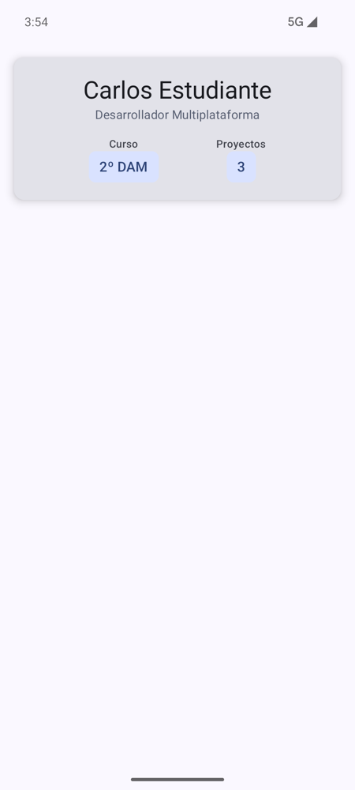

# **Codelab 2.01: Tarjeta de Presentación y `@Preview`**

En este primer codelab maquetarás tu primera interfaz con **Jetpack Compose**: una tarjeta de presentación. Todavía no hay botones ni nada que cambie; solo funciones `@Composable` que reciben datos y los pintan, organizadas con `Column`, `Row` y `Card`, y comprobadas con varias **vistas previas** (`@Preview`) sin arrancar el emulador.

!!! info "Punto de partida: tag `c2.01-inicio`"
    Todos los codelabs de la UT2 se hacen en el mismo proyecto, el repositorio del laboratorio **[pmdm2627-lab-ut2](https://github.com/jssdocente/pmdm2627-lab-ut2)**. Cada codelab empieza en un tag `-inicio` y termina en un tag `-fin`, que es a la vez el inicio del siguiente.

    ```bash
    git clone https://github.com/jssdocente/pmdm2627-lab-ut2.git lab-ut2
    cd lab-ut2
    git checkout c2.01-inicio
    git switch -c mi-lab
    ```

    `c2.01-inicio` es la plantilla `ProyectoComposeBase` del curso, con el paquete `com.pmdm.lab.ut2`. Si no usas Git, descarga el `.zip` del tag desde la pestaña **Tags** del repositorio. Tienes los detalles en [2.4 Laboratorio](../2.4-laboratorio-retos.md#1-el-repositorio-del-laboratorio).

---

## 1. ¿Qué vas a construir?

Una **tarjeta de presentación de desarrollador** con tu nombre, tu especialidad y dos datos destacados: el curso y el número de proyectos. La tarjeta es una función **sin estado** (*stateless*): todo lo que muestra le llega por parámetro.

<div style="display: flex; flex-direction: row; justify-content: center; align-items: flex-start; gap: 1.5rem; flex-wrap: wrap; margin: 1.8rem 0;" markdown="1">

<figure style="margin: 0; text-align: center; max-width: 260px;" markdown="1">

{ style="border-radius: 8px; box-shadow: 0 4px 10px rgba(0,0,0,0.15); width: 100%; max-width: 250px;" }

<figcaption style="font-size: 0.85rem; margin-top: 0.5rem; color: var(--md-default-fg-color--light);"><strong>Figura 1:</strong> La tarjeta al terminar el codelab (tag <code>c2.01-fin</code>).</figcaption>
</figure>

</div>

<figure class="arq-fig">
--8<-- "docs/temas/02/codelabs/images/c2.01-arbol.svg"
<figcaption>A la izquierda, el árbol de composición; a la derecha, lo que pinta cada nodo. Todo lo que hay dentro de la <code>Card</code> sale de los tres parámetros de <code>TarjetaPresentacion</code>.</figcaption>
</figure>

Al terminar, serás capaz de:

- Organizar elementos con `Column`, `Row`, `Card`, `Surface` y `Spacer`.
- Usar los modificadores esenciales: `fillMaxWidth`, `padding` y `height`.
- Escribir un composable que solo depende de sus parámetros.
- Crear varias `@Preview` con datos de prueba distintos, en modo claro y oscuro.

---

## 2. Los Contenedores de Disposición Básicos en Compose

En Compose no hay XML: la estructura de la pantalla se escribe anidando funciones de Kotlin.

<figure class="arq-fig">
--8<-- "docs/temas/02/codelabs/images/c2.01-contenedores.svg"
<figcaption>Los tres contenedores básicos. Casi cualquier pantalla se construye anidándolos.</figcaption>
</figure>

- **`Column`:** apila sus hijos en vertical, de arriba abajo.
- **`Row`:** coloca sus hijos en horizontal, de izquierda a derecha.
- **`Box`:** superpone sus hijos en capas; el primero queda al fondo.
- **`Card`** y **`Surface`:** contenedores de Material 3 con fondo, forma y, en la `Card`, sombra.
- **`Spacer`:** un hueco vacío del tamaño que le digas (`Spacer(Modifier.height(16.dp))`).

### ¿Qué son los Modificadores (`Modifier`)?

Un `Modifier` le dice a un composable cómo medirse, dibujarse o colocarse. Se encadenan y **el orden importa**:

- **Tamaño:** `fillMaxSize()`, `fillMaxWidth()`, `height(32.dp)`, `size(100.dp)`.
- **Espacio interior:** `padding(16.dp)`.
- **Alineación** (parámetros del contenedor, no modificadores): `horizontalAlignment` en una `Column`, `verticalAlignment` en una `Row`, `horizontalArrangement` para repartir el espacio.

!!! tip "El parámetro `modifier`"
    Por convención, todo composable que pinta algo recibe `modifier: Modifier = Modifier` y lo aplica a su elemento raíz. Así, quien lo usa decide el margen o el tamaño sin tocar el componente. Lo verás en `TarjetaPresentacion`.

Tienes la teoría completa en [2.3.1 Layouts y modificadores](../2.3.1-layouts-modificadores.md).

---

## 3. Paso 1: El Componente `TarjetaPresentacion`

1. En el panel *Project*, sobre `com.pmdm.lab.ut2`, crea el paquete `codelabs.codelab01_tarjeta` (*New › Package*).

2. Dentro, crea el archivo `TarjetaPresentacion.kt` (*New › Kotlin Class/File › File*).

3. Escribe el componente. Fíjate en que **no guarda nada**: recibe `nombre`, `especialidad` y `proyectos` y los pinta.

??? example "Ver código: `TarjetaPresentacion` y `DatoTarjeta`"

    ```kotlin
    package com.pmdm.lab.ut2.codelabs.codelab01_tarjeta

    import android.content.res.Configuration
    import androidx.compose.foundation.layout.Arrangement
    import androidx.compose.foundation.layout.Column
    import androidx.compose.foundation.layout.Row
    import androidx.compose.foundation.layout.Spacer
    import androidx.compose.foundation.layout.fillMaxWidth
    import androidx.compose.foundation.layout.height
    import androidx.compose.foundation.layout.padding
    import androidx.compose.material3.Card
    import androidx.compose.material3.CardDefaults
    import androidx.compose.material3.MaterialTheme
    import androidx.compose.material3.Surface
    import androidx.compose.material3.Text
    import androidx.compose.runtime.Composable
    import androidx.compose.ui.Alignment
    import androidx.compose.ui.Modifier
    import androidx.compose.ui.tooling.preview.Preview
    import androidx.compose.ui.unit.dp
    import com.pmdm.lab.ut2.ui.theme.LabUt2Theme

    // ============================================================================
    // COMPONENTE SIN ESTADO: solo pinta los datos que recibe por parámetro
    // ============================================================================
    @Composable
    fun TarjetaPresentacion(
        nombre: String,
        especialidad: String,
        proyectos: Int,
        modifier: Modifier = Modifier
    ) {
        Card(
            modifier = modifier.fillMaxWidth(),
            elevation = CardDefaults.cardElevation(defaultElevation = 6.dp)
        ) {
            Column(
                modifier = Modifier.padding(20.dp),
                horizontalAlignment = Alignment.CenterHorizontally
            ) {
                Text(
                    text = nombre,
                    style = MaterialTheme.typography.headlineMedium
                )
                Text(
                    text = especialidad,
                    style = MaterialTheme.typography.bodyMedium,
                    color = MaterialTheme.colorScheme.secondary
                )

                Spacer(modifier = Modifier.height(16.dp))

                Row(
                    modifier = Modifier.fillMaxWidth(),
                    horizontalArrangement = Arrangement.SpaceEvenly,
                    verticalAlignment = Alignment.CenterVertically
                ) {
                    DatoTarjeta(etiqueta = "Curso", valor = "2º DAM")
                    DatoTarjeta(etiqueta = "Proyectos", valor = "$proyectos")
                }
            }
        }
    }

    // Un dato de la tarjeta: la etiqueta encima y el valor resaltado debajo
    @Composable
    private fun DatoTarjeta(etiqueta: String, valor: String) {
        Column(horizontalAlignment = Alignment.CenterHorizontally) {
            Text(
                text = etiqueta,
                style = MaterialTheme.typography.labelMedium,
                color = MaterialTheme.colorScheme.onSurfaceVariant
            )
            Surface(
                color = MaterialTheme.colorScheme.primaryContainer,
                shape = MaterialTheme.shapes.small
            ) {
                Text(
                    text = valor,
                    modifier = Modifier.padding(horizontal = 12.dp, vertical = 6.dp),
                    style = MaterialTheme.typography.titleMedium,
                    color = MaterialTheme.colorScheme.onPrimaryContainer
                )
            }
        }
    }
    ```

Tres detalles del código:

- `DatoTarjeta` es `private`: es una pieza interna de la tarjeta y no se usa fuera de este archivo. Extraerla evita repetir el mismo bloque dos veces.
- Los colores y los estilos salen de `MaterialTheme` (`colorScheme.secondary`, `typography.headlineMedium`), nunca de valores fijos. Así la tarjeta se adapta al modo oscuro sin cambiar nada.
- `modifier` se aplica a la `Card`, que es el elemento raíz, y se encadena con `fillMaxWidth()`.

---

## 4. Paso 2: Vistas Previas con `@Preview`

Una función anotada con `@Preview` pinta el composable en el panel de diseño de IntelliJ IDEA (*Split* o *Design*) sin instalar la app. Como `TarjetaPresentacion` solo depende de sus parámetros, puedes probarla con datos de prueba distintos en cada preview.

Añade al final de `TarjetaPresentacion.kt`:

??? example "Ver código: tres vistas previas"

    ```kotlin
    // ============================================================================
    // VISTAS PREVIAS: el mismo componente con datos de prueba distintos
    // ============================================================================
    @Preview(name = "Tarjeta · claro", showBackground = true)
    @Composable
    private fun TarjetaPreviewInicial() {
        LabUt2Theme {
            TarjetaPresentacion(
                nombre = "Ada Lovelace",
                especialidad = "Desarrolladora Kotlin",
                proyectos = 0,
                modifier = Modifier.padding(16.dp)
            )
        }
    }

    @Preview(name = "Tarjeta · nombre largo", showBackground = true, widthDp = 320)
    @Composable
    private fun TarjetaPreviewNombreLargo() {
        LabUt2Theme {
            TarjetaPresentacion(
                nombre = "María de las Mercedes",
                especialidad = "Desarrolladora Multiplataforma",
                proyectos = 12,
                modifier = Modifier.padding(16.dp)
            )
        }
    }

    @Preview(
        name = "Tarjeta · oscuro",
        showBackground = true,
        uiMode = Configuration.UI_MODE_NIGHT_YES
    )
    @Composable
    private fun TarjetaPreviewOscuro() {
        LabUt2Theme {
            TarjetaPresentacion(
                nombre = "Grace Hopper",
                especialidad = "Arquitecta de compiladores",
                proyectos = 42,
                modifier = Modifier.padding(16.dp)
            )
        }
    }
    ```

| Parámetro de `@Preview` | Para qué sirve |
| :--- | :--- |
| `name` | El título que aparece encima de la preview en el panel. |
| `showBackground = true` | Pinta un fondo detrás del componente (si no, es transparente). |
| `widthDp = 320` | Simula una pantalla estrecha: comprueba que un nombre largo no rompe la tarjeta. |
| `uiMode = UI_MODE_NIGHT_YES` | Simula el modo oscuro del sistema. |

!!! warning "Envuelve siempre la preview en el tema"
    Si llamas a `TarjetaPresentacion` sin `LabUt2Theme { ... }`, la preview usa los colores por defecto de Material y no verás los de tu app, ni el modo oscuro.

Si el panel no muestra nada, compila (*Build › Build Project*) y pulsa *Refresh*.

---

## 5. Paso 3: Mostrar la Tarjeta en la App

La plantilla trae en `MainActivity.kt` un `Greeting("Android")`. Sustitúyelo por la tarjeta y borra las funciones `Greeting` y `GreetingPreview`, que ya no se usan.

??? example "Ver código: `MainActivity.kt`"

    ```kotlin
    package com.pmdm.lab.ut2

    import android.os.Bundle
    import androidx.activity.ComponentActivity
    import androidx.activity.compose.setContent
    import androidx.activity.enableEdgeToEdge
    import androidx.compose.foundation.layout.fillMaxSize
    import androidx.compose.foundation.layout.padding
    import androidx.compose.material3.Scaffold
    import androidx.compose.ui.Modifier
    import androidx.compose.ui.unit.dp
    import com.pmdm.lab.ut2.codelabs.codelab01_tarjeta.TarjetaPresentacion
    import com.pmdm.lab.ut2.ui.theme.LabUt2Theme

    class MainActivity : ComponentActivity() {
        override fun onCreate(savedInstanceState: Bundle?) {
            super.onCreate(savedInstanceState)
            enableEdgeToEdge()
            setContent {
                LabUt2Theme {
                    Scaffold(modifier = Modifier.fillMaxSize()) { innerPadding ->
                        TarjetaPresentacion(
                            nombre = "Carlos Estudiante",
                            especialidad = "Desarrollador Multiplataforma",
                            proyectos = 3,
                            modifier = Modifier
                                .padding(innerPadding)
                                .padding(16.dp)
                        )
                    }
                }
            }
        }
    }
    ```

Fíjate en los dos `padding` encadenados: el primero aplica `innerPadding`, el hueco que deja el `Scaffold` para la barra de estado (sin él, la tarjeta quedaría debajo de la hora y la batería). El segundo añade el margen de 16 dp.

!!! note "Y el test instrumentado"
    La plantilla trae `ExampleInstrumentedTest`, que busca el texto `"Hola Android!"`. Como ya no existe, cambia el texto que busca por `"Carlos Estudiante"`. El tag `c2.01-fin` ya lo trae cambiado.

Ejecuta la app (▶) en el emulador: debes ver la tarjeta de la Figura 1.

---

## 6. Experimenta

Antes de pasar al siguiente codelab, cambia estas cosas y observa la preview:

1. En la `Row`, cambia `Arrangement.SpaceEvenly` por `Arrangement.SpaceBetween` y después por `Arrangement.spacedBy(8.dp)`. ¿Dónde se queda el espacio sobrante en cada caso?

2. En `MainActivity`, intercambia el orden de `.padding(innerPadding)` y `.padding(16.dp)`. ¿Cambia algo? ¿Y si quitas `.padding(innerPadding)`?

3. Añade un tercer `DatoTarjeta` (por ejemplo, `"Módulo"` con `"PMDM"`). Gracias a haberlo extraído, es una línea.

!!! success "Solución: tag `c2.01-fin`"
    Compara tu código con el tag [`c2.01-fin`](https://github.com/jssdocente/pmdm2627-lab-ut2/tree/c2.01-fin) (`git diff c2.01-fin`). Ese tag es también el punto de partida del [Codelab 2.02](./02-contador-incremental.md).

---

## 7. Resumen y Checklist

- [ ] `TarjetaPresentacion` está en `codelabs/codelab01_tarjeta/` y **no guarda ningún dato**: todo le llega por parámetro.
- [ ] Recibe `modifier: Modifier = Modifier` y lo aplica a su elemento raíz.
- [ ] Colores y tipografías salen de `MaterialTheme`.
- [ ] Hay tres `@Preview` (claro, nombre largo y oscuro), todas dentro de `LabUt2Theme`.
- [ ] `MainActivity` muestra la tarjeta respetando el `innerPadding` del `Scaffold`.

La tarjeta muestra siempre «3 proyectos» porque el número está escrito a mano. En el [Codelab 2.02](./02-contador-incremental.md) aprenderás qué es el **estado** y le darás vida.
