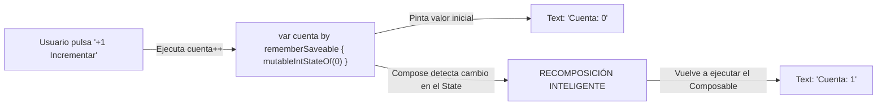

# **Codelab 2: Mi Primer Composable Interactivo (El Contador de Clics y Recomposición)**

En este codelab darás el salto definitivo desde una interfaz estática hacia una aplicación móvil viva y reactiva construida con **Jetpack Compose**.

Aprenderás por qué las variables ordinarias de Kotlin no funcionan para actualizar la pantalla, cómo opera el motor de **recomposición** de Compose, qué diferencia a un estado observable (`mutableIntStateOf`) de una variable común, y cómo utilizar el guardián **`remember`** (y `rememberSaveable`) para preservar datos a medida que el usuario interactúa.

---

## 1. ¿Qué vas a construir?

Construirás una pantalla interactiva limpia y didáctica (`ContadorIncrementalScreen`) centrada en el concepto más elemental de la programación reactiva: **el contador de clics**.

La pantalla incluye:

- Un número visual destacado en el centro de la pantalla que muestra el conteo actual.
- Un texto informativo reactivo que se adapta al valor: *"Has pulsado el botón X veces"*.
- Una fila de controles interactivos:
  - Botón principal **"+1 Incrementar"**.
  - Botón secundario **"-1 Decrementar"** (deshabilitado automáticamente si el contador llega a 0 para no permitir números negativos).
  - Botón **"Reiniciar"** para restablecer la cuenta a cero.
- Botón de regreso al catálogo del laboratorio.



Al finalizar este codelab, serás capaz de:

- Comprender la fórmula fundamental del desarrollo declarativo: **`UI = f(State)`**.
- Identificar y evitar el error más frecuente de los principiantes en Compose (usar variables normales de Kotlin).
- Crear estados observables con `mutableIntStateOf`.
- Entender el rol de `remember` como memoria local ante recomposiciones.
- Utilizar la delegación de propiedades de Kotlin (`by getValue / setValue`).
- Deshabilitar botones de forma reactiva con la propiedad `enabled`.

---

## 2. El "Gran Error" del Principiante en Compose

Cuando un programador acostumbrado a Java tradicional o a interfaces de consola llega a Compose, su primer impulso suele ser escribir algo como esto:

```kotlin
// ⚠️ ¡CÓDIGO INCORRECTO! NO COPIAR ESTE EJEMPLO
@Composable
fun ContadorQueNoFunciona() {
    var contador = 0 // Variable ordinaria de Kotlin

    Column {
        Text(text = "Has pulsado: $contador veces")
        Button(onClick = { 
            contador++ // Se incrementa en la memoria RAM...
            println("El contador ahora vale: $contador") 
        }) {
            Text("Pulsar")
        }
    }
}
```

Si ejecutas este código y pulsas el botón:

1. En la consola verás que `contador` efectivamente cambia a 1, 2, 3...
2. **Sin embargo, en la pantalla del teléfono el texto sigue mostrando obstinadamente `"Has pulsado: 0 veces"`**.

### ¿Por qué ocurre esto?

Una variable ordinaria de Kotlin (`var contador = 0`) no tiene mecanismos para avisar a nadie cuando su valor muta. Para que la pantalla cambie, el compilador de Compose necesita volver a ejecutar la función `@Composable` (proceso denominado **recomposición**). Como `contador` es una variable normal, **Compose no sabe que ha cambiado y, por tanto, no repinta la interfaz**.

---

## 3. Las Dos Piezas Fundamentales: `State` y `remember`

Para resolver este problema y lograr interactividad real, Jetpack Compose introduce dos herramientas complementarias:

### Pieza 1: El Estado Observable (`mutableIntStateOf`)

En lugar de un primitivo `Int`, envolvemos el dato en un contenedor especial observable:

```kotlin
val contador: MutableIntState = mutableIntStateOf(0)
```

Cuando un `@Composable` lee el valor de este objeto y posteriormente dicho valor cambia, **Compose lo detecta al instante y programa una recomposición automática de ese trozo específico de pantalla**.

### Pieza 2: El Guardián de la Memoria (`remember`)

Si solo utilizáramos `mutableIntStateOf(0)`, tendríamos un segundo problema: cada vez que la pantalla se recompone, la función componible se vuelve a ejecutar desde su primera línea, lo que provocaría que `contador` volviera a nacer con valor `0` en cada pulsación.

Para evitar que el valor se resetee, usamos **`remember`**:

```kotlin
val contador = remember { mutableIntStateOf(0) }
```

`remember` le indica a Compose: *"Calcula este valor la primera vez que se pinte el composable, pero en las siguientes recomposiciones conserva el valor previo que ya tenía"*.

### La Magia del Delegado `by` en Kotlin

Para no tener que escribir continuamente `contador.intValue++` o `contador.intValue = 0`, importamos los delegados de Compose:

```kotlin
import androidx.compose.runtime.getValue
import androidx.compose.runtime.setValue

// Con 'by', tratamos a 'cuenta' exactamente como un Int normal de Kotlin:
var cuenta by remember { mutableIntStateOf(0) }

cuenta++ // Modifica internamente el State y dispara la recomposición
```

---

## 4. Paso 1: Componente de Presentación (`ContadorIncrementalContent`)

Creamos el archivo `app/src/main/java/com/dam/pmdmlab/ui/retos/reto02_contador/ContadorIncrementalScreen.kt`.

Siguiendo las buenas prácticas arquitectónicas que mantendremos en todo el curso, creamos en primer lugar el componente puramente visual (*Stateless Content*):

- Recibe el número actual (`cuenta: Int`).
- Recibe lambdas para los tres eventos: `onIncrementar: () -> Unit`, `onDecrementar: () -> Unit` y `onReset: () -> Unit`.
- Recibe la lambda `onBack: () -> Unit` para regresar al menú.

```kotlin
@Composable
fun ContadorIncrementalContent(
    cuenta: Int,
    onIncrementar: () -> Unit,
    onDecrementar: () -> Unit,
    onReset: () -> Unit,
    onBack: () -> Unit,
    modifier: Modifier = Modifier
) {
    Column(
        modifier = modifier
            .fillMaxSize()
            .padding(24.dp),
        horizontalAlignment = Alignment.CenterHorizontally,
        verticalArrangement = Arrangement.Center
    ) {
        Text(
            text = "Mi Primer Composable",
            style = MaterialTheme.typography.headlineMedium
        )

        Spacer(modifier = Modifier.height(8.dp))

        Text(
            text = "Estado y Recomposición en tiempo real",
            style = MaterialTheme.typography.bodyMedium,
            color = MaterialTheme.colorScheme.onSurfaceVariant
        )

        Spacer(modifier = Modifier.height(36.dp))

        // Visualización del número principal
        Surface(
            color = MaterialTheme.colorScheme.primaryContainer,
            shape = MaterialTheme.shapes.extraLarge,
            modifier = Modifier.padding(16.dp)
        ) {
            Text(
                text = "$cuenta",
                style = MaterialTheme.typography.displayLarge,
                color = MaterialTheme.colorScheme.onPrimaryContainer,
                modifier = Modifier.padding(horizontal = 48.dp, vertical = 24.dp)
            )
        }

        Spacer(modifier = Modifier.height(12.dp))

        // Texto informativo reactivo
        Text(
            text = when (cuenta) {
                0 -> "Pulsa '+1' para empezar a contar"
                1 -> "Has pulsado el botón 1 vez"
                else -> "Has pulsado el botón $cuenta veces"
            },
            style = MaterialTheme.typography.bodyLarge,
            color = MaterialTheme.colorScheme.secondary
        )

        Spacer(modifier = Modifier.height(32.dp))

        // Fila de botones de acción
        Row(
            modifier = Modifier.fillMaxWidth(0.9f),
            horizontalArrangement = Arrangement.spacedBy(12.dp),
            verticalAlignment = Alignment.CenterVertically
        ) {
            // Botón Decrementar (se deshabilita en 0)
            OutlinedButton(
                onClick = onDecrementar,
                modifier = Modifier.weight(1f),
                enabled = cuenta > 0
            ) {
                Text("-1")
            }

            // Botón Incrementar
            Button(
                onClick = onIncrementar,
                modifier = Modifier.weight(1.5f)
            ) {
                Text(
                    text = "+1 Incrementar",
                    style = MaterialTheme.typography.titleMedium
                )
            }

            // Botón Reset
            OutlinedButton(
                onClick = onReset,
                modifier = Modifier.weight(1f),
                enabled = cuenta > 0
            ) {
                Text("Reset")
            }
        }

        Spacer(modifier = Modifier.height(48.dp))

        OutlinedButton(onClick = onBack) {
            Text("Volver al Menú Principal")
        }
    }
}
```

---

## 5. Paso 2: Vistas Previas con `@Preview`

Al haber separado el componente en una función *Stateless*, podemos previsualizarlo en IntelliJ IDEA en diferentes estados instantáneamente:

```kotlin
@Preview(name = "Contador en Cero", showBackground = true)
@Composable
private fun ContadorPreviewCero() {
    Surface {
        ContadorIncrementalContent(
            cuenta = 0,
            onIncrementar = {},
            onDecrementar = {},
            onReset = {},
            onBack = {}
        )
    }
}

@Preview(name = "Contador con Valor Activo", showBackground = true)
@Composable
private fun ContadorPreviewActivo() {
    Surface {
        ContadorIncrementalContent(
            cuenta = 15,
            onIncrementar = {},
            onDecrementar = {},
            onReset = {},
            onBack = {}
        )
    }
}
```

Observa cómo en la vista previa con valor `0`, los botones `"-1"` y `"Reset"` se muestran automáticamente en gris deshabilitado gracias a la condición reactiva `enabled = cuenta > 0`.

---

## 6. Paso 3: Pantalla Contenedora (`ContadorIncrementalScreen`)

Implementamos el contenedor con estado (*Stateful Screen*). 

Para garantizar que el número no se pierda si el usuario gira el teléfono, utilizamos **`rememberSaveable`**:

??? example "Ver código completo: ContadorIncrementalScreen.kt"

    ```kotlin
    package com.dam.pmdmlab.ui.retos.reto02_contador

    import androidx.compose.foundation.layout.Arrangement
    import androidx.compose.foundation.layout.Column
    import androidx.compose.foundation.layout.Row
    import androidx.compose.foundation.layout.Spacer
    import androidx.compose.foundation.layout.fillMaxSize
    import androidx.compose.foundation.layout.fillMaxWidth
    import androidx.compose.foundation.layout.height
    import androidx.compose.foundation.layout.padding
    import androidx.compose.material3.Button
    import androidx.compose.material3.MaterialTheme
    import androidx.compose.material3.OutlinedButton
    import androidx.compose.material3.Surface
    import androidx.compose.material3.Text
    import androidx.compose.runtime.Composable
    import androidx.compose.runtime.getValue
    import androidx.compose.runtime.mutableIntStateOf
    import androidx.compose.runtime.saveable.rememberSaveable
    import androidx.compose.runtime.setValue
    import androidx.compose.ui.Alignment
    import androidx.compose.ui.Modifier
    import androidx.compose.ui.tooling.preview.Preview
    import androidx.compose.ui.unit.dp

    // ============================================================================
    // 1. COMPONENTE DE PRESENTACIÓN (STATELESS CONTENT)
    // ============================================================================
    @Composable
    fun ContadorIncrementalContent(
        cuenta: Int,
        onIncrementar: () -> Unit,
        onDecrementar: () -> Unit,
        onReset: () -> Unit,
        onBack: () -> Unit,
        modifier: Modifier = Modifier
    ) {
        Column(
            modifier = modifier
                .fillMaxSize()
                .padding(24.dp),
            horizontalAlignment = Alignment.CenterHorizontally,
            verticalArrangement = Arrangement.Center
        ) {
            Text(
                text = "Mi Primer Composable",
                style = MaterialTheme.typography.headlineMedium
            )

            Spacer(modifier = Modifier.height(8.dp))

            Text(
                text = "Estado y Recomposición en tiempo real",
                style = MaterialTheme.typography.bodyMedium,
                color = MaterialTheme.colorScheme.onSurfaceVariant
            )

            Spacer(modifier = Modifier.height(36.dp))

            // Visualización del número principal
            Surface(
                color = MaterialTheme.colorScheme.primaryContainer,
                shape = MaterialTheme.shapes.extraLarge,
                modifier = Modifier.padding(16.dp)
            ) {
                Text(
                    text = "$cuenta",
                    style = MaterialTheme.typography.displayLarge,
                    color = MaterialTheme.colorScheme.onPrimaryContainer,
                    modifier = Modifier.padding(horizontal = 48.dp, vertical = 24.dp)
                )
            }

            Spacer(modifier = Modifier.height(12.dp))

            // Texto informativo reactivo
            Text(
                text = when (cuenta) {
                    0 -> "Pulsa '+1' para empezar a contar"
                    1 -> "Has pulsado el botón 1 vez"
                    else -> "Has pulsado el botón $cuenta veces"
                },
                style = MaterialTheme.typography.bodyLarge,
                color = MaterialTheme.colorScheme.secondary
            )

            Spacer(modifier = Modifier.height(32.dp))

            // Fila de botones de acción
            Row(
                modifier = Modifier.fillMaxWidth(0.9f),
                horizontalArrangement = Arrangement.spacedBy(12.dp),
                verticalAlignment = Alignment.CenterVertically
            ) {
                // Botón Decrementar (se deshabilita en 0)
                OutlinedButton(
                    onClick = onDecrementar,
                    modifier = Modifier.weight(1f),
                    enabled = cuenta > 0
                ) {
                    Text("-1")
                }

                // Botón Incrementar
                Button(
                    onClick = onIncrementar,
                    modifier = Modifier.weight(1.5f)
                ) {
                    Text(
                        text = "+1",
                        style = MaterialTheme.typography.titleMedium
                    )
                }

                // Botón Reset
                OutlinedButton(
                    onClick = onReset,
                    modifier = Modifier.weight(1f),
                    enabled = cuenta > 0
                ) {
                    Text("Reset")
                }
            }

            Spacer(modifier = Modifier.height(48.dp))

            OutlinedButton(onClick = onBack) {
                Text("Volver al Menú Principal")
            }
        }
    }

    // ============================================================================
    // 2. VISTAS PREVIAS (@PREVIEW) CON DATOS MOCK
    // ============================================================================
    @Preview(name = "Contador en Cero", showBackground = true)
    @Composable
    private fun ContadorPreviewCero() {
        Surface {
            ContadorIncrementalContent(
                cuenta = 0,
                onIncrementar = {},
                onDecrementar = {},
                onReset = {},
                onBack = {}
            )
        }
    }

    @Preview(name = "Contador con Valor Activo", showBackground = true)
    @Composable
    private fun ContadorPreviewActivo() {
        Surface {
            ContadorIncrementalContent(
                cuenta = 15,
                onIncrementar = {},
                onDecrementar = {},
                onReset = {},
                onBack = {}
            )
        }
    }

    // ============================================================================
    // 3. PANTALLA CONTENEDORA (STATEFUL SCREEN)
    // ============================================================================
    @Composable
    fun ContadorIncrementalScreen(
        onBack: () -> Unit,
        modifier: Modifier = Modifier
    ) {
        var cuenta by rememberSaveable { mutableIntStateOf(0) }

        ContadorIncrementalContent(
            cuenta = cuenta,
            onIncrementar = { cuenta++ },
            onDecrementar = { if (cuenta > 0) cuenta-- },
            onReset = { cuenta = 0 },
            onBack = onBack,
            modifier = modifier
        )
    }
    ```

---

## 7. Experimento Práctico

1. **Prueba en Interactive Mode de IntelliJ IDEA:**
   - Abre `ContadorIncrementalScreen.kt` en IntelliJ IDEA.
   - En el panel derecho de vista previa, pulsa el icono de la mano con el cursor (**Interactive Mode**).
   - Haz clic sobre el botón `"+1"`: verás cómo el número aumenta inmediatamente en tu editor sin necesidad de compilar el APK.
2. **Prueba en el Emulador / Dispositivo:**
   - Ejecuta la app y pulsa `+1` hasta llegar a 7.
   - Pulsa `-1` y verifica que el texto y el número bajan sincronizados.
   - Rota la pantalla del dispositivo a horizontal: comprueba que el valor 6 no se borra gracias a `rememberSaveable`.

---

## 8. Resumen y Checklist de Calidad

En este codelab has aprendido:

- Por qué las variables normales no provocan recomposición y cómo `mutableIntStateOf` resuelve este problema.
- El papel de `remember` como memoria de datos a lo largo de las recomposiciones.
- El uso de delegados de propiedad de Kotlin (`var cuenta by rememberSaveable { ... }`).
- La reactividad de botones desactivando opciones que no proceden (`enabled = cuenta > 0`).
- Cómo separar el contenido puramente visual de la gestión del estado para testeo y vistas previas.
