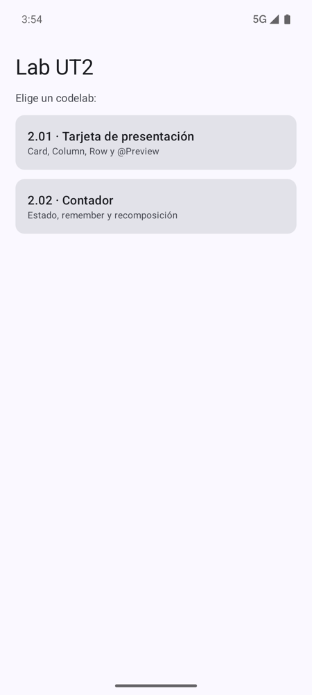
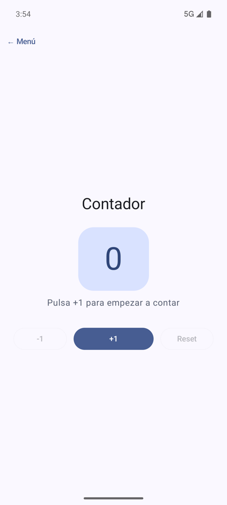
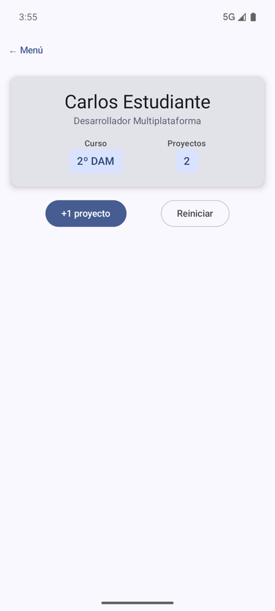

# **Codelab 2.02: El Contador, el Estado y el Menú del Laboratorio**

La tarjeta del codelab anterior muestra siempre «3 proyectos» porque el número está escrito a mano. En este codelab das el salto a una interfaz **viva**: aprenderás por qué una variable normal de Kotlin no actualiza la pantalla, qué es el **estado** en Compose, cómo lo recuerda `remember` y cómo se separa un componente sin estado de la pantalla que guarda ese estado (*state hoisting*).

Con dos pantallas en el proyecto, además, necesitas una forma de ir de una a otra: construirás el **menú del laboratorio**, que también funciona con estado.

!!! info "Punto de partida: tag `c2.02-inicio`"
    Sigue en el repositorio del laboratorio, [pmdm2627-lab-ut2](https://github.com/jssdocente/pmdm2627-lab-ut2). Si terminaste el [Codelab 2.01](./01-tarjeta-presentacion.md), continúa en tu rama. Si no, parte del tag:

    ```bash
    git checkout c2.02-inicio
    git switch -c mi-lab-2.02
    ```

    `c2.02-inicio` es el mismo commit que `c2.01-fin`: la tarjeta de presentación terminada.

---

## 1. ¿Qué vas a construir?

Tres cosas, en este orden:

1. Un **contador de clics** con botones `+1`, `-1` y `Reset`. El `-1` y el `Reset` se deshabilitan solos cuando la cuenta está a 0.

2. El **menú del laboratorio**: una lista de tarjetas, una por codelab, que abre cada pantalla. A partir de ahora, cada codelab añadirá su entrada a este menú.

3. Una **tarjeta con estado**: la `TarjetaPresentacion` del codelab 2.01, sin tocarla, con un botón `+1 proyecto` que por fin cambia el número.

<div style="display: flex; flex-direction: row; justify-content: center; align-items: flex-start; gap: 1.5rem; flex-wrap: wrap; margin: 1.8rem 0;" markdown="1">

<figure style="margin: 0; text-align: center; max-width: 220px;" markdown="1">

{ style="border-radius: 8px; box-shadow: 0 4px 10px rgba(0,0,0,0.15); width: 100%; max-width: 210px;" }

<figcaption style="font-size: 0.85rem; margin-top: 0.5rem; color: var(--md-default-fg-color--light);"><strong>Figura 1:</strong> El menú del laboratorio.</figcaption>
</figure>

<figure style="margin: 0; text-align: center; max-width: 220px;" markdown="1">

{ style="border-radius: 8px; box-shadow: 0 4px 10px rgba(0,0,0,0.15); width: 100%; max-width: 210px;" }

<figcaption style="font-size: 0.85rem; margin-top: 0.5rem; color: var(--md-default-fg-color--light);"><strong>Figura 2:</strong> El contador tras pulsar +1 tres veces.</figcaption>
</figure>

<figure style="margin: 0; text-align: center; max-width: 220px;" markdown="1">

{ style="border-radius: 8px; box-shadow: 0 4px 10px rgba(0,0,0,0.15); width: 100%; max-width: 210px;" }

<figcaption style="font-size: 0.85rem; margin-top: 0.5rem; color: var(--md-default-fg-color--light);"><strong>Figura 3:</strong> La tarjeta del 2.01, ahora con estado.</figcaption>
</figure>

</div>

<figure class="arq-fig">
--8<-- "docs/temas/02/codelabs/images/c2.02-recomposicion.svg"
<figcaption>El clic no cambia el texto: cambia el estado. Como el estado es observable, Compose vuelve a ejecutar los composables que lo leen.</figcaption>
</figure>

Al terminar, serás capaz de:

- Explicar la fórmula del desarrollo declarativo: **`UI = f(estado)`**.
- Reconocer y evitar el error de usar variables normales de Kotlin para la interfaz.
- Crear estado observable con `mutableIntStateOf` y `mutableStateOf`, y recordarlo con `remember`.
- Separar un componente sin estado (`…Content`) de su pantalla con estado (`…Screen`).
- Cambiar de pantalla guardando en el estado cuál se está viendo.

---

## 2. El "Gran Error" del Principiante en Compose

Cuando un programador acostumbrado a Java tradicional o a interfaces de consola llega a Compose, su primer impulso suele ser escribir algo como esto:

```kotlin
// ⚠️ ¡CÓDIGO INCORRECTO! NO COPIAR ESTE EJEMPLO
@Composable
fun ContadorQueNoFunciona() {
    var contador = 0 // Variable ordinaria de Kotlin

    Column {
        Text(text = "Has pulsado: $contador veces")
        Button(onClick = { 
            contador++ // Se incrementa en la memoria RAM...
            println("El contador ahora vale: $contador") 
        }) {
            Text("Pulsar")
        }
    }
}
```

Si ejecutas este código y pulsas el botón:

1. En la consola verás que `contador` efectivamente cambia a 1, 2, 3...
2. **Sin embargo, en la pantalla del teléfono el texto sigue mostrando obstinadamente `"Has pulsado: 0 veces"`**.

### ¿Por qué ocurre esto?

Una variable ordinaria de Kotlin (`var contador = 0`) no tiene mecanismos para avisar a nadie cuando su valor muta. Para que la pantalla cambie, el compilador de Compose necesita volver a ejecutar la función `@Composable` (proceso denominado **recomposición**). Como `contador` es una variable normal, **Compose no sabe que ha cambiado y, por tanto, no repinta la interfaz**.

---

## 3. Las Dos Piezas Fundamentales: `State` y `remember`

Para resolver este problema y lograr interactividad real, Jetpack Compose introduce dos herramientas complementarias:

### Pieza 1: El Estado Observable (`mutableIntStateOf`)

En lugar de un primitivo `Int`, envolvemos el dato en un contenedor especial observable:

```kotlin
val contador: MutableIntState = mutableIntStateOf(0)
```

Cuando un `@Composable` lee el valor de este objeto y posteriormente dicho valor cambia, **Compose lo detecta al instante y programa una recomposición automática de ese trozo específico de pantalla**.

### Pieza 2: El Guardián de la Memoria (`remember`)

Si solo utilizáramos `mutableIntStateOf(0)`, tendríamos un segundo problema: cada vez que la pantalla se recompone, la función componible se vuelve a ejecutar desde su primera línea, lo que provocaría que `contador` volviera a nacer con valor `0` en cada pulsación.

Para evitar que el valor se resetee, usamos **`remember`**:

```kotlin
val contador = remember { mutableIntStateOf(0) }
```

`remember` le indica a Compose: *"Calcula este valor la primera vez que se pinte el composable, pero en las siguientes recomposiciones conserva el valor previo que ya tenía"*.

### La Magia del Delegado `by` en Kotlin

Para no tener que escribir continuamente `contador.intValue++` o `contador.intValue = 0`, importamos los delegados de Compose:

```kotlin
import androidx.compose.runtime.getValue
import androidx.compose.runtime.setValue

// Con 'by', tratamos a 'cuenta' exactamente como un Int normal de Kotlin:
var cuenta by remember { mutableIntStateOf(0) }

cuenta++ // Modifica internamente el State y dispara la recomposición
```


---

## 4. Paso 1: El Componente sin Estado (`ContadorContent`)

Igual que la tarjeta del codelab anterior, el contador empieza por un componente que **solo pinta**: recibe la cuenta y, en lugar de cambiarla él mismo, **avisa** de cada pulsación con una lambda (`onIncrementar`, `onDecrementar`, `onReset`). Es la regla del *state hoisting*: **el estado baja como parámetro y los eventos suben como lambdas**.

Crea el paquete `codelabs.codelab02_contador` y, dentro, el archivo `Contador.kt`:

??? example "Ver código: `ContadorContent`"

    ```kotlin
    package com.pmdm.lab.ut2.codelabs.codelab02_contador

    import androidx.compose.foundation.layout.Arrangement
    import androidx.compose.foundation.layout.Column
    import androidx.compose.foundation.layout.Row
    import androidx.compose.foundation.layout.Spacer
    import androidx.compose.foundation.layout.fillMaxSize
    import androidx.compose.foundation.layout.fillMaxWidth
    import androidx.compose.foundation.layout.height
    import androidx.compose.foundation.layout.padding
    import androidx.compose.material3.Button
    import androidx.compose.material3.MaterialTheme
    import androidx.compose.material3.OutlinedButton
    import androidx.compose.material3.Surface
    import androidx.compose.material3.Text
    import androidx.compose.runtime.Composable
    import androidx.compose.runtime.getValue
    import androidx.compose.runtime.mutableIntStateOf
    import androidx.compose.runtime.remember
    import androidx.compose.runtime.setValue
    import androidx.compose.ui.Alignment
    import androidx.compose.ui.Modifier
    import androidx.compose.ui.tooling.preview.Preview
    import androidx.compose.ui.unit.dp
    import com.pmdm.lab.ut2.ui.theme.LabUt2Theme

    // ============================================================================
    // 1. COMPONENTE SIN ESTADO (stateless): recibe el valor y avisa de los clics
    // ============================================================================
    @Composable
    fun ContadorContent(
        cuenta: Int,
        onIncrementar: () -> Unit,
        onDecrementar: () -> Unit,
        onReset: () -> Unit,
        modifier: Modifier = Modifier
    ) {
        Column(
            modifier = modifier
                .fillMaxSize()
                .padding(24.dp),
            horizontalAlignment = Alignment.CenterHorizontally,
            verticalArrangement = Arrangement.Center
        ) {
            Text(
                text = "Contador",
                style = MaterialTheme.typography.headlineMedium
            )

            Spacer(modifier = Modifier.height(24.dp))

            Surface(
                color = MaterialTheme.colorScheme.primaryContainer,
                shape = MaterialTheme.shapes.extraLarge
            ) {
                Text(
                    text = "$cuenta",
                    style = MaterialTheme.typography.displayLarge,
                    color = MaterialTheme.colorScheme.onPrimaryContainer,
                    modifier = Modifier.padding(horizontal = 48.dp, vertical = 24.dp)
                )
            }

            Spacer(modifier = Modifier.height(12.dp))

            Text(
                text = when (cuenta) {
                    0 -> "Pulsa +1 para empezar a contar"
                    1 -> "Has pulsado 1 vez"
                    else -> "Has pulsado $cuenta veces"
                },
                style = MaterialTheme.typography.bodyLarge,
                color = MaterialTheme.colorScheme.secondary
            )

            Spacer(modifier = Modifier.height(32.dp))

            Row(
                modifier = Modifier.fillMaxWidth(),
                horizontalArrangement = Arrangement.spacedBy(12.dp)
            ) {
                OutlinedButton(
                    onClick = onDecrementar,
                    enabled = cuenta > 0,
                    modifier = Modifier.weight(1f)
                ) {
                    Text("-1")
                }
                Button(
                    onClick = onIncrementar,
                    modifier = Modifier.weight(1.5f)
                ) {
                    Text("+1")
                }
                OutlinedButton(
                    onClick = onReset,
                    enabled = cuenta > 0,
                    modifier = Modifier.weight(1f)
                ) {
                    Text("Reset")
                }
            }
        }
    }
    ```

Dos detalles:

- `enabled = cuenta > 0` deshabilita los botones **de forma declarativa**: no hay que «desactivar» nada cuando la cuenta llega a 0; basta con que la condición dependa del estado.
- `Modifier.weight(...)` reparte el ancho de la `Row`: el botón `+1` ocupa 1,5 partes y los otros dos, 1 cada uno.

---

## 5. Paso 2: Vistas Previas

Como `ContadorContent` no tiene estado, la preview es trivial: le pasas un número fijo y lambdas vacías. Añade al final del archivo:

??? example "Ver código: dos vistas previas"

    ```kotlin
    // ============================================================================
    // 2. VISTAS PREVIAS: no necesitan estado, basta con pasar un valor fijo
    // ============================================================================
    @Preview(name = "Contador · cero", showBackground = true)
    @Composable
    private fun ContadorPreviewCero() {
        LabUt2Theme {
            ContadorContent(cuenta = 0, onIncrementar = {}, onDecrementar = {}, onReset = {})
        }
    }

    @Preview(name = "Contador · quince", showBackground = true)
    @Composable
    private fun ContadorPreviewActivo() {
        LabUt2Theme {
            ContadorContent(cuenta = 15, onIncrementar = {}, onDecrementar = {}, onReset = {})
        }
    }
    ```

Compara las dos previews: en la de cero, `-1` y `Reset` aparecen deshabilitados.

---

## 6. Paso 3: La Pantalla con Estado (`ContadorScreen`)

Ahora sí: la pantalla **guarda** la cuenta y se la pasa al componente. Cuando el componente avisa de un clic, la pantalla cambia el estado y Compose recompone.

??? example "Ver código: `ContadorScreen`"

    ```kotlin
    // ============================================================================
    // 3. PANTALLA CON ESTADO (stateful): guarda la cuenta y la pasa hacia abajo
    // ============================================================================
    @Composable
    fun ContadorScreen(modifier: Modifier = Modifier) {
        var cuenta by remember { mutableIntStateOf(0) }

        ContadorContent(
            cuenta = cuenta,
            onIncrementar = { cuenta++ },
            onDecrementar = { if (cuenta > 0) cuenta-- },
            onReset = { cuenta = 0 },
            modifier = modifier
        )
    }
    ```

<figure class="arq-fig">
--8<-- "docs/temas/02/codelabs/images/c2.02-hoisting.svg"
<figcaption><code>ContadorScreen</code> guarda la cuenta y se la pasa a <code>ContadorContent</code>, que solo pinta y avisa de cada pulsación.</figcaption>
</figure>

!!! tip "¿Por qué separar `Content` y `Screen`?"
    - El `Content` se puede previsualizar y probar con cualquier valor, sin estado.
    - El `Content` se puede reutilizar: lo usarás tal cual con otro origen del estado (en la UT3, un `ViewModel`).
    - Solo hay **una** fuente de verdad para la cuenta: la variable de la `Screen`.

---

## 7. Paso 4: El Menú del Laboratorio

Ya tienes dos pantallas, la tarjeta y el contador, y `setContent` solo puede mostrar una. La solución es otra vez **estado**: una variable que dice qué pantalla se ve. Si cambia, Compose recompone y aparece la otra.

### 7.1. Las pantallas: `PantallaLab`

Crea en el paquete raíz (`com.pmdm.lab.ut2`) el archivo `LabApp.kt` con un `enum class` que enumera las pantallas. Cada entrada lleva el título y la descripción que mostrará el menú:

```kotlin
// Cada pantalla del laboratorio. Para añadir un codelab: una entrada aquí
// y una rama en el when de LabApp.
enum class PantallaLab(val titulo: String, val descripcion: String) {
    MENU("Menú", "Catálogo de codelabs"),
    TARJETA("2.01 · Tarjeta de presentación", "Card, Column, Row y @Preview"),
    CONTADOR("2.02 · Contador", "Estado, remember y recomposición")
}
```

### 7.2. El navegador: `LabApp`

En el mismo archivo, `LabApp` guarda la pantalla actual y elige qué mostrar con un `when`:

??? example "Ver código: `LabApp` y `PantallaConVolver`"

    ```kotlin
    package com.pmdm.lab.ut2

    import androidx.activity.compose.BackHandler
    import androidx.compose.foundation.layout.Column
    import androidx.compose.material3.TextButton
    import androidx.compose.material3.Text
    import androidx.compose.runtime.Composable
    import androidx.compose.runtime.getValue
    import androidx.compose.runtime.mutableStateOf
    import androidx.compose.runtime.remember
    import androidx.compose.runtime.setValue
    import androidx.compose.ui.Modifier
    import com.pmdm.lab.ut2.codelabs.codelab01_tarjeta.TarjetaScreen
    import com.pmdm.lab.ut2.codelabs.codelab02_contador.ContadorScreen
    import com.pmdm.lab.ut2.ui.menu.LabMenuScreen

    // (enum class PantallaLab, del paso anterior)

    @Composable
    fun LabApp(modifier: Modifier = Modifier) {
        // La pantalla visible también es estado: al cambiarla, Compose recompone
        var pantalla by remember { mutableStateOf(PantallaLab.MENU) }

        // El botón «atrás» del sistema vuelve al menú en lugar de cerrar la app
        BackHandler(enabled = pantalla != PantallaLab.MENU) {
            pantalla = PantallaLab.MENU
        }

        when (pantalla) {
            PantallaLab.MENU -> LabMenuScreen(
                onAbrir = { pantalla = it },
                modifier = modifier
            )
            PantallaLab.TARJETA -> PantallaConVolver({ pantalla = PantallaLab.MENU }, modifier) {
                TarjetaScreen()
            }
            PantallaLab.CONTADOR -> PantallaConVolver({ pantalla = PantallaLab.MENU }, modifier) {
                ContadorScreen()
            }
        }
    }

    // Añade a cualquier pantalla un botón para volver al menú
    @Composable
    private fun PantallaConVolver(
        onVolver: () -> Unit,
        modifier: Modifier = Modifier,
        contenido: @Composable () -> Unit
    ) {
        Column(modifier = modifier) {
            TextButton(onClick = onVolver) {
                Text("← Menú")
            }
            contenido()
        }
    }
    ```

Tres ideas nuevas, todas pequeñas:

- `mutableStateOf(PantallaLab.MENU)`: el estado puede ser de cualquier tipo, no solo un `Int`. Para números existe la versión optimizada `mutableIntStateOf`.
- `BackHandler` intercepta el botón o gesto «atrás» del sistema mientras `enabled` sea `true`. Sin él, «atrás» cerraría la app desde cualquier pantalla.
- `PantallaConVolver` recibe **otro composable como parámetro** (`contenido: @Composable () -> Unit`) y lo envuelve con el botón `← Menú`. Así las pantallas de los codelabs no necesitan saber nada de la navegación.

!!! note "Una navegación «casera»"
    Este `when` es suficiente para un laboratorio, pero no gestiona una pila de pantallas ni argumentos. En la UT3 usarás **Navigation**, la librería oficial.

### 7.3. La pantalla del menú: `LabMenuScreen`

Crea el paquete `ui.menu` y, dentro, `LabMenuScreen.kt`. Recorre las entradas del `enum` (salvo `MENU`) y pinta una tarjeta pulsable por cada una. Al pulsar, **avisa hacia arriba** con `onAbrir`: el menú no cambia la pantalla él mismo, igual que `ContadorContent` no cambia la cuenta.

??? example "Ver código: `LabMenuScreen`"

    ```kotlin
    package com.pmdm.lab.ut2.ui.menu

    import androidx.compose.foundation.clickable
    import androidx.compose.foundation.layout.Arrangement
    import androidx.compose.foundation.layout.Column
    import androidx.compose.foundation.layout.fillMaxSize
    import androidx.compose.foundation.layout.fillMaxWidth
    import androidx.compose.foundation.layout.padding
    import androidx.compose.foundation.rememberScrollState
    import androidx.compose.foundation.verticalScroll
    import androidx.compose.material3.Card
    import androidx.compose.material3.MaterialTheme
    import androidx.compose.material3.Text
    import androidx.compose.runtime.Composable
    import androidx.compose.ui.Modifier
    import androidx.compose.ui.tooling.preview.Preview
    import androidx.compose.ui.unit.dp
    import com.pmdm.lab.ut2.PantallaLab
    import com.pmdm.lab.ut2.ui.theme.LabUt2Theme

    @Composable
    fun LabMenuScreen(
        onAbrir: (PantallaLab) -> Unit,
        modifier: Modifier = Modifier
    ) {
        Column(
            modifier = modifier
                .fillMaxSize()
                .verticalScroll(rememberScrollState())
                .padding(20.dp),
            verticalArrangement = Arrangement.spacedBy(12.dp)
        ) {
            Text(
                text = "Lab UT2",
                style = MaterialTheme.typography.headlineMedium
            )
            Text(
                text = "Elige un codelab:",
                style = MaterialTheme.typography.bodyMedium,
                color = MaterialTheme.colorScheme.onSurfaceVariant
            )

            PantallaLab.entries
                .filter { it != PantallaLab.MENU }
                .forEach { pantalla ->
                    TarjetaMenu(pantalla = pantalla, onClick = { onAbrir(pantalla) })
                }
        }
    }

    @Composable
    private fun TarjetaMenu(pantalla: PantallaLab, onClick: () -> Unit) {
        Card(
            modifier = Modifier
                .fillMaxWidth()
                .clickable(onClick = onClick)
        ) {
            Column(modifier = Modifier.padding(16.dp)) {
                Text(
                    text = pantalla.titulo,
                    style = MaterialTheme.typography.titleMedium
                )
                Text(
                    text = pantalla.descripcion,
                    style = MaterialTheme.typography.bodySmall,
                    color = MaterialTheme.colorScheme.onSurfaceVariant
                )
            }
        }
    }

    @Preview(showBackground = true)
    @Composable
    private fun LabMenuScreenPreview() {
        LabUt2Theme {
            LabMenuScreen(onAbrir = {})
        }
    }
    ```

`verticalScroll(rememberScrollState())` hace que la columna se pueda desplazar cuando haya más codelabs de los que caben en pantalla. El `ScrollState` también es estado, recordado con `remember`.

### 7.4. `MainActivity` muestra `LabApp`

Por último, `MainActivity` ya no muestra la tarjeta, sino `LabApp`:

```kotlin
setContent {
    LabUt2Theme {
        Scaffold(modifier = Modifier.fillMaxSize()) { innerPadding ->
            LabApp(modifier = Modifier.padding(innerPadding))
        }
    }
}
```

---

## 8. Paso 5: Dale Vida a la Tarjeta del Codelab 2.01

Falta la entrada `TARJETA` del menú, que abre `TarjetaScreen`. Es el momento de aplicar lo aprendido a la tarjeta del codelab anterior **sin modificarla**: como `TarjetaPresentacion` no tiene estado, basta con una pantalla nueva que guarde el número de proyectos y se lo pase.

Crea `TarjetaScreen.kt` en `codelabs/codelab01_tarjeta/`:

??? example "Ver código: `TarjetaScreen`"

    ```kotlin
    package com.pmdm.lab.ut2.codelabs.codelab01_tarjeta

    import androidx.compose.foundation.layout.Arrangement
    import androidx.compose.foundation.layout.Column
    import androidx.compose.foundation.layout.Row
    import androidx.compose.foundation.layout.fillMaxSize
    import androidx.compose.foundation.layout.fillMaxWidth
    import androidx.compose.foundation.layout.padding
    import androidx.compose.material3.Button
    import androidx.compose.material3.OutlinedButton
    import androidx.compose.material3.Text
    import androidx.compose.runtime.Composable
    import androidx.compose.runtime.getValue
    import androidx.compose.runtime.mutableIntStateOf
    import androidx.compose.runtime.remember
    import androidx.compose.runtime.setValue
    import androidx.compose.ui.Modifier
    import androidx.compose.ui.unit.dp

    // La tarjeta del codelab 2.01 no cambia: esta pantalla le añade el estado.
    @Composable
    fun TarjetaScreen(modifier: Modifier = Modifier) {
        var proyectos by remember { mutableIntStateOf(0) }

        Column(
            modifier = modifier
                .fillMaxSize()
                .padding(16.dp),
            verticalArrangement = Arrangement.spacedBy(16.dp)
        ) {
            TarjetaPresentacion(
                nombre = "Carlos Estudiante",
                especialidad = "Desarrollador Multiplataforma",
                proyectos = proyectos
            )

            Row(
                modifier = Modifier.fillMaxWidth(),
                horizontalArrangement = Arrangement.SpaceEvenly
            ) {
                Button(onClick = { proyectos++ }) {
                    Text("+1 proyecto")
                }
                OutlinedButton(onClick = { proyectos = 0 }) {
                    Text("Reiniciar")
                }
            }
        }
    }
    ```

Esta es la recompensa de haber hecho la tarjeta sin estado en el codelab 2.01: añadirle comportamiento no obliga a tocarla.

!!! note "El test instrumentado"
    Como la app arranca ahora en el menú, `ExampleInstrumentedTest` pulsa la entrada de la tarjeta antes de buscar el nombre. Tienes la versión actualizada en el tag `c2.02-fin`.

---

## 9. Experimenta: Gira el Móvil

Ejecuta la app y prueba el contador y la tarjeta. Después:

1. Abre el contador y pulsa `+1` hasta llegar a 5.

2. Gira el emulador (botón *Rotate* de la barra lateral).

3. Observa dos cosas: **el contador vuelve a 0** y, además, **la app vuelve al menú**.

No es un error de tu código: es el **ciclo de vida** de Android. Al girar, el sistema destruye la `Activity` y la crea de nuevo, y todo lo que guardaba `remember` se pierde con ella. En el [Codelab 2.03](./03-ciclo-vida-logcat.md) lo verás en Logcat y lo arreglarás.

!!! success "Solución: tag `c2.02-fin`"
    Compara tu código con el tag [`c2.02-fin`](https://github.com/jssdocente/pmdm2627-lab-ut2/tree/c2.02-fin) (`git diff c2.02-fin`). Es también el punto de partida del [Codelab 2.03](./03-ciclo-vida-logcat.md).

---

## 10. Resumen y Checklist

- [ ] `ContadorContent` no tiene ningún `remember`: recibe `cuenta` y avisa con lambdas.
- [ ] `ContadorScreen` guarda la cuenta con `var cuenta by remember { mutableIntStateOf(0) }`.
- [ ] Los botones `-1` y `Reset` usan `enabled = cuenta > 0`.
- [ ] `PantallaLab` tiene las entradas `MENU`, `TARJETA` y `CONTADOR`, y `LabApp` tiene una rama del `when` por cada una.
- [ ] El botón «atrás» del sistema vuelve al menú.
- [ ] `TarjetaScreen` usa la `TarjetaPresentacion` del codelab 2.01 sin modificarla.
