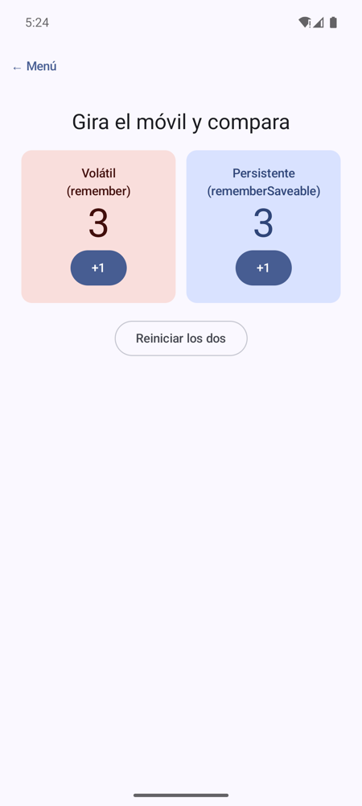
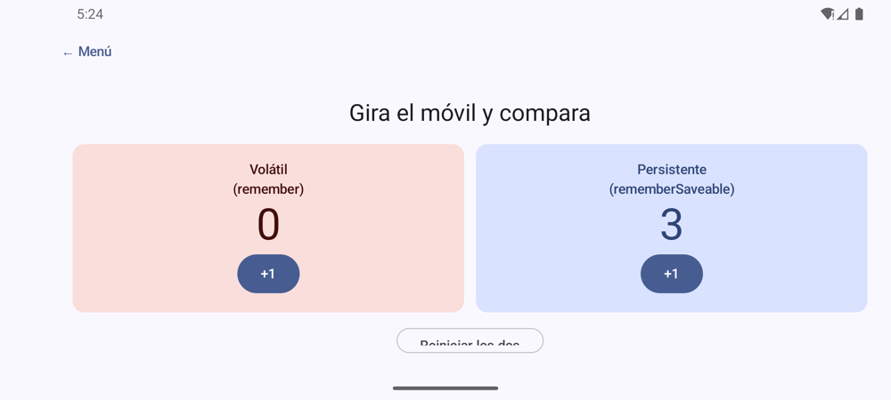

# **Codelab 2.03: Ciclo de Vida, Logcat y `rememberSaveable`**

Al terminar el codelab anterior viste algo raro: al girar el móvil, el contador volvía a 0 y la app regresaba al menú. En este codelab descubrirás por qué. Instrumentarás `MainActivity` con trazas de `Log`, las seguirás en **Logcat** y comprobarás que al girar la pantalla Android **destruye y vuelve a crear la `Activity`**. Después lo arreglarás con `rememberSaveable` y lo verás en una pantalla que compara los dos contadores lado a lado.

!!! info "Punto de partida: tag `c2.03-inicio`"
    Sigue en el repositorio del laboratorio, [pmdm2627-lab-ut2](https://github.com/jssdocente/pmdm2627-lab-ut2). Si terminaste el [Codelab 2.02](./02-contador-incremental.md), continúa en tu rama. Si no, parte del tag:

    ```bash
    git checkout c2.03-inicio
    git switch -c mi-lab-2.03
    ```

    `c2.03-inicio` es `c2.02-fin`: el menú, el contador y la tarjeta con estado, todo con `remember`.

---

## 1. ¿Qué vas a construir?

- Trazas `Log.d` en los métodos del ciclo de vida de `MainActivity`, filtradas en Logcat.
- Dos experimentos: mandar la app a segundo plano y girar la pantalla.
- El arreglo: cambiar `remember` por `rememberSaveable` en el contador, en la tarjeta y en el menú.
- Una pantalla nueva, **2.03 · Ciclo de vida**, con dos contadores iguales: uno con `remember` y otro con `rememberSaveable`. Al girar, el primero se pierde y el segundo no.

<div style="display: flex; flex-direction: row; justify-content: center; align-items: center; gap: 1.5rem; flex-wrap: wrap; margin: 1.8rem 0;" markdown="1">

<figure style="margin: 0; text-align: center; max-width: 220px;" markdown="1">

{ style="border-radius: 8px; box-shadow: 0 4px 10px rgba(0,0,0,0.15); width: 100%; max-width: 210px;" }

<figcaption style="font-size: 0.85rem; margin-top: 0.5rem; color: var(--md-default-fg-color--light);"><strong>Figura 1:</strong> Antes de girar: los dos contadores a 3.</figcaption>
</figure>

<figure style="margin: 0; text-align: center; max-width: 440px;" markdown="1">

{ style="border-radius: 8px; box-shadow: 0 4px 10px rgba(0,0,0,0.15); width: 100%; max-width: 430px;" }

<figcaption style="font-size: 0.85rem; margin-top: 0.5rem; color: var(--md-default-fg-color--light);"><strong>Figura 2:</strong> Tras girar: el volátil vuelve a 0 y el persistente conserva el 3.</figcaption>
</figure>

</div>

Al terminar, serás capaz de:

- Sobrescribir los métodos del ciclo de vida de una `Activity` y trazarlos con `Log.d`.
- Filtrar Logcat por etiqueta y por nivel.
- Explicar qué pasa con el estado cuando Android recrea la `Activity`.
- Elegir entre `remember` y `rememberSaveable`.

---

## 2. El Ciclo de Vida de la Activity

Una **`Activity`** es la ventana en la que Android dibuja tu interfaz; en nuestra app solo hay una, `MainActivity`, y dentro de ella vive todo Compose. A diferencia de un programa de consola, que empieza en `main()` y acaba, una `Activity` pasa por varios estados que **decide el sistema**: cuando llega una llamada, cuando cambias de app, cuando giras la pantalla o cuando falta memoria.

<figure class="arq-fig">
--8<-- "docs/temas/02/codelabs/images/c2.03-ciclo.svg"
<figcaption>Los seis métodos que vas a instrumentar. Con <em>Home</em> la <code>Activity</code> se para; al girar, se destruye y se crea otra.</figcaption>
</figure>

| Método | ¿Cuándo se invoca? |
| :--- | :--- |
| **`onCreate()`** | Al crear la `Activity`. Aquí se llama a `setContent { ... }`. |
| **`onStart()`** | La `Activity` pasa a ser visible. |
| **`onResume()`** | Está en primer plano y recibe pulsaciones. |
| **`onPause()`** | Pierde el primer plano (un diálogo del sistema, la multitarea…). |
| **`onStop()`** | Deja de verse: pulsas *Home* o cambias de app. |
| **`onDestroy()`** | Se destruye: al cerrar la app… **o al girar la pantalla**. |

Tienes la teoría completa en [2.2 Ciclo de vida de una aplicación](../2.2-ciclo-vida-app.md).

---

## 3. Paso 1: Instrumentar `MainActivity` con Logs

Abre `MainActivity.kt` y sobrescribe los seis métodos para que cada uno escriba una traza. La etiqueta (`TAG`) es una constante en un `companion object`, el equivalente en Kotlin a un `static final` de Java:

??? example "Ver código: `MainActivity.kt` instrumentado"

    ```kotlin
    package com.pmdm.lab.ut2

    import android.os.Bundle
    import android.util.Log
    import androidx.activity.ComponentActivity
    import androidx.activity.compose.setContent
    import androidx.activity.enableEdgeToEdge
    import androidx.compose.foundation.layout.fillMaxSize
    import androidx.compose.foundation.layout.padding
    import androidx.compose.material3.Scaffold
    import androidx.compose.ui.Modifier
    import com.pmdm.lab.ut2.ui.theme.LabUt2Theme

    class MainActivity : ComponentActivity() {

        companion object {
            // Etiqueta para filtrar en Logcat: tag:CicloVidaLab
            private const val TAG = "CicloVidaLab"
        }

        override fun onCreate(savedInstanceState: Bundle?) {
            super.onCreate(savedInstanceState)
            Log.d(TAG, "onCreate: la Activity se crea")
            enableEdgeToEdge()
            setContent {
                LabUt2Theme {
                    Scaffold(modifier = Modifier.fillMaxSize()) { innerPadding ->
                        LabApp(modifier = Modifier.padding(innerPadding))
                    }
                }
            }
        }

        override fun onStart() {
            super.onStart()
            Log.d(TAG, "onStart: la Activity es visible")
        }

        override fun onResume() {
            super.onResume()
            Log.d(TAG, "onResume: la Activity está en primer plano")
        }

        override fun onPause() {
            super.onPause()
            Log.d(TAG, "onPause: la Activity pierde el primer plano")
        }

        override fun onStop() {
            super.onStop()
            Log.d(TAG, "onStop: la Activity deja de verse")
        }

        override fun onDestroy() {
            super.onDestroy()
            Log.d(TAG, "onDestroy: la Activity se destruye")
        }
    }
    ```

!!! warning "Llama siempre a `super`"
    Cada método debe llamar primero a su `super.onXxx()`. Si lo olvidas, la app se cierra con una `SuperNotCalledException`.

---

## 4. Paso 2: Logcat en IntelliJ IDEA

1. **Abre Logcat:** pestaña **Logcat** de la barra inferior (++alt+6++ en Windows/Linux, ++cmd+6++ en macOS).

2. **Elige el dispositivo** en el desplegable de la izquierda: tu emulador o tu móvil.

3. **Filtra por etiqueta** escribiendo en la caja de búsqueda:

    ```text
    tag:CicloVidaLab
    ```

    Logcat ocultará los miles de mensajes del sistema y dejará solo los tuyos.

4. **Nivel:** `Log.d` escribe con nivel *Debug*. Si no ves nada, comprueba que el filtro de nivel no esté en *Info* o superior.

Ejecuta la app: al arrancar verás `onCreate`, `onStart` y `onResume`, en ese orden.

---

## 5. Paso 3: Experimento 1, Segundo Plano

1. Con la app abierta y Logcat filtrado, pulsa el botón **Home** del emulador.

2. Logcat muestra:

    ```text
    onPause: la Activity pierde el primer plano
    onStop: la Activity deja de verse
    ```

3. Vuelve a la app desde la multitarea. Logcat muestra:

    ```text
    onStart: la Activity es visible
    onResume: la Activity está en primer plano
    ```

**Conclusión:** la `Activity` no se ha destruido; ha estado parada en memoria. Si tenías el contador en 5, sigue en 5.

---

## 6. Paso 4: Experimento 2, Girar la Pantalla

1. Abre **2.02 · Contador** y pulsa `+1` hasta llegar a 5.

2. Gira el emulador (botón *Rotate* de la barra lateral).

3. Logcat muestra la secuencia completa:

    ```text
    onPause: la Activity pierde el primer plano
    onStop: la Activity deja de verse
    onDestroy: la Activity se destruye
    onCreate: la Activity se crea
    onStart: la Activity es visible
    onResume: la Activity está en primer plano
    ```

4. En pantalla, la app ha vuelto al **menú** y, si abres el contador, está a **0**.

### ¿Por qué se pierde todo?

Girar la pantalla es un **cambio de configuración**: el ancho, el alto y quizá los recursos cambian, así que Android destruye la `Activity` y crea una nueva. Con ella se destruye la composición entera, y **`remember` solo guarda valores mientras dura la composición**. La nueva `Activity` llama otra vez a `setContent`, que empieza de cero: `pantalla` vuelve a `MENU` y `cuenta`, a `0`.

<figure class="arq-fig">
--8<-- "docs/temas/02/codelabs/images/c2.03-giro.svg"
<figcaption>Al girar, la composición se crea de nuevo. Solo sobrevive lo que se guardó en el <code>Bundle</code>, que es lo que hace <code>rememberSaveable</code>.</figcaption>
</figure>

---

## 7. Paso 5: El Arreglo, `rememberSaveable`

`rememberSaveable` funciona igual que `remember`, pero además **guarda el valor en el `Bundle`** que Android conserva cuando recrea la `Activity` (el `savedInstanceState` que recibe `onCreate`). Al volver a componer, recupera el valor en lugar de empezar de cero.

Cámbialo en los **tres** sitios donde la app guarda estado. En cada archivo cambia también el `import`:

```kotlin
import androidx.compose.runtime.saveable.rememberSaveable
```

| Archivo | Antes | Después |
| :--- | :--- | :--- |
| `LabApp.kt` | `var pantalla by remember { mutableStateOf(PantallaLab.MENU) }` | `var pantalla by rememberSaveable { mutableStateOf(PantallaLab.MENU) }` |
| `codelab02_contador/Contador.kt` | `var cuenta by remember { mutableIntStateOf(0) }` | `var cuenta by rememberSaveable { mutableIntStateOf(0) }` |
| `codelab01_tarjeta/TarjetaScreen.kt` | `var proyectos by remember { mutableIntStateOf(0) }` | `var proyectos by rememberSaveable { mutableIntStateOf(0) }` |

Repite el experimento: ahora la app se queda en el contador y la cuenta sigue en 5. Los composables `…Content` no cambian: no tienen estado, así que no hay nada que guardar en ellos.

!!! tip "¿Qué se puede guardar con `rememberSaveable`?"
    Lo que cabe en un `Bundle`: números, `String`, `Boolean`, `enum` (por eso funciona `PantallaLab`) y clases `@Parcelize`. Para objetos más complejos hace falta un `Saver`; y para el estado de una pantalla de verdad usarás un **`ViewModel`** en la UT3.

!!! question "¿Y por qué no usar siempre `rememberSaveable`?"
    Guardar en el `Bundle` tiene un coste y un límite de tamaño. Úsalo para lo que el usuario espera conservar (lo que ha escrito, la pantalla en la que está, un marcador). `remember` sigue siendo correcto para lo que se puede recalcular, como el `ScrollState` de una lista o un objeto auxiliar.

---

## 8. Paso 6: La Pantalla de Comparación

Para tener los dos comportamientos a la vista, crea una pantalla con dos contadores idénticos salvo en cómo se recuerdan. Crea el paquete `codelabs.codelab03_ciclovida` y el archivo `CicloVida.kt`. Sigue el patrón de siempre: un `Content` sin estado y una `Screen` con estado.

??? example "Ver código: `CicloVida.kt`"

    ```kotlin
    package com.pmdm.lab.ut2.codelabs.codelab03_ciclovida

    import androidx.compose.foundation.layout.Arrangement
    import androidx.compose.foundation.layout.Column
    import androidx.compose.foundation.layout.Row
    import androidx.compose.foundation.layout.fillMaxSize
    import androidx.compose.foundation.layout.fillMaxWidth
    import androidx.compose.foundation.layout.padding
    import androidx.compose.material3.Button
    import androidx.compose.material3.Card
    import androidx.compose.material3.CardDefaults
    import androidx.compose.material3.MaterialTheme
    import androidx.compose.material3.OutlinedButton
    import androidx.compose.material3.Text
    import androidx.compose.runtime.Composable
    import androidx.compose.runtime.getValue
    import androidx.compose.runtime.mutableIntStateOf
    import androidx.compose.runtime.remember
    import androidx.compose.runtime.saveable.rememberSaveable
    import androidx.compose.runtime.setValue
    import androidx.compose.ui.Alignment
    import androidx.compose.ui.Modifier
    import androidx.compose.ui.graphics.Color
    import androidx.compose.ui.text.style.TextAlign
    import androidx.compose.ui.tooling.preview.Preview
    import androidx.compose.ui.unit.dp
    import com.pmdm.lab.ut2.ui.theme.LabUt2Theme

    // ============================================================================
    // 1. COMPONENTE SIN ESTADO: dos contadores, uno al lado del otro
    // ============================================================================
    @Composable
    fun CicloVidaContent(
        cuentaVolatil: Int,
        cuentaGuardada: Int,
        onIncrementarVolatil: () -> Unit,
        onIncrementarGuardada: () -> Unit,
        onReiniciar: () -> Unit,
        modifier: Modifier = Modifier
    ) {
        Column(
            modifier = modifier
                .fillMaxSize()
                .padding(24.dp),
            horizontalAlignment = Alignment.CenterHorizontally,
            verticalArrangement = Arrangement.spacedBy(16.dp)
        ) {
            Text(
                text = "Gira el móvil y compara",
                style = MaterialTheme.typography.headlineSmall
            )

            // Una al lado de la otra: así se ven las dos también en horizontal
            Row(
                modifier = Modifier.fillMaxWidth(),
                horizontalArrangement = Arrangement.spacedBy(12.dp)
            ) {
                TarjetaContador(
                    titulo = "Volátil\n(remember)",
                    cuenta = cuentaVolatil,
                    fondo = MaterialTheme.colorScheme.errorContainer,
                    texto = MaterialTheme.colorScheme.onErrorContainer,
                    onIncrementar = onIncrementarVolatil,
                    modifier = Modifier.weight(1f)
                )
                TarjetaContador(
                    titulo = "Persistente\n(rememberSaveable)",
                    cuenta = cuentaGuardada,
                    fondo = MaterialTheme.colorScheme.primaryContainer,
                    texto = MaterialTheme.colorScheme.onPrimaryContainer,
                    onIncrementar = onIncrementarGuardada,
                    modifier = Modifier.weight(1f)
                )
            }

            OutlinedButton(onClick = onReiniciar) {
                Text("Reiniciar los dos")
            }
        }
    }

    @Composable
    private fun TarjetaContador(
        titulo: String,
        cuenta: Int,
        fondo: Color,
        texto: Color,
        onIncrementar: () -> Unit,
        modifier: Modifier = Modifier
    ) {
        Card(
            modifier = modifier,
            colors = CardDefaults.cardColors(containerColor = fondo, contentColor = texto)
        ) {
            Column(
                modifier = Modifier
                    .fillMaxWidth()
                    .padding(16.dp),
                horizontalAlignment = Alignment.CenterHorizontally
            ) {
                Text(
                    text = titulo,
                    style = MaterialTheme.typography.titleSmall,
                    textAlign = TextAlign.Center
                )
                Text(text = "$cuenta", style = MaterialTheme.typography.displayMedium)
                Button(onClick = onIncrementar) {
                    Text("+1")
                }
            }
        }
    }

    // ============================================================================
    // 2. VISTA PREVIA
    // ============================================================================
    @Preview(name = "Ciclo de vida", showBackground = true)
    @Composable
    private fun CicloVidaPreview() {
        LabUt2Theme {
            CicloVidaContent(
                cuentaVolatil = 5,
                cuentaGuardada = 5,
                onIncrementarVolatil = {},
                onIncrementarGuardada = {},
                onReiniciar = {}
            )
        }
    }

    // ============================================================================
    // 3. PANTALLA CON ESTADO: la única diferencia entre los dos es cómo se recuerdan
    // ============================================================================
    @Composable
    fun CicloVidaScreen(modifier: Modifier = Modifier) {
        // Se pierde al recrearse la Activity (por ejemplo, al girar la pantalla)
        var cuentaVolatil by remember { mutableIntStateOf(0) }
        // Se guarda en el Bundle de la Activity y se restaura al recrearla
        var cuentaGuardada by rememberSaveable { mutableIntStateOf(0) }

        CicloVidaContent(
            cuentaVolatil = cuentaVolatil,
            cuentaGuardada = cuentaGuardada,
            onIncrementarVolatil = { cuentaVolatil++ },
            onIncrementarGuardada = { cuentaGuardada++ },
            onReiniciar = {
                cuentaVolatil = 0
                cuentaGuardada = 0
            },
            modifier = modifier
        )
    }
    ```

Las tarjetas van en una `Row` con `Modifier.weight(1f)` para que se repartan el ancho a partes iguales. Si fueran una debajo de otra, en horizontal no cabrían y no verías la segunda tras girar.

### Registrar la pantalla en el menú

Es la receta que repetirás en cada codelab a partir de ahora. En `LabApp.kt`:

1. Añade una entrada al `enum`:

    ```kotlin
    CICLO_VIDA("2.03 · Ciclo de vida", "Logcat, rotación y rememberSaveable")
    ```

2. Añade su rama al `when` (y el `import` de `CicloVidaScreen`):

    ```kotlin
    PantallaLab.CICLO_VIDA -> PantallaConVolver({ pantalla = PantallaLab.MENU }, modifier) {
        CicloVidaScreen()
    }
    ```

El menú no hay que tocarlo: recorre `PantallaLab.entries`, así que la nueva tarjeta aparece sola. Y si olvidas la rama del `when`, el compilador te avisa: un `when` sobre un `enum` debe cubrir todos sus valores.

Ejecuta, abre **2.03 · Ciclo de vida**, sube los dos contadores y gira: obtendrás las Figuras 1 y 2.

!!! success "Solución: tag `c2.03-fin`"
    Compara tu código con el tag [`c2.03-fin`](https://github.com/jssdocente/pmdm2627-lab-ut2/tree/c2.03-fin) (`git diff c2.03-fin`). Es también el punto de partida del [Codelab 2.04](./04-dado-interactivo.md).

---

## 9. Resumen y Checklist

- [ ] `MainActivity` sobrescribe los seis métodos del ciclo de vida, llama a `super` en todos y escribe con `Log.d(TAG, …)`.
- [ ] Sabes filtrar Logcat con `tag:CicloVidaLab`.
- [ ] Al pulsar *Home* la `Activity` se para (`onPause`, `onStop`); al girar se destruye y se recrea.
- [ ] `LabApp`, `ContadorScreen` y `TarjetaScreen` usan `rememberSaveable`: tras girar, la app sigue en la misma pantalla y con los mismos valores.
- [ ] La pantalla **2.03 · Ciclo de vida** muestra la diferencia entre `remember` y `rememberSaveable`.
- [ ] Sabes registrar una pantalla nueva en el menú: una entrada en `PantallaLab` y una rama en el `when`.
