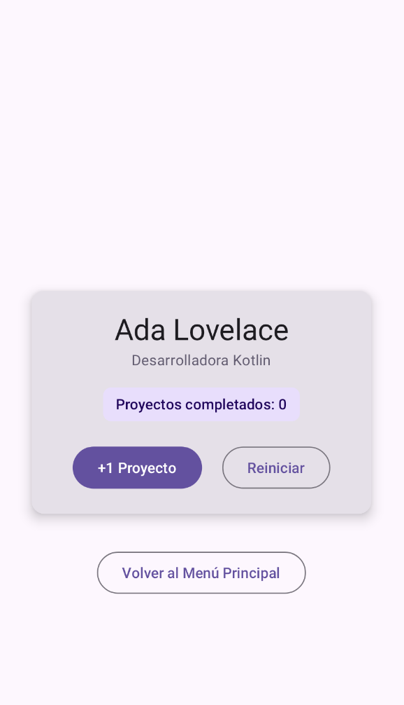
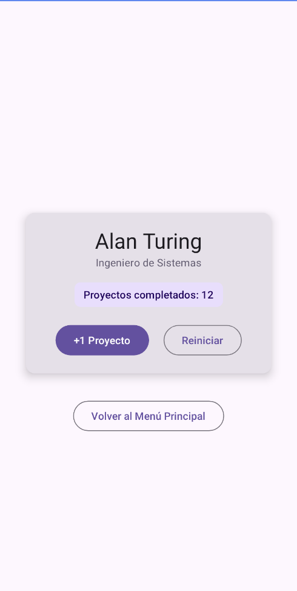
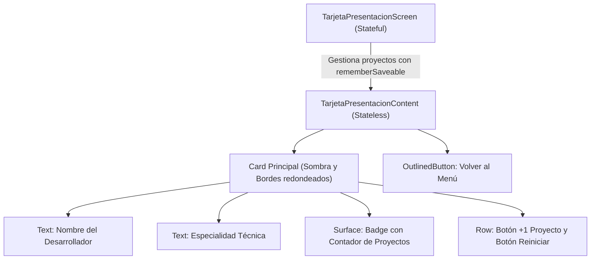
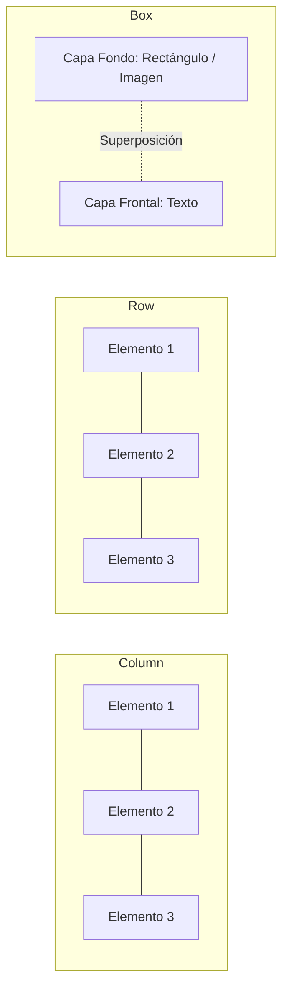

# **Codelab 3: Tarjeta de Presentación y Metodología @Preview**

En este codelab aprenderás a maquetar tu primera interfaz declarativa en **Jetpack Compose** utilizando los contenedores de distribución fundamentales y el sistema de modificadores (`Modifier`).

Además, aplicarás uno de los principios arquitectónicos más importantes del desarrollo frontend profesional: la separación entre **componentes de presentación sin estado (*Stateless Content*)** y **pantallas contenedoras con estado (*Stateful Screen*)**, complementándolo con el uso profesional de la anotación **`@Preview`** para diseñar, probar y depurar sin necesidad de arrancar el emulador.

---

## 1. ¿Qué vas a construir?

Construirás una **Tarjeta de Presentación de Desarrollador** interactiva. La tarjeta muestra información personal del perfil (nombre, especialidad técnica, insignia con número de proyectos completados) y dos botones de acción: uno para incrementar el número de proyectos y otro para reiniciar la cuenta.

<div style="display: flex; flex-direction: row; justify-content: center; align-items: flex-start; gap: 1.5rem; flex-wrap: wrap; margin: 1.8rem 0;" markdown="1">

<figure style="margin: 0; text-align: center; max-width: 260px;" markdown="1">

{ style="border-radius: 8px; box-shadow: 0 4px 10px rgba(0,0,0,0.15); width: 100%; max-width: 250px;" }

<figcaption style="font-size: 0.85rem; margin-top: 0.5rem; color: var(--md-default-fg-color--light);"><strong>Figura 1:</strong> Perfil inicial (Ada Lovelace, 0 proyectos).</figcaption>
</figure>

<figure style="margin: 0; text-align: center; max-width: 260px;" markdown="1">

{ style="border-radius: 8px; box-shadow: 0 4px 10px rgba(0,0,0,0.15); width: 100%; max-width: 250px;" }

<figcaption style="font-size: 0.85rem; margin-top: 0.5rem; color: var(--md-default-fg-color--light);"><strong>Figura 2:</strong> Vista previa con datos avanzados (Alan Turing, 12 proyectos).</figcaption>
</figure>

</div>



Al finalizar este codelab, serás capaz de:

- Organizar elementos visuales usando `Column`, `Row`, `Box` y `Spacer`.
- Utilizar modificadores esenciales: `fillMaxWidth`, `fillMaxSize`, `padding` y `size`.
- Desacoplar la lógica de estado (`Stateful`) de la capa visual (`Stateless`).
- Crear múltiples vistas previas con `@Preview` (Modo Claro, Modo Oscuro y datos mock).
- Probar la interactividad de tu componente directamente en IntelliJ IDEA usando el **Interactive Mode**.

---

## 2. Los Contenedores de Disposición Básicos en Compose

En Jetpack Compose no se emplean etiquetas XML ni layouts imperativos. La estructura visual se define componiendo funciones de Kotlin:



- **`Column`:** Apila sus elementos de manera vertical, de arriba hacia abajo.
- **`Row`:** Coloca sus elementos de manera horizontal, de izquierda a derecha.
- **`Box`:** Superpone elementos unos sobre otros en capas Z (el primer elemento queda al fondo y los sucesivos se colocan encima).
- **`Spacer`:** Componente vacío diseñado para introducir espacios y separaciones exactas (`Spacer(modifier = Modifier.height(16.dp))`).

### ¿Qué son los Modificadores (`Modifier`)?

Los modificadores indican a un composable cómo debe dibujarse, comportarse o posicionarse dentro de su contenedor padre. Son encadenables y permiten:

- **Dimensionar:** `fillMaxSize()`, `fillMaxWidth(0.9f)`, `height(32.dp)`, `width(100.dp)`.
- **Espaciar:** `padding(16.dp)` añade margen interior respecto a los límites.
- **Alinear:** `horizontalAlignment = Alignment.CenterHorizontally` en una `Column`.

---

## 3. Paso 1: Componente de Presentación (`TarjetaPresentacionContent`)

Creamos el archivo `app/src/main/java/com/dam/pmdmlab/codelabs/codelab03_tarjeta/TarjetaPresentacionScreen.kt`.

El componente de presentación (*Stateless Content*) debe cumplir las siguientes reglas de oro:

1. **No posee estado mutable interno:** Recibe todos los valores que necesita como parámetros inmutables (`nombre`, `especialidad`, `contadorProyectos`).
2. **No ejecuta lógica de negocio directa:** Cuando el usuario hace clic, delega la acción hacia arriba mediante lambdas (`onSumarProyecto`, `onReiniciar`, `onBack`).
3. **Expone un modificador:** Siempre incluye como último parámetro opcional `modifier: Modifier = Modifier`.

```kotlin
@Composable
fun TarjetaPresentacionContent(
    nombre: String,
    especialidad: String,
    contadorProyectos: Int,
    onSumarProyecto: () -> Unit,
    onReiniciar: () -> Unit,
    onBack: () -> Unit,
    modifier: Modifier = Modifier
) {
    Column(
        modifier = modifier
            .fillMaxSize()
            .padding(16.dp),
        horizontalAlignment = Alignment.CenterHorizontally,
        verticalArrangement = Arrangement.Center
    ) {
        Card(
            modifier = Modifier.fillMaxWidth(0.9f),
            elevation = CardDefaults.cardElevation(defaultElevation = 6.dp)
        ) {
            Column(
                modifier = Modifier.padding(20.dp),
                horizontalAlignment = Alignment.CenterHorizontally
            ) {
                Text(
                    text = nombre,
                    style = MaterialTheme.typography.headlineMedium
                )
                Text(
                    text = especialidad,
                    style = MaterialTheme.typography.bodyMedium,
                    color = MaterialTheme.colorScheme.secondary
                )

                Spacer(modifier = Modifier.height(16.dp))

                Surface(
                    color = MaterialTheme.colorScheme.primaryContainer,
                    shape = MaterialTheme.shapes.small
                ) {
                    Text(
                        text = "Proyectos completados: $contadorProyectos",
                        modifier = Modifier.padding(horizontal = 12.dp, vertical = 6.dp),
                        style = MaterialTheme.typography.labelLarge,
                        color = MaterialTheme.colorScheme.onPrimaryContainer
                    )
                }

                Spacer(modifier = Modifier.height(20.dp))

                Row(
                    modifier = Modifier.fillMaxWidth(),
                    horizontalArrangement = Arrangement.SpaceEvenly
                ) {
                    Button(onClick = onSumarProyecto) {
                        Text("+1 Proyecto")
                    }
                    OutlinedButton(onClick = onReiniciar) {
                        Text("Reiniciar")
                    }
                }
            }
        }

        Spacer(modifier = Modifier.height(32.dp))

        OutlinedButton(onClick = onBack) {
            Text("Volver al Menú Principal")
        }
    }
}
```

---

## 4. Paso 2: Dominar las Vistas Previas con `@Preview`

Una de las ventajas competitivas de Jetpack Compose es poder inspeccionar la interfaz en tiempo de diseño en IntelliJ IDEA sin necesidad de arrancar el emulador.

Al tener un componente *Stateless*, podemos instanciarlo con diferentes conjuntos de datos de prueba (*mock data*) y configuraciones de sistema:

### 1. Vista Previa en Estado Inicial (Modo Claro)

```kotlin
@Preview(name = "Tarjeta Inicial - Modo Claro", showBackground = true)
@Composable
private fun TarjetaPresentacionPreviewInicial() {
    Surface {
        TarjetaPresentacionContent(
            nombre = "Ada Lovelace",
            especialidad = "Desarrolladora Kotlin",
            contadorProyectos = 0,
            onSumarProyecto = {},
            onReiniciar = {},
            onBack = {}
        )
    }
}
```

### 2. Vista Previa con Datos Avanzados

```kotlin
@Preview(name = "Tarjeta con Datos - 12 Proyectos", showBackground = true)
@Composable
private fun TarjetaPresentacionPreviewConDatos() {
    Surface {
        TarjetaPresentacionContent(
            nombre = "Alan Turing",
            especialidad = "Ingeniero de Sistemas",
            contadorProyectos = 12,
            onSumarProyecto = {},
            onReiniciar = {},
            onBack = {}
        )
    }
}
```

### 3. Vista Previa en Modo Oscuro (*Dark Theme*)

Podemos verificar cómo reacciona el diseño a la paleta nocturna indicando el flag `uiMode = Configuration.UI_MODE_NIGHT_YES`:

```kotlin
@Preview(
    name = "Tarjeta - Modo Oscuro",
    showBackground = true,
    uiMode = android.content.res.Configuration.UI_MODE_NIGHT_YES
)
@Composable
private fun TarjetaPresentacionPreviewDark() {
    Surface {
        TarjetaPresentacionContent(
            nombre = "Grace Hopper",
            especialidad = "Arquitecta de Compiladores",
            contadorProyectos = 42,
            onSumarProyecto = {},
            onReiniciar = {},
            onBack = {}
        )
    }
}
```

---

## 5. Paso 3: El Modo Interactivo de IntelliJ IDEA (*Interactive Mode*)

En la esquina superior del panel de previsualización de IntelliJ IDEA encontrarás el icono de **Interactive Mode** (icono con silueta de mano o de rayo).

Al pulsar sobre este botón:

1. El lienzo de la preview deja de ser una captura estática y se convierte en una instancia viva ejecutada sobre la JVM de tu ordenador.
2. Si la preview contiene estado local, puedes pulsar los botones directamente y observar cómo la interfaz se actualiza en tiempo real.
3. No requiere compilar el APK completo ni conectar un teléfono o emulador, acelerando el ciclo de retroalimentación de diseño a segundos.

---

## 6. Paso 4: Contenedor con Estado (`TarjetaPresentacionScreen`)

El contenedor con estado (*Stateful Screen*) se encarga de alojar la variable de estado mediante `rememberSaveable`, gestionar la mutación del contador ante los eventos de los botones y propagar la navegación de regreso (`onBack`):

??? example "Ver código completo: TarjetaPresentacionScreen.kt"

    ```kotlin
    package com.dam.pmdmlab.codelabs.codelab03_tarjeta

    import androidx.compose.foundation.layout.Arrangement
    import androidx.compose.foundation.layout.Column
    import androidx.compose.foundation.layout.Row
    import androidx.compose.foundation.layout.Spacer
    import androidx.compose.foundation.layout.fillMaxSize
    import androidx.compose.foundation.layout.fillMaxWidth
    import androidx.compose.foundation.layout.height
    import androidx.compose.foundation.layout.padding
    import androidx.compose.material3.Button
    import androidx.compose.material3.Card
    import androidx.compose.material3.CardDefaults
    import androidx.compose.material3.MaterialTheme
    import androidx.compose.material3.OutlinedButton
    import androidx.compose.material3.Surface
    import androidx.compose.material3.Text
    import androidx.compose.runtime.Composable
    import androidx.compose.runtime.getValue
    import androidx.compose.runtime.mutableIntStateOf
    import androidx.compose.runtime.saveable.rememberSaveable
    import androidx.compose.runtime.setValue
    import androidx.compose.ui.Alignment
    import androidx.compose.ui.Modifier
    import androidx.compose.ui.tooling.preview.Preview
    import androidx.compose.ui.unit.dp

    // ============================================================================
    // 1. COMPONENTE DE PRESENTACIÓN (STATELESS CONTENT)
    // ============================================================================
    @Composable
    fun TarjetaPresentacionContent(
        nombre: String,
        especialidad: String,
        contadorProyectos: Int,
        onSumarProyecto: () -> Unit,
        onReiniciar: () -> Unit,
        onBack: () -> Unit,
        modifier: Modifier = Modifier
    ) {
        Column(
            modifier = modifier
                .fillMaxSize()
                .padding(16.dp),
            horizontalAlignment = Alignment.CenterHorizontally,
            verticalArrangement = Arrangement.Center
        ) {
            Card(
                modifier = Modifier.fillMaxWidth(0.9f),
                elevation = CardDefaults.cardElevation(defaultElevation = 6.dp)
            ) {
                Column(
                    modifier = Modifier.padding(20.dp),
                    horizontalAlignment = Alignment.CenterHorizontally
                ) {
                    Text(
                        text = nombre,
                        style = MaterialTheme.typography.headlineMedium
                    )
                    Text(
                        text = especialidad,
                        style = MaterialTheme.typography.bodyMedium,
                        color = MaterialTheme.colorScheme.secondary
                    )

                    Spacer(modifier = Modifier.height(16.dp))

                    Surface(
                        color = MaterialTheme.colorScheme.primaryContainer,
                        shape = MaterialTheme.shapes.small
                    ) {
                        Text(
                            text = "Proyectos completados: $contadorProyectos",
                            modifier = Modifier.padding(horizontal = 12.dp, vertical = 6.dp),
                            style = MaterialTheme.typography.labelLarge,
                            color = MaterialTheme.colorScheme.onPrimaryContainer
                        )
                    }

                    Spacer(modifier = Modifier.height(20.dp))

                    Row(
                        modifier = Modifier.fillMaxWidth(),
                        horizontalArrangement = Arrangement.SpaceEvenly
                    ) {
                        Button(onClick = onSumarProyecto) {
                            Text("+1 Proyecto")
                        }
                        OutlinedButton(onClick = onReiniciar) {
                            Text("Reiniciar")
                        }
                    }
                }
            }

            Spacer(modifier = Modifier.height(32.dp))

            OutlinedButton(onClick = onBack) {
                Text("Volver al Menú Principal")
            }
        }
    }

    // ============================================================================
    // 2. VISTAS PREVIAS (@PREVIEW) CON DATOS MOCK
    // ============================================================================
    @Preview(name = "Tarjeta Inicial - Claro", showBackground = true)
    @Composable
    private fun TarjetaPresentacionPreviewInicial() {
        Surface {
            TarjetaPresentacionContent(
                nombre = "Ada Lovelace",
                especialidad = "Desarrolladora Kotlin",
                contadorProyectos = 0,
                onSumarProyecto = {},
                onReiniciar = {},
                onBack = {}
            )
        }
    }

    @Preview(name = "Tarjeta Activa - Varios Proyectos", showBackground = true)
    @Composable
    private fun TarjetaPresentacionPreviewConDatos() {
        Surface {
            TarjetaPresentacionContent(
                nombre = "Alan Turing",
                especialidad = "Ingeniero de Sistemas",
                contadorProyectos = 12,
                onSumarProyecto = {},
                onReiniciar = {},
                onBack = {}
            )
        }
    }

    @Preview(
        name = "Tarjeta - Modo Oscuro",
        showBackground = true,
        uiMode = android.content.res.Configuration.UI_MODE_NIGHT_YES
    )
    @Composable
    private fun TarjetaPresentacionPreviewDark() {
        Surface {
            TarjetaPresentacionContent(
                nombre = "Grace Hopper",
                especialidad = "Arquitecta de Compiladores",
                contadorProyectos = 42,
                onSumarProyecto = {},
                onReiniciar = {},
                onBack = {}
            )
        }
    }

    // ============================================================================
    // 3. PANTALLA CONTENEDORA (STATEFUL SCREEN)
    // ============================================================================
    @Composable
    fun TarjetaPresentacionScreen(
        onBack: () -> Unit,
        modifier: Modifier = Modifier
    ) {
        var proyectos by rememberSaveable { mutableIntStateOf(0) }

        TarjetaPresentacionContent(
            nombre = "Carlos Estudiante",
            especialidad = "Desarrollador Multiplataforma (2º DAM)",
            contadorProyectos = proyectos,
            onSumarProyecto = { proyectos++ },
            onReiniciar = { proyectos = 0 },
            onBack = onBack,
            modifier = modifier
        )
    }
    ```

---

## 7. Resumen y Checklist de Calidad

En este codelab has aprendido:

- Cómo combinar `Column`, `Row`, `Spacer` y `Card` para componer layouts claros y ordenados.
- El uso de modificadores para controlar el tamaño relativo (`fillMaxWidth(0.9f)`) y el padding.
- La separación arquitectónica estricta entre un composable visual inmutable y su pantalla contenedora con estado.
- La creación de vistas previas ricas en Modo Claro y Modo Oscuro con datos mock.
- El uso del **Interactive Mode** en IntelliJ IDEA para probar la UI en tiempo récord.
