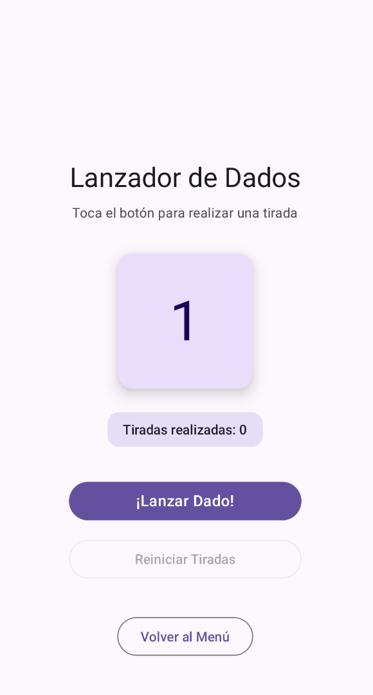
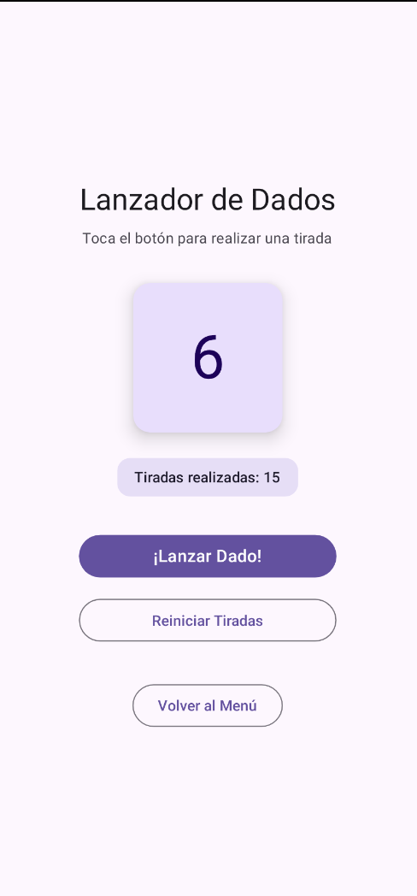
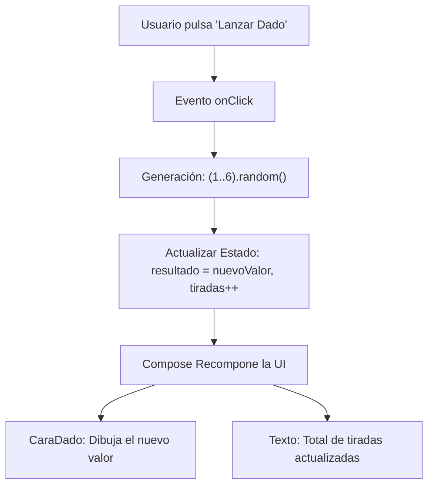

# **Codelab 4: Lanzador de Dados (*Dice Roller*) e Interactividad**

En este codelab aprenderás a construir una de las aplicaciones interactivas más populares del catálogo oficial de Google para Android: el **Lanzador de Dados (*Dice Roller*)**, adaptado con las mejores prácticas de **Jetpack Compose**.

Aprenderás a gestionar eventos de usuario mediante botones, a generar valores pseudoaleatorios en Kotlin, a mutar y recordar el estado reactivo con `rememberSaveable`, y a diseñar visualmente la cara del dado combinando componentes y modificadores de Compose.

---

## 1. ¿Qué vas a construir?

Construirás una aplicación interactiva que simula una tirada de dado de 6 caras. Cada vez que el usuario pulsa sobre el botón principal **"¡Lanzar Dado!"**:

1. Se genera un nuevo número aleatorio del 1 al 6.
2. La cara gráfica del dado se actualiza instantáneamente en pantalla.
3. Se incrementa un contador global de tiradas acumuladas.
4. El usuario dispone de un botón secundario para reiniciar el contador a cero.
5. Todos los valores (la cara del dado y las tiradas acumuladas) permanecen intactos si el usuario rota la pantalla del dispositivo.

<div style="display: flex; flex-direction: row; justify-content: center; align-items: flex-start; gap: 1.5rem; flex-wrap: wrap; margin: 1.8rem 0;" markdown="1">

<figure style="margin: 0; text-align: center; max-width: 260px;" markdown="1">

{ style="border-radius: 8px; box-shadow: 0 4px 10px rgba(0,0,0,0.15); width: 100%; max-width: 250px;" }

<figcaption style="font-size: 0.85rem; margin-top: 0.5rem; color: var(--md-default-fg-color--light);"><strong>Figura 1:</strong> Estado inicial (0 tiradas realizadas).</figcaption>
</figure>

<figure style="margin: 0; text-align: center; max-width: 260px;" markdown="1">

{ style="border-radius: 8px; box-shadow: 0 4px 10px rgba(0,0,0,0.15); width: 100%; max-width: 250px;" }

<figcaption style="font-size: 0.85rem; margin-top: 0.5rem; color: var(--md-default-fg-color--light);"><strong>Figura 2:</strong> Estado interactivo tras varias tiradas (resultado 6, 15 tiradas acumuladas).</figcaption>
</figure>

</div>



Al finalizar este codelab, serás capaz de:

- Gestionar pulsaciones e interactividad con el componente `Button`.
- Generar números pseudoaleatorios en Kotlin con `(1..6).random()`.
- Mutar variables de estado con `mutableIntStateOf`.
- Proteger múltiples variables de estado frente a cambios de configuración con `rememberSaveable`.
- Diseñar la superficie visual de un dado con `Card`, `Box` y tipografía destacada.
- Aplicar la separación arquitectónica *Stateless Content* y *Stateful Screen*.

---

## 2. Anatomía Visual del Dado en Compose

Para representar la cara del dado sin necesidad de incorporar aún recursos gráficos externos (`drawables`), utilizaremos una composición elegante basada en componentes nativos de Compose:

```
┌─────────────────────────────────┐
│           CaraDado              │
│  ┌───────────────────────────┐  │
│  │   Card (140.dp x 140.dp)  │  │
│  │   Bordes redondeados      │  │
│  │   Elevación y fondo sutil │  │
│  │                           │  │
│  │             5             │  │  <── Text (DisplayLarge, Centrado)
│  │                           │  │
│  └───────────────────────────┘  │
└─────────────────────────────────┘
```

- Un contenedor `Card` cuadrado de `140.dp` con esquinas redondeadas de `16.dp` y sombra sutil (`defaultElevation = 8.dp`).
- Un `Box` centralizado con `contentAlignment = Alignment.Center` que contiene el número resultante dibujado con estilo `MaterialTheme.typography.displayLarge`.
- Un badge secundario en `Surface` que indica `"Tiradas realizadas: X"`.

---

## 3. Paso 1: Componente de Presentación (`DadoRollerContent`)

Creamos el archivo `app/src/main/java/com/dam/pmdmlab/codelabs/codelab04_dados/DadoRollerScreen.kt`.

Implementamos en primer lugar el componente visual puro (*Stateless*):

- Recibe el número actual del dado (`valorDado: Int`).
- Recibe el número de tiradas realizadas (`totalTiradas: Int`).
- Expone las lambdas para eventos: `onLanzarDado: () -> Unit`, `onReiniciarTiradas: () -> Unit` y `onBack: () -> Unit`.

```kotlin
@Composable
fun DadoRollerContent(
    valorDado: Int,
    totalTiradas: Int,
    onLanzarDado: () -> Unit,
    onReiniciarTiradas: () -> Unit,
    onBack: () -> Unit,
    modifier: Modifier = Modifier
) {
    Column(
        modifier = modifier
            .fillMaxSize()
            .padding(24.dp),
        horizontalAlignment = Alignment.CenterHorizontally,
        verticalArrangement = Arrangement.Center
    ) {
        Text(
            text = "Lanzador de Dados",
            style = MaterialTheme.typography.headlineMedium
        )

        Spacer(modifier = Modifier.height(8.dp))

        Text(
            text = "Toca el botón para realizar una tirada",
            style = MaterialTheme.typography.bodyMedium,
            color = MaterialTheme.colorScheme.onSurfaceVariant
        )

        Spacer(modifier = Modifier.height(32.dp))

        // Componente visual: Cara del Dado
        CaraDado(valor = valorDado)

        Spacer(modifier = Modifier.height(24.dp))

        // Badge informativo con el total de tiradas acumuladas
        Surface(
            color = MaterialTheme.colorScheme.secondaryContainer,
            shape = MaterialTheme.shapes.medium
        ) {
            Text(
                text = "Tiradas realizadas: $totalTiradas",
                modifier = Modifier.padding(horizontal = 16.dp, vertical = 8.dp),
                style = MaterialTheme.typography.labelLarge,
                color = MaterialTheme.colorScheme.onSecondaryContainer
            )
        }

        Spacer(modifier = Modifier.height(32.dp))

        // Botón principal de lanzamiento
        Button(
            onClick = onLanzarDado,
            modifier = Modifier.fillMaxWidth(0.7f)
        ) {
            Text(
                text = "¡Lanzar Dado!",
                style = MaterialTheme.typography.titleMedium
            )
        }

        Spacer(modifier = Modifier.height(12.dp))

        // Botón secundario para reiniciar tiradas
        OutlinedButton(
            onClick = onReiniciarTiradas,
            modifier = Modifier.fillMaxWidth(0.7f),
            enabled = totalTiradas > 0
        ) {
            Text("Reiniciar Tiradas")
        }

        Spacer(modifier = Modifier.height(32.dp))

        OutlinedButton(onClick = onBack) {
            Text("Volver al Menú")
        }
    }
}

@Composable
fun CaraDado(valor: Int, modifier: Modifier = Modifier) {
    Card(
        modifier = modifier.size(140.dp),
        shape = MaterialTheme.shapes.large,
        elevation = CardDefaults.cardElevation(defaultElevation = 8.dp),
        colors = CardDefaults.cardColors(
            containerColor = MaterialTheme.colorScheme.primaryContainer
        )
    ) {
        Box(
            modifier = Modifier.fillMaxSize(),
            contentAlignment = Alignment.Center
        ) {
            Text(
                text = "$valor",
                style = MaterialTheme.typography.displayLarge,
                color = MaterialTheme.colorScheme.onPrimaryContainer
            )
        }
    }
}
```

---

## 4. Paso 2: Configurar las Vistas Previas con `@Preview`

Al ser un componente *Stateless*, podemos simular en IntelliJ IDEA cualquier estado del dado instantáneamente:

```kotlin
@Preview(name = "Dado - Estado Inicial (1)", showBackground = true)
@Composable
private fun DadoRollerPreviewInicial() {
    Surface {
        DadoRollerContent(
            valorDado = 1,
            totalTiradas = 0,
            onLanzarDado = {},
            onReiniciarTiradas = {},
            onBack = {}
        )
    }
}

@Preview(name = "Dado - Tirada Avanzada (6 con 15 tiradas)", showBackground = true)
@Composable
private fun DadoRollerPreviewAvanzado() {
    Surface {
        DadoRollerContent(
            valorDado = 6,
            totalTiradas = 15,
            onLanzarDado = {},
            onReiniciarTiradas = {},
            onBack = {}
        )
    }
}
```

---

## 5. Paso 3: Contenedor con Estado (`DadoRollerScreen`)

El contenedor con estado gestiona:

1. **`valorDado`:** Inicializado en `1` y protegido con `rememberSaveable`.
2. **`totalTiradas`:** Inicializado en `0` y protegido con `rememberSaveable`.
3. **Lógica de lanzamiento:** Generación pseudoaleatoria mediante la expresión idiomática de Kotlin `(1..6).random()`.

??? example "Ver código completo: DadoRollerScreen.kt"

    ```kotlin
    package com.dam.pmdmlab.codelabs.codelab04_dados

    import androidx.compose.foundation.layout.Arrangement
    import androidx.compose.foundation.layout.Box
    import androidx.compose.foundation.layout.Column
    import androidx.compose.foundation.layout.Spacer
    import androidx.compose.foundation.layout.fillMaxSize
    import androidx.compose.foundation.layout.fillMaxWidth
    import androidx.compose.foundation.layout.height
    import androidx.compose.foundation.layout.padding
    import androidx.compose.foundation.layout.size
    import androidx.compose.material3.Button
    import androidx.compose.material3.Card
    import androidx.compose.material3.CardDefaults
    import androidx.compose.material3.MaterialTheme
    import androidx.compose.material3.OutlinedButton
    import androidx.compose.material3.Surface
    import androidx.compose.material3.Text
    import androidx.compose.runtime.Composable
    import androidx.compose.runtime.getValue
    import androidx.compose.runtime.mutableIntStateOf
    import androidx.compose.runtime.saveable.rememberSaveable
    import androidx.compose.runtime.setValue
    import androidx.compose.ui.Alignment
    import androidx.compose.ui.Modifier
    import androidx.compose.ui.tooling.preview.Preview
    import androidx.compose.ui.unit.dp

    // ============================================================================
    // 1. COMPONENTE DE PRESENTACIÓN (STATELESS CONTENT)
    // ============================================================================
    @Composable
    fun DadoRollerContent(
        valorDado: Int,
        totalTiradas: Int,
        onLanzarDado: () -> Unit,
        onReiniciarTiradas: () -> Unit,
        onBack: () -> Unit,
        modifier: Modifier = Modifier
    ) {
        Column(
            modifier = modifier
                .fillMaxSize()
                .padding(24.dp),
            horizontalAlignment = Alignment.CenterHorizontally,
            verticalArrangement = Arrangement.Center
        ) {
            Text(
                text = "Lanzador de Dados",
                style = MaterialTheme.typography.headlineMedium
            )

            Spacer(modifier = Modifier.height(8.dp))

            Text(
                text = "Toca el botón para realizar una tirada",
                style = MaterialTheme.typography.bodyMedium,
                color = MaterialTheme.colorScheme.onSurfaceVariant
            )

            Spacer(modifier = Modifier.height(32.dp))

            // Componente visual: Cara del Dado
            CaraDado(valor = valorDado)

            Spacer(modifier = Modifier.height(24.dp))

            // Badge con el total de tiradas acumuladas
            Surface(
                color = MaterialTheme.colorScheme.secondaryContainer,
                shape = MaterialTheme.shapes.medium
            ) {
                Text(
                    text = "Tiradas realizadas: $totalTiradas",
                    modifier = Modifier.padding(horizontal = 16.dp, vertical = 8.dp),
                    style = MaterialTheme.typography.labelLarge,
                    color = MaterialTheme.colorScheme.onSecondaryContainer
                )
            }

            Spacer(modifier = Modifier.height(32.dp))

            // Botón principal de lanzamiento
            Button(
                onClick = onLanzarDado,
                modifier = Modifier.fillMaxWidth(0.7f)
            ) {
                Text(
                    text = "¡Lanzar Dado!",
                    style = MaterialTheme.typography.titleMedium
                )
            }

            Spacer(modifier = Modifier.height(12.dp))

            // Botón secundario para reiniciar tiradas
            OutlinedButton(
                onClick = onReiniciarTiradas,
                modifier = Modifier.fillMaxWidth(0.7f),
                enabled = totalTiradas > 0
            ) {
                Text("Reiniciar Tiradas")
            }

            Spacer(modifier = Modifier.height(32.dp))

            OutlinedButton(onClick = onBack) {
                Text("Volver al Menú")
            }
        }
    }

    @Composable
    fun CaraDado(valor: Int, modifier: Modifier = Modifier) {
        Card(
            modifier = modifier.size(140.dp),
            shape = MaterialTheme.shapes.large,
            elevation = CardDefaults.cardElevation(defaultElevation = 8.dp),
            colors = CardDefaults.cardColors(
                containerColor = MaterialTheme.colorScheme.primaryContainer
            )
        ) {
            Box(
                modifier = Modifier.fillMaxSize(),
                contentAlignment = Alignment.Center
            ) {
                Text(
                    text = "$valor",
                    style = MaterialTheme.typography.displayLarge,
                    color = MaterialTheme.colorScheme.onPrimaryContainer
                )
            }
        }
    }

    // ============================================================================
    // 2. VISTAS PREVIAS (@PREVIEW) CON DATOS MOCK
    // ============================================================================
    @Preview(name = "Dado - Estado Inicial (1)", showBackground = true)
    @Composable
    private fun DadoRollerPreviewInicial() {
        Surface {
            DadoRollerContent(
                valorDado = 1,
                totalTiradas = 0,
                onLanzarDado = {},
                onReiniciarTiradas = {},
                onBack = {}
            )
        }
    }

    @Preview(name = "Dado - Tirada Avanzada (6)", showBackground = true)
    @Composable
    private fun DadoRollerPreviewAvanzado() {
        Surface {
            DadoRollerContent(
                valorDado = 6,
                totalTiradas = 15,
                onLanzarDado = {},
                onReiniciarTiradas = {},
                onBack = {}
            )
        }
    }

    // ============================================================================
    // 3. PANTALLA CONTENEDORA (STATEFUL SCREEN)
    // ============================================================================
    @Composable
    fun DadoRollerScreen(
        onBack: () -> Unit,
        modifier: Modifier = Modifier
    ) {
        var valorDado by rememberSaveable { mutableIntStateOf(1) }
        var totalTiradas by rememberSaveable { mutableIntStateOf(0) }

        DadoRollerContent(
            valorDado = valorDado,
            totalTiradas = totalTiradas,
            onLanzarDado = {
                valorDado = (1..6).random()
                totalTiradas++
            },
            onReiniciarTiradas = {
                valorDado = 1
                totalTiradas = 0
            },
            onBack = onBack,
            modifier = modifier
        )
    }
    ```

---

## 6. Experimento Práctico

1. Ejecuta la aplicación en el emulador y pulsa el botón **"¡Lanzar Dado!"** varias veces.
2. Observa cómo el número del dado cambia a valores entre 1 y 6 y el contador de tiradas se incrementa con cada toque.
3. Rota la pantalla del dispositivo a horizontal:
   - Verifica que el valor actual del dado no vuelve a 1 ni el contador vuelve a cero gracias a `rememberSaveable`.
4. Pulsa sobre **"Reiniciar Tiradas"** y observa cómo el botón queda automáticamente deshabilitado (`enabled = totalTiradas > 0`) cuando el contador llega a cero.

---

## 7. Resumen y Checklist de Calidad

En este codelab has aprendido:

- La generación de valores aleatorios seguros con `(1..6).random()`.
- La reactividad de botones desactivando opciones cuando no procedan (`enabled = totalTiradas > 0`).
- El diseño modular de sub-componentes visuales reutilizables (`CaraDado`).
- La persistencia integral de múltiples estados ante rotaciones con `rememberSaveable`.
