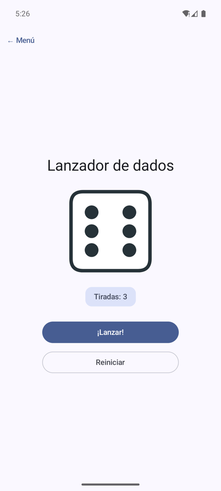

# **Codelab 2.04: Lanzador de Dados, Imágenes y Recursos**

Hasta ahora todo lo que se ve en el laboratorio es texto. En este codelab construirás un **lanzador de dados** que muestra una **imagen** distinta para cada cara, y sacarás los textos de la pantalla a **`strings.xml`**. Por el camino usarás el azar de Kotlin, `(1..6).random()`, y escribirás tu primer **test unitario**.

!!! info "Punto de partida: tag `c2.04-inicio`"
    Sigue en el repositorio del laboratorio, [pmdm2627-lab-ut2](https://github.com/jssdocente/pmdm2627-lab-ut2). Si terminaste el [Codelab 2.03](./03-ciclo-vida-logcat.md), continúa en tu rama. Si no, parte del tag:

    ```bash
    git checkout c2.04-inicio
    git switch -c mi-lab-2.04
    ```

    `c2.04-inicio` es `c2.03-fin`: el menú con tres codelabs y todo el estado guardado con `rememberSaveable`.

---

## 1. ¿Qué vas a construir?

Una pantalla con la imagen de un dado, un contador de tiradas y dos botones: **¡Lanzar!** saca un número del 1 al 6 y cambia la imagen; **Reiniciar** vuelve al 1 y pone las tiradas a cero (y está deshabilitado mientras no hayas tirado).

<div style="display: flex; flex-direction: row; justify-content: center; align-items: flex-start; gap: 1.5rem; flex-wrap: wrap; margin: 1.8rem 0;" markdown="1">

<figure style="margin: 0; text-align: center; max-width: 260px;" markdown="1">

{ style="border-radius: 8px; box-shadow: 0 4px 10px rgba(0,0,0,0.15); width: 100%; max-width: 250px;" }

<figcaption style="font-size: 0.85rem; margin-top: 0.5rem; color: var(--md-default-fg-color--light);"><strong>Figura 1:</strong> El lanzador de dados tras tres tiradas.</figcaption>
</figure>

</div>

<figure class="arq-fig">
--8<-- "docs/temas/02/codelabs/images/c2.04-flujo.svg"
<figcaption>El botón solo cambia el estado; la imagen se elige a partir de él en cada recomposición.</figcaption>
</figure>

Al terminar, serás capaz de:

- Añadir imágenes vectoriales a `res/drawable` y mostrarlas con `Image` y `painterResource`.
- Elegir un recurso según un valor con `when` y la clase `R`.
- Mover los textos a `strings.xml`, incluidos los que llevan un número (`%1$d`).
- Escribir una `contentDescription` útil para la accesibilidad.
- Escribir y ejecutar un test unitario con JUnit.

---

## 2. Los Recursos de una App Android

Todo lo que no es código va en `app/src/main/res/`, y el compilador genera la clase **`R`** con un identificador entero por cada recurso:

| Carpeta | Contenido | Se usa en Compose con |
| :--- | :--- | :--- |
| `res/drawable/` | Imágenes: vectores XML, PNG, WebP | `painterResource(R.drawable.dado_1)` |
| `res/values/strings.xml` | Textos de la app | `stringResource(R.string.dado_titulo)` |

Separar los textos del código permite traducir la app sin tocar Kotlin: basta con añadir `res/values-en/strings.xml`. Tienes la teoría completa en [2.3.2 Imágenes, iconos y recursos](../2.3.2-imagenes-iconos-recursos.md).

---

## 3. Paso 1: Las Seis Caras del Dado

Cada cara es un **vector XML**: un cuadrado redondeado y tantos puntos como indique su valor. Al ser vectoriales, se ven nítidas a cualquier tamaño y ocupan muy poco. Así es `dado_3.xml`:

```xml
<?xml version="1.0" encoding="utf-8"?>
<!-- Cara 3 del dado (codelab 2.04) -->
<vector xmlns:android="http://schemas.android.com/apk/res/android"
    android:width="100dp"
    android:height="100dp"
    android:viewportWidth="100"
    android:viewportHeight="100">
    <path
        android:fillColor="#FFFFFFFF"
        android:strokeColor="#FF263238"
        android:strokeWidth="4"
        android:pathData="M18,4 L82,4 Q96,4 96,18 L96,82 Q96,96 82,96 L18,96 Q4,96 4,82 L4,18 Q4,4 18,4 Z" />
    <path
        android:fillColor="#FF263238"
        android:pathData="M20,28 a8,8 0 1,0 16,0 a8,8 0 1,0 -16,0 Z" />
    <path
        android:fillColor="#FF263238"
        android:pathData="M42,50 a8,8 0 1,0 16,0 a8,8 0 1,0 -16,0 Z" />
    <path
        android:fillColor="#FF263238"
        android:pathData="M64,72 a8,8 0 1,0 16,0 a8,8 0 1,0 -16,0 Z" />
</vector>
```

No hace falta que escribas los seis a mano. Tráelos del tag de la solución, solo esa carpeta:

```bash
git checkout c2.04-fin -- app/src/main/res/drawable/
```

Comprueba que en `res/drawable/` tienes `dado_1.xml` … `dado_6.xml`. Si haces doble clic en uno, IntelliJ IDEA muestra su vista previa.

!!! tip "Nombres de recursos"
    Solo minúsculas, números y guion bajo, y sin empezar por número: `dado_1.xml` es válido; `Dado-1.xml`, no. El nombre del fichero, sin extensión, es el del identificador: `R.drawable.dado_1`.

---

## 4. Paso 2: Los Textos en `strings.xml`

Abre `res/values/strings.xml` y añade los textos de la pantalla:

```xml
<resources>
    <string name="app_name">Lab UT2</string>

    <!-- Codelab 2.04: lanzador de dados -->
    <string name="dado_titulo">Lanzador de dados</string>
    <string name="dado_descripcion">Dado que muestra un %1$d</string>
    <string name="dado_tiradas">Tiradas: %1$d</string>
    <string name="dado_lanzar">¡Lanzar!</string>
    <string name="dado_reiniciar">Reiniciar</string>
</resources>
```

`%1$d` es un hueco para el primer argumento, un entero. Desde Compose se rellena así: `stringResource(R.string.dado_tiradas, tiradas)`.

---

## 5. Paso 3: De Valor a Imagen y el Componente sin Estado

Crea el paquete `codelabs.codelab04_dados` y el archivo `Dado.kt`. Empieza por una función normal (no composable) que traduce un valor del 1 al 6 en el identificador de su imagen:

```kotlin
@DrawableRes
fun imagenDado(valor: Int): Int = when (valor) {
    1 -> R.drawable.dado_1
    2 -> R.drawable.dado_2
    3 -> R.drawable.dado_3
    4 -> R.drawable.dado_4
    5 -> R.drawable.dado_5
    else -> R.drawable.dado_6
}
```

La anotación `@DrawableRes` dice que el `Int` devuelto no es un número cualquiera, sino un identificador de `drawable`; si lo usas donde se espera otro tipo de recurso, el IDE te avisa.

Después, el componente sin estado, igual que en los codelabs anteriores:

??? example "Ver código: `Dado.kt` (imports, `imagenDado` y `DadoContent`)"

    ```kotlin
    package com.pmdm.lab.ut2.codelabs.codelab04_dados

    import androidx.annotation.DrawableRes
    import androidx.compose.foundation.Image
    import androidx.compose.foundation.layout.Arrangement
    import androidx.compose.foundation.layout.Column
    import androidx.compose.foundation.layout.fillMaxSize
    import androidx.compose.foundation.layout.fillMaxWidth
    import androidx.compose.foundation.layout.padding
    import androidx.compose.foundation.layout.size
    import androidx.compose.material3.Button
    import androidx.compose.material3.MaterialTheme
    import androidx.compose.material3.OutlinedButton
    import androidx.compose.material3.Surface
    import androidx.compose.material3.Text
    import androidx.compose.runtime.Composable
    import androidx.compose.runtime.getValue
    import androidx.compose.runtime.mutableIntStateOf
    import androidx.compose.runtime.saveable.rememberSaveable
    import androidx.compose.runtime.setValue
    import androidx.compose.ui.Alignment
    import androidx.compose.ui.Modifier
    import androidx.compose.ui.res.painterResource
    import androidx.compose.ui.res.stringResource
    import androidx.compose.ui.tooling.preview.Preview
    import androidx.compose.ui.unit.dp
    import com.pmdm.lab.ut2.R
    import com.pmdm.lab.ut2.ui.theme.LabUt2Theme

    // ============================================================================
    // 1. DE VALOR A IMAGEN: cada cara del dado es un drawable de res/drawable
    // ============================================================================
    @DrawableRes
    fun imagenDado(valor: Int): Int = when (valor) {
        1 -> R.drawable.dado_1
        2 -> R.drawable.dado_2
        3 -> R.drawable.dado_3
        4 -> R.drawable.dado_4
        5 -> R.drawable.dado_5
        else -> R.drawable.dado_6
    }

    // ============================================================================
    // 2. COMPONENTE SIN ESTADO
    // ============================================================================
    @Composable
    fun DadoContent(
        valor: Int,
        tiradas: Int,
        onLanzar: () -> Unit,
        onReiniciar: () -> Unit,
        modifier: Modifier = Modifier
    ) {
        Column(
            modifier = modifier
                .fillMaxSize()
                .padding(24.dp),
            horizontalAlignment = Alignment.CenterHorizontally,
            verticalArrangement = Arrangement.spacedBy(24.dp, Alignment.CenterVertically)
        ) {
            Text(
                text = stringResource(R.string.dado_titulo),
                style = MaterialTheme.typography.headlineMedium
            )

            Image(
                painter = painterResource(imagenDado(valor)),
                // Lo lee TalkBack: describe lo que se ve, no el nombre del fichero
                contentDescription = stringResource(R.string.dado_descripcion, valor),
                modifier = Modifier.size(160.dp)
            )

            Surface(
                color = MaterialTheme.colorScheme.secondaryContainer,
                shape = MaterialTheme.shapes.medium
            ) {
                Text(
                    text = stringResource(R.string.dado_tiradas, tiradas),
                    modifier = Modifier.padding(horizontal = 16.dp, vertical = 8.dp),
                    style = MaterialTheme.typography.labelLarge
                )
            }

            Column(
                modifier = Modifier.fillMaxWidth(0.7f),
                verticalArrangement = Arrangement.spacedBy(8.dp)
            ) {
                Button(onClick = onLanzar, modifier = Modifier.fillMaxWidth()) {
                    Text(stringResource(R.string.dado_lanzar))
                }
                OutlinedButton(
                    onClick = onReiniciar,
                    enabled = tiradas > 0,
                    modifier = Modifier.fillMaxWidth()
                ) {
                    Text(stringResource(R.string.dado_reiniciar))
                }
            }
        }
    }
    ```

!!! warning "`contentDescription` no es opcional"
    TalkBack, el lector de pantalla de Android, lee la `contentDescription` de cada imagen. Describe lo que muestra («Dado que muestra un 4»), no cómo es el fichero. Solo una imagen puramente decorativa lleva `contentDescription = null`.

---

## 6. Paso 4: Vistas Previas

??? example "Ver código: dos vistas previas"

    ```kotlin
    // ============================================================================
    // 3. VISTAS PREVIAS
    // ============================================================================
    @Preview(name = "Dado · inicial", showBackground = true)
    @Composable
    private fun DadoPreviewInicial() {
        LabUt2Theme {
            DadoContent(valor = 1, tiradas = 0, onLanzar = {}, onReiniciar = {})
        }
    }

    @Preview(name = "Dado · seis", showBackground = true)
    @Composable
    private fun DadoPreviewSeis() {
        LabUt2Theme {
            DadoContent(valor = 6, tiradas = 15, onLanzar = {}, onReiniciar = {})
        }
    }
    ```

---

## 7. Paso 5: La Pantalla con Estado

Dos estados, y los dos con `rememberSaveable`, porque ya sabes lo que pasa al girar:

??? example "Ver código: `DadoScreen`"

    ```kotlin
    // ============================================================================
    // 4. PANTALLA CON ESTADO: rememberSaveable, para que el dado sobreviva al giro
    // ============================================================================
    @Composable
    fun DadoScreen(modifier: Modifier = Modifier) {
        var valor by rememberSaveable { mutableIntStateOf(1) }
        var tiradas by rememberSaveable { mutableIntStateOf(0) }

        DadoContent(
            valor = valor,
            tiradas = tiradas,
            onLanzar = {
                valor = (1..6).random()
                tiradas++
            },
            onReiniciar = {
                valor = 1
                tiradas = 0
            },
            modifier = modifier
        )
    }
    ```

`(1..6)` es un `IntRange`, el rango de enteros del 1 al 6 ambos incluidos, y `.random()` devuelve uno al azar. Una lambda puede cambiar varios estados a la vez: Compose agrupa los cambios y recompone una sola vez.

Registra la pantalla en `LabApp.kt` con la receta del codelab anterior:

```kotlin
DADO("2.04 · Lanzador de dados", "Aleatoriedad, imágenes y strings.xml")
```

```kotlin
PantallaLab.DADO -> PantallaConVolver({ pantalla = PantallaLab.MENU }, modifier) {
    DadoScreen()
}
```

---

## 8. Paso 6: Tu Primer Test Unitario

`imagenDado` es una función normal de Kotlin: se puede probar sin emulador. Un test útil comprueba que **cada valor tiene una imagen distinta** (si te equivocas y repites `dado_5` en dos ramas, falla).

Crea `app/src/test/java/com/pmdm/lab/ut2/codelabs/codelab04_dados/DadoTest.kt`:

```kotlin
package com.pmdm.lab.ut2.codelabs.codelab04_dados

import org.junit.Assert.assertEquals
import org.junit.Test

class DadoTest {
    @Test
    fun cadaValor_tieneSuPropiaImagen() {
        val imagenes = (1..6).map { imagenDado(it) }
        assertEquals(6, imagenes.toSet().size)
    }
}
```

Ejecútalo con el icono ▶ junto a la clase o desde el terminal:

```bash
./gradlew test
```

Los tests de `src/test` se ejecutan en tu ordenador, en la JVM, en segundos. Los de `src/androidTest`, como `ExampleInstrumentedTest`, necesitan un emulador.

---

## 9. Experimenta

1. Cambia el `size(160.dp)` de la imagen por `200.dp`. ¿Se ve borrosa? ¿Por qué no?

2. Crea `res/values-en/strings.xml` con los cinco textos en inglés, cambia el idioma del emulador y abre el dado.

3. Rompe a propósito `imagenDado` (dos ramas con la misma imagen) y ejecuta el test.

!!! success "Solución: tag `c2.04-fin`"
    Compara tu código con el tag [`c2.04-fin`](https://github.com/jssdocente/pmdm2627-lab-ut2/tree/c2.04-fin) (`git diff c2.04-fin`). Es también el punto de partida del [Codelab 2.05](./05-semaforo-estados.md).

---

## 10. Resumen y Checklist

- [ ] Las seis caras están en `res/drawable/` y se muestran con `Image(painterResource(...))`.
- [ ] La imagen tiene una `contentDescription` que dice el valor.
- [ ] Ningún texto del dado está escrito en el código: todos salen de `strings.xml`.
- [ ] `valor` y `tiradas` usan `rememberSaveable`: el dado sobrevive al giro.
- [ ] `Reiniciar` está deshabilitado mientras `tiradas` es 0.
- [ ] `./gradlew test` pasa, incluido `DadoTest`.
