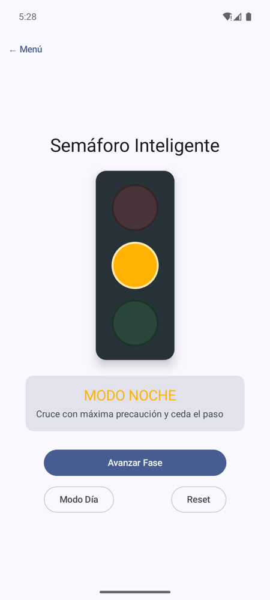

# **Codelab 2.05: Semáforo y Máquinas de Estados**

En los codelabs anteriores el estado era un número. En este codelab, el estado es **una fase entre varias posibles**, y de la fase depende toda la pantalla: qué luz se enciende, qué mensaje se lee, de qué color y qué hace cada botón. Modelarás esas fases con un **`enum class`** que sabe cuál es la siguiente, es decir, una pequeña **máquina de estados**, y dibujarás las luces con formas circulares.

!!! info "Punto de partida: tag `c2.05-inicio`"
    Sigue en el repositorio del laboratorio, [pmdm2627-lab-ut2](https://github.com/jssdocente/pmdm2627-lab-ut2). Si terminaste el [Codelab 2.04](./04-dado-interactivo.md), continúa en tu rama. Si no, parte del tag:

    ```bash
    git checkout c2.05-inicio
    git switch -c mi-lab-2.05
    ```

    `c2.05-inicio` es `c2.04-fin`: el menú con cuatro codelabs, incluido el lanzador de dados.

---

## 1. ¿Qué vas a construir?

Un semáforo con tres luces y un panel que explica la fase actual. **Avanzar fase** recorre el ciclo rojo → verde → ámbar → rojo; **Modo noche** deja el ámbar fijo y **Modo día** vuelve al rojo; **Reset** vuelve al rojo desde cualquier fase.

<div style="display: flex; flex-direction: row; justify-content: center; align-items: flex-start; gap: 1.5rem; flex-wrap: wrap; margin: 1.8rem 0;" markdown="1">

<figure style="margin: 0; text-align: center; max-width: 220px;" markdown="1">

{ style="border-radius: 8px; box-shadow: 0 4px 10px rgba(0,0,0,0.15); width: 100%; max-width: 210px;" }

<figcaption style="font-size: 0.85rem; margin-top: 0.5rem; color: var(--md-default-fg-color--light);"><strong>Figura 1:</strong> Fase inicial: rojo.</figcaption>
</figure>

<figure style="margin: 0; text-align: center; max-width: 220px;" markdown="1">

{ style="border-radius: 8px; box-shadow: 0 4px 10px rgba(0,0,0,0.15); width: 100%; max-width: 210px;" }

<figcaption style="font-size: 0.85rem; margin-top: 0.5rem; color: var(--md-default-fg-color--light);"><strong>Figura 2:</strong> Tras pulsar «Avanzar fase».</figcaption>
</figure>

<figure style="margin: 0; text-align: center; max-width: 220px;" markdown="1">

{ style="border-radius: 8px; box-shadow: 0 4px 10px rgba(0,0,0,0.15); width: 100%; max-width: 210px;" }

<figcaption style="font-size: 0.85rem; margin-top: 0.5rem; color: var(--md-default-fg-color--light);"><strong>Figura 3:</strong> Modo noche.</figcaption>
</figure>

</div>

<figure class="arq-fig">
--8<-- "docs/temas/02/codelabs/images/c2.05-estados.svg"
<figcaption>Las cuatro fases y sus transiciones. El ciclo normal lo recorre <code>siguiente()</code>; el modo noche y el reset, los botones.</figcaption>
</figure>

Al terminar, serás capaz de:

- Modelar un conjunto cerrado de estados con un `enum class` con propiedades.
- Escribir las transiciones de la máquina de estados en el propio `enum`, con `when`.
- Dibujar formas con `Box`, `clip(CircleShape)`, `background` y `border`.
- Derivar toda una pantalla de **un único estado**.
- Probar la lógica de transiciones con tests unitarios.

---

## 2. Paso 1: El Modelo, `FaseSemaforo`

En lugar de guardar textos sueltos (`"rojo"`, `"verde"`) o números mágicos (`0`, `1`, `2`), modelamos las fases con un `enum class`. Así es **imposible** tener una fase que no exista, y cada fase lleva consigo su título, su descripción y su color.

Crea el paquete `codelabs.codelab05_semaforo` y el archivo `Semaforo.kt`. Empieza por el modelo:

```kotlin
// ============================================================================
// 1. MODELO: LAS FASES DEL SEMÁFORO Y SUS TRANSICIONES
// ============================================================================
enum class FaseSemaforo(
    val titulo: String,
    val descripcion: String,
    val colorActivo: Color
) {
    ROJO(
        titulo = "¡ALTO!",
        descripcion = "Detención obligatoria para todos los vehículos",
        colorActivo = Color(0xFFE53935)
    ),
    AMBAR(
        titulo = "PRECAUCIÓN",
        descripcion = "Deténgase si es seguro hacerlo; cambio inminente a rojo",
        colorActivo = Color(0xFFFFB300)
    ),
    VERDE(
        titulo = "VÍA LIBRE",
        descripcion = "Paso permitido respetando la prioridad peatonal",
        colorActivo = Color(0xFF43A047)
    ),
    PRECAUCION(
        titulo = "MODO NOCHE",
        descripcion = "Cruce con máxima precaución y ceda el paso",
        colorActivo = Color(0xFFFFB300)
    );

    fun siguiente(): FaseSemaforo = when (this) {
        ROJO -> VERDE
        VERDE -> AMBAR
        AMBAR -> ROJO
        PRECAUCION -> ROJO
    }
}
```

Dos detalles de Kotlin:

- Cuando un `enum` tiene funciones, la lista de valores termina con **punto y coma** (`;`).
- `siguiente()` es la **tabla de transiciones** de la máquina de estados. El `when` cubre los cuatro valores sin `else`: si mañana añades una fase, el compilador te obligará a decidir cuál le sigue.

---

## 3. Paso 2: Una Luz del Semáforo, `LuzCircular`

Compose no tiene un componente «círculo»: se construye con un `Box` y modificadores. El **orden** de los modificadores importa: primero el tamaño, luego el recorte a círculo y después el fondo y el borde, que ya se pintan con forma circular.

```kotlin
// ============================================================================
// 2. UNA LUZ DEL SEMÁFORO: un Box recortado en círculo
// ============================================================================
@Composable
fun LuzCircular(
    colorBase: Color,
    estaEncendida: Boolean,
    modifier: Modifier = Modifier
) {
    val colorFinal = if (estaEncendida) colorBase else colorBase.copy(alpha = 0.18f)

    Box(
        modifier = modifier
            .size(72.dp)
            .clip(CircleShape)
            .background(colorFinal)
            .border(
                width = 3.dp,
                color = if (estaEncendida) Color.White.copy(alpha = 0.7f) else Color.Black.copy(alpha = 0.3f),
                shape = CircleShape
            )
    )
}
```

Una luz apagada es la misma luz con el color casi transparente (`copy(alpha = 0.18f)`).

---

## 4. Paso 3: El Componente sin Estado, `SemaforoContent`

Toda la pantalla depende de **un solo valor**, `faseActual`: qué luz se enciende, el título y su color, la descripción y hasta el texto del botón de modo noche.

??? example "Ver código: `SemaforoContent`"

    ```kotlin
    // ============================================================================
    // 3. COMPONENTE SIN ESTADO
    // ============================================================================
    @Composable
    fun SemaforoContent(
        faseActual: FaseSemaforo,
        onAvanzarFase: () -> Unit,
        onConmutarModoNoche: () -> Unit,
        onReiniciar: () -> Unit,
        modifier: Modifier = Modifier
    ) {
        Column(
            modifier = modifier
                .fillMaxSize()
                .padding(20.dp),
            horizontalAlignment = Alignment.CenterHorizontally,
            verticalArrangement = Arrangement.Center
        ) {
            Text(
                text = "Semáforo Inteligente",
                style = MaterialTheme.typography.headlineMedium
            )

            Spacer(modifier = Modifier.height(20.dp))

            // Chasis exterior del semáforo
            Card(
                colors = CardDefaults.cardColors(containerColor = Color(0xFF263238)),
                shape = MaterialTheme.shapes.large,
                elevation = CardDefaults.cardElevation(defaultElevation = 10.dp)
            ) {
                Column(
                    modifier = Modifier.padding(horizontal = 24.dp, vertical = 20.dp),
                    verticalArrangement = Arrangement.spacedBy(16.dp),
                    horizontalAlignment = Alignment.CenterHorizontally
                ) {
                    LuzCircular(
                        colorBase = Color(0xFFE53935),
                        estaEncendida = (faseActual == FaseSemaforo.ROJO)
                    )

                    LuzCircular(
                        colorBase = Color(0xFFFFB300),
                        estaEncendida = (faseActual == FaseSemaforo.AMBAR || faseActual == FaseSemaforo.PRECAUCION)
                    )

                    LuzCircular(
                        colorBase = Color(0xFF43A047),
                        estaEncendida = (faseActual == FaseSemaforo.VERDE)
                    )
                }
            }

            Spacer(modifier = Modifier.height(24.dp))

            // Panel de información vial reactivo
            Card(
                modifier = Modifier.fillMaxWidth(0.9f),
                colors = CardDefaults.cardColors(
                    containerColor = MaterialTheme.colorScheme.surfaceVariant
                )
            ) {
                Column(
                    modifier = Modifier.padding(16.dp),
                    horizontalAlignment = Alignment.CenterHorizontally
                ) {
                    Text(
                        text = faseActual.titulo,
                        style = MaterialTheme.typography.titleLarge,
                        color = faseActual.colorActivo
                    )
                    Spacer(modifier = Modifier.height(4.dp))
                    Text(
                        text = faseActual.descripcion,
                        style = MaterialTheme.typography.bodyMedium,
                        color = MaterialTheme.colorScheme.onSurfaceVariant
                    )
                }
            }

            Spacer(modifier = Modifier.height(24.dp))

            Button(
                onClick = onAvanzarFase,
                modifier = Modifier.fillMaxWidth(0.75f)
            ) {
                Text("Avanzar Fase")
            }

            Spacer(modifier = Modifier.height(8.dp))

            Row(
                modifier = Modifier.fillMaxWidth(0.75f),
                horizontalArrangement = Arrangement.SpaceBetween
            ) {
                OutlinedButton(onClick = onConmutarModoNoche) {
                    Text(if (faseActual == FaseSemaforo.PRECAUCION) "Modo Día" else "Modo Noche")
                }
                OutlinedButton(onClick = onReiniciar) {
                    Text("Reset")
                }
            }
        }
    }
    ```

Fíjate en que el componente **no decide** cuál es la siguiente fase: solo avisa con `onAvanzarFase`. La regla vive en el modelo (`siguiente()`).

---

## 5. Paso 4: Una Vista Previa por Fase

Con un `enum`, comprobar todos los estados es tan fácil como hacer una preview por valor. Para no escribir cuatro funciones casi iguales, puedes escribir una con un parámetro y anotarla con `@PreviewParameter`; aquí, por claridad, se escriben las cuatro:

??? example "Ver código: cuatro vistas previas"

    ```kotlin
    // ============================================================================
    // 4. VISTAS PREVIAS: una por fase
    // ============================================================================
    @Preview(name = "Fase: Rojo", showBackground = true)
    @Composable
    private fun SemaforoPreviewRojo() {
        LabUt2Theme {
            SemaforoContent(
                faseActual = FaseSemaforo.ROJO,
                onAvanzarFase = {},
                onConmutarModoNoche = {},
                onReiniciar = {}
            )
        }
    }

    @Preview(name = "Fase: Verde", showBackground = true)
    @Composable
    private fun SemaforoPreviewVerde() {
        LabUt2Theme {
            SemaforoContent(
                faseActual = FaseSemaforo.VERDE,
                onAvanzarFase = {},
                onConmutarModoNoche = {},
                onReiniciar = {}
            )
        }
    }

    @Preview(name = "Fase: Ámbar", showBackground = true)
    @Composable
    private fun SemaforoPreviewAmbar() {
        LabUt2Theme {
            SemaforoContent(
                faseActual = FaseSemaforo.AMBAR,
                onAvanzarFase = {},
                onConmutarModoNoche = {},
                onReiniciar = {}
            )
        }
    }

    @Preview(name = "Fase: Modo Noche", showBackground = true)
    @Composable
    private fun SemaforoPreviewNoche() {
        LabUt2Theme {
            SemaforoContent(
                faseActual = FaseSemaforo.PRECAUCION,
                onAvanzarFase = {},
                onConmutarModoNoche = {},
                onReiniciar = {}
            )
        }
    }
    ```

---

## 6. Paso 5: La Pantalla con Estado

Un único estado, de tipo `FaseSemaforo`. Como es un `enum`, `rememberSaveable` lo guarda sin más:

??? example "Ver código: `SemaforoScreen`"

    ```kotlin
    // ============================================================================
    // 5. PANTALLA CON ESTADO: toda la pantalla depende de una sola variable
    // ============================================================================
    @Composable
    fun SemaforoScreen(modifier: Modifier = Modifier) {
        var faseActual by rememberSaveable { mutableStateOf(FaseSemaforo.ROJO) }

        SemaforoContent(
            faseActual = faseActual,
            onAvanzarFase = {
                faseActual = faseActual.siguiente()
            },
            onConmutarModoNoche = {
                faseActual = if (faseActual == FaseSemaforo.PRECAUCION) {
                    FaseSemaforo.ROJO
                } else {
                    FaseSemaforo.PRECAUCION
                }
            },
            onReiniciar = {
                faseActual = FaseSemaforo.ROJO
            },
            modifier = modifier
        )
    }
    ```

??? example "Ver los imports de `Semaforo.kt`"

    ```kotlin
    package com.pmdm.lab.ut2.codelabs.codelab05_semaforo

    import androidx.compose.foundation.background
    import androidx.compose.foundation.border
    import androidx.compose.foundation.layout.Arrangement
    import androidx.compose.foundation.layout.Box
    import androidx.compose.foundation.layout.Column
    import androidx.compose.foundation.layout.Row
    import androidx.compose.foundation.layout.Spacer
    import androidx.compose.foundation.layout.fillMaxSize
    import androidx.compose.foundation.layout.fillMaxWidth
    import androidx.compose.foundation.layout.height
    import androidx.compose.foundation.layout.padding
    import androidx.compose.foundation.layout.size
    import androidx.compose.foundation.shape.CircleShape
    import androidx.compose.material3.Button
    import androidx.compose.material3.Card
    import androidx.compose.material3.CardDefaults
    import androidx.compose.material3.MaterialTheme
    import androidx.compose.material3.OutlinedButton
    import androidx.compose.material3.Text
    import androidx.compose.runtime.Composable
    import androidx.compose.runtime.getValue
    import androidx.compose.runtime.mutableStateOf
    import androidx.compose.runtime.saveable.rememberSaveable
    import androidx.compose.runtime.setValue
    import androidx.compose.ui.Alignment
    import androidx.compose.ui.Modifier
    import androidx.compose.ui.draw.clip
    import androidx.compose.ui.graphics.Color
    import androidx.compose.ui.tooling.preview.Preview
    import androidx.compose.ui.unit.dp
    import com.pmdm.lab.ut2.ui.theme.LabUt2Theme
    ```

Registra la pantalla en `LabApp.kt`, como siempre:

```kotlin
SEMAFORO("2.05 · Semáforo", "Máquina de estados con enum class")
```

```kotlin
PantallaLab.SEMAFORO -> PantallaConVolver({ pantalla = PantallaLab.MENU }, modifier) {
    SemaforoScreen()
}
```

---

## 7. Paso 6: Tests de la Máquina de Estados

La lógica del semáforo está en `siguiente()`, una función de un `enum` que no sabe nada de Compose. Por eso se prueba en la JVM, sin emulador. Crea `app/src/test/java/com/pmdm/lab/ut2/codelabs/codelab05_semaforo/FaseSemaforoTest.kt`:

```kotlin
package com.pmdm.lab.ut2.codelabs.codelab05_semaforo

import org.junit.Assert.assertEquals
import org.junit.Test

class FaseSemaforoTest {
    @Test
    fun elCicloNormal_esRojoVerdeAmbarRojo() {
        assertEquals(FaseSemaforo.VERDE, FaseSemaforo.ROJO.siguiente())
        assertEquals(FaseSemaforo.AMBAR, FaseSemaforo.VERDE.siguiente())
        assertEquals(FaseSemaforo.ROJO, FaseSemaforo.AMBAR.siguiente())
    }

    @Test
    fun desdeElModoNoche_seVuelveARojo() {
        assertEquals(FaseSemaforo.ROJO, FaseSemaforo.PRECAUCION.siguiente())
    }
}
```

```bash
./gradlew test
```

Esta separación (la regla en el modelo, la pantalla solo la usa) es la misma idea que en la UT3 llevarás a un `ViewModel`.

---

## 8. Experimenta

1. Añade una fase `INTERMITENTE` al `enum`. ¿Qué te pide el compilador y por qué?

2. Haz que en `PRECAUCION` el ámbar se vea al 50 % (pista: `LuzCircular` ya recibe si está encendida; ¿qué tendrías que cambiar para que reciba un `alpha`?).

3. Gira el móvil en cualquier fase: la fase se conserva, porque un `enum` cabe en el `Bundle`.

!!! success "Solución: tag `c2.05-fin`"
    Compara tu código con el tag [`c2.05-fin`](https://github.com/jssdocente/pmdm2627-lab-ut2/tree/c2.05-fin) (`git diff c2.05-fin`). Los [retos autónomos](../2.4-laboratorio-retos.md#4-retos-autonomos) parten de aquí. El último codelab, el [2.06](./06-icono-pantalla-inicio.md), da al laboratorio su icono y su pantalla de inicio.

---

## 9. Resumen y Checklist

- [ ] `FaseSemaforo` es un `enum class` con título, descripción y color, y la función `siguiente()`.
- [ ] El `when` de `siguiente()` cubre todos los valores sin `else`.
- [ ] `LuzCircular` dibuja un círculo con `size`, `clip(CircleShape)`, `background` y `border`, en ese orden.
- [ ] `SemaforoContent` solo pinta y avisa; la regla de transición está en el modelo.
- [ ] Hay una `@Preview` por fase.
- [ ] La fase usa `rememberSaveable` y sobrevive al giro.
- [ ] `FaseSemaforoTest` pasa con `./gradlew test`.
