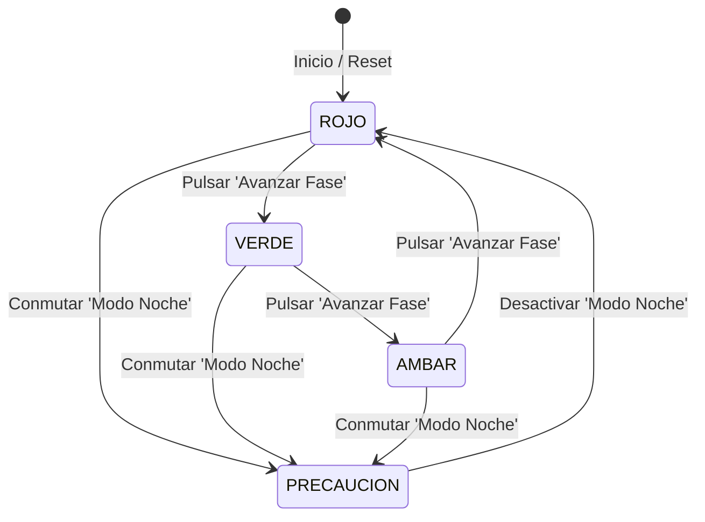

# **Codelab 5: Semáforo Inteligente y Máquinas de Estados**

En este codelab aprenderás a modelar y representar visualmente una **máquina de estados finita** en Jetpack Compose a través de una aplicación práctica y didáctica: el **Semáforo Inteligente de Tráfico**.

Aprenderás a estructurar estados discretos mediante un `enum class` de Kotlin, a controlar de manera reactiva la apariencia geométrica y lumínica de componentes visuales (color, brillo y opacidad mediante `alpha`), y a conectar botones de control que hacen transitar la aplicación por sus diferentes fases viales.

---

## 1. ¿Qué vas a construir?

Construirás una interfaz interactiva que simula un semáforo de tráfico urbano real:

1. **Chasis del semáforo:** Un contenedor vertical estilizado con fondo oscuro y bordes redondeados.
2. **Tres ópticas circulares:** Luces en rojo, ámbar y verde que se encienden con brillo total (`alpha = 1.0f`) o se atenúan cuando están apagadas (`alpha = 0.2f`).
3. **Panel informativo dinámico:** Muestra el texto explicativo de tráfico correspondiente a la luz activa.
4. **Control secuencial de avance:** Un botón **"Avanzar Fase"** que progresa por el ciclo reglamentario:
   $$\text{ROJO} \longrightarrow \text{VERDE} \longrightarrow \text{ÁMBAR} \longrightarrow \text{ROJO}$$
5. **Modo Noche / Precaución:** Un conmutador que activa la fase especial de ámbar fijo.
6. **Resistencia a giros:** La fase activa se almacena con `rememberSaveable`, manteniendo el estado intacto al rotar el dispositivo.



Al finalizar este codelab, serás capaz de:

- Modelar estados discretos de UI mediante `enum class` de Kotlin y funciones de extensión.
- Utilizar formas geométricas circulares con `Modifier.clip(CircleShape)`.
- Alterar el color y la transparencia de un Composable de manera condicional usando `copy(alpha = ...)`.
- Diseñar interfaces con `Column`, `Box` y alineaciones centralizadas.
- Configurar vistas previas simultáneas con `@Preview` para cada una de las fases del semáforo.

---

## 2. Modelado de Dominio: El Estado del Semáforo

En lugar de almacenar enteros mágicos o cadenas de texto sueltas (`"rojo"`, `"verde"`), modelamos las fases del semáforo con un `enum class` fuertemente tipado:

```kotlin
enum class FaseSemaforo(
    val titulo: String,
    val descripcion: String,
    val colorActivo: Color
) {
    ROJO(
        titulo = "¡ALTO!",
        descripcion = "Detención obligatoria para todos los vehículos",
        colorActivo = Color(0xFFE53935)
    ),
    AMBAR(
        titulo = "PRECAUCIÓN",
        descripcion = "Deténgase si es seguro hacerlo; cambio inminente a rojo",
        colorActivo = Color(0xFFFFB300)
    ),
    VERDE(
        titulo = "VÍA LIBRE",
        descripcion = "Paso permitido respetando la prioridad peatonal",
        colorActivo = Color(0xFF43A047)
    ),
    PRECAUCION(
        titulo = "MODO NOCHE",
        descripcion = "Cruce con máxima precaución y ceda el paso",
        colorActivo = Color(0xFFFFB300)
    );

    // Función para obtener la siguiente fase en el ciclo de tráfico regular
    fun siguiente(): FaseSemaforo = when (this) {
        ROJO -> VERDE
        VERDE -> AMBAR
        AMBAR -> ROJO
        PRECAUCION -> ROJO
    }
}
```

---

## 3. Paso 1: Creación de la Óptica Circular (`LuzCircular`)

Creamos el archivo `app/src/main/java/com/dam/pmdmlab/codelabs/codelab05_semaforo/SemaforoScreen.kt`.

Cada luz del semáforo es un composable `LuzCircular` que recibe:

- El color base de la luz (`Color`).
- Un indicador booleano `estaEncendida: Boolean`.

Si la luz está encendida, se dibuja con opacidad completa (`alpha = 1f`) y un borde sutil; si está apagada, se dibuja atenuada (`alpha = 0.18f`):

```kotlin
@Composable
fun LuzCircular(
    colorBase: Color,
    estaEncendida: Boolean,
    modifier: Modifier = Modifier
) {
    val colorFinal = if (estaEncendida) colorBase else colorBase.copy(alpha = 0.18f)

    Box(
        modifier = modifier
            .size(72.dp)
            .clip(CircleShape)
            .background(colorFinal)
            .border(
                width = 3.dp,
                color = if (estaEncendida) Color.White.copy(alpha = 0.7f) else Color.Black.copy(alpha = 0.3f),
                shape = CircleShape
            )
    )
}
```

---

## 4. Paso 2: Componente de Presentación (`SemaforoContent`)

El componente de presentación organiza verticalmente:

1. El encabezado de la pantalla.
2. El **Chasis del semáforo:** Un `Card` alargado con color gris muy oscuro (`Color(0xFF212121)`), relleno interno y sombra, que contiene las tres luces (`ROJO`, `AMBAR`, `VERDE`).
3. El **Panel de información vial:** Una tarjeta con el título y la descripción de la fase activa.
4. La **Botonera de acciones:** Botón principal para avanzar de fase, botón para conmutar el modo noche y botón para reiniciar.

```kotlin
@Composable
fun SemaforoContent(
    faseActual: FaseSemaforo,
    onAvanzarFase: () -> Unit,
    onConmutarModoNoche: () -> Unit,
    onReiniciar: () -> Unit,
    onBack: () -> Unit,
    modifier: Modifier = Modifier
) {
    Column(
        modifier = modifier
            .fillMaxSize()
            .padding(20.dp),
        horizontalAlignment = Alignment.CenterHorizontally,
        verticalArrangement = Arrangement.Center
    ) {
        Text(
            text = "Semáforo Inteligente",
            style = MaterialTheme.typography.headlineMedium
        )

        Spacer(modifier = Modifier.height(20.dp))

        // Chasis exterior del semáforo
        Card(
            colors = CardDefaults.cardColors(containerColor = Color(0xFF263238)),
            shape = MaterialTheme.shapes.large,
            elevation = CardDefaults.cardElevation(defaultElevation = 10.dp)
        ) {
            Column(
                modifier = Modifier.padding(horizontal = 24.dp, vertical = 20.dp),
                verticalArrangement = Arrangement.spacedBy(16.dp),
                horizontalAlignment = Alignment.CenterHorizontally
            ) {
                // Luz Roja
                LuzCircular(
                    colorBase = Color(0xFFE53935),
                    estaEncendida = (faseActual == FaseSemaforo.ROJO)
                )

                // Luz Ámbar (se enciende en AMBAR y en PRECAUCION)
                LuzCircular(
                    colorBase = Color(0xFFFFB300),
                    estaEncendida = (faseActual == FaseSemaforo.AMBAR || faseActual == FaseSemaforo.PRECAUCION)
                )

                // Luz Verde
                LuzCircular(
                    colorBase = Color(0xFF43A047),
                    estaEncendida = (faseActual == FaseSemaforo.VERDE)
                )
            }
        }

        Spacer(modifier = Modifier.height(24.dp))

        // Panel de información de tráfico reactivo
        Card(
            modifier = Modifier.fillMaxWidth(0.9f),
            colors = CardDefaults.cardColors(
                containerColor = MaterialTheme.colorScheme.surfaceVariant
            )
        ) {
            Column(
                modifier = Modifier.padding(16.dp),
                horizontalAlignment = Alignment.CenterHorizontally
            ) {
                Text(
                    text = faseActual.titulo,
                    style = MaterialTheme.typography.titleLarge,
                    color = faseActual.colorActivo
                )
                Spacer(modifier = Modifier.height(4.dp))
                Text(
                    text = faseActual.descripcion,
                    style = MaterialTheme.typography.bodyMedium,
                    color = MaterialTheme.colorScheme.onSurfaceVariant
                )
            }
        }

        Spacer(modifier = Modifier.height(24.dp))

        // Botones de acción
        Button(
            onClick = onAvanzarFase,
            modifier = Modifier.fillMaxWidth(0.75f)
        ) {
            Text("Avanzar Fase")
        }

        Spacer(modifier = Modifier.height(8.dp))

        Row(
            modifier = Modifier.fillMaxWidth(0.75f),
            horizontalArrangement = Arrangement.SpaceBetween
        ) {
            OutlinedButton(onClick = onConmutarModoNoche) {
                Text(if (faseActual == FaseSemaforo.PRECAUCION) "Modo Día" else "Modo Noche")
            }
            OutlinedButton(onClick = onReiniciar) {
                Text("Reset")
            }
        }

        Spacer(modifier = Modifier.height(20.dp))

        OutlinedButton(onClick = onBack) {
            Text("Volver al Menú")
        }
    }
}
```

---

## 5. Paso 3: Vistas Previas de Todas las Fases con `@Preview`

Gracias al desacoplamiento Stateless, podemos diseñar una vista previa para cada uno de los estados posibles en IntelliJ IDEA:

```kotlin
@Preview(name = "Fase 1: Rojo", showBackground = true)
@Composable
private fun SemaforoPreviewRojo() {
    Surface {
        SemaforoContent(
            faseActual = FaseSemaforo.ROJO,
            onAvanzarFase = {},
            onConmutarModoNoche = {},
            onReiniciar = {},
            onBack = {}
        )
    }
}

@Preview(name = "Fase 2: Verde", showBackground = true)
@Composable
private fun SemaforoPreviewVerde() {
    Surface {
        SemaforoContent(
            faseActual = FaseSemaforo.VERDE,
            onAvanzarFase = {},
            onConmutarModoNoche = {},
            onReiniciar = {},
            onBack = {}
        )
    }
}

@Preview(name = "Fase 3: Ámbar", showBackground = true)
@Composable
private fun SemaforoPreviewAmbar() {
    Surface {
        SemaforoContent(
            faseActual = FaseSemaforo.AMBAR,
            onAvanzarFase = {},
            onConmutarModoNoche = {},
            onReiniciar = {},
            onBack = {}
        )
    }
}

@Preview(name = "Fase 4: Modo Noche", showBackground = true)
@Composable
private fun SemaforoPreviewNoche() {
    Surface {
        SemaforoContent(
            faseActual = FaseSemaforo.PRECAUCION,
            onAvanzarFase = {},
            onConmutarModoNoche = {},
            onReiniciar = {},
            onBack = {}
        )
    }
}
```

---

## 6. Paso 4: Contenedor con Estado (`SemaforoScreen`)

Implementamos la pantalla contenedora que almacena la fase activa y conecta los eventos del usuario:

??? example "Ver código completo: SemaforoScreen.kt"

    ```kotlin
    package com.dam.pmdmlab.codelabs.codelab05_semaforo

    import androidx.compose.foundation.background
    import androidx.compose.foundation.border
    import androidx.compose.foundation.layout.Arrangement
    import androidx.compose.foundation.layout.Box
    import androidx.compose.foundation.layout.Column
    import androidx.compose.foundation.layout.Row
    import androidx.compose.foundation.layout.Spacer
    import androidx.compose.foundation.layout.fillMaxSize
    import androidx.compose.foundation.layout.fillMaxWidth
    import androidx.compose.foundation.layout.height
    import androidx.compose.foundation.layout.padding
    import androidx.compose.foundation.layout.size
    import androidx.compose.foundation.shape.CircleShape
    import androidx.compose.material3.Button
    import androidx.compose.material3.Card
    import androidx.compose.material3.CardDefaults
    import androidx.compose.material3.MaterialTheme
    import androidx.compose.material3.OutlinedButton
    import androidx.compose.material3.Surface
    import androidx.compose.material3.Text
    import androidx.compose.runtime.Composable
    import androidx.compose.runtime.getValue
    import androidx.compose.runtime.mutableStateOf
    import androidx.compose.runtime.saveable.rememberSaveable
    import androidx.compose.runtime.setValue
    import androidx.compose.ui.Alignment
    import androidx.compose.ui.Modifier
    import androidx.compose.ui.draw.clip
    import androidx.compose.ui.graphics.Color
    import androidx.compose.ui.tooling.preview.Preview
    import androidx.compose.ui.unit.dp

    // ============================================================================
    // 1. MODELO DE DOMINIO: ESTADOS DEL SEMÁFORO
    // ============================================================================
    enum class FaseSemaforo(
        val titulo: String,
        val descripcion: String,
        val colorActivo: Color
    ) {
        ROJO(
            titulo = "¡ALTO!",
            descripcion = "Detención obligatoria para todos los vehículos",
            colorActivo = Color(0xFFE53935)
        ),
        AMBAR(
            titulo = "PRECAUCIÓN",
            descripcion = "Deténgase si es seguro hacerlo; cambio inminente a rojo",
            colorActivo = Color(0xFFFFB300)
        ),
        VERDE(
            titulo = "VÍA LIBRE",
            descripcion = "Paso permitido respetando la prioridad peatonal",
            colorActivo = Color(0xFF43A047)
        ),
        PRECAUCION(
            titulo = "MODO NOCHE",
            descripcion = "Cruce con máxima precaución y ceda el paso",
            colorActivo = Color(0xFFFFB300)
        );

        fun siguiente(): FaseSemaforo = when (this) {
            ROJO -> VERDE
            VERDE -> AMBAR
            AMBAR -> ROJO
            PRECAUCION -> ROJO
        }
    }

    // ============================================================================
    // 2. SUB-COMPONENTE VISUAL: LUZ CIRCULAR
    // ============================================================================
    @Composable
    fun LuzCircular(
        colorBase: Color,
        estaEncendida: Boolean,
        modifier: Modifier = Modifier
    ) {
        val colorFinal = if (estaEncendida) colorBase else colorBase.copy(alpha = 0.18f)

        Box(
            modifier = modifier
                .size(72.dp)
                .clip(CircleShape)
                .background(colorFinal)
                .border(
                    width = 3.dp,
                    color = if (estaEncendida) Color.White.copy(alpha = 0.7f) else Color.Black.copy(alpha = 0.3f),
                    shape = CircleShape
                )
        )
    }

    // ============================================================================
    // 3. COMPONENTE DE PRESENTACIÓN (STATELESS CONTENT)
    // ============================================================================
    @Composable
    fun SemaforoContent(
        faseActual: FaseSemaforo,
        onAvanzarFase: () -> Unit,
        onConmutarModoNoche: () -> Unit,
        onReiniciar: () -> Unit,
        onBack: () -> Unit,
        modifier: Modifier = Modifier
    ) {
        Column(
            modifier = modifier
                .fillMaxSize()
                .padding(20.dp),
            horizontalAlignment = Alignment.CenterHorizontally,
            verticalArrangement = Arrangement.Center
        ) {
            Text(
                text = "Semáforo Inteligente",
                style = MaterialTheme.typography.headlineMedium
            )

            Spacer(modifier = Modifier.height(20.dp))

            // Chasis exterior del semáforo
            Card(
                colors = CardDefaults.cardColors(containerColor = Color(0xFF263238)),
                shape = MaterialTheme.shapes.large,
                elevation = CardDefaults.cardElevation(defaultElevation = 10.dp)
            ) {
                Column(
                    modifier = Modifier.padding(horizontal = 24.dp, vertical = 20.dp),
                    verticalArrangement = Arrangement.spacedBy(16.dp),
                    horizontalAlignment = Alignment.CenterHorizontally
                ) {
                    LuzCircular(
                        colorBase = Color(0xFFE53935),
                        estaEncendida = (faseActual == FaseSemaforo.ROJO)
                    )

                    LuzCircular(
                        colorBase = Color(0xFFFFB300),
                        estaEncendida = (faseActual == FaseSemaforo.AMBAR || faseActual == FaseSemaforo.PRECAUCION)
                    )

                    LuzCircular(
                        colorBase = Color(0xFF43A047),
                        estaEncendida = (faseActual == FaseSemaforo.VERDE)
                    )
                }
            }

            Spacer(modifier = Modifier.height(24.dp))

            // Panel de información vial reactivo
            Card(
                modifier = Modifier.fillMaxWidth(0.9f),
                colors = CardDefaults.cardColors(
                    containerColor = MaterialTheme.colorScheme.surfaceVariant
                )
            ) {
                Column(
                    modifier = Modifier.padding(16.dp),
                    horizontalAlignment = Alignment.CenterHorizontally
                ) {
                    Text(
                        text = faseActual.titulo,
                        style = MaterialTheme.typography.titleLarge,
                        color = faseActual.colorActivo
                    )
                    Spacer(modifier = Modifier.height(4.dp))
                    Text(
                        text = faseActual.descripcion,
                        style = MaterialTheme.typography.bodyMedium,
                        color = MaterialTheme.colorScheme.onSurfaceVariant
                    )
                }
            }

            Spacer(modifier = Modifier.height(24.dp))

            Button(
                onClick = onAvanzarFase,
                modifier = Modifier.fillMaxWidth(0.75f)
            ) {
                Text("Avanzar Fase")
            }

            Spacer(modifier = Modifier.height(8.dp))

            Row(
                modifier = Modifier.fillMaxWidth(0.75f),
                horizontalArrangement = Arrangement.SpaceBetween
            ) {
                OutlinedButton(onClick = onConmutarModoNoche) {
                    Text(if (faseActual == FaseSemaforo.PRECAUCION) "Modo Día" else "Modo Noche")
                }
                OutlinedButton(onClick = onReiniciar) {
                    Text("Reset")
                }
            }

            Spacer(modifier = Modifier.height(20.dp))

            OutlinedButton(onClick = onBack) {
                Text("Volver al Menú")
            }
        }
    }

    // ============================================================================
    // 4. VISTAS PREVIAS (@PREVIEW) DE CADA FASE
    // ============================================================================
    @Preview(name = "Fase: Rojo", showBackground = true)
    @Composable
    private fun SemaforoPreviewRojo() {
        Surface {
            SemaforoContent(
                faseActual = FaseSemaforo.ROJO,
                onAvanzarFase = {},
                onConmutarModoNoche = {},
                onReiniciar = {},
                onBack = {}
            )
        }
    }

    @Preview(name = "Fase: Verde", showBackground = true)
    @Composable
    private fun SemaforoPreviewVerde() {
        Surface {
            SemaforoContent(
                faseActual = FaseSemaforo.VERDE,
                onAvanzarFase = {},
                onConmutarModoNoche = {},
                onReiniciar = {},
                onBack = {}
            )
        }
    }

    @Preview(name = "Fase: Ámbar", showBackground = true)
    @Composable
    private fun SemaforoPreviewAmbar() {
        Surface {
            SemaforoContent(
                faseActual = FaseSemaforo.AMBAR,
                onAvanzarFase = {},
                onConmutarModoNoche = {},
                onReiniciar = {},
                onBack = {}
            )
        }
    }

    @Preview(name = "Fase: Modo Noche", showBackground = true)
    @Composable
    private fun SemaforoPreviewNoche() {
        Surface {
            SemaforoContent(
                faseActual = FaseSemaforo.PRECAUCION,
                onAvanzarFase = {},
                onConmutarModoNoche = {},
                onReiniciar = {},
                onBack = {}
            )
        }
    }

    // ============================================================================
    // 5. PANTALLA CONTENEDORA (STATEFUL SCREEN)
    // ============================================================================
    @Composable
    fun SemaforoScreen(
        onBack: () -> Unit,
        modifier: Modifier = Modifier
    ) {
        var faseActual by rememberSaveable { mutableStateOf(FaseSemaforo.ROJO) }

        SemaforoContent(
            faseActual = faseActual,
            onAvanzarFase = {
                faseActual = faseActual.siguiente()
            },
            onConmutarModoNoche = {
                faseActual = if (faseActual == FaseSemaforo.PRECAUCION) {
                    FaseSemaforo.ROJO
                } else {
                    FaseSemaforo.PRECAUCION
                }
            },
            onReiniciar = {
                faseActual = FaseSemaforo.ROJO
            },
            onBack = onBack,
            modifier = modifier
        )
    }
    ```

---

## 7. Resumen y Checklist de Calidad

En este codelab has aprendido:

- El modelado riguroso de máquinas de estados discretos con `enum class` y funciones de transición.
- La creación de figuras geométricas puras con `Modifier.clip(CircleShape)` y `Modifier.border(...)`.
- El dinamismo visual reactivo modulando la opacidad (`alpha`) de colores según el estado activo.
- La organización de vistas previas exhaustivas para validar en IntelliJ IDEA todos los estados de la aplicación.
