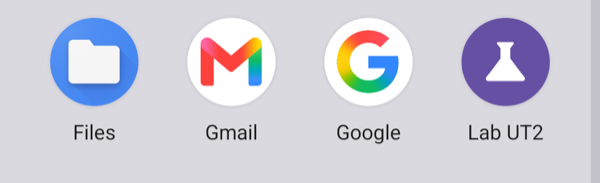

# **Codelab 2.06: Icono y Pantalla de Inicio**

Hasta ahora, el laboratorio se abre con el icono de ejemplo de la plantilla y, al pulsarlo, el sistema muestra un instante ese mismo icono genérico. En este codelab le darás a la app su **identidad**: un **icono propio** creado con *Image Asset Studio* y una **pantalla de inicio** (*splash screen*) con sus colores, configurada con la biblioteca `core-splashscreen`.

A diferencia de los codelabs anteriores, aquí no hay pantalla nueva en el menú: todo lo que cambias afecta a **la app entera** y ocurre **antes** de que se ejecute Compose.

!!! info "Punto de partida: tag `c2.06-inicio`"
    Sigue en el repositorio del laboratorio, [pmdm2627-lab-ut2](https://github.com/jssdocente/pmdm2627-lab-ut2). Si terminaste el [Codelab 2.05](./05-semaforo-estados.md), continúa en tu rama. Si no, parte del tag:

    ```bash
    git checkout c2.06-inicio
    git switch -c mi-lab-2.06
    ```

    `c2.06-inicio` es el laboratorio con los cinco codelabs y las pantallas de partida de los [retos](../2.4-laboratorio-retos.md#4-retos-autonomos) en el menú.

---

## 1. ¿Qué vas a construir?

<div style="display: flex; flex-direction: row; justify-content: center; align-items: flex-start; gap: 1.5rem; flex-wrap: wrap; margin: 1.8rem 0;" markdown="1">

<figure style="margin: 0; text-align: center; max-width: 220px;" markdown="1">

{ style="border-radius: 8px; box-shadow: 0 4px 10px rgba(0,0,0,0.15); width: 100%; max-width: 210px;" }

<figcaption style="font-size: 0.85rem; margin-top: 0.5rem; color: var(--md-default-fg-color--light);"><strong>Figura 1:</strong> Pantalla de inicio, modo claro.</figcaption>
</figure>

<figure style="margin: 0; text-align: center; max-width: 220px;" markdown="1">

{ style="border-radius: 8px; box-shadow: 0 4px 10px rgba(0,0,0,0.15); width: 100%; max-width: 210px;" }

<figcaption style="font-size: 0.85rem; margin-top: 0.5rem; color: var(--md-default-fg-color--light);"><strong>Figura 2:</strong> La misma, en modo oscuro.</figcaption>
</figure>

</div>

<figure class="arq-fig">
--8<-- "docs/temas/02/codelabs/images/c2.06-resultado.svg"
<figcaption>El icono del laboratorio en el lanzador, la pantalla de inicio que dibuja el sistema al abrirlo y, cuando Compose pinta, el menú de siempre.</figcaption>
</figure>

Al terminar, serás capaz de:

- Crear un **icono adaptativo** con *Image Asset Studio* y entender qué fichero es cada capa.
- Añadir una biblioteca nueva con el **catálogo de versiones**.
- Escribir un **tema XML** que hereda de otro y sobrescribe atributos.
- Asignar un tema a una `Activity` en el **Manifest**.
- Activar la pantalla de inicio con `installSplashScreen()` y comprobarla con un **arranque en frío**.

---

## 2. Antes de Empezar

Este codelab pone en práctica tres apartados de teoría. Conviene tenerlos a mano:

- [2.1 §3.3 El tema XML de la ventana](../2.1-primeros-pasos.md#33-el-tema-xml-de-la-ventana): qué es `themes.xml` y por qué no es lo mismo que `LabUt2Theme`.
- [2.2 §1 Qué pasa al pulsar el icono](../2.2-ciclo-vida-app.md#que-pasa-al-pulsar-el-icono): la pantalla de inicio se ve antes de que exista tu código.
- [Anexo A](../../00-android/anexos/a-iconos-app-recursos.md) (el icono adaptativo) y [Anexo B](../../00-android/anexos/b-pantalla-inicio-splash.md) (la pantalla de inicio), para consultar detalles y problemas habituales.

Estos son los ficheros que vas a tocar:

<figure class="arq-fig">
--8<-- "docs/temas/02/codelabs/images/c2.06-ficheros.svg"
<figcaption>Cinco pasos y ninguno toca Compose: el icono y la pantalla de inicio son recursos y configuración.</figcaption>
</figure>

---

## 3. Paso 1: El Icono con Image Asset Studio

El laboratorio usa todavía el icono de la plantilla (un móvil sobre fondo verde). Lo cambiarás por un **matraz** blanco sobre el morado del tema.

1. En el panel del proyecto, haz clic derecho sobre `app/src/main/res` y elige **New › Image Asset**.

2. En **Icon type**, deja **Launcher Icons (Adaptive and Legacy)** y el nombre `ic_launcher`.

3. En la pestaña **Foreground Layer**:

    - **Asset type:** *Clip Art*. Pulsa el botón del icono, busca `science` y elige el matraz.
    - **Color:** `FFFFFF` (blanco).
    - **Resize:** bájalo hasta que el matraz quede holgado dentro del círculo de la vista previa (alrededor del 60 %).

4. En la pestaña **Background Layer**: **Asset type** *Color* y el color `6650A4` (el morado `Purple40` de `Color.kt`).

5. Pulsa **Next**, revisa la lista de ficheros que va a sobrescribir y pulsa **Finish**.

El asistente reescribe dos recursos que ya existían:

=== "drawable/ic_launcher_foreground.xml"

    ```xml
    <!-- Icono del laboratorio: un matraz (clip art «science» de Image Asset Studio).
         Lienzo de 108 dp; el dibujo ocupa los 48 dp centrales para caber en la zona segura. -->
    <vector xmlns:android="http://schemas.android.com/apk/res/android"
        android:width="108dp"
        android:height="108dp"
        android:viewportWidth="108"
        android:viewportHeight="108">
        <group
            android:scaleX="2"
            android:scaleY="2"
            android:translateX="30"
            android:translateY="30">
            <path
                android:fillColor="#FFFFFF"
                android:pathData="M19.8,18.4L14,10.67V6.5l1.35,-1.69C15.61,4.48 15.38,4 14.96,4H9.04C8.62,4 8.39,4.48 8.65,4.81L10,6.5v4.17L4.2,18.4C3.71,19.06 4.18,20 5,20h14C19.82,20 20.29,19.06 19.8,18.4z" />
        </group>
    </vector>
    ```

=== "values/ic_launcher_background.xml"

    ```xml
    <resources>
        <color name="ic_launcher_background">#6650A4</color>
    </resources>
    ```

El fichero que los une, `mipmap-anydpi/ic_launcher.xml`, no cambia: declara el **icono adaptativo** con sus capas de fondo, delantera y monocroma (la que usan los iconos temáticos de Android 13).

!!! warning "Si *Image Asset* no aparece o está en gris"
    Comprueba que has hecho clic sobre la carpeta `res` del módulo `app` y que Gradle ha terminado de sincronizar. Las demás causas están en el [Anexo A §4.1](../../00-android/anexos/a-iconos-app-recursos.md#41-image-asset-o-vector-asset-no-aparecen-en-el-menu-o-estan-en-gris). Como último recurso, copia los dos ficheros de arriba a mano: el resultado es el mismo.

Ejecuta la app, sal al lanzador y busca **Lab UT2**: ya tiene su matraz.

{ style="display: block; margin: 1rem auto; border-radius: 8px; box-shadow: 0 4px 10px rgba(0,0,0,0.15); max-width: 420px; width: 100%;" }

---

## 4. Paso 2: La Biblioteca `core-splashscreen`

La pantalla de inicio del sistema existe desde Android 12. La biblioteca `core-splashscreen` ofrece la misma API en todas las versiones, así que el laboratorio (`minSdk 26`) funciona igual en un móvil con Android 8 que en uno con Android 16.

Añádela al catálogo de versiones, `gradle/libs.versions.toml`:

```toml hl_lines="3 7"
[versions]
activityCompose = "1.13.0"
coreSplashscreen = "1.2.0"

[libraries]
androidx-activity-compose = { group = "androidx.activity", name = "activity-compose", version.ref = "activityCompose" }
androidx-core-splashscreen = { group = "androidx.core", name = "core-splashscreen", version.ref = "coreSplashscreen" }
```

Y al módulo, en `app/build.gradle.kts`:

```kotlin hl_lines="4"
dependencies {
    implementation(libs.androidx.core.ktx)
    implementation(libs.androidx.activity.compose)
    implementation(libs.androidx.core.splashscreen)
    // …
}
```

Pulsa **Sync Now** en el aviso de Gradle. Si `libs.androidx.core.splashscreen` sale en rojo, revisa que el nombre del catálogo coincide: los guiones de `androidx-core-splashscreen` se convierten en puntos.

---

## 5. Paso 3: El Tema de la Pantalla de Inicio

La pantalla de inicio la dibuja el sistema a partir de un **tema XML**. Necesitas un color de fondo y un tema nuevo. Como el matraz es blanco, el fondo será el **morado** del icono, para que contraste.

Crea `res/values/colors.xml` con el fondo para el modo claro:

```xml
<resources>
    <!-- Codelab 2.06: fondo de la pantalla de inicio (modo claro) -->
    <color name="fondo_splash">#6650A4</color>
</resources>
```

Y `res/values-night/colors.xml`, con **el mismo nombre** y un morado más oscuro para el modo oscuro. Android elige la carpeta según el modo del móvil, igual que `values-en` elegía el idioma:

```xml
<resources>
    <!-- Codelab 2.06: fondo de la pantalla de inicio (modo oscuro) -->
    <color name="fondo_splash">#381E72</color>
</resources>
```

!!! tip "Crear las carpetas"
    Con la vista **Android** del panel de proyecto, `values-night` no se ve como carpeta aparte. Clic derecho sobre `res` › **New › Android Resource File**, nombre `colors`, y en **Available qualifiers** añade *Night Mode › Night*. El asistente crea la carpeta por ti.

Ahora añade el tema a `res/values/themes.xml`, debajo del que ya existía:

```xml hl_lines="5-11"
<resources>
    <!-- Tema de la ventana; los colores de la interfaz se definen en ui/theme/Theme.kt -->
    <style name="Theme.LabUt2" parent="android:Theme.Material.Light.NoActionBar" />

    <!-- Codelab 2.06: tema de la pantalla de inicio -->
    <style name="Theme.LabUt2.Splash" parent="Theme.SplashScreen">
        <item name="windowSplashScreenBackground">@color/fondo_splash</item>
        <item name="windowSplashScreenAnimatedIcon">@drawable/ic_launcher_foreground</item>
        <!-- Tema al que vuelve la ventana cuando termina la pantalla de inicio -->
        <item name="postSplashScreenTheme">@style/Theme.LabUt2</item>
    </style>
</resources>
```

Léelo como una clase que hereda de otra:

- `parent="Theme.SplashScreen"`: parte del tema que trae la biblioteca del paso 2.
- `windowSplashScreenAnimatedIcon`: **reutiliza** la capa delantera del icono del paso 1. No hace falta otra imagen.
- `postSplashScreenTheme`: al terminar, la ventana vuelve a `Theme.LabUt2`. Sin esta línea, la app se quedaría con el tema de la pantalla de inicio.

---

## 6. Paso 4: La Activity Arranca con el Tema Nuevo

En `AndroidManifest.xml`, la `<activity>` usa todavía `Theme.LabUt2`. Cámbialo **solo en la Activity**, no en `<application>`:

```xml hl_lines="4"
<activity
    android:name=".MainActivity"
    android:exported="true"
    android:theme="@style/Theme.LabUt2.Splash">
    <intent-filter>
        <action android:name="android.intent.action.MAIN" />
        <category android:name="android.intent.category.LAUNCHER" />
    </intent-filter>
</activity>
```

A partir de ahora, cuando el usuario pulse el icono, el sistema leerá este tema para dibujar la pantalla de inicio.

---

## 7. Paso 5: `installSplashScreen()`

Falta un detalle: decirle a la biblioteca que se encargue de la pantalla de inicio y de cambiar al tema normal al terminar. Es una línea en `MainActivity.kt`, **antes de `super.onCreate()`**:

```kotlin hl_lines="1 6 7"
import androidx.core.splashscreen.SplashScreen.Companion.installSplashScreen

class MainActivity : ComponentActivity() {

    override fun onCreate(savedInstanceState: Bundle?) {
        // Codelab 2.06: engancha la pantalla de inicio del tema; siempre antes de super.onCreate()
        installSplashScreen()
        super.onCreate(savedInstanceState)
        Log.d(TAG, "onCreate: la Activity se crea")
        enableEdgeToEdge()
        setContent {
            // … igual que antes
        }
    }
    // … onStart, onResume y el resto del Codelab 2.03, sin cambios
}
```

!!! note "¿Por qué antes de `super.onCreate()`?"
    `super.onCreate()` aplica el tema de la ventana. `installSplashScreen()` tiene que intervenir antes para leer los atributos de la pantalla de inicio y dejar preparado el cambio a `postSplashScreenTheme`.

---

## 8. Paso 6: Pruébalo con un Arranque en Frío

Al lanzar la app desde el IDE, la pantalla de inicio puede verse incompleta o pasar tan rápido que no la notes. Para verla bien:

1. Ejecuta la app una vez desde el IDE para instalarla.

2. Ciérrala del todo: desliza la app fuera de la lista de **recientes**, o desde la terminal:

    ```bash
    adb shell am force-stop com.pmdm.lab.ut2
    ```

3. Ábrela desde **su icono en el lanzador**. Verás el matraz sobre el fondo morado y, enseguida, el menú.

4. Activa el **modo oscuro** del móvil y repite: el fondo cambia a `#381E72` sin tocar código.

5. Con Logcat filtrado por `tag:CicloVidaLab` (Codelab 2.03), fíjate en que `onCreate` aparece mientras la pantalla de inicio sigue visible: es lo que muestra la línea de tiempo de [2.2 §1](../2.2-ciclo-vida-app.md#que-pasa-al-pulsar-el-icono).

!!! warning "Si se ve el fondo y el icono de siempre"
    Revisa, en este orden: que la `<activity>` del Manifest usa `Theme.LabUt2.Splash` (paso 4), que `installSplashScreen()` está antes de `super.onCreate()` (paso 5) y que has cerrado la app antes de abrirla. Más casos en el [Anexo B §5](../../00-android/anexos/b-pantalla-inicio-splash.md#5-errores-frecuentes).

---

## 9. Experimenta

1. Cambia `fondo_splash` de `values/colors.xml` por un color claro, como `#FFFBFE`, y abre la app en frío. ¿Qué le pasa al matraz blanco? Elegir un fondo que contraste con el icono es responsabilidad tuya (más en el [Anexo B §3](../../00-android/anexos/b-pantalla-inicio-splash.md#3-el-icono-tamano-y-zona-visible)).

2. Añade una **animación de salida** para que la pantalla de inicio se desvanezca en lugar de desaparecer de golpe. El código y dónde colocarlo están en el [Anexo B §4.1](../../00-android/anexos/b-pantalla-inicio-splash.md#41-animacion-de-salida-opcional). No olvides `vista.remove()`.

3. En un emulador con Android 13 o superior, mantén pulsado el fondo del escritorio › **Fondo de pantalla y estilo** y activa los **iconos temáticos**. El matraz se tiñe con los colores del sistema gracias a la capa `<monochrome>` de `ic_launcher.xml`.

!!! success "Solución: tag `c2.06-fin`"
    Compara tu código con el tag [`c2.06-fin`](https://github.com/jssdocente/pmdm2627-lab-ut2/tree/c2.06-fin) (`git diff c2.06-fin`).

---

## 10. Resumen y Checklist

- [ ] El laboratorio tiene icono propio: `ic_launcher_foreground.xml` (matraz) e `ic_launcher_background` (morado).
- [ ] `core-splashscreen` está en el catálogo de versiones y en `build.gradle.kts`.
- [ ] `fondo_splash` existe en `values/` y en `values-night/`, con el mismo nombre.
- [ ] `Theme.LabUt2.Splash` hereda de `Theme.SplashScreen`, reutiliza el icono y define `postSplashScreenTheme`.
- [ ] El fondo de la pantalla de inicio contrasta con el icono.
- [ ] Solo la `<activity>` del Manifest usa el tema de la pantalla de inicio.
- [ ] `installSplashScreen()` se llama antes de `super.onCreate()`.
- [ ] Has comprobado la pantalla de inicio en frío, desde el lanzador, en modo claro y oscuro.
- [ ] No hay pantalla de inicio en Compose ni ningún `delay`.
