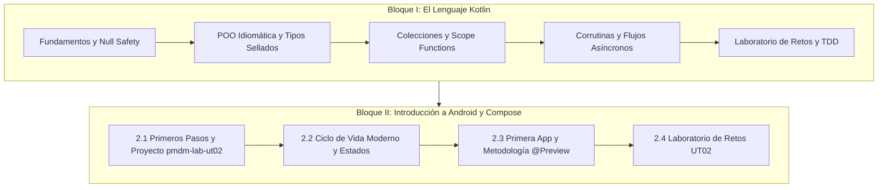

# **UT2. El Lenguaje Kotlin e Introducción a la Programación en Android**

En esta unidad consolidamos los cimientos del desarrollo nativo moderno en Android. Nos apoyamos en dos pilares fundamentales: el dominio exhaustivo de **Kotlin** como lenguaje de programación idiomático y la comprensión de la **arquitectura básica de Android** junto con los primeros pasos en **Jetpack Compose**.

A lo largo de este tema construiremos y trabajaremos sobre un único proyecto modular de prácticas: **`pmdm-lab-ut02`**, donde resolveremos retos incrementales sin dispersar el trabajo en decenas de proyectos independientes.

---

## 🧭 Estructura y Ruta de Aprendizaje

Esta unidad de trabajo se articula en dos grandes bloques complementarios:

---

## 🔷 Bloque I: Dominio del Lenguaje Kotlin

Antes de interactuar con el SDK de Android, es imprescindible dominar las capacidades del lenguaje Kotlin que hacen posible la programación reactiva y declarativa. Todos los apuntes teóricos detallados, ejemplos prácticos y retos guiados de Kotlin se encuentran en el manual de referencia:

### 1. Sintaxis Básica y Seguridad de Tipos
- [Introducción a Kotlin](../00-android/00-kotlin/index.md): Filosofía del lenguaje, interoperabilidad con Java y entorno de compilación.
- [Variables e Inmutabilidad](../00-android/00-kotlin/11-variables-tipos-datos.md): Uso estricto de `val` frente a `var`, inferencia de tipos y tipos básicos.
- [Expresiones frente a Sentencias](../00-android/00-kotlin/12-expresiones-vs-sentencias.md): El valor de retorno en estructuras condicionales (`if` como expresión).
- [Estructura de Control When](../00-android/00-kotlin/12.1-when.md): Coincidencia de patrones (*pattern matching*) y exhaustividad.
- [Bucles e Iteración](../00-android/00-kotlin/12.2-bucles-iteracion.md): Rangos, progresiones y recorridos seguros.
- [Funciones y Lambdas](../00-android/00-kotlin/13-funciones-lambdas.md): Funciones de orden superior, tipos función y parámetros por defecto.
- [Null Safety](../00-android/00-kotlin/14-null-safety.md): Operador de llamada segura `?.`, operador Elvis `?:`, aserción no nula `!!` y *Smart Casts*.

### 2. Estructuras de Datos y Programación Orientada a Objetos
- [Colecciones en Kotlin](../00-android/00-kotlin/41-arrays.md): [Arrays](../00-android/00-kotlin/41-arrays.md), [Listas mutables e inmutables](../00-android/00-kotlin/42-listas.md), [Maps](../00-android/00-kotlin/43-maps.md) y [Sets](../00-android/00-kotlin/44-sets.md).
- [POO Idiomática](../00-android/00-kotlin/21-poo.md): Constructores primarios y secundarios, propiedades, visibilidad y herencia.
- [Singletons y Objetos Anónimos](../00-android/00-kotlin/22-objetos-anonimos.md): Declaraciones `object` y `companion object`.
- [Data Classes](../00-android/00-kotlin/23-data-classes.md): Modelado de datos inmutables y función `copy()`.
- [Tipos Sellados (Sealed Classes e Interfaces)](../00-android/00-kotlin/26-sealed-classes.md): Modelado robusto de estados de interfaz (`UiState`: `Loading`, `Success`, `Error`).
- [Scope Functions](../00-android/00-kotlin/31-scope-functions.md): Uso contextual de `let`, `run`, `with`, `apply` y `also`.

### 3. Concurrencia y Reactividad
- [Corrutinas](../00-android/00-kotlin/51-corrutinas.md): Hilos ligeros, `suspend functions`, `Dispatchers` y ámbitos (`CoroutineScope`).
- [Flujos Asíncronos (Flow y StateFlow)](../00-android/00-kotlin/52-flows.md): Reactividad fría y caliente para estados de pantalla.

### 4. Prácticas y Retos de Kotlin
- [Laboratorio de Retos de Kotlin](../00-android/00-kotlin/ejercicios/index.md): Banco de proyectos paso a paso (Ahorcado, Wordle, Memory Match, Combate RPG).
- [Testing y TDD](../00-android/00-kotlin/testing/index.md): Validación automatizada de código con JUnit.

---

## 🔶 Bloque II: Introducción a Android y Jetpack Compose

Una vez dominados los fundamentos de Kotlin, nos adentramos en la arquitectura del sistema operativo Android y la creación de interfaces de usuario modernas.

En este bloque dejamos atrás las tecnologías imperativas antiguas (archivos XML y `findViewById`) para adoptar plenamente **Jetpack Compose**, el estándar de Google donde la interfaz de usuario se define mediante funciones de Kotlin puras anotadas con `@Composable`.

### Contenidos del Bloque

1. **[2.1 Primeros pasos y Creación del Proyecto en IntelliJ IDEA (`pmdm-lab-ut02`)](./2.1-primeros-pasos.md):**  
   Creación guiada paso a paso de un proyecto Android nativo con **Jetpack Compose en IntelliJ IDEA** (justificación pedagógica de por qué Android nativo puro sin KMP todavía), selección de plantillas modernas (`Empty Activity` con Compose frente al XML obsoleto), configuración de Gradle con Kotlin DSL y catálogo de versiones (`libs.versions.toml`), verificación de componibles, ejecución inicial y arquitectura de paquetes de aula.

2. **[2.2 Ciclo de vida de una aplicación Android](./2.2-ciclo-vida-app.md):**  
   Análisis de `ComponentActivity`, estados del ciclo de vida (`onCreate`, `onStart`, `onResume`, etc.), inspección con `Logcat` y cómo interactúa el ciclo de vida con Compose ante rotaciones de pantalla (`remember` vs `rememberSaveable`).

3. **[2.3 Primera aplicación y Metodología @Preview en Compose](./2.3-primera-app.md):**  
   Punto de entrada `setContent { ... }`, funciones `@Composable`, separación arquitectónica entre componente contenedor (*Stateful*) y componente de contenido (*Stateless*), y uso profesional de `@Preview` con datos mock.

4. **[2.4 Laboratorio de Prácticas y Codelabs](./2.4-laboratorio-retos.md):**  
   Proyecto unificado de laboratorio (`pmdm-lab-ut02`) con 5 Codelabs guiados paso a paso (Ciclo de Vida/Logcat, Contador Incremental, Tarjeta y Previews, Lanzador de Dados, Semáforo Inteligente) y banco de Retos Autónomos para evaluación (*Lemonade App* y *Marcador de Baloncesto*).

---

!!! tip "Nota Pedagógica: Lo que vendrá a continuación"

    En esta unidad nos centramos en entender el ciclo de vida, la anatomía del proyecto y la creación de componibles sencillos con vista previa. 
    
    Aspectos avanzados como layouts complejos, animaciones, el sistema de diseño completo de **Material Design 3**, la navegación entre pantallas y el testing de UI se profundizarán en detalle a partir de la **UT3: Interfaz de Usuario**.

---

## 📁 Recursos y Documentación Oficial

=== "Documentación Oficial de Android"

    - [Documentación oficial de Jetpack Compose](https://developer.android.com/jetpack/compose?hl=es-419): Guías conceptuales, tutoriales y API de referencia de Compose.
    - [Codelabs: Android Basics with Compose](https://developer.android.com/courses/android-basics-compose/unit-1?hl=es-419): Itinerario formativo oficial de Google.
    - [Ciclo de vida de Activities (Android Developers)](https://developer.android.com/guide/components/activities/activity-lifecycle?hl=es-419): Explicación exhaustiva del ciclo de vida del sistema.

=== "Kotlin y Herramientas"

    - [Documentación oficial de Kotlin](https://kotlinlang.org/docs/home.html): Especificación del lenguaje y novedades de Kotlin 2.x.
    - [Kotlin Coroutines Guide](https://kotlinlang.org/docs/coroutines-guide.html): Guía de concurrencia asíncrona de JetBrains.
    - [Android Studio Release Notes](https://developer.android.com/studio/releases): Novedades y descarga oficial del IDE.