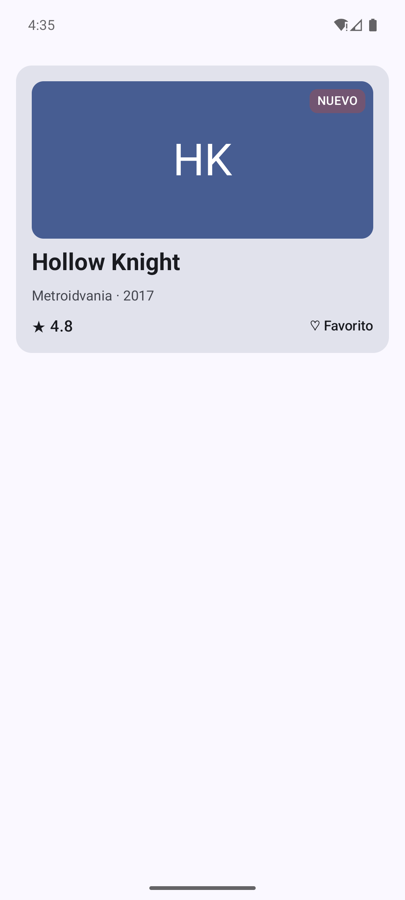
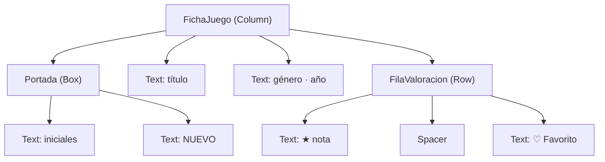

# **Sesión 2.01 · Primer contacto con Compose**

Hoy escribimos nuestras primeras funciones de Jetpack Compose y, con ellas, construimos la **ficha de un videojuego** combinando `Column`, `Row` y `Box`.

!!! abstract "Ficha de la sesión"

    - **Duración:** 2 h.
    - **Apuntes de referencia:** [2.3 Primera aplicación y @Preview](../2.3-primera-app.md) y [2.3.1 Maquetación: Column, Row, Box y Modifier](../2.3.1-layouts-modificadores.md).
    - **Proyecto de clase:** FichaJuego, de `s2.01-inicio` a `s2.01-fin` (ver [Guía de clases](./index.md#el-proyecto-de-clase-fichajuego)).
    - **Necesitas:** IntelliJ IDEA 2026.2 con los plugins *Android* y *Android Compose*, y un emulador o un móvil.

<figure style="text-align: center;">
  
  <figcaption>Lo que tendrás al terminar la clase.</figcaption>
</figure>

---

## 🎯 Objetivos

Al terminar la clase sabrás:

- Qué es una **función composable** y por qué en Compose la interfaz es una función de los datos.
- Leer el **árbol de la composición** que forman unas funciones que llaman a otras.
- Qué hace cada línea de la **`MainActivity`** de un proyecto Compose.
- Usar **`@Preview`** para diseñar sin ejecutar la app, en claro, en oscuro y con otros datos.
- Maquetar con **`Column`**, **`Row`**, **`Box`**, `Spacer` y **`Modifier`**.

---

## ✅ Antes de empezar

1. Descarga el proyecto en el tag de inicio (`git checkout s2.01-inicio`) o descarga su `.zip`.

2. Ábrelo en IntelliJ con *File > Open…* sobre la carpeta que contiene `settings.gradle.kts` y espera a que termine la sincronización de Gradle.

3. Arranca el emulador y ejecuta la app con ▶. Debe aparecer «Hola Android!».

!!! warning "Si no compila"
    Repasa la tabla de errores frecuentes del `README.md` de la plantilla: ruta con acentos o en OneDrive, SDK 37 sin instalar o JDK 21 no encontrado son los fallos más habituales.

---

## ⏱️ Agenda

| # | Min | Bloque | Apuntes |
| :---: | :---: | :--- | :--- |
| 0 | 10 | Arranque: el proyecto de clase funcionando | — |
| 1 | 20 | Funciones composable y árbol de la composición | [2.3 §1-2](../2.3-primera-app.md#1-el-paradigma-declarativo-ui-fstate) |
| 2 | 10 | Anatomía de `MainActivity` | [2.2 §1](../2.2-ciclo-vida-app.md#1-la-activity-en-el-ecosistema-moderno) |
| 3 | 10 | `@Preview` y sus opciones | [2.3 §5](../2.3-primera-app.md#5-dominio-de-la-anotacion-preview) |
| 4 | 40 | Taller: la ficha del juego paso a paso | [2.3.1 §1-7](../2.3.1-layouts-modificadores.md#1-como-coloca-compose-los-elementos) |
| 5 ⏩ | 10 | El orden de los modificadores importa | [2.3.1 §8-9](../2.3.1-layouts-modificadores.md#8-el-orden-de-los-modificadores-importa) |
| 6 ⏩ | 15 | Reto exprés: fila de plataformas | [2.3.1 §5](../2.3.1-layouts-modificadores.md#5-repartir-el-espacio-weight-y-spacer) |
| 7 | 5 | Comprobación rápida y cierre | — |
| | **120** | | |

---

## 0 · Arranque (10 min)

Abre `MainActivity.kt`. Todo lo que hay en pantalla sale de **tres funciones de Kotlin**: `onCreate`, `Greeting` y `GreetingPreview`. No hay ficheros XML de diseño.

!!! example "Manos a la obra"

    1. Cambia `"Android"` por tu nombre en la llamada a `Greeting` y vuelve a ejecutar.

    2. Abre la vista **Split** (arriba a la derecha del editor) para ver código y vista previa a la vez.

---

## 1 · Funciones composable y árbol (20 min)

- **`UI = f(estado)`:** en Compose no modificas la pantalla, **describes** cómo debe verse con los datos actuales. Si los datos cambian, Compose vuelve a llamar a la función. → [2.3 §1](../2.3-primera-app.md#1-el-paradigma-declarativo-ui-fstate)
- **Una función composable** lleva `@Composable`, se escribe en `PascalCase`, **no devuelve nada** (emite interfaz) y solo puede llamarse desde otra función composable. → [2.3 §2](../2.3-primera-app.md#2-anatomia-de-una-funcion-composable)
- **El árbol de la composición:** cada función que llama a otra cuelga de ella como un nodo hijo. Compose dibuja recorriendo ese árbol. → [Componer funciones componibles](../../00-android/00-compose/21-composable-functions.md#componer-funciones-componibles)

Así será el árbol de la ficha que construiremos hoy:



!!! example "Manos a la obra"

    1. Crea `Despedida(nombre: String)` debajo de `Greeting`, que muestre «Adiós, $nombre».

    2. Intenta llamarla desde una función normal (sin `@Composable`). Lee el error del compilador: solo se puede llamar desde otra función composable.

    3. Dibuja en papel el árbol de `setContent` → `Scaffold` → `Greeting`.

---

## 2 · Anatomía de `MainActivity` (10 min)

- **`ComponentActivity`:** la pantalla de Android que aloja Compose. → [2.2 §1](../2.2-ciclo-vida-app.md#de-appcompatactivity-a-componentactivity)
- **`onCreate`:** lo primero que ejecuta Android al abrir la pantalla.
- **`enableEdgeToEdge()`:** la app se dibuja también bajo las barras del sistema.
- **`setContent { … }`:** el puente entre Android y Compose; dentro va la raíz del árbol.
- **`FichaJuegoTheme { … }`:** aplica colores y tipografía de Material 3 a todo lo que contiene.
- **`Scaffold`:** el marco de la pantalla; su `innerPadding` evita que el contenido quede bajo las barras. Lo veremos a fondo en la UT3.

!!! warning "Gotcha"
    Si quitas `Modifier.padding(innerPadding)` de `Greeting`, el texto se mete debajo de la barra de estado. Pruébalo y vuelve a ponerlo.

---

## 3 · `@Preview` y sus opciones (10 min)

Una *preview* es una función composable **sin parámetros** marcada con `@Preview`. IntelliJ la dibuja sin ejecutar la app. → [2.3 §5](../2.3-primera-app.md#5-dominio-de-la-anotacion-preview) · [Opciones de previsualización](../../00-android/00-compose/21-composable-functions.md#opciones-de-previsualizacion)

| Opción | Para qué sirve |
| :--- | :--- |
| `name = "Oscuro"` | Pone nombre a la preview en el panel. |
| `showBackground = true` | Pinta un fondo blanco detrás. |
| `uiMode = Configuration.UI_MODE_NIGHT_YES` | Simula el modo oscuro. |
| `widthDp = 320`, `device = Devices.PIXEL_TABLET` | Cambia el tamaño de pantalla. |

!!! example "Manos a la obra"

    1. Duplica `GreetingPreview`, llámala `GreetingOscuroPreview` y añade `uiMode = Configuration.UI_MODE_NIGHT_YES` y `name = "Oscuro"`.

    2. Pulsa el icono de **modo interactivo** de la preview. → [2.3 §5.2](../2.3-primera-app.md#52-modo-interactivo-de-la-preview-interactive-mode)

---

## 4 · Taller: la ficha del juego (40 min)

Vamos a construir la ficha **de dentro hacia fuera**, comprobando cada paso en la preview. Crea el paquete `ui.ficha` y dentro el fichero `FichaJuego.kt`.

- **`Column`** coloca uno debajo de otro, **`Row`** uno al lado de otro y **`Box`** uno encima de otro. → [2.3.1 §2-4](../2.3.1-layouts-modificadores.md#2-column-elementos-uno-debajo-de-otro)
- **`Modifier`** decora un elemento: tamaño, márgenes, fondo, forma… → [2.3.1 §7](../2.3.1-layouts-modificadores.md#7-que-es-un-modifier)

!!! example "Paso 1 · Los textos en una `Column` (8 min)"

    1. Escribe `FichaJuego()` con una `Column` que contenga el título «Hollow Knight» y la línea «Metroidvania · 2017».

    2. Crea su preview y dale estilo al título con `style = MaterialTheme.typography.headlineSmall`.

    3. Añade `verticalArrangement = Arrangement.spacedBy(8.dp)` a la `Column` y observa la separación.

!!! example "Paso 2 · La valoración en una `Row` (8 min)"

    1. Crea `FilaValoracion(nota: Double)` con una `Row` que muestre «★ 4.8» y «♡ Favorito».

    2. Empuja «Favorito» al extremo derecho con un `Spacer(Modifier.weight(1f))` entre los dos textos. → [2.3.1 §5](../2.3.1-layouts-modificadores.md#5-repartir-el-espacio-weight-y-spacer)

    3. Centra los textos en vertical con `verticalAlignment = Alignment.CenterVertically`.

!!! example "Paso 3 · La portada con un `Box` (10 min)"

    1. Crea `Portada(titulo: String)`: un `Box` de `160.dp` de alto, ancho completo, esquinas redondeadas y fondo `colorScheme.primary`.

    2. Dentro, las iniciales «HK» centradas con `Modifier.align(Alignment.Center)`.

    3. Añade encima la insignia «NUEVO» con `Modifier.align(Alignment.TopEnd)`.

    ```kotlin
    Box(
        modifier = modifier
            .fillMaxWidth()
            .height(160.dp)
            .clip(RoundedCornerShape(12.dp))
            .background(MaterialTheme.colorScheme.primary)
    ) {
        Text("HK", modifier = Modifier.align(Alignment.Center))
        Text("NUEVO", modifier = Modifier.align(Alignment.TopEnd).padding(8.dp))
    }
    ```

!!! example "Paso 4 · Montar la ficha con datos (14 min)"

    1. Crea `model/Juego.kt` con `data class Juego(titulo, genero, anio, nota, esNovedad)` y un `juegoEjemplo`.

    2. Cambia `FichaJuego` para que reciba `juego: Juego` y `modifier: Modifier = Modifier`, y monte `Portada`, los dos textos y `FilaValoracion`.

    3. Pasa a `Portada` el título y `esNovedad`. Calcula las iniciales con `titulo.split(" ").take(2).joinToString("") { it.first().uppercase() }`.

    4. Haz que la insignia solo aparezca `if (esNovedad)`: esto es `UI = f(datos)`.

    5. Añade dos previews más: una en **modo oscuro** y otra con un juego que **no** sea novedad.

    6. En `MainActivity`, sustituye `Greeting` por `FichaJuego(juego = juegoEjemplo, …)` y ejecuta la app.

!!! warning "Gotcha"
    Las previews usan `FichaJuegoTheme(dynamicColor = false)`. Con el color dinámico activado, la preview y el emulador pueden mostrar colores distintos, porque el color dinámico depende del fondo de pantalla del dispositivo.

---

## 5 ⏩ · El orden de los modificadores importa (10 min)

Los modificadores se aplican **de fuera hacia dentro, en el orden en que los escribes**. `padding` antes de `background` deja un margen sin pintar; después de `background`, lo pinta. → [2.3.1 §8](../2.3.1-layouts-modificadores.md#8-el-orden-de-los-modificadores-importa)

!!! example "Manos a la obra"

    1. En la insignia «NUEVO», intercambia `.background(…)` y el último `.padding(…)`. ¿Qué cambia?

    2. Juega con el [playground de modificadores](../2.3.1-layouts-modificadores.md#9-playground-de-modificadores) de los apuntes.

---

## 6 ⏩ · Reto exprés: fila de plataformas (15 min)

Añade debajo de la línea del género una `Row` con «chips» de texto para las plataformas: **PC**, **Switch** y **PS5**. Cada chip es un `Text` con fondo `secondaryContainer`, esquinas redondeadas y `padding` interior; sepáralos con `Arrangement.spacedBy(8.dp)`.

??? success "Pista"
    Haz una función `ChipPlataforma(nombre: String)` y llámala tres veces dentro de la `Row`. Si añades `plataformas: List<String>` a `Juego`, puedes recorrerla con `forEach`.

---

## 🧪 Comprobación rápida

1. ¿Qué devuelve una función `@Composable`?

    ??? success "Respuesta"
        Nada (`Unit`). No devuelve la interfaz: la **emite** al árbol de la composición.

2. Quieres un texto a la izquierda y un icono pegado a la derecha en la misma fila. ¿Qué usas?

    ??? success "Respuesta"
        Una `Row` con un `Spacer(Modifier.weight(1f))` entre ambos.

3. ¿Qué contenedor usas para poner la insignia «NUEVO» encima de la portada?

    ??? success "Respuesta"
        `Box`, y colocas la insignia con `Modifier.align(Alignment.TopEnd)`.

4. ¿Por qué una preview no puede tener parámetros?

    ??? success "Respuesta"
        Porque IntelliJ la llama sin saber qué valores pasarle. Los datos se escriben dentro de la preview (datos *mock*).

---

## 🏠 Para casa

- Termina los bloques 5 y 6 si no dio tiempo en clase.
- Reto 🟢 de los apuntes: [tarjeta de contacto](../2.3.1-layouts-modificadores.md#basico-tarjeta-de-contacto).
- Lee [2.3.1 §11 Errores frecuentes](../2.3.1-layouts-modificadores.md#11-errores-frecuentes).
- Si faltaste a clase: `git checkout s2.01-fin` y repasa el código de `ui/ficha/FichaJuego.kt`.

---

## ➡️ Próxima sesión

[**2.02 · Estado y *state hoisting***](./s02-estado-state-hoisting.md): el corazón de «Favorito» y un contador de partidas que reaccionan al pulsar. Descubriremos por qué una variable normal no actualiza la pantalla. Lectura previa: [2.3 §3 Stateful Screen vs Stateless Content](../2.3-primera-app.md#3-patron-de-diseno-stateful-screen-vs-stateless-content).
