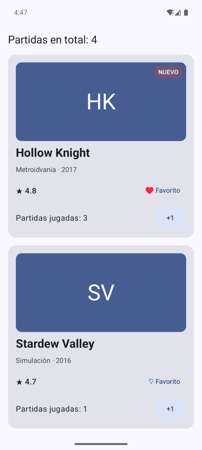
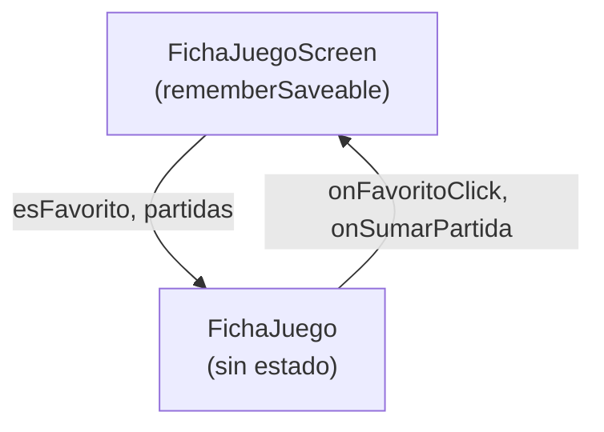
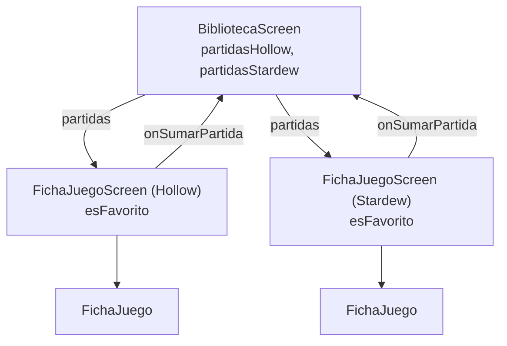

# **Sesión 2.02 · Estado y *state hoisting***

Hoy la ficha cobra vida: el corazón de «Favorito» y un contador de partidas que **reaccionan al pulsar**. Veremos por qué una variable normal no basta y dónde debe vivir el estado.

!!! abstract "Ficha de la sesión"

    - **Duración:** 2 h.
    - **Apuntes de referencia:** [2.3 §3 Stateful Screen vs Stateless Content](../2.3-primera-app.md#3-patron-de-diseno-stateful-screen-vs-stateless-content), [2.2 §4 El ciclo de vida desde Compose](../2.2-ciclo-vida-app.md#4-el-ciclo-de-vida-desde-la-perspectiva-de-jetpack-compose) y [Gestión del estado en Compose](../../00-android/00-compose/22-state-management.md).
    - **Proyecto de clase:** FichaJuego, de `s2.02-inicio` a `s2.02-fin` (ver [Guía de clases](./index.md#el-proyecto-de-clase-fichajuego)).
    - **Necesitas:** el proyecto tal como acabó la [sesión 2.01](./s01-primer-contacto-compose.md) y un emulador.

<figure style="text-align: center;">
  
  <figcaption>Lo que tendrás al terminar la clase.</figcaption>
</figure>

---

## 🎯 Objetivos

Al terminar la clase sabrás:

- Qué es el **estado** y qué es la **recomposición**.
- Guardar estado en un composable con **`remember`** y **`mutableStateOf`**, y escribirlo cómodo con el delegado **`by`**.
- Elegir entre **`remember`** y **`rememberSaveable`** según si el valor debe sobrevivir a un giro de pantalla.
- Aplicar **_state hoisting_**: componentes sin estado que reciben valores y emiten eventos.
- Decidir **hasta dónde sube** cada estado.

---

## ✅ Antes de empezar

1. Sitúate en el punto de partida: `git checkout s2.02-inicio` (es el mismo código que `s2.01-fin`) o descarga su `.zip`.

2. Ejecuta la app y abre `ui/ficha/FichaJuego.kt` en vista **Split**.

---

## ⏱️ Agenda

| # | Min | Bloque | Apuntes |
| :---: | :---: | :--- | :--- |
| 0 | 10 | Repaso: el árbol de la ficha | [Sesión 2.01](./s01-primer-contacto-compose.md#1-funciones-composable-y-arbol-20-min) |
| 1 | 10 | El gran error: estado y recomposición | [Codelab 2 §2](../codelabs/02-contador-incremental.md#2-el-gran-error-del-principiante-en-compose) |
| 2 | 20 | Taller: favorito y partidas con `remember` | [Codelab 2 §3](../codelabs/02-contador-incremental.md#3-las-dos-piezas-fundamentales-state-y-remember) |
| 3 | 10 | `remember` frente a `rememberSaveable` | [2.2 §4](../2.2-ciclo-vida-app.md#42-remember-vs-remembersaveable) |
| 4 | 20 | *State hoisting*: la ficha sin estado | [2.3 §3](../2.3-primera-app.md#3-patron-de-diseno-stateful-screen-vs-stateless-content) |
| 5 | 20 | El estado sube al padre común: la biblioteca | [State hoisting y UDF](../../00-android/00-compose/22-state-management.md#elevacion-del-estado-state-hoisting-y-patron-udf) |
| 6 ⏩ | 10 | ¿Qué se recompone? Lo vemos en Logcat | [2.2 §4.1](../2.2-ciclo-vida-app.md#41-recomposicion-vs-ciclo-de-vida-del-sistema) |
| 7 ⏩ | 15 | Reto exprés: restar y reiniciar | — |
| 8 | 5 | Comprobación rápida y cierre | — |
| | **120** | | |

---

## 0 · Repaso (10 min)

Dibuja en la pizarra el árbol de `FichaJuego`: `Column` → `Portada` (`Box`), dos `Text` y `FilaValoracion` (`Row`).

Pregunta clave para hoy: si `UI = f(estado)`, **¿qué es el estado de esta ficha?** Hasta ahora, nada: todo son datos fijos. Ninguna pulsación cambia nada.

---

## 1 · El gran error (10 min)

- **Estado** es cualquier valor que puede cambiar con el tiempo y que la interfaz muestra: si es favorito, cuántas partidas llevas, lo que hay escrito en un campo…
- **Recomposición** es volver a ejecutar una función composable para que la pantalla refleje el nuevo valor. Compose solo recompone si **se entera** del cambio. → [Actualización de funciones componibles](../../00-android/00-compose/21-composable-functions.md#actualizacion-de-funciones-componibles)
- Una variable normal de Kotlin cambia en memoria, pero **no avisa a nadie**. → [Codelab 2 §2](../codelabs/02-contador-incremental.md#2-el-gran-error-del-principiante-en-compose)

!!! example "Manos a la obra: provoca el fallo"

    1. Crea `FilaPartidas(partidas: Int, onSumarPartida: () -> Unit)`: una `Row` con el texto «Partidas jugadas: $partidas», un `Spacer(Modifier.weight(1f))` y un `FilledTonalButton` con el texto «+1».

    2. En `FichaJuego`, declara `var partidas = 0` y añade al final de la `Column`:

        ```kotlin
        FilaPartidas(partidas = partidas, onSumarPartida = { partidas++ })
        ```

    3. Ejecuta y pulsa «+1» varias veces. El número no cambia. ¿Por qué?

---

## 2 · Taller: favorito y partidas con `remember` (20 min)

Necesitamos **dos piezas**: → [Codelab 2 §3](../codelabs/02-contador-incremental.md#3-las-dos-piezas-fundamentales-state-y-remember)

- **`mutableStateOf(valor)`** (o `mutableIntStateOf` para enteros): un valor **observable**. Cuando cambia, Compose recompone a quien lo lee.
- **`remember { … }`**: guarda ese valor **entre recomposiciones**. Sin él, cada recomposición volvería a crearlo desde cero.
- **`by`**: con el delegado lo usas como una variable normal (`partidas++`). → [La magia del delegado `by`](../codelabs/02-contador-incremental.md#la-magia-del-delegado-by-en-kotlin)

```kotlin
var partidas by remember { mutableIntStateOf(0) }
var esFavorito by remember { mutableStateOf(false) }
```

!!! example "Manos a la obra"

    1. Cambia `var partidas = 0` por la versión con `remember` y `mutableIntStateOf`. Pulsa «+1»: ahora sí funciona.

    2. Si `by` sale en rojo, importa `androidx.compose.runtime.getValue` y `androidx.compose.runtime.setValue` (`Alt+Enter`).

    3. Añade a `FilaValoracion` los parámetros `esFavorito: Boolean` y `onFavoritoClick: () -> Unit`. Sustituye el texto «♡ Favorito» por un `TextButton` que muestre «♥ Favorito» o «♡ Favorito» según `esFavorito`.

    4. Declara `esFavorito` con `remember` en `FichaJuego` y conecta el botón: `onFavoritoClick = { esFavorito = !esFavorito }`.

!!! warning "Gotcha"
    `var partidas by mutableIntStateOf(0)` **sin** `remember` compila, pero el contador vuelve a 0 en cada recomposición. IntelliJ lo marca en rojo: *Creating a state object during composition without using remember*.

---

## 3 · `remember` frente a `rememberSaveable` (10 min)

- **`remember`** sobrevive a las recomposiciones, pero **no** a un cambio de configuración: al girar la pantalla, Android destruye y vuelve a crear la `Activity`. → [2.2 §4.1](../2.2-ciclo-vida-app.md#41-recomposicion-vs-ciclo-de-vida-del-sistema)
- **`rememberSaveable`** guarda el valor en el `Bundle` del sistema y lo recupera al recrearse la `Activity`. → [2.2 §4.2](../2.2-ciclo-vida-app.md#42-remember-vs-remembersaveable)

!!! example "Manos a la obra"

    1. Suma unas cuantas partidas, marca el favorito y **gira el emulador**. Todo vuelve a 0.

    2. Cambia los dos `remember` por `rememberSaveable` (import `androidx.compose.runtime.saveable.rememberSaveable`) y repite. Ahora se conserva.

    3. Prueba también a cambiar el modo oscuro del emulador con la app abierta: también es un cambio de configuración.

---

## 4 · *State hoisting*: la ficha sin estado (20 min)

Ahora `FichaJuego` **tiene estado dentro**. Eso tiene tres problemas: no puedes previsualizarla con 12 partidas, no puedes reutilizarla con otro estado y nadie de fuera puede leer cuántas partidas lleva.

La solución es **elevar el estado** (*state hoisting*): → [2.3 §3](../2.3-primera-app.md#3-patron-de-diseno-stateful-screen-vs-stateless-content) · [La regla de oro](../../00-android/00-compose/22-state-management.md#la-regla-de-oro-del-state-hoisting)

- El componente **sin estado** (*stateless*) recibe **el valor** (`partidas: Int`) y **un evento** (`onSumarPartida: () -> Unit`). Ni guarda ni modifica nada.
- El contenedor **con estado** (*stateful*), que por convenio llamamos `…Screen`, guarda el estado y decide qué hacer con cada evento.
- **El estado baja, los eventos suben.**



!!! example "Manos a la obra"

    1. Añade a `FichaJuego` los parámetros `esFavorito`, `partidas`, `onFavoritoClick` y `onSumarPartida`, y **borra** de ella las dos variables de estado.

    2. Crea `ui/ficha/FichaJuegoScreen.kt` con `FichaJuegoScreen(juego: Juego)`. Dentro van los dos `rememberSaveable` y la llamada a `FichaJuego` conectando valores y eventos.

    3. Arregla las previews de `FichaJuego`: ahora puedes pintarla en cualquier estado sin pulsar nada (`esFavorito = true`, `partidas = 12`, eventos vacíos `{}`).

    4. En `MainActivity`, llama a `FichaJuegoScreen(juego = juegoEjemplo, …)` y ejecuta.

!!! tip "Para probarlo sin ejecutar"
    Crea una preview de `FichaJuegoScreen` y actívale el **modo interactivo**: como guarda estado, puedes pulsar los botones dentro de la propia preview.

---

## 5 · El estado sube al padre común (20 min)

Nuevo requisito: una pantalla con **dos fichas** y, arriba, el **total de partidas** de ambas.

- El total necesita las partidas de las dos fichas, así que ese estado **no puede vivir dentro de cada ficha**: sube al **antepasado común más cercano** que lo lee, `BibliotecaScreen`.
- El favorito no le interesa a nadie más: **se queda** en `FichaJuegoScreen`. Eleva el estado solo hasta donde haga falta.
- `FichaJuego` no se toca: como no tiene estado, se reutiliza tal cual. → [UDF](../../00-android/00-compose/22-state-management.md#arquitectura-udf-unidirectional-data-flow)



!!! example "Manos a la obra"

    1. Cambia `FichaJuegoScreen` para que reciba `partidas: Int` y `onSumarPartida: () -> Unit` en lugar de guardar las partidas. El favorito sigue dentro.

    2. Crea `ui/biblioteca/BibliotecaScreen.kt` con dos `rememberSaveable` (`partidasHollow` y `partidasStardew`) y una `Column` con:

        - un `Text` con «Partidas en total: ${partidasHollow + partidasStardew}»,
        - un `FichaJuegoScreen` para `juegoEjemplo` y otro para `otroJuego`.

    3. Las dos fichas no caben en pantalla: añade a la `Column` `Modifier.verticalScroll(rememberScrollState())`.

    4. En `MainActivity`, muestra `BibliotecaScreen`. Comprueba que el total suma bien y que cada favorito es independiente.

---

## 6 ⏩ · ¿Qué se recompone? (10 min)

Compose no repinta toda la pantalla: solo vuelve a ejecutar las funciones que **leen** el estado que ha cambiado. Vamos a verlo.

!!! example "Manos a la obra"

    1. Añade como primera línea de `FichaJuego`, `Portada` y `FilaPartidas` un mensaje de log, por ejemplo:

        ```kotlin
        Log.d("Recomposicion", "FilaPartidas $partidas")
        ```

    2. Abre **Logcat**, filtra por `tag:Recomposicion`, pulsa «+1» en Hollow Knight y observa: se recomponen su `FichaJuego` y su `FilaPartidas`, pero **ni la portada ni la ficha de Stardew Valley**.

    3. Pulsa ahora el favorito. ¿Qué funciones aparecen?

    4. Quita los logs al terminar: son solo para el experimento.

---

## 7 ⏩ · Reto exprés: restar y reiniciar (15 min)

1. Añade a `FilaPartidas` un botón «−1» que solo esté activo si hay partidas (`enabled = partidas > 0`). ¿Qué parámetro nuevo necesita `FilaPartidas`? ¿Y `FichaJuego`?

2. Añade en `BibliotecaScreen`, junto al total, un `TextButton` «Reiniciar» que ponga a 0 las partidas de las dos fichas.

??? success "Pista"
    Sigue la regla: un valor hacia abajo y un evento hacia arriba. Necesitas `onRestarPartida: () -> Unit` en `FilaPartidas`, en `FichaJuego` y en `FichaJuegoScreen`, y quien lo implementa es `BibliotecaScreen`, que es quien guarda las partidas. «Reiniciar» no necesita tocar las fichas.

---

## 🧪 Comprobación rápida

1. ¿Por qué `var partidas = 0` dentro de un composable no actualiza la pantalla?

    ??? success "Respuesta"
        Porque una variable normal no avisa a Compose cuando cambia, y Compose no recompone. Además, en cada recomposición se volvería a crear con valor 0.

2. Giras el móvil y el contador vuelve a 0. ¿Qué has usado y qué deberías usar?

    ??? success "Respuesta"
        Has usado `remember`, que no sobrevive a la recreación de la `Activity`. Usa `rememberSaveable`.

3. ¿Qué recibe un composable sin estado según la regla del *state hoisting*?

    ??? success "Respuesta"
        El valor actual (solo lectura) y una lambda para avisar de los eventos. Nunca un `MutableState`.

4. ¿Por qué las partidas viven en `BibliotecaScreen` y el favorito en `FichaJuegoScreen`?

    ??? success "Respuesta"
        Porque el estado sube hasta el antepasado común más cercano que lo necesita. El total necesita las partidas de ambas fichas, pero el favorito solo lo usa cada ficha.

---

## 🏠 Para casa

- Termina los bloques 6 y 7 si no dio tiempo en clase.
- Codelab del laboratorio: [Codelab 2 · Contador y recomposición](../codelabs/02-contador-incremental.md). Fíjate en cómo separa `…Content` (sin estado) y `…Screen` (con estado), igual que hemos hecho con la ficha.
- Lee [Elevación del estado y UDF](../../00-android/00-compose/22-state-management.md#elevacion-del-estado-state-hoisting-y-patron-udf) en los apuntes de Compose.
- Si faltaste a clase: `git checkout s2.02-fin` y repasa `FichaJuego.kt`, `FichaJuegoScreen.kt` y `BibliotecaScreen.kt`.

---

## ➡️ Próxima sesión

**2.03 · Imágenes, iconos y recursos:** cambiaremos las iniciales por la **portada real** del juego con `Image`, los símbolos ♥ y ★ por **iconos** de Material y los textos fijos por recursos de `strings.xml`. Lectura previa: [2.3.2 §1 Los recursos de una app Android](../2.3.2-imagenes-iconos-recursos.md#1-los-recursos-de-una-app-android).
