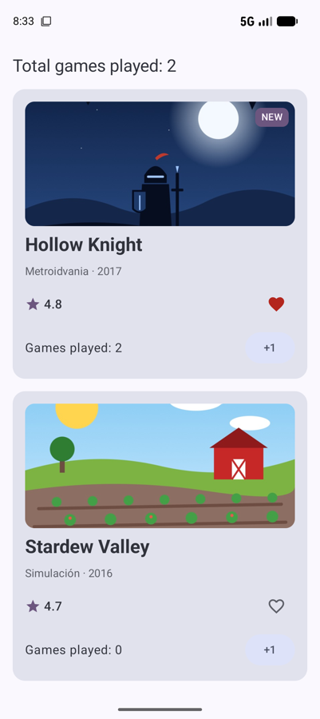

# **Sesión 2.03 · Imágenes, iconos y recursos** 📚

Esta sesión la trabajas **por tu cuenta**. Vas a cambiar en la ficha tres cosas que se quedaron provisionales: las iniciales por una **portada real**, los símbolos ★ y ♥ por **iconos** de Material y los textos escritos en el código por **recursos** traducibles.

!!! abstract "Ficha de la sesión"

    - **Duración:** unas 2 h · 📚 estudio autónomo.
    - **Apuntes de referencia:** [2.3.2 Imágenes, iconos y recursos](../2.3.2-imagenes-iconos-recursos.md) y el [Anexo A: Iconos de la app y gestión de recursos](../../00-android/anexos/a-iconos-app-recursos.md).
    - **Proyecto de clase:** FichaJuego, de `s2.03-inicio` a `s2.03-fin` (ver [Guía de clases](./index.md#el-proyecto-de-clase-fichajuego)).
    - **Necesitas:** el proyecto tal como acabó la [sesión 2.02](./s02-estado-state-hoisting.md), conexión a internet para descargar iconos y un emulador.

<figure style="text-align: center;">
  
  <figcaption>Lo que tendrás al terminar.</figcaption>
</figure>

---

## 🎯 Objetivos

Al terminar sabrás:

- Dónde guardar cada recurso en `res/` y usarlo desde Compose con la clase **`R`**.
- Elegir entre un **mapa de bits** y un **vector**.
- Mostrar imágenes con **`Image`**, describirlas con `contentDescription` y encajarlas con **`contentScale`**.
- Usar iconos con **`Icon`** a partir de los **Material Symbols**.
- Sacar los textos a **`strings.xml`**, con parámetros, y traducir la app al inglés.

---

## ✅ Antes de empezar

1. Sitúate en el punto de partida: `git checkout s2.03-inicio` (es el mismo código que `s2.02-fin`) o descarga su `.zip`.

2. Descarga las dos portadas del curso (clic derecho → *Guardar enlace como…*):

    - [img_portada_hollow.jpg](https://github.com/jssdocente/pmdm2627-fichajuego/raw/s2.03-fin/app/src/main/res/drawable/img_portada_hollow.jpg)
    - [img_portada_stardew.jpg](https://github.com/jssdocente/pmdm2627-fichajuego/raw/s2.03-fin/app/src/main/res/drawable/img_portada_stardew.jpg)

    Son ilustraciones propias del curso. También puedes usar imágenes tuyas.

3. Ejecuta la app para comprobar que todo funciona antes de tocar nada.

!!! tip "Cómo trabajar esta sesión"
    Sigue los bloques en orden. En cada uno, **lee primero el apartado de los apuntes** que se indica y después haz el «Manos a la obra». Si te atascas, compara tu código con la solución: `git diff s2.03-inicio s2.03-fin`.

---

## ⏱️ Agenda

| # | Min | Bloque | Apuntes |
| :---: | :---: | :--- | :--- |
| 0 | 5 | Punto de partida | — |
| 1 | 15 | La carpeta `res` y la clase `R` | [2.3.2 §1](../2.3.2-imagenes-iconos-recursos.md#1-los-recursos-de-una-app-android) |
| 2 | 10 | Mapas de bits y vectores | [2.3.2 §2](../2.3.2-imagenes-iconos-recursos.md#2-mapas-de-bits-y-vectores) |
| 3 | 25 | La portada con `Image` | [2.3.2 §3](../2.3.2-imagenes-iconos-recursos.md#3-mostrar-imagenes-con-image) |
| 4 | 25 | Iconos con Material Symbols | [2.3.2 §4](../2.3.2-imagenes-iconos-recursos.md#4-iconos-con-icon) |
| 5 | 25 | Textos en `strings.xml` y traducción | [2.3.2 §5](../2.3.2-imagenes-iconos-recursos.md#5-textos-y-colores-como-recursos) |
| 6 ⏩ | 10 | Vector Asset y SVG desde el IDE | [2.3.2 §4](../2.3.2-imagenes-iconos-recursos.md#de-donde-sacar-los-iconos-material-symbols), [Anexo A](../../00-android/anexos/a-iconos-app-recursos.md) |
| 7 | 5 | Autoevaluación | — |
| | **120** | | |

---

## 0 · Punto de partida (5 min)

Abre `FichaJuego.kt` y localiza lo provisional:

- `Portada` pinta las **iniciales** sobre un color.
- `FilaValoracion` usa los caracteres **★, ♥ y ♡**.
- Hay **textos escritos en el código**: «NUEVO», «Partidas jugadas: …», «Partidas en total: …». Así no se pueden traducir.

---

## 1 · La carpeta `res` y la clase `R` (15 min)

- Todo lo que no es código va en **`app/src/main/res/`**: `drawable/` para imágenes, `values/` para textos y colores, `mipmap-…/` **solo** para el icono de la app. → [2.3.2 §1](../2.3.2-imagenes-iconos-recursos.md#1-los-recursos-de-una-app-android)
- Al compilar se genera la clase **`R`**, con un identificador para cada recurso: `R.drawable.img_portada_hollow`, `R.string.app_name`… → [La clase `R`](../2.3.2-imagenes-iconos-recursos.md#la-clase-r)
- **Nombres:** solo minúsculas, números y guiones bajos. Prefijos habituales: `img_` para imágenes e `ic_` para iconos.

!!! example "Manos a la obra"

    1. Copia las dos portadas en `res/drawable/`. Desde el panel *Project*, cambia la vista a **Project** si no ves la carpeta.

    2. Prueba a renombrar una como `Portada-Hollow.jpg` y compila. Lee el error y vuelve a dejarle su nombre.

    3. Escribe `R.drawable.` en cualquier función y mira qué sugiere el autocompletado.

---

## 2 · Mapas de bits y vectores (10 min)

- Un **mapa de bits** (`.jpg`, `.png`, `.webp`) guarda píxeles: es lo adecuado para fotos e ilustraciones con mucho detalle, pero pierde calidad si lo amplías.
- Un **vector** (`.xml` de Android) guarda formas: pesa poco y se ve nítido a cualquier tamaño. Es lo adecuado para iconos y logotipos. → [2.3.2 §2](../2.3.2-imagenes-iconos-recursos.md#2-mapas-de-bits-y-vectores)
- Los tamaños se dan en **`dp`**, no en píxeles, para que se vean igual en pantallas de distinta densidad. → [Densidades y `dp`](../2.3.2-imagenes-iconos-recursos.md#densidades-de-pantalla-y-dp)

Las portadas son mapas de bits (ilustraciones con degradados). Los iconos del bloque 4 serán vectores.

---

## 3 · La portada con `Image` (25 min)

- **`Image(painter = painterResource(R.drawable.…), contentDescription = …)`** muestra una imagen de `res/drawable`. → [2.3.2 §3](../2.3.2-imagenes-iconos-recursos.md#3-mostrar-imagenes-con-image)
- **`contentDescription`** es lo que lee TalkBack a una persona ciega. Si la imagen es solo decorativa, pon `null`. → [Accesibilidad](../2.3.2-imagenes-iconos-recursos.md#contentdescription-accesibilidad)
- **`contentScale`** decide cómo encaja la imagen en su hueco: `Crop` llena y recorta, `Fit` cabe entera y deja bandas. → [`contentScale`](../2.3.2-imagenes-iconos-recursos.md#contentscale-como-se-adapta-la-imagen-a-su-hueco)

!!! example "Manos a la obra"

    1. Añade a `Juego` el campo `@DrawableRes val portada: Int` y dale valor en los dos juegos de ejemplo: `portada = R.drawable.img_portada_hollow` y `R.drawable.img_portada_stardew`.

    2. Cambia `Portada` para que reciba `@DrawableRes portada: Int`. Quita el fondo de color y las iniciales, y pon en su lugar:

        ```kotlin
        Image(
            painter = painterResource(portada),
            contentDescription = "Portada de $titulo",
            contentScale = ContentScale.Crop,
            modifier = Modifier.fillMaxSize()
        )
        ```

    3. Comprueba en la preview que la insignia «NUEVO» sigue **encima** de la imagen. ¿Por qué? Porque en un `Box` lo último que escribes se dibuja arriba.

    4. Cambia `ContentScale.Crop` por `Fit` y luego por `FillBounds`. Compara en la preview y quédate con `Crop`. Puedes probarlo también en el playground de los apuntes.

    5. Borra la función `iniciales`: ya no se usa.

!!! warning "Gotcha"
    `@DrawableRes` no es obligatorio, pero hace que el IDE te avise si por error pasas un `R.string` donde se espera una imagen. Las dos son `Int` y, sin la anotación, compilaría.

---

## 4 · Iconos con Material Symbols (25 min)

- **`Icon`** pinta un dibujo de **un solo color** (el *tinte*) y por defecto mide 24 dp. Es para iconos de interfaz; `Image` es para imágenes a color. → [2.3.2 §4](../2.3.2-imagenes-iconos-recursos.md#4-iconos-con-icon)
- Los iconos se descargan como **vector XML** desde [fonts.google.com/icons](https://fonts.google.com/icons) y se guardan en `res/drawable/`. → [Material Symbols](../2.3.2-imagenes-iconos-recursos.md#de-donde-sacar-los-iconos-material-symbols)
- Si el icono se pulsa, va dentro de un **`IconButton`**. Si alterna entre dos estados (como el favorito), dentro de un **`IconToggleButton`**.

!!! example "Manos a la obra"

    1. Descarga de Material Symbols, en la pestaña **Android**, estos tres iconos y guárdalos con estos nombres:

        - *Star*, relleno → `ic_star.xml`
        - *Favorite*, relleno → `ic_favorite.xml`
        - *Favorite*, sin rellenar → `ic_favorite_border.xml`

    2. En `FilaValoracion`, sustituye «★» por un `Icon` con `ic_star`, `tint = MaterialTheme.colorScheme.tertiary` y `Modifier.size(20.dp)`. Como el número ya se lee, el icono es decorativo: `contentDescription = null`.

    3. Sustituye el `TextButton` del favorito por un `IconToggleButton(checked = esFavorito, onCheckedChange = { onFavoritoClick() })` que muestre `ic_favorite` o `ic_favorite_border` según `esFavorito`.

    4. Dale al corazón el tinte `colorScheme.error` cuando está marcado y `onSurfaceVariant` cuando no.

    5. Aquí la `contentDescription` **sí** importa, porque es un botón: «Marcar como favorito» o «Quitar de favoritos», según el estado.

---

## 5 · Textos en `strings.xml` y traducción (25 min)

- Los textos de la interfaz van en **`res/values/strings.xml`** y se leen con **`stringResource(R.string.…)`**. → [2.3.2 §5](../2.3.2-imagenes-iconos-recursos.md#5-textos-y-colores-como-recursos)
- Los **parámetros** se marcan con `%1$s` (texto) y `%1$d` (número entero): `stringResource(R.string.partidas_jugadas, partidas)`.
- Para traducir, se crea **`res/values-en/strings.xml`** con las mismas claves. Android elige el fichero según el idioma del móvil. → [Calificadores](../2.3.2-imagenes-iconos-recursos.md#calificadores-un-recurso-varias-versiones)

```xml
<string name="partidas_jugadas">Partidas jugadas: %1$d</string>
<string name="genero_anio">%1$s · %2$d</string>
<string name="portada_de">Portada de %1$s</string>
```

!!! example "Manos a la obra"

    1. Pasa a `strings.xml` todos los textos fijos de la interfaz: la insignia, el género y el año, «Partidas jugadas», «Partidas en total», el «+1», la descripción de la portada y las dos del favorito.

    2. Sustituye cada texto por su `stringResource(…)`. Sitúa el cursor sobre un texto y pulsa `Alt+Enter` → *Extract string resource*: el IDE lo hace por ti.

    3. Crea `values-en/strings.xml` con la traducción. En el editor de `strings.xml` tienes *Open editor* para ver las dos columnas a la vez.

    4. En el emulador, ve a *Ajustes → Sistema → Idiomas* y pon el inglés en primer lugar. Vuelve a la app: los textos han cambiado y **el contador no se ha perdido**, porque cambiar de idioma es un cambio de configuración, igual que girar la pantalla.

!!! warning "¿Y «Hollow Knight» o «Metroidvania»?"
    Son **datos** del juego, no textos de la interfaz: no van en `strings.xml`. En la UT4 los datos vendrán de una base de datos o de internet, ya en el idioma que toque.

<figure style="text-align: center;">
  
  <figcaption>La misma app con el móvil en inglés.</figcaption>
</figure>

---

## 6 ⏩ · Vector Asset y SVG desde el IDE (10 min)

El IDE tiene su propio asistente para iconos: clic derecho sobre `res` → **New → Vector Asset**. Con la opción *Clip art* eliges un icono de Material, y con *Local file* conviertes un **SVG** tuyo (por ejemplo, un logotipo exportado de Inkscape o Figma) en un vector de Android. → [Material Symbols](../2.3.2-imagenes-iconos-recursos.md#de-donde-sacar-los-iconos-material-symbols)

!!! example "Manos a la obra"

    1. Crea con *Vector Asset* un icono `ic_add` y úsalo en el botón «+1» en lugar del texto.

    2. Si el asistente no aparece o sale en gris, consulta la [solución de problemas del anexo](../../00-android/anexos/a-iconos-app-recursos.md#4-solucion-de-problemas).

---

## 🧪 Autoevaluación

1. Has guardado una imagen como `Portada Hollow.png` y no compila. ¿Por qué?

    ??? success "Respuesta"
        Los nombres de recursos solo admiten minúsculas, números y guiones bajos. Debe llamarse, por ejemplo, `img_portada_hollow.png`.

2. ¿Cuándo usas `Image` y cuándo `Icon`?

    ??? success "Respuesta"
        `Image` para fotos e ilustraciones con sus colores originales. `Icon` para iconos de interfaz de un solo color, que toman el tinte del tema.

3. La portada aparece con bandas vacías a los lados. ¿Qué `contentScale` está usando y cuál quieres?

    ??? success "Respuesta"
        Está usando `Fit`, que encaja la imagen entera. Para llenar el hueco recortando lo que sobra, usa `Crop`.

4. ¿Qué tienes que hacer para que la app salga en francés?

    ??? success "Respuesta"
        Crear `res/values-fr/strings.xml` con las mismas claves traducidas. No hay que tocar el código Kotlin.

!!! success "Comprueba tu resultado"
    Tu app debe verse como la captura del principio, en español y en inglés. Si algo no cuadra, compáralo con la solución: `git diff s2.03-inicio s2.03-fin`, o en GitHub, comparando los dos tags.

---

## 🏠 Para seguir practicando

- El bloque 6, si no lo has hecho.
- Reto 🟢 de los apuntes: [tarjeta de producto](../2.3.2-imagenes-iconos-recursos.md#basico-tarjeta-de-producto).
- Lee [2.3.2 §6 Errores frecuentes](../2.3.2-imagenes-iconos-recursos.md#6-errores-frecuentes).

---

## ➡️ Próxima sesión

**3.01 · Tema de Material 3, Scaffold y listas:** empezamos la UT3 dándole a la app aspecto de app real, con un tema propio, una estructura de pantalla con `Scaffold` y la biblioteca convertida en una lista eficiente con `LazyColumn`. Consulta el [plan de sesiones de la UT3](../../03/sesiones/index.md).
