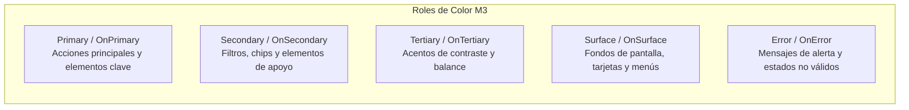
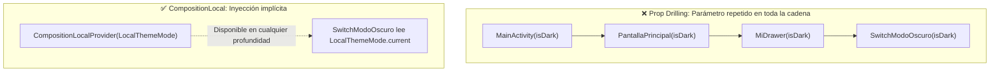
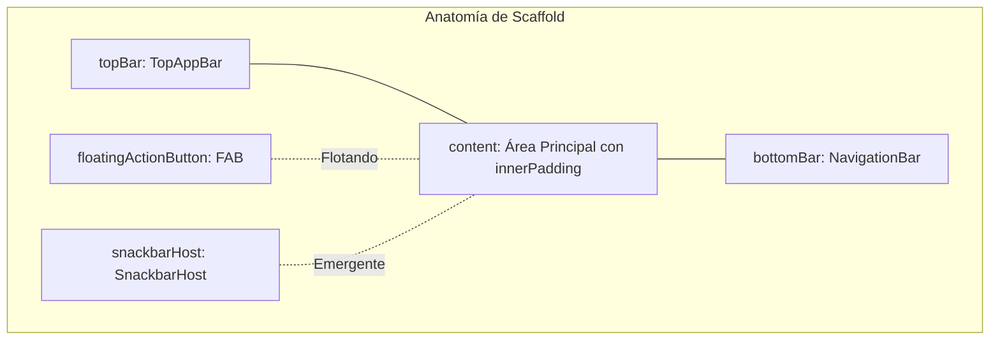
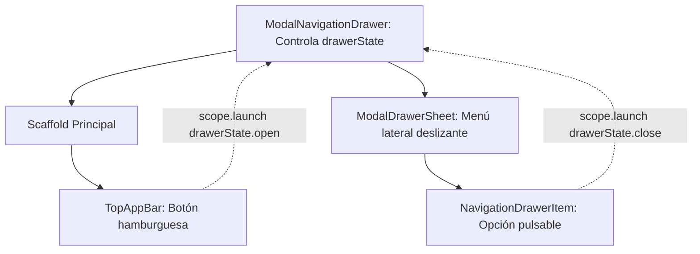

# **3.1 Material Design 3, Theming, Providers y Scaffold**

**Material Design 3 (M3)**, también conocido como *Material You*, es el sistema de diseño visual oficial de Google para Android. Proporciona una guía integral de estilos, componentes y patrones ergonómicos pensados para crear aplicaciones consistentes, accesibles y estéticamente atractivas.

En este apartado aprenderemos a estructurar pantallas completas utilizando el contenedor maestro **`Scaffold`**, a controlar la apariencia global mediante el sistema de temas y **Providers**, y a implementar el clásico **menú hamburguesa** con **`ModalNavigationDrawer`**.

---

## 1. El Sistema de Diseño Material 3: Arquitectura y Theming

En el ecosistema de Android con Jetpack Compose, el sistema de **Theming** de [Material Design 3 (M3)](https://m3.material.io/) es la piedra angular de la coherencia visual. Un "Theme" (tema) no es simplemente una paleta estética de colores; es un sistema integral que encapsula **colores semánticos**, **escalas tipográficas** y **geometría de formas (shapes)** para dotar a la aplicación de una identidad reconocible, accesible y adaptativa tanto en modo claro como en modo oscuro.

### 1.1. La Anatomía de un Tema en Compose

Al crear un proyecto moderno de Compose, se genera automáticamente el paquete `ui.theme` con los pilares del diseño:

- **`Color.kt`:** Define los valores hexadecimales fijos (`Color(0xFF...)`) que servirán de base para las tonalidades.

- **`Type.kt`:** Configura la escala tipográfica (`Typography`), asignando familias de fuentes, tamaños (`sp`) e interlineados a los distintos roles de texto.

- **`Shapes.kt` (o integrado en `Theme.kt`):** Define los radios de curvatura (`RoundedCornerShape`) para componentes pequeños, medianos y grandes.

- **`Theme.kt`:** Es el archivo central donde se conectan los tres pilares mediante el composable raíz `MaterialTheme`.

```kotlin
// ui/theme/Theme.kt
@Composable
fun MiAppTheme(
    darkTheme: Boolean = isSystemInDarkTheme(),
    dynamicColor: Boolean = true, // Color dinámico en Android 12+
    content: @Composable () -> Unit
) {
    val colorScheme = when {
        dynamicColor && Build.VERSION.SDK_INT >= Build.VERSION_CODES.S -> {
            val context = LocalContext.current
            if (darkTheme) dynamicDarkColorScheme(context) else dynamicLightColorScheme(context)
        }
        darkTheme -> DarkColorScheme
        else -> LightColorScheme
    }

    MaterialTheme(
        colorScheme = colorScheme,
        typography = Typography,
        shapes = Shapes,
        content = content
    )
}
```

Al envolver la jerarquía gráfica con `MiAppTheme`, cualquier composable estándar de Material (`Text`, `Button`, `Card`, `Scaffold`) heredará automáticamente estos atributos sin necesidad de estilarlos manualmente uno a uno.

---

### 1.2. Esquemas de Color (`ColorScheme`) y Roles Semánticos

Material 3 no utiliza nombres de color descriptivos directos (como "azul" o "rojo"), sino **roles semánticos** que indican la función del elemento en la interfaz:



#### Reglas de Contraste y "On-Colors"
Para asegurar la accesibilidad y el contraste mínimo exigido (WCAG), cada rol de fondo viene acompañado de su color de contenido opuesto (*on-color*):

- Si el contenedor o fondo es `primary`, cualquier icono o texto interior **debe** pintarse con `onPrimary`.
- Si una tarjeta usa `surfaceVariant`, su contenido debe utilizar `onSurfaceVariant`.
- Si un banner o alerta usa `errorContainer`, su texto debe usar `onErrorContainer`.

---

### 1.3. Personalización de Paletas en `Color.kt` y `Theme.kt`

Para crear una marca personalizada, definimos los colores base y los asignamos a `lightColorScheme` y `darkColorScheme`:

```kotlin
// ui/theme/Color.kt
val AzulPrimario80 = Color(0xFFA5C8FF)
val AzulSecundario80 = Color(0xFFBDC7DC)
val AzulPrimario40 = Color(0xFF005EB4)
val AzulSecundario40 = Color(0xFF555F71)

// ui/theme/Theme.kt
private val DarkColorScheme = darkColorScheme(
    primary = AzulPrimario80,
    secondary = AzulSecundario80,
    background = Color(0xFF1A1C1E),
    surface = Color(0xFF1A1C1E)
)

private val LightColorScheme = lightColorScheme(
    primary = AzulPrimario40,
    secondary = AzulSecundario40,
    background = Color(0xFFFDFBFF),
    surface = Color(0xFFFDFBFF)
)
```

---

### 1.4. Color Dinámico ("Material You") en Android 12+

En dispositivos con Android 12 (API 31) o superior, el sistema operativo permite extraer tonalidades del fondo de pantalla elegido por el usuario para generar una paleta única y personal.

Compose soporta esta capacidad de forma nativa a través de:

- **`dynamicLightColorScheme(context)`:** Genera el esquema claro derivado del wallpaper.
- **`dynamicDarkColorScheme(context)`:** Genera el esquema oscuro adaptado al usuario.

Si el dispositivo ejecuta una versión anterior a Android 12 o si la app prefiere preservar estrictamente los colores corporativos, la condición `when` del tema utiliza las paletas estáticas `LightColorScheme` y `DarkColorScheme`.

---

### 1.5. Personalización de Tipografía (`Type.kt`)

Material 3 define una escala tipográfica completa de 15 estilos (`displayLarge`, `headlineMedium`, `titleSmall`, `bodyLarge`, `labelSmall`, etc.).

Para incorporar fuentes personalizadas de la marca (archivos `.ttf` u `.otf` ubicados en `res/font`):

```kotlin
// ui/theme/Type.kt
import androidx.compose.material3.Typography
import androidx.compose.ui.text.TextStyle
import androidx.compose.ui.text.font.Font
import androidx.compose.ui.text.font.FontFamily
import androidx.compose.ui.text.font.FontWeight
import androidx.compose.ui.unit.sp
import com.pmdm.lab.R

val Montserrat = FontFamily(
    Font(R.font.montserrat_regular, FontWeight.Normal),
    Font(R.font.montserrat_bold, FontWeight.Bold)
)

val Typography = Typography(
    titleLarge = TextStyle(
        fontFamily = Montserrat,
        fontWeight = FontWeight.Bold,
        fontSize = 22.sp,
        lineHeight = 28.sp
    ),
    bodyLarge = TextStyle(
        fontFamily = Montserrat,
        fontWeight = FontWeight.Normal,
        fontSize = 16.sp,
        lineHeight = 24.sp
    )
)
```

---

### 1.6. Personalización de Formas (`Shapes.kt`)

La geometría de los componentes define el carácter visual de la aplicación. M3 clasifica los radios de curvatura en tres rangos estándar:

```kotlin
// ui/theme/Shapes.kt
import androidx.compose.foundation.shape.RoundedCornerShape
import androidx.compose.material3.Shapes
import androidx.compose.ui.unit.dp

val Shapes = Shapes(
    small = RoundedCornerShape(4.dp),    // Botones pequeños, chips
    medium = RoundedCornerShape(12.dp),  // Tarjetas (Cards), diálogos
    large = RoundedCornerShape(24.dp)    // Modal Bottom Sheets, cajones
)
```

---

### 1.7. Material Theme Builder y Recursos Oficiales

Para diseñar una paleta completa accesible sin calcular los tonos manualmente, Google proporciona la herramienta oficial **[Material Theme Builder](https://m3.material.io/theme-builder)** (disponible en la web y como plugin de Figma).

<figure style="text-align: center;">
  
  <figcaption>Generación de esquemas completos y roles semánticos a partir de un único color semilla.</figcaption>
</figure>

Permite introducir un **color semilla** (*seed color*) corporativo y exporta directamente los archivos `Color.kt` y `Theme.kt` listos para ser pegados en el proyecto.

!!! tip "Codelab recomendado de profundización"

    Para practicar la personalización guiada de colores, fuentes y formas paso a paso, consulta el Codelab oficial:
    
    - [Temas de Material con Compose (Android Developers)](https://developer.android.com/codelabs/basic-android-kotlin-compose-material-theming?hl=es-419)

---

## 2. Inyección de Datos Globales en Compose: Providers y CompositionLocal

Uno de los problemas más habituales al diseñar una interfaz ocurre cuando un elemento situado en un nivel profundo del árbol (por ejemplo, un botón dentro de una tarjeta dentro de una lista) necesita un dato global, como el contexto de Android o el modo de tema activo.

El enfoque ingenuo consistiría en pasar ese dato como parámetro a través de todas las funciones intermedias. Este antipatrón se denomina **Prop Drilling** (*perforación de propiedades*) y vuelve el código frágil y difícil de mantener.



### 2.1. ¿Cómo Funciona `CompositionLocal`?

Compose utiliza internamente `CompositionLocal` para propagar datos hacia abajo sin requerir parámetros explícitos:

- **`LocalContext.current`:** Entrega el contexto de la Activity actual a cualquier composable.
- **`MaterialTheme.colorScheme`:** Permite que cualquier `Text` o `Card` conozca los colores actuales sin pasárselos a mano.

### 2.2. Ejemplo Práctico: Control del Modo Oscuro Global

Podemos crear nuestro propio `CompositionLocal` para que cualquier pantalla o menú pueda consultar o alternar el Modo Oscuro de la app:

```kotlin
import androidx.compose.runtime.compositionLocalOf

// 1. Declaramos la clave del Provider
val LocalThemeMode = compositionLocalOf { false }

// 2. En MainActivity inyectamos el valor para todo el árbol
class MainActivity : ComponentActivity() {
    override fun onCreate(savedInstanceState: Bundle?) {
        super.onCreate(savedInstanceState)
        setContent {
            var modoOscuro by rememberSaveable { mutableStateOf(false) }

            CompositionLocalProvider(LocalThemeMode provides modoOscuro) {
                MiAppTheme(darkTheme = modoOscuro) {
                    // Todas las pantallas hijas pueden leer LocalThemeMode.current
                    LabApp(onToggleDark = { modoOscuro = !modoOscuro })
                }
            }
        }
    }
}
```

??? info "Profundización: Conceptos Clave de CompositionLocal y Enlaces Oficiales"

    `CompositionLocal` es el mecanismo de bajo nivel que permite a Jetpack Compose proporcionar datos transversales a través del árbol de la composición sin obligarnos a declararlos como argumentos en cada función.

    #### ¿Cómo se crean los CompositionLocals?
    Compose ofrece dos constructores según el impacto que deseamos en la recomposición:

    - **`compositionLocalOf { ... }`:**
      Cuando el valor inyectado cambia, Compose recompone **únicamente los componibles que leen explícitamente el valor mediante `.current`**. Es la opción recomendada para datos que pueden cambiar durante el uso de la aplicación (como alternar entre Modo Claro y Modo Oscuro, o cambiar el idioma).

    - **`staticCompositionLocalOf { ... }`:**
      Compose no realiza un rastreo granular de qué componentes leen el dato. Si el valor cambia, **se recompone todo el subárbol hijo completo**. Es mucho más eficiente en memoria y velocidad, pero **solo debe utilizarse para valores estáticos que rara vez o nunca cambian** tras iniciarse la aplicación (por ejemplo, constantes de diseño de la marca).

    #### Buenas Prácticas según Google: ¿Cuándo usarlo y cuándo no?
    
    - **Cuándo es recomendable:** Para datos universales que afectan a la interfaz gráfica y que una enorme cantidad de componibles necesitan consultar (colores de tema, estilos de texto, densidad de pantalla o gestores de foco).
    - **Cuándo es un antipatrón:** No debe utilizarse para pasar modelos de datos específicos (como el juego actual o la lista de tareas) ni dependencias que solo consume un componente concreto. En esos casos, el paso explícito de parámetros o el uso de un `ViewModel` garantiza un código mucho más claro y testeable.

    #### 📖 Enlaces a la Documentación Oficial de Android
    
    - [Guía Oficial: Datos con ámbito local mediante CompositionLocal (Android Developers)](https://developer.android.com/develop/ui/compose/compositionlocal?hl=es-419): Guía completa con ejemplos de diseño, diagramas de recomposición y alternativas recomendadas.
    - [Referencia de la API de CompositionLocalProvider (Android Developers)](https://developer.android.com/reference/kotlin/androidx/compose/runtime/package-summary#CompositionLocalProvider(kotlin.Array,kotlin.Function0)): Especificación técnica de la función y ejemplos de uso.
    - [Manual de referencia del módulo: Contexto, CompositionLocal y Efectos Secundarios](../00-android/00-compose/27-compositionlocal-contexto-efectos.md).

---

## 3. Estructura de Pantalla: El Contenedor `Scaffold`

El composable **`Scaffold`** implementa la estructura visual estándar de Material Design. Gestiona automáticamente la posición de las barras de aplicación, botones de acción flotantes y avisos temporales.



### 3.1. Parámetros Fundamentales del `Scaffold`

- **`topBar`:** Barra superior de la pantalla.
- **`bottomBar`:** Barra de navegación inferior o barra de acciones.
- **`floatingActionButton`:** Botón circular destacado de acción primaria.
- **`snackbarHost`:** Contenedor de notificaciones emergentes rápidas.
- **`content`:** Función lambda que recibe un parámetro obligatorio de espaciado: `innerPadding`.

!!! warning "Obligatoriedad de `innerPadding`"

    El contenido que dibujes dentro de la lambda `content` de un `Scaffold` **debe aplicar siempre el modificador `Modifier.padding(innerPadding)`**. Si no lo haces, la barra superior o la barra inferior taparán físicamente los primeros y últimos elementos de tu pantalla.

---

## 4. Barras de Aplicación Superiores (`TopAppBar`)

En Material 3 existen variantes de barras según la jerarquía de la pantalla:

- **`TopAppBar` (Pequeña):** Estándar para pantallas de detalle o secundarias.
- **`MediumTopAppBar` / `LargeTopAppBar`:** Títulos prominentes que se comprimen con animación al hacer scroll.

```kotlin
@OptIn(ExperimentalMaterial3Api::class)
@Composable
fun BarraSuperior(
    titulo: String,
    onMenuClick: () -> Unit,
    onAccionBuscar: () -> Unit
) {
    TopAppBar(
        title = { Text(titulo) },
        navigationIcon = {
            IconButton(onClick = onMenuClick) {
                Icon(Icons.Filled.Menu, contentDescription = "Abrir menú lateral")
            }
        },
        actions = {
            IconButton(onClick = onAccionBuscar) {
                Icon(Icons.Filled.Search, contentDescription = "Buscar")
            }
        },
        colors = TopAppBarDefaults.topAppBarColors(
            containerColor = MaterialTheme.colorScheme.primaryContainer,
            titleContentColor = MaterialTheme.colorScheme.onPrimaryContainer
        )
    )
}
```

??? example "🔍 Ver implementación en el showroom: `Material3_example`"

    - **Ficheros de referencia:**  
      - `com.pmdm.mt3.components.AppBars.SmallTopAppBarScreen.kt`
      - `com.pmdm.mt3.components.AppBars.MediumTopAppBarScreen.kt`
      - `com.pmdm.mt3.components.AppBars.LargeTopAppBarScreen.kt`
    - **Selector en `MainActivity.kt`:** Configura `Screen.SmallTopAppBar` para ver la barra en acción.

---

## 5. Notificaciones Temporales con `Snackbar`

Los Snackbars muestran avisos breves en la parte inferior de la pantalla sin bloquear la interacción del usuario. En Compose se gestionan mediante un **`SnackbarHostState`** y una corrutina:

```kotlin
@Composable
fun PantallaConAviso() {
    val snackbarHostState = remember { SnackbarHostState() }
    val scope = rememberCoroutineScope()

    Scaffold(
        snackbarHost = { SnackbarHost(hostState = snackbarHostState) }
    ) { innerPadding ->
        Button(
            modifier = Modifier.padding(innerPadding),
            onClick = {
                scope.launch {
                    val resultado = snackbarHostState.showSnackbar(
                        message = "Archivo eliminado",
                        actionLabel = "Deshacer",
                        duration = SnackbarDuration.Short
                    )
                    if (resultado == SnackbarResult.ActionPerformed) {
                        // El usuario pulsó Deshacer
                    }
                }
            }
        ) {
            Text("Eliminar elemento")
        }
    }
}
```

??? example "🔍 Ver implementación en el showroom: `Material3_example`"

    - **Fichero de referencia:** `com.pmdm.mt3.components.Snackbar.SnackbarBasicScreen.kt`
    - **Selector en `MainActivity.kt`:** Configura `Screen.SnackbarBasic`.

---

## 6. El Menú Hamburguesa con `ModalNavigationDrawer`

El menú lateral (*Drawer*) es el patrón más extendido en Android para navegar entre secciones principales de una app.

En Material 3 se produce un **cambio de arquitectura clave**: el `Scaffold` ya no contiene el Drawer. En su lugar, el **`ModalNavigationDrawer` es el contenedor padre que envuelve al `Scaffold`**.



### 6.1. Componentes del Menú Lateral
1. **`ModalNavigationDrawer`:** Gestiona el estado de apertura y cierre mediante `rememberDrawerState(DrawerValue.Closed)`.
2. **`ModalDrawerSheet`:** Es la superficie visual (el "panel") que se desliza desde la izquierda.
3. **`NavigationDrawerItem`:** Cada una de las opciones del menú. Acepta icono, texto, estado de selección (`selected`) y la acción al pulsar (`onClick`).

### 6.2. Implementación Completa del Patrón Drawer

```kotlin
@OptIn(ExperimentalMaterial3Api::class)
@Composable
fun PantallaConDrawer(
    opcionActual: String,
    onSeleccionarOpcion: (String) -> Unit
) {
    // 1. Estado de apertura/cierre del menú
    val drawerState = rememberDrawerState(initialValue = DrawerValue.Closed)
    // 2. Scope de corrutina para animar la apertura/cierre
    val scope = rememberCoroutineScope()

    ModalNavigationDrawer(
        drawerState = drawerState,
        drawerContent = {
            ModalDrawerSheet {
                Spacer(modifier = Modifier.height(16.dp))
                Text(
                    text = "Mi Aplicación",
                    style = MaterialTheme.typography.titleLarge,
                    modifier = Modifier.padding(16.dp)
                )
                Divider(modifier = Modifier.padding(vertical = 8.dp))

                NavigationDrawerItem(
                    icon = { Icon(Icons.Filled.Home, contentDescription = null) },
                    label = { Text("Inicio") },
                    selected = opcionActual == "Inicio",
                    onClick = {
                        scope.launch { drawerState.close() }
                        onSeleccionarOpcion("Inicio")
                    },
                    modifier = Modifier.padding(NavigationDrawerItemDefaults.ItemPadding)
                )

                NavigationDrawerItem(
                    icon = { Icon(Icons.Filled.Settings, contentDescription = null) },
                    label = { Text("Ajustes") },
                    selected = opcionActual == "Ajustes",
                    onClick = {
                        scope.launch { drawerState.close() }
                        onSeleccionarOpcion("Ajustes")
                    },
                    modifier = Modifier.padding(NavigationDrawerItemDefaults.ItemPadding)
                )
            }
        }
    ) {
        // Contenido principal envuelto en el Scaffold
        Scaffold(
            topBar = {
                TopAppBar(
                    title = { Text(opcionActual) },
                    navigationIcon = {
                        IconButton(onClick = { scope.launch { drawerState.open() } }) {
                            Icon(Icons.Filled.Menu, contentDescription = "Abrir menú hamburguesa")
                        }
                    }
                )
            }
        ) { innerPadding ->
            Box(modifier = Modifier.fillMaxSize().padding(innerPadding)) {
                Text(
                    text = "Contenido de la pantalla: $opcionActual",
                    modifier = Modifier.align(Alignment.Center)
                )
            }
        }
    }
}
```

??? example "🔍 Ver implementación en el showroom: `Material3_example`"

    - **Fichero de referencia:** `com.pmdm.mt3.components.Scaffold.ScaffoldWithDrawerScreen.kt`
    - **Selector en `MainActivity.kt`:** Configura `Screen.ScaffoldWithDrawer`.
    - **Puntos clave explicados en el archivo:**
      - Observa cómo `scope.launch { drawerState.open() }` se invoca en el icono `Menu` de la barra superior.
      - Fíjate en cómo al pulsar cualquier `NavigationDrawerItem` se ejecuta primero `drawerState.close()` para cerrar suavemente el menú antes de cambiar de sección.
