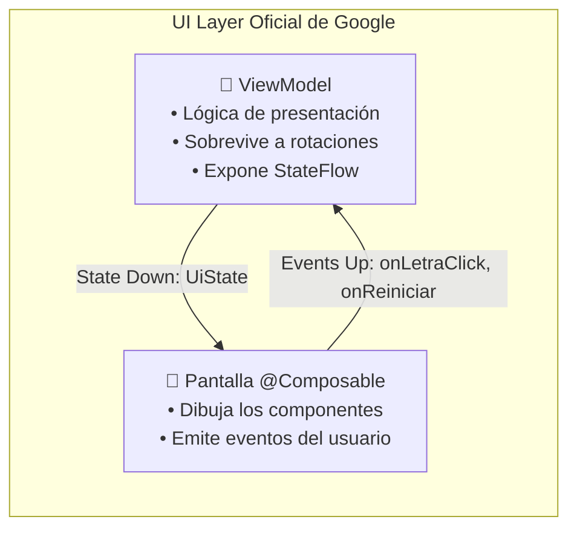
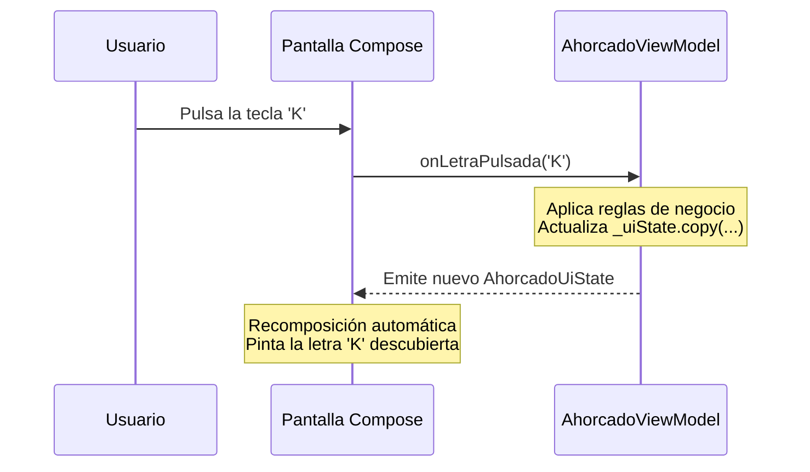

# **3.4 Capa de Interfaz (UI): ViewModel, UiState y UDF**

A medida que una aplicación crece, mantener el estado y las operaciones de negocio directamente dentro de funciones `@Composable` mediante llamadas a `remember` se vuelve inasumible. Mezclar la lógica de la pantalla con el dibujo de los botones genera código difícil de depurar, propenso a recomposiciones infinitas y prácticamente imposible de probar con pruebas automatizadas.

Para resolver este desafío, la arquitectura recomendada por Google establece una separación clara en la **Capa de Interfaz (*UI Layer*)**, compuesta por dos elementos coordinados: los **Elementos de la UI (Composables)** y el **Titular de Estado (*State Holder* o `ViewModel`)**.

---

## 1. El Rol del `ViewModel` en la Arquitectura Moderna

El **`ViewModel`** es una clase de la librería Android Jetpack (`androidx.lifecycle.ViewModel`) diseñada para encapsular la lógica de presentación y gestionar el estado que necesita una pantalla.



### 1.1. Supervivencia ante Cambios de Configuración
La mayor ventaja del `ViewModel` es su ciclo de vida especializado:
- Cuando el usuario rota el teléfono o cambia el modo oscuro, la `ComponentActivity` se destruye y se vuelve a crear.
- **El `ViewModel` no se destruye.** La instancia existente se retiene en memoria y se reconecta automáticamente a la nueva Activity, manteniendo todos los datos de la partida o del formulario intactos sin necesidad de serializarlos manualmente.
- Solo se destruye cuando la pantalla se cierra definitivamente, invocando su método `onCleared()`.

---

## 2. Modelado Inmutable del Estado: `UiState`

Para que la interfaz de usuario sea predecible, toda la información que necesita pintar una pantalla debe agruparse en una única estructura de datos inmutable: una **`data class`** que represente el estado completo de la pantalla (*Single Source of Truth*).

### 2.1. Ejemplo: Modelado de Estado para un Juego
Tomemos como referencia el juego de **El Ahorcado** que resolvimos en el bloque de Kotlin:

```kotlin
data class AhorcadoUiState(
    val palabraOculta: String = "KOTLIN",
    val letrasAdivinadas: Set<Char> = emptySet(),
    val vidasRestantes: Int = 6,
    val vidasMaximas: Int = 6,
    val juegoTerminado: Boolean = false,
    val haGanado: Boolean = false
) {
    // Propiedad calculada: palabra con guiones para mostrar en pantalla (ej: "K _ T L _ N")
    val palabraParaMostrar: String
        get() = palabraOculta.map { letra ->
            if (letrasAdivinadas.contains(letra)) letra else '_'
        }.joinToString(" ")
}
```

---

## 3. Reactividad con `StateFlow` y el Patrón UDF

El **Flujo Unidireccional de Datos (*Unidirectional Data Flow - UDF*)** es el principio rector de las aplicaciones modernas:
1. **El Estado Desciende (*State Down*):** El `ViewModel` expone un flujo reactivo inmutable (`StateFlow<UiState>`). Los componibles se suscriben a él y dibujan la interfaz según los valores recibidos.
2. **Los Eventos Ascienden (*Events Up*):** La interfaz de usuario nunca modifica los datos directamente. Cuando el usuario pulsa un botón, emite un evento hacia el `ViewModel` invocando una función (`onProbarLetra('A')`).



### 3.1. Implementación del ViewModel

```kotlin
package com.dam.pmdmlab.ui.retos.ahorcado

import androidx.lifecycle.ViewModel
import kotlinx.coroutines.flow.MutableStateFlow
import kotlinx.coroutines.flow.StateFlow
import kotlinx.coroutines.flow.asStateFlow
import kotlinx.coroutines.flow.update

class AhorcadoViewModel : ViewModel() {

    // 1. Estado mutable privado (solo modificable dentro del ViewModel)
    private val _uiState = MutableStateFlow(AhorcadoUiState())

    // 2. Estado público inmutable (solo lectura para la interfaz)
    val uiState: StateFlow<AhorcadoUiState> = _uiState.asStateFlow()

    fun onProbarLetra(letra: Char) {
        val estadoActual = _uiState.value
        if (estadoActual.juegoTerminado || estadoActual.letrasAdivinadas.contains(letra)) return

        val nuevasLetras = estadoActual.letrasAdivinadas + letra
        val acierto = estadoActual.palabraOculta.contains(letra)
        val nuevasVidas = if (acierto) estadoActual.vidasRestantes else estadoActual.vidasRestantes - 1

        val victoria = estadoActual.palabraOculta.all { nuevasLetras.contains(it) }
        val derrota = nuevasVidas <= 0

        // Actualizamos el estado con una copia inmutable
        _uiState.update { anterior ->
            anterior.copy(
                letrasAdivinadas = nuevasLetras,
                vidasRestantes = nuevasVidas,
                juegoTerminado = victoria || derrota,
                haGanado = victoria
            )
        }
    }

    fun onReiniciarPartida() {
        _uiState.value = AhorcadoUiState(palabraOculta = "COMPOSE")
    }
}
```

---

## 4. Consumo del ViewModel en Compose

Para conectar el ViewModel con el árbol de Compose se utiliza la función **`viewModel()`** de la librería `androidx.lifecycle:lifecycle-viewmodel-compose`:

```kotlin
import androidx.compose.runtime.Composable
import androidx.compose.runtime.collectAsState
import androidx.compose.runtime.getValue
import androidx.lifecycle.viewmodel.compose.viewModel

// 1. Pantalla Contenedora (Stateful Screen)
@Composable
fun AhorcadoScreen(
    onBack: () -> Unit,
    viewModel: AhorcadoViewModel = viewModel() // Inyección automática del ViewModel
) {
    // Nos suscribimos reactivamente al StateFlow del ViewModel
    val state by viewModel.uiState.collectAsState()

    // Pasamos el estado inmutable y las funciones al componente de presentación
    AhorcadoContent(
        state = state,
        onLetraClick = { letra -> viewModel.onProbarLetra(letra) },
        onReiniciar = { viewModel.onReiniciarPartida() },
        onBack = onBack
    )
}
```

### 4.2. Componente de Presentación (Stateless Content)
Al aplicar esta separación, el componente visual `AhorcadoContent` no depende del ciclo de vida de Android ni del ViewModel, lo que permite previsualizarlo inmediatamente en IntelliJ IDEA con `@Preview` pasando estados inventados:

```kotlin
// 2. Componente de Presentación (Stateless Content)
@Composable
fun AhorcadoContent(
    state: AhorcadoUiState,
    onLetraClick: (Char) -> Unit,
    onReiniciar: () -> Unit,
    onBack: () -> Unit,
    modifier: Modifier = Modifier
) {
    Scaffold(modifier = modifier) { innerPadding ->
        Column(
            modifier = Modifier.fillMaxSize().padding(innerPadding),
            horizontalAlignment = Alignment.CenterHorizontally
        ) {
            Text(
                text = state.palabraParaMostrar,
                style = MaterialTheme.typography.displayMedium
            )
            Text(text = "Vidas restantes: ${state.vidasRestantes}/${state.vidasMaximas}")

            // Teclado visual con las letras
            // ...
        }
    }
}

// Vista previa inmediata con estado mock (ej: partida ganada)
@Preview(showBackground = true)
@Composable
private fun AhorcadoPreviewVictoria() {
    MaterialTheme {
        AhorcadoContent(
            state = AhorcadoUiState(
                palabraOculta = "KOTLIN",
                letrasAdivinadas = setOf('K', 'O', 'T', 'L', 'I', 'N'),
                juegoTerminado = true,
                haGanado = true
            ),
            onLetraClick = {},
            onReiniciar = {},
            onBack = {}
        )
    }
}
```
