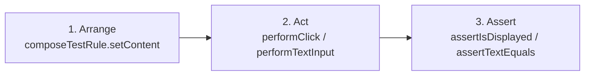

# **3.5 Testing Automatizado de UI en Compose**

En el bloque de Kotlin aprendimos a construir pruebas unitarias con JUnit para verificar que la lógica pura de negocio y los algoritmos funcionaban de acuerdo con sus especificaciones. 

En **Jetpack Compose**, esa misma filosofía de desarrollo guiado por pruebas se traslada directamente a la interfaz visual. Gracias a la arquitectura declarativa y al árbol de semántica, es posible escribir pruebas automatizadas rápidas que verifiquen si un componente visual se dibuja correctamente, si un formulario muestra errores ante entradas inválidas o si al pulsar un botón la pantalla reacciona como se espera.

---

## 1. Configuración del Entorno de Pruebas

Para ejecutar pruebas de interfaz en Compose necesitamos incorporar las librerías oficiales de testing en nuestro proyecto.

### 1.1. Catálogo de Versiones (`gradle/libs.versions.toml`)
Asegúrate de tener declaradas las siguientes dependencias en la sección `[libraries]`:

```toml
[libraries]
androidx-ui-test-junit4 = { group = "androidx.compose.ui", name = "ui-test-junit4" }
androidx-ui-test-manifest = { group = "androidx.compose.ui", name = "ui-test-manifest" }
```

### 1.2. Módulo de la Aplicación (`app/build.gradle.kts`)
En el bloque de dependencias:

```kotlin
dependencies {
    // ... dependencias principales de Compose

    // Dependencia para pruebas instrumentadas en src/androidTest/
    androidTestImplementation(libs.androidx.ui.test.junit4)
    debugImplementation(libs.androidx.ui.test.manifest)
}
```

---

## 2. La Regla de Test: `createComposeRule()`

Para probar una pantalla o componente de Compose de forma aislada no necesitamos iniciar la `MainActivity` completa. La librería nos proporciona **`createComposeRule()`**, que levanta un lienzo ligero y limpio donde podemos inyectar cualquier función `@Composable`.

```kotlin
import androidx.compose.ui.test.junit4.createComposeRule
import org.junit.Rule
import org.junit.Test

class MiComponenteTest {

    // 1. Declaramos la regla oficial de Compose para JUnit
    @get:Rule
    val composeTestRule = createComposeRule()

    @Test
    fun alIniciar_muestraMensajeEsperado() {
        // 2. Cargamos el Composable que deseamos verificar
        composeTestRule.setContent {
            MiComponenteSaludo(nombre = "Ada")
        }

        // 3. Comprobaciones y aserciones
        // ...
    }
}
```

---

## 3. El Árbol Semántico y la Búsqueda de Nodos

Compose no busca elementos inspeccionando píxeles ni buscando identificadores XML tipo `R.id.boton`. En su lugar, analiza el **Árbol de Semántica**, que contiene el significado accesible de cada elemento visible en pantalla.

### 3.1. Localizadores Principales
- **Por texto visible:**  
  `composeTestRule.onNodeWithText("Guardar")`
- **Por descripción de accesibilidad:**  
  `composeTestRule.onNodeWithContentDescription("Abrir menú lateral")`
- **Por etiqueta de pruebas personalizada (`testTag`):**  
  Cuando un elemento no tiene texto estático (como un campo de texto vacío o un icono genérico), podemos asignarle una etiqueta única mediante el modificador `Modifier.testTag("tag_identificador")` y buscarlo con:  
  `composeTestRule.onNodeWithTag("tag_identificador")`

---

## 4. Acciones y Aserciones de Interfaz

Una prueba típica de interfaz sigue el patrón canónico **Arrange - Act - Assert**:



### 4.1. Simulación de Acciones del Usuario
- **Hacer clic / pulsar:**  
  `composeTestRule.onNodeWithText("Iniciar Partida").performClick()`
- **Escribir en un campo de texto:**  
  `composeTestRule.onNodeWithTag("campo_email").performTextInput("alumno@fp.es")`
- **Limpiar el texto existente:**  
  `composeTestRule.onNodeWithTag("campo_email").performTextClearance()`

### 4.2. Aserciones de Comprobación
- **Verificar visibilidad:**  
  `composeTestRule.onNodeWithText("¡Has ganado!").assertIsDisplayed()`
- **Verificar ausencia:**  
  `composeTestRule.onNodeWithText("Error").assertDoesNotExist()`
- **Verificar estado de habilitación:**  
  `composeTestRule.onNodeWithText("Comprar").assertIsEnabled()`  
  `composeTestRule.onNodeWithText("Comprar").assertIsNotEnabled()`

---

## 5. Ejemplo Práctico: Test de Interfaz para el Ahorcado

Vamos a escribir una prueba automatizada que valide el componente visual `AhorcadoContent` desarrollado en el apartado anterior.

Ubicación del archivo: `app/src/androidTest/java/com/dam/pmdmlab/AhorcadoContentTest.kt`:

```kotlin
package com.dam.pmdmlab

import androidx.compose.ui.test.assertIsDisplayed
import androidx.compose.ui.test.junit4.createComposeRule
import androidx.compose.ui.test.onNodeWithText
import androidx.compose.ui.test.performClick
import com.dam.pmdmlab.ui.retos.ahorcado.AhorcadoContent
import com.dam.pmdmlab.ui.retos.ahorcado.AhorcadoUiState
import org.junit.Assert.assertEquals
import org.junit.Rule
import org.junit.Test

class AhorcadoContentTest {

    @get:Rule
    val composeTestRule = createComposeRule()

    @Test
    fun alIniciarPartida_muestraVidasCorrectasYLetrasOcultas() {
        val estadoInicial = AhorcadoUiState(
            palabraOculta = "KOTLIN",
            vidasRestantes = 6,
            vidasMaximas = 6
        )

        composeTestRule.setContent {
            AhorcadoContent(
                state = estadoInicial,
                onLetraClick = {},
                onReiniciar = {},
                onBack = {}
            )
        }

        // Verificamos que se muestra el contador de vidas
        composeTestRule.onNodeWithText("Vidas restantes: 6/6").assertIsDisplayed()

        // Verificamos que la palabra se muestra con 6 guiones
        composeTestRule.onNodeWithText("_ _ _ _ _ _").assertIsDisplayed()
    }

    @Test
    fun alPulsarLetra_emiteEventoConLaLetraCorrecta() {
        var letraPulsadaCapturada = ' '

        composeTestRule.setContent {
            AhorcadoContent(
                state = AhorcadoUiState(),
                onLetraClick = { letra -> letraPulsadaCapturada = letra },
                onReiniciar = {},
                onBack = {}
            )
        }

        // Buscamos el botón de la letra 'A' en el teclado visual y lo pulsamos
        composeTestRule.onNodeWithText("A").performClick()

        // Verificamos que la lambda se ejecutó con el argumento 'A'
        assertEquals('A', letraPulsadaCapturada)
    }

    @Test
    fun siPartidaTerminada_muestraAvisoDeFinDeJuego() {
        val estadoVictoria = AhorcadoUiState(
            juegoTerminado = true,
            haGanado = true
        )

        composeTestRule.setContent {
            AhorcadoContent(
                state = estadoVictoria,
                onLetraClick = {},
                onReiniciar = {},
                onBack = {}
            )
        }

        // Verificamos que el diálogo de victoria se hace visible en pantalla
        composeTestRule.onNodeWithText("¡Felicidades, has ganado!").assertIsDisplayed()
    }
}
```

!!! tip "Ejecutar las pruebas en IntelliJ IDEA"

    Para ejecutar estas pruebas instrumentadas:
    1. Asegúrate de tener arrancado el emulador AVD o conectado tu teléfono móvil.
    2. En el archivo `AhorcadoContentTest.kt`, pulsa sobre el icono verde de **Play** situado a la izquierda de la clase o de cada `@Test`.
    3. IntelliJ IDEA compilará el módulo de test y mostrará el árbol de ejecución con los resultados en verde.
