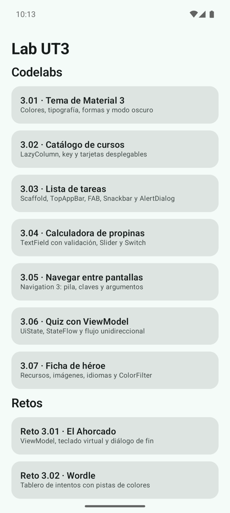
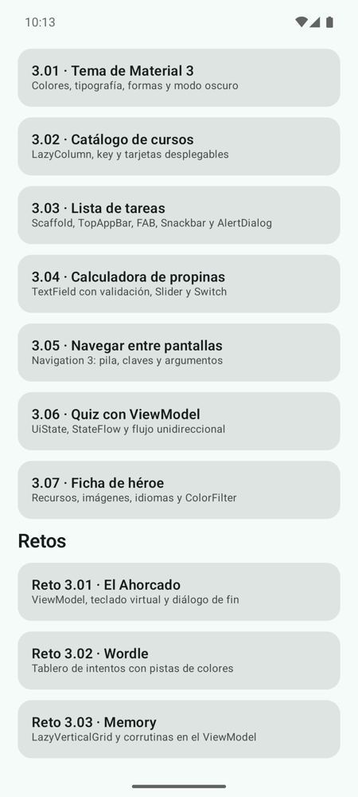
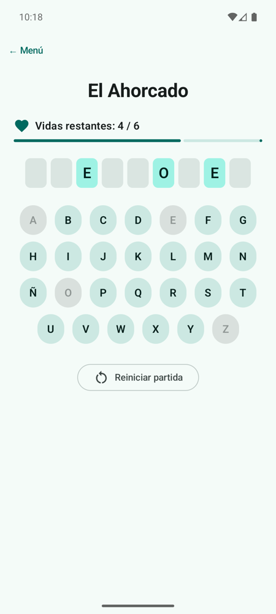
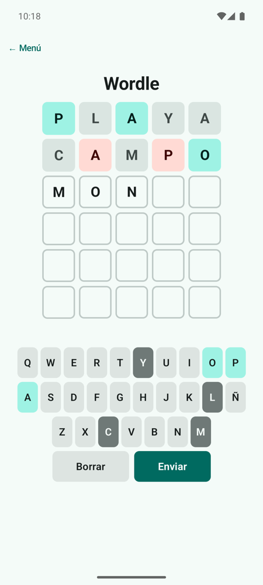

# **3.6 Laboratorio de Prácticas y Codelabs**

El laboratorio de la UT3 es, como el de la UT2, **una sola app Android que crece codelab a codelab**. Parte de la plantilla del curso con el menú del laboratorio y, en siete codelabs guiados, añade las piezas de una app moderna: un tema propio de Material 3, listas, la estructura de `Scaffold`, formularios, navegación con Navigation 3, un ViewModel y recursos traducidos. Después, tres **retos autónomos** te piden construir juegos completos con todo lo aprendido.

El laboratorio se divide en dos bloques:

1. **Codelabs guiados:** paso a paso, con la teoría, el código completo y un tag de Git con la solución.

2. **Retos autónomos:** un enunciado con requisitos que resuelves por tu cuenta.

---

## 1. El Repositorio del Laboratorio

Todo el laboratorio vive en un repositorio de GitHub:

**[github.com/jssdocente/pmdm2627-lab-ut3](https://github.com/jssdocente/pmdm2627-lab-ut3)**

- **Punto de partida:** la plantilla `ProyectoComposeBase` del curso (IntelliJ IDEA 2026.2, AGP 9.1.1, compileSdk 37), con el paquete `com.pmdm.lab.ut3` y el menú del laboratorio ya montado.
- **Dos tags por codelab:** el de inicio (`c3.01-inicio`) y el de fin (`c3.01-fin`). El tag de fin de un codelab es el mismo commit que el de inicio del siguiente.
- **Tags de los retos:** el de inicio (`r3.01-inicio`), con la pantalla provisional y los `TODO`, y, cuando hay solución publicada, el de la solución (`r3.01-solucion`).

| Codelab | Inicio | Fin |
| :--- | :--- | :--- |
| [3.01 · Tema propio de Material 3](./codelabs/01-tema-material3.md) | `c3.01-inicio` | `c3.01-fin` |
| [3.02 · Catálogo de cursos con `LazyColumn`](./codelabs/02-catalogo-lazycolumn.md) | `c3.02-inicio` | `c3.02-fin` |
| [3.03 · Lista de tareas con `Scaffold`](./codelabs/03-tareas-scaffold.md) | `c3.03-inicio` | `c3.03-fin` |
| [3.04 · Calculadora de propinas: formularios](./codelabs/04-propinas-formulario.md) | `c3.04-inicio` | `c3.04-fin` |
| [3.05 · Navegar entre pantallas con Navigation 3](./codelabs/05-navegacion-navigation3.md) | `c3.05-inicio` | `c3.05-fin` |
| [3.06 · Quiz con ViewModel y `StateFlow`](./codelabs/06-quiz-viewmodel.md) | `c3.06-inicio` | `c3.06-fin` |
| [3.07 · Ficha de héroe, recursos e idiomas](./codelabs/07-ficha-heroe-recursos.md) | `c3.07-inicio` | `c3.07-fin` |
| [3.08 · Temporizador Pomodoro](./codelabs/08-temporizador-pomodoro.md) | `c3.08-inicio` | `c3.08-fin` |
| [Reto 3.01 · El Ahorcado](#reto-301-el-ahorcado) | `r3.01-inicio` | `r3.01-solucion` |
| [Reto 3.02 · Wordle](#reto-302-wordle) | `r3.02-inicio` | `r3.02-solucion` |
| [Reto 3.03 · Memory](#reto-303-memory) | `r3.03-inicio` | Sin solución publicada |

### 1.1. Descargarlo con Git (recomendado)

```bash
git clone https://github.com/jssdocente/pmdm2627-lab-ut3.git lab-ut3
cd lab-ut3
git checkout c3.01-inicio      # el punto de partida del primer codelab
git switch -c mi-lab           # tu rama para trabajar
```

Abre la carpeta `lab-ut3` en IntelliJ IDEA (*File › Open…*, la carpeta que contiene `settings.gradle.kts`). La configuración del SDK y del JDK es la misma que la de la plantilla; si algo falla, consulta su README.

Trabaja siempre en **tu rama**. Así, para cada codelab tienes dos opciones:

- **Seguir con tu código:** si terminaste el codelab anterior, continúa en tu rama.
- **Partir de la solución:** si te quedaste a medias, crea una rama nueva desde el tag de inicio: `git switch -c mi-lab-3.03 c3.03-inicio`.

Para comparar tu trabajo con la solución de un codelab:

```bash
git diff c3.03-fin            # qué te falta o qué has hecho distinto
```

!!! tip "Tags nuevos"
    Si las soluciones de los retos se publican después de que clonaras el repositorio, descárgalas con `git fetch --tags`.

### 1.2. Sin Git

En la página del repositorio, en **Tags**, cada tag se descarga como `.zip`. Descomprímelo en una ruta corta y sin acentos (por ejemplo `C:\PMDM\lab-ut3`), igual que la plantilla. Para el codelab siguiente, descarga su tag de inicio o sigue trabajando sobre tu carpeta.

---

## 2. Cómo está Organizado el Proyecto

Al terminar el último codelab, el proyecto tiene esta estructura:

```
com.pmdm.lab.ut3/
├── MainActivity.kt            // Scaffold con innerPadding y consumeWindowInsets
├── LabApp.kt                  // PantallaLab + navegación con when
├── codelabs/
│   ├── codelab01_tema/        // Muestrario del tema y modo oscuro               (3.01)
│   ├── codelab02_catalogo/    // Curso, LazyColumn y key                         (3.02)
│   ├── codelab03_tareas/      // Scaffold, Snackbar y AlertDialog                (3.03)
│   ├── codelab04_propinas/    // Formulario validado y state hoisting            (3.04)
│   ├── codelab05_navegacion/  // Claves, pila y NavDisplay                       (3.05)
│   ├── codelab06_quiz/        // UiState, ViewModel y StateFlow                  (3.06)
│   ├── codelab07_heroe/       // Recursos, idiomas y ColorFilter                 (3.07)
│   └── codelab08_pomodoro/    // Job, delay, bloqueo y ciclo de vida
├── retos/
│   ├── reto01_ahorcado/       // domain/ (ya resuelto) y ui/
│   ├── reto02_wordle/
│   └── reto03_memory/
└── ui/
    ├── menu/LabMenuScreen.kt  // Catálogo de pantallas
    └── theme/                 // LabUt3Theme: Color, Type, Shape y Theme        (3.01)
```

La navegación del laboratorio es la misma que construiste en el [Codelab 2.02](../02/codelabs/02-contador-incremental.md#7-paso-4-el-menu-del-laboratorio): `LabApp` guarda en el estado qué pantalla se ve y un `when` decide cuál pintar.

<div style="display: flex; flex-direction: row; justify-content: center; align-items: flex-start; gap: 1.5rem; flex-wrap: wrap; margin: 1.8rem 0;" markdown="1">

<figure style="margin: 0; text-align: center; max-width: 220px;" markdown="1">

{ style="border-radius: 8px; box-shadow: 0 4px 10px rgba(0,0,0,0.15); width: 100%; max-width: 210px;" }

<figcaption style="font-size: 0.85rem; margin-top: 0.5rem; color: var(--md-default-fg-color--light);"><strong>Figura 1:</strong> El menú con los siete codelabs.</figcaption>
</figure>

</div>

<figure class="arq-fig">
--8<-- "docs/temas/03/codelabs/images/lab-navegacion.svg"
<figcaption><code>LabApp</code> guarda qué pantalla se ve; el menú y el botón de volver solo cambian ese estado.</figcaption>
</figure>

**Para añadir una pantalla** al laboratorio (lo harás en cada codelab):

1. Añade una entrada a `enum class PantallaLab` en `LabApp.kt`, con su título y su descripción.

2. Añade su rama al `when` de `LabApp`, envuelta en `PantallaConVolver`.

El menú no se toca: recorre `PantallaLab.entries` y la nueva tarjeta aparece sola.

!!! info "`consumeWindowInsets` en `MainActivity`"
    Las pantallas del laboratorio van dentro del `Scaffold` de `MainActivity`. Desde el Codelab 3.03, muchas tienen además su propio `Scaffold`. `MainActivity` aplica `consumeWindowInsets(innerPadding)` para que los `Scaffold` de dentro sepan que el hueco de las barras del sistema ya está cubierto y no lo repitan.

---

## 3. Los Codelabs Guiados

| Codelab | Qué aprendes | Sesión de clase |
| :--- | :--- | :--- |
| [**3.01 · Tema de Material 3**](./codelabs/01-tema-material3.md) | Roles de color, `ColorScheme` claro y oscuro, `Typography`, `Shapes` y un `MaterialTheme` anidado. | [3.01](./sesiones/s01-tema-scaffold-listas.md) |
| [**3.02 · Catálogo de cursos**](./codelabs/02-catalogo-lazycolumn.md) | `LazyColumn`, `item` e `items`, `key`, `contentPadding`, `mutableStateListOf` y `animateContentSize`. | [3.01](./sesiones/s01-tema-scaffold-listas.md) |
| [**3.03 · Lista de tareas**](./codelabs/03-tareas-scaffold.md) | `Scaffold` con `TopAppBar`, `FloatingActionButton` y `snackbarHost`, `innerPadding`, `AlertDialog` y `Snackbar` con corrutinas. | [3.02](./sesiones/s02-componentes-interactivos.md) |
| [**3.04 · Calculadora de propinas**](./codelabs/04-propinas-formulario.md) | `OutlinedTextField` validado, `KeyboardOptions`, `Slider`, `Switch`, valores derivados y tests de interfaz. | [3.02](./sesiones/s02-componentes-interactivos.md) |
| [**3.05 · Navegar entre pantallas**](./codelabs/05-navegacion-navigation3.md) | Navigation 3: `NavKey`, `rememberNavBackStack`, `NavDisplay`, `entryProvider`, argumentos y volver atrás. | [3.03](./sesiones/s03-navigation3-i.md) y [3.04](./sesiones/s04-navigation3-ii-edge-to-edge.md) |
| [**3.06 · Quiz con ViewModel**](./codelabs/06-quiz-viewmodel.md) | `UiState` inmutable, `ViewModel`, `StateFlow`, `collectAsStateWithLifecycle`, flujo unidireccional y tests del ViewModel. | [3.05](./sesiones/s05-viewmodel-uistate-i.md) |
| [**3.07 · Ficha de héroe**](./codelabs/07-ficha-heroe-recursos.md) | `strings.xml` con huecos y `string-array`, traducción con `values-en`, `Box`, `clip`, `ColorFilter.tint` y `Crossfade`. | — |
| [**3.08 · Temporizador Pomodoro**](./codelabs/08-temporizador-pomodoro.md) | Corrutinas en el ViewModel: `Job`, `delay`, espera con bloqueo, `LifecycleResumeEffect`, `animate*AsState`, `graphicsLayer` y tests con tiempo virtual. | [3.06](./sesiones/s06-tiempo-ciclo-vida.md) |

---

## 4. Retos Autónomos

Los tres retos son **juegos completos** con la arquitectura del Codelab 3.06: un `UiState`, un `ViewModel` con las reglas y una pantalla sin estado que solo pinta y avisa. Parten del laboratorio terminado: en el tag de inicio, cada reto ya tiene su entrada en el menú y su archivo con una pantalla provisional y una lista de `TODO`.

```bash
git switch -c mi-reto-3.01 r3.01-inicio
```

Aquí **no tienes el código resuelto**: diseña la solución tú mismo a partir de la especificación. La solución de referencia del Ahorcado y del Wordle está en los tags `r3.01-solucion` y `r3.02-solucion`; mírala solo después de entregar. El Memory no tiene solución publicada.

<div style="display: flex; flex-direction: row; justify-content: center; align-items: flex-start; gap: 1.5rem; flex-wrap: wrap; margin: 1.8rem 0;" markdown="1">

<figure style="margin: 0; text-align: center; max-width: 220px;" markdown="1">

{ style="border-radius: 8px; box-shadow: 0 4px 10px rgba(0,0,0,0.15); width: 100%; max-width: 210px;" }

<figcaption style="font-size: 0.85rem; margin-top: 0.5rem; color: var(--md-default-fg-color--light);"><strong>Figura 2:</strong> El menú en <code>r3.01-inicio</code>, con los tres retos al final.</figcaption>
</figure>

</div>

---

### Reto 3.01 · El Ahorcado

- **Tag de inicio:** `r3.01-inicio` · **Solución:** `r3.01-solucion`
- **Paquetes:** `retos/reto01_ahorcado/domain` (ya resuelto) y `retos/reto01_ahorcado/ui`

La lógica del juego ya está hecha en el paquete `domain`, con sus tests: es la del bloque de Kotlin (`EstadoAhorcado`, `procesarIntento`, `enmascarar`). Tu trabajo es la **capa de interfaz**: conectar ese dominio con Compose a través de un ViewModel.

!!! info "Dónde está la solución del dominio"
    - **En el laboratorio:** el paquete [`retos/reto01_ahorcado/domain`](https://github.com/jssdocente/pmdm2627-lab-ut3/tree/r3.01-inicio/app/src/main/java/com/pmdm/lab/ut3/retos/reto01_ahorcado/domain) del tag `r3.01-inicio` trae `EstadoAhorcado.kt` y `MotorAhorcado.kt` ya resueltos, y sus tests en [`src/test/…/reto01_ahorcado`](https://github.com/jssdocente/pmdm2627-lab-ut3/tree/r3.01-inicio/app/src/test/java/com/pmdm/lab/ut3/retos/reto01_ahorcado).
    - **En los apuntes de Kotlin**, donde se construyó: el [Reto 2.17 · El juego del Ahorcado con arquitectura de estado pura](../00-android/00-kotlin/ejercicios/02-funciones-lambdas-nullsafety.md#reto-217-el-juego-del-ahorcado-con-arquitectura-de-estado-pura-uistate) y el [Taller de Testing 2 · El Ahorcado con TDD](../00-android/00-kotlin/testing/02-test-ahorcado-tdd.md).

<div style="display: flex; flex-direction: row; justify-content: center; align-items: flex-start; gap: 1.5rem; flex-wrap: wrap; margin: 1.8rem 0;" markdown="1">

<figure style="margin: 0; text-align: center; max-width: 260px;" markdown="1">

{ style="border-radius: 8px; box-shadow: 0 4px 10px rgba(0,0,0,0.15); width: 100%; max-width: 250px;" }

<figcaption style="font-size: 0.85rem; margin-top: 0.5rem; color: var(--md-default-fg-color--light);"><strong>Figura 3:</strong> Una solución posible, a mitad de partida.</figcaption>
</figure>

</div>

#### 1. La Interfaz

1. **Indicador de vidas.**

    - Un `LinearProgressIndicator` con las vidas que quedan y el texto `"Vidas restantes: 4 / 6"`.
    - Su color cambia según quedan menos vidas (por ejemplo, `primary`, `tertiary` y `error`).

2. **Palabra oculta.** Una casilla por letra: las descubiertas muestran su letra y el resto quedan vacías.

3. **Teclado virtual.**

    - Un `FilledTonalButton` por letra del abecedario, incluida la Ñ.
    - Las letras ya probadas se deshabilitan (`enabled = false`), igual que todo el teclado al terminar la partida.

4. **Fin de partida.** Un `AlertDialog` aparece solo al ganar o perder, informa del resultado (y de la palabra, si se pierde) y ofrece **Jugar de nuevo**.

#### 2. Requisitos Técnicos Obligatorios

- `AhorcadoUiState`: una `data class` con lo que muestra la pantalla, ya preparado (la palabra enmascarada, las vidas, las letras probadas como `Set<Char>` y el estado de la partida).
- `AhorcadoViewModel` con `MutableStateFlow` privado y `StateFlow` público, que usa las funciones del dominio. Recibe la lista de palabras por el constructor, con un valor por defecto.
- `AhorcadoContent` sin estado, dividido en componentes (`VidasIndicator`, `PalabraOculta`, `TecladoVirtual`…), y `AhorcadoScreen` con `viewModel()` y `collectAsStateWithLifecycle()`.
- Un **test de interfaz** en `src/androidTest`: con un ViewModel creado con la palabra `"KOTLIN"`, pulsar la Z muestra `"Vidas restantes: 5 / 6"` y deja la Z deshabilitada. Repasa [3C.4 §5 Probar las pantallas Compose](./c-arquitectura/3c.4-testing.md#5-probar-las-pantallas-compose).

---

### Reto 3.02 · Wordle

- **Tag de inicio:** `r3.02-inicio` · **Solución:** `r3.02-solucion`
- **Paquete:** `retos/reto02_wordle`

Adivina una palabra de cinco letras en seis intentos. Tras cada intento, cada casilla se colorea con una pista.

<div style="display: flex; flex-direction: row; justify-content: center; align-items: flex-start; gap: 1.5rem; flex-wrap: wrap; margin: 1.8rem 0;" markdown="1">

<figure style="margin: 0; text-align: center; max-width: 260px;" markdown="1">

{ style="border-radius: 8px; box-shadow: 0 4px 10px rgba(0,0,0,0.15); width: 100%; max-width: 250px;" }

<figcaption style="font-size: 0.85rem; margin-top: 0.5rem; color: var(--md-default-fg-color--light);"><strong>Figura 4:</strong> Una solución posible, tras dos intentos.</figcaption>
</figure>

</div>

#### 1. La Interfaz y las Reglas

1. **El tablero.** Seis filas de cinco casillas (`Column` de `Row`). Cada casilla es una `Surface` con bordes redondeados y la letra en negrita.

2. **Las pistas.** Al enviar un intento, cada casilla toma un color del tema:

    - **Acierto** (letra en su sitio): `primaryContainer`.
    - **Presente** (la letra está, pero en otra posición): `tertiaryContainer`.
    - **Ausente** (la letra no está): `surfaceVariant`.

3. **Letras repetidas.** Una letra solo da tantas pistas como veces aparece en la palabra secreta: si la secreta tiene una R y el intento dos, solo una puede ser *presente*.

4. **El teclado.** Las letras en filas, más **Borrar** y **Enviar**. Cada tecla se pinta con la mejor pista conseguida con su letra.

5. **Mensajes y final.** Enviar una palabra de menos de cinco letras muestra un aviso y no gasta intento. Al acertar o agotar los seis intentos, un `AlertDialog` muestra la palabra y ofrece jugar de nuevo.

#### 2. Requisitos Técnicos Obligatorios

- El cálculo de las pistas es una **función pura** del dominio, sin Compose: `evaluar(secreta: String, intento: String): List<Pista>`.
- **Tests unitarios** de `evaluar`, incluido un caso con letras repetidas, y al menos uno del ViewModel.
- `WordleUiState` inmutable y `WordleViewModel` con los eventos `escribirLetra`, `borrar`, `enviar` y `reiniciar`.
- `WordleContent` sin estado, con al menos una `@Preview` a mitad de partida.

---

### Reto 3.03 · Memory

- **Tag de inicio:** `r3.03-inicio` · **Solución:** no se publica
- **Paquete:** `retos/reto03_memory`

El clásico juego de parejas: dieciséis cartas boca abajo, ocho parejas. Este reto no tiene solución publicada.

#### 1. La Interfaz y las Reglas

1. **El tablero.** Una cuadrícula de 4 × 4 con **`LazyVerticalGrid(columns = GridCells.Fixed(4))`** y `key` en cada carta.

2. **Las cartas.**

    - Cada carta es una `ElevatedCard` táctil.
    - Boca abajo muestra un reverso uniforme con el color `primary`. Boca arriba, su símbolo (un emoji o un icono).
    - Las parejas encontradas se quedan a la vista.

3. **El turno.**

    - La primera carta se da la vuelta. Con la segunda se suma un intento y se comparan.
    - Si son pareja, se quedan boca arriba. Si no, se muestran un momento y se vuelven a ocultar.
    - Mientras dos cartas distintas están a la vista, no se puede pulsar ninguna otra.

4. **Marcador y final.** Arriba, el número de intentos y un botón para reiniciar la partida con las cartas barajadas de nuevo. Al encontrar todas las parejas, un `AlertDialog` muestra los intentos.

#### 2. Requisitos Técnicos Obligatorios

- `MemoryUiState` inmutable y `MemoryViewModel` con las reglas. Las cartas se barajan con `shuffled()`.
- La espera antes de ocultar dos cartas se hace en el ViewModel con una corrutina: `viewModelScope.launch { delay(…) }`. Nunca con `Thread.sleep`, que congela la interfaz.
- La pantalla no tiene estado propio del juego: solo pinta el `UiState` y avisa de cada pulsación.

---

## 5. Lista de Verificación de Calidad (*Checklist*)

Antes de entregar, comprueba en cada pantalla:

- [ ] **Tema:** ningún color escrito a mano; todo sale de `MaterialTheme.colorScheme`, y la pantalla se ve bien en modo oscuro.
- [ ] **`Scaffold`:** el contenido aplica `innerPadding` y nada queda debajo de las barras.
- [ ] **Listas:** todas las `LazyColumn` y `LazyVerticalGrid` usan `key` con un id único.
- [ ] **Arquitectura:** los juegos guardan el estado y las reglas en un ViewModel con `StateFlow`; la pantalla no tiene variables de juego sueltas.
- [ ] **Giro:** la partida sobrevive al girar el móvil.
- [ ] **Tests:** `./gradlew test` y `./gradlew connectedAndroidTest` terminan en verde.
