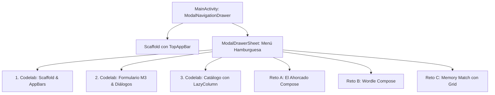

# **3.6 Laboratorio de Retos de la UT03 (`pmdm-lab-ut03`)**

El laboratorio de esta unidad consolida el dominio de **Material Design 3**, la arquitectura de interfaz con **`ViewModel`** y las pruebas automatizadas en un único proyecto Android: **`pmdm-lab-ut03`**.

Para ofrecer una navegación profesional y limpia entre todas las prácticas, la aplicación implementa como contenedor principal un **menú hamburguesa (`ModalNavigationDrawer`)**, permitiendo acceder de forma inmediata tanto a los codelabs de componentes como a los tres juegos adaptados desde el bloque de Kotlin.

---

## 1. Arquitectura del Proyecto `pmdm-lab-ut03`



### 1.1. Estructura de Paquetes Recomendada

Organiza el directorio `app/src/main/java/com/dam/pmdmlab03/` de la siguiente forma:

```
com.dam.pmdmlab03/
├── MainActivity.kt                      // Punto de entrada con ModalNavigationDrawer
├── ui/
│   ├── theme/                          // Paleta M3 y Theme.kt
│   ├── codelabs/
│   │   ├── codelab01_scaffold/         // Codelab de Scaffold y AppBars
│   │   ├── codelab02_formulario/       // Codelab de Formulario y Diálogos
│   │   └── codelab03_catalogo/         // Codelab de LazyColumn
│   └── juegos/
│       ├── ahorcado/                   // Reto A: Juego Ahorcado + ViewModel
│       ├── wordle/                     // Reto B: Juego Wordle + ViewModel
│       └── memory/                     // Reto C: Juego Memory Match + ViewModel
```

---

## 2. El Contenedor con Menú Hamburguesa

A continuación se detalla la implementación del contenedor principal con menú hamburguesa que da acceso a todas las prácticas del laboratorio:

??? example "Ver código completo: MainActivity.kt (Contenedor con Drawer)"

    ```kotlin
    package com.dam.pmdmlab03

    import android.os.Bundle
    import androidx.activity.ComponentActivity
    import androidx.activity.compose.setContent
    import androidx.compose.foundation.layout.Box
    import androidx.compose.foundation.layout.Spacer
    import androidx.compose.foundation.layout.fillMaxSize
    import androidx.compose.foundation.layout.height
    import androidx.compose.foundation.layout.padding
    import androidx.compose.material.icons.Icons
    import androidx.compose.material.icons.filled.Casino
    import androidx.compose.material.icons.filled.Category
    import androidx.compose.material.icons.filled.EditNote
    import androidx.compose.material.icons.filled.GridOn
    import androidx.compose.material.icons.filled.Menu
    import androidx.compose.material.icons.filled.Password
    import androidx.compose.material.icons.filled.ViewAgenda
    import androidx.compose.material3.Divider
    import androidx.compose.material3.DrawerValue
    import androidx.compose.material3.ExperimentalMaterial3Api
    import androidx.compose.material3.Icon
    import androidx.compose.material3.IconButton
    import androidx.compose.material3.MaterialTheme
    import androidx.compose.material3.ModalDrawerSheet
    import androidx.compose.material3.ModalNavigationDrawer
    import androidx.compose.material3.NavigationDrawerItem
    import androidx.compose.material3.NavigationDrawerItemDefaults
    import androidx.compose.material3.Scaffold
    import androidx.compose.material3.Surface
    import androidx.compose.material3.Text
    import androidx.compose.material3.TopAppBar
    import androidx.compose.material3.rememberDrawerState
    import androidx.compose.runtime.Composable
    import androidx.compose.runtime.getValue
    import androidx.compose.runtime.mutableStateOf
    import androidx.compose.runtime.rememberCoroutineScope
    import androidx.compose.runtime.saveable.rememberSaveable
    import androidx.compose.runtime.setValue
    import androidx.compose.ui.Modifier
    import androidx.compose.ui.graphics.vector.ImageVector
    import androidx.compose.ui.unit.dp
    import com.dam.pmdmlab03.ui.theme.PMDMLab03Theme
    import kotlinx.coroutines.launch

    enum class SeccionLaboratorio(val titulo: String, val icono: ImageVector) {
        // Bloque Codelabs M3
        CODELAB_SCAFFOLD("Codelab: Scaffold & AppBars", Icons.Filled.ViewAgenda),
        CODELAB_FORMULARIO("Codelab: Formulario & Modales", Icons.Filled.EditNote),
        CODELAB_CATALOGO("Codelab: Catálogo LazyColumn", Icons.Filled.Category),

        // Bloque Retos de Juegos con ViewModel
        JUEGO_AHORCADO("El Ahorcado", Icons.Filled.Password),
        JUEGO_WORDLE("Wordle Compose", Icons.Filled.GridOn),
        JUEGO_MEMORY("Memory Match", Icons.Filled.Casino)
    }

    class MainActivity : ComponentActivity() {
        override fun onCreate(savedInstanceState: Bundle?) {
            super.onCreate(savedInstanceState)
            setContent {
                PMDMLab03Theme {
                    Surface(
                        modifier = Modifier.fillMaxSize(),
                        color = MaterialTheme.colorScheme.background
                    ) {
                        AppLaboratorio03()
                    }
                }
            }
        }
    }

    @OptIn(ExperimentalMaterial3Api::class)
    @Composable
    fun AppLaboratorio03() {
        var seccionActual by rememberSaveable { mutableStateOf(SeccionLaboratorio.CODELAB_SCAFFOLD) }
        val drawerState = rememberDrawerState(initialValue = DrawerValue.Closed)
        val scope = rememberCoroutineScope()

        ModalNavigationDrawer(
            drawerState = drawerState,
            drawerContent = {
                ModalDrawerSheet {
                    Spacer(Modifier.height(16.dp))
                    Text(
                        text = "PMDM Lab - UT03",
                        style = MaterialTheme.typography.headlineSmall,
                        modifier = Modifier.padding(horizontal = 24.dp)
                    )
                    Text(
                        text = "Material 3 & Jetpack Compose",
                        style = MaterialTheme.typography.bodySmall,
                        color = MaterialTheme.colorScheme.secondary,
                        modifier = Modifier.padding(horizontal = 24.dp, vertical = 4.dp)
                    )

                    Divider(modifier = Modifier.padding(vertical = 12.dp))

                    SeccionLaboratorio.entries.forEach { seccion ->
                        NavigationDrawerItem(
                            icon = { Icon(seccion.icono, contentDescription = null) },
                            label = { Text(seccion.titulo) },
                            selected = seccionActual == seccion,
                            onClick = {
                                seccionActual = seccion
                                scope.launch { drawerState.close() }
                            },
                            modifier = Modifier.padding(NavigationDrawerItemDefaults.ItemPadding)
                        )
                    }
                }
            }
        ) {
            Scaffold(
                topBar = {
                    TopAppBar(
                        title = { Text(seccionActual.titulo) },
                        navigationIcon = {
                            IconButton(onClick = { scope.launch { drawerState.open() } }) {
                                Icon(Icons.Filled.Menu, contentDescription = "Abrir menú hamburguesa")
                            }
                        }
                    )
                }
            ) { innerPadding ->
                Box(
                    modifier = Modifier
                        .fillMaxSize()
                        .padding(innerPadding)
                ) {
                    when (seccionActual) {
                        SeccionLaboratorio.CODELAB_SCAFFOLD -> {
                            // Codelab01ScaffoldScreen()
                            Text("Pantalla de Codelab 1: Scaffold, FAB y Snackbar", Modifier.padding(16.dp))
                        }
                        SeccionLaboratorio.CODELAB_FORMULARIO -> {
                            // Codelab02FormularioScreen()
                            Text("Pantalla de Codelab 2: Formulario M3 con validaciones", Modifier.padding(16.dp))
                        }
                        SeccionLaboratorio.CODELAB_CATALOGO -> {
                            // Codelab03CatalogoScreen()
                            Text("Pantalla de Codelab 3: LazyColumn dinámico con tarjetas", Modifier.padding(16.dp))
                        }
                        SeccionLaboratorio.JUEGO_AHORCADO -> {
                            // AhorcadoScreen()
                            Text("Reto A: El Ahorcado con ViewModel y LinearProgressIndicator", Modifier.padding(16.dp))
                        }
                        SeccionLaboratorio.JUEGO_WORDLE -> {
                            // WordleScreen()
                            Text("Reto B: Wordle con matriz de casillas y teclado reactivo", Modifier.padding(16.dp))
                        }
                        SeccionLaboratorio.JUEGO_MEMORY -> {
                            // MemoryScreen()
                            Text("Reto C: Memory Match con LazyVerticalGrid de cartas", Modifier.padding(16.dp))
                        }
                    }
                }
            }
        }
    }
    ```

---

## 3. Banco de Prácticas del Laboratorio

### Bloque A: Codelabs Formativos de Componentes M3

#### Codelab 1: Estructura Completa con Scaffold, FAB y Snackbar
- **Paquete:** `ui.codelabs.codelab01_scaffold`
- **Requisitos:**
  - `TopAppBar` con título y menú de acciones (icono de búsqueda e icono de información).
  - `FloatingActionButton` que añade un nuevo elemento a la pantalla.
  - Al pulsar sobre el FAB o sobre un botón, se dispara un `Snackbar` mediante corrutinas mostrando un mensaje temporal con la acción "Deshacer".
  - Apóyate en los ejemplos de tu showroom: `ScaffoldWithFabScreen.kt` y `SnackbarBasicScreen.kt`.

#### Codelab 2: Formulario de Perfil y Ajustes con Diálogos Modales
- **Paquete:** `ui.codelabs.codelab02_formulario`
- **Requisitos:**

    - Campo de texto `OutlinedTextField` para nombre de usuario con icono inicial y validación (no puede estar vacío).
    - Interruptor `Switch` para activar o desactivar notificaciones.
    - Deslizador `Slider` continuo para seleccionar el volumen de audio.
    - Desplegable `DropdownMenu` para seleccionar el nivel o categoría.
    - Botón "Restablecer valores" que abre un `AlertDialog` solicitando confirmación antes de borrar los campos.
    - Apóyate en los ejemplos de tu showroom: `Buttons/`, `Dialogs/` y `Menus/`.

#### Codelab 3: Catálogo Dinámico con `LazyColumn`
- **Paquete:** `ui.codelabs.codelab03_catalogo`
- **Requisitos:**
  
    - Presentar una lista de al menos 15 elementos utilizando `LazyColumn`.
    - Asignar una clave única obligatoria: `items(elementos, key = { it.id })`.
    - Cada fila debe ser una tarjeta `ElevatedCard` con icono, título y descripción.
    - Botón de eliminación en cada tarjeta que borre el elemento de la lista en memoria.

---

### Bloque B: Retos de Juegos con Compose y ViewModel

En este bloque aplicarás la arquitectura oficial de la Capa de UI (**`UiState` + `ViewModel` + `Compose`**) a los juegos cuya lógica ya desarrollaste en Kotlin:

#### 🎮 Reto A: El Ahorcado (*Hangman Compose*)
- **Paquete:** `ui.juegos.ahorcado`
- **Requisitos:**
  
    - Reutiliza la lógica del motor de `JuegoAhorcado` creada en el bloque de Kotlin.
    - Crea `AhorcadoViewModel` con su correspondiente `data class AhorcadoUiState` y flujo `StateFlow`.
    - **Componentes de interfaz M3:**

        - Indicador visual de vidas restantes mediante `LinearProgressIndicator` (del paquete `Progress/` del showroom).
        - Fila de casillas de texto para las letras descubiertas (`_ _ A _ O`).
        - Teclado virtual con botones (`FilledTonalButton`) para cada letra del abecedario. Las letras ya probadas deben deshabilitarse (`enabled = false`).
        - Diálogo modal `AlertDialog` que aparezca automáticamente al ganar o perder, informando del resultado y ofreciendo un botón "Jugar de nuevo".

#### 🟩 Reto B: Wordle (*Wordle Compose*)
- **Paquete:** `ui.juegos.wordle`
- **Requisitos:**

    - Matriz visual de 6 intentos x 5 letras (`Column` con 6 filas de `Row`).
    - Cada casilla debe ser una `Card` o `Surface` con bordes redondeados y texto centrado en negrita.
    - Al validar un intento (tecla *Enter*), las casillas deben cambiar de color según las pistas:

        - **Verde:** Letra acertada en la posición correcta (`MaterialTheme.colorScheme.primaryContainer`).
        - **Amarillo:** Letra existente en otra posición (`MaterialTheme.colorScheme.tertiaryContainer`).
        - **Gris:** Letra ausente en la palabra secreta (`MaterialTheme.colorScheme.surfaceVariant`).

    - Teclado interactivo inferior con letras y botones de *Borrar* y *Enter*.

#### 🧠 Reto C: Memory Match (*Memory Match con Grid*)
- **Paquete:** `ui.juegos.memory`
- **Requisitos:**

    - Tablero en cuadrícula de 4x4 cartas utilizando **`LazyVerticalGrid(columns = GridCells.Fixed(4))`**.
    - Cada carta es una `ElevatedCard` táctil que muestra:

        - Su reverso (diseño uniforme con color primario) cuando está oculta.
        - Su anverso (icono o identificador de la carta) cuando está descubierta o emparejada.
        - Marcador superior con el número de intentos realizados y botón para reiniciar la partida.

    - `MemoryViewModel` para gestionar el emparejamiento y el bloqueo de interacción mientras dos cartas erróneas se muestran antes de ocultarse.

---

### Bloque C: Taller de Pruebas Automatizadas de Interfaz

- Ubicación: `app/src/androidTest/java/com/dam/pmdmlab03/`
- Implementar al menos **dos pruebas automatizadas con `createComposeRule()`** sobre alguno de los componentes de la aplicación:

    1. *Test 1:* Verificar que al introducir un texto en el formulario del Codelab 2 y pulsar el botón, el estado se actualiza y desaparece el error.
    2. *Test 2:* Verificar que en el juego de El Ahorcado, pulsar una letra errónea decrementa el contador visual de vidas restantes.

---

## 4. Lista de Verificación de Calidad (*Checklist*)

Antes de entregar tu proyecto, comprueba los siguientes puntos:

- [ ] **Navegación funcional:** El menú lateral `ModalNavigationDrawer` permite alternar con fluidez entre todos los retos sin cierres inesperados.
- [ ] **Manejo correcto de espaciados:** Todos los componibles dentro de `Scaffold` aplican el modificador `Modifier.padding(innerPadding)`.
- [ ] **Claves únicas en listas:** Todos los `LazyColumn` y `LazyVerticalGrid` definen el parámetro `key` con identificadores unívocos.
- [ ] **Arquitectura de UI limpia:** Los juegos separan rigurosamente el estado y las reglas en un `ViewModel` con `StateFlow`, sin variables de juego mutables sueltas en los componibles.
- [ ] **Pruebas de UI en verde:** Las pruebas instrumentadas en `src/androidTest/` se ejecutan y finalizan con éxito.
