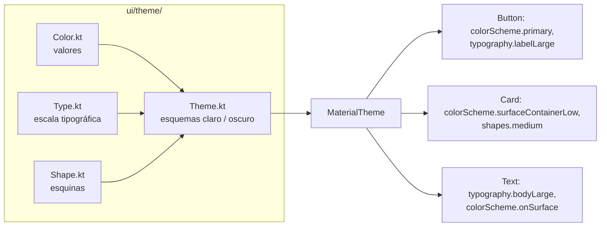
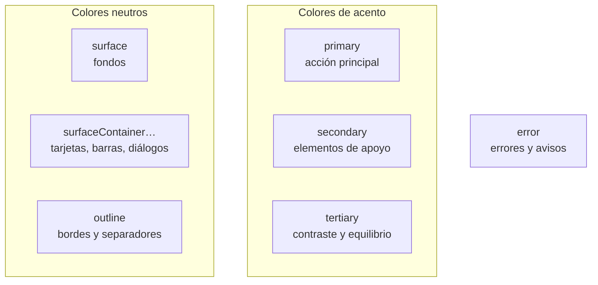
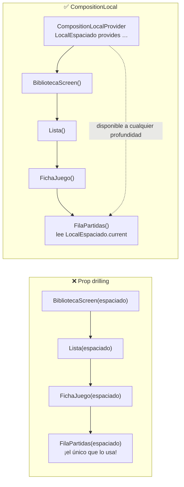
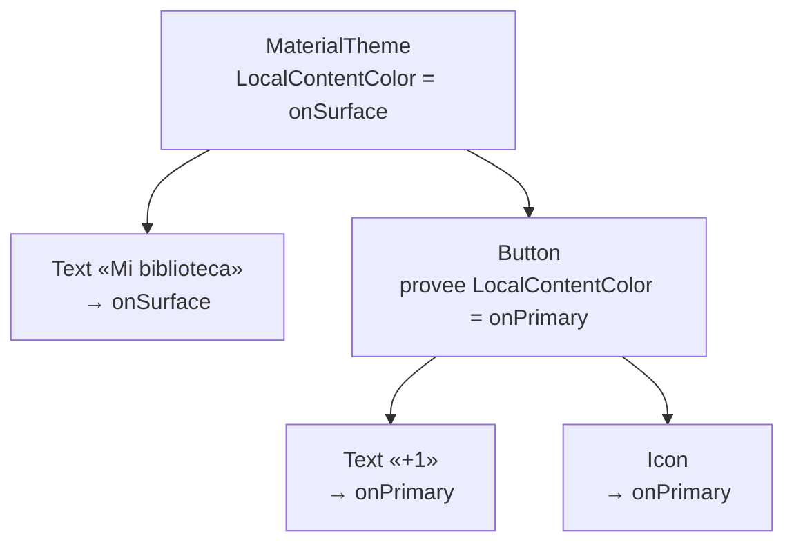
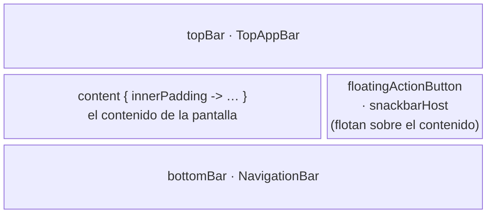
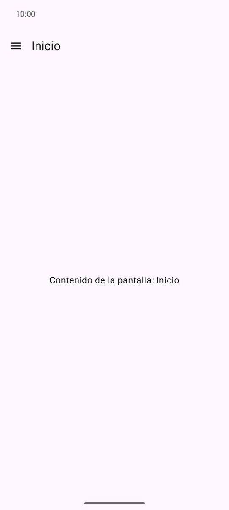
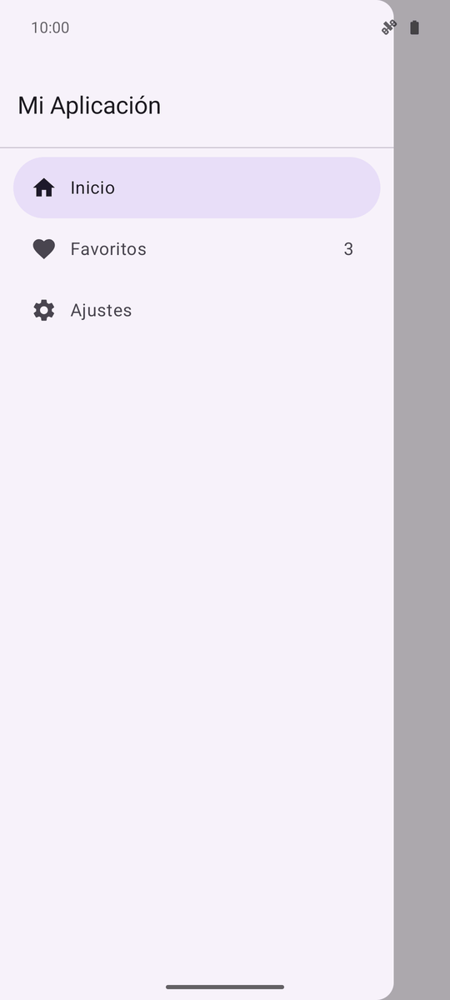
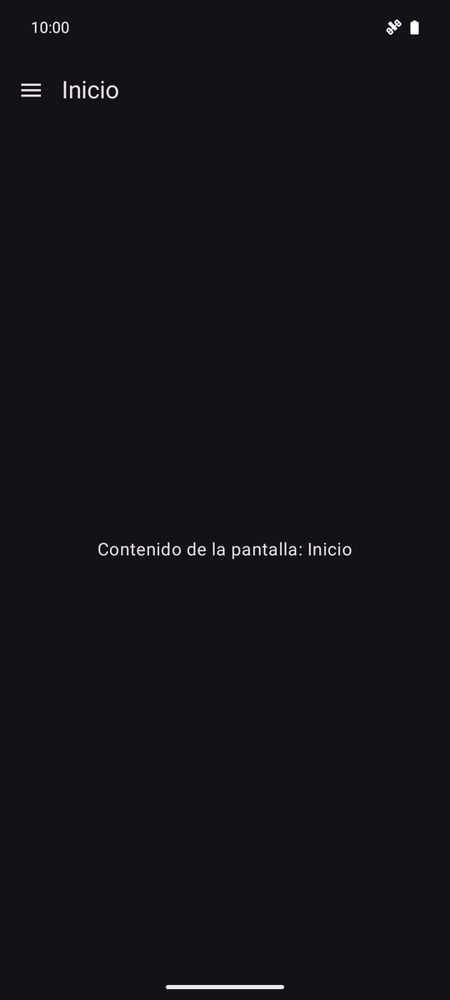
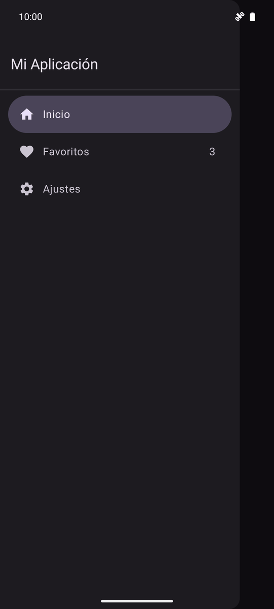
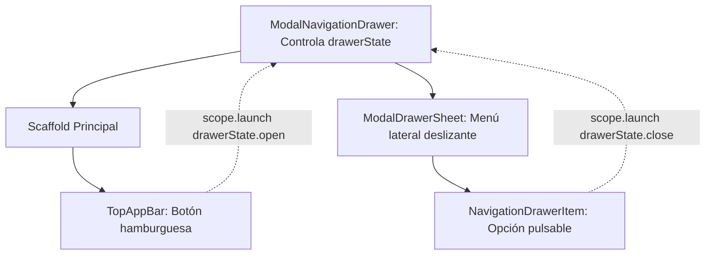

# **3A.1 Material Design 3, Theming, Providers y Scaffold**

**Material Design 3 (M3)**, también conocido como *Material You*, es el sistema de diseño visual oficial de Google para Android. Proporciona una guía integral de estilos, componentes y patrones ergonómicos pensados para crear aplicaciones consistentes, accesibles y estéticamente atractivas.

Incluye dos **playgrounds interactivos** para experimentar sin abrir el IDE: uno de **roles de color** y otro de la **escala tipográfica**.

En este apartado aprenderemos a estructurar pantallas completas utilizando el contenedor maestro **`Scaffold`**, a controlar la apariencia global mediante el sistema de temas y **Providers**, y a implementar el clásico **menú hamburguesa** con **`ModalNavigationDrawer`**.

---

## 1. El Sistema de Diseño Material 3: Arquitectura y Theming

Un **tema** es mucho más que una paleta. En [Material Design 3](https://m3.material.io/) agrupa tres decisiones de diseño que comparte toda la app:

- **Color:** qué color tiene cada función de la interfaz (acción principal, fondo, error…).
- **Tipografía:** qué tamaño, peso e interlineado tiene cada tipo de texto (título, cuerpo, etiqueta…).
- **Formas:** cuánto se redondean las esquinas de cada tipo de componente.

La idea clave es que **los componentes nunca eligen sus valores**: los piden al tema por su **función**. Un `Button` no sabe que es índigo; sabe que es `primary`. Si cambias el tema, cambia toda la app sin tocar ninguna pantalla, y el modo oscuro sale «gratis».



### 1.1. La Anatomía de un Tema en Compose

Al crear un proyecto con Compose, el asistente genera el paquete `ui.theme`:

| Fichero | Contiene | Se lee con |
| :--- | :--- | :--- |
| `Color.kt` | Los valores de color en bruto: `Color(0xFF4F55B5)` | — (solo los usa `Theme.kt`) |
| `Type.kt` | La escala tipográfica (`Typography`) | `MaterialTheme.typography` |
| `Shape.kt` | Los radios de las esquinas (`Shapes`). La plantilla no lo trae: lo creas tú | `MaterialTheme.shapes` |
| `Theme.kt` | El composable que lo reúne todo en `MaterialTheme` | — |

`Theme.kt` declara una función composable que elige el esquema de color y envuelve a toda la app:

```kotlin
// ui/theme/Theme.kt
@Composable
fun FichaJuegoTheme(
    darkTheme: Boolean = isSystemInDarkTheme(),  // (1)!
    dynamicColor: Boolean = false,               // (2)!
    content: @Composable () -> Unit
) {
    val colorScheme = when {
        dynamicColor && Build.VERSION.SDK_INT >= Build.VERSION_CODES.S -> {
            val context = LocalContext.current
            if (darkTheme) dynamicDarkColorScheme(context) else dynamicLightColorScheme(context)
        }
        darkTheme -> DarkColorScheme
        else -> LightColorScheme
    }

    MaterialTheme(
        colorScheme = colorScheme,
        typography = Typography,
        shapes = Shapes,
        content = content
    )
}
```

1. Por defecto sigue el modo del sistema. En las previews se puede forzar: `FichaJuegoTheme(darkTheme = true) { … }`.
2. Color dinámico (Android 12+): ver [§1.4](#14-color-dinamico-material-you-en-android-12).

En `MainActivity` se envuelve todo el contenido con el tema, **una sola vez**:

```kotlin
setContent {
    FichaJuegoTheme {
        BibliotecaScreen()
    }
}
```

Dentro, cualquier composable lee el tema con `MaterialTheme.colorScheme.…`, `MaterialTheme.typography.…` y `MaterialTheme.shapes.…`. Los componentes de Material (`Text`, `Button`, `Card`, `TopAppBar`…) ya lo hacen solos.

!!! warning "Las previews también necesitan el tema"
    Una `@Preview` que llama directamente a tu pantalla, sin envolverla en `FichaJuegoTheme { … }`, se pinta con los colores morados por defecto de Material y no con los tuyos.

---

### 1.2. Esquemas de Color (`ColorScheme`) y Roles Semánticos

Material 3 no usa nombres como «azul» o «rojo», sino **roles**: nombres que dicen **para qué** sirve el color. Un `ColorScheme` es simplemente un objeto con un valor para cada rol.



Cada color de acento tiene **cuatro roles**: el color, su versión suave (*container*) y el color de lo que va encima de cada uno (*on-*):

| Rol | Para qué | Ejemplos |
| :--- | :--- | :--- |
| `primary` / `onPrimary` | La acción más importante de la pantalla | `Button`, `FloatingActionButton`, interruptor activado |
| `primaryContainer` / `onPrimaryContainer` | Elementos destacados con menos peso | Barra superior coloreada, tarjeta seleccionada |
| `secondary…` / `secondaryContainer…` | Elementos de apoyo | `FilterChip`, `FilledTonalButton`, indicador de la barra inferior |
| `tertiary…` / `tertiaryContainer…` | Acentos que contrastan con los anteriores | Insignias, valoraciones, gráficos |
| `error…` / `errorContainer…` | Errores y validación | Campo de texto con error, avisos |
| `surface` / `onSurface` | Fondo de la pantalla y texto principal | `Scaffold`, `Text` |
| `onSurfaceVariant` | Texto e iconos secundarios | Subtítulos, iconos de una lista |
| `surfaceContainerLowest` … `surfaceContainerHighest` | Superficies a distinta «altura» | `ElevatedCard` (*Low*), `NavigationBar` (*Container*), diálogos (*High*), `Card` rellena (*Highest*) |
| `outline` / `outlineVariant` | Bordes y separadores | `OutlinedTextField`, `OutlinedCard`, `HorizontalDivider` |

#### La regla del *on-color*

Cada fondo tiene su color de contenido emparejado, y **se usan siempre juntos**. Así el contraste mínimo de accesibilidad ([WCAG](https://www.w3.org/WAI/standards-guidelines/wcag/)) está garantizado tanto en modo claro como en oscuro:

- Sobre `primary`, texto e iconos en `onPrimary`.
- Sobre `primaryContainer`, en `onPrimaryContainer`.
- Sobre `surface`, en `onSurface` (o en `onSurfaceVariant` si es secundario).

```kotlin
// ✅ El fondo y el texto salen de la misma pareja de roles
Surface(color = MaterialTheme.colorScheme.tertiary, shape = MaterialTheme.shapes.small) {
    Text("NUEVO", color = MaterialTheme.colorScheme.onTertiary)
}

// ❌ Color fijo: en modo claro, blanco sobre un fondo claro no se lee
Text("Hollow Knight", color = Color.White)
```

!!! tip "No hace falta indicar el on-color en los componentes de Material"
    `Button`, `Card`, `Surface` o `TopAppBar` ponen solos el on-color correcto a su contenido mediante `LocalContentColor`. Solo tienes que indicarlo cuando pintas tú el fondo, por ejemplo con `Modifier.background(…)`.

Prueba las parejas de roles en el playground: elige una, observa dónde se usa en la maqueta y compara el contraste en claro y en oscuro. Activa «Texto `Color.White` fijo» para ver por qué los colores fijos fallan.

<div class="cpg" data-cpg="colorroles"></div>

---

### 1.3. Personalización de Paletas en `Color.kt` y `Theme.kt`

Para dar identidad propia a la app se definen los valores en `Color.kt` y se asignan a los roles de **dos esquemas**: uno claro y otro oscuro. Este es el tema de FichaJuego, el proyecto de clase:

=== "Color.kt"

    ```kotlin
    // Modo claro: tonos oscuros (40) sobre fondos claros
    val Indigo40 = Color(0xFF4F55B5)
    val IndigoContainer90 = Color(0xFFE0E0FF)
    val OnIndigoContainer10 = Color(0xFF0A0F6B)
    val Ambar40 = Color(0xFF8B5000)
    // …

    // Modo oscuro: tonos claros (80) sobre fondos oscuros
    val Indigo80 = Color(0xFFBFC1FF)
    val OnIndigo20 = Color(0xFF1F247E)
    val IndigoContainer30 = Color(0xFF373C9B)
    val Ambar80 = Color(0xFFFFB870)
    // …
    ```

=== "Theme.kt"

    ```kotlin
    private val LightColorScheme = lightColorScheme(
        primary = Indigo40,
        onPrimary = Color.White,
        primaryContainer = IndigoContainer90,
        onPrimaryContainer = OnIndigoContainer10,
        tertiary = Ambar40,
        // … secondary, surface, onSurface, etc.
    )

    private val DarkColorScheme = darkColorScheme(
        primary = Indigo80,
        onPrimary = OnIndigo20,
        primaryContainer = IndigoContainer30,
        onPrimaryContainer = IndigoContainer90,
        tertiary = Ambar80,
        // …
    )
    ```

Fíjate en el patrón: en modo claro el color de acento es **oscuro** y su *container* es **claro**; en modo oscuro se invierte. Los números (`40`, `80`, `90`…) indican el **tono**, de 0 (negro) a 100 (blanco), y son la convención de Material para nombrarlos.

!!! info "Los roles que no defines"
    `lightColorScheme(…)` y `darkColorScheme(…)` rellenan con los valores morados por defecto de Material todos los roles que no indiques. Si defines `primary` pero no `primaryContainer`, aparecerán toques morados en tu app. Por eso conviene generar la paleta completa con [Material Theme Builder](#17-material-theme-builder-y-recursos-oficiales).

---

### 1.4. Color Dinámico ("Material You") en Android 12+

Desde Android 12 (API 31), el sistema puede generar una paleta a partir del **fondo de pantalla del usuario**: es lo que Google llama *Material You*. Compose la ofrece con `dynamicLightColorScheme(context)` y `dynamicDarkColorScheme(context)`.

| | Color dinámico | Paleta propia |
| :--- | :--- | :--- |
| Los colores salen de… | El fondo de pantalla de cada usuario | Tu `Color.kt` |
| Ventaja | La app se integra con el resto del sistema | La app se reconoce siempre (identidad de marca) |
| Inconveniente | Tu app se ve distinta en cada móvil | No se adapta al gusto del usuario |
| Disponible | Android 12+ (en versiones anteriores se usa la paleta propia) | Siempre |

La plantilla del curso trae `dynamicColor = true`. Si quieres que se vean tus colores, ponlo a `false`: si no, en un móvil con Android 12+ **no verás los cambios que hagas en `Color.kt`**, lo que es una fuente habitual de confusión.

---

### 1.5. Personalización de Tipografía (`Type.kt`)

Material 3 define una **escala tipográfica** de **15 estilos**: **5 categorías** con **3 tamaños** cada una (`Large`, `Medium` y `Small`). Igual que con el color, eliges el estilo por su **función**, no por su tamaño:

| Categoría | Para qué | Tamaños por defecto (sp) | Ejemplos |
| :--- | :--- | :--- | :--- |
| `display` | Textos enormes y muy cortos | 57 · 45 · 36 | Una cifra destacada, la pantalla de bienvenida |
| `headline` | Títulos importantes | 32 · 28 · 24 | Título de una pantalla de detalle, de un diálogo |
| `title` | Títulos de elementos | 22 · 16 · 14 | `TopAppBar` (`titleLarge`), tarjetas, elementos de lista |
| `body` | Texto de lectura | 16 · 14 · 12 | Párrafos y descripciones. `Text` usa `bodyLarge` por defecto |
| `label` | Textos de componentes | 14 · 12 · 11 | Botones (`labelLarge`), chips, insignias |

Cada estilo es un `TextStyle` con **tamaño** (`fontSize`), **interlineado** (`lineHeight`), **peso** (`fontWeight`), **espaciado entre letras** (`letterSpacing`) y **familia** (`fontFamily`). Se usa así:

```kotlin
Text(
    text = juego.titulo,
    style = MaterialTheme.typography.headlineSmall
)
```

!!! tip "sp y no dp para el texto"
    Los tamaños de texto se dan en **sp** (*scale-independent pixels*): como los dp, pero además crecen si el usuario aumenta el tamaño de letra en los ajustes de accesibilidad. Usa siempre los estilos del tema y evita fijar `fontSize` a mano en cada `Text`.

#### Personalizar la escala

En `Type.kt` **solo redefines los estilos que quieres cambiar**; el resto conserva los valores por defecto de Material:

```kotlin
// ui/theme/Type.kt
val Typography = Typography(
    headlineSmall = TextStyle(
        fontFamily = FontFamily.Default,
        fontWeight = FontWeight.Bold,   // títulos de las fichas en negrita
        fontSize = 24.sp,
        lineHeight = 32.sp
    ),
    labelMedium = TextStyle(
        fontWeight = FontWeight.Bold,
        fontSize = 12.sp,
        lineHeight = 16.sp,
        letterSpacing = 0.8.sp
    )
)
```

Si una pantalla necesita una pequeña variación puntual, parte del estilo del tema con `copy` en lugar de inventar uno nuevo: `MaterialTheme.typography.bodyLarge.copy(fontStyle = FontStyle.Italic)`.

Explora la escala completa en el playground: compara los 15 estilos, escribe tu propio texto y cambia la familia o el peso de uno para ver el código de `Type.kt` que lo produce.

<div class="cpg" data-cpg="typography"></div>

#### Usar una fuente propia

Hay dos formas de usar una tipografía distinta de la del sistema:

=== "Fichero en res/font"

    Copia los ficheros `.ttf` en `res/font/` (con nombres válidos de recurso, por ejemplo `montserrat_bold.ttf`) y crea la familia:

    ```kotlin
    val Montserrat = FontFamily(
        Font(R.font.montserrat_regular, FontWeight.Normal),
        Font(R.font.montserrat_bold, FontWeight.Bold)
    )

    val Typography = Typography(
        titleLarge = TextStyle(fontFamily = Montserrat, fontWeight = FontWeight.Bold, fontSize = 22.sp)
    )
    ```

=== "Google Fonts descargables"

    Con la librería `androidx.compose.ui:ui-text-google-fonts`, la fuente se descarga la primera vez que se usa y no aumenta el tamaño de la app. Requiere configurar un proveedor de certificados: sigue la [guía oficial de fuentes descargables](https://developer.android.com/develop/ui/compose/text/fonts?hl=es-419#downloadable-fonts).

!!! warning "Una o dos familias como mucho"
    Lo habitual es una familia para toda la app y, como mucho, otra distinta para los títulos (`display` y `headline`). Más familias hacen que la interfaz parezca descuidada.

---

### 1.6. Personalización de Formas (`Shapes.kt`)

Las esquinas también forman parte de la identidad de la app: muy redondeadas transmiten cercanía y casi rectas, seriedad. Material 3 define **cinco niveles**, y cada componente usa siempre el mismo:

| Nivel | Por defecto | Lo usan |
| :--- | :--- | :--- |
| `extraSmall` | 4 dp | `OutlinedTextField`, menús desplegables, *snackbars* |
| `small` | 8 dp | Chips |
| `medium` | 12 dp | `Card`, `ElevatedCard` |
| `large` | 16 dp | `FloatingActionButton`, menú lateral |
| `extraLarge` | 28 dp | Diálogos, hojas inferiores (`ModalBottomSheet`) |

Los botones son la excepción: siempre son completamente redondeados (forma de píldora), sea cual sea el tema.

```kotlin
// ui/theme/Shape.kt
val Shapes = Shapes(
    small = RoundedCornerShape(8.dp),
    medium = RoundedCornerShape(16.dp),  // tarjetas más redondeadas que por defecto
    large = RoundedCornerShape(24.dp)
)
```

Para que se aplique, pásalo a `MaterialTheme(shapes = Shapes, …)` en `Theme.kt`. En tus propios elementos, usa también los niveles del tema en lugar de radios sueltos:

```kotlin
Modifier
    .clip(MaterialTheme.shapes.small)
    .background(MaterialTheme.colorScheme.tertiary, MaterialTheme.shapes.small)
```

---

### 1.7. Material Theme Builder y Recursos Oficiales

Calcular a mano los 30 roles de dos esquemas, con contrastes correctos, es inviable. Google ofrece la herramienta **[Material Theme Builder](https://m3.material.io/theme-builder)** (web y plugin de Figma):

1. Introduces un **color semilla** (*seed color*), por ejemplo el color principal de tu marca.

2. La herramienta genera todos los roles, en claro y en oscuro, con los contrastes garantizados. Puedes ajustar los colores secundario y terciario.

3. Exportas con **Export → Jetpack Compose (Theme.kt)** y obtienes `Color.kt` y `Theme.kt` listos para copiar en tu paquete `ui.theme`.

<figure style="text-align: center;">
  
  <figcaption>Generación de esquemas completos y roles semánticos a partir de un único color semilla.</figcaption>
</figure>

!!! tip "Para saber más"

    - [Material Design 3 en Compose (Android Developers)](https://developer.android.com/develop/ui/compose/designsystems/material3?hl=es-419): color, tipografía y formas en Compose.
    - [Roles de color (m3.material.io)](https://m3.material.io/styles/color/roles) y [escala tipográfica (m3.material.io)](https://m3.material.io/styles/typography/type-scale-tokens): la referencia de diseño.
    - [Codelab oficial: Temas de Material con Compose](https://developer.android.com/codelabs/basic-android-kotlin-compose-material-theming?hl=es-419).
    - Codelab del laboratorio: [Codelab 1 · Theming en Material Design 3](../codelabs/01-theming-material3.md).

---

### 1.8. Errores frecuentes con el tema

| Síntoma | Causa | Solución |
| :--- | :--- | :--- |
| Cambias `Color.kt` y en el móvil no se nota | El color dinámico está activado (Android 12+) | `dynamicColor = false` en `Theme.kt` |
| Aparecen toques morados que no has puesto | Roles sin definir en el esquema (toman el valor por defecto) | Define el esquema completo o genéralo con Theme Builder |
| Un texto no se lee en modo oscuro | Color fijo (`Color.Black`, `Color.White`) | Usa el on-color de su fondo: `onSurface`, `onPrimary`… |
| La preview sale con otros colores | La preview no está envuelta en el tema | `FichaJuegoTheme { MiPantalla() }` dentro de la preview |
| Todos los textos tienen tamaños distintos e incoherentes | `fontSize` fijado a mano en cada `Text` | Usa `style = MaterialTheme.typography.…` |

---

## 2. Inyección de Datos Globales en Compose: Providers y CompositionLocal

En Compose los datos bajan por el árbol **como parámetros**: es lo que hemos hecho hasta ahora y es lo correcto casi siempre. Pero hay datos que necesitan **muchísimos composables, a cualquier profundidad**: los colores del tema, el estilo de texto actual, el `Context` de Android, la densidad de la pantalla… Pasarlos a mano por cada función intermedia, aunque esa función no los use, se llama ***prop drilling*** (perforación de parámetros) y llena el código de parámetros que solo están «de paso».



`CompositionLocal` es el mecanismo de Compose para que un valor esté **disponible para todo un subárbol** sin pasarlo explícitamente. No es algo exótico: `MaterialTheme` funciona exactamente así.

### 2.1. ¿Cómo Funciona `CompositionLocal`?

Hay tres piezas:

1. **Crear la clave**, normalmente como variable de nivel superior con prefijo `Local`:

    ```kotlin
    val LocalEspaciado = staticCompositionLocalOf { Espaciado() }  // valor por defecto
    ```

2. **Proveer un valor** para un subárbol con `CompositionLocalProvider` y el operador `provides`:

    ```kotlin
    CompositionLocalProvider(LocalEspaciado provides Espaciado(normal = 20.dp)) {
        BibliotecaScreen()   // todo lo que hay dentro ve ese valor
    }
    ```

3. **Leer el valor** desde cualquier composable del subárbol con `.current`:

    ```kotlin
    val espaciado = LocalEspaciado.current
    ```

Si nadie ha provisto un valor más arriba, `.current` devuelve el **valor por defecto** de la clave. Y si hay varios proveedores anidados, **gana el más cercano**:



Por eso un `Text` dentro de un `Button` sale con el color correcto sin que le digas nada: el botón provee `LocalContentColor` para su contenido.

#### Los que ya trae Compose

| CompositionLocal | Qué ofrece | Uso habitual |
| :--- | :--- | :--- |
| `LocalContext` | El `Context` de Android (la Activity) | Abrir otra app, mostrar un `Toast`, leer recursos fuera de Compose |
| `LocalContentColor` | El color de contenido actual | Lo leen `Text` e `Icon` cuando no les das color |
| `LocalTextStyle` | El estilo de texto actual | Lo lee `Text`; Material lo inicia con `bodyLarge` |
| `LocalDensity` | La densidad de pantalla | Convertir entre `dp` y píxeles |
| `LocalConfiguration` | Configuración del dispositivo | Orientación, idioma, tamaño de pantalla |
| `LocalUriHandler` | Abridor de enlaces | `LocalUriHandler.current.openUri("https://…")` |

`MaterialTheme.colorScheme`, `MaterialTheme.typography` y `MaterialTheme.shapes` son, por dentro, lecturas de `CompositionLocal` que provee el composable `MaterialTheme`.

### 2.2. Ejemplo Práctico: una escala de espaciados para toda la app

Un uso muy común en apps reales es **extender el tema** con valores que Material no trae, como una escala de **espaciados**. Así toda la app usa los mismos márgenes y se cambian en un único sitio. (Es lo que hace el proyecto GameVault con sus *Dimens*).

=== "1. Definir y crear la clave"

    ```kotlin
    // ui/theme/Espaciado.kt
    data class Espaciado(
        val pequeno: Dp = 4.dp,
        val normal: Dp = 8.dp,
        val medio: Dp = 16.dp,
        val grande: Dp = 24.dp
    )

    // static: el valor casi nunca cambia (ver §2.4)
    val LocalEspaciado = staticCompositionLocalOf { Espaciado() }

    // Acceso cómodo, con la misma forma que MaterialTheme.colorScheme
    val MaterialTheme.espaciado: Espaciado
        @Composable @ReadOnlyComposable
        get() = LocalEspaciado.current
    ```

=== "2. Proveerlo en el tema"

    ```kotlin
    // ui/theme/Theme.kt
    @Composable
    fun FichaJuegoTheme(/* … */, content: @Composable () -> Unit) {
        // …
        CompositionLocalProvider(LocalEspaciado provides Espaciado()) {
            MaterialTheme(
                colorScheme = colorScheme,
                typography = Typography,
                shapes = Shapes,
                content = content
            )
        }
    }
    ```

=== "3. Usarlo en cualquier pantalla"

    ```kotlin
    LazyColumn(
        contentPadding = PaddingValues(MaterialTheme.espaciado.medio),
        verticalArrangement = Arrangement.spacedBy(MaterialTheme.espaciado.medio)
    ) { /* … */ }
    ```

!!! tip "¿Y el interruptor de modo oscuro?"
    Activar o desactivar el modo oscuro **no** se resuelve con un `CompositionLocal` propio: es **estado** de la app. Se guarda arriba (en `MainActivity` o, mejor, en un `ViewModel` en la UT4 con DataStore), se pasa al tema con `FichaJuegoTheme(darkTheme = modoOscuro)` y el interruptor recibe el valor y un evento, como cualquier composable *stateless*. El tema ya se encarga de que toda la app cambie de colores.

### 2.3. Sobrescribir un valor en una parte de la pantalla

Como gana el proveedor más cercano, puedes cambiar un valor **solo para un trozo** del árbol. Por ejemplo, para que todo el contenido de una franja destacada use el color de contenido adecuado sin indicarlo en cada `Text` e `Icon`:

```kotlin
Row(
    modifier = Modifier.background(MaterialTheme.colorScheme.tertiaryContainer)
) {
    CompositionLocalProvider(LocalContentColor provides MaterialTheme.colorScheme.onTertiaryContainer) {
        Icon(painterResource(R.drawable.ic_star), contentDescription = null)
        Text("Juego del mes")          // también toma onTertiaryContainer
    }
}
```

Lo mismo se hace con `LocalTextStyle` para cambiar el estilo de todos los textos de un bloque. Es exactamente lo que hacen por dentro `Surface`, `Card` o `Button`.

### 2.4. `compositionLocalOf` frente a `staticCompositionLocalOf`

| | `compositionLocalOf` | `staticCompositionLocalOf` |
| :--- | :--- | :--- |
| Si el valor cambia, se recompone… | Solo lo que lee `.current` | Todo el contenido del proveedor |
| Coste de leerlo | Algo mayor (Compose sigue quién lo lee) | Mínimo |
| Para valores que… | Cambian con frecuencia | No cambian nunca o casi nunca |
| Ejemplos | Un color que se anima | Espaciados, `LocalContext`, configuraciones de la marca |

### 2.5. Cuándo usarlo (y cuándo no)

- ✅ **Sí:** datos **transversales de la interfaz** que necesitan muchos composables a cualquier profundidad: tema, espaciados, estilos, servicios de la plataforma.
- ❌ **No:** datos de la pantalla o del negocio, como el juego seleccionado, la lista de la biblioteca o el usuario. Esos van **como parámetros** o en un `ViewModel`: así se ve de dónde viene cada dato, las previews son fáciles y los tests también.
- ❌ **No** para evitar pasar dos o tres parámetros: un `CompositionLocal` es una dependencia oculta. Si un composable lo lee, no se ve en su firma.

!!! warning "Errores frecuentes"

    - **Leer `.current` fuera de un composable** (por ejemplo, dentro de un `onClick`): no compila o lee un valor antiguo. Guárdalo antes en una variable: `val context = LocalContext.current` y úsala en la lambda.
    - **Olvidar proveer el valor:** se usa en silencio el valor por defecto. Si un valor debe proveerse siempre, crea la clave con `compositionLocalOf { error("LocalX no provisto") }` para que falle en cuanto falte.

!!! info "Para saber más"

    - [Datos con alcance local mediante CompositionLocal (Android Developers)](https://developer.android.com/develop/ui/compose/compositionlocal?hl=es-419).
    - Manual del módulo: [Contexto, CompositionLocal y efectos secundarios](../../00-android/00-compose/27-compositionlocal-contexto-efectos.md).

---

## 3. Estructura de Pantalla: El Contenedor `Scaffold`

El composable **`Scaffold`** implementa la estructura visual estándar de Material Design. Gestiona automáticamente la posición de las barras de aplicación, botones de acción flotantes y avisos temporales.



### 3.1. Parámetros Fundamentales del `Scaffold`

- **`topBar`:** Barra superior de la pantalla.
- **`bottomBar`:** Barra de navegación inferior o barra de acciones.
- **`floatingActionButton`:** Botón circular destacado de acción primaria.
- **`snackbarHost`:** Contenedor de notificaciones emergentes rápidas.
- **`content`:** Función lambda que recibe un parámetro obligatorio de espaciado: `innerPadding`.

!!! warning "Obligatoriedad de `innerPadding`"

    El contenido que dibujes dentro de la lambda `content` de un `Scaffold` **debe aplicar siempre el modificador `Modifier.padding(innerPadding)`**. Si no lo haces, la barra superior o la barra inferior taparán físicamente los primeros y últimos elementos de tu pantalla.

---

## 4. Barras de Aplicación Superiores (`TopAppBar`)

En Material 3 existen variantes de barras según la jerarquía de la pantalla:

- **`TopAppBar` (Pequeña):** Estándar para pantallas de detalle o secundarias.
- **`MediumTopAppBar` / `LargeTopAppBar`:** Títulos prominentes que se comprimen con animación al hacer scroll.

```kotlin
@OptIn(ExperimentalMaterial3Api::class)
@Composable
fun BarraSuperior(
    titulo: String,
    onMenuClick: () -> Unit,
    onAccionBuscar: () -> Unit
) {
    TopAppBar(
        title = { Text(titulo) },
        navigationIcon = {
            IconButton(onClick = onMenuClick) {
                Icon(Icons.Filled.Menu, contentDescription = "Abrir menú lateral")
            }
        },
        actions = {
            IconButton(onClick = onAccionBuscar) {
                Icon(Icons.Filled.Search, contentDescription = "Buscar")
            }
        },
        colors = TopAppBarDefaults.topAppBarColors(
            containerColor = MaterialTheme.colorScheme.primaryContainer,
            titleContentColor = MaterialTheme.colorScheme.onPrimaryContainer
        )
    )
}
```

??? example "🔍 Ver implementación en el showroom: `Material3_example`"

    - **Ficheros de referencia:**  
      - `com.pmdm.mt3.components.AppBars.SmallTopAppBarScreen.kt`
      - `com.pmdm.mt3.components.AppBars.MediumTopAppBarScreen.kt`
      - `com.pmdm.mt3.components.AppBars.LargeTopAppBarScreen.kt`
    - **Selector en `MainActivity.kt`:** Configura `Screen.SmallTopAppBar` para ver la barra en acción.

---

## 5. Notificaciones Temporales con `Snackbar`

Los Snackbars muestran avisos breves en la parte inferior de la pantalla sin bloquear la interacción del usuario. En Compose se gestionan mediante un **`SnackbarHostState`** y una corrutina:

```kotlin
@Composable
fun PantallaConAviso() {
    val snackbarHostState = remember { SnackbarHostState() }
    val scope = rememberCoroutineScope()

    Scaffold(
        snackbarHost = { SnackbarHost(hostState = snackbarHostState) }
    ) { innerPadding ->
        Button(
            modifier = Modifier.padding(innerPadding),
            onClick = {
                scope.launch {
                    val resultado = snackbarHostState.showSnackbar(
                        message = "Archivo eliminado",
                        actionLabel = "Deshacer",
                        duration = SnackbarDuration.Short
                    )
                    if (resultado == SnackbarResult.ActionPerformed) {
                        // El usuario pulsó Deshacer
                    }
                }
            }
        ) {
            Text("Eliminar elemento")
        }
    }
}
```

??? example "🔍 Ver implementación en el showroom: `Material3_example`"

    - **Fichero de referencia:** `com.pmdm.mt3.components.Snackbar.SnackbarBasicScreen.kt`
    - **Selector en `MainActivity.kt`:** Configura `Screen.SnackbarBasic`.

---

## 6. El Menú Hamburguesa con `ModalNavigationDrawer`

El menú lateral (*Drawer*) es el patrón más extendido en Android para navegar entre secciones principales de una app.

En Material 3 se produce un **cambio de arquitectura clave**: el `Scaffold` ya no contiene el Drawer. En su lugar, el **`ModalNavigationDrawer` es el contenedor padre que envuelve al `Scaffold`**.

A la izquierda, la pantalla con el menú cerrado: solo se ve el icono de hamburguesa en la `TopAppBar`. A la derecha, el menú abierto sobre la pantalla, que queda oscurecida, con la opción actual resaltada y un *badge* en «Favoritos»:

=== "Tema claro"

    { width="240" }
    { width="240" }

=== "Tema oscuro"

    { width="240" }
    { width="240" }



### 6.1. Componentes del Menú Lateral

1. **`ModalNavigationDrawer`:** Gestiona el estado de apertura y cierre mediante `rememberDrawerState(DrawerValue.Closed)`.

2. **`ModalDrawerSheet`:** Es la superficie visual (el "panel") que se desliza desde la izquierda.

3. **`NavigationDrawerItem`:** Cada una de las opciones del menú. Acepta icono, texto, estado de selección (`selected`), un `badge` opcional a la derecha y la acción al pulsar (`onClick`).

### 6.2. Implementación Completa del Patrón Drawer

```kotlin
@OptIn(ExperimentalMaterial3Api::class)
@Composable
fun PantallaConDrawer(
    opcionActual: String,
    onSeleccionarOpcion: (String) -> Unit
) {
    // 1. Estado de apertura/cierre del menú
    val drawerState = rememberDrawerState(initialValue = DrawerValue.Closed)
    // 2. Scope de corrutina para animar la apertura/cierre
    val scope = rememberCoroutineScope()

    ModalNavigationDrawer(
        drawerState = drawerState,
        drawerContent = {
            ModalDrawerSheet {
                Spacer(modifier = Modifier.height(16.dp))
                Text(
                    text = "Mi Aplicación",
                    style = MaterialTheme.typography.titleLarge,
                    modifier = Modifier.padding(16.dp)
                )
                HorizontalDivider(modifier = Modifier.padding(vertical = 8.dp))

                NavigationDrawerItem(
                    icon = { Icon(painterResource(R.drawable.ic_home), contentDescription = null) },
                    label = { Text("Inicio") },
                    selected = opcionActual == "Inicio",
                    onClick = {
                        scope.launch { drawerState.close() }
                        onSeleccionarOpcion("Inicio")
                    },
                    modifier = Modifier.padding(NavigationDrawerItemDefaults.ItemPadding)
                )

                NavigationDrawerItem(
                    icon = { Icon(painterResource(R.drawable.ic_settings), contentDescription = null) },
                    label = { Text("Ajustes") },
                    selected = opcionActual == "Ajustes",
                    onClick = {
                        scope.launch { drawerState.close() }
                        onSeleccionarOpcion("Ajustes")
                    },
                    modifier = Modifier.padding(NavigationDrawerItemDefaults.ItemPadding)
                )
            }
        }
    ) {
        // Contenido principal envuelto en el Scaffold
        Scaffold(
            topBar = {
                TopAppBar(
                    title = { Text(opcionActual) },
                    navigationIcon = {
                        IconButton(onClick = { scope.launch { drawerState.open() } }) {
                            Icon(painterResource(R.drawable.ic_menu), contentDescription = "Abrir menú hamburguesa")
                        }
                    }
                )
            }
        ) { innerPadding ->
            Box(modifier = Modifier.fillMaxSize().padding(innerPadding)) {
                Text(
                    text = "Contenido de la pantalla: $opcionActual",
                    modifier = Modifier.align(Alignment.Center)
                )
            }
        }
    }
}
```

??? example "🔍 Ver implementación en el showroom: `Material3_example`"

    - **Fichero de referencia:** `com/pmdm/mt3/components/Scaffold/ScaffoldWithDrawerScreen.kt`
    - **Cómo abrirlo:** ejecuta la app y elige el ejemplo en la lista de la pantalla de inicio (ruta `AppRoutes.ScaffoldWithDrawer`).
    - **Puntos clave explicados en el archivo:**

        - Observa cómo `scope.launch { drawerState.open() }` se invoca en el icono `Menu` de la barra superior.
        - Fíjate en cómo al pulsar cualquier `NavigationDrawerItem` se ejecuta primero `drawerState.close()` para cerrar suavemente el menú antes de cambiar de sección.

### 6.3. Playground del Drawer

Abre el menú con la hamburguesa o deslizando desde el borde izquierdo del móvil (la franja sombreada) y elige una opción. Debajo verás el valor de `drawerState` y de `opcionActual`, y quién los ha cambiado.

<div class="cpg" data-cpg="drawer"></div>

Cosas que conviene probar:

- Desactiva «Cerrar el menú al elegir» y pulsa otra opción: el título cambia, pero el menú sigue tapando la pantalla. Por eso cada `onClick` llama a `drawerState.close()`.

- Desactiva `gesturesEnabled` e intenta abrir el menú deslizando: ya solo se abre con la hamburguesa.

- Fíjate en que `open()` y `close()` van dentro de `scope.launch { … }`: son funciones `suspend` porque animan el panel.
