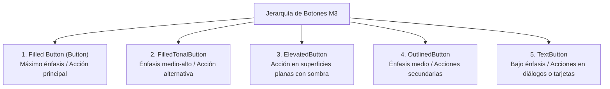
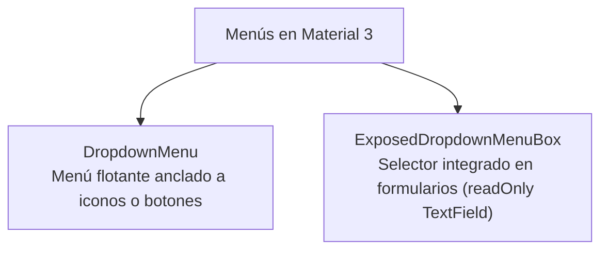

# **3A.2 Componentes Interactivos, Formularios y Diálogos**

En una aplicación móvil moderna, la interacción del usuario se basa en controles visuales ergonómicos, intuitivos y con feedback inmediato. Material Design 3 define una jerarquía estricta para botones, entradas de texto y elementos modales, garantizando que el usuario comprenda la importancia de cada acción antes de pulsarla.

En este apartado exploraremos los componentes interactivos fundamentales de M3, aprenderemos a construir formularios con validación reactiva y analizaremos la gestión de ventanas modales y diálogos.

---

## 1. La Jerarquía de Botones en Material 3

No todos los botones tienen la misma relevancia en una pantalla. M3 ofrece 5 variantes principales según el nivel de atención que requieren:



### 1.1. Ejemplo de Uso de las Variantes

```kotlin
@Composable
fun BotonesDemostracion(
    onGuardar: () -> Unit,
    onCancelar: () -> Unit
) {
    Row(
        horizontalArrangement = Arrangement.spacedBy(8.dp),
        modifier = Modifier.padding(16.dp)
    ) {
        // Acción primaria destacada
        Button(onClick = onGuardar) {
            Icon(Icons.Filled.Check, contentDescription = null)
            Spacer(Modifier.width(8.dp))
            Text("Guardar")
        }

        // Acción secundaria con borde
        OutlinedButton(onClick = onCancelar) {
            Text("Cancelar")
        }

        // Botón plano de menor jerarquía
        TextButton(onClick = { /* Ayuda */ }) {
            Text("Ayuda")
        }
    }
}
```

??? example "🔍 Ver implementación en el showroom: `Material3_example`"

    - **Ficheros de referencia:**  
      - `com.pmdm.mt3.components.Buttons.FilledButtonScreen.kt`
      - `com.pmdm.mt3.components.Buttons.OutlinedButtonScreen.kt`
      - `com.pmdm.mt3.components.Buttons.ElevatedButtonScreen.kt`
    - **Selector en `MainActivity.kt`:** Configura `Screen.FilledButton` o `Screen.OutlinedButton`.

---

## 2. Formularios y Entradas de Texto (`OutlinedTextField`)

Para la entrada de información por teclado, Material 3 recomienda el uso de **`OutlinedTextField`**, ya que su borde perimetral delimita claramente el área interactiva frente al fondo de la pantalla.

### 2.1. Anatomía y Validación Reactiva

Un campo de texto profesional en Compose debe contemplar tres aspectos clave:
1. **Etiqueta flotante (`label`):** Describe el dato esperado y asciende con animación al enfocar el campo.
2. **Iconos informativos:** `leadingIcon` a la izquierda (identifica el tipo de dato) y `trailingIcon` a la derecha (acciones como borrar texto o ver contraseña).
3. **Control y feedback de error:** Los parámetros `isError` y `supportingText` cambian el color del borde a rojo y muestran un mensaje explicativo debajo del campo.

```kotlin
@Composable
fun CampoEmailValidado(
    email: String,
    onEmailChange: (String) -> Unit
) {
    // Calculamos si el formato es inválido
    val esInvalido = email.isNotBlank() && !email.contains("@")

    OutlinedTextField(
        value = email,
        onValueChange = onEmailChange,
        label = { Text("Correo electrónico") },
        placeholder = { Text("usuario@dominio.com") },
        leadingIcon = {
            Icon(Icons.Filled.Email, contentDescription = null)
        },
        trailingIcon = {
            if (email.isNotEmpty()) {
                IconButton(onClick = { onEmailChange("") }) {
                    Icon(Icons.Filled.Clear, contentDescription = "Borrar texto")
                }
            }
        },
        isError = esInvalido,
        supportingText = {
            if (esInvalido) {
                Text(
                    text = "Introduce una dirección de correo válida",
                    color = MaterialTheme.colorScheme.error
                )
            } else {
                Text("Utilizaremos este email para enviarte la confirmación")
            }
        },
        singleLine = true,
        keyboardOptions = KeyboardOptions(keyboardType = KeyboardType.Email),
        modifier = Modifier.fillMaxWidth()
    )
}
```

---

## 3. Controles de Selección: Switch, Checkbox y Slider

### 3.1. Interruptores Binarios (`Switch`)
El componente `Switch` es el control idóneo para activar o desactivar estados booleanos independientes (por ejemplo, Modo Oscuro, Wi-Fi o Notificaciones):

```kotlin
@Composable
fun AjusteModoOscuro(
    activo: Boolean,
    onCambio: (Boolean) -> Unit
) {
    Row(
        modifier = Modifier.fillMaxWidth().padding(16.dp),
        horizontalArrangement = Arrangement.SpaceBetween,
        verticalAlignment = Alignment.CenterVertically
    ) {
        Text("Modo Oscuro")
        Switch(
            checked = activo,
            onCheckedChange = onCambio,
            thumbContent = {
                Icon(
                    imageVector = if (activo) Icons.Filled.DarkMode else Icons.Filled.LightMode,
                    contentDescription = null,
                    modifier = Modifier.size(SwitchDefaults.IconSize)
                )
            }
        )
    }
}
```

### 3.2. Casillas de Verificación (`Checkbox`)
Se utilizan para aceptar términos o seleccionar múltiples opciones dentro de una lista:

```kotlin
Row(verticalAlignment = Alignment.CenterVertically) {
    Checkbox(
        checked = aceptado,
        onCheckedChange = { nuevoValor -> aceptado = nuevoValor }
    )
    Text("Acepto las condiciones del servicio")
}
```

### 3.3. Deslizadores Continuos y por Pasos (`Slider`)
Permiten seleccionar un valor numérico dentro de un rango cerrado:

```kotlin
Column(modifier = Modifier.padding(16.dp)) {
    Text("Dificultad del juego: ${dificultad.toInt()}")
    Slider(
        value = dificultad,
        onValueChange = { dificultad = it },
        valueRange = 1f..5f,
        steps = 3 // Crea 3 puntos intermedios entre 1 y 5 (pasos discretos)
    )
}
```

---

## 4. Menús en Material 3: Flotantes y Expuestos

En Material 3 existen dos patrones principales para presentar listas de opciones seleccionables:

1. **Menú Desplegable Contextual (`DropdownMenu`):** Aparece como una tarjeta flotante anclada a un botón, tarjeta o icono de acciones (`MoreVert`).

2. **Menú Desplegable Expuesto (`ExposedDropdownMenuBox`):** Integra el menú dentro de un campo de texto en un formulario (el equivalente moderno y accesible al antiguo `Spinner` de Android).



### 4.1. Menú Desplegable Contextual (`DropdownMenu`)

Un `DropdownMenu` se posiciona automáticamente junto al elemento que lo invoca. Dentro de él, cada opción se define con `DropdownMenuItem`.

#### Anatomía de `DropdownMenuItem`
Permite una personalización completa mediante los siguientes parámetros:

- **`text`:** Contenido textual del elemento (`@Composable () -> Unit`).

- **`leadingIcon`:** Icono identificativo previo al texto.

- **`trailingIcon`:** Icono o texto complementario (como un atajo de teclado).

- **`enabled`:** Si es `false`, atenúa el elemento e impide su selección.

Además, podemos intercalar **`HorizontalDivider()`** para separar lógicamente grupos de acciones (por ejemplo, acciones normales de acciones destructivas).

```kotlin
@Composable
fun MenuOpcionesImagen(
    onCompartir: () -> Unit,
    onEliminar: () -> Unit
) {
    var expandido by remember { mutableStateOf(false) }

    Box {
        IconButton(onClick = { expandido = true }) {
            Icon(Icons.Filled.MoreVert, contentDescription = "Más opciones")
        }

        DropdownMenu(
            expanded = expandido,
            onDismissRequest = { expandido = false }
        ) {
            DropdownMenuItem(
                text = { Text("Compartir") },
                leadingIcon = { Icon(Icons.Filled.Share, contentDescription = null) },
                onClick = {
                    expandido = false
                    onCompartir()
                }
            )

            DropdownMenuItem(
                text = { Text("Descargar (No disponible)") },
                leadingIcon = { Icon(Icons.Filled.Download, contentDescription = null) },
                enabled = false,
                onClick = { /* Deshabilitado */ }
            )

            HorizontalDivider()

            DropdownMenuItem(
                text = { Text("Eliminar", color = MaterialTheme.colorScheme.error) },
                leadingIcon = {
                    Icon(
                        Icons.Filled.Delete,
                        contentDescription = null,
                        tint = MaterialTheme.colorScheme.error
                    )
                },
                onClick = {
                    expandido = false
                    onEliminar()
                }
            )
        }
    }
}
```

<figure style="text-align: center;">
  
  <figcaption>Personalización de ítems con iconos, estado deshabilitado y separador HorizontalDivider.</figcaption>
</figure>

---

### 4.2. Menús Expuestos para Formularios (`ExposedDropdownMenuBox`)

En formularios donde el usuario debe elegir una opción de una lista cerrada (como seleccionar dificultad, categoría o tipo de teléfono), Material 3 recomienda **`ExposedDropdownMenuBox`**.

#### Puntos Clave de su Implementación:

1. **Contenedor `ExposedDropdownMenuBox`:** Coordina la posición del menú desplegable con el campo de texto ancla.

2. **Doble Estado:**
    - `expandido (Boolean)`: Controla si el desplegable está visible.
    - `opcionSeleccionada (String)`: Guarda la opción elegida por el usuario.

3. **El campo ancla (`TextField` / `OutlinedTextField`):**
    - `readOnly = true`: Evita la apertura del teclado virtual del móvil.
    - `trailingIcon`: Utiliza `ExposedDropdownMenuDefaults.TrailingIcon(expanded = expandido)` que rota automáticamente según el estado.
    - `modifier = Modifier.menuAnchor()`: Vincula físicamente el campo con el menú desplegable.

4. **El menú (`ExposedDropdownMenu`):**
    - Se sitúa como segundo hijo del `Box` y contiene los correspondientes `DropdownMenuItem`.

```kotlin
@OptIn(ExperimentalMaterial3Api::class)
@Composable
fun SelectorDificultadFormulario(
    dificultadActual: String,
    onDificultadSeleccionada: (String) -> Unit
) {
    val opciones = listOf("Fácil (6 intentos)", "Normal (5 intentos)", "Difícil (4 intentos)")
    var expandido by remember { mutableStateOf(false) }

    ExposedDropdownMenuBox(
        expanded = expandido,
        onExpandedChange = { expandido = !expandido },
        modifier = Modifier.fillMaxWidth().padding(16.dp)
    ) {
        OutlinedTextField(
            value = dificultadActual,
            onValueChange = {},
            readOnly = true,
            label = { Text("Nivel de Dificultad") },
            trailingIcon = {
                ExposedDropdownMenuDefaults.TrailingIcon(expanded = expandido)
            },
            colors = ExposedDropdownMenuDefaults.outlinedTextFieldColors(),
            modifier = Modifier
                .menuAnchor()
                .fillMaxWidth()
        )

        ExposedDropdownMenu(
            expanded = expandido,
            onDismissRequest = { expandido = false }
        ) {
            opciones.forEach { opcion ->
                DropdownMenuItem(
                    text = { Text(opcion) },
                    onClick = {
                        onDificultadSeleccionada(opcion)
                        expandido = false
                    }
                )
            }
        }
    }
}
```

??? example "🔍 Ver implementación en el showroom: `Material3_example`"

    - **Ficheros de referencia:**
        - `com.pmdm.mt3.components.Menus.DropdownMenuScreen.kt`
        - `com.pmdm.mt3.components.Menus.ExposedDropdownMenuScreen.kt`
    - **Selectores en `MainActivity.kt`:** Configura `Screen.DropdownMenu` o `Screen.ExposedDropdownMenu`.

---

## 5. Ventanas Modales y Diálogos

### 5.1. Diálogo de Alerta (`AlertDialog`)
El componente `AlertDialog` interrumpe temporalmente la interacción para solicitar confirmación crítica o comunicar un resultado relevante (como la victoria o derrota en un juego):

```kotlin
@Composable
fun DialogoConfirmacionReinicio(
    visible: Boolean,
    onConfirmar: () -> Unit,
    onDescartar: () -> Unit
) {
    if (visible) {
        AlertDialog(
            onDismissRequest = onDescartar,
            icon = { Icon(Icons.Filled.Warning, contentDescription = null) },
            title = { Text("¿Reiniciar partida?") },
            text = { Text("Se perderá todo el progreso actual del tablero.") },
            confirmButton = {
                Button(onClick = onConfirmar) {
                    Text("Sí, reiniciar")
                }
            },
            dismissButton = {
                OutlinedButton(onClick = onDescartar) {
                    Text("Cancelar")
                }
            }
        )
    }
}
```

??? example "🔍 Ver implementación en el showroom: `Material3_example`"

    - **Fichero de referencia:** `com.pmdm.mt3.components.Dialogs.AlertDialogScreen.kt`
    - **Selector en `MainActivity.kt`:** Configura `Screen.AlertDialog`.

---

### 5.2. Hojas Deslizantes Inferiores (`ModalBottomSheet`)

Para presentar acciones ricas o filtros avanzados sin salir de la pantalla principal, M3 recomienda `ModalBottomSheet`:

```kotlin
@OptIn(ExperimentalMaterial3Api::class)
@Composable
fun PanelFiltrosInferior(
    mostrar: Boolean,
    onCerrar: () -> Unit
) {
    val sheetState = rememberModalBottomSheetState()

    if (mostrar) {
        ModalBottomSheet(
            onDismissRequest = onCerrar,
            sheetState = sheetState
        ) {
            Column(
                modifier = Modifier.fillMaxWidth().padding(24.dp)
            ) {
                Text("Opciones del Tablero", style = MaterialTheme.typography.titleLarge)
                Spacer(Modifier.height(16.dp))
                // Contenido del panel inferior
                Button(
                    onClick = onCerrar,
                    modifier = Modifier.fillMaxWidth()
                ) {
                    Text("Aplicar filtros")
                }
            }
        }
    }
}
```

??? example "🔍 Ver implementación en el showroom: `Material3_example`"

    - **Fichero de referencia:** `com.pmdm.mt3.components.BottomSheets.ModalBottomSheetScreen.kt`
    - **Selector en `MainActivity.kt`:** Configura `Screen.ModalBottomSheet`.
