# **3A.3 Listas y Cuadrículas Eficientes: Lazy Layouts**

Cuando una aplicación necesita mostrar una colección de datos (un catálogo de juegos, una lista de mensajes o un tablero de cartas), el rendimiento del scroll y la gestión de memoria se convierten en el factor más crítico para ofrecer una experiencia fluida a 60 o 120 fotogramas por segundo (fps).

En este apartado analizaremos por qué los contenedores estándar no escalan con grandes conjuntos de datos y dominaremos los contenedores perezosos oficiales de Compose: **`LazyColumn`** y **`LazyRow`** para listas, y **`LazyVerticalGrid`** y **`LazyHorizontalGrid`** para cuadrículas.

!!! info "Los iconos de los ejemplos"
    Como en el resto de la unidad, los iconos se cargan desde `res/drawable` con `painterResource(R.drawable.ic_…)`: son **Material Symbols** descargados como vectores, tal y como se explica en [Imágenes, iconos y recursos](../../02/2.3.2-imagenes-iconos-recursos.md#de-donde-sacar-los-iconos-material-symbols).

---

## 1. El Problema del Rendimiento: `Column` con scroll vs `LazyLayout`

En Compose es muy fácil hacer scroll envolviendo una columna normal con el modificador `verticalScroll`:

```kotlin
// ❌ INEFICIENTE para colecciones medianas o grandes:
Column(modifier = Modifier.verticalScroll(rememberScrollState())) {
    elementos.forEach { item ->
        TarjetaElemento(item)
    }
}
```

### ¿Por qué falla este enfoque con muchos elementos?

- **Composición masiva:** Si la lista contiene 500 elementos, `Column` ejecuta el código de los 500 componibles de golpe, los mide y los coloca, aunque en la pantalla solo quepan 5 a la vez.
- **Tirones (*jank*) y consumo de RAM:** Todo ese trabajo bloquea el hilo principal al abrir la pantalla y ocupa memoria con elementos que nadie está viendo.

### La Filosofía "Lazy" (Perezosa)

Los componentes **Lazy** solo trabajan con lo que se ve:

- Solo componen, miden y dibujan los elementos **visibles** en la ventana (*viewport*), más uno o dos de margen por arriba y por abajo.
- Conforme el usuario hace scroll, los elementos que salen de la pantalla se descartan y Compose **reutiliza** su composición para los que entran.

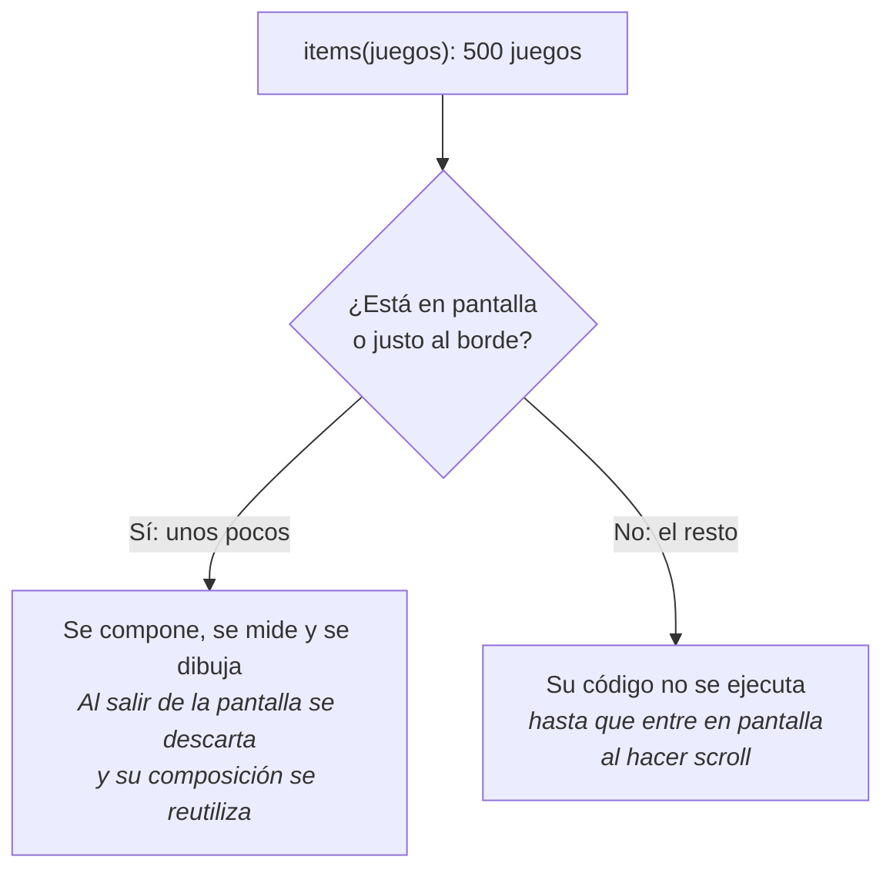

En el [playground de listas](#23-playground-de-listas) puedes comparar las dos formas: con `Column` se componen todos los elementos de golpe y con `LazyColumn` solo los que caben en pantalla.

---

## 2. Listas Verticales con `LazyColumn`

`LazyColumn` es el equivalente moderno y declarativo al antiguo `RecyclerView` de Android, pero sin necesidad de adaptadores (*Adapters*) ni ficheros XML.

=== "Tema claro"

    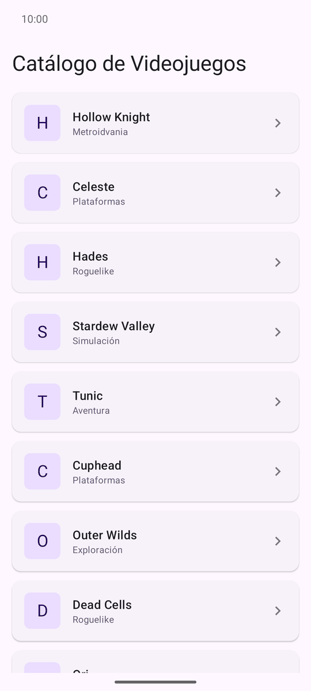{ width="270" }

=== "Tema oscuro"

    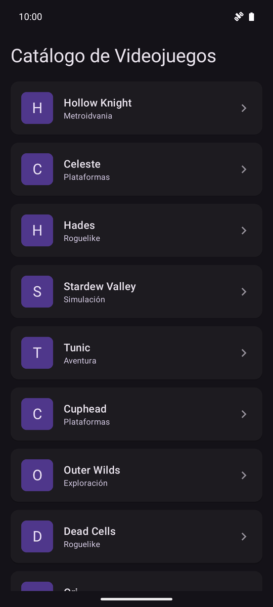{ width="270" }

### 2.1. Anatomía de `LazyListScope`

Dentro de la lambda de un `LazyColumn` disponemos de métodos especializados para emitir contenido:

- **`item { ... }`:** Permite emitir un único componible (por ejemplo, una cabecera de sección o un banner destacado).
- **`items(coleccion) { item -> ... }`:** Itera sobre una lista o colección de datos emitiendo un componible por cada registro.
- **`itemsIndexed(coleccion) { index, item -> ... }`:** Proporciona además la posición numérica de cada elemento.

```kotlin
@Composable
fun ListaCatalogoJuegos(
    juegos: List<JuegoItem>,
    onJuegoClick: (JuegoItem) -> Unit
) {
    LazyColumn(
        modifier = Modifier.fillMaxSize(),
        contentPadding = PaddingValues(16.dp), // Margen exterior de toda la lista
        verticalArrangement = Arrangement.spacedBy(12.dp) // Hueco automático entre tarjetas
    ) {
        // Cabecera única
        item {
            Text(
                text = "Catálogo de Videojuegos",
                style = MaterialTheme.typography.headlineMedium,
                modifier = Modifier.padding(bottom = 8.dp)
            )
        }

        // Listado dinámico con clave única
        items(
            items = juegos,
            key = { juego -> juego.id } // Identifica cada fila por su juego, no por su posición
        ) { juego ->
            TarjetaJuegoItem(
                juego = juego,
                onClick = { onJuegoClick(juego) }
            )
        }
    }
}
```

!!! tip "`contentPadding` mejor que `Modifier.padding`"
    `contentPadding` deja el margen **dentro** de la zona de scroll: las tarjetas pasan por debajo del margen al desplazarse y no se cortan de golpe en el borde. Con `Modifier.padding`, la lista entera encoge y el contenido se recorta a 16 dp del borde.

### 2.2. Listas Horizontales con `LazyRow` (carruseles)

`LazyRow` funciona igual que `LazyColumn`, pero en horizontal: usa `horizontalArrangement` en lugar de `verticalArrangement`. Su uso más habitual son los **carruseles** de una pantalla de inicio, cada uno dentro de un `item` de una `LazyColumn`:

=== "Tema claro"

    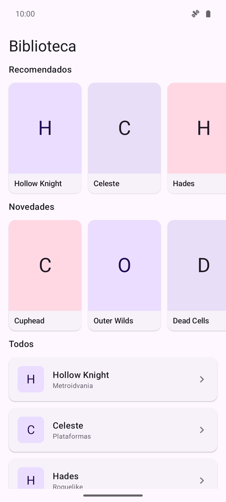{ width="270" }

=== "Tema oscuro"

    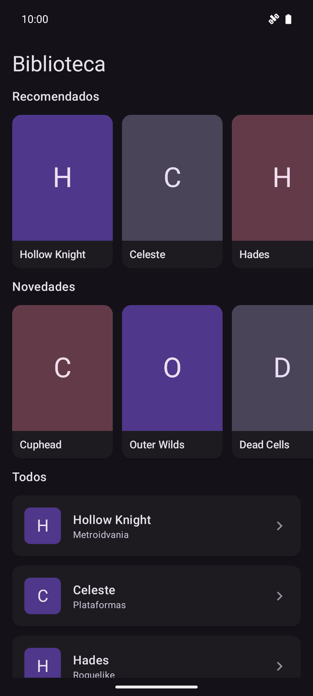{ width="270" }

```kotlin
LazyColumn(verticalArrangement = Arrangement.spacedBy(12.dp)) {
    item { TituloSeccion("Recomendados") }
    item {
        LazyRow(
            contentPadding = PaddingValues(horizontal = 16.dp),
            horizontalArrangement = Arrangement.spacedBy(12.dp)
        ) {
            items(recomendados, key = { it.id }) { juego ->
                Portada(juego, modifier = Modifier.width(132.dp))
            }
        }
    }
    item { TituloSeccion("Todos") }
    items(juegos, key = { it.id }) { juego -> TarjetaJuegoItem(juego, onClick = {}) }
}
```

!!! warning "Una lista con scroll vertical dentro de otra, nunca"
    Se puede meter una `LazyRow` dentro de una `LazyColumn` porque se desplazan en direcciones distintas. Lo que **no** se puede es meter una `LazyColumn` dentro de otra `LazyColumn` (o de una `Column` con `verticalScroll`): la app se cierra con el error *«Vertically scrollable component was measured with an infinity maximum height constraints»*. Usa varios `item` / `items` dentro de la misma `LazyColumn`.

### 2.3. Playground de listas

Elige el contenedor y el número de elementos, haz scroll en el móvil y fíjate en el contador de filas compuestas. Las filas que se iluminan son las que Compose acaba de componer al entrar en pantalla.

<div class="cpg" data-cpg="lazylist"></div>

Cosas que conviene probar:

- Con 1000 elementos, compara `LazyColumn` con `Column + verticalScroll`: en la primera, «compuestos ahora» se queda en una docena; en la segunda, son los 1000.

- Pasa a `LazyRow`: es la misma idea en horizontal.

- Quita la `key`, marca dos o tres corazones y pulsa «Eliminar el primero». Lo explicamos en el apartado siguiente.

---

## 3. La Clave del Rendimiento: Asignación de `key`

El parámetro `key = { it.id }` en la función `items` le dice a Compose **cómo identificar cada fila**:

- **Sin `key`:** Compose identifica cada fila por su posición (`0, 1, 2...`). Todo el estado que la fila guarda con `remember` (si está desplegada, un favorito, una animación en curso…) va unido a esa **posición**. Si eliminas el primer elemento, todos suben un puesto, pero el estado se queda donde estaba: el juego que ahora ocupa la posición 0 hereda el estado del que has borrado.
- **Con `key`:** Cada fila queda unida al identificador de su elemento. Al eliminar, añadir o reordenar, el estado viaja con su elemento, Compose sabe qué filas solo han cambiado de sitio (y no tiene que volver a componerlas) y puede animar el movimiento con `Modifier.animateItem()`.

```kotlin
// Siempre proporciona un identificador único e inmutable como clave
items(
    items = listaTareas,
    key = { tarea -> tarea.id }
) { tarea ->
    FilaTarea(tarea)
}
```

Compruébalo en el [playground de listas](#23-playground-de-listas): sin `key`, los corazones se quedan en su posición y pasan a otros juegos; con `key`, cada corazón sigue a su juego.

!!! tip "`contentType` para listas con filas de varios tipos"
    Si una lista mezcla cabeceras, tarjetas y anuncios, añade `contentType = { it.tipo }` a `items`. Así Compose solo reutiliza la composición de una fila para otra **del mismo tipo**, que es mucho más barato.

---

## 4. Cuadrículas Adaptativas con `LazyVerticalGrid`

Cuando el contenido no es puramente secuencial sino que se organiza en filas y columnas (como un catálogo de productos, una galería de fotos o el tablero de cartas de un **Memory Match**), utilizamos **`LazyVerticalGrid`**. Dentro tiene los mismos `item`, `items` e `itemsIndexed` que `LazyColumn`.

### 4.1. Modos de Cuadrícula

El parámetro `columns` define cómo se distribuyen las celdas:

1. **`GridCells.Fixed(columnas)`:** Fija un número exacto de columnas sin importar el tamaño de la pantalla (ideal para tableros cerrados, como un 4x4). Si hay más espacio, las celdas crecen.

2. **`GridCells.Adaptive(minSize)`:** Mete tantas columnas como quepan con al menos `minSize` de ancho y reparte el espacio sobrante entre ellas. En un móvil en vertical caben 2 o 3; si se gira a horizontal o es una tablet, salen 5 o 6 sin tocar el código.

3. **`GridCells.FixedSize(size)`:** Las celdas miden exactamente `size` y caben tantas como quepan. El espacio sobrante no se reparte entre las celdas.

La misma cuadrícula con `GridCells.Adaptive(110.dp)`, con el móvil en vertical (3 columnas) y en horizontal (6 columnas):

=== "Tema claro"

    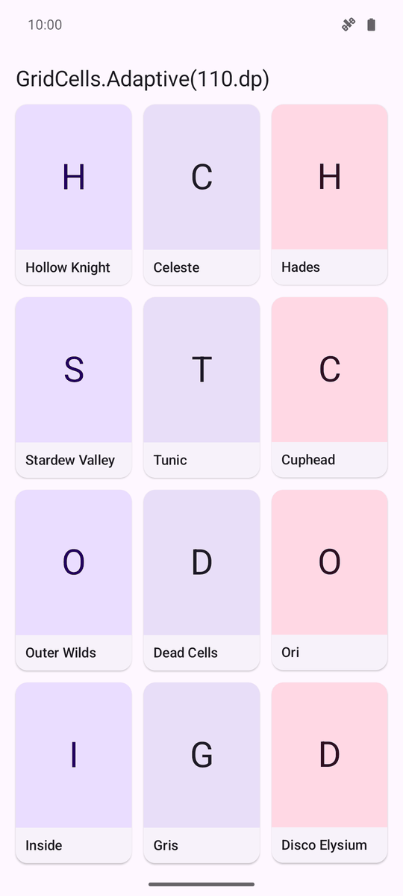{ width="240" }
    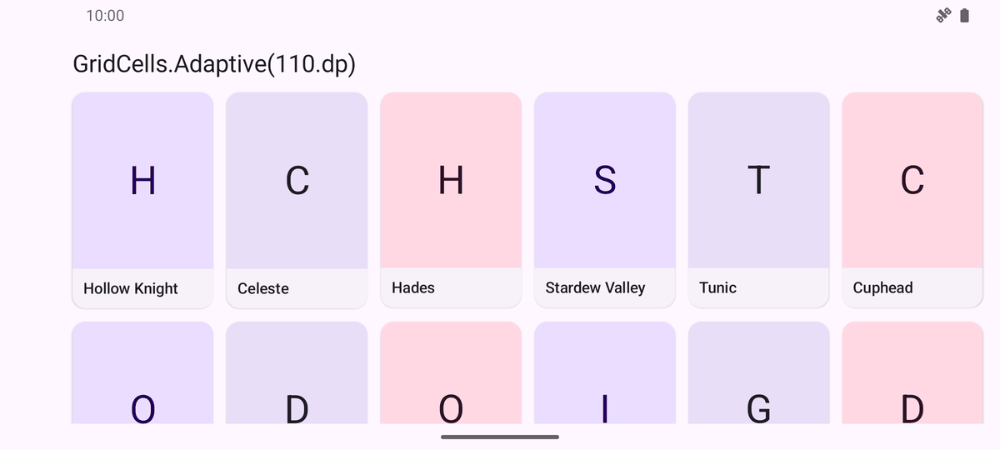{ width="533" }

=== "Tema oscuro"

    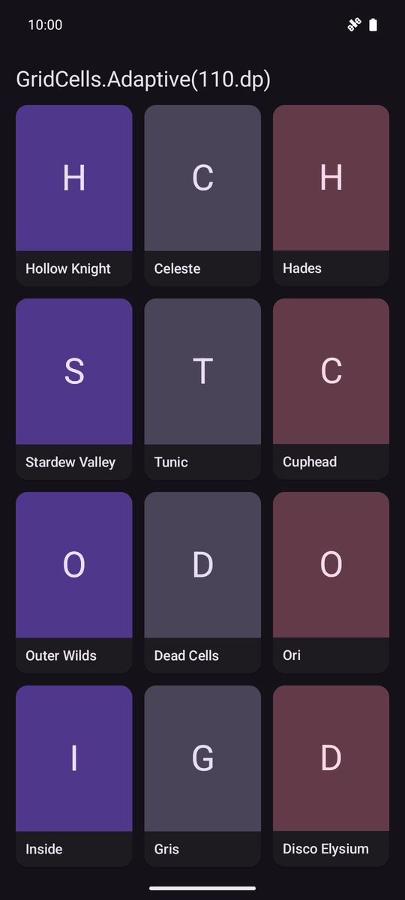{ width="240" }
    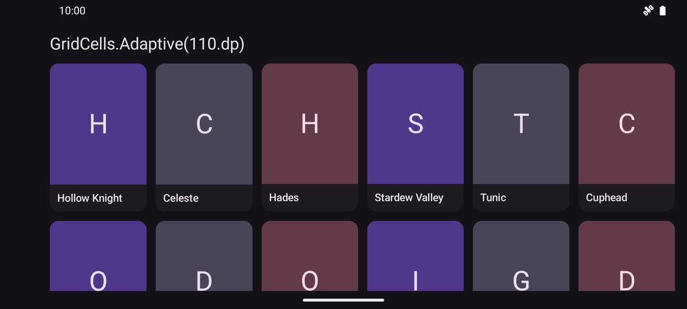{ width="533" }

### 4.2. Ejemplo: Tablero de Cartas en Cuadrícula

Un tablero de Memory 4 × 4 con `GridCells.Fixed(4)`: siempre cuatro columnas, sea cual sea el ancho de la pantalla.

=== "Tema claro"

    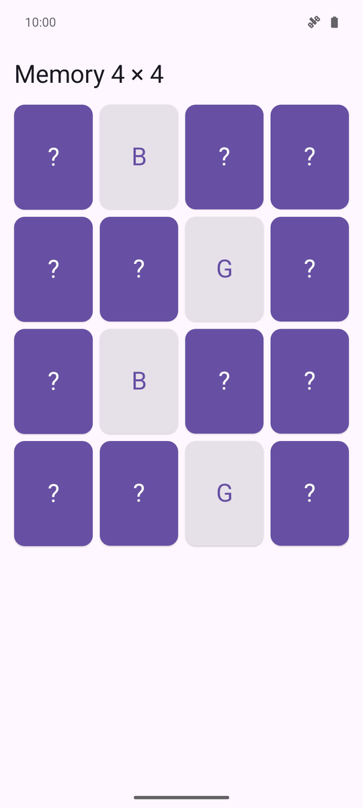{ width="270" }

=== "Tema oscuro"

    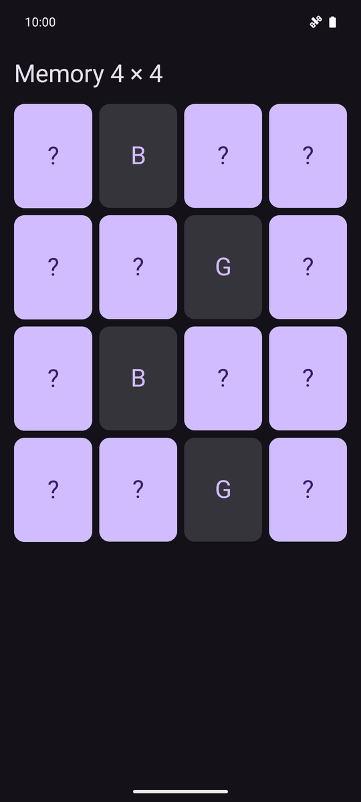{ width="270" }

```kotlin
@Composable
fun TableroMemoryGrid(
    cartas: List<CartaItem>,
    onCartaClick: (Int) -> Unit
) {
    LazyVerticalGrid(
        columns = GridCells.Fixed(4), // Tablero de 4 columnas
        modifier = Modifier.fillMaxSize().padding(16.dp),
        horizontalArrangement = Arrangement.spacedBy(8.dp),
        verticalArrangement = Arrangement.spacedBy(8.dp)
    ) {
        items(
            count = cartas.size,
            key = { indice -> cartas[indice].id }
        ) { indice ->
            val carta = cartas[indice]
            TarjetaCartaJuego(
                carta = carta,
                onClick = { onCartaClick(indice) }
            )
        }
    }
}
```

### 4.3. Cabeceras que ocupan toda la fila (`span`)

Cada `item` de una cuadrícula puede indicar cuántas columnas ocupa con el parámetro `span`. Con `GridItemSpan(maxLineSpan)` ocupa la fila entera, que es lo que necesitas para los títulos de sección (o para el título «Memory 4 × 4» de la captura anterior):

=== "Tema claro"

    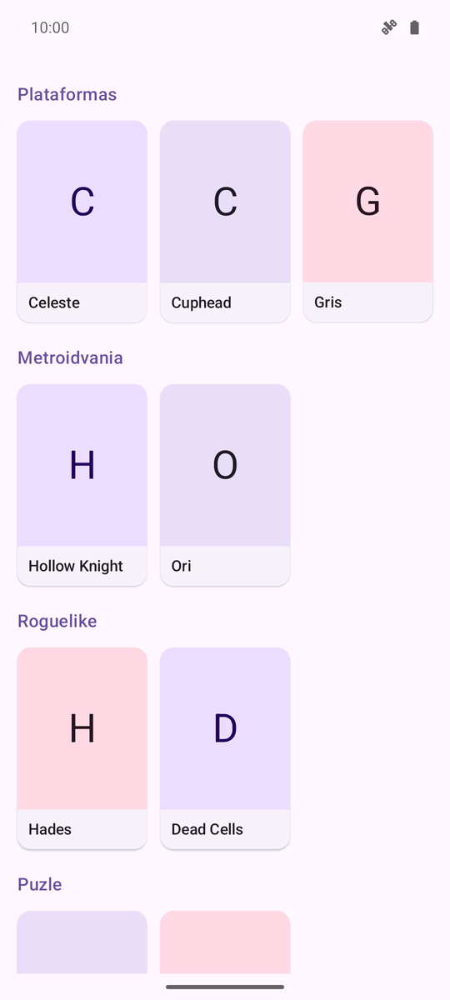{ width="270" }

=== "Tema oscuro"

    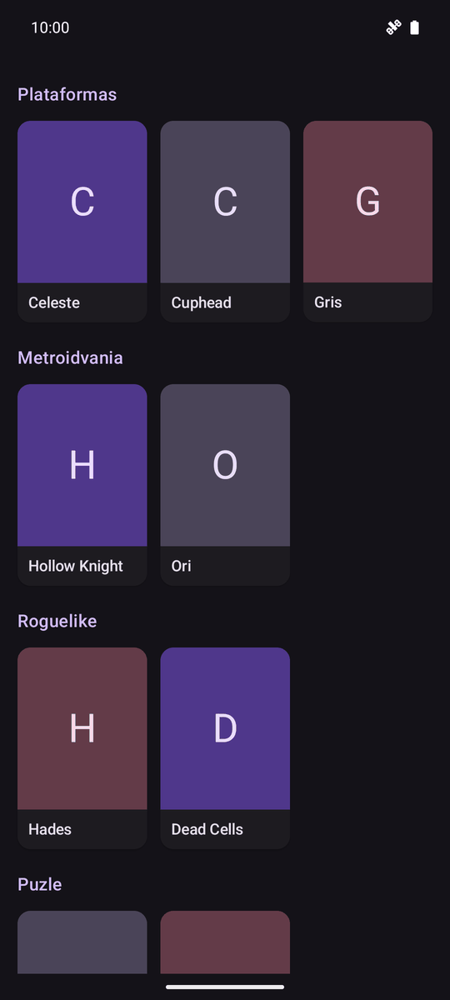{ width="270" }

```kotlin
LazyVerticalGrid(
    columns = GridCells.Fixed(3),
    contentPadding = PaddingValues(16.dp),
    horizontalArrangement = Arrangement.spacedBy(12.dp),
    verticalArrangement = Arrangement.spacedBy(12.dp)
) {
    juegosPorGenero.forEach { (genero, juegos) ->
        // La cabecera ocupa todas las columnas de su fila
        item(span = { GridItemSpan(maxLineSpan) }) {
            Text(genero, style = MaterialTheme.typography.titleMedium)
        }
        items(juegos, key = { it.id }) { juego -> Portada(juego) }
    }
}
```

### 4.4. Cuadrículas Horizontales con `LazyHorizontalGrid`

`LazyHorizontalGrid` es la versión que se desplaza en horizontal. En lugar de `columns` recibe **`rows`**, con los mismos `GridCells.Fixed`, `Adaptive` y `FixedSize`. Es útil para varias filas de categorías o de portadas que se recorren de lado:

=== "Tema claro"

    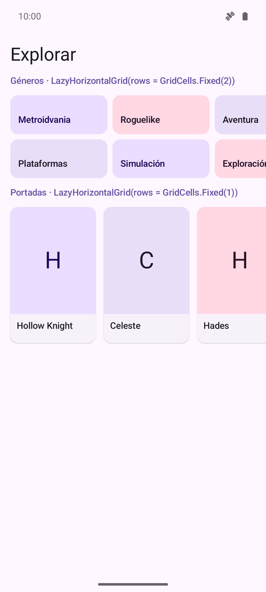{ width="270" }

=== "Tema oscuro"

    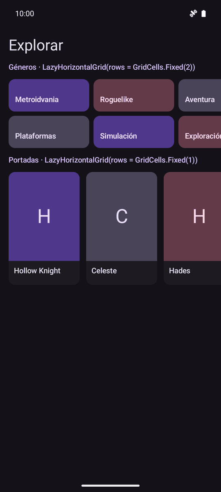{ width="270" }

```kotlin
LazyHorizontalGrid(
    rows = GridCells.Fixed(2),
    modifier = Modifier.height(128.dp), // Imprescindible: necesita un alto definido
    contentPadding = PaddingValues(horizontal = 16.dp),
    horizontalArrangement = Arrangement.spacedBy(8.dp),
    verticalArrangement = Arrangement.spacedBy(8.dp)
) {
    items(generos) { genero -> TarjetaGenero(genero, modifier = Modifier.width(150.dp)) }
}
```

!!! warning "Dale siempre un alto a `LazyHorizontalGrid`"
    Para saber cuánto mide cada fila, la cuadrícula horizontal reparte su **alto** entre las filas. Si está dentro de una `Column` con scroll o de una `LazyColumn` y no le das un alto con `Modifier.height(…)`, ese alto es infinito y la app se cierra.

### 4.5. Playground de cuadrículas

Elige el contenedor y el tipo de celdas, y mueve el deslizador del espacio disponible: es lo que pasa al girar el móvil o al abrir la app en una tablet. Debajo verás cuántas columnas (o filas) salen y cuánto mide cada celda.

<div class="cpg" data-cpg="lazygrid"></div>

Cosas que conviene probar:

- Con `Fixed(4)`, mueve el deslizador: siempre hay cuatro columnas y lo que cambia es el tamaño de las celdas.

- Con `Adaptive(110)`, mueve el deslizador: el tamaño de las celdas apenas cambia y lo que varía es el **número** de columnas.

- Con `FixedSize(96)`, fíjate en el espacio que sobra a la derecha: no se reparte entre las celdas.

- Activa las cabeceras y pasa a `LazyHorizontalGrid`: con `span = maxLineSpan`, la cabecera ocupa toda la **columna**.

---

## 5. Diseño de Tarjetas de Colección (`ElevatedCard`)

Para que cada elemento de la lista se distinga visualmente como una superficie táctil independiente, utilizamos las tarjetas de Material 3 (es la tarjeta de la captura del [apartado 2](#2-listas-verticales-con-lazycolumn)):

```kotlin
@Composable
fun TarjetaJuegoItem(
    juego: JuegoItem,
    onClick: () -> Unit,
    modifier: Modifier = Modifier
) {
    ElevatedCard(
        onClick = onClick,
        modifier = modifier.fillMaxWidth(),
        shape = MaterialTheme.shapes.medium
    ) {
        Row(
            modifier = Modifier.padding(16.dp),
            verticalAlignment = Alignment.CenterVertically
        ) {
            Surface(
                color = MaterialTheme.colorScheme.primaryContainer,
                shape = MaterialTheme.shapes.small,
                modifier = Modifier.size(48.dp)
            ) {
                Box(contentAlignment = Alignment.Center) {
                    Text(
                        text = juego.titulo.take(1).uppercase(),
                        style = MaterialTheme.typography.titleLarge,
                        color = MaterialTheme.colorScheme.onPrimaryContainer
                    )
                }
            }

            Spacer(modifier = Modifier.width(16.dp))

            Column(modifier = Modifier.weight(1f)) {
                Text(
                    text = juego.titulo,
                    style = MaterialTheme.typography.titleMedium
                )
                Text(
                    text = juego.genero,
                    style = MaterialTheme.typography.bodySmall,
                    color = MaterialTheme.colorScheme.secondary
                )
            }

            Icon(
                painter = painterResource(R.drawable.ic_chevron_right),
                contentDescription = null,
                tint = MaterialTheme.colorScheme.outline
            )
        }
    }
}
```

---

## 6. ¿Qué contenedor elijo?

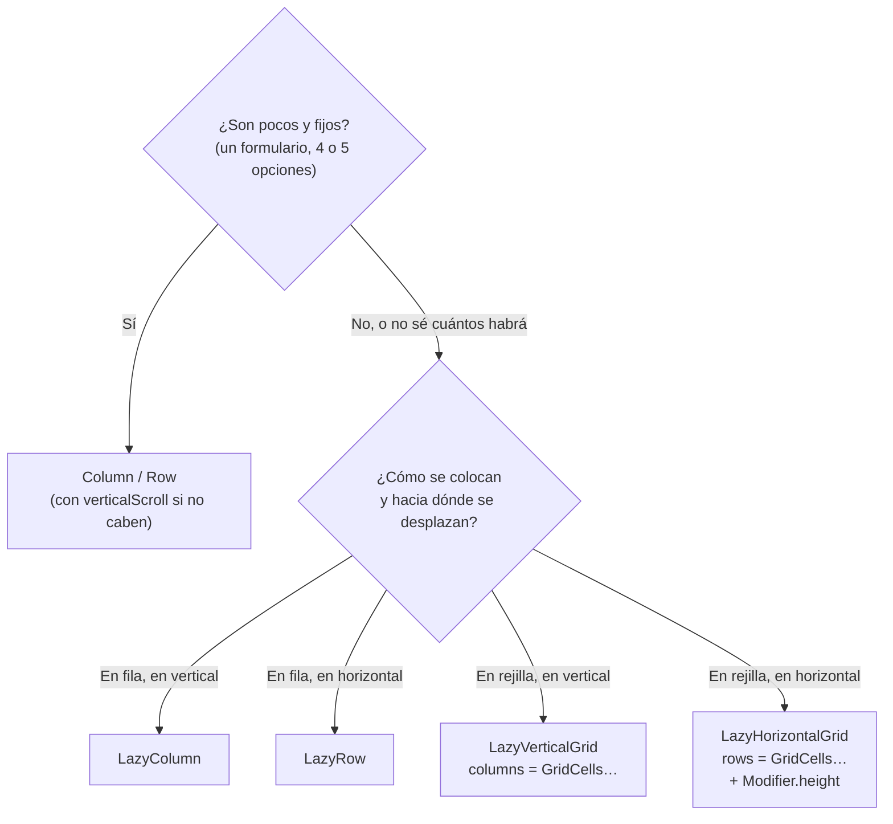

Y para el parámetro `columns` (o `rows`) de una cuadrícula:

| Quiero… | Uso | Ejemplo |
| --- | --- | --- |
| Siempre el mismo número de columnas | `GridCells.Fixed(n)` | Tablero de Memory 4 × 4 |
| Que quepan más columnas cuanto más ancha sea la pantalla | `GridCells.Adaptive(minSize)` | Catálogo de portadas en móvil y tablet |
| Celdas de un tamaño exacto | `GridCells.FixedSize(size)` | Paleta de colores o de iconos |
