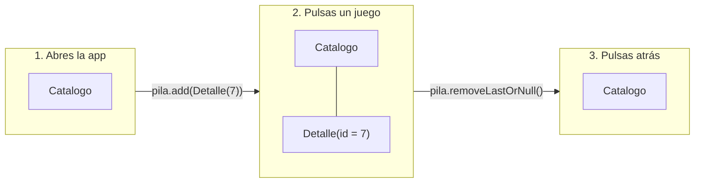
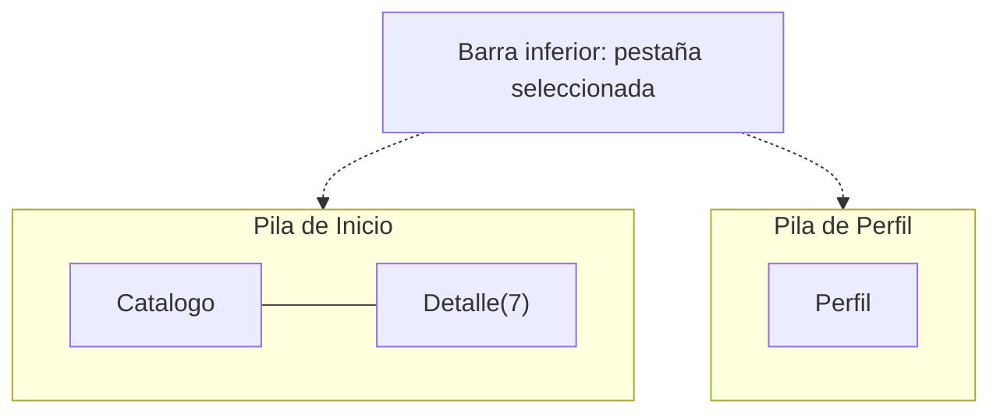

# **3B.1 Navegación con Navigation 3**

Hasta ahora nuestras apps tenían una sola pantalla. Una app real tiene muchas: un catálogo, el detalle de cada elemento, los ajustes, el perfil… y el usuario espera moverse entre ellas con naturalidad y volver atrás con el botón o el gesto del sistema.

**Navigation 3** es la librería oficial de Google para navegar entre pantallas en Jetpack Compose. Es estable desde finales de 2025 y está diseñada desde cero para Compose. Su idea central es muy sencilla:

> **La pila de navegación es una lista que tú controlas.** Navegar es añadir un elemento a la lista; volver es quitar el último. La pantalla que se ve es la del último elemento.

Es exactamente el mismo principio que ya conocemos de Compose, `UI = f(estado)`, aplicado a la navegación: **`pantalla visible = f(pila)`**.

!!! info "¿Y `NavHost` y `NavController`?"
    En muchos tutoriales verás `NavHost`, `NavController` y `navController.navigate(...)`. Son de **Navigation 2**, la librería anterior. Sigue funcionando, pero en este curso usamos Navigation 3. Si copias código de internet, fíjate en los paquetes: Navigation 3 usa `androidx.navigation3.*`.

---

## 1. La idea: una pila de pantallas

Imagina una pila de cartas. Cada carta es una pantalla y solo ves la de arriba:



- **Navegar hacia delante:** `pila.add(destino)`.
- **Volver atrás:** `pila.removeLastOrNull()`.
- **Lo que se muestra:** siempre la pantalla correspondiente al **último** elemento.

Como la pila es un estado observable de Compose, cada vez que cambia, la interfaz se actualiza sola.

---

## 2. Configurar el proyecto

Navigation 3 se compone de varias librerías. Añádelas al catálogo de versiones y al módulo `app`:

=== "gradle/libs.versions.toml"

    ```toml
    [versions]
    nav3Core = "1.2.0"
    lifecycleViewmodelNav3 = "2.11.0"
    kotlinxSerializationCore = "1.9.0"

    [libraries]
    androidx-navigation3-runtime = { module = "androidx.navigation3:navigation3-runtime", version.ref = "nav3Core" }
    androidx-navigation3-ui = { module = "androidx.navigation3:navigation3-ui", version.ref = "nav3Core" }
    androidx-lifecycle-viewmodel-navigation3 = { module = "androidx.lifecycle:lifecycle-viewmodel-navigation3", version.ref = "lifecycleViewmodelNav3" }
    kotlinx-serialization-core = { module = "org.jetbrains.kotlinx:kotlinx-serialization-core", version.ref = "kotlinxSerializationCore" }

    [plugins]
    # Usa la misma versión que tu plugin de Kotlin
    jetbrains-kotlin-serialization = { id = "org.jetbrains.kotlin.plugin.serialization", version.ref = "kotlin" }
    ```

=== "app/build.gradle.kts"

    ```kotlin
    plugins {
        // ... los que ya tenías
        alias(libs.plugins.jetbrains.kotlin.serialization)
    }

    dependencies {
        // ... las que ya tenías
        implementation(libs.androidx.navigation3.runtime)
        implementation(libs.androidx.navigation3.ui)
        implementation(libs.androidx.lifecycle.viewmodel.navigation3)
        implementation(libs.kotlinx.serialization.core)
    }
    ```

| Librería | Para qué sirve |
|---|---|
| `navigation3-runtime` | La pila (`NavBackStack`), las claves (`NavKey`) y las entradas (`NavEntry`) |
| `navigation3-ui` | El composable `NavDisplay`, que muestra la pantalla actual y gestiona el botón atrás |
| `lifecycle-viewmodel-navigation3` | Que cada pantalla tenga su propio ViewModel (apartado 6) |
| Plugin y librería de serialización | Que la pila sobreviva a rotaciones y al cierre del proceso |

!!! note "Versiones"
    Las versiones son las de la [guía oficial](https://developer.android.com/guide/navigation/navigation-3/get-started) y las [recetas oficiales](https://github.com/android/nav3-recipes) en el momento de escribir estos apuntes. Si Gradle avisa de que la librería necesita un `compileSdk` mayor, súbelo en `app/build.gradle.kts`. Consulta la [matriz de compatibilidad](../../00-android/00-tools/04-matriz-compatibilidad.md) del curso.

---

## 3. Paso 1: definir los destinos

Cada pantalla se identifica con una **clave** (*key*): un objeto o una clase de Kotlin que cumple dos requisitos:

- Implementa la interfaz **`NavKey`**.
- Lleva la anotación **`@Serializable`**.

```kotlin
import androidx.navigation3.runtime.NavKey
import kotlinx.serialization.Serializable

// Pantallas sin argumentos: data object
@Serializable
data object Catalogo : NavKey

@Serializable
data object Ajustes : NavKey

// Pantallas con argumentos: data class
@Serializable
data class Detalle(val juegoId: Int) : NavKey
```

Los **argumentos** de una pantalla son simplemente las propiedades de su clave. Para abrir el detalle del juego 7 basta con añadir `Detalle(juegoId = 7)` a la pila: el compilador comprueba que el tipo es correcto y no hay cadenas de texto que puedan tener erratas.

!!! tip "Pasa identificadores, no objetos completos"
    La clave debe contener lo **mínimo** para que la pantalla sepa qué mostrar: normalmente un identificador. No pases el objeto `Juego` entero: se copiaría al guardar la pila, podría quedarse desactualizado y algunos tipos no se pueden serializar. La pantalla de detalle ya se encargará de buscar el juego a partir de su `juegoId`.

---

## 4. Paso 2: crear la pila

La pila se crea con `rememberNavBackStack`, indicando la pantalla inicial:

```kotlin
val pila = rememberNavBackStack(Catalogo)
```

`rememberNavBackStack` no es un simple `remember`: **guarda la pila** cuando se gira el móvil o cuando Android cierra la app en segundo plano para liberar memoria, y la restaura al volver. Para poder guardarla necesita convertir cada clave a texto, y por eso las claves deben ser `@Serializable` y `NavKey`.

---

## 5. Paso 3: mostrar la pantalla actual con `NavDisplay`

`NavDisplay` observa la pila y muestra la pantalla correspondiente al último elemento. Necesita saber **qué composable corresponde a cada clave**; eso se lo indicamos con `entryProvider` y la función `entry<TipoDeClave>`.

Este es un ejemplo completo con tres pantallas. Los datos están en memoria; en 3C los organizaremos con una arquitectura profesional.

```kotlin
// ---------- Datos de ejemplo (en memoria) ----------
data class Juego(val id: Int, val titulo: String, val plataforma: String)

object JuegosEnMemoria {
    val juegos = listOf(
        Juego(1, "Hollow Knight", "Switch"),
        Juego(2, "Celeste", "PC"),
        Juego(7, "Zelda: Tears of the Kingdom", "Switch")
    )
    fun buscar(id: Int): Juego? = juegos.find { it.id == id }
}

// ---------- Navegación ----------
@Composable
fun AppNavegacion() {
    val pila = rememberNavBackStack(Catalogo)

    NavDisplay(
        backStack = pila,
        onBack = { pila.removeLastOrNull() },
        entryProvider = entryProvider {
            entry<Catalogo> {
                PantallaCatalogo(
                    juegos = JuegosEnMemoria.juegos,
                    onJuegoClick = { id -> pila.add(Detalle(juegoId = id)) },
                    onAjustesClick = { pila.add(Ajustes) }
                )
            }
            entry<Detalle> { clave ->
                PantallaDetalle(
                    juego = JuegosEnMemoria.buscar(clave.juegoId),
                    onVolver = { pila.removeLastOrNull() }
                )
            }
            entry<Ajustes> {
                PantallaAjustes(onVolver = { pila.removeLastOrNull() })
            }
        }
    )
}
```

Fíjate en tres detalles:

1. **`entry<Detalle> { clave -> … }`** recibe la clave, y de ella se leen los argumentos: `clave.juegoId`.

2. **Las pantallas no conocen la pila.** `PantallaCatalogo` recibe lambdas como `onJuegoClick` y no sabe qué pasa al pulsar. Así la pantalla se puede previsualizar con `@Preview` y reutilizar, y toda la lógica de navegación está en un único sitio: `AppNavegacion`.

3. **`AppNavegacion` se llama desde `setContent`** de la `MainActivity`, dentro del tema de la app.

??? example "Ver las tres pantallas de ejemplo"

    ```kotlin
    @OptIn(ExperimentalMaterial3Api::class)
    @Composable
    fun PantallaCatalogo(
        juegos: List<Juego>,
        onJuegoClick: (Int) -> Unit,
        onAjustesClick: () -> Unit,
        modifier: Modifier = Modifier
    ) {
        Scaffold(
            modifier = modifier,
            topBar = {
                TopAppBar(
                    title = { Text("Mis juegos") },
                    actions = {
                        IconButton(onClick = onAjustesClick) {
                            Icon(painterResource(R.drawable.ic_settings), contentDescription = "Ajustes")
                        }
                    }
                )
            }
        ) { innerPadding ->
            LazyColumn(contentPadding = innerPadding) {
                items(juegos, key = { it.id }) { juego ->
                    ListItem(
                        headlineContent = { Text(juego.titulo) },
                        supportingContent = { Text(juego.plataforma) },
                        modifier = Modifier.clickable { onJuegoClick(juego.id) }
                    )
                }
            }
        }
    }

    @OptIn(ExperimentalMaterial3Api::class)
    @Composable
    fun PantallaDetalle(
        juego: Juego?,
        onVolver: () -> Unit,
        modifier: Modifier = Modifier
    ) {
        Scaffold(
            modifier = modifier,
            topBar = {
                TopAppBar(
                    title = { Text(juego?.titulo ?: "Juego no encontrado") },
                    navigationIcon = {
                        IconButton(onClick = onVolver) {
                            Icon(painterResource(R.drawable.ic_arrow_back), contentDescription = "Volver")
                        }
                    }
                )
            }
        ) { innerPadding ->
            Column(modifier = Modifier.padding(innerPadding).padding(16.dp)) {
                if (juego != null) {
                    Text("Plataforma: ${juego.plataforma}", style = MaterialTheme.typography.bodyLarge)
                }
            }
        }
    }

    @OptIn(ExperimentalMaterial3Api::class)
    @Composable
    fun PantallaAjustes(onVolver: () -> Unit, modifier: Modifier = Modifier) {
        Scaffold(
            modifier = modifier,
            topBar = {
                TopAppBar(
                    title = { Text("Ajustes") },
                    navigationIcon = {
                        IconButton(onClick = onVolver) {
                            Icon(painterResource(R.drawable.ic_arrow_back), contentDescription = "Volver")
                        }
                    }
                )
            }
        ) { innerPadding ->
            Text("Aquí irán los ajustes", modifier = Modifier.padding(innerPadding).padding(16.dp))
        }
    }
    ```

    Los iconos `ic_settings` e `ic_arrow_back` son Material Symbols descargados como vector (ver [2.3.2 Imágenes, iconos y recursos](../../02/2.3.2-imagenes-iconos-recursos.md#de-donde-sacar-los-iconos-material-symbols)).

??? info "Imports principales de Navigation 3"

    ```kotlin
    import androidx.navigation3.runtime.NavKey
    import androidx.navigation3.runtime.entryProvider
    import androidx.navigation3.runtime.rememberNavBackStack
    import androidx.navigation3.runtime.rememberSaveableStateHolderNavEntryDecorator
    import androidx.navigation3.ui.NavDisplay
    import androidx.lifecycle.viewmodel.navigation3.rememberViewModelStoreNavEntryDecorator
    import androidx.navigation3.runtime.result.LocalResultEventBus
    import androidx.navigation3.runtime.result.rememberResultEventBusNavEntryDecorator
    import androidx.lifecycle.viewmodel.compose.viewModel
    import kotlinx.serialization.Serializable
    ```

    Si el IDE propone importar `NavHost` o `androidx.navigation.compose.*`, es Navigation 2: no lo aceptes.

---

## 6. Volver atrás

`NavDisplay` llama a `onBack` cuando el usuario pulsa el **botón atrás** o hace el **gesto atrás** del sistema. Lo normal es quitar el último elemento de la pila:

```kotlin
onBack = { pila.removeLastOrNull() }
```

Cuando en la pila **solo queda una pantalla**, `NavDisplay` deja de interceptar el gesto atrás y el sistema cierra la app, que es el comportamiento que espera el usuario. Además, `NavDisplay` es compatible con el **gesto atrás predictivo** de Android: al empezar a deslizar se ve una vista previa de la pantalla anterior.

La flecha «volver» de la barra superior debe hacer exactamente lo mismo, por eso en el ejemplo `onVolver` también llama a `pila.removeLastOrNull()`.

---

## 7. Operaciones habituales con la pila

Como la pila es una lista, cualquier operación de navegación se expresa con métodos de lista:

| Quiero… | Código |
|---|---|
| Ir a una pantalla | `pila.add(Detalle(7))` |
| Volver atrás | `pila.removeLastOrNull()` |
| No duplicar la pantalla actual | `if (pila.lastOrNull() != Ajustes) pila.add(Ajustes)` |
| Sustituir la pantalla actual (sin poder volver a ella) | `pila[pila.lastIndex] = Inicio` |
| Volver a la pantalla inicial | `while (pila.size > 1) pila.removeLastOrNull()` |
| Empezar de cero (por ejemplo, tras iniciar o cerrar sesión) | `pila.clear()` seguido de `pila.add(Inicio)` |

!!! warning "Nunca dejes la pila vacía"
    `NavDisplay` necesita al menos una pantalla que mostrar. Si haces `pila.clear()`, añade el nuevo destino **en la misma acción** (dentro del mismo `onClick`), como en la última fila de la tabla. Compose aplica los dos cambios a la vez y el usuario nunca ve una pila vacía.

---

## 8. Un ViewModel para cada pantalla

En una app real, cada pantalla suele tener su propio **ViewModel** (lo estudiamos en [3C.1](../c-arquitectura/3c.1-capa-ui-viewmodel.md)). Queremos que:

- Se cree al entrar en la pantalla.
- Sobreviva a las rotaciones.
- **Se destruya al salir** de la pantalla (al quitarla de la pila).
- Si abrimos el detalle de dos juegos distintos, cada uno tenga **su propio** ViewModel.

Para conseguirlo, se añaden a `NavDisplay` unos **decoradores de entrada** (*entry decorators*), que envuelven cada pantalla con funcionalidad extra:

```kotlin
NavDisplay(
    backStack = pila,
    onBack = { pila.removeLastOrNull() },
    entryDecorators = listOf(
        rememberSaveableStateHolderNavEntryDecorator(),   // 1. conserva el estado de rememberSaveable
        rememberViewModelStoreNavEntryDecorator()         // 2. un ViewModel por pantalla
    ),
    entryProvider = entryProvider {
        entry<Detalle> { clave ->
            // El ViewModel queda asociado a ESTA entrada de la pila
            val viewModel = viewModel { DetalleViewModel(juegoId = clave.juegoId) }
            val estado by viewModel.uiState.collectAsStateWithLifecycle()
            PantallaDetalle(estado = estado, onVolver = { pila.removeLastOrNull() })
        }
        // ... resto de pantallas
    }
)
```

- `rememberSaveableStateHolderNavEntryDecorator()` debe ir **siempre el primero**. Hace que `rememberSaveable` funcione dentro de cada pantalla, por ejemplo para no perder lo escrito en un formulario al volver a él.
- `rememberViewModelStoreNavEntryDecorator()` da a cada entrada de la pila su propio almacén de ViewModels.
- `viewModel { DetalleViewModel(juegoId = clave.juegoId) }` crea el ViewModel pasándole el argumento de la pantalla.

!!! note "Dependencias de ViewModel en Compose"
    `viewModel { … }` está en la librería `androidx.lifecycle:lifecycle-viewmodel-compose` y `collectAsStateWithLifecycle()`, en `androidx.lifecycle:lifecycle-runtime-compose`. Si el IDE no las encuentra, añádelas al módulo `app` con la misma versión que el resto de librerías `lifecycle` del proyecto.

!!! danger "El error clásico: olvidar el decorador de ViewModel"
    Sin `rememberViewModelStoreNavEntryDecorator()`, los ViewModel se asocian a la **Activity**: no se destruyen al salir de la pantalla y, peor aún, todas las pantallas de detalle **comparten el mismo** ViewModel. Abres el juego 1, vuelves, abres el juego 7… y sigues viendo el juego 1.

En [3C.3](../c-arquitectura/3c.3-inyeccion-dependencias-koin.md) veremos cómo crear estos ViewModel con Koin en lugar de hacerlo a mano.

---

## 9. Devolver un resultado a la pantalla anterior

A veces una pantalla sirve para **elegir algo** y devolverlo a la anterior: un filtro, una dirección, un contacto… Desde la versión 1.2, Navigation 3 incluye para ello un **bus de resultados** (`ResultEventBus`).

Ejemplo: desde el catálogo se abre una pantalla para elegir la plataforma por la que filtrar.

```kotlin
enum class Plataforma { Todas, Switch, PC, PlayStation }

@Serializable
data object ElegirPlataforma : NavKey
```

**1. Activa el bus** añadiendo su decorador a `NavDisplay`:

```kotlin
entryDecorators = listOf(
    rememberSaveableStateHolderNavEntryDecorator(),
    rememberViewModelStoreNavEntryDecorator(),
    rememberResultEventBusNavEntryDecorator()
),
```

**2. La pantalla que elige envía el resultado** y vuelve atrás:

```kotlin
entry<ElegirPlataforma> {
    val bus = LocalResultEventBus.current
    PantallaElegirPlataforma(
        onElegida = { plataforma ->
            bus.sendResult(result = plataforma)
            pila.removeLastOrNull()
        }
    )
}
```

**3. La pantalla que lo recibe lo observa** como un estado:

```kotlin
entry<Catalogo> {
    val bus = LocalResultEventBus.current
    val filtro by bus.conflateAsState<Plataforma>(defaultValue = Plataforma.Todas)

    PantallaCatalogo(
        juegos = JuegosEnMemoria.juegos.filter {
            filtro == Plataforma.Todas || it.plataforma == filtro.name
        },
        filtro = filtro,
        onFiltroClick = { pila.add(ElegirPlataforma) },
        onJuegoClick = { id -> pila.add(Detalle(id)) }
    )
}
```

El bus empareja quién envía y quién recibe por el **tipo** del resultado (aquí, `Plataforma`). Si dos pantallas devuelven resultados del mismo tipo (por ejemplo, dos `String`), usa una clave explícita: `sendResult(resultKey = "origen", result = …)` y `conflateAsState<String>(resultKey = "origen", …)`.

| Para… | Usa | Comportamiento |
|---|---|---|
| Un valor que se muestra (filtro, color elegido) | `conflateAsState` | Guarda solo el último valor |
| Una acción que debe ocurrir una vez (mostrar un aviso) | `ResultEffect { … }` | Procesa cada resultado una vez y en orden |

!!! warning "Los resultados viven en memoria"
    Si Android cierra la app en segundo plano, los resultados se pierden. Si el valor es importante, guárdalo en el ViewModel de la pantalla receptora en cuanto lo recibas.

---

## 10. Barra de navegación inferior con una pila por pestaña

Muchas apps tienen una **barra inferior** con varias secciones (Inicio, Buscar, Perfil). El usuario espera que cada pestaña **recuerde dónde estaba**: si en «Inicio» había entrado en un detalle, cambia a «Perfil» y vuelve a «Inicio», debe seguir en ese detalle.

La solución oficial es tener **una pila por pestaña** y mostrar en `NavDisplay` la de la pestaña seleccionada. El patrón se llama *exit through home* («salir por inicio»): la pila de la pestaña inicial siempre está debajo, así que al volver atrás desde otra pestaña se regresa a Inicio, y desde Inicio se sale de la app.



??? example "Ver el código completo de la barra inferior con pilas por pestaña"

    ```kotlin
    @Serializable data object Perfil : NavKey

    // Las pestañas de la barra y la pantalla raíz de cada una
    enum class Pestana(val raiz: NavKey, val etiqueta: String, @DrawableRes val icono: Int) {
        Inicio(Catalogo, "Inicio", R.drawable.ic_home),
        Usuario(Perfil, "Perfil", R.drawable.ic_person)
    }

    @Composable
    fun AppConBarraInferior() {
        // Pestaña seleccionada (sobrevive a rotaciones)
        var seleccionada by rememberSaveable { mutableStateOf(Pestana.Inicio) }

        // Una pila independiente para cada pestaña
        val pilas = Pestana.entries.associateWith { rememberNavBackStack(it.raiz) }
        val pilaActual = pilas.getValue(seleccionada)

        fun navegar(destino: NavKey) = pilaActual.add(destino)

        fun volver() {
            if (pilaActual.size > 1) {
                pilaActual.removeLastOrNull()            // dentro de la pestaña
            } else {
                seleccionada = Pestana.Inicio            // de la raíz de otra pestaña, a Inicio
            }
        }

        val proveedor = entryProvider {
            entry<Catalogo> {
                PantallaCatalogo(
                    juegos = JuegosEnMemoria.juegos,
                    onJuegoClick = { id -> navegar(Detalle(id)) },
                    onAjustesClick = { navegar(Ajustes) }
                )
            }
            entry<Detalle> { clave ->
                PantallaDetalle(JuegosEnMemoria.buscar(clave.juegoId), onVolver = ::volver)
            }
            entry<Ajustes> { PantallaAjustes(onVolver = ::volver) }
            entry<Perfil> { PantallaPerfil() }
        }

        // Cada pila se decora con SUS PROPIOS decoradores: así conserva su estado
        // y sus ViewModel aunque su pestaña no se esté mostrando.
        val entradasPorPestana = pilas.mapValues { (_, pila) ->
            rememberDecoratedNavEntries(
                backStack = pila,
                entryDecorators = listOf(
                    rememberSaveableStateHolderNavEntryDecorator(),
                    rememberViewModelStoreNavEntryDecorator()
                ),
                entryProvider = proveedor
            )
        }

        // Se muestran las entradas de Inicio y, encima, las de la pestaña actual
        val entradasVisibles =
            if (seleccionada == Pestana.Inicio) entradasPorPestana.getValue(Pestana.Inicio)
            else entradasPorPestana.getValue(Pestana.Inicio) + entradasPorPestana.getValue(seleccionada)

        Scaffold(
            bottomBar = {
                NavigationBar {
                    Pestana.entries.forEach { pestana ->
                        NavigationBarItem(
                            selected = pestana == seleccionada,
                            onClick = { seleccionada = pestana },
                            icon = { Icon(painterResource(pestana.icono), contentDescription = null) },
                            label = { Text(pestana.etiqueta) }
                        )
                    }
                }
            }
        ) { innerPadding ->
            NavDisplay(
                entries = entradasVisibles,
                onBack = ::volver,
                modifier = Modifier.padding(innerPadding)
            )
        }
    }
    ```

    Claves del código:

    - Con varias pilas, `NavDisplay` recibe directamente la lista de **entradas ya decoradas** (`entries = …`) en lugar de `backStack` y `entryProvider`.
    - Cada pila tiene **sus propios decoradores**. Si se usaran los mismos para todas, al cambiar de pestaña Navigation 3 creería que las pantallas de la pestaña anterior se han cerrado y borraría su estado y sus ViewModel.
    - Es una versión simplificada de la [receta oficial de pilas múltiples](https://developer.android.com/guide/navigation/navigation-3/recipes/multiple-backstacks), que separa el estado (`NavigationState`) y las acciones (`Navigator`) en dos clases. Para un proyecto grande, sigue esa receta.

---

## 11. Animaciones de transición

`NavDisplay` trae una animación de transición predefinida. Puedes sustituirla por otra al avanzar (`transitionSpec`), al volver (`popTransitionSpec`) y durante el gesto atrás predictivo (`predictivePopTransitionSpec`):

```kotlin
NavDisplay(
    backStack = pila,
    onBack = { pila.removeLastOrNull() },
    transitionSpec = {
        // Avanzar: la nueva pantalla entra por la derecha
        slideInHorizontally { anchoTotal -> anchoTotal } togetherWith
            slideOutHorizontally { anchoTotal -> -anchoTotal / 3 }
    },
    popTransitionSpec = {
        // Volver: la pantalla anterior entra por la izquierda
        slideInHorizontally { anchoTotal -> -anchoTotal / 3 } togetherWith
            slideOutHorizontally { anchoTotal -> anchoTotal }
    },
    predictivePopTransitionSpec = {
        // Gesto atrás predictivo: la misma animación que al volver
        slideInHorizontally { anchoTotal -> -anchoTotal / 3 } togetherWith
            slideOutHorizontally { anchoTotal -> anchoTotal }
    },
    entryProvider = entryProvider { /* ... */ }
)
```

Las animaciones se estudian a fondo en 3A.4. También se puede definir una animación distinta para una pantalla concreta mediante sus metadatos; consulta la [guía de animaciones de Navigation 3](https://developer.android.com/guide/navigation/navigation-3/animate-destinations).

---

## 12. Navegación en pantallas grandes

En una tablet o un plegable abierto no tiene sentido mostrar solo la lista o solo el detalle: lo natural es verlos **uno al lado del otro**. Navigation 3 lo resuelve con **escenas** (*scenes*): `NavDisplay` puede mostrar varias entradas de la pila a la vez cuando hay espacio. Lo veremos en **[3B.2 Diseño adaptativo y edge-to-edge](./3b.2-diseno-adaptativo.md#5-lista-y-detalle-a-la-vez-con-navigation-3)**.

---

## 13. Errores frecuentes

!!! warning "La app se cierra al girar el móvil o al volver a ella tras un rato"
    Alguna clave no tiene `@Serializable` o no implementa `NavKey`, y la pila no se puede guardar. Revisa todas las claves.

!!! warning "Excepción al navegar a una pantalla nueva"
    Has añadido una clave a la pila pero no has escrito su `entry<…>` en el `entryProvider`. Cada tipo de clave necesita su entrada.

!!! warning "Al abrir otro detalle sigo viendo el anterior"
    Falta `rememberViewModelStoreNavEntryDecorator()` en `entryDecorators` (apartado 8).

!!! warning "He pasado la pila a todas las pantallas"
    Funciona, pero acopla cada pantalla a la navegación: ya no se puede previsualizar ni reutilizar. Pasa lambdas (`onJuegoClick`, `onVolver`) y deja que solo el composable de navegación toque la pila.

!!! warning "Código de internet que no compila"
    Comprueba que no estás mezclando Navigation 2 (`NavHost`, `NavController`, `composable("ruta")`) con Navigation 3.

---

## 14. Retos

### 🟢 Básico: pantalla «Acerca de»

Añade al ejemplo del apartado 5 una pantalla `AcercaDe` a la que se llega desde Ajustes, con la versión de la app y un botón para volver. Comprueba que el botón atrás del sistema te lleva de «Acerca de» a Ajustes y de ahí al catálogo.

??? success "Solución"

    ```kotlin
    @Serializable
    data object AcercaDe : NavKey

    // En PantallaAjustes, añade un parámetro y un botón:
    @OptIn(ExperimentalMaterial3Api::class)
    @Composable
    fun PantallaAjustes(
        onVolver: () -> Unit,
        onAcercaDeClick: () -> Unit,
        modifier: Modifier = Modifier
    ) {
        Scaffold(
            modifier = modifier,
            topBar = {
                TopAppBar(
                    title = { Text("Ajustes") },
                    navigationIcon = {
                        IconButton(onClick = onVolver) {
                            Icon(painterResource(R.drawable.ic_arrow_back), contentDescription = "Volver")
                        }
                    }
                )
            }
        ) { innerPadding ->
            ListItem(
                headlineContent = { Text("Acerca de") },
                modifier = Modifier
                    .padding(innerPadding)
                    .clickable(onClick = onAcercaDeClick)
            )
        }
    }

    // En el entryProvider:
    entry<Ajustes> {
        PantallaAjustes(
            onVolver = { pila.removeLastOrNull() },
            onAcercaDeClick = { pila.add(AcercaDe) }
        )
    }
    entry<AcercaDe> {
        PantallaAcercaDe(version = "1.0.0", onVolver = { pila.removeLastOrNull() })
    }
    ```

    Claves de la solución:

    - Una pantalla nueva siempre son **tres piezas**: la clave, su `entry<…>` y la lambda que la abre desde otra pantalla.
    - `PantallaAjustes` no sabe que existe `AcercaDe`: solo expone `onAcercaDeClick`.
    - No hay que hacer nada especial para el botón atrás: `onBack` ya quita el último elemento de la pila.

### 🟡 Intermedio: inicio de sesión

Añade una pantalla `Login` que sea la pantalla inicial. Al pulsar «Entrar» se va al catálogo, y desde el catálogo **el botón atrás debe cerrar la app**, no volver al login. Añade también en Ajustes un botón «Cerrar sesión» que lleve de nuevo al login sin posibilidad de volver atrás.

??? success "Solución"

    ```kotlin
    @Serializable
    data object Login : NavKey

    @Composable
    fun AppNavegacion() {
        val pila = rememberNavBackStack(Login)   // la app empieza en el login

        NavDisplay(
            backStack = pila,
            onBack = { pila.removeLastOrNull() },
            entryProvider = entryProvider {
                entry<Login> {
                    PantallaLogin(
                        onEntrar = {
                            // Sustituye Login por Catalogo: no queda nada debajo
                            pila[pila.lastIndex] = Catalogo
                        }
                    )
                }
                entry<Catalogo> { /* … como en el apartado 5 … */ }
                entry<Ajustes> {
                    PantallaAjustes(
                        onVolver = { pila.removeLastOrNull() },
                        onCerrarSesion = {
                            // Empezar de cero: vaciar y añadir Login en la misma acción
                            pila.clear()
                            pila.add(Login)
                        }
                    )
                }
                // … resto de pantallas
            }
        )
    }
    ```

    Claves de la solución:

    - Tras entrar, la pila es `[Catalogo]`: solo hay una pantalla, así que el botón atrás cierra la app.
    - Al cerrar sesión, la pila pasa de `[Catalogo, Ajustes]` a `[Login]` en un solo paso. El usuario no puede volver a Ajustes con el botón atrás.
    - En una app real, la pantalla inicial dependería de si ya hay una sesión guardada. Lo haremos en UT4 con DataStore.

### 🔴 Avanzado: detalle con ViewModel y favoritos

Crea un `DetalleViewModel(juegoId: Int)` que exponga un `StateFlow<DetalleUiState>` con el juego y un booleano `esFavorito`, y una función `alternarFavorito()`. Conéctalo a la pantalla de detalle con los decoradores del apartado 8. Comprueba que:

- Si marcas como favorito el juego 1, vuelves y abres el juego 7, este **no** aparece como favorito.
- Si giras el móvil en el detalle, el estado de favorito se conserva.

??? success "Solución"

    ```kotlin
    data class DetalleUiState(
        val juego: Juego? = null,
        val esFavorito: Boolean = false
    )

    class DetalleViewModel(juegoId: Int) : ViewModel() {
        private val _uiState = MutableStateFlow(
            DetalleUiState(juego = JuegosEnMemoria.buscar(juegoId))
        )
        val uiState: StateFlow<DetalleUiState> = _uiState.asStateFlow()

        fun alternarFavorito() {
            _uiState.update { it.copy(esFavorito = !it.esFavorito) }
        }
    }

    // En AppNavegacion
    NavDisplay(
        backStack = pila,
        onBack = { pila.removeLastOrNull() },
        entryDecorators = listOf(
            rememberSaveableStateHolderNavEntryDecorator(),
            rememberViewModelStoreNavEntryDecorator()
        ),
        entryProvider = entryProvider {
            entry<Detalle> { clave ->
                val viewModel = viewModel { DetalleViewModel(clave.juegoId) }
                val estado by viewModel.uiState.collectAsStateWithLifecycle()
                PantallaDetalle(
                    estado = estado,
                    onFavoritoClick = viewModel::alternarFavorito,
                    onVolver = { pila.removeLastOrNull() }
                )
            }
            // … resto de pantallas
        }
    )

    // La pantalla solo pinta el estado y avisa de los eventos
    @OptIn(ExperimentalMaterial3Api::class)
    @Composable
    fun PantallaDetalle(
        estado: DetalleUiState,
        onFavoritoClick: () -> Unit,
        onVolver: () -> Unit,
        modifier: Modifier = Modifier
    ) {
        Scaffold(
            modifier = modifier,
            topBar = {
                TopAppBar(
                    title = { Text(estado.juego?.titulo ?: "Juego no encontrado") },
                    navigationIcon = {
                        IconButton(onClick = onVolver) {
                            Icon(painterResource(R.drawable.ic_arrow_back), contentDescription = "Volver")
                        }
                    },
                    actions = {
                        IconButton(onClick = onFavoritoClick) {
                            Icon(
                                painter = painterResource(
                                    if (estado.esFavorito) R.drawable.ic_favorite_filled
                                    else R.drawable.ic_favorite
                                ),
                                contentDescription = if (estado.esFavorito) "Quitar de favoritos"
                                                     else "Añadir a favoritos"
                            )
                        }
                    }
                )
            }
        ) { innerPadding ->
            Text(
                text = "Plataforma: ${estado.juego?.plataforma ?: "-"}",
                modifier = Modifier.padding(innerPadding).padding(16.dp)
            )
        }
    }
    ```

    Claves de la solución:

    - Gracias a `rememberViewModelStoreNavEntryDecorator()`, `Detalle(1)` y `Detalle(7)` son entradas distintas de la pila y cada una tiene **su propio** `DetalleViewModel`.
    - Al volver atrás, la entrada sale de la pila y su ViewModel se destruye: si vuelves a abrir el juego 1, empieza sin favorito. Para que el favorito se mantenga de verdad haría falta guardarlo en un repositorio compartido ([3C.2](../c-arquitectura/3c.2-clean-architecture.md)) o en una base de datos (UT4).
    - El ViewModel sobrevive a la rotación, así que el favorito se conserva al girar el móvil.
    - `viewModel { … }` permite pasar el `juegoId` al constructor. En 3C.3 lo sustituiremos por Koin.

---

## 15. Para saber más

- **Manual de referencia:** [Gestión del estado en Compose](../../00-android/00-compose/22-state-management.md) y [Tipos sellados y `UiState`](../../00-android/00-kotlin/26-sealed-classes.md).
- **Documentación oficial de Google:**

    - [Navigation 3: introducción](https://developer.android.com/guide/navigation/navigation-3?hl=es-419)
    - [Conceptos básicos de Navigation 3](https://developer.android.com/guide/navigation/navigation-3/basics?hl=es-419)
    - [Guardar el estado y asociar ViewModels a las pantallas](https://developer.android.com/guide/navigation/navigation-3/save-state)
    - [Devolver resultados](https://developer.android.com/guide/navigation/navigation-3/return-results)
    - [Recetas oficiales de Navigation 3](https://github.com/android/nav3-recipes) (ejemplos de barra inferior, lista-detalle, animaciones, Koin…)
