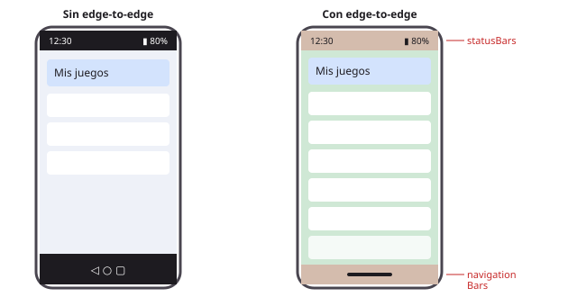
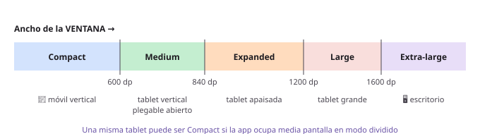
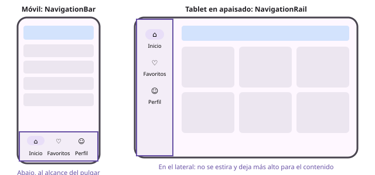
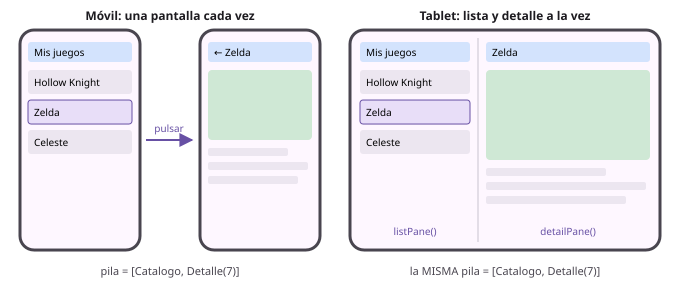
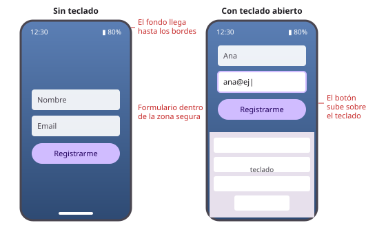
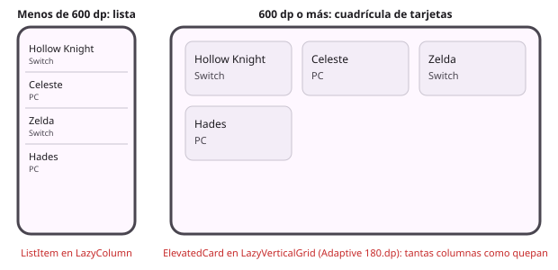
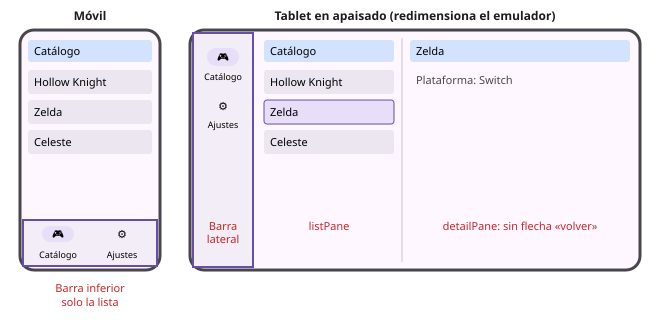

# **3B.2 Diseño adaptativo y edge-to-edge**

Una app Android no se ejecuta solo en un móvil en vertical. El mismo código puede acabar en un móvil girado, en un plegable que se abre y se cierra, en una tablet, en una ventana redimensionable de un Chromebook o en un monitor conectado al móvil. Una interfaz pensada solo para un móvil en vertical se ve **estirada, vacía o cortada** en todos los demás.

El **diseño adaptativo** consiste en que la interfaz **cambie su distribución** según el espacio disponible: una columna en el móvil, lista y detalle uno al lado del otro en la tablet, barra de navegación abajo o a un lado… Y **edge-to-edge** consiste en aprovechar toda la pantalla, dibujando también detrás de las barras del sistema.

Al terminar este apartado sabrás:

- Dibujar a pantalla completa sin que las barras del sistema tapen el contenido.
- Saber cuánto espacio tienes con las **clases de tamaño de ventana**.
- Cambiar automáticamente entre barra inferior y barra lateral con `NavigationSuiteScaffold`.
- Mostrar **lista y detalle a la vez** en pantallas grandes con Navigation 3.
- Probar tu app en distintos tamaños sin tener todos los dispositivos.

---

## 1. Por qué ya no es opcional

Durante años, muchas apps «solucionaban» las tablets bloqueando la orientación vertical en el manifiesto. Google ha ido cerrando esa puerta:

| Versión de Android | Qué cambia (para apps que la tienen como `targetSdk`) |
|---|---|
| **Android 15** (API 35) | Las apps se dibujan **edge-to-edge** por defecto, aunque todavía se podía desactivar. |
| **Android 16** (API 36) | Ya **no se puede desactivar** edge-to-edge. En pantallas grandes (600 dp o más de ancho mínimo), el sistema **ignora** el bloqueo de orientación, de tamaño y de proporción del manifiesto. Había una opción temporal para evitarlo. |
| **Android 17** (API 37) | Desaparece esa opción temporal: en pantallas grandes, la app **siempre** puede girarse y redimensionarse. |

En la práctica, `android:screenOrientation="portrait"` o `android:resizeableActivity="false"` **no sirven** en tablets y plegables. Tu app se va a mostrar en apaisado y en ventanas de cualquier tamaño, así que tiene que verse bien en todas.

!!! note "Excepción: los juegos"
    Estas restricciones no se aplican a las apps declaradas como juego (`android:appCategory="game"`) ni a pantallas con menos de 600 dp de ancho mínimo, como los móviles normales.

---

## 2. Edge-to-edge: aprovechar toda la pantalla

En una app *edge-to-edge*, el contenido se extiende **por debajo** de la barra de estado (arriba) y de la barra de navegación (abajo), que pasan a ser transparentes. Queda más moderno y aprovecha todo el espacio, pero obliga a tener cuidado: el texto y los botones no pueden quedar **tapados** por esas barras, por la muesca de la cámara o por el teclado.

<figure markdown="span">
  { width="640" }
  <figcaption>Izquierda: las barras del sistema son franjas opacas. Derecha: el contenido llega a los bordes y las barras quedan superpuestas (en rojo, las zonas que marcan los insets).</figcaption>
</figure>

### 2.1. Activarlo

En la `MainActivity`, llama a `enableEdgeToEdge()` **antes** de `setContent`. Los proyectos nuevos ya lo traen:

```kotlin
class MainActivity : ComponentActivity() {
    override fun onCreate(savedInstanceState: Bundle?) {
        enableEdgeToEdge()
        super.onCreate(savedInstanceState)
        setContent {
            MiAppTheme {
                AppNavegacion()
            }
        }
    }
}
```

`enableEdgeToEdge()` también ajusta el color de los iconos de las barras (claros u oscuros) para que se lean sobre tu interfaz. En Android 15 y posteriores, el sistema aplica edge-to-edge aunque no lo llames; llamarlo hace que la app se comporte igual en las versiones anteriores.

### 2.2. *Insets*: las zonas que no debes tapar

Compose informa del tamaño de cada zona ocupada por el sistema mediante los **insets** (márgenes del sistema):

| Inset | Qué representa |
|---|---|
| `WindowInsets.statusBars` | Barra de estado (hora, batería) |
| `WindowInsets.navigationBars` | Barra o gesto de navegación inferior |
| `WindowInsets.systemBars` | Las dos anteriores |
| `WindowInsets.ime` | El teclado en pantalla, cuando está abierto |
| `WindowInsets.displayCutout` | La muesca o el agujero de la cámara |
| `WindowInsets.safeDrawing` | **Todo lo anterior junto**: la zona donde es seguro dibujar contenido |

### 2.3. Con `Scaffold` (lo habitual)

`Scaffold` ya calcula los insets por ti y los entrega en el `innerPadding` de su contenido. **La regla es aplicar siempre ese `innerPadding`**:

```kotlin
Scaffold(
    topBar = { TopAppBar(title = { Text("Mis juegos") }) },
    bottomBar = { /* barra de navegación */ }
) { innerPadding ->
    LazyColumn(
        contentPadding = innerPadding        // la lista se desliza POR DEBAJO de las barras
    ) {
        items(juegos, key = { it.id }) { juego -> FilaJuego(juego) }
    }
}
```

En listas, pasa el `innerPadding` como `contentPadding` en lugar de como `Modifier.padding(innerPadding)`. Así el contenido se ve deslizar por detrás de las barras translúcidas, pero el primer y el último elemento quedan visibles.

Las barras de Material 3 (`TopAppBar`, `NavigationBar`) también aplican sus insets: se extienden por detrás de la barra de estado o de navegación y colocan su contenido en la zona segura.

### 2.4. Sin `Scaffold`: modificadores de insets

Si una pantalla no usa `Scaffold` (por ejemplo, una pantalla de bienvenida a pantalla completa), aplica tú los insets con modificadores:

```kotlin
Box(modifier = Modifier.fillMaxSize()) {
    // La imagen de fondo SÍ ocupa toda la pantalla, incluso bajo las barras
    Image(
        painter = painterResource(R.drawable.img_fondo),
        contentDescription = null,
        contentScale = ContentScale.Crop,
        modifier = Modifier.matchParentSize()
    )
    // El contenido se aparta de las barras, la muesca y el teclado
    Column(
        modifier = Modifier
            .fillMaxSize()
            .safeDrawingPadding()
            .padding(24.dp)
    ) {
        // ...
    }
}
```

| Modificador | Aparta el contenido de… |
|---|---|
| `safeDrawingPadding()` | Todo: barras, muesca y teclado (**el más seguro**) |
| `systemBarsPadding()` | Barra de estado y de navegación |
| `statusBarsPadding()` / `navigationBarsPadding()` | Solo una de ellas |
| `imePadding()` | El teclado, cuando está abierto |
| `windowInsetsPadding(insets)` | Los insets que le indiques |

!!! tip "Formularios y teclado"
    Si al escribir en un campo el teclado tapa el botón «Enviar», añade `imePadding()` al contenedor del formulario y, si es largo, `verticalScroll(rememberScrollState())`. Así el contenido sube y se puede desplazar cuando aparece el teclado.

---

## 3. Clases de tamaño de ventana

Para adaptar la interfaz necesitamos saber **cuánto espacio tenemos**. Fíjate en que hablamos de la **ventana**, no del dispositivo: en una tablet con dos apps en pantalla dividida, cada una tiene media pantalla. Por eso nunca se pregunta «¿es una tablet?», sino «¿cuánto mide mi ventana?».

Google agrupa los anchos en **clases de tamaño** (*window size classes*):

| Clase de ancho | Ancho de la ventana | Ejemplos típicos |
|---|---|---|
| **Compact** | menos de 600 dp | Móvil en vertical |
| **Medium** | de 600 a 840 dp | Tablet en vertical, plegable abierto en vertical |
| **Expanded** | de 840 a 1200 dp | Tablet en apaisado, plegable abierto en apaisado |
| **Large** | de 1200 a 1600 dp | Tablets grandes |
| **Extra-large** | 1600 dp o más | Monitores de escritorio |

También hay clases de **alto** (*compact* por debajo de 480 dp, típico de un móvil en apaisado), útiles por ejemplo para ocultar la barra superior cuando hay poco alto.

<figure markdown="span">
  { width="640" }
  <figcaption>Las cinco clases de ancho y los dispositivos típicos de cada una.</figcaption>
</figure>

### Consultar la clase de tamaño

Se obtiene con `currentWindowAdaptiveInfo()` de la librería `material3-adaptive`, que se actualiza sola cuando la ventana cambia de tamaño:

```kotlin
@Composable
fun PantallaCatalogo(juegos: List<Juego>) {
    val claseTamano = currentWindowAdaptiveInfo().windowSizeClass
    val esAncha = claseTamano.isWidthAtLeastBreakpoint(WindowSizeClass.WIDTH_DP_MEDIUM_LOWER_BOUND)

    if (esAncha) {
        CuadriculaJuegos(juegos)     // 600 dp o más: cuadrícula
    } else {
        ListaJuegos(juegos)          // menos de 600 dp: lista
    }
}
```

`isWidthAtLeastBreakpoint` responde a la pregunta «¿mide al menos…?». Las constantes disponibles son `WIDTH_DP_MEDIUM_LOWER_BOUND` (600 dp), `WIDTH_DP_EXPANDED_LOWER_BOUND` (840 dp) y, para alturas, `HEIGHT_DP_MEDIUM_LOWER_BOUND` (480 dp), entre otras.

!!! tip "Decide arriba y pasa el resultado hacia abajo"
    Consulta la clase de tamaño en el composable de más alto nivel (la pantalla o la navegación) y pasa a los hijos solo lo que necesitan, por ejemplo un `Boolean` como `esAncha`. Así los componentes pequeños siguen siendo sencillos y fáciles de previsualizar.

!!! info "No siempre hace falta preguntar"
    Muchas adaptaciones no necesitan la clase de tamaño: `LazyVerticalGrid(columns = GridCells.Adaptive(160.dp))` ya crea tantas columnas como quepan, y `Modifier.widthIn(max = 600.dp)` evita que un formulario o un texto se estire hasta ocupar todo el ancho de una tablet, que sería incómodo de leer.

---

## 4. Navegación adaptativa con `NavigationSuiteScaffold`

En un móvil, las secciones principales de la app van en una **barra inferior** (*navigation bar*). En una tablet en apaisado, esa barra quedaría ancha y lejos de los pulgares: lo correcto es una **barra lateral** (*navigation rail*).

<figure markdown="span">
  { width="640" }
  <figcaption>Las mismas tres secciones: abajo en el móvil (NavigationBar) y en el lateral en la tablet (NavigationRail).</figcaption>
</figure>

`NavigationSuiteScaffold` elige automáticamente la adecuada según la clase de tamaño:

- **Barra inferior** si el ancho o el alto son *compact*.
- **Barra lateral** en el resto de casos.

```kotlin
enum class Seccion(val etiqueta: String, @DrawableRes val icono: Int) {
    Inicio("Inicio", R.drawable.ic_home),
    Favoritos("Favoritos", R.drawable.ic_favorite),
    Perfil("Perfil", R.drawable.ic_person)
}

@Composable
fun AppAdaptativa() {
    var actual by rememberSaveable { mutableStateOf(Seccion.Inicio) }

    NavigationSuiteScaffold(
        navigationSuiteItems = {
            Seccion.entries.forEach { seccion ->
                item(
                    selected = seccion == actual,
                    onClick = { actual = seccion },
                    icon = { Icon(painterResource(seccion.icono), contentDescription = null) },
                    label = { Text(seccion.etiqueta) }
                )
            }
        }
    ) {
        when (actual) {
            Seccion.Inicio -> PantallaInicio()
            Seccion.Favoritos -> PantallaFavoritos()
            Seccion.Perfil -> PantallaPerfil()
        }
    }
}
```

Fíjate en que **no hay ni un `if`** sobre el tamaño: la misma declaración produce una barra inferior en el móvil y una lateral en la tablet, y cambia sola al girar el dispositivo o redimensionar la ventana.

Para combinarlo con las **pilas por pestaña** de [3B.1](./3b.1-navigation3.md#10-barra-de-navegacion-inferior-con-una-pila-por-pestana), basta con sustituir el `Scaffold` con `NavigationBar` de aquel ejemplo por `NavigationSuiteScaffold`: los `item(...)` usan la pestaña seleccionada y el contenido es el `NavDisplay`.

!!! tip "Cajón de navegación en pantallas muy anchas"
    Por defecto, `NavigationSuiteScaffold` no muestra nunca un cajón (*drawer*). Si lo quieres para ventanas *expanded* o mayores, se puede indicar con su parámetro `layoutType`; consulta la [guía oficial de navegación adaptativa](https://developer.android.com/develop/ui/compose/layouts/adaptive/build-adaptive-navigation).

---

## 5. Lista y detalle a la vez con Navigation 3

El diseño adaptativo más habitual es el **lista-detalle**: en un móvil se ve la lista y, al pulsar un elemento, se navega al detalle; en una pantalla ancha se ven **las dos cosas a la vez**, la lista a la izquierda y el detalle a la derecha.

<figure markdown="span">
  { width="640" }
  <figcaption>Con la misma pila, el móvil muestra una pantalla cada vez y la tablet muestra la lista y el detalle juntos.</figcaption>
</figure>

En Navigation 3 esto se consigue con **escenas** (*scenes*). Una *estrategia de escena* decide, según el espacio disponible, si `NavDisplay` muestra solo la última entrada de la pila o **varias a la vez**. La librería de Material 3 adaptativo trae una ya hecha para lista-detalle: `ListDetailSceneStrategy`.

**Lo mejor: la pila y el resto de la navegación no cambian.** Solo hay que:

1. Crear la estrategia y pasarla a `NavDisplay`.
2. Marcar con **metadatos** qué entrada es la lista y cuál el detalle.

```kotlin
@OptIn(ExperimentalMaterial3AdaptiveApi::class)
@Composable
fun AppNavegacion() {
    val pila = rememberNavBackStack(Catalogo)
    val estrategiaListaDetalle = rememberListDetailSceneStrategy<NavKey>()

    NavDisplay(
        backStack = pila,
        onBack = { pila.removeLastOrNull() },
        sceneStrategies = listOf(estrategiaListaDetalle),
        entryProvider = entryProvider {
            entry<Catalogo>(
                metadata = ListDetailSceneStrategy.listPane(
                    // Qué mostrar en el hueco del detalle cuando aún no se ha elegido nada
                    detailPlaceholder = { MensajeElegirJuego() }
                )
            ) {
                PantallaCatalogo(
                    juegos = JuegosEnMemoria.juegos,
                    onJuegoClick = { id ->
                        // Si ya hay un detalle abierto, se sustituye en lugar de apilar otro
                        if (pila.lastOrNull() is Detalle) pila[pila.lastIndex] = Detalle(id)
                        else pila.add(Detalle(id))
                    }
                )
            }
            entry<Detalle>(
                metadata = ListDetailSceneStrategy.detailPane()
            ) { clave ->
                PantallaDetalle(
                    juego = JuegosEnMemoria.buscar(clave.juegoId),
                    onVolver = { pila.removeLastOrNull() }
                )
            }
            entry<Ajustes> {          // sin metadatos: siempre a pantalla completa
                PantallaAjustes(onVolver = { pila.removeLastOrNull() })
            }
        }
    )
}
```

Qué ocurre en cada caso con la **misma** pila `[Catalogo, Detalle(7)]`:

- **Móvil:** solo se ve el detalle del juego 7. El botón atrás vuelve a la lista.
- **Tablet:** se ven la lista y el detalle del juego 7 uno al lado del otro. Al pulsar otro juego, el detalle cambia sin perder la lista.
- **Al girar o abrir un plegable:** la vista pasa de una a otra **automáticamente**, conservando la pila.

Con `[Catalogo]` sola, en el móvil se ve la lista y en la tablet la lista junto al `detailPlaceholder`.

??? info "Dependencias e imports"

    ```kotlin
    // app/build.gradle.kts
    implementation("androidx.compose.material3.adaptive:adaptive-navigation3:1.3.0")
    implementation("androidx.compose.material3:material3-adaptive-navigation-suite")   // para NavigationSuiteScaffold
    ```

    La versión de `adaptive-navigation3` es la que usan las recetas oficiales en el momento de escribir estos apuntes. `material3-adaptive-navigation-suite` toma su versión del BOM de Compose.

    ```kotlin
    import androidx.compose.material3.adaptive.ExperimentalMaterial3AdaptiveApi
    import androidx.compose.material3.adaptive.currentWindowAdaptiveInfo
    import androidx.compose.material3.adaptive.navigation3.ListDetailSceneStrategy
    import androidx.compose.material3.adaptive.navigation3.rememberListDetailSceneStrategy
    import androidx.compose.material3.adaptive.navigationsuite.NavigationSuiteScaffold
    import androidx.window.core.layout.WindowSizeClass
    ```

!!! note "La flecha «volver» en el detalle"
    Cuando la lista y el detalle se ven a la vez, la flecha «volver» del detalle sobra. Una forma sencilla de ocultarla es que la pantalla de detalle consulte la clase de tamaño y no muestre el `navigationIcon` cuando la ventana sea *medium* o más ancha.

Además de lista-detalle, Material 3 define otros diseños canónicos, como el **panel de apoyo** (*supporting pane*: contenido principal más un panel secundario con información relacionada). Las [recetas oficiales de Navigation 3](https://github.com/android/nav3-recipes) incluyen ejemplos de ambos.

---

## 6. No perder el estado al cambiar de tamaño

Girar el móvil, abrir un plegable o redimensionar una ventana son **cambios de configuración**: Android destruye y vuelve a crear la Activity. Todo lo que guardes con un simple `remember` **se pierde**. Ya lo vimos en [2.2 Ciclo de vida](../../02/2.2-ciclo-vida-app.md), pero en apps adaptativas ocurre continuamente:

- El estado de la interfaz que deba sobrevivir (texto escrito, pestaña elegida, elemento seleccionado) va en `rememberSaveable` o en el **ViewModel**.
- La pila de Navigation 3 ya se conserva sola gracias a `rememberNavBackStack`.
- Nunca dependas de la orientación para decidir el diseño (`if (apaisado)`): usa la **clase de tamaño**.

---

## 7. Probar en distintos tamaños

No necesitas una tablet ni un plegable para probar tu app:

- **Previews multitamaño:** la anotación `@PreviewScreenSizes` genera de golpe la vista previa en móvil, plegable, tablet y escritorio.

    ```kotlin
    @PreviewScreenSizes
    @Composable
    fun CatalogoPreview() {
        MiAppTheme {
            PantallaCatalogo(juegos = JuegosEnMemoria.juegos)
        }
    }
    ```

- **Emulador redimensionable:** en el *Device Manager*, crea un dispositivo con el perfil **Resizable**. Desde su barra de herramientas puedes cambiar entre móvil, plegable, tablet y escritorio sin reiniciarlo.

- **Emuladores de tablet y plegable:** perfiles como *Pixel Tablet* o *Pixel Fold* reproducen dispositivos reales.

- **Pantalla dividida:** en el emulador o en tu móvil, abre la app en modo de pantalla dividida y mueve el separador. Es la forma más rápida de comprobar que la interfaz responde a cualquier ancho.

!!! tip "Lista de comprobación rápida"
    Gira el dispositivo, abre la app en pantalla dividida y abre el teclado en cada formulario. Si en ninguno de esos casos hay contenido tapado, estirado o perdido, vas por buen camino.

---

## 8. Errores frecuentes

!!! warning "El contenido queda debajo de la barra de estado o de la barra de navegación"
    No estás aplicando el `innerPadding` del `Scaffold`, o en una pantalla sin `Scaffold` falta `safeDrawingPadding()` o similar.

!!! warning "Doble espacio arriba o abajo"
    Has aplicado los insets dos veces; por ejemplo, el `innerPadding` del `Scaffold` y además `systemBarsPadding()` en el contenido. Aplícalos en un solo sitio.

!!! warning "El teclado tapa el botón de enviar"
    Falta `imePadding()` en el contenedor del formulario (y, si es largo, `verticalScroll`).

!!! warning "He puesto `screenOrientation="portrait"` y en la tablet se gira igualmente"
    Es el comportamiento esperado desde Android 16 en pantallas grandes (apartado 1). Adapta el diseño en lugar de bloquearlo.

!!! warning "Al girar el móvil se pierde lo que había escrito"
    Ese estado está en un `remember`. Pásalo a `rememberSaveable` o al ViewModel.

!!! warning "Pregunto si es una tablet y en pantalla dividida se ve mal"
    Lo que importa es el tamaño de la **ventana**, no del dispositivo. Usa `currentWindowAdaptiveInfo().windowSizeClass`.

---

## 9. Retos

### 🟢 Básico: formulario edge-to-edge

Crea una pantalla de registro **sin `Scaffold`** con una imagen de fondo a pantalla completa y, encima, un formulario (nombre, email, botón «Registrarme»). La imagen debe verse detrás de las barras del sistema, pero el formulario no puede quedar tapado por ellas ni por el teclado.

**Resultado esperado** (referencia orientativa; las anotaciones en rojo no forman parte de la interfaz):

{ width="560" }

??? success "Solución"

    ```kotlin
    @Composable
    fun PantallaRegistro(
        onRegistrar: (nombre: String, email: String) -> Unit,
        modifier: Modifier = Modifier
    ) {
        var nombre by rememberSaveable { mutableStateOf("") }
        var email by rememberSaveable { mutableStateOf("") }

        Box(modifier = modifier.fillMaxSize()) {
            Image(
                painter = painterResource(R.drawable.img_fondo_registro),
                contentDescription = null,
                contentScale = ContentScale.Crop,
                modifier = Modifier.matchParentSize()
            )
            Column(
                modifier = Modifier
                    .fillMaxSize()
                    .safeDrawingPadding()                     // barras, muesca y teclado
                    .verticalScroll(rememberScrollState())
                    .padding(24.dp),
                verticalArrangement = Arrangement.spacedBy(12.dp, Alignment.CenterVertically)
            ) {
                OutlinedTextField(
                    value = nombre,
                    onValueChange = { nombre = it },
                    label = { Text("Nombre") },
                    modifier = Modifier.fillMaxWidth()
                )
                OutlinedTextField(
                    value = email,
                    onValueChange = { email = it },
                    label = { Text("Email") },
                    modifier = Modifier.fillMaxWidth()
                )
                Button(
                    onClick = { onRegistrar(nombre, email) },
                    modifier = Modifier.fillMaxWidth()
                ) {
                    Text("Registrarme")
                }
            }
        }
    }
    ```

    Claves de la solución:

    - La imagen **no** lleva insets: debe ocupar toda la pantalla, también detrás de las barras.
    - La columna lleva `safeDrawingPadding()`, que incluye el teclado (`ime`). Al abrirlo, el espacio útil se reduce y `verticalScroll` permite llegar al botón.
    - `rememberSaveable` conserva lo escrito al girar el móvil.
    - `spacedBy(12.dp, Alignment.CenterVertically)` separa los campos y, además, centra el bloque en vertical cuando sobra espacio.

### 🟡 Intermedio: catálogo que se adapta

Haz que `PantallaCatalogo` muestre los juegos en una **lista** cuando la ventana mida menos de 600 dp y en una **cuadrícula** de tarjetas cuando mida 600 dp o más. Comprueba el resultado con `@PreviewScreenSizes`.

**Resultado esperado** (referencia orientativa; las anotaciones en rojo no forman parte de la interfaz):

{ width="560" }

??? success "Solución"

    ```kotlin
    @Composable
    fun PantallaCatalogo(
        juegos: List<Juego>,
        onJuegoClick: (Int) -> Unit,
        modifier: Modifier = Modifier,
        esAncha: Boolean = currentWindowAdaptiveInfo().windowSizeClass
            .isWidthAtLeastBreakpoint(WindowSizeClass.WIDTH_DP_MEDIUM_LOWER_BOUND)
    ) {
        if (esAncha) {
            LazyVerticalGrid(
                columns = GridCells.Adaptive(minSize = 180.dp),
                contentPadding = PaddingValues(16.dp),
                horizontalArrangement = Arrangement.spacedBy(12.dp),
                verticalArrangement = Arrangement.spacedBy(12.dp),
                modifier = modifier
            ) {
                items(juegos, key = { it.id }) { juego ->
                    ElevatedCard(onClick = { onJuegoClick(juego.id) }) {
                        Column(Modifier.padding(16.dp)) {
                            Text(juego.titulo, style = MaterialTheme.typography.titleMedium)
                            Text(juego.plataforma, style = MaterialTheme.typography.bodyMedium)
                        }
                    }
                }
            }
        } else {
            LazyColumn(modifier = modifier) {
                items(juegos, key = { it.id }) { juego ->
                    ListItem(
                        headlineContent = { Text(juego.titulo) },
                        supportingContent = { Text(juego.plataforma) },
                        modifier = Modifier.clickable { onJuegoClick(juego.id) }
                    )
                }
            }
        }
    }

    @PreviewScreenSizes
    @Composable
    fun PantallaCatalogoPreview() {
        MiAppTheme {
            PantallaCatalogo(juegos = JuegosEnMemoria.juegos, onJuegoClick = {})
        }
    }
    ```

    Claves de la solución:

    - La decisión se toma con la **clase de tamaño de la ventana**, no con la orientación ni con el tipo de dispositivo.
    - `esAncha` es un **parámetro con valor por defecto**: en la app se calcula solo, y en tests o previews concretas se puede forzar a `true` o `false`.
    - `GridCells.Adaptive(180.dp)` reparte las columnas según el ancho: dos en una tablet en vertical, más en apaisado.
    - Las claves (`key = { it.id }`) se mantienen en las dos versiones.

### 🔴 Avanzado: app adaptativa completa

Combina lo visto en 3B.1 y en este apartado:

- `NavigationSuiteScaffold` con dos secciones: **Catálogo** y **Ajustes**.
- En Catálogo, una pila de Navigation 3 con `ListDetailSceneStrategy`: lista de juegos y detalle uno al lado del otro en pantallas anchas.
- El detalle no debe mostrar la flecha «volver» cuando se ve junto a la lista.

Pruébalo en el emulador redimensionable cambiando entre móvil, plegable y tablet.

**Resultado esperado** (referencia orientativa; las anotaciones en rojo no forman parte de la interfaz):

{ width="560" }

??? success "Solución"

    ```kotlin
    enum class Seccion(val etiqueta: String, @DrawableRes val icono: Int) {
        Catalogo("Catálogo", R.drawable.ic_videogame),
        Ajustes("Ajustes", R.drawable.ic_settings)
    }

    @Composable
    fun AppAdaptativa() {
        var seccion by rememberSaveable { mutableStateOf(Seccion.Catalogo) }

        NavigationSuiteScaffold(
            navigationSuiteItems = {
                Seccion.entries.forEach { s ->
                    item(
                        selected = s == seccion,
                        onClick = { seccion = s },
                        icon = { Icon(painterResource(s.icono), contentDescription = null) },
                        label = { Text(s.etiqueta) }
                    )
                }
            }
        ) {
            when (seccion) {
                Seccion.Catalogo -> NavegacionCatalogo()
                Seccion.Ajustes -> PantallaAjustes()
            }
        }
    }

    @OptIn(ExperimentalMaterial3AdaptiveApi::class)
    @Composable
    fun NavegacionCatalogo() {
        val pila = rememberNavBackStack(Catalogo)
        val estrategia = rememberListDetailSceneStrategy<NavKey>()
        val esAncha = currentWindowAdaptiveInfo().windowSizeClass
            .isWidthAtLeastBreakpoint(WindowSizeClass.WIDTH_DP_MEDIUM_LOWER_BOUND)

        NavDisplay(
            backStack = pila,
            onBack = { pila.removeLastOrNull() },
            sceneStrategies = listOf(estrategia),
            entryProvider = entryProvider {
                entry<Catalogo>(
                    metadata = ListDetailSceneStrategy.listPane(
                        detailPlaceholder = {
                            Box(Modifier.fillMaxSize(), contentAlignment = Alignment.Center) {
                                Text("Elige un juego de la lista")
                            }
                        }
                    )
                ) {
                    PantallaCatalogo(
                        juegos = JuegosEnMemoria.juegos,
                        onJuegoClick = { id ->
                            if (pila.lastOrNull() is Detalle) pila[pila.lastIndex] = Detalle(id)
                            else pila.add(Detalle(id))
                        },
                        esAncha = false          // en el panel de lista, siempre en formato lista
                    )
                }
                entry<Detalle>(
                    metadata = ListDetailSceneStrategy.detailPane()
                ) { clave ->
                    PantallaDetalle(
                        juego = JuegosEnMemoria.buscar(clave.juegoId),
                        mostrarVolver = !esAncha,
                        onVolver = { pila.removeLastOrNull() }
                    )
                }
            }
        )
    }

    @OptIn(ExperimentalMaterial3Api::class)
    @Composable
    fun PantallaDetalle(
        juego: Juego?,
        mostrarVolver: Boolean,
        onVolver: () -> Unit,
        modifier: Modifier = Modifier
    ) {
        Scaffold(
            modifier = modifier,
            topBar = {
                TopAppBar(
                    title = { Text(juego?.titulo ?: "Juego no encontrado") },
                    navigationIcon = {
                        if (mostrarVolver) {
                            IconButton(onClick = onVolver) {
                                Icon(painterResource(R.drawable.ic_arrow_back), contentDescription = "Volver")
                            }
                        }
                    }
                )
            }
        ) { innerPadding ->
            Text(
                text = "Plataforma: ${juego?.plataforma ?: "-"}",
                modifier = Modifier.padding(innerPadding).padding(16.dp)
            )
        }
    }
    ```

    Claves de la solución:

    - **Dos niveles de adaptación** que no se estorban: `NavigationSuiteScaffold` adapta la navegación entre secciones y `ListDetailSceneStrategy` adapta el contenido de la sección Catálogo.
    - Ningún composable pregunta por el dispositivo: todo depende de la **clase de tamaño de la ventana**.
    - Al pulsar otro juego con el detalle ya abierto, se **sustituye** la última entrada en lugar de apilar detalles. Así, en el móvil, el botón atrás vuelve directamente a la lista.
    - La lista recibe `esAncha = false`: dentro del panel de lista, que es estrecho, la cuadrícula no tendría sentido aunque la ventana sea ancha.
    - `mostrarVolver = !esAncha` oculta la flecha cuando la lista y el detalle se ven a la vez.

---

## 10. Para saber más

- **Documentación oficial de Google:**

    - [Diseño adaptativo en Compose (introducción)](https://developer.android.com/develop/ui/compose/layouts/adaptive?hl=es-419)
    - [Clases de tamaño de ventana](https://developer.android.com/develop/ui/compose/layouts/adaptive/use-window-size-classes?hl=es-419)
    - [Navegación adaptativa con `NavigationSuiteScaffold`](https://developer.android.com/develop/ui/compose/layouts/adaptive/build-adaptive-navigation?hl=es-419)
    - [Edge-to-edge en Compose](https://developer.android.com/develop/ui/compose/system/insets?hl=es-419)
    - [Cambios de comportamiento de Android 16](https://developer.android.com/about/versions/16/behavior-changes-16?hl=es-419)
    - [Preparar la app para los cambios de orientación y tamaño de Android 17](https://developer.android.com/blog/posts/prepare-your-app-for-the-resizability-and-orientation-changes-in-android-17)
    - [Receta de lista-detalle con Material 3 y Navigation 3](https://github.com/android/nav3-recipes/tree/main/app/src/main/java/com/example/nav3recipes/material/listdetail)
