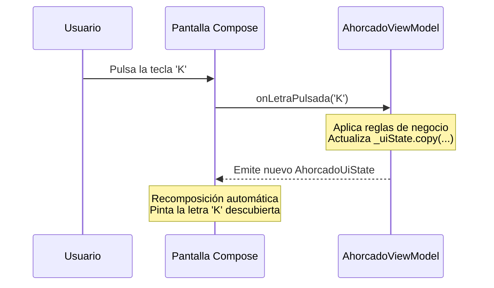

# **3C.1 Capa de Interfaz (UI): ViewModel, UiState y UDF**

A medida que una aplicación crece, mantener el estado y las operaciones de negocio directamente dentro de funciones `@Composable` mediante llamadas a `remember` se vuelve inasumible. Mezclar la lógica de la pantalla con el dibujo de los botones genera código difícil de depurar, propenso a recomposiciones infinitas y prácticamente imposible de probar con pruebas automatizadas.

Para resolver este desafío, la arquitectura recomendada por Google establece una separación clara en la **Capa de Interfaz (*UI Layer*)**, compuesta por dos elementos coordinados: los **Elementos de la UI (Composables)** y el **Titular de Estado (*State Holder* o `ViewModel`)**.

---

## El mapa de la arquitectura

Antes de entrar en el ViewModel, conviene ver el mapa completo. Una app bien organizada reparte su código en **tres capas**. En este apartado estudiamos la de la izquierda, la **presentación**; en [3C.2](./3c.2-clean-architecture.md) completaremos las otras dos.

<figure class="arq-fig">
--8<-- "docs/temas/03/c-arquitectura/images/mapa-capas.svg"
<figcaption>Las tres capas con las clases del catálogo de juegos. Las flechas negras son dependencias (quién hace <code>import</code> de quién); la roja discontinua, el camino que siguen los datos cuando la app se ejecuta.</figcaption>
</figure>

Fíjate en las dos clases de flechas, porque es lo que más confunde al principio:

- **Las dependencias apuntan hacia el dominio.** El ViewModel *usa* el caso de uso y el repositorio en memoria *implementa* la interfaz del dominio, pero el dominio no conoce a ninguno de los dos: no tiene ni un `import` de Android, de Compose ni de la capa de datos.
- **Los datos viajan al revés.** Cuando la app se ejecuta, los juegos salen de la capa de datos, pasan por el dominio y llegan a la pantalla convertidos en `UiState`.

Que vayan en sentidos opuestos no es una contradicción: es justo lo que permite cambiar la base de datos o la pantalla sin tocar el dominio.

---

## 1. El Rol del `ViewModel` en la Arquitectura Moderna

El **`ViewModel`** es una clase de la librería Android Jetpack (`androidx.lifecycle.ViewModel`) diseñada para encapsular la lógica de presentación y gestionar el estado que necesita una pantalla.

La capa de UI se reparte el trabajo así: el ViewModel **decide** (guarda el estado y aplica las reglas de la pantalla) y la pantalla Compose **dibuja** ese estado y **avisa** de lo que hace el usuario. Lo veremos en detalle en el apartado 3:

<figure class="arq-fig">
--8<-- "docs/temas/03/c-arquitectura/images/bucle-udf.svg"
<figcaption>El ViewModel del Ahorcado y su pantalla: el estado baja, los eventos suben.</figcaption>
</figure>

### 1.1. Supervivencia ante Cambios de Configuración

La mayor ventaja del `ViewModel` es su ciclo de vida especializado:

- Cuando el usuario rota el teléfono o cambia el modo oscuro, la `ComponentActivity` se destruye y se vuelve a crear.
- **El `ViewModel` no se destruye.** La instancia existente se retiene en memoria y se reconecta automáticamente a la nueva Activity, manteniendo todos los datos de la partida o del formulario intactos sin necesidad de serializarlos manualmente.
- Solo se destruye cuando la pantalla se cierra definitivamente, invocando su método `onCleared()`.

<figure class="arq-fig">
--8<-- "docs/temas/03/c-arquitectura/images/ciclo-viewmodel.svg"
<figcaption>Durante el uso normal de una pantalla, la Activity puede recrearse varias veces; el ViewModel es siempre el mismo.</figcaption>
</figure>

!!! warning "El ViewModel no sobrevive a todo"
    Si la app pasa a segundo plano y Android cierra su **proceso** para liberar memoria, al volver se crea un ViewModel nuevo. Para datos pequeños de la pantalla (lo escrito en un campo, la pestaña elegida) usa `rememberSaveable` o `SavedStateHandle`; lo importante (la biblioteca, los favoritos) debe estar en la capa de datos, que veremos en UT4.

---

## 2. Modelado Inmutable del Estado: `UiState`

Para que la interfaz de usuario sea predecible, toda la información que necesita pintar una pantalla debe agruparse en una única estructura de datos inmutable: una **`data class`** que represente el estado completo de la pantalla (*Single Source of Truth*).

### 2.1. Ejemplo: Modelado de Estado para un Juego
Tomemos como referencia el juego de **El Ahorcado** que resolvimos en el bloque de Kotlin:

```kotlin
data class AhorcadoUiState(
    val palabraOculta: String = "KOTLIN",
    val letrasAdivinadas: Set<Char> = emptySet(),
    val vidasRestantes: Int = 6,
    val vidasMaximas: Int = 6,
    val juegoTerminado: Boolean = false,
    val haGanado: Boolean = false
) {
    // Propiedad calculada: palabra con guiones para mostrar en pantalla (ej: "K _ T L _ N")
    val palabraParaMostrar: String
        get() = palabraOculta.map { letra ->
            if (letrasAdivinadas.contains(letra)) letra else '_'
        }.joinToString(" ")
}
```

---

## 3. Reactividad con `StateFlow` y el Patrón UDF

El **Flujo Unidireccional de Datos (*Unidirectional Data Flow - UDF*)** es el principio rector de las aplicaciones modernas (es el bucle de la figura del [apartado 1](#1-el-rol-del-viewmodel-en-la-arquitectura-moderna)):

1. **El Estado Desciende (*State Down*):** El `ViewModel` expone un flujo reactivo inmutable (`StateFlow<UiState>`). Los componibles se suscriben a él y dibujan la interfaz según los valores recibidos.

2. **Los Eventos Ascienden (*Events Up*):** La interfaz de usuario nunca modifica los datos directamente. Cuando el usuario pulsa un botón, emite un evento hacia el `ViewModel` invocando una función (`onProbarLetra('A')`).

Paso a paso, al pulsar una letra:



### 3.1. Implementación del ViewModel

```kotlin
package com.dam.pmdmlab.ui.retos.ahorcado

import androidx.lifecycle.ViewModel
import kotlinx.coroutines.flow.MutableStateFlow
import kotlinx.coroutines.flow.StateFlow
import kotlinx.coroutines.flow.asStateFlow
import kotlinx.coroutines.flow.update

class AhorcadoViewModel : ViewModel() {

    // 1. Estado mutable privado (solo modificable dentro del ViewModel)
    private val _uiState = MutableStateFlow(AhorcadoUiState())

    // 2. Estado público inmutable (solo lectura para la interfaz)
    val uiState: StateFlow<AhorcadoUiState> = _uiState.asStateFlow()

    fun onProbarLetra(letra: Char) {
        val estadoActual = _uiState.value
        if (estadoActual.juegoTerminado || estadoActual.letrasAdivinadas.contains(letra)) return

        val nuevasLetras = estadoActual.letrasAdivinadas + letra
        val acierto = estadoActual.palabraOculta.contains(letra)
        val nuevasVidas = if (acierto) estadoActual.vidasRestantes else estadoActual.vidasRestantes - 1

        val victoria = estadoActual.palabraOculta.all { nuevasLetras.contains(it) }
        val derrota = nuevasVidas <= 0

        // Actualizamos el estado con una copia inmutable
        _uiState.update { anterior ->
            anterior.copy(
                letrasAdivinadas = nuevasLetras,
                vidasRestantes = nuevasVidas,
                juegoTerminado = victoria || derrota,
                haGanado = victoria
            )
        }
    }

    fun onReiniciarPartida() {
        _uiState.value = AhorcadoUiState(palabraOculta = "COMPOSE")
    }
}
```

---

## 4. Consumo del ViewModel en Compose

La pantalla se parte en **dos composables**: uno que conoce el ViewModel y otro que solo dibuja. Así el que dibuja se puede previsualizar y probar sin ViewModel:

<figure class="arq-fig">
--8<-- "docs/temas/03/c-arquitectura/images/screen-content.svg"
<figcaption>AhorcadoScreen conecta el ViewModel con la interfaz; AhorcadoContent solo recibe datos y lambdas.</figcaption>
</figure>

### 4.1. Pantalla Contenedora (Stateful Screen)

Para conectar el ViewModel con el árbol de Compose se utiliza la función **`viewModel()`** de la librería `androidx.lifecycle:lifecycle-viewmodel-compose`, y para leer su estado, **`collectAsStateWithLifecycle()`** de `androidx.lifecycle:lifecycle-runtime-compose`:

```kotlin
import androidx.compose.runtime.Composable
import androidx.compose.runtime.getValue
import androidx.lifecycle.compose.collectAsStateWithLifecycle
import androidx.lifecycle.viewmodel.compose.viewModel

// 1. Pantalla Contenedora (Stateful Screen)
@Composable
fun AhorcadoScreen(
    onBack: () -> Unit,
    viewModel: AhorcadoViewModel = viewModel() // Devuelve el ViewModel de esta pantalla: lo crea la primera vez y lo reutiliza al girar
) {
    // Nos suscribimos al StateFlow; deja de escuchar cuando la app pasa a segundo plano
    val state by viewModel.uiState.collectAsStateWithLifecycle()

    // Pasamos el estado inmutable y las funciones al componente de presentación
    AhorcadoContent(
        state = state,
        onLetraClick = { letra -> viewModel.onProbarLetra(letra) },
        onReiniciar = { viewModel.onReiniciarPartida() },
        onBack = onBack
    )
}
```

!!! tip "¿Por qué `collectAsStateWithLifecycle` y no `collectAsState`?"
    Las dos convierten el `StateFlow` en un estado de Compose. La diferencia es que `collectAsStateWithLifecycle()` **deja de escuchar** cuando la app no está visible y vuelve a hacerlo al regresar, así no se gastan recursos actualizando una pantalla que nadie ve. Es la recomendada en Android y la que usamos en el resto de la unidad.

### 4.2. Componente de Presentación (Stateless Content)

Al aplicar esta separación, el componente visual `AhorcadoContent` no depende del ciclo de vida de Android ni del ViewModel, lo que permite previsualizarlo inmediatamente en IntelliJ IDEA con `@Preview` pasando estados inventados:

```kotlin
// 2. Componente de Presentación (Stateless Content)
@Composable
fun AhorcadoContent(
    state: AhorcadoUiState,
    onLetraClick: (Char) -> Unit,
    onReiniciar: () -> Unit,
    onBack: () -> Unit,
    modifier: Modifier = Modifier
) {
    Scaffold(modifier = modifier) { innerPadding ->
        Column(
            modifier = Modifier.fillMaxSize().padding(innerPadding),
            horizontalAlignment = Alignment.CenterHorizontally
        ) {
            Text(
                text = state.palabraParaMostrar,
                style = MaterialTheme.typography.displayMedium
            )
            Text(text = "Vidas restantes: ${state.vidasRestantes}/${state.vidasMaximas}")

            // Teclado visual con las letras
            // ...
        }
    }
}

// Vista previa inmediata con estado mock (ej: partida ganada)
@Preview(showBackground = true)
@Composable
private fun AhorcadoPreviewVictoria() {
    MaterialTheme {
        AhorcadoContent(
            state = AhorcadoUiState(
                palabraOculta = "KOTLIN",
                letrasAdivinadas = setOf('K', 'O', 'T', 'L', 'I', 'N'),
                juegoTerminado = true,
                haGanado = true
            ),
            onLetraClick = {},
            onReiniciar = {},
            onBack = {}
        )
    }
}
```

---

## 5. Tareas con Tiempo en el ViewModel

Un cronómetro, una espera antes de cambiar algo o una cuenta atrás son **lógica**, así que van en el ViewModel. Las piezas son las de [Corrutinas](../../00-android/00-kotlin/51-corrutinas.md): `viewModelScope.launch`, `delay` y el `Job` que devuelve `launch`. El ejemplo es el cronómetro de FichaJuego ([sesión 3.06](../sesiones/s06-tiempo-ciclo-vida.md)).

### 5.1. Una tarea que se puede parar: `Job`

`launch` devuelve un `Job`, el «mando a distancia» de la corrutina. Si se guarda, se puede cancelar:

```kotlin
class FichaJuegoViewModel : ViewModel() {

    // No es un dato de pantalla: no va en el UiState
    private var jobCronometro: Job? = null

    private fun arrancarCronometro() {
        jobCronometro?.cancel() // nunca dos corrutinas contando a la vez
        jobCronometro = viewModelScope.launch {
            while (true) {
                delay(1_000) // suspende sin bloquear el hilo principal
                _uiState.update { it.copy(segundos = it.segundos + 1) }
            }
        }
    }

    fun onPausar() {
        jobCronometro?.cancel()
        _uiState.update { it.copy(enMarcha = false) }
    }
}
```

- `delay` es además el punto en que la corrutina **comprueba si la han cancelado**: por eso el `while (true)` termina al llamar a `cancel()`.
- `viewModelScope` cancela todas sus corrutinas cuando se destruye el ViewModel. No hay que hacer nada para que el cronómetro no siga contando después.
- Si se pulsa dos veces y no se cancela la anterior, **dos corrutinas cuentan a la vez** y el tiempo corre al doble.

### 5.2. Una espera con bloqueo

Para esperar antes de hacer algo, se usa `delay`, **nunca `Thread.sleep`**, que congelaría la interfaz. Si durante la espera no se debe poder pulsar nada, el bloqueo es **un campo del `UiState`**, y la regla se comprueba en el ViewModel:

```kotlin
fun onTerminar() {
    if (_uiState.value.guardando) return // regla: ignora la pulsación durante la espera

    jobCronometro?.cancel()
    _uiState.update { it.copy(enMarcha = false, guardando = true) } // el bloqueo, antes de esperar
    viewModelScope.launch {
        delay(2_000)
        // … hacer el trabajo …
        _uiState.update { it.copy(guardando = false) }
    }
}
```

La pantalla solo lo pinta: `Button(enabled = !estado.guardando, …)`.

### 5.3. Parar al salir de la app: `LifecycleResumeEffect`

`viewModelScope` no sabe si la app está en primer plano: el ViewModel sigue vivo al pulsar el botón de inicio, y el cronómetro seguiría contando. Para reaccionar al ciclo de vida desde Compose está `LifecycleResumeEffect`, de `lifecycle-runtime-compose`:

```kotlin
// Se ejecuta al llegar a RESUMED; onPauseOrDispose, al salir de ese estado
LifecycleResumeEffect(Unit) {
    viewModel.onVolverALaApp()
    onPauseOrDispose { viewModel.onSalirDeLaApp() }
}
```

La pantalla solo avisa; quien decide es el ViewModel. Fíjate en que salir de la app cancela la corrutina, pero **no cambia `enMarcha`**: así, al volver, se sabe si hay que continuar o si el usuario lo había pausado.

<figure class="arq-fig">
--8<-- "docs/temas/03/c-arquitectura/images/3c1-cronometro.svg"
<figcaption>El <code>Job</code> es la herramienta y el <code>UiState</code>, lo que se recuerda.</figcaption>
</figure>

```kotlin
fun onSalirDeLaApp() {
    jobCronometro?.cancel()
}

fun onVolverALaApp() {
    if (_uiState.value.cronometro.enMarcha) arrancarCronometro()
}
```

Al girar el móvil se ejecutan los dos, y el cronómetro continúa: el tiempo está en el `UiState`, que sobrevive en el ViewModel.

### 5.4. Probar el tiempo sin esperar

En un test, `delay` no espera de verdad: con un dispatcher de pruebas, el tiempo es **virtual** y lo avanzas tú. Necesitas `kotlinx-coroutines-test` y la regla `MainDispatcherRule` de [3C.4 §4.1](./3c.4-testing.md#41-el-problema-del-hilo-principal).

```kotlin
class CronometroTest {

    @get:Rule
    val mainDispatcherRule = MainDispatcherRule()

    private val viewModel = FichaJuegoViewModel()

    @Test
    fun `empezar dos veces no lanza dos cronometros`() = runTest {
        viewModel.onEmpezar(juegoId = 1)
        viewModel.onEmpezar(juegoId = 1)

        advanceTimeBy(3_000) // avanza el reloj hasta justo antes de los 3 s
        runCurrent()         // ejecuta también lo programado justo en ese instante

        assertEquals(3, viewModel.uiState.value.cronometro.segundos)
        viewModel.onPausar() // ¡páralo siempre!
    }
}
```

!!! danger "Un temporizador es un bucle infinito"
    `advanceUntilIdle()` avanza hasta que no quede nada pendiente, y un `while (true)` con `delay` **siempre** tiene algo pendiente: el test se queda colgado. Con temporizadores, usa `advanceTimeBy` y `runCurrent`, y para el temporizador antes de terminar el test.

### 5.5. Errores frecuentes

| Síntoma | Causa | Solución |
| :--- | :--- | :--- |
| El tiempo corre al doble | Dos corrutinas contando: no se canceló la anterior | `jobCronometro?.cancel()` antes de lanzar otra |
| La interfaz se congela | `Thread.sleep` en el hilo principal | `delay` dentro de `viewModelScope.launch` |
| Sigue contando con la app en segundo plano | Nadie avisa al ViewModel del ciclo de vida | `LifecycleResumeEffect` |
| Tras volver a la app arranca aunque estaba pausado | Salir de la app puso `enMarcha` en `false` o se relanza sin comprobarlo | Salir solo cancela; volver comprueba `enMarcha` |
| Se puede pulsar durante la espera | El bloqueo está solo en el botón, o en una variable de la pantalla | Campo en el `UiState` **y** regla en el evento |
| Se reinicia el tiempo al girar | El tiempo está en un `remember` de la pantalla | En el `UiState` del ViewModel |
| El test se queda colgado | `advanceUntilIdle()` con un bucle infinito | `advanceTimeBy` + `runCurrent`, y parar el temporizador |

**Practica con:** [Sesión 3.06](../sesiones/s06-tiempo-ciclo-vida.md) y [Codelab 3.08 · Temporizador Pomodoro](../codelabs/08-temporizador-pomodoro.md).
