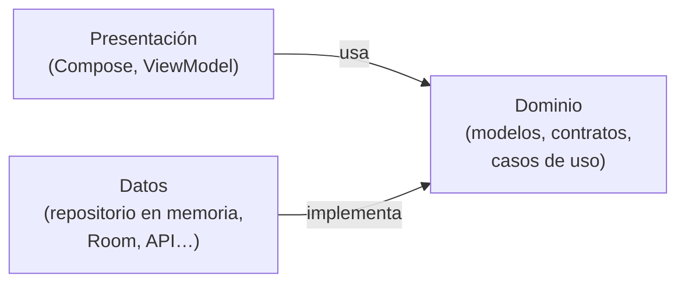

# **3C.2 Clean Architecture paso a paso**

En [3B.1](../b-navegacion/3b.1-navigation3.md) construimos un catálogo de juegos con detalle y favoritos. Funciona, pero tiene trampa: los ViewModel leen directamente de un objeto `JuegosEnMemoria` y el favorito **se pierde** al salir de la pantalla. Además, en UT4 los juegos vendrán de una base de datos y de internet. Con el código actual, eso obligaría a reescribir todos los ViewModel.

En este apartado vamos a **reorganizar esa misma app** siguiendo **Clean Architecture**, la forma de estructurar el código que se usa en la industria y que exige el proyecto intermodular. No añadiremos funcionalidad nueva: el objetivo es que el código quede **ordenado, testeable y preparado para crecer**.

Al terminar sabrás:

- Qué son las capas de **dominio**, **datos** y **presentación**, y qué va en cada una.
- Por qué las dependencias solo pueden apuntar hacia el dominio.
- Crear un **repositorio** con su interfaz y una implementación en memoria.
- Escribir **casos de uso** y saber cuándo merecen la pena.
- Pasar las dependencias a los ViewModel en lugar de crearlas dentro.

---

## 1. El punto de partida (y sus problemas)

Así quedó el ViewModel del detalle en el reto avanzado de 3B.1:

```kotlin
class DetalleViewModel(juegoId: Int) : ViewModel() {
    private val _uiState = MutableStateFlow(
        DetalleUiState(juego = JuegosEnMemoria.buscar(juegoId))   // ⚠️ accede directamente a los datos
    )
    val uiState: StateFlow<DetalleUiState> = _uiState.asStateFlow()

    fun alternarFavorito() {
        _uiState.update { it.copy(esFavorito = !it.esFavorito) }   // ⚠️ el favorito solo vive aquí
    }
}
```

Hazte estas preguntas:

- **¿Y si los juegos vienen de internet?** Habría que cambiar este ViewModel, el del catálogo y cualquier otro que use `JuegosEnMemoria`.
- **¿Dónde se guarda el favorito?** En el estado de esta pantalla. Si sales y vuelves, o miras el catálogo, el favorito ha desaparecido: no hay una **única fuente de verdad**.
- **¿Cómo lo pruebo?** No se puede sustituir `JuegosEnMemoria` por otros datos en un test.
- **¿Puedo reutilizarlo en la versión de escritorio (3D)?** Solo si separamos lo que es lógica de la app de lo que depende de Android.

Clean Architecture responde a todas a la vez.

---

## 2. La idea: tres capas y una regla

El código se reparte en **tres capas**, cada una con una responsabilidad:

| Capa | Responsabilidad | Contiene | En nuestro ejemplo |
|---|---|---|---|
| **Presentación** (*ui*) | Mostrar datos y recoger las acciones del usuario | Pantallas Compose, ViewModel, `UiState` | `PantallaCatalogo`, `CatalogoViewModel` |
| **Dominio** (*domain*) | Las **reglas de la app**: qué es un juego, qué se puede hacer con él | Modelos, interfaces de repositorio, casos de uso | `Juego`, `JuegoRepositorio`, `AlternarFavoritoUseCase` |
| **Datos** (*data*) | **De dónde** salen y dónde se guardan los datos | Implementaciones de repositorios, fuentes de datos | `JuegoRepositorioEnMemoria` (en UT4: Room y API) |

Y una única regla, la **regla de dependencia**:

> **Presentación y datos dependen del dominio. El dominio no depende de nadie.**



«Depender» significa aquí **importar**. Los ficheros del dominio no pueden tener ni un `import` de Android, de Compose ni de la capa de datos: son **Kotlin puro**. Por eso el dominio:

- No cambia aunque cambiemos la base de datos o la librería de red.
- Se puede probar con tests sencillos, sin emulador.
- Se puede compartir tal cual con iOS o escritorio en un proyecto KMP (3D).

!!! info "¿Cómo puede la presentación usar datos sin depender de la capa de datos?"
    Gracias a un truco llamado **inversión de dependencias**: el dominio define una **interfaz** (`JuegoRepositorio`: «necesito algo que me dé juegos») y la capa de datos la **implementa** (`JuegoRepositorioEnMemoria`). El ViewModel solo conoce la interfaz. Qué implementación recibe se decide en un único sitio al arrancar la app (apartado 8).

---

## 3. Organización de paquetes

Usaremos la organización **por funcionalidad** (*package by feature*): una carpeta por cada parte de la app y, dentro, una subcarpeta por capa. Así, todo lo relacionado con el catálogo de juegos está junto.

```text
com.dam.pmdmlab03/
├── juegos/                        ← funcionalidad «juegos»
│   ├── domain/
│   │   ├── Juego.kt               ← modelo
│   │   ├── JuegoRepositorio.kt    ← contrato (interfaz)
│   │   └── usecase/
│   │       ├── ObtenerJuegosUseCase.kt
│   │       ├── ObservarJuegoUseCase.kt
│   │       └── AlternarFavoritoUseCase.kt
│   ├── data/
│   │   └── JuegoRepositorioEnMemoria.kt
│   └── ui/
│       ├── catalogo/
│       │   ├── CatalogoUiState.kt
│       │   ├── CatalogoViewModel.kt
│       │   └── PantallaCatalogo.kt
│       └── detalle/
│           ├── DetalleUiState.kt
│           ├── DetalleViewModel.kt
│           └── PantallaDetalle.kt
├── navegacion/
│   └── AppNavegacion.kt
└── ContenedorApp.kt               ← crea y conecta las piezas (apartado 8)
```

---

## 4. Paso 1: el modelo de dominio

El modelo describe **qué es un juego para nuestra app**, sin pensar en cómo se guarda ni cómo se muestra:

```kotlin
package com.dam.pmdmlab03.juegos.domain

data class Juego(
    val id: Int,
    val titulo: String,
    val plataforma: String,
    val esFavorito: Boolean = false
)
```

Es la misma `data class` de 3B.1, con un cambio importante: **el favorito forma parte del juego**. Ya no es un detalle de una pantalla, sino un dato de la app que cualquier pantalla puede consultar.

---

## 5. Paso 2: el contrato del repositorio

Un **repositorio** es la puerta de acceso a los datos de una entidad. En el dominio solo definimos **qué** operaciones ofrece, con una interfaz:

```kotlin
package com.dam.pmdmlab03.juegos.domain

import kotlinx.coroutines.flow.Flow

interface JuegoRepositorio {
    /** Lista de juegos, que se vuelve a emitir cada vez que cambia. */
    fun observarJuegos(): Flow<List<Juego>>

    /** Un juego concreto (o null si no existe), actualizado en tiempo real. */
    fun observarJuego(id: Int): Flow<Juego?>

    suspend fun alternarFavorito(id: Int)
}
```

Dos decisiones que conviene entender:

- **Las lecturas devuelven `Flow`** en lugar de una lista. Así, cuando cambia un dato (por ejemplo, un favorito), **todas las pantallas que lo observan se actualizan solas**. Además, Room (UT4) devuelve exactamente `Flow`, así que el contrato no tendrá que cambiar.
- **Las escrituras son `suspend`**. Hoy guardamos en memoria y es instantáneo, pero mañana será una base de datos o una petición de red, que tardan y no pueden bloquear la interfaz. Repasa [Corrutinas](../../00-android/00-kotlin/51-corrutinas.md) y [Flows](../../00-android/00-kotlin/52-flows.md) si lo necesitas.

`kotlinx.coroutines` es una librería de Kotlin, no de Android, así que importarla en el dominio está permitido.

---

## 6. Paso 3: la implementación en memoria

En la capa de datos implementamos el contrato. De momento guardamos los juegos en memoria, en un `MutableStateFlow`:

```kotlin
package com.dam.pmdmlab03.juegos.data

import com.dam.pmdmlab03.juegos.domain.Juego
import com.dam.pmdmlab03.juegos.domain.JuegoRepositorio
import kotlinx.coroutines.flow.Flow
import kotlinx.coroutines.flow.MutableStateFlow
import kotlinx.coroutines.flow.map
import kotlinx.coroutines.flow.update

class JuegoRepositorioEnMemoria : JuegoRepositorio {

    // Única fuente de verdad: todos los juegos de la app
    private val juegos = MutableStateFlow(
        listOf(
            Juego(1, "Hollow Knight", "Switch"),
            Juego(2, "Celeste", "PC"),
            Juego(3, "Hades", "PlayStation"),
            Juego(7, "Zelda: Tears of the Kingdom", "Switch")
        )
    )

    override fun observarJuegos(): Flow<List<Juego>> = juegos

    override fun observarJuego(id: Int): Flow<Juego?> =
        juegos.map { lista -> lista.find { it.id == id } }

    override suspend fun alternarFavorito(id: Int) {
        juegos.update { lista ->
            lista.map { juego ->
                if (juego.id == id) juego.copy(esFavorito = !juego.esFavorito) else juego
            }
        }
    }
}
```

Ahora el repositorio es la **única fuente de verdad** (*single source of truth*): si el detalle marca un favorito, el `MutableStateFlow` emite la lista nueva y el catálogo lo ve al instante. El problema de 3B.1 desaparece, siempre que **toda la app use la misma instancia** del repositorio (apartado 8).

!!! tip "Un repositorio *fake* no es código de usar y tirar"
    Este repositorio en memoria seguirá siendo útil después de UT4: servirá como *fake* en los tests y para las `@Preview`, porque se comporta como el real sin necesitar base de datos ni internet.

---

## 7. Paso 4: los casos de uso

Un **caso de uso** representa **una acción concreta** que la app puede realizar, con sus reglas de negocio: «obtener los juegos ordenados», «marcar un favorito», «añadir un juego validando sus datos»…

Por convención se nombran con un verbo, terminan en `UseCase` y tienen un único método público. Usando `operator fun invoke`, el objeto se puede llamar como si fuera una función:

```kotlin
package com.dam.pmdmlab03.juegos.domain.usecase

class ObtenerJuegosUseCase(private val repositorio: JuegoRepositorio) {

    // Regla de la app: los favoritos primero y, dentro de cada grupo, por orden alfabético
    operator fun invoke(): Flow<List<Juego>> =
        repositorio.observarJuegos().map { juegos ->
            juegos.sortedWith(compareByDescending<Juego> { it.esFavorito }.thenBy { it.titulo })
        }
}

class AlternarFavoritoUseCase(private val repositorio: JuegoRepositorio) {
    suspend operator fun invoke(id: Int) = repositorio.alternarFavorito(id)
}
```

```kotlin
// Uso: el objeto se llama como una función gracias a 'invoke'
val juegos = obtenerJuegos()          // equivale a obtenerJuegos.invoke()
alternarFavorito(7)
```

Fíjate en que el caso de uso recibe el repositorio **por el constructor** y solo conoce la **interfaz** `JuegoRepositorio`: no sabe si los datos están en memoria, en Room o en un servidor.

!!! question "¿Hace falta un caso de uso para cada cosa?"
    No. La guía oficial de Google considera **opcional** la capa de dominio. Un caso de uso aporta valor cuando **contiene una regla** (como el orden de `ObtenerJuegosUseCase`), cuando **combina varios repositorios** o cuando **se reutiliza** en varios ViewModel. `AlternarFavoritoUseCase` solo reenvía la llamada al repositorio; lo mantenemos porque en este curso queremos que todas las acciones pasen por el dominio (y así lo pide el proyecto intermodular), pero en una app real podrías llamar al repositorio directamente desde el ViewModel.

---

## 8. Paso 5: ViewModel que reciben sus dependencias

El cambio clave en la capa de presentación es este: **el ViewModel no crea lo que necesita, lo recibe por el constructor**.

### 8.1. El catálogo

Modelamos el estado con una `sealed interface` que cubre los cuatro casos posibles de una pantalla con datos:

```kotlin
sealed interface CatalogoUiState {
    data object Cargando : CatalogoUiState
    data object Vacio : CatalogoUiState
    data class Exito(val juegos: List<Juego>, val filtro: String?) : CatalogoUiState
    data class Error(val mensaje: String) : CatalogoUiState
}
```

```kotlin
class CatalogoViewModel(
    obtenerJuegos: ObtenerJuegosUseCase,
    private val alternarFavorito: AlternarFavoritoUseCase
) : ViewModel() {

    private val filtro = MutableStateFlow<String?>(null)   // plataforma elegida, o null para todas

    val uiState: StateFlow<CatalogoUiState> =
        combine(obtenerJuegos(), filtro) { juegos, plataforma ->
            val visibles = juegos.filter { plataforma == null || it.plataforma == plataforma }
            if (visibles.isEmpty()) CatalogoUiState.Vacio
            else CatalogoUiState.Exito(visibles, plataforma)
        }
            .catch { e -> emit(CatalogoUiState.Error(e.message ?: "Error al cargar los juegos")) }
            .stateIn(
                scope = viewModelScope,
                started = SharingStarted.WhileSubscribed(5_000),
                initialValue = CatalogoUiState.Cargando
            )

    fun onFiltroCambiado(plataforma: String?) {
        filtro.value = plataforma
    }

    fun onFavoritoClick(id: Int) {
        viewModelScope.launch { alternarFavorito(id) }
    }
}
```

Lo nuevo respecto a 3C.1 es cómo se construye el `uiState`. En lugar de un `MutableStateFlow` que actualizamos a mano, **lo derivamos de los datos**:

1. **`combine(…)`** mezcla dos flujos: los juegos del caso de uso y el filtro elegido. Cada vez que cambia cualquiera de los dos, se recalcula el estado.

2. **`.catch { … }`** convierte un posible error en el estado `Error`, en lugar de cerrar la app.

3. **`.stateIn(…)`** convierte el resultado en un `StateFlow` que la pantalla puede observar:

    - `initialValue = Cargando`: lo que se muestra mientras llegan los primeros datos.
    - `SharingStarted.WhileSubscribed(5_000)`: deja de escuchar los datos 5 segundos después de que la pantalla deje de observarlos (por ejemplo, con la app en segundo plano), pero no durante una rotación, que dura menos.

### 8.2. El detalle

```kotlin
data class DetalleUiState(
    val cargando: Boolean = true,
    val juego: Juego? = null
)

class DetalleViewModel(
    private val juegoId: Int,
    observarJuego: ObservarJuegoUseCase,
    private val alternarFavorito: AlternarFavoritoUseCase
) : ViewModel() {

    val uiState: StateFlow<DetalleUiState> =
        observarJuego(juegoId)
            .map { juego -> DetalleUiState(cargando = false, juego = juego) }
            .stateIn(viewModelScope, SharingStarted.WhileSubscribed(5_000), DetalleUiState())

    fun onFavoritoClick() {
        viewModelScope.launch { alternarFavorito(juegoId) }
    }
}

// En el dominio, junto a los otros casos de uso
class ObservarJuegoUseCase(private val repositorio: JuegoRepositorio) {
    operator fun invoke(id: Int): Flow<Juego?> = repositorio.observarJuego(id)
}
```

Observa que `onFavoritoClick` **ya no modifica el estado**: le pide al dominio que cambie el dato y, como el estado se deriva del repositorio, la pantalla se actualiza sola. Y el catálogo también, porque observa el mismo repositorio.

Las pantallas Compose **no cambian** respecto a 3B y 3C.1: siguen recibiendo un estado y lambdas.

---

## 9. Paso 6: ¿quién crea y conecta las piezas?

Si ningún ViewModel crea su repositorio, alguien tiene que hacerlo. La respuesta es un único sitio al arrancar la app, llamado **raíz de composición** (*composition root*). De momento lo haremos a mano, con una clase contenedora:

```kotlin
package com.dam.pmdmlab03

/** Crea las dependencias de la app UNA sola vez y las comparte. */
class ContenedorApp {
    // Una única instancia para toda la app: la única fuente de verdad
    private val juegoRepositorio: JuegoRepositorio = JuegoRepositorioEnMemoria()

    val obtenerJuegos = ObtenerJuegosUseCase(juegoRepositorio)
    val observarJuego = ObservarJuegoUseCase(juegoRepositorio)
    val alternarFavorito = AlternarFavoritoUseCase(juegoRepositorio)
}
```

El contenedor debe vivir mientras viva la app, así que lo creamos en una clase `Application` propia:

=== "MiApp.kt"

    ```kotlin
    class MiApp : Application() {
        val contenedor = ContenedorApp()
    }
    ```

=== "AndroidManifest.xml"

    ```xml
    <application
        android:name=".MiApp"
        ... >
    ```

Y en la navegación, cada pantalla toma sus dependencias del contenedor al crear su ViewModel:

```kotlin
@Composable
fun AppNavegacion() {
    val contenedor = (LocalContext.current.applicationContext as MiApp).contenedor
    val pila = rememberNavBackStack(Catalogo)

    NavDisplay(
        backStack = pila,
        onBack = { pila.removeLastOrNull() },
        entryDecorators = listOf(
            rememberSaveableStateHolderNavEntryDecorator(),
            rememberViewModelStoreNavEntryDecorator()
        ),
        entryProvider = entryProvider {
            entry<Catalogo> {
                val viewModel = viewModel {
                    CatalogoViewModel(contenedor.obtenerJuegos, contenedor.alternarFavorito)
                }
                val estado by viewModel.uiState.collectAsStateWithLifecycle()
                PantallaCatalogo(
                    estado = estado,
                    onJuegoClick = { id -> pila.add(Detalle(id)) },
                    onFavoritoClick = viewModel::onFavoritoClick,
                    onFiltroCambiado = viewModel::onFiltroCambiado
                )
            }
            entry<Detalle> { clave ->
                val viewModel = viewModel {
                    DetalleViewModel(clave.juegoId, contenedor.observarJuego, contenedor.alternarFavorito)
                }
                val estado by viewModel.uiState.collectAsStateWithLifecycle()
                PantallaDetalle(
                    estado = estado,
                    onFavoritoClick = viewModel::onFavoritoClick,
                    onVolver = { pila.removeLastOrNull() }
                )
            }
        }
    )
}
```

Funciona, y ya cumple la regla de dependencia. Pero fíjate en lo que pasará cuando la app crezca: el contenedor tendrá decenas de propiedades, y cada `viewModel { … }` tendrá que enumerar a mano todo lo que necesita su ViewModel. Esa tarea repetitiva es exactamente lo que automatiza **Koin**, la librería de inyección de dependencias que veremos en **[3C.3](./3c.3-inyeccion-dependencias-koin.md)**.

---

## 10. Modelos en cada capa (avance de UT4)

De momento usamos el mismo modelo `Juego` en todas las capas. En UT4 aparecerán **modelos propios de la capa de datos**:

- `JuegoEntity`: cómo se guarda un juego en la base de datos Room (con anotaciones de Room).
- `JuegoDto`: cómo llega un juego desde la API (con anotaciones de serialización).

Esos modelos **nunca salen de la capa de datos**: el repositorio los convierte a `Juego` con funciones de conversión (*mappers*, como `fun JuegoEntity.toDomain(): Juego`) antes de entregarlos. Así, aunque la API cambie el nombre de un campo, el dominio y las pantallas no se enteran. Puedes adelantar lo que veremos en el manual: [El patrón Mapper](../../00-android/02-arquitectura/02-clean-architecture.md#patron-mapper).

---

## 11. Qué hemos ganado

| Situación | Antes (3B.1) | Ahora (capas) |
|---|---|---|
| Los juegos pasan a venir de Room o de internet (UT4) | Cambiar todos los ViewModel | Escribir otra implementación de `JuegoRepositorio` y cambiar **una línea** del contenedor |
| Marco un favorito en el detalle | Se pierde al salir | Se ve en el catálogo y en cualquier pantalla |
| Quiero probar la lógica | Imposible sin la app | Tests de Kotlin puro con un repositorio *fake* |
| Versión de escritorio (3D) | Habría que copiar el código | El dominio se comparte tal cual |
| Busco dónde está una regla de negocio | En cualquier ViewModel | En los casos de uso |

### Un test en dos minutos

Como el dominio es Kotlin puro, probarlo es muy sencillo. Este test comprueba la regla de orden de `ObtenerJuegosUseCase` usando el propio repositorio en memoria:

```kotlin
class ObtenerJuegosUseCaseTest {

    @Test
    fun `los favoritos aparecen primero y el resto por orden alfabetico`() = runTest {
        // Arrange
        val repositorio = JuegoRepositorioEnMemoria()
        repositorio.alternarFavorito(7)                 // Zelda pasa a favorito
        val obtenerJuegos = ObtenerJuegosUseCase(repositorio)

        // Act
        val juegos = obtenerJuegos().first()

        // Assert
        assertEquals(
            listOf("Zelda: Tears of the Kingdom", "Celeste", "Hades", "Hollow Knight"),
            juegos.map { it.titulo }
        )
    }
}
```

`runTest` (de `kotlinx-coroutines-test`) permite llamar a funciones `suspend` dentro del test, y `first()` toma el primer valor del `Flow`. Profundizaremos en los tests de casos de uso y ViewModel en [3C.4](./3c.4-testing.md).

---

## 12. Errores frecuentes

!!! warning "Imports de Android o Compose en el dominio"
    Si en un fichero de `domain/` aparece `import android.…` o `import androidx.compose.…`, se está rompiendo la regla de dependencia. El dominio solo puede usar Kotlin y librerías puras como `kotlinx.coroutines`.

!!! warning "El ViewModel crea su propio repositorio"
    `class CatalogoViewModel : ViewModel() { private val repo = JuegoRepositorioEnMemoria() }` crea un repositorio **distinto en cada ViewModel**: el favorito marcado en el detalle no se verá en el catálogo. Las dependencias se reciben por el constructor y se crean una sola vez en el contenedor.

!!! warning "El ViewModel depende de la implementación y no de la interfaz"
    Si el constructor pide `JuegoRepositorioEnMemoria` en lugar de `JuegoRepositorio`, no podrás cambiar la fuente de datos sin tocar el ViewModel. Pide siempre el tipo del dominio.

!!! warning "Copiar los datos en el estado y modificarlos ahí"
    Si el ViewModel guarda la lista de juegos en su propio `MutableStateFlow` y le cambia el favorito, vuelves a tener dos fuentes de verdad. Pide el cambio al dominio y **deriva** el estado del repositorio, como en el apartado 8.

!!! warning "Exponer `MutableStateFlow` desde el repositorio o el ViewModel"
    Cualquiera podría modificar los datos saltándose las reglas. Expón siempre `Flow` o `StateFlow`, de solo lectura.

---

## 13. Retos

Parte del código de este apartado (repositorio en memoria, casos de uso, ViewModel y contenedor).

### 🟢 Básico: los mejor valorados

Añade al modelo `Juego` una propiedad `puntuacion: Int` (de 0 a 100) y crea un caso de uso `ObtenerMejorValoradosUseCase` que devuelva, como `Flow`, los juegos con puntuación de 80 o más, de mayor a menor. Escribe un test que lo compruebe.

??? success "Solución"

    ```kotlin
    // domain/Juego.kt
    data class Juego(
        val id: Int,
        val titulo: String,
        val plataforma: String,
        val puntuacion: Int = 0,
        val esFavorito: Boolean = false
    )

    // domain/usecase/ObtenerMejorValoradosUseCase.kt
    class ObtenerMejorValoradosUseCase(private val repositorio: JuegoRepositorio) {
        operator fun invoke(minimo: Int = 80): Flow<List<Juego>> =
            repositorio.observarJuegos().map { juegos ->
                juegos.filter { it.puntuacion >= minimo }
                      .sortedByDescending { it.puntuacion }
            }
    }

    // test
    class ObtenerMejorValoradosUseCaseTest {
        @Test
        fun `devuelve solo los de 80 o mas ordenados de mayor a menor`() = runTest {
            val repositorio = JuegoRepositorioEnMemoria()   // con puntuaciones en sus datos de ejemplo
            val mejores = ObtenerMejorValoradosUseCase(repositorio)().first()

            assertTrue(mejores.all { it.puntuacion >= 80 })
            assertEquals(mejores.sortedByDescending { it.puntuacion }, mejores)
        }
    }
    ```

    Claves de la solución:

    - La regla («80 o más, de mayor a menor») vive en el **dominio**: si mañana cambia, solo se toca este caso de uso.
    - El repositorio no cambia: el caso de uso **transforma** lo que ya ofrece.
    - El parámetro `minimo` con valor por defecto permite reutilizarlo con otros umbrales.
    - El test no necesita Android: se ejecuta en segundos con `./gradlew test`.

### 🟡 Intermedio: añadir un juego con validación

Añade al contrato `suspend fun agregar(juego: Juego)` e impleméntalo en el repositorio en memoria. Crea `AgregarJuegoUseCase(titulo: String, plataforma: String)` que:

- Rechace un título vacío o con menos de 2 caracteres.
- Rechace un título que ya exista (sin distinguir mayúsculas).
- Asigne automáticamente un `id` nuevo.

El caso de uso debe devolver un `Result<Juego>`: éxito con el juego creado o fallo con el motivo.

??? success "Solución"

    ```kotlin
    // domain/JuegoRepositorio.kt (añadido)
    suspend fun agregar(juego: Juego)

    // data/JuegoRepositorioEnMemoria.kt (añadido)
    override suspend fun agregar(juego: Juego) {
        juegos.update { lista -> lista + juego }
    }

    // domain/usecase/AgregarJuegoUseCase.kt
    class AgregarJuegoUseCase(private val repositorio: JuegoRepositorio) {

        suspend operator fun invoke(titulo: String, plataforma: String): Result<Juego> {
            val tituloLimpio = titulo.trim()
            if (tituloLimpio.length < 2) {
                return Result.failure(IllegalArgumentException("El título debe tener al menos 2 caracteres"))
            }

            val actuales = repositorio.observarJuegos().first()
            if (actuales.any { it.titulo.equals(tituloLimpio, ignoreCase = true) }) {
                return Result.failure(IllegalArgumentException("Ya existe un juego con ese título"))
            }

            val nuevo = Juego(
                id = (actuales.maxOfOrNull { it.id } ?: 0) + 1,
                titulo = tituloLimpio,
                plataforma = plataforma
            )
            repositorio.agregar(nuevo)
            return Result.success(nuevo)
        }
    }

    // Uso desde un ViewModel (_eventos y _error son flujos del ViewModel para avisos y errores)
    fun onGuardar(titulo: String, plataforma: String) {
        viewModelScope.launch {
            agregarJuego(titulo, plataforma)
                .onSuccess { _eventos.emit("«${it.titulo}» añadido") }
                .onFailure { _error.value = it.message }
        }
    }
    ```

    Claves de la solución:

    - Las **reglas de validación están en el dominio**, no en la pantalla ni en el ViewModel: se pueden probar con tests y reutilizar desde otra pantalla o desde la versión de escritorio.
    - El repositorio solo **guarda**; no decide si un juego es válido.
    - `Result<Juego>` obliga a quien llama a tratar los dos casos con `onSuccess` y `onFailure`, sin excepciones sueltas.
    - `first()` lee el valor actual del `Flow` una sola vez, sin quedarse escuchando.

### 🔴 Avanzado: pantalla de favoritos sincronizada

Añade una sección **Favoritos** (con `NavigationSuiteScaffold`, como en [3B.2](../b-navegacion/3b.2-diseno-adaptativo.md)) que muestre solo los juegos favoritos, con un botón para quitarlos. Comprueba que:

- Al marcar un favorito en el detalle, aparece en la sección Favoritos sin recargar nada.
- Al quitarlo desde Favoritos, el icono cambia también en el catálogo.

Escribe un test del ViewModel de favoritos.

??? success "Solución"

    ```kotlin
    // domain/usecase/ObtenerFavoritosUseCase.kt
    class ObtenerFavoritosUseCase(private val repositorio: JuegoRepositorio) {
        operator fun invoke(): Flow<List<Juego>> =
            repositorio.observarJuegos().map { juegos ->
                juegos.filter { it.esFavorito }.sortedBy { it.titulo }
            }
    }

    // ui/favoritos/FavoritosViewModel.kt
    sealed interface FavoritosUiState {
        data object Cargando : FavoritosUiState
        data object Vacio : FavoritosUiState
        data class Exito(val juegos: List<Juego>) : FavoritosUiState
    }

    class FavoritosViewModel(
        obtenerFavoritos: ObtenerFavoritosUseCase,
        private val alternarFavorito: AlternarFavoritoUseCase
    ) : ViewModel() {

        val uiState: StateFlow<FavoritosUiState> =
            obtenerFavoritos()
                .map { if (it.isEmpty()) FavoritosUiState.Vacio else FavoritosUiState.Exito(it) }
                .stateIn(viewModelScope, SharingStarted.WhileSubscribed(5_000), FavoritosUiState.Cargando)

        fun onQuitarFavorito(id: Int) {
            viewModelScope.launch { alternarFavorito(id) }
        }
    }

    // ContenedorApp.kt (añadido)
    val obtenerFavoritos = ObtenerFavoritosUseCase(juegoRepositorio)

    // test del ViewModel
    class FavoritosViewModelTest {

        @Before fun setUp() = Dispatchers.setMain(UnconfinedTestDispatcher())
        @After fun tearDown() = Dispatchers.resetMain()

        @Test
        fun `quitar un favorito lo elimina de la lista`() = runTest {
            val repositorio = JuegoRepositorioEnMemoria()
            repositorio.alternarFavorito(1)
            val viewModel = FavoritosViewModel(
                ObtenerFavoritosUseCase(repositorio),
                AlternarFavoritoUseCase(repositorio)
            )
            // Mantiene el flujo activo durante el test (WhileSubscribed necesita un observador)
            backgroundScope.launch(UnconfinedTestDispatcher(testScheduler)) {
                viewModel.uiState.collect {}
            }

            assertEquals(1, (viewModel.uiState.value as FavoritosUiState.Exito).juegos.size)

            viewModel.onQuitarFavorito(1)

            assertEquals(FavoritosUiState.Vacio, viewModel.uiState.value)
        }
    }
    ```

    Claves de la solución:

    - Las tres pantallas (catálogo, detalle y favoritos) **observan el mismo repositorio**, que el contenedor crea una sola vez. Por eso se sincronizan solas: no hay que avisar a ninguna pantalla de que algo ha cambiado.
    - Ningún ViewModel guarda una copia de los datos: todos **derivan** su estado del dominio.
    - En el test, `Dispatchers.setMain` sustituye el hilo principal de Android, que no existe en un test local, y el `collect` en `backgroundScope` activa el `StateFlow` creado con `WhileSubscribed`. Lo explicamos con detalle en [3C.4](./3c.4-testing.md).

---

## 14. Para saber más

- **Manual de referencia de arquitectura:**

    - [Guía oficial de arquitectura de Google](../../00-android/02-arquitectura/01-guia-arquitectura-google.md)
    - [Clean Architecture en Android y KMP](../../00-android/02-arquitectura/02-clean-architecture.md): regla de dependencia, mappers y organización de paquetes.
    - [Glosario de patrones](../../00-android/02-arquitectura/05-glosario-patrones.md): ViewModel, UseCase, Repository, DataSource, DTO, Mapper…

- **Documentación oficial de Google:**

    - [Guía de arquitectura de apps](https://developer.android.com/topic/architecture?hl=es-419)
    - [Capa de dominio](https://developer.android.com/topic/architecture/domain-layer?hl=es-419)
    - [Capa de datos](https://developer.android.com/topic/architecture/data-layer?hl=es-419)
