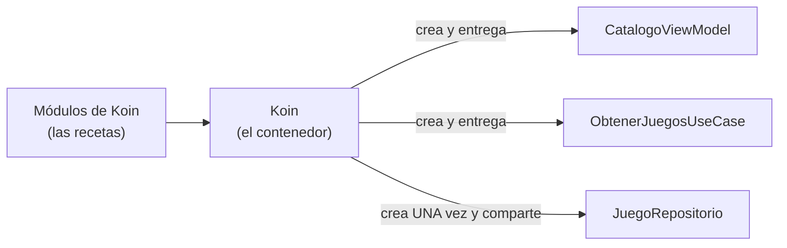

# **3C.3 Inyección de dependencias con Koin**

Al final de [3C.2](./3c.2-clean-architecture.md) conectamos todas las piezas a mano con un `ContenedorApp`. Funcionaba, pero ya se intuía el problema: por cada clase nueva hay que añadir una propiedad al contenedor, y por cada ViewModel hay que escribir a mano qué recibe. En una app real, con decenas de pantallas y casos de uso, ese código crece sin parar y es fácil equivocarse.

**Koin** es una librería que hace ese trabajo por nosotros. Le describimos **cómo se crea cada pieza** y Koin se encarga de crearlas, conectarlas y entregarlas a quien las necesite. Es la herramienta de **inyección de dependencias** que usaremos en el curso y la que pide el proyecto intermodular.

Al terminar sabrás:

- Qué es la inyección de dependencias y qué problema resuelve.
- Declarar las piezas de la app en **módulos de Koin** y elegir entre `single`, `factory` y `viewModel`.
- Arrancar Koin al iniciar la app.
- Obtener ViewModels en Compose con `koinViewModel()`, también con parámetros.
- Cambiar una implementación por otra tocando **una sola línea**.
- Comprobar con un test que todas las dependencias se pueden crear.

---

## 1. Qué es la inyección de dependencias

Una **dependencia** es cualquier objeto que una clase necesita para funcionar: el `CatalogoViewModel` depende de `ObtenerJuegosUseCase`, que a su vez depende de `JuegoRepositorio`.

**Inyectar** una dependencia significa **dárselo desde fuera** en lugar de que la clase lo cree:

=== "❌ Sin inyección"

    ```kotlin
    class CatalogoViewModel : ViewModel() {
        // La clase decide qué implementación usar y la crea ella misma
        private val repositorio = JuegoRepositorioEnMemoria()
        private val obtenerJuegos = ObtenerJuegosUseCase(repositorio)
    }
    ```

=== "✅ Con inyección"

    ```kotlin
    class CatalogoViewModel(
        obtenerJuegos: ObtenerJuegosUseCase,          // se lo dan desde fuera
        private val alternarFavorito: AlternarFavoritoUseCase
    ) : ViewModel()
    ```

En 3C.2 **ya aplicamos inyección de dependencias**: todos nuestros ViewModel y casos de uso reciben lo que necesitan por el constructor. Lo que cambia ahora es **quién** crea los objetos: en lugar de nuestro `ContenedorApp` escrito a mano, lo hará Koin.



!!! info "¿Por qué Koin y no Hilt?"
    Google promueve **Hilt** para apps solo Android. Koin funciona también en proyectos **Kotlin Multiplatform**, así que los mismos módulos servirán en la versión de escritorio que haremos en 3D. Además, es más sencillo de configurar. Encontrarás una comparación detallada en el manual: [¿Por qué Koin frente a Hilt?](../../00-android/02-arquitectura/03-inyeccion-dependencias-koin.md#por-que-koin-frente-a-hilt).

---

## 2. Configurar el proyecto

Koin publica un **BOM** (*Bill of Materials*): declaras su versión una vez y todas las librerías de Koin usan la misma.

=== "gradle/libs.versions.toml"

    ```toml
    [versions]
    koin = "4.2.1"

    [libraries]
    koin-bom = { module = "io.insert-koin:koin-bom", version.ref = "koin" }
    koin-android = { module = "io.insert-koin:koin-android" }
    koin-compose-viewmodel = { module = "io.insert-koin:koin-compose-viewmodel" }
    koin-test = { module = "io.insert-koin:koin-test" }
    ```

=== "app/build.gradle.kts"

    ```kotlin
    dependencies {
        implementation(platform(libs.koin.bom))
        implementation(libs.koin.android)             // arrancar Koin en Android
        implementation(libs.koin.compose.viewmodel)   // koinViewModel() en Compose

        testImplementation(platform(libs.koin.bom))
        testImplementation(libs.koin.test)            // comprobar los módulos (apartado 8)
    }
    ```

| Librería | Para qué sirve |
|---|---|
| `koin-android` | Arrancar Koin con el contexto de la app Android |
| `koin-compose-viewmodel` | Obtener ViewModels desde Compose con `koinViewModel()`. Es multiplataforma: la reutilizaremos en 3D |
| `koin-test` | Verificar en un test que todas las dependencias se pueden crear |

---

## 3. Paso 1: describir las piezas en un módulo

Un **módulo** es la lista de recetas que Koin necesita. Para cada clase indicamos **cómo** se crea y **cuántas veces**:

| Declaración | Qué hace | Úsala para |
|---|---|---|
| `singleOf(::Clase)` | Crea **una única instancia** para toda la app y la reutiliza siempre | Repositorios, bases de datos, clientes HTTP |
| `factoryOf(::Clase)` | Crea una **instancia nueva** cada vez que alguien la pide | Casos de uso y clases sin estado |
| `viewModelOf(::Clase)` | Crea un **ViewModel** con su ciclo de vida de Android (sobrevive a rotaciones y se destruye al cerrar la pantalla) | ViewModels |

Así queda nuestro `ContenedorApp` de 3C.2 convertido en módulos de Koin:

```kotlin
package com.dam.pmdmlab03.di

import org.koin.core.module.dsl.factoryOf
import org.koin.core.module.dsl.singleOf
import org.koin.core.module.dsl.viewModelOf
import org.koin.dsl.bind
import org.koin.dsl.module

// Capa de datos: UNA instancia del repositorio, que se entrega como JuegoRepositorio
val datosModule = module {
    singleOf(::JuegoRepositorioEnMemoria) bind JuegoRepositorio::class
}

// Capa de dominio: un caso de uso nuevo cada vez que se pide
val dominioModule = module {
    factoryOf(::ObtenerJuegosUseCase)
    factoryOf(::ObservarJuegoUseCase)
    factoryOf(::AlternarFavoritoUseCase)
}

// Capa de presentación
val presentacionModule = module {
    viewModelOf(::CatalogoViewModel)
    viewModelOf(::DetalleViewModel)
}

val appModules = listOf(datosModule, dominioModule, presentacionModule)
```

Fíjate en lo que **no** hemos escrito: en ningún sitio decimos que `CatalogoViewModel` necesita `ObtenerJuegosUseCase`, ni que este necesita un `JuegoRepositorio`. Koin **mira el constructor** de cada clase (`::CatalogoViewModel` es una referencia a su constructor) y busca en sus recetas algo de cada tipo.

Dos detalles importantes:

- **`bind JuegoRepositorio::class`**: los casos de uso piden un `JuegoRepositorio` (la interfaz del dominio), no un `JuegoRepositorioEnMemoria`. Con `bind` le decimos a Koin que esta implementación sirve cuando alguien pida la interfaz.
- **El repositorio es `single`**: así toda la app comparte la misma instancia y es la **única fuente de verdad**. Si fuera `factory`, cada caso de uso tendría su propio repositorio y el favorito volvería a perderse.

!!! tip "Un módulo por capa"
    Separar los módulos por capa (datos, dominio, presentación) hace que encontrar una declaración sea inmediato y que, en UT4, solo haya que tocar `datosModule` para pasar a Room o a una API.

---

## 4. Paso 2: arrancar Koin

Koin debe arrancarse **una sola vez**, al iniciar la app. El sitio adecuado es la clase `Application` que creamos en 3C.2, que ya está registrada en el manifiesto con `android:name=".MiApp"`:

```kotlin
import android.app.Application
import org.koin.android.ext.koin.androidContext
import org.koin.android.ext.koin.androidLogger
import org.koin.core.context.startKoin

class MiApp : Application() {
    override fun onCreate() {
        super.onCreate()
        startKoin {
            androidLogger()                 // muestra en Logcat lo que crea Koin
            androidContext(this@MiApp)      // da acceso al Context de la app (lo usaremos con Room en UT4)
            modules(appModules)
        }
    }
}
```

El `ContenedorApp` de 3C.2 ya no hace falta: puedes borrarlo.

---

## 5. Paso 3: obtener los ViewModel en Compose

En la navegación, cambiamos `viewModel { … }` por **`koinViewModel()`**. Koin crea el ViewModel con todas sus dependencias:

```kotlin
import org.koin.compose.viewmodel.koinViewModel
import org.koin.core.parameter.parametersOf

@Composable
fun AppNavegacion() {
    val pila = rememberNavBackStack(Catalogo)

    NavDisplay(
        backStack = pila,
        onBack = { pila.removeLastOrNull() },
        entryDecorators = listOf(
            rememberSaveableStateHolderNavEntryDecorator(),
            rememberViewModelStoreNavEntryDecorator()      // imprescindible: un ViewModel por entrada
        ),
        entryProvider = entryProvider {
            entry<Catalogo> {
                val viewModel = koinViewModel<CatalogoViewModel>()
                val estado by viewModel.uiState.collectAsStateWithLifecycle()
                PantallaCatalogo(
                    estado = estado,
                    onJuegoClick = { id -> pila.add(Detalle(id)) },
                    onFavoritoClick = viewModel::onFavoritoClick,
                    onFiltroCambiado = viewModel::onFiltroCambiado
                )
            }
            entry<Detalle> { clave ->
                // El id viene de la clave de navegación: se lo pasamos a Koin como parámetro
                val viewModel = koinViewModel<DetalleViewModel> { parametersOf(clave.juegoId) }
                val estado by viewModel.uiState.collectAsStateWithLifecycle()
                PantallaDetalle(
                    estado = estado,
                    onFavoritoClick = viewModel::onFavoritoClick,
                    onVolver = { pila.removeLastOrNull() }
                )
            }
        }
    )
}
```

Compara con 3C.2: ha desaparecido la línea que buscaba el contenedor y ya no enumeramos las dependencias de cada ViewModel.

### Parámetros: `parametersOf`

`DetalleViewModel` necesita tres cosas: el `juegoId` y dos casos de uso. Los casos de uso los conoce Koin, pero el `juegoId` **solo se sabe en el momento de navegar**. Por eso se lo pasamos con `parametersOf(clave.juegoId)`. Al crear el ViewModel, Koin usa ese valor para el parámetro `Int` del constructor y resuelve el resto con sus recetas. No hay que cambiar nada en `viewModelOf(::DetalleViewModel)`.

!!! danger "No olvides el decorador de ViewModel"
    `koinViewModel()` asocia el ViewModel al «propietario» más cercano. Sin `rememberViewModelStoreNavEntryDecorator()` en `NavDisplay`, ese propietario es la Activity, y todas las pantallas de detalle compartirían **el mismo** `DetalleViewModel`: el primer juego que abras se quedaría para siempre. Es el mismo error que vimos en [3B.1](../b-navegacion/3b.1-navigation3.md#8-un-viewmodel-para-cada-pantalla).

### Las pantallas siguen sin saber nada de Koin

Solo el composable de navegación llama a `koinViewModel()`. Las pantallas (`PantallaCatalogo`, `PantallaDetalle`) siguen recibiendo un estado y lambdas, así que:

- Las `@Preview` funcionan sin arrancar Koin: les pasas un estado inventado.
- Los tests de interfaz de [3C.4](./3c.4-testing.md) tampoco necesitan Koin.

---

## 6. La recompensa: cambiar una implementación en una línea

Supongamos que queremos simular que los datos tardan en llegar, para comprobar que la pantalla muestra bien el estado `Cargando`. Creamos otra implementación del mismo contrato:

```kotlin
class JuegoRepositorioLento(
    private val real: JuegoRepositorio = JuegoRepositorioEnMemoria()
) : JuegoRepositorio by real {           // delega todo en 'real'…

    override fun observarJuegos(): Flow<List<Juego>> =
        real.observarJuegos().onStart { delay(2_000) }   // …salvo esto: espera 2 s antes de emitir
}
```

Y para usarla en toda la app basta con cambiar **una línea** del módulo de datos:

```kotlin
val datosModule = module {
    singleOf(::JuegoRepositorioLento) bind JuegoRepositorio::class
}
```

Ni los ViewModel, ni los casos de uso, ni las pantallas se enteran. En **UT4** haremos exactamente lo mismo para pasar a `JuegoRepositorioRoom` o a un repositorio que combine base de datos y API.

!!! info "`JuegoRepositorio by real`"
    Es la **delegación de clases** de Kotlin: `JuegoRepositorioLento` implementa la interfaz reenviando todas las llamadas a `real`, salvo las que sobrescribe. Evita escribir a mano los métodos que no cambian.

---

## 7. Opcional: Koin y Navigation 3

Koin ofrece además una integración específica con Navigation 3 (librería `koin-compose-navigation3`) que permite declarar **las propias pantallas** en los módulos. Está marcada como **experimental**, así que en el curso usamos el enfoque del apartado 5, pero conviene que la conozcas porque aparece en muchos ejemplos actuales.

??? example "Ver cómo se declaran las pantallas en un módulo de Koin"

    ```kotlin
    @OptIn(KoinExperimentalAPI::class)
    val navegacionModule = module {
        navigation<Catalogo> {
            val viewModel = koinViewModel<CatalogoViewModel>()
            // … misma pantalla que en el apartado 5
        }
        navigation<Detalle> { clave ->
            val viewModel = koinViewModel<DetalleViewModel> { parametersOf(clave.juegoId) }
            // …
        }
    }

    @OptIn(KoinExperimentalAPI::class)
    @Composable
    fun AppNavegacion() {
        val pila = rememberNavBackStack(Catalogo)
        NavDisplay(
            backStack = pila,
            onBack = { pila.removeLastOrNull() },
            entryDecorators = listOf(
                rememberSaveableStateHolderNavEntryDecorator(),
                rememberViewModelStoreNavEntryDecorator()
            ),
            entryProvider = koinEntryProvider<NavKey>()    // Koin construye el entryProvider con los módulos
        )
    }
    ```

    Ventaja: cada funcionalidad declara sus propias pantallas en su módulo, sin un `entryProvider` central gigante. Inconveniente: las pantallas necesitan acceder a la pila para navegar, lo que obliga a compartirla (normalmente, inyectando un objeto «navegador»). Consulta la [documentación de Koin para Navigation 3](https://insert-koin.io/docs/reference/koin-compose/navigation3/).

---

## 8. Comprobar los módulos con un test

Si te olvidas de declarar una clase, Koin no lo detecta al compilar: la app **se cierra al abrir la pantalla** que la necesita. Para descubrirlo antes, `koin-test` ofrece `verify()`, que revisa que cada clase declarada tenga disponibles todas sus dependencias:

```kotlin
import org.koin.dsl.module
import org.koin.test.verify.definition
import org.koin.test.verify.injectedParameters
import org.koin.test.verify.verify

class ModulosKoinTest {

    @Test
    fun `todas las dependencias de la app se pueden crear`() {
        module { includes(appModules) }.verify(
            // DetalleViewModel recibe un Int con parametersOf() al navegar: no viene de ningún módulo
            injections = injectedParameters(
                definition<DetalleViewModel>(Int::class)
            )
        )
    }
}
```

`verify()` se ejecuta en la JVM, así que va en `src/test`, como el resto de tests locales.

Es un test que tarda milisegundos y evita uno de los fallos más frecuentes al trabajar con Koin. Ejecútalo cada vez que añadas clases nuevas.

---

## 9. Errores frecuentes

!!! warning "`NoDefinitionFoundException: No definition found for type …`"
    Koin no tiene receta para ese tipo. Suele ser porque falta un `factoryOf`/`singleOf`/`viewModelOf`, o porque el constructor pide la implementación (`JuegoRepositorioEnMemoria`) y en el módulo solo se ofrece la interfaz (o al revés). El test del apartado 8 lo detecta antes de ejecutar la app.

!!! warning "`KoinApplication has not been started`"
    `startKoin` no se ha ejecutado. Comprueba que `MiApp` existe y que el manifiesto tiene `android:name=".MiApp"`.

!!! warning "El favorito no se comparte entre pantallas"
    El repositorio está declarado con `factoryOf` en lugar de `singleOf`: cada caso de uso recibe un repositorio distinto.

!!! warning "Todas las pantallas de detalle muestran el mismo juego"
    Falta `rememberViewModelStoreNavEntryDecorator()` en `NavDisplay` (apartado 5).

!!! warning "Error al crear `DetalleViewModel`: no encuentra un `Int`"
    Has llamado a `koinViewModel<DetalleViewModel>()` sin `parametersOf(clave.juegoId)`.

!!! warning "Pedir dependencias a Koin desde dentro de las clases"
    Koin permite escribir `val repo: JuegoRepositorio = get()` dentro de cualquier clase, pero entonces la clase vuelve a depender de Koin y deja de poder probarse pasándole un *fake*. Recibe siempre las dependencias **por el constructor** y deja que Koin las rellene.

---

## 10. Retos

Parte del código final de este apartado.

### 🟢 Básico: registrar la pantalla de favoritos

Si hiciste el reto avanzado de 3C.2, tienes un `ObtenerFavoritosUseCase` y un `FavoritosViewModel`. Regístralos en los módulos de Koin y obtén el ViewModel con `koinViewModel()`. Si no lo hiciste, crea ambos siguiendo la solución de aquel reto.

??? success "Solución"

    ```kotlin
    val dominioModule = module {
        factoryOf(::ObtenerJuegosUseCase)
        factoryOf(::ObservarJuegoUseCase)
        factoryOf(::AlternarFavoritoUseCase)
        factoryOf(::ObtenerFavoritosUseCase)      // nuevo
    }

    val presentacionModule = module {
        viewModelOf(::CatalogoViewModel)
        viewModelOf(::DetalleViewModel)
        viewModelOf(::FavoritosViewModel)         // nuevo
    }

    // En la navegación
    entry<Favoritos> {
        val viewModel = koinViewModel<FavoritosViewModel>()
        val estado by viewModel.uiState.collectAsStateWithLifecycle()
        PantallaFavoritos(
            estado = estado,
            onQuitarFavorito = viewModel::onQuitarFavorito,
            onJuegoClick = { id -> pila.add(Detalle(id)) }
        )
    }
    ```

    Claves de la solución:

    - Añadir una pantalla nueva solo exige **dos líneas** en los módulos: no hay que tocar ningún contenedor ni enumerar dependencias.
    - `FavoritosViewModel` recibe el mismo `JuegoRepositorio` (`single`) que el resto, por eso sigue sincronizado con el catálogo y el detalle.

### 🟡 Intermedio: repositorio lento solo mientras desarrollas

Crea el `JuegoRepositorioLento` del apartado 6 y haz que se use **solo** cuando una constante `SIMULAR_LATENCIA` valga `true`. Comprueba que el catálogo muestra el estado `Cargando` durante dos segundos.

??? success "Solución"

    ```kotlin
    // di/Configuracion.kt
    const val SIMULAR_LATENCIA = true

    // di/Modulos.kt
    val datosModule = module {
        if (SIMULAR_LATENCIA) {
            single<JuegoRepositorio> { JuegoRepositorioLento() }
        } else {
            singleOf(::JuegoRepositorioEnMemoria) bind JuegoRepositorio::class
        }
    }

    // ui/catalogo/PantallaCatalogo.kt (fragmento)
    when (estado) {
        CatalogoUiState.Cargando -> Box(Modifier.fillMaxSize(), contentAlignment = Alignment.Center) {
            CircularProgressIndicator()
        }
        CatalogoUiState.Vacio -> MensajeVacio()
        is CatalogoUiState.Exito -> ListaJuegos(estado.juegos, onJuegoClick, onFavoritoClick)
        is CatalogoUiState.Error -> MensajeError(estado.mensaje)
    }
    ```

    Claves de la solución:

    - Los módulos de Koin son **código Kotlin normal**: se pueden usar `if`, funciones y constantes para decidir qué se registra.
    - `single<JuegoRepositorio> { JuegoRepositorioLento() }` es la forma explícita (con lambda) de declarar una receta. Es útil cuando el constructor tiene parámetros con valor por defecto o necesitas configurar algo al crearlo.
    - Probar el estado `Cargando` con datos reales suele ser difícil porque llegan demasiado rápido. Un repositorio lento lo hace visible sin tocar ni el ViewModel ni la pantalla.

### 🔴 Avanzado: encontrar el fallo antes de ejecutar

Añade el test `verify()` del apartado 8. Después, rompe a propósito los módulos de tres formas distintas, una cada vez, y comprueba que el test falla con un mensaje que indica el problema:

1. Quita `factoryOf(::AlternarFavoritoUseCase)`.
2. Cambia el constructor de `ObtenerJuegosUseCase` para que pida `JuegoRepositorioEnMemoria` en lugar de `JuegoRepositorio`, y elimina el `bind` del módulo de datos.
3. Quita el parámetro `injections` del test.

Explica en un comentario del test por qué falla cada caso.

??? success "Solución"

    ```kotlin
    class ModulosKoinTest {

        /**
         * Verifica que cada definición de Koin puede crearse con lo que hay en los módulos.
         *
         * Fallos provocados durante el reto:
         * 1. Sin factoryOf(::AlternarFavoritoUseCase): CatalogoViewModel y DetalleViewModel
         *    lo piden en su constructor y no hay receta para ese tipo.
         * 2. Sin el bind: el módulo ofrece JuegoRepositorioEnMemoria, pero el resto de casos
         *    de uso piden JuegoRepositorio (la interfaz) y Koin no los relaciona.
         * 3. Sin injections: DetalleViewModel pide un Int que ningún módulo declara porque
         *    llega con parametersOf() al navegar; hay que indicárselo al verificador.
         */
        @Test
        fun `todas las dependencias de la app se pueden crear`() {
            module { includes(appModules) }.verify(
                injections = injectedParameters(
                    definition<DetalleViewModel>(Int::class)
                )
            )
        }
    }
    ```

    Claves de la solución:

    - Los tres errores **compilan sin problemas**: sin este test solo se descubrirían al abrir la pantalla afectada en el móvil.
    - El caso 2 muestra por qué conviene que todo dependa de la **interfaz** del dominio: si alguna clase pide la implementación concreta, el `bind` deja de ser suficiente y el diseño se vuelve frágil.
    - Este test es barato de mantener y es buena práctica incluirlo en cualquier proyecto con Koin, incluido el proyecto intermodular.

---

## 11. Para saber más

- **Manual de referencia:** [Inyección de dependencias con Koin](../../00-android/02-arquitectura/03-inyeccion-dependencias-koin.md), con la inicialización en proyectos KMP.
- **Documentación oficial de Koin:**

    - [Koin en Android: inicio rápido](https://insert-koin.io/docs/quickstart/android-compose/)
    - [Definiciones (`single`, `factory`, `viewModel`) y DSL con constructores](https://insert-koin.io/docs/reference/koin-core/dsl/)
    - [ViewModels en Compose](https://insert-koin.io/docs/reference/koin-compose/compose/)
    - [Verificar la configuración con `verify()`](https://insert-koin.io/docs/reference/koin-test/verify/)
    - [Koin y Navigation 3](https://insert-koin.io/docs/reference/koin-compose/navigation3/)
