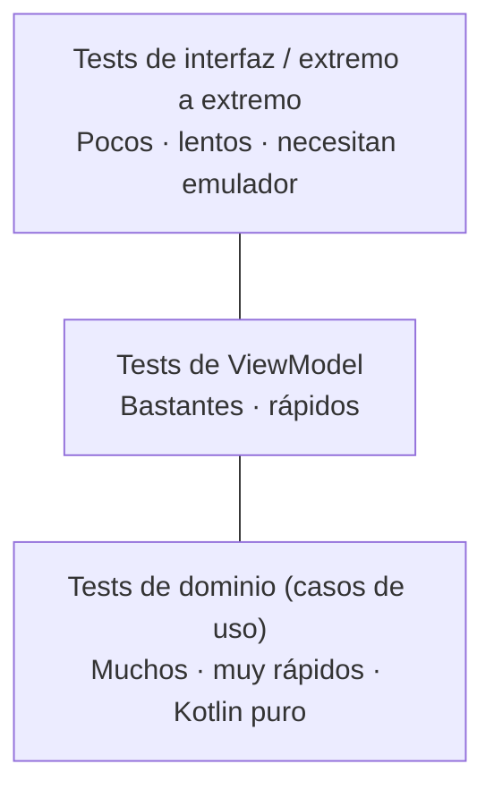

# **3C.4 Testing: dominio, ViewModel e interfaz**

En el bloque de Kotlin aprendimos a escribir pruebas unitarias con JUnit para comprobar que la lógica funcionaba según lo esperado (ver [Testing de retos](../../00-android/00-kotlin/testing/index.md)). Ahora que nuestra app está organizada en capas ([3C.2](./3c.2-clean-architecture.md)) y recibe sus dependencias desde fuera ([3C.3](./3c.3-inyeccion-dependencias-koin.md)), probarla es mucho más sencillo: cada pieza se puede comprobar **por separado**, sustituyendo lo que necesita por una versión de prueba.

En este apartado aprenderemos a probar las tres capas de la app de juegos:

- **Dominio:** los casos de uso, con un repositorio de prueba (*fake*).
- **Presentación (lógica):** los ViewModel y sus `StateFlow`, controlando las corrutinas.
- **Presentación (interfaz):** las pantallas Compose, buscando elementos y simulando pulsaciones.

---

## 1. Qué probar y dónde

### 1.1. La pirámide de tests

No todos los tests cuestan lo mismo. La recomendación habitual es tener **muchos tests pequeños y rápidos** y **pocos tests grandes y lentos**:



### 1.2. Tests locales y tests instrumentados

Un proyecto Android tiene dos carpetas de tests, que se ejecutan en sitios distintos:

| | **Tests locales** | **Tests instrumentados** |
|---|---|---|
| Carpeta | `app/src/test/` | `app/src/androidTest/` |
| Se ejecutan en | Tu ordenador (JVM) | Un emulador o un móvil |
| Velocidad | Milisegundos | Segundos o minutos |
| Para qué | Casos de uso, ViewModel, verificación de Koin | Pantallas Compose, integración con Android |
| Comando | `./gradlew test` | `./gradlew connectedAndroidTest` |

### 1.3. Estructura de un test: *Arrange, Act, Assert*

Todos los tests siguen el mismo esquema de tres pasos:

1. **Arrange (preparar):** crear los objetos y los datos de partida.

2. **Act (actuar):** ejecutar la acción que se quiere probar.

3. **Assert (comprobar):** verificar que el resultado es el esperado.

Y un test debe comprobar **un solo comportamiento**, con un nombre que lo describa. En Kotlin se pueden escribir nombres con espacios entre comillas invertidas: `` fun `los favoritos aparecen primero`() ``.

---

## 2. Configurar el proyecto

=== "gradle/libs.versions.toml"

    ```toml
    [versions]
    junit = "4.13.2"
    coroutinesTest = "1.11.0"
    turbine = "1.2.1"

    [libraries]
    junit = { module = "junit:junit", version.ref = "junit" }
    kotlin-test = { module = "org.jetbrains.kotlin:kotlin-test" }
    kotlinx-coroutines-test = { module = "org.jetbrains.kotlinx:kotlinx-coroutines-test", version.ref = "coroutinesTest" }
    turbine = { module = "app.cash.turbine:turbine", version.ref = "turbine" }
    androidx-compose-ui-test-junit4 = { group = "androidx.compose.ui", name = "ui-test-junit4" }
    androidx-compose-ui-test-manifest = { group = "androidx.compose.ui", name = "ui-test-manifest" }
    ```

=== "app/build.gradle.kts"

    ```kotlin
    dependencies {
        // Tests locales (src/test)
        testImplementation(libs.junit)
        testImplementation(libs.kotlin.test)
        testImplementation(libs.kotlinx.coroutines.test)
        testImplementation(libs.turbine)

        // Tests de interfaz (src/androidTest)
        androidTestImplementation(platform(libs.androidx.compose.bom))
        androidTestImplementation(libs.androidx.compose.ui.test.junit4)
        debugImplementation(libs.androidx.compose.ui.test.manifest)
    }
    ```

| Librería | Para qué sirve |
|---|---|
| `junit` + `kotlin-test` | Ejecutar los tests (`@Test`) y comprobar resultados (`assertEquals`, `assertTrue`…) |
| `kotlinx-coroutines-test` | Probar código con corrutinas: `runTest`, despachadores de prueba |
| `turbine` | Comprobar paso a paso los valores que emite un `Flow` |
| `ui-test-junit4` y `ui-test-manifest` | Probar pantallas Compose. Su versión la fija el BOM de Compose |

Si hiciste [3C.3](./3c.3-inyeccion-dependencias-koin.md#8-comprobar-los-modulos-con-un-test), ya tienes también `koin-test` para verificar los módulos.

---

## 3. Probar el dominio con un repositorio *fake*

### 3.1. *Fakes* frente a *mocks*

Para probar un caso de uso necesitamos darle un `JuegoRepositorio`, pero no queremos depender de los datos reales. Hay dos formas de crear un repositorio de prueba:

- **Fake:** una implementación **sencilla pero funcional** de la interfaz, escrita por nosotros. Se comporta como el real, pero con datos en memoria.
- **Mock:** un objeto generado por una librería (como MockK) al que se le dice qué responder en cada llamada.

En el curso usaremos **fakes**: son código Kotlin normal, fáciles de entender, funcionan igual en KMP y, gracias a la arquitectura de 3C.2, basta con implementar la interfaz.

### 3.2. Un repositorio de prueba controlable

El `JuegoRepositorioEnMemoria` de 3C.2 ya se parece mucho a un fake, pero tiene datos fijos. Para los tests conviene uno que podamos **controlar** desde cada test: elegir los datos de partida y simular errores.

```kotlin
// app/src/test/java/com/dam/pmdmlab03/juegos/FakeJuegoRepositorio.kt
class FakeJuegoRepositorio(
    juegosIniciales: List<Juego> = emptyList()
) : JuegoRepositorio {

    private val juegos = MutableStateFlow(juegosIniciales)

    /** Si no es null, observarJuegos() fallará con este error. */
    var errorAlObservar: Throwable? = null

    override fun observarJuegos(): Flow<List<Juego>> =
        errorAlObservar?.let { error -> flow { throw error } } ?: juegos

    override fun observarJuego(id: Int): Flow<Juego?> =
        juegos.map { lista -> lista.find { it.id == id } }

    override suspend fun alternarFavorito(id: Int) {
        juegos.update { lista ->
            lista.map { if (it.id == id) it.copy(esFavorito = !it.esFavorito) else it }
        }
    }
}
```

### 3.3. Test de un caso de uso

```kotlin
class ObtenerJuegosUseCaseTest {

    private val hades = Juego(1, "Hades", "PC")
    private val celeste = Juego(2, "Celeste", "PC")
    private val zelda = Juego(3, "Zelda", "Switch", esFavorito = true)

    @Test
    fun `devuelve los favoritos primero y el resto por orden alfabetico`() = runTest {
        // Arrange
        val repositorio = FakeJuegoRepositorio(listOf(hades, celeste, zelda))
        val obtenerJuegos = ObtenerJuegosUseCase(repositorio)

        // Act
        val resultado = obtenerJuegos().first()

        // Assert
        assertEquals(listOf(zelda, celeste, hades), resultado)
    }

    @Test
    fun `con el repositorio vacio devuelve una lista vacia`() = runTest {
        val obtenerJuegos = ObtenerJuegosUseCase(FakeJuegoRepositorio())

        assertTrue(obtenerJuegos().first().isEmpty())
    }
}
```

- **`runTest`** ejecuta el test dentro de una corrutina, así que se pueden llamar funciones `suspend`. Además, **salta los `delay`** sin esperar de verdad: un `delay(5_000)` no hace que el test tarde cinco segundos.
- **`first()`** toma el primer valor que emite el `Flow` y deja de escuchar.
- Cada test crea **su propio** repositorio: los tests no deben compartir estado, para que el resultado no dependa del orden en que se ejecuten.

### 3.4. Comprobar varias emisiones con Turbine

¿Y si queremos comprobar que el caso de uso **reacciona a los cambios**? Con `first()` solo vemos el primer valor. **Turbine** permite ir leyendo los valores que emite un `Flow` uno a uno:

```kotlin
@Test
fun `al marcar un favorito, la lista se reordena`() = runTest {
    val repositorio = FakeJuegoRepositorio(listOf(hades, celeste))
    val obtenerJuegos = ObtenerJuegosUseCase(repositorio)

    obtenerJuegos().test {
        // Primera emisión: orden alfabético
        assertEquals(listOf(celeste, hades), awaitItem())

        // Hades pasa a favorito…
        repositorio.alternarFavorito(hades.id)

        // …y la siguiente emisión lo coloca el primero
        assertEquals(listOf(hades.copy(esFavorito = true), celeste), awaitItem())

        cancelAndIgnoreRemainingEvents()
    }
}
```

- **`test { … }`** empieza a escuchar el `Flow` y lo deja de escuchar al terminar el bloque.
- **`awaitItem()`** espera el siguiente valor. Si no llega, el test falla al cabo de unos segundos.
- **`cancelAndIgnoreRemainingEvents()`** termina la escucha sin comprobar nada más. Sin ella, si quedara algún valor sin leer, Turbine haría fallar el test.

---

## 4. Probar los ViewModel

### 4.1. El problema del hilo principal

Los ViewModel lanzan sus corrutinas en `viewModelScope`, que usa el **hilo principal** de Android (`Dispatchers.Main`). En un test local no hay Android, así que no existe hilo principal y el test falla con *«Module with the Main dispatcher is missing»*.

La solución es sustituir `Dispatchers.Main` por un despachador de prueba antes de cada test. Para no repetir ese código en todas las clases de test, se escribe una vez como **regla de JUnit**:

```kotlin
// app/src/test/java/com/dam/pmdmlab03/MainDispatcherRule.kt
class MainDispatcherRule(
    private val testDispatcher: TestDispatcher = UnconfinedTestDispatcher()
) : TestWatcher() {

    override fun starting(description: Description) {
        Dispatchers.setMain(testDispatcher)      // antes de cada test
    }

    override fun finished(description: Description) {
        Dispatchers.resetMain()                  // después de cada test
    }
}
```

`UnconfinedTestDispatcher` ejecuta las corrutinas **inmediatamente**, en el momento en que se lanzan. Así, tras llamar a `viewModel.onFavoritoClick(1)`, el cambio ya se ha aplicado y se puede comprobar en la línea siguiente.

### 4.2. Activar un `StateFlow` creado con `stateIn`

Nuestros ViewModel construyen el estado con `stateIn(…, SharingStarted.WhileSubscribed(5_000), …)`. Ese flujo **solo empieza a calcular cuando alguien lo observa**. En la app, el observador es la pantalla; en el test, tenemos que poner uno nosotros. Si no, `uiState.value` se queda siempre en el valor inicial (`Cargando`).

Se hace lanzando una recolección en el `backgroundScope` de `runTest`, que se cancela sola al terminar el test:

```kotlin
backgroundScope.launch(UnconfinedTestDispatcher(testScheduler)) {
    viewModel.uiState.collect {}
}
```

### 4.3. Test completo de `CatalogoViewModel`

```kotlin
class CatalogoViewModelTest {

    @get:Rule
    val mainDispatcherRule = MainDispatcherRule()

    private val hades = Juego(1, "Hades", "PC")
    private val zelda = Juego(2, "Zelda", "Switch")

    private fun crearViewModel(repositorio: JuegoRepositorio) = CatalogoViewModel(
        obtenerJuegos = ObtenerJuegosUseCase(repositorio),
        alternarFavorito = AlternarFavoritoUseCase(repositorio)
    )

    @Test
    fun `el estado inicial es Cargando`() {
        val viewModel = crearViewModel(FakeJuegoRepositorio(listOf(hades)))

        assertEquals(CatalogoUiState.Cargando, viewModel.uiState.value)
    }

    @Test
    fun `con datos, el estado pasa a Exito con todos los juegos`() = runTest {
        val viewModel = crearViewModel(FakeJuegoRepositorio(listOf(hades, zelda)))
        backgroundScope.launch(UnconfinedTestDispatcher(testScheduler)) { viewModel.uiState.collect {} }

        val estado = assertIs<CatalogoUiState.Exito>(viewModel.uiState.value)
        assertEquals(listOf(hades, zelda), estado.juegos)
    }

    @Test
    fun `al filtrar por plataforma solo quedan sus juegos`() = runTest {
        val viewModel = crearViewModel(FakeJuegoRepositorio(listOf(hades, zelda)))
        backgroundScope.launch(UnconfinedTestDispatcher(testScheduler)) { viewModel.uiState.collect {} }

        viewModel.onFiltroCambiado("Switch")

        assertEquals(
            CatalogoUiState.Exito(juegos = listOf(zelda), filtro = "Switch"),
            viewModel.uiState.value
        )
    }

    @Test
    fun `si el repositorio falla, el estado es Error`() = runTest {
        val repositorio = FakeJuegoRepositorio().apply {
            errorAlObservar = IllegalStateException("Sin conexión")
        }
        val viewModel = crearViewModel(repositorio)
        backgroundScope.launch(UnconfinedTestDispatcher(testScheduler)) { viewModel.uiState.collect {} }

        assertEquals(CatalogoUiState.Error("Sin conexión"), viewModel.uiState.value)
    }
}
```

Fíjate en lo que **no** aparece: ni Android, ni emulador, ni Koin. El ViewModel recibe sus casos de uso por el constructor (3C.3) y los casos de uso, un fake. Estos tests se ejecutan en milisegundos.

!!! tip "Comprobar el tipo de un estado sellado: `assertIs`"
    `assertIs<CatalogoUiState.Exito>(valor)`, de la librería `kotlin.test`, comprueba que el estado es de ese tipo (si no, el test falla) y **devuelve el valor ya convertido**, así que a continuación puedes usar `estado.juegos` sin conversiones manuales.

---

## 5. Probar las pantallas Compose

Los tests de interfaz comprueban que una pantalla **muestra** lo que debe para cada estado y que **avisa** de las acciones del usuario. Gracias a la separación *stateful*/*stateless* de [2.3](../../02/2.3-primera-app.md), probamos el composable **sin ViewModel**: le pasamos un estado inventado y lambdas que registran lo que pasa.

Estos tests van en `app/src/androidTest/` y necesitan un emulador o un móvil conectado.

### 5.1. La regla de test de Compose

```kotlin
import androidx.compose.ui.test.junit4.v2.createComposeRule

class PantallaCatalogoTest {

    @get:Rule
    val composeTestRule = createComposeRule()

    @Test
    fun muestra_los_juegos_del_estado() {
        composeTestRule.setContent {
            MiAppTheme {
                PantallaCatalogo(
                    estado = CatalogoUiState.Exito(listOf(Juego(1, "Hades", "PC")), filtro = null),
                    onJuegoClick = {},
                    onFavoritoClick = {},
                    onFiltroCambiado = {}
                )
            }
        }

        composeTestRule.onNodeWithText("Hades").assertIsDisplayed()
    }
}
```

`createComposeRule()` prepara una pantalla vacía en la que `setContent` dibuja solo el composable que queremos probar, sin arrancar toda la app.

!!! note "APIs de test v1 y v2"
    Fíjate en el paquete: `androidx.compose.ui.test.junit4.v2`. Desde Compose 1.11 existen las **APIs de test v2**, que sustituyen a las anteriores (`androidx.compose.ui.test.junit4.createComposeRule`), ya obsoletas. La diferencia principal es que en v2 las corrutinas que lanza la pantalla no se ejecutan al instante, sino cuando el test espera a que la interfaz esté en reposo. Si una comprobación falla justo después de una acción, añade `composeTestRule.waitForIdle()` antes. En internet encontrarás muchos ejemplos con v1: funcionan, pero conviene usar v2. Consulta la [guía de migración](https://developer.android.com/develop/ui/compose/testing/migrate-v2).

### 5.2. Encontrar elementos: el árbol semántico

Compose no busca elementos por identificadores de XML como `R.id.boton`. Usa el **árbol semántico**: la misma información que usa TalkBack para describir la pantalla. Por eso, una pantalla accesible es también una pantalla fácil de probar.

| Buscar por… | Código | Cuándo usarlo |
|---|---|---|
| Texto visible | `onNodeWithText("Guardar")` | Botones, títulos, mensajes |
| Descripción de accesibilidad | `onNodeWithContentDescription("Añadir a favoritos")` | Iconos y botones con icono |
| Etiqueta de test | `onNodeWithTag("cargando")` | Elementos sin texto ni descripción, como un indicador de carga |
| Varios elementos | `onAllNodesWithText("Switch")` | Cuando el mismo texto aparece varias veces |

La **etiqueta de test** se añade con un modificador en el código de la pantalla:

```kotlin
CircularProgressIndicator(modifier = Modifier.testTag("cargando"))
```

### 5.3. Acciones y comprobaciones

| Acción | Código |
|---|---|
| Pulsar | `.performClick()` |
| Escribir en un campo | `.performTextInput("alumno@fp.es")` |
| Borrar un campo | `.performTextClearance()` |
| Desplazar una lista hasta un elemento | `.performScrollToNode(hasText("Zelda"))` |

| Comprobación | Código |
|---|---|
| Se ve en pantalla | `.assertIsDisplayed()` |
| No existe | `.assertDoesNotExist()` |
| Está habilitado / deshabilitado | `.assertIsEnabled()` / `.assertIsNotEnabled()` |
| Tiene exactamente este texto | `.assertTextEquals("Hades")` |
| Número de elementos | `onAllNodesWithText("PC").assertCountEquals(2)` |

### 5.4. Ejemplo: cada estado y cada evento de la pantalla de catálogo

```kotlin
class PantallaCatalogoTest {

    @get:Rule
    val composeTestRule = createComposeRule()

    private fun mostrar(
        estado: CatalogoUiState,
        onJuegoClick: (Int) -> Unit = {},
        onFavoritoClick: (Int) -> Unit = {}
    ) {
        composeTestRule.setContent {
            MiAppTheme {
                PantallaCatalogo(
                    estado = estado,
                    onJuegoClick = onJuegoClick,
                    onFavoritoClick = onFavoritoClick,
                    onFiltroCambiado = {}
                )
            }
        }
    }

    @Test
    fun en_estado_cargando_muestra_el_indicador() {
        mostrar(CatalogoUiState.Cargando)

        composeTestRule.onNodeWithTag("cargando").assertIsDisplayed()
    }

    @Test
    fun en_estado_vacio_muestra_el_mensaje() {
        mostrar(CatalogoUiState.Vacio)

        composeTestRule.onNodeWithText("No hay juegos para mostrar").assertIsDisplayed()
    }

    @Test
    fun al_pulsar_un_juego_avisa_con_su_id() {
        var idPulsado: Int? = null
        mostrar(
            estado = CatalogoUiState.Exito(listOf(Juego(7, "Zelda", "Switch")), filtro = null),
            onJuegoClick = { idPulsado = it }
        )

        composeTestRule.onNodeWithText("Zelda").performClick()

        assertEquals(7, idPulsado)
    }

    @Test
    fun al_pulsar_el_corazon_avisa_del_favorito() {
        var idFavorito: Int? = null
        mostrar(
            estado = CatalogoUiState.Exito(listOf(Juego(7, "Zelda", "Switch")), filtro = null),
            onFavoritoClick = { idFavorito = it }
        )

        composeTestRule.onNodeWithContentDescription("Añadir a favoritos").performClick()

        assertEquals(7, idFavorito)
    }
}
```

Los textos (`"No hay juegos para mostrar"`, `"Añadir a favoritos"`) y la etiqueta `"cargando"` deben coincidir con los que use tu `PantallaCatalogo`. Si usas `stringResource`, en el test puedes leer el mismo texto con `InstrumentationRegistry.getInstrumentation().targetContext.getString(R.string.…)`.

!!! tip "Comprobar eventos con una variable"
    Para saber si la pantalla ha avisado de una acción, pásale una lambda que guarde el valor en una variable del test (`onJuegoClick = { idPulsado = it }`) y compruébala después. Así se prueba la pantalla sin ViewModel ni navegación.

### 5.5. Ejemplo del laboratorio: El Ahorcado

En el [laboratorio de la UT3](../3.6-laboratorio-retos.md) se pide probar la interfaz de El Ahorcado de [3C.1](./3c.1-capa-ui-viewmodel.md). Este es un punto de partida.

??? example "Ver los tests de `AhorcadoContent`"

    ```kotlin
    // app/src/androidTest/java/com/dam/pmdmlab/AhorcadoContentTest.kt
    package com.dam.pmdmlab

    import androidx.compose.ui.test.assertIsDisplayed
    import androidx.compose.ui.test.junit4.v2.createComposeRule
    import androidx.compose.ui.test.onNodeWithText
    import androidx.compose.ui.test.performClick
    import com.dam.pmdmlab.ui.retos.ahorcado.AhorcadoContent
    import com.dam.pmdmlab.ui.retos.ahorcado.AhorcadoUiState
    import org.junit.Assert.assertEquals
    import org.junit.Rule
    import org.junit.Test

    class AhorcadoContentTest {

        @get:Rule
        val composeTestRule = createComposeRule()

        @Test
        fun alIniciarPartida_muestraVidasCorrectasYLetrasOcultas() {
            composeTestRule.setContent {
                AhorcadoContent(
                    state = AhorcadoUiState(palabraOculta = "KOTLIN", vidasRestantes = 6, vidasMaximas = 6),
                    onLetraClick = {},
                    onReiniciar = {},
                    onBack = {}
                )
            }

            composeTestRule.onNodeWithText("Vidas restantes: 6/6").assertIsDisplayed()
            composeTestRule.onNodeWithText("_ _ _ _ _ _").assertIsDisplayed()
        }

        @Test
        fun alPulsarLetra_emiteEventoConLaLetraCorrecta() {
            var letraPulsada = ' '

            composeTestRule.setContent {
                AhorcadoContent(
                    state = AhorcadoUiState(),
                    onLetraClick = { letraPulsada = it },
                    onReiniciar = {},
                    onBack = {}
                )
            }

            composeTestRule.onNodeWithText("A").performClick()

            assertEquals('A', letraPulsada)
        }

        @Test
        fun siPartidaTerminada_muestraAvisoDeFinDeJuego() {
            composeTestRule.setContent {
                AhorcadoContent(
                    state = AhorcadoUiState(juegoTerminado = true, haGanado = true),
                    onLetraClick = {},
                    onReiniciar = {},
                    onBack = {}
                )
            }

            composeTestRule.onNodeWithText("¡Felicidades, has ganado!").assertIsDisplayed()
        }
    }
    ```

!!! info "Tests de interfaz sin emulador"
    Con la librería **Robolectric** es posible ejecutar los tests de Compose en `src/test`, como tests locales, sin emulador. Es más rápido, pero requiere configuración adicional y no reproduce un dispositivo real al cien por cien. En el curso los ejecutaremos en el emulador.

---

## 6. Ejecutar los tests

**Desde el IDE:** pulsa el icono verde ▶ junto a una clase o a un método `@Test`. Para ejecutar todos los tests locales, clic derecho sobre la carpeta `src/test` → **Run Tests**.

**Desde la terminal:**

```bash
./gradlew test
```

```bash
./gradlew :app:testDebugUnitTest --tests "*CatalogoViewModelTest"
```

```bash
./gradlew connectedAndroidTest
```

| Comando | Qué ejecuta |
|---|---|
| `./gradlew test` | Todos los tests locales (`src/test`) |
| `./gradlew :app:testDebugUnitTest --tests "*CatalogoViewModelTest"` | Solo una clase de tests locales |
| `./gradlew connectedAndroidTest` | Los tests instrumentados (`src/androidTest`) en el emulador o móvil conectado |

Tras ejecutar los tests locales, Gradle genera un informe en `app/build/reports/tests/testDebugUnitTest/index.html` que puedes abrir en el navegador.

---

## 7. Errores frecuentes

!!! warning "«Module with the Main dispatcher is missing»"
    El ViewModel usa `viewModelScope` y el test no ha sustituido el hilo principal. Añade la `MainDispatcherRule` (apartado 4.1).

!!! warning "`uiState.value` se queda siempre en `Cargando`"
    El `StateFlow` se crea con `WhileSubscribed` y nadie lo está observando. Lanza un `collect` en `backgroundScope` (apartado 4.2).

!!! warning "Un test pasa solo y falla cuando se ejecutan todos"
    Los tests comparten estado: por ejemplo, un repositorio declarado como `object` o reutilizado entre tests. Crea los objetos dentro de cada test.

!!! warning "Turbine falla con «Unconsumed events found»"
    El `Flow` emitió más valores de los que has leído con `awaitItem()`. Léelos o termina con `cancelAndIgnoreRemainingEvents()`.

!!! warning "El test de interfaz no encuentra el elemento"
    El texto no coincide exactamente (mayúsculas, espacios, texto traducido), el elemento está fuera de la pantalla en una lista (desplázate con `performScrollToNode`) o es un icono sin `contentDescription`. Para ver qué hay en el árbol semántico, usa `composeTestRule.onRoot().printToLog("ARBOL")` y revisa Logcat.

!!! warning "La comprobación falla justo después de pulsar"
    Con las APIs v2, las corrutinas lanzadas por la pantalla todavía no se han ejecutado. Añade `composeTestRule.waitForIdle()` antes de comprobar.

!!! warning "He puesto el test de interfaz en `src/test` y no funciona"
    Los tests de Compose necesitan un dispositivo: van en `src/androidTest` (salvo que configures Robolectric).

---

## 8. Retos

Usa el `FakeJuegoRepositorio` y la `MainDispatcherRule` de este apartado.

### 🟢 Básico: test de `AlternarFavoritoUseCase`

Escribe dos tests para `AlternarFavoritoUseCase`: que un juego que no era favorito pasa a serlo, y que al llamarlo dos veces vuelve a no ser favorito.

??? success "Solución"

    ```kotlin
    class AlternarFavoritoUseCaseTest {

        @Test
        fun `un juego que no era favorito pasa a serlo`() = runTest {
            val repositorio = FakeJuegoRepositorio(listOf(Juego(1, "Hades", "PC")))
            val alternarFavorito = AlternarFavoritoUseCase(repositorio)

            alternarFavorito(1)

            assertEquals(true, repositorio.observarJuego(1).first()?.esFavorito)
        }

        @Test
        fun `al alternarlo dos veces vuelve a no ser favorito`() = runTest {
            val repositorio = FakeJuegoRepositorio(listOf(Juego(1, "Hades", "PC")))
            val alternarFavorito = AlternarFavoritoUseCase(repositorio)

            alternarFavorito(1)
            alternarFavorito(1)

            assertEquals(false, repositorio.observarJuego(1).first()?.esFavorito)
        }
    }
    ```

    Claves de la solución:

    - El resultado se comprueba **leyendo del repositorio**, que es la fuente de verdad, no del caso de uso.
    - Cada test crea su propio repositorio con un único juego: el escenario es mínimo y fácil de entender.
    - `observarJuego(1).first()` devuelve `Juego?`, así que se compara con `?.esFavorito`.

### 🟡 Intermedio: favoritos y estado vacío en el ViewModel

Añade a `CatalogoViewModelTest` dos tests:

- Tras llamar a `onFavoritoClick(id)`, ese juego aparece el primero y marcado como favorito en el estado.
- Si se filtra por una plataforma sin juegos, el estado es `Vacio`.

??? success "Solución"

    ```kotlin
    @Test
    fun `al marcar un favorito pasa a ser el primero del catalogo`() = runTest {
        val viewModel = crearViewModel(FakeJuegoRepositorio(listOf(hades, zelda)))
        backgroundScope.launch(UnconfinedTestDispatcher(testScheduler)) { viewModel.uiState.collect {} }

        viewModel.onFavoritoClick(zelda.id)

        val estado = assertIs<CatalogoUiState.Exito>(viewModel.uiState.value)
        assertEquals(zelda.copy(esFavorito = true), estado.juegos.first())
    }

    @Test
    fun `si ningun juego coincide con el filtro el estado es Vacio`() = runTest {
        val viewModel = crearViewModel(FakeJuegoRepositorio(listOf(hades, zelda)))
        backgroundScope.launch(UnconfinedTestDispatcher(testScheduler)) { viewModel.uiState.collect {} }

        viewModel.onFiltroCambiado("PlayStation")

        assertEquals(CatalogoUiState.Vacio, viewModel.uiState.value)
    }
    ```

    Claves de la solución:

    - El primer test recorre **todo el camino**: el ViewModel llama al caso de uso, el caso de uso cambia el repositorio, el repositorio emite y el ViewModel recalcula el estado. Y no hay ni una línea de Android.
    - `assertIs<CatalogoUiState.Exito>(…)` comprueba el tipo y devuelve el valor ya convertido, así que podemos usar `estado.juegos`.
    - Gracias a `UnconfinedTestDispatcher`, el `viewModelScope.launch` de `onFavoritoClick` se ejecuta de inmediato y el estado ya está actualizado en la línea siguiente.

### 🔴 Avanzado: pantalla de detalle

Escribe tests de interfaz para `PantallaDetalle` (la de 3C.2, que recibe `DetalleUiState`, `onFavoritoClick` y `onVolver`) que comprueben:

- Que muestra el título y la plataforma del juego.
- Que el botón de favorito cambia su descripción según `esFavorito` («Añadir a favoritos» / «Quitar de favoritos»).
- Que al pulsar la flecha se llama a `onVolver`.
- Que, si el juego no existe (`juego = null`), muestra «Juego no encontrado».

??? success "Solución"

    ```kotlin
    class PantallaDetalleTest {

        @get:Rule
        val composeTestRule = createComposeRule()

        private val zelda = Juego(7, "Zelda", "Switch")

        private fun mostrar(
            estado: DetalleUiState,
            onFavoritoClick: () -> Unit = {},
            onVolver: () -> Unit = {}
        ) {
            composeTestRule.setContent {
                MiAppTheme {
                    PantallaDetalle(estado = estado, onFavoritoClick = onFavoritoClick, onVolver = onVolver)
                }
            }
        }

        @Test
        fun muestra_titulo_y_plataforma() {
            mostrar(DetalleUiState(cargando = false, juego = zelda))

            composeTestRule.onNodeWithText("Zelda").assertIsDisplayed()
            composeTestRule.onNodeWithText("Plataforma: Switch").assertIsDisplayed()
        }

        @Test
        fun el_boton_de_favorito_describe_la_accion_correcta() {
            mostrar(DetalleUiState(cargando = false, juego = zelda.copy(esFavorito = true)))

            composeTestRule.onNodeWithContentDescription("Quitar de favoritos").assertIsDisplayed()
            composeTestRule.onNodeWithContentDescription("Añadir a favoritos").assertDoesNotExist()
        }

        @Test
        fun la_flecha_llama_a_onVolver() {
            var haVuelto = false
            mostrar(DetalleUiState(cargando = false, juego = zelda), onVolver = { haVuelto = true })

            composeTestRule.onNodeWithContentDescription("Volver").performClick()

            assertTrue(haVuelto)
        }

        @Test
        fun si_el_juego_no_existe_lo_indica() {
            mostrar(DetalleUiState(cargando = false, juego = null))

            composeTestRule.onNodeWithText("Juego no encontrado").assertIsDisplayed()
        }
    }
    ```

    Claves de la solución:

    - Los iconos se encuentran por su **`contentDescription`**: el mismo texto que lee TalkBack. Si una prueba no encuentra un icono, probablemente tampoco sea accesible.
    - El segundo test comprueba también lo que **no** debe aparecer (`assertDoesNotExist`): así se detecta si la pantalla mostrara las dos descripciones a la vez.
    - Una función auxiliar `mostrar(…)` con valores por defecto evita repetir el `setContent` en cada test y deja visible solo lo que cambia.
    - Ninguno de estos tests necesita ViewModel, repositorio ni Koin.

---

## 9. Para saber más

- **Manual de referencia:** [Testing en Android y KMP](../../00-android/02-arquitectura/06-testing-android-kmp.md): librerías, ejecución con Gradle, *fakes* frente a *mocks* y verificación de Koin.
- **Documentación oficial:**

    - [Estrategias de prueba en Android](https://developer.android.com/training/testing/fundamentals/strategies?hl=es-419)
    - [Probar corrutinas de Kotlin en Android](https://developer.android.com/kotlin/coroutines/test?hl=es-419)
    - [Probar flujos (`Flow`) en Android](https://developer.android.com/kotlin/flow/test?hl=es-419)
    - [Probar el diseño de Compose](https://developer.android.com/develop/ui/compose/testing?hl=es-419)
    - [APIs de test v2 de Compose](https://developer.android.com/develop/ui/compose/testing/migrate-v2)
    - [Turbine (GitHub)](https://github.com/cashapp/turbine)
