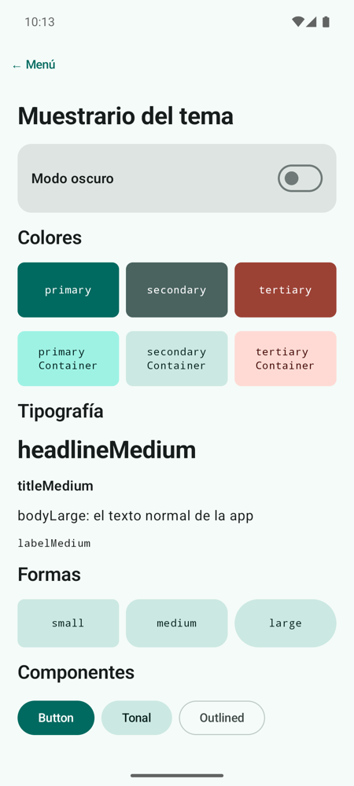
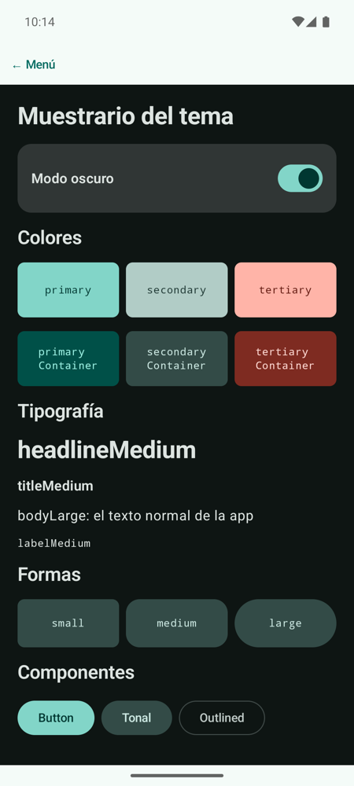

# **Codelab 3.01: Tema Propio de Material 3**

Hasta ahora el laboratorio usaba los colores morados que trae la plantilla. En este codelab le das a la app **su propia identidad**: una paleta de colores, una escala tipográfica y unas formas de esquina, montadas en un tema de Material 3 que todas las pantallas heredan sin tocarlas. Para comprobarlo, construirás un **muestrario** que enseña cada pieza del tema y permite cambiar a modo oscuro.

!!! info "Punto de partida: tag `c3.01-inicio`"
    Trabajas en el repositorio del laboratorio de la UT3, [pmdm2627-lab-ut3](https://github.com/jssdocente/pmdm2627-lab-ut3). Si es la primera vez, sigue los pasos de [3.6 §1 El repositorio del laboratorio](../3.6-laboratorio-retos.md#1-el-repositorio-del-laboratorio) y crea tu rama:

    ```bash
    git checkout c3.01-inicio
    git switch -c mi-lab
    ```

    `c3.01-inicio` es la plantilla del curso con el **menú del laboratorio** ya montado (el mismo de la UT2), todavía sin ningún codelab.

---

## 1. ¿Qué vas a construir?

Un muestrario del tema: los seis colores principales con el texto que va encima de cada uno, la escala tipográfica, las tres formas de esquina y algunos botones. Un interruptor cambia todo el muestrario a modo oscuro.

<div style="display: flex; flex-direction: row; justify-content: center; align-items: flex-start; gap: 1.5rem; flex-wrap: wrap; margin: 1.8rem 0;" markdown="1">

<figure style="margin: 0; text-align: center; max-width: 260px;" markdown="1">

{ style="border-radius: 8px; box-shadow: 0 4px 10px rgba(0,0,0,0.15); width: 100%; max-width: 250px;" }

<figcaption style="font-size: 0.85rem; margin-top: 0.5rem; color: var(--md-default-fg-color--light);"><strong>Figura 1:</strong> El muestrario en modo claro.</figcaption>
</figure>

<figure style="margin: 0; text-align: center; max-width: 260px;" markdown="1">

{ style="border-radius: 8px; box-shadow: 0 4px 10px rgba(0,0,0,0.15); width: 100%; max-width: 250px;" }

<figcaption style="font-size: 0.85rem; margin-top: 0.5rem; color: var(--md-default-fg-color--light);"><strong>Figura 2:</strong> El mismo muestrario con el interruptor activado.</figcaption>
</figure>

</div>

Al terminar, serás capaz de:

- Explicar qué son los **roles de color** de Material 3 y por qué cada fondo tiene su *on-color*.
- Definir una paleta propia en `Color.kt` y montar con ella un esquema claro y otro oscuro.
- Ajustar la escala tipográfica (`Typography`) y las formas (`Shapes`) del tema.
- Leer el tema desde cualquier composable con `MaterialTheme.colorScheme`, `typography` y `shapes`.
- Anidar un `MaterialTheme` dentro de otro para cambiar el tema de una parte de la pantalla.

---

## 2. Las Piezas del Tema

El tema vive en el paquete `ui/theme/`. Cada archivo aporta una pieza, y `Theme.kt` las junta en un `MaterialTheme`:

<figure class="arq-fig">
--8<-- "docs/temas/03/codelabs/images/c3.01-tema.svg"
<figcaption>Los composables no conocen los colores concretos: piden un rol (<code>primary</code>) y el tema decide cuál es.</figcaption>
</figure>

La idea clave son los **roles de color**. En lugar de escribir `Color(0xFF006A60)` en una pantalla, pides `MaterialTheme.colorScheme.primary`. Así, cambiar la paleta o pasar a modo oscuro no obliga a tocar ninguna pantalla:

| Rol | Para qué se usa | Texto encima |
| :--- | :--- | :--- |
| `primary` | Botones principales, elementos destacados | `onPrimary` |
| `primaryContainer` | Fondos suaves con el color de la marca (tarjetas, chips) | `onPrimaryContainer` |
| `secondary` / `secondaryContainer` | Elementos de menos importancia | `onSecondary` / `onSecondaryContainer` |
| `tertiary` / `tertiaryContainer` | Acentos que contrastan con el primario | `onTertiary` / `onTertiaryContainer` |
| `surface` y `surfaceContainer…` | Fondo de la pantalla, de las `Card` y de las barras | `onSurface`, `onSurfaceVariant` |
| `error` | Errores y acciones destructivas | `onError` |

Tienes la teoría completa en [3A.1 Material Design 3, Providers y Scaffold](../a-diseno/3a.1-material-design-3-scaffold.md).

---

## 3. Paso 1: La Paleta en `Color.kt`

Sustituye los colores morados de la plantilla por una paleta propia: **turquesa** como primario, **pizarra** como secundario y **coral** como terciario. Los números del nombre indican la luminosidad (`40` es oscuro, `90` muy claro): en modo claro los colores fuertes son los `40`, y en modo oscuro, los `80`.

??? example "Ver código: `ui/theme/Color.kt`"

    ```kotlin
    package com.pmdm.lab.ut3.ui.theme

    import androidx.compose.ui.graphics.Color

    // Paleta del laboratorio: turquesa (primario), pizarra (secundario) y coral (terciario).
    // Cada color de fondo tiene su "on-color" para el texto y los iconos que van encima.

    // Modo claro
    val Turquesa40 = Color(0xFF006A60)
    val TurquesaContainer90 = Color(0xFF9EF2E4)
    val OnTurquesaContainer10 = Color(0xFF00201C)
    val Pizarra40 = Color(0xFF4A635F)
    val PizarraContainer90 = Color(0xFFCCE8E2)
    val OnPizarraContainer10 = Color(0xFF05201C)
    val Coral40 = Color(0xFF9C4235)
    val CoralContainer90 = Color(0xFFFFDAD4)
    val OnCoralContainer10 = Color(0xFF3E0400)
    val Fondo98 = Color(0xFFF4FBF8)
    val Texto10 = Color(0xFF171D1C)
    val Variante90 = Color(0xFFDAE5E1)
    val OnVariante30 = Color(0xFF3F4947)
    val Borde50 = Color(0xFF6F7977)
    val BordeSuave80 = Color(0xFFBEC9C6)
    // Fondos de Card, menús y barras: del más claro al más marcado
    val Contenedor100 = Color(0xFFFFFFFF)
    val Contenedor96 = Color(0xFFEFF5F2)
    val Contenedor94 = Color(0xFFE9EFEC)
    val Contenedor92 = Color(0xFFE3EAE7)
    val Contenedor90 = Color(0xFFDDE4E1)
    // Colores invertidos: el Snackbar es oscuro en modo claro (y al revés)
    val Invertido20 = Color(0xFF2B3230)
    val OnInvertido95 = Color(0xFFECF2EF)

    // Modo oscuro
    val Turquesa80 = Color(0xFF82D5C8)
    val OnTurquesa20 = Color(0xFF003731)
    val TurquesaContainer30 = Color(0xFF005048)
    val Pizarra80 = Color(0xFFB1CCC6)
    val OnPizarra20 = Color(0xFF1C3531)
    val PizarraContainer30 = Color(0xFF334B47)
    val Coral80 = Color(0xFFFFB4A8)
    val OnCoral20 = Color(0xFF5F150C)
    val CoralContainer30 = Color(0xFF7E2B21)
    val Fondo6 = Color(0xFF0E1513)
    val Texto90 = Color(0xFFDDE4E1)
    val Variante30 = Color(0xFF3F4947)
    val OnVariante80 = Color(0xFFBEC9C6)
    val Borde60 = Color(0xFF899390)
    val BordeSuave30 = Color(0xFF3F4947)
    val Contenedor4 = Color(0xFF090F0E)
    val Contenedor10 = Color(0xFF171D1C)
    val Contenedor12 = Color(0xFF1B2120)
    val Contenedor17 = Color(0xFF252B2A)
    val Contenedor22 = Color(0xFF303635)
    ```

!!! tip "Genera tu paleta con Material Theme Builder"
    No hace falta inventar los valores a mano. En [Material Theme Builder](https://material-foundation.github.io/material-theme-builder/) eliges un color semilla y te devuelve todos los roles, para claro y oscuro, con el contraste garantizado. Exporta en formato *Jetpack Compose* y copia los valores.

---

## 4. Paso 2: La Escala Tipográfica en `Type.kt`

Material 3 define 15 estilos de texto (`displayLarge`, `headlineMedium`, `titleMedium`, `bodyLarge`, `labelSmall`…). Solo cambias los que quieres distinguir; el resto conserva sus valores por defecto. Aquí, los títulos van en negrita y `labelMedium` usa una fuente monoespaciada para mostrar nombres de código:

??? example "Ver código: `ui/theme/Type.kt`"

    ```kotlin
    package com.pmdm.lab.ut3.ui.theme

    import androidx.compose.material3.Typography
    import androidx.compose.ui.text.TextStyle
    import androidx.compose.ui.text.font.FontFamily
    import androidx.compose.ui.text.font.FontWeight
    import androidx.compose.ui.unit.sp

    // Escala tipográfica de Material 3: solo cambiamos los estilos que usa el laboratorio;
    // el resto conserva los valores por defecto.
    val Typography = Typography(
        headlineMedium = TextStyle(
            fontFamily = FontFamily.Default,
            fontWeight = FontWeight.Bold,
            fontSize = 28.sp,
            lineHeight = 36.sp
        ),
        titleLarge = TextStyle(
            fontFamily = FontFamily.Default,
            fontWeight = FontWeight.SemiBold,
            fontSize = 22.sp,
            lineHeight = 28.sp
        ),
        titleMedium = TextStyle(
            fontFamily = FontFamily.Default,
            fontWeight = FontWeight.SemiBold,
            fontSize = 16.sp,
            lineHeight = 24.sp,
            letterSpacing = 0.15.sp
        ),
        bodyLarge = TextStyle(
            fontFamily = FontFamily.Default,
            fontWeight = FontWeight.Normal,
            fontSize = 16.sp,
            lineHeight = 24.sp,
            letterSpacing = 0.5.sp
        ),
        labelMedium = TextStyle(
            fontFamily = FontFamily.Monospace,
            fontWeight = FontWeight.Medium,
            fontSize = 12.sp,
            lineHeight = 16.sp,
            letterSpacing = 0.5.sp
        )
    )
    ```

---

## 5. Paso 3: Las Formas en `Shape.kt`

Crea el archivo `Shape.kt`. `Shapes` define tres tamaños de esquina que los componentes usan solos (las `Card` toman `medium`, los diálogos `large`…):

```kotlin
package com.pmdm.lab.ut3.ui.theme

import androidx.compose.foundation.shape.RoundedCornerShape
import androidx.compose.material3.Shapes
import androidx.compose.ui.unit.dp

// Radios de las esquinas: los componentes de Material los toman de aquí
// (las Card usan medium) y nosotros los leemos con MaterialTheme.shapes.
val Shapes = Shapes(
    small = RoundedCornerShape(8.dp),
    medium = RoundedCornerShape(16.dp),
    large = RoundedCornerShape(28.dp)
)
```

---

## 6. Paso 4: Montar el Tema en `Theme.kt`

`Theme.kt` construye un esquema para cada modo y elige uno según `darkTheme`. Fíjate en tres cambios respecto a la plantilla:

1. Los esquemas rellenan **todos** los roles, no solo `primary`, `secondary` y `tertiary`. Si dejas alguno sin definir, Material usa el morado por defecto y aparecerá en sitios inesperados, como el fondo de las `Card` (`surfaceContainer…`) o el del `Snackbar` (`inverseSurface`).

2. `dynamicColor` pasa a ser `false`: con `true`, en Android 12 o superior los colores salen del fondo de pantalla del usuario y tu paleta se ignora.

3. `MaterialTheme` recibe también `shapes = Shapes`.

??? example "Ver código: `ui/theme/Theme.kt`"

    ```kotlin
    package com.pmdm.lab.ut3.ui.theme

    import android.os.Build
    import androidx.compose.foundation.isSystemInDarkTheme
    import androidx.compose.material3.MaterialTheme
    import androidx.compose.material3.darkColorScheme
    import androidx.compose.material3.dynamicDarkColorScheme
    import androidx.compose.material3.dynamicLightColorScheme
    import androidx.compose.material3.lightColorScheme
    import androidx.compose.runtime.Composable
    import androidx.compose.ui.graphics.Color
    import androidx.compose.ui.platform.LocalContext

    private val LightColorScheme = lightColorScheme(
        primary = Turquesa40,
        onPrimary = Color.White,
        primaryContainer = TurquesaContainer90,
        onPrimaryContainer = OnTurquesaContainer10,
        secondary = Pizarra40,
        onSecondary = Color.White,
        secondaryContainer = PizarraContainer90,
        onSecondaryContainer = OnPizarraContainer10,
        tertiary = Coral40,
        onTertiary = Color.White,
        tertiaryContainer = CoralContainer90,
        onTertiaryContainer = OnCoralContainer10,
        background = Fondo98,
        onBackground = Texto10,
        surface = Fondo98,
        onSurface = Texto10,
        surfaceVariant = Variante90,
        onSurfaceVariant = OnVariante30,
        outline = Borde50,
        outlineVariant = BordeSuave80,
        surfaceContainerLowest = Contenedor100,
        surfaceContainerLow = Contenedor96,
        surfaceContainer = Contenedor94,
        surfaceContainerHigh = Contenedor92,
        surfaceContainerHighest = Contenedor90,
        inverseSurface = Invertido20,
        inverseOnSurface = OnInvertido95,
        inversePrimary = Turquesa80
    )

    private val DarkColorScheme = darkColorScheme(
        primary = Turquesa80,
        onPrimary = OnTurquesa20,
        primaryContainer = TurquesaContainer30,
        onPrimaryContainer = TurquesaContainer90,
        secondary = Pizarra80,
        onSecondary = OnPizarra20,
        secondaryContainer = PizarraContainer30,
        onSecondaryContainer = PizarraContainer90,
        tertiary = Coral80,
        onTertiary = OnCoral20,
        tertiaryContainer = CoralContainer30,
        onTertiaryContainer = CoralContainer90,
        background = Fondo6,
        onBackground = Texto90,
        surface = Fondo6,
        onSurface = Texto90,
        surfaceVariant = Variante30,
        onSurfaceVariant = OnVariante80,
        outline = Borde60,
        outlineVariant = BordeSuave30,
        surfaceContainerLowest = Contenedor4,
        surfaceContainerLow = Contenedor10,
        surfaceContainer = Contenedor12,
        surfaceContainerHigh = Contenedor17,
        surfaceContainerHighest = Contenedor22,
        inverseSurface = Texto90,
        inverseOnSurface = Invertido20,
        inversePrimary = Turquesa40
    )

    @Composable
    fun LabUt3Theme(
        darkTheme: Boolean = isSystemInDarkTheme(),
        // Desactivado: queremos ver siempre NUESTRA paleta. Con true, en Android 12+
        // los colores salen del fondo de pantalla del usuario y la paleta se ignora.
        dynamicColor: Boolean = false,
        content: @Composable () -> Unit
    ) {
        val colorScheme = when {
            dynamicColor && Build.VERSION.SDK_INT >= Build.VERSION_CODES.S -> {
                val context = LocalContext.current
                if (darkTheme) dynamicDarkColorScheme(context) else dynamicLightColorScheme(context)
            }

            darkTheme -> DarkColorScheme
            else -> LightColorScheme
        }

        MaterialTheme(
            colorScheme = colorScheme,
            typography = Typography,
            shapes = Shapes,
            content = content
        )
    }
    ```

Ejecuta la app: sin tocar el menú, sus tarjetas ya usan la paleta nueva.

---

## 7. Paso 5: El Muestrario

Crea el paquete `codelabs/codelab01_tema` y, dentro, `TemaScreen.kt`. La pantalla tiene dos partes:

- **`TemaScreen`**, con estado: recuerda si el modo oscuro está activado y **envuelve el contenido en otro `LabUt3Theme`** con ese valor. Un `MaterialTheme` dentro de otro solo afecta a lo que tiene dentro: por eso el botón «← Menú», que está fuera, no cambia de color.

- **`MuestrarioTema`**, sin estado: pinta cada pieza leyendo `MaterialTheme`.

```kotlin
fun TemaScreen(modifier: Modifier = Modifier) {
    var modoOscuro by rememberSaveable { mutableStateOf(false) }

    // Un MaterialTheme dentro de otro: lo de dentro usa el esquema que elijamos
    LabUt3Theme(darkTheme = modoOscuro) {
        MuestrarioTema(
            modoOscuro = modoOscuro,
            onModoOscuroChange = { modoOscuro = it },
            modifier = modifier
        )
    }
}
```

`Surface` pinta el fondo con `surface` y fija `onSurface` como color del texto que tiene dentro: así el texto se ve bien en los dos modos sin indicar ningún color.

??? example "Ver código completo: `codelabs/codelab01_tema/TemaScreen.kt`"

    ```kotlin
    package com.pmdm.lab.ut3.codelabs.codelab01_tema

    import android.content.res.Configuration
    import androidx.compose.foundation.layout.Arrangement
    import androidx.compose.foundation.layout.Box
    import androidx.compose.foundation.layout.Column
    import androidx.compose.foundation.layout.Row
    import androidx.compose.foundation.layout.fillMaxSize
    import androidx.compose.foundation.layout.fillMaxWidth
    import androidx.compose.foundation.layout.height
    import androidx.compose.foundation.layout.padding
    import androidx.compose.foundation.rememberScrollState
    import androidx.compose.foundation.verticalScroll
    import androidx.compose.material3.Button
    import androidx.compose.material3.Card
    import androidx.compose.material3.FilledTonalButton
    import androidx.compose.material3.MaterialTheme
    import androidx.compose.material3.OutlinedButton
    import androidx.compose.material3.Surface
    import androidx.compose.material3.Switch
    import androidx.compose.material3.Text
    import androidx.compose.runtime.Composable
    import androidx.compose.runtime.getValue
    import androidx.compose.runtime.mutableStateOf
    import androidx.compose.runtime.saveable.rememberSaveable
    import androidx.compose.runtime.setValue
    import androidx.compose.ui.Alignment
    import androidx.compose.ui.Modifier
    import androidx.compose.ui.graphics.Color
    import androidx.compose.ui.graphics.Shape
    import androidx.compose.ui.tooling.preview.Preview
    import androidx.compose.ui.unit.dp
    import com.pmdm.lab.ut3.ui.theme.LabUt3Theme

    @Composable
    fun TemaScreen(modifier: Modifier = Modifier) {
        var modoOscuro by rememberSaveable { mutableStateOf(false) }

        // Un MaterialTheme dentro de otro: lo de dentro usa el esquema que elijamos
        LabUt3Theme(darkTheme = modoOscuro) {
            MuestrarioTema(
                modoOscuro = modoOscuro,
                onModoOscuroChange = { modoOscuro = it },
                modifier = modifier
            )
        }
    }

    @Composable
    fun MuestrarioTema(
        modoOscuro: Boolean,
        onModoOscuroChange: (Boolean) -> Unit,
        modifier: Modifier = Modifier
    ) {
        // Surface pinta el fondo con el color del tema y fija el color del texto (onSurface)
        Surface(modifier = modifier.fillMaxSize()) {
            Column(
                modifier = Modifier
                    .verticalScroll(rememberScrollState())
                    .padding(20.dp),
                verticalArrangement = Arrangement.spacedBy(16.dp)
            ) {
                Text(text = "Muestrario del tema", style = MaterialTheme.typography.headlineMedium)

                // 1. Interruptor de modo oscuro
                Card(modifier = Modifier.fillMaxWidth()) {
                    Row(
                        modifier = Modifier
                            .fillMaxWidth()
                            .padding(16.dp),
                        verticalAlignment = Alignment.CenterVertically,
                        horizontalArrangement = Arrangement.SpaceBetween
                    ) {
                        Text(text = "Modo oscuro", style = MaterialTheme.typography.titleMedium)
                        Switch(checked = modoOscuro, onCheckedChange = onModoOscuroChange)
                    }
                }

                // 2. Roles de color: cada fondo con su "on-color" encima
                Text(text = "Colores", style = MaterialTheme.typography.titleLarge)
                Row(horizontalArrangement = Arrangement.spacedBy(8.dp)) {
                    MuestraColor("primary", MaterialTheme.colorScheme.primary,
                        MaterialTheme.colorScheme.onPrimary, Modifier.weight(1f))
                    MuestraColor("secondary", MaterialTheme.colorScheme.secondary,
                        MaterialTheme.colorScheme.onSecondary, Modifier.weight(1f))
                    MuestraColor("tertiary", MaterialTheme.colorScheme.tertiary,
                        MaterialTheme.colorScheme.onTertiary, Modifier.weight(1f))
                }
                Row(horizontalArrangement = Arrangement.spacedBy(8.dp)) {
                    MuestraColor("primary\nContainer", MaterialTheme.colorScheme.primaryContainer,
                        MaterialTheme.colorScheme.onPrimaryContainer, Modifier.weight(1f))
                    MuestraColor("secondary\nContainer", MaterialTheme.colorScheme.secondaryContainer,
                        MaterialTheme.colorScheme.onSecondaryContainer, Modifier.weight(1f))
                    MuestraColor("tertiary\nContainer", MaterialTheme.colorScheme.tertiaryContainer,
                        MaterialTheme.colorScheme.onTertiaryContainer, Modifier.weight(1f))
                }

                // 3. Escala tipográfica
                Text(text = "Tipografía", style = MaterialTheme.typography.titleLarge)
                Text(text = "headlineMedium", style = MaterialTheme.typography.headlineMedium)
                Text(text = "titleMedium", style = MaterialTheme.typography.titleMedium)
                Text(text = "bodyLarge: el texto normal de la app", style = MaterialTheme.typography.bodyLarge)
                Text(text = "labelMedium", style = MaterialTheme.typography.labelMedium)

                // 4. Formas: small, medium y large
                Text(text = "Formas", style = MaterialTheme.typography.titleLarge)
                Row(horizontalArrangement = Arrangement.spacedBy(8.dp)) {
                    MuestraForma("small", MaterialTheme.shapes.small, Modifier.weight(1f))
                    MuestraForma("medium", MaterialTheme.shapes.medium, Modifier.weight(1f))
                    MuestraForma("large", MaterialTheme.shapes.large, Modifier.weight(1f))
                }

                // 5. Los componentes toman sus colores del tema sin que se los digamos
                Text(text = "Componentes", style = MaterialTheme.typography.titleLarge)
                Row(horizontalArrangement = Arrangement.spacedBy(8.dp)) {
                    Button(onClick = {}) { Text("Button") }
                    FilledTonalButton(onClick = {}) { Text("Tonal") }
                    OutlinedButton(onClick = {}) { Text("Outlined") }
                }
            }
        }
    }

    @Composable
    private fun MuestraColor(nombre: String, fondo: Color, texto: Color, modifier: Modifier = Modifier) {
        Surface(
            color = fondo,
            contentColor = texto,
            shape = MaterialTheme.shapes.small,
            modifier = modifier.height(64.dp)
        ) {
            Box(contentAlignment = Alignment.Center) {
                Text(text = nombre, style = MaterialTheme.typography.labelMedium)
            }
        }
    }

    @Composable
    private fun MuestraForma(nombre: String, forma: Shape, modifier: Modifier = Modifier) {
        Surface(
            color = MaterialTheme.colorScheme.secondaryContainer,
            shape = forma,
            modifier = modifier.height(56.dp)
        ) {
            Box(contentAlignment = Alignment.Center) {
                Text(text = nombre, style = MaterialTheme.typography.labelMedium)
            }
        }
    }

    @Preview(name = "Claro", showBackground = true, heightDp = 900)
    @Composable
    private fun MuestrarioClaroPreview() {
        LabUt3Theme(darkTheme = false) {
            MuestrarioTema(modoOscuro = false, onModoOscuroChange = {})
        }
    }

    @Preview(name = "Oscuro", uiMode = Configuration.UI_MODE_NIGHT_YES, showBackground = true, heightDp = 900)
    @Composable
    private fun MuestrarioOscuroPreview() {
        LabUt3Theme(darkTheme = true) {
            MuestrarioTema(modoOscuro = true, onModoOscuroChange = {})
        }
    }
    ```

Las dos vistas previas dibujan el muestrario en claro y en oscuro a la vez, sin abrir el emulador.

---

## 8. Paso 6: Añadirlo al Menú del Laboratorio

Como en la UT2, cada pantalla nueva necesita dos cambios en `LabApp.kt`:

1. Una entrada en `enum class PantallaLab`:

    ```kotlin
    TEMA("3.01 · Tema de Material 3", "Colores, tipografía, formas y modo oscuro")
    ```

2. Su rama en el `when` de `LabApp`:

    ```kotlin
    PantallaLab.TEMA -> PantallaConVolver({ pantalla = PantallaLab.MENU }, modifier) {
        TemaScreen()
    }
    ```

El menú recorre `PantallaLab.entries`, así que la tarjeta nueva aparece sola.

---

## 9. Experimenta

1. Genera una paleta con Material Theme Builder a partir de un color que te guste y pégala en `Color.kt`. Todo el laboratorio cambia de golpe.

2. Pon `dynamicColor = true` en `LabUt3Theme`, cambia el fondo de pantalla del emulador y vuelve a abrir la app.

3. Cambia `medium` en `Shape.kt` a `RoundedCornerShape(0.dp)`. ¿Qué componentes del menú cambian?

4. Borra `surfaceContainerHighest` del esquema claro y mira el color de las tarjetas del menú.

!!! success "Solución: tag `c3.01-fin`"
    Compara tu código con el tag [`c3.01-fin`](https://github.com/jssdocente/pmdm2627-lab-ut3/tree/c3.01-fin) (`git diff c3.01-fin`). Es también el punto de partida del [Codelab 3.02](./02-catalogo-lazycolumn.md).

---

## 10. Resumen y Checklist

- [ ] `Color.kt` tiene una paleta propia, con versión clara (`40`, `90`) y oscura (`80`, `30`).
- [ ] Los dos esquemas de `Theme.kt` definen todos los roles, incluidos `surfaceContainer…` e `inverse…`.
- [ ] `dynamicColor` es `false` y `MaterialTheme` recibe `colorScheme`, `typography` y `shapes`.
- [ ] Ninguna pantalla escribe colores a mano: todas leen `MaterialTheme.colorScheme`.
- [ ] El muestrario cambia a modo oscuro con el interruptor y las dos `@Preview` se ven bien.
