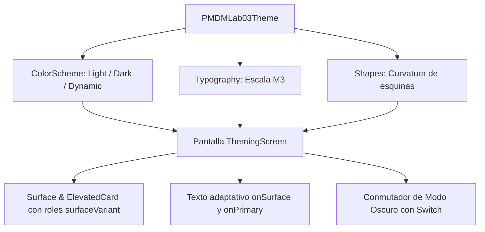
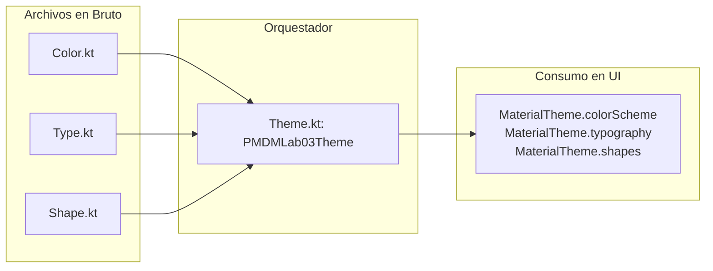
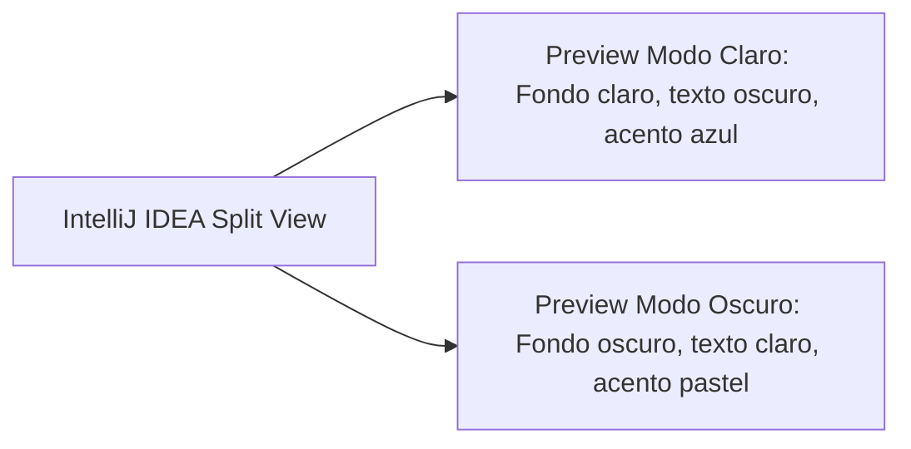

# **Codelab 1: Theming en Material Design 3 (Colores, Tipografía y Formas)**

En este codelab aprenderás a dotar a tus aplicaciones Android de una identidad visual moderna, profesional y accesible utilizando el sistema de diseño oficial de Google: **Material Design 3 (Material You)**.

Descubrirás por qué en el desarrollo móvil profesional está terminantemente desaconsejado "hardcodear" colores fijos como `Color.Black` o `Color.White`, y cómo unificar tu interfaz mediante **roles de color semánticos**, **escalas tipográficas** y **formas adaptativas** que reaccionan de manera nativa al **Modo Oscuro** y al fondo de pantalla del usuario (**Dynamic Color**).

---

## 1. ¿Qué vas a construir?

Construirás una **Tarjeta de Perfil y Ajustes de Apariencia** interactiva que servirá de vitrina técnica para poner a prueba tu sistema de diseño.



Al finalizar este codelab, serás capaz de:

- Comprender la arquitectura de los cuatro archivos del paquete `ui/theme/`.
- Usar los roles de color semánticos de `MaterialTheme.colorScheme` en lugar de constantes estáticas.
- Personalizar la escala tipográfica con `Typography` y fuentes de Google Fonts.
- Modificar el radio de curvatura de esquinas mediante `Shapes`.
- Configurar vistas previas simultáneas (`@Preview`) en **Modo Claro** y **Modo Oscuro** dentro de IntelliJ IDEA / Android Studio.

---

## 2. Anatomía del Paquete `ui/theme/`

Cuando generas un nuevo proyecto Android con Jetpack Compose en IntelliJ IDEA, el asistente crea automáticamente un paquete en `app/src/main/java/com/dam/pmdmlab03/ui/theme/` con cuatro archivos fundamentales:

```
ui/theme/
├── Color.kt     // Paleta de valores hexadecimales en bruto (ARGB)
├── Type.kt      // Escala tipográfica oficial (Headline, Title, Body, Label)
├── Shape.kt     // Radios de redondeo de esquinas (Small, Medium, Large)
└── Theme.kt     // Composable raíz que encapsula y expone MaterialTheme
```



---

## 3. Paso 1: La Trampa de los Colores Fijos y los Roles Semánticos de M3

!!! danger "¡El error más común de los desarrolladores noveles!"
    Escribir `color = Color.White` o `color = Color.Black` en tus componibles provocará que, cuando el usuario active el Modo Oscuro de su móvil, tu texto blanco se vuelva invisible sobre un fondo claro forzado, o tu texto negro quede oculto sobre un fondo negro.

Material Design 3 sustituye los nombres físicos por **roles semánticos** que describen la función del elemento, no su tono cromático:

| Rol Semántico | Propósito en la Interfaz | Ejemplo en Compose |
| :--- | :--- | :--- |
| `primary` | Color principal de la marca para componentes clave (botones destacados, barras de progreso). | `ButtonDefaults.buttonColors()` |
| `onPrimary` | Color del texto e iconos que se sitúan sobre `primary` garantizando contraste WCAG. | `Text(color = MaterialTheme.colorScheme.onPrimary)` |
| `primaryContainer` | Variante suavizada de baja saturación para fondos de tarjetas destacadas. | `CardDefaults.cardColors(containerColor = ...)` |
| `onPrimaryContainer` | Color del contenido textual dentro de un `primaryContainer`. | Título de una tarjeta prioritaria |
| `surface` | Superficie neutra para el lienzo de la pantalla (`Scaffold`, `Surface`). | Fondo principal de la aplicación |
| `onSurface` | Texto estándar y encabezados que reposan sobre superficies neutras. | Párrafos generales de lectura |
| `surfaceVariant` | Fondo secundario sutilmente tintado para separar tarjetas o inputs. | `OutlinedTextField` o `Card` |
| `onSurfaceVariant` | Iconos secundarios y textos de apoyo (*supporting text*). | Leyendas y etiquetas grises |
| `error` / `onError` | Colores universales para validaciones fallidas y alertas críticas. | Borde de input inválido |

### Configuración en `Color.kt`

Abre tu archivo `app/src/main/java/com/dam/pmdmlab03/ui/theme/Color.kt` y define una paleta personalizada:

```kotlin
package com.dam.pmdmlab03.ui.theme

import androidx.compose.ui.graphics.Color

// Paleta Primaria (Azul Tecnológico)
val Indigo80 = Color(0xFFBAC3FF)
val Indigo40 = Color(0xFF3B5BDB)

// Paleta Secundaria (Menta Creativo)
val Teal80 = Color(0xFFA2F0E0)
val Teal40 = Color(0xFF0CA678)

// Paleta Terciaria (Ámbar Lúdico)
val Amber80 = Color(0xFFFFD8A8)
val Amber40 = Color(0xFFF76707)

// Superficies y Neutros
val NeutralDark = Color(0xFF1A1B1E)
val NeutralLight = Color(0xFFF8F9FA)
val SurfaceVariantDark = Color(0xFF2C2E33)
val SurfaceVariantLight = Color(0xFFE9ECEF)
```

---

## 4. Paso 2: Escala Tipográfica Oficial con `Type.kt`

Material 3 define una jerarquía tipográfica estándar compuesta por 15 estilos agrupados en:
- `display`: Títulos monumentales para portadas o marcadores.
- `headline`: Encabezados principales de pantalla.
- `title`: Títulos de tarjetas, diálogos y secciones.
- `body`: Párrafos de lectura continua.
- `label`: Botones, etiquetas compactas y leyendas.

Edita tu archivo `app/src/main/java/com/dam/pmdmlab03/ui/theme/Type.kt`:

```kotlin
package com.dam.pmdmlab03.ui.theme

import androidx.compose.material3.Typography
import androidx.compose.ui.text.TextStyle
import androidx.compose.ui.text.font.FontFamily
import androidx.compose.ui.text.font.FontWeight
import androidx.compose.ui.unit.sp

val Typography = Typography(
    headlineMedium = TextStyle(
        fontFamily = FontFamily.Default,
        fontWeight = FontWeight.Bold,
        fontSize = 28.sp,
        lineHeight = 36.sp,
        letterSpacing = 0.sp
    ),
    titleLarge = TextStyle(
        fontFamily = FontFamily.Default,
        fontWeight = FontWeight.SemiBold,
        fontSize = 22.sp,
        lineHeight = 28.sp,
        letterSpacing = 0.sp
    ),
    titleMedium = TextStyle(
        fontFamily = FontFamily.Default,
        fontWeight = FontWeight.Medium,
        fontSize = 16.sp,
        lineHeight = 24.sp,
        letterSpacing = 0.15.sp
    ),
    bodyLarge = TextStyle(
        fontFamily = FontFamily.Default,
        fontWeight = FontWeight.Normal,
        fontSize = 16.sp,
        lineHeight = 24.sp,
        letterSpacing = 0.5.sp
    ),
    labelSmall = TextStyle(
        fontFamily = FontFamily.Default,
        fontWeight = FontWeight.Medium,
        fontSize = 11.sp,
        lineHeight = 16.sp,
        letterSpacing = 0.5.sp
    )
)
```

---

## 5. Paso 3: Curvatura de Esquinas con `Shapes.kt`

Crea o revisa el archivo `app/src/main/java/com/dam/pmdmlab03/ui/theme/Shape.kt`. Este archivo define la curvatura de esquinas (*corner radius*) de todos los componentes:

```kotlin
package com.dam.pmdmlab03.ui.theme

import androidx.compose.foundation.shape.RoundedCornerShape
import androidx.compose.material3.Shapes
import androidx.compose.ui.unit.dp

val Shapes = Shapes(
    small = RoundedCornerShape(8.dp),     // Chips, botones pequeños
    medium = RoundedCornerShape(16.dp),   // Tarjetas ElevatedCard, campos de texto
    large = RoundedCornerShape(24.dp),    // Diálogos modales AlertDialog, BottomSheets
    extraLarge = RoundedCornerShape(32.dp)
)
```

---

## 6. Paso 4: El Orquestador del Tema en `Theme.kt`

Abre `app/src/main/java/com/dam/pmdmlab03/ui/theme/Theme.kt`. En este archivo unificamos las paletas en dos esquemas: `DarkColorScheme` y `LightColorScheme`.

Compose comprueba si el teléfono tiene Android 12 o superior (`Build.VERSION.SDK_INT >= Build.VERSION_CODES.S`). De ser así, activa **Dynamic Color**, extrayendo la paleta del fondo de pantalla del usuario:

```kotlin
package com.dam.pmdmlab03.ui.theme

import android.os.Build
import androidx.compose.foundation.isSystemInDarkTheme
import androidx.compose.material3.MaterialTheme
import androidx.compose.material3.darkColorScheme
import androidx.compose.material3.dynamicDarkColorScheme
import androidx.compose.material3.dynamicLightColorScheme
import androidx.compose.material3.lightColorScheme
import androidx.compose.runtime.Composable
import androidx.compose.ui.platform.LocalContext

private val DarkColorScheme = darkColorScheme(
    primary = Indigo80,
    onPrimary = Indigo40,
    primaryContainer = SurfaceVariantDark,
    onPrimaryContainer = Indigo80,
    secondary = Teal80,
    onSecondary = Teal40,
    surface = NeutralDark,
    onSurface = NeutralLight,
    surfaceVariant = SurfaceVariantDark,
    onSurfaceVariant = NeutralLight
)

private val LightColorScheme = lightColorScheme(
    primary = Indigo40,
    onPrimary = NeutralLight,
    primaryContainer = SurfaceVariantLight,
    onPrimaryContainer = Indigo40,
    secondary = Teal40,
    onSecondary = NeutralLight,
    surface = NeutralLight,
    onSurface = NeutralDark,
    surfaceVariant = SurfaceVariantLight,
    onSurfaceVariant = NeutralDark
)

@Composable
fun PMDMLab03Theme(
    darkTheme: Boolean = isSystemInDarkTheme(),
    dynamicColor: Boolean = true,
    content: @Composable () -> Unit
) {
    val colorScheme = when {
        dynamicColor && Build.VERSION.SDK_INT >= Build.VERSION_CODES.S -> {
            val context = LocalContext.current
            if (darkTheme) dynamicDarkColorScheme(context) else dynamicLightColorScheme(context)
        }
        darkTheme -> DarkColorScheme
        else -> LightColorScheme
    }

    MaterialTheme(
        colorScheme = colorScheme,
        typography = Typography,
        shapes = Shapes,
        content = content
    )
}
```

---

## 7. Paso 5: Implementar la Pantalla `ThemingScreen.kt`

Ahora construiremos el componible visual que aplica todos estos conceptos.

Crea el archivo en `app/src/main/java/com/dam/pmdmlab03/codelabs/codelab01_theming/ThemingScreen.kt`:

```kotlin
package com.dam.pmdmlab03.codelabs.codelab01_theming

import android.content.res.Configuration
import androidx.compose.foundation.layout.Arrangement
import androidx.compose.foundation.layout.Column
import androidx.compose.foundation.layout.Row
import androidx.compose.foundation.layout.Spacer
import androidx.compose.foundation.layout.fillMaxSize
import androidx.compose.foundation.layout.fillMaxWidth
import androidx.compose.foundation.layout.height
import androidx.compose.foundation.layout.padding
import androidx.compose.foundation.layout.size
import androidx.compose.material.icons.Icons
import androidx.compose.material.icons.filled.AccountCircle
import androidx.compose.material.icons.filled.DarkMode
import androidx.compose.material.icons.filled.Palette
import androidx.compose.material3.Button
import androidx.compose.material3.CardDefaults
import androidx.compose.material3.ElevatedCard
import androidx.compose.material3.FilledTonalButton
import androidx.compose.material3.HorizontalDivider
import androidx.compose.material3.Icon
import androidx.compose.material3.MaterialTheme
import androidx.compose.material3.Surface
import androidx.compose.material3.Switch
import androidx.compose.material3.Text
import androidx.compose.runtime.Composable
import androidx.compose.runtime.getValue
import androidx.compose.runtime.mutableStateOf
import androidx.compose.runtime.remember
import androidx.compose.runtime.setValue
import androidx.compose.ui.Alignment
import androidx.compose.ui.Modifier
import androidx.compose.ui.tooling.preview.Preview
import androidx.compose.ui.unit.dp
import com.dam.pmdmlab03.ui.theme.PMDMLab03Theme

@Composable
fun ThemingScreen(modifier: Modifier = Modifier) {
    var forzarModoOscuro by remember { mutableStateOf(false) }

    // Envolvemos el contenido en el tema con la variable interactiva
    PMDMLab03Theme(darkTheme = forzarModoOscuro, dynamicColor = false) {
        Surface(
            modifier = modifier.fillMaxSize(),
            color = MaterialTheme.colorScheme.surface
        ) {
            Column(
                modifier = Modifier
                    .fillMaxSize()
                    .padding(20.dp),
                verticalArrangement = Arrangement.spacedBy(16.dp)
            ) {
                // Encabezado
                Text(
                    text = "Material 3 Theming",
                    style = MaterialTheme.typography.headlineMedium,
                    color = MaterialTheme.colorScheme.primary
                )

                Text(
                    text = "Demostración de tokens semánticos, tipografía y Modo Oscuro.",
                    style = MaterialTheme.typography.bodyLarge,
                    color = MaterialTheme.colorScheme.onSurfaceVariant
                )

                HorizontalDivider()

                // Tarjeta de Perfil Estilizada con Shapes y Roles Semánticos
                ElevatedCard(
                    modifier = Modifier.fillMaxWidth(),
                    shape = MaterialTheme.shapes.medium,
                    colors = CardDefaults.elevatedCardColors(
                        containerColor = MaterialTheme.colorScheme.surfaceVariant
                    )
                ) {
                    Column(modifier = Modifier.padding(16.dp)) {
                        Row(verticalAlignment = Alignment.CenterVertically) {
                            Icon(
                                imageVector = Icons.Filled.AccountCircle,
                                contentDescription = null,
                                modifier = Modifier.size(48.dp),
                                tint = MaterialTheme.colorScheme.primary
                            )
                            Column(modifier = Modifier.padding(start = 12.dp)) {
                                Text(
                                    text = "Estudiante DAM",
                                    style = MaterialTheme.typography.titleLarge,
                                    color = MaterialTheme.colorScheme.onSurfaceVariant
                                )
                                Text(
                                    text = "Desarrollo Móvil 2026/2027",
                                    style = MaterialTheme.typography.labelSmall,
                                    color = MaterialTheme.colorScheme.secondary
                                )
                            }
                        }

                        Spacer(modifier = Modifier.height(12.dp))

                        Text(
                            text = "Esta tarjeta hereda automáticamente los colores de superficie y tipografía del tema actual sin romper el contraste.",
                            style = MaterialTheme.typography.bodyLarge,
                            color = MaterialTheme.colorScheme.onSurfaceVariant
                        )
                    }
                }

                // Ajustes de Apariencia en Vivo
                ElevatedCard(
                    modifier = Modifier.fillMaxWidth(),
                    shape = MaterialTheme.shapes.medium
                ) {
                    Row(
                        modifier = Modifier
                            .fillMaxWidth()
                            .padding(16.dp),
                        verticalAlignment = Alignment.CenterVertically,
                        horizontalArrangement = Arrangement.SpaceBetween
                    ) {
                        Row(verticalAlignment = Alignment.CenterVertically) {
                            Icon(
                                imageVector = Icons.Filled.DarkMode,
                                contentDescription = null,
                                tint = MaterialTheme.colorScheme.primary
                            )
                            Text(
                                text = "Forzar Modo Oscuro",
                                style = MaterialTheme.typography.titleMedium,
                                modifier = Modifier.padding(start = 12.dp)
                            )
                        }

                        Switch(
                            checked = forzarModoOscuro,
                            onCheckedChange = { forzarModoOscuro = it }
                        )
                    }
                }

                // Botonera de Demostración
                Row(
                    modifier = Modifier.fillMaxWidth(),
                    horizontalArrangement = Arrangement.spacedBy(12.dp)
                ) {
                    Button(
                        onClick = {},
                        modifier = Modifier.weight(1f),
                        shape = MaterialTheme.shapes.small
                    ) {
                        Text("Primario")
                    }

                    FilledTonalButton(
                        onClick = {},
                        modifier = Modifier.weight(1f),
                        shape = MaterialTheme.shapes.small
                    ) {
                        Text("Tonal")
                    }
                }
            }
        }
    }
}

// ==========================================
// PREVIEWS SIMULTÁNEAS EN TIEMPO DE DISEÑO
// ==========================================

@Preview(name = "Theming - Modo Claro", showBackground = true)
@Composable
private fun ThemingScreenPreviewLight() {
    PMDMLab03Theme(darkTheme = false, dynamicColor = false) {
        ThemingScreen()
    }
}

@Preview(
    name = "Theming - Modo Oscuro",
    uiMode = Configuration.UI_MODE_NIGHT_YES,
    showBackground = true
)
@Composable
private fun ThemingScreenPreviewDark() {
    PMDMLab03Theme(darkTheme = true, dynamicColor = false) {
        ThemingScreen()
    }
}
```

---

## 8. Verificación y Resultados de Aprendizaje

Abre el archivo `ThemingScreen.kt` en IntelliJ IDEA y observa el panel lateral **Split View**:



- [x] **Comprobación de contraste:** Ambos modos garantizan que todo texto sea legible sin necesidad de escribir condicionales `if (modoOscuro) Color.White else Color.Black`.
- [x] **Comprobación de tipografía:** Los títulos utilizan la jerarquía `headlineMedium` y `titleLarge`, mientras que los textos explicativos utilizan `bodyLarge`.
- [x] **Comprobación de formas:** Las tarjetas y botones adoptan los radios de curvatura definidos en `Shapes.kt`.

---

## 9. Reto de Consolidación

Modifica `Color.kt` y `Theme.kt` para crear un nuevo rol de acento en tu aplicación:
1. Define un color de advertencia `val WarningContainer = Color(0xFFFFF3BF)` y `val OnWarningContainer = Color(0xFF5F370E)`.
2. Añade a la pantalla una tarjeta informativa de aviso que aplique estos dos colores garantizando el contraste visual tanto en Modo Claro como en Modo Oscuro.
