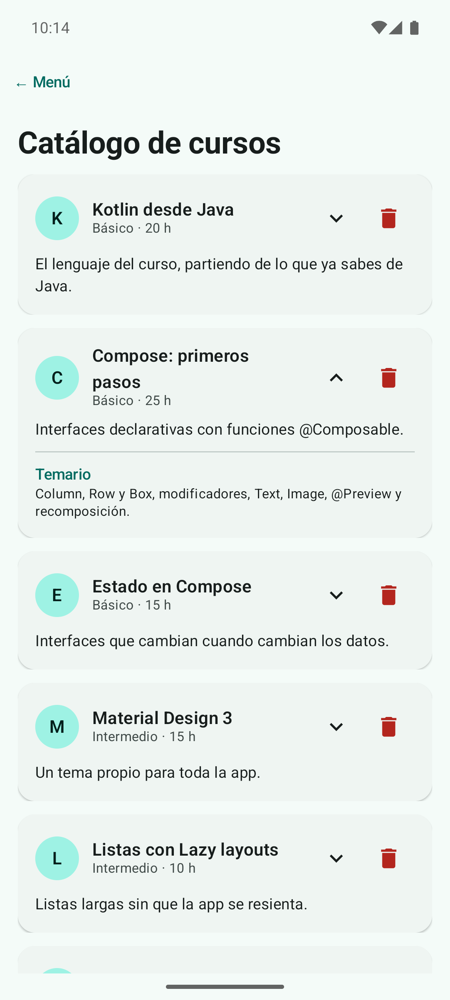

# **Codelab 3.02: Catálogo de Cursos con `LazyColumn`**

Las apps reales muestran listas: canciones, mensajes, productos, juegos. En este codelab construirás un **catálogo de cursos** con `LazyColumn`, la lista de Compose que solo dibuja lo que cabe en pantalla. Cada curso será una tarjeta que se despliega para enseñar el temario y que se puede borrar. Por el camino descubrirás por qué la lista necesita una **`key`**.

!!! info "Punto de partida: tag `c3.02-inicio`"
    Sigue en el repositorio del laboratorio, [pmdm2627-lab-ut3](https://github.com/jssdocente/pmdm2627-lab-ut3). Si terminaste el [Codelab 3.01](./01-tema-material3.md), continúa en tu rama. Si no, parte del tag:

    ```bash
    git checkout c3.02-inicio
    git switch -c mi-lab-3.02
    ```

    `c3.02-inicio` es `c3.01-fin`: el laboratorio con el tema propio y el muestrario.

---

## 1. ¿Qué vas a construir?

Una lista de doce cursos. Cada tarjeta muestra la inicial del curso en un círculo, el título, el nivel y las horas. La flecha despliega el temario con una animación, y la papelera quita el curso de la lista. Si los borras todos, aparece un botón para restaurar el catálogo.

<div style="display: flex; flex-direction: row; justify-content: center; align-items: flex-start; gap: 1.5rem; flex-wrap: wrap; margin: 1.8rem 0;" markdown="1">

<figure style="margin: 0; text-align: center; max-width: 260px;" markdown="1">

{ style="border-radius: 8px; box-shadow: 0 4px 10px rgba(0,0,0,0.15); width: 100%; max-width: 250px;" }

<figcaption style="font-size: 0.85rem; margin-top: 0.5rem; color: var(--md-default-fg-color--light);"><strong>Figura 1:</strong> El catálogo con la segunda tarjeta desplegada.</figcaption>
</figure>

</div>

Al terminar, serás capaz de:

- Explicar la diferencia entre `Column` con *scroll* y `LazyColumn`.
- Mostrar una lista con `items(...)` y añadir elementos sueltos con `item { }`.
- Usar `key` para que cada elemento conserve su estado aunque cambie de posición.
- Guardar una lista modificable con `mutableStateListOf`.
- Animar un cambio de tamaño con `animateContentSize()`.

---

## 2. `Column` frente a `LazyColumn`

Una `Column` con `verticalScroll` compone **todos** sus hijos, se vean o no. Con doce cursos no se nota; con mil, la pantalla tarda en abrirse y consume memoria para tarjetas que nadie ve.

`LazyColumn` es *perezosa*: solo compone los elementos visibles (y alguno más para que el desplazamiento sea fluido). Cuando desplazas la lista, compone los que entran y descarta los que salen.

<figure class="arq-fig">
--8<-- "docs/temas/03/codelabs/images/c3.02-lazy.svg"
<figcaption><code>LazyColumn</code> solo compone las tarjetas visibles; <code>key</code> une cada tarjeta a su curso.</figcaption>
</figure>

Dentro de `LazyColumn` no se escriben composables directamente, sino **elementos** con un pequeño lenguaje propio:

| Función | Qué añade |
| :--- | :--- |
| `item { … }` | Un elemento suelto, por ejemplo un título |
| `items(lista) { elemento -> … }` | Un elemento por cada valor de la lista |
| `items(lista, key = { it.id }) { … }` | Lo mismo, identificando cada elemento por su id |

La teoría completa está en [3A.3 Listas y cuadrículas](../a-diseno/3a.3-listas-cuadriculas.md).

---

## 3. Paso 1: El Modelo de Datos

Crea el paquete `codelabs/codelab02_catalogo` y, dentro, `Curso.kt`. Cada curso tiene un `id` único, que será su `key`, y la lista `catalogoCursos` con los doce cursos:

```kotlin
// Un curso del catálogo. El id es único: lo usaremos como key de la lista
data class Curso(
    val id: Int,
    val titulo: String,
    val nivel: String,
    val horas: Int,
    val resumen: String,
    val temario: String
)
```

??? example "Ver código completo: `Curso.kt` (los doce cursos)"

    ```kotlin
    package com.pmdm.lab.ut3.codelabs.codelab02_catalogo

    // Un curso del catálogo. El id es único: lo usaremos como key de la lista
    data class Curso(
        val id: Int,
        val titulo: String,
        val nivel: String,
        val horas: Int,
        val resumen: String,
        val temario: String
    )

    val catalogoCursos = listOf(
        Curso(1, "Kotlin desde Java", "Básico", 20,
            "El lenguaje del curso, partiendo de lo que ya sabes de Java.",
            "val y var, null safety, data class, funciones de extensión, lambdas y colecciones."),
        Curso(2, "Compose: primeros pasos", "Básico", 25,
            "Interfaces declarativas con funciones @Composable.",
            "Column, Row y Box, modificadores, Text, Image, @Preview y recomposición."),
        Curso(3, "Estado en Compose", "Básico", 15,
            "Interfaces que cambian cuando cambian los datos.",
            "remember, mutableStateOf, rememberSaveable y state hoisting."),
        Curso(4, "Material Design 3", "Intermedio", 15,
            "Un tema propio para toda la app.",
            "ColorScheme, roles de color, Typography, Shapes y modo oscuro."),
        Curso(5, "Listas con Lazy layouts", "Intermedio", 10,
            "Listas largas sin que la app se resienta.",
            "LazyColumn, LazyRow, LazyVerticalGrid, key y contentPadding."),
        Curso(6, "Scaffold y componentes", "Intermedio", 15,
            "La estructura de una pantalla de Material 3.",
            "TopAppBar, FloatingActionButton, Snackbar, AlertDialog e innerPadding."),
        Curso(7, "Navigation 3", "Intermedio", 15,
            "Varias pantallas y una pila que controlas tú.",
            "NavKey, rememberNavBackStack, NavDisplay, entryProvider y argumentos."),
        Curso(8, "ViewModel y StateFlow", "Avanzado", 20,
            "El estado de la pantalla fuera de la interfaz.",
            "UiState inmutable, MutableStateFlow, flujo unidireccional y collectAsStateWithLifecycle."),
        Curso(9, "Persistencia con Room", "Avanzado", 25,
            "Bases de datos locales con corrutinas.",
            "@Entity, @Dao, @Database, consultas con Flow y migraciones."),
        Curso(10, "APIs REST con Retrofit", "Avanzado", 20,
            "Datos de un servidor en tu app.",
            "Retrofit, kotlinx.serialization, corrutinas y gestión de errores de red."),
        Curso(11, "Inyección con Koin", "Avanzado", 10,
            "Dependencias sin crearlas a mano en cada pantalla.",
            "Módulos, single, factory, viewModel y koinViewModel()."),
        Curso(12, "Publicar en Google Play", "Intermedio", 10,
            "De tu proyecto a la tienda.",
            "Firma de la app, App Bundle, ficha de la tienda y pistas de prueba.")
    )
    ```

---

## 4. Paso 2: La Tarjeta de un Curso

Crea `CatalogoScreen.kt`. Empieza por `TarjetaCurso`, que pinta un curso:

- Un `Surface` con forma de círculo (`CircleShape`) y la inicial del curso.
- El título y, debajo, el nivel y las horas en `bodySmall`.
- Dos `IconButton`: la flecha para desplegar y la papelera, en el color `error` del tema.
- El temario, que **solo se compone** cuando `desplegada` es `true`.

Cada tarjeta recuerda si está desplegada con su propio `rememberSaveable`, y `animateContentSize()` anima el cambio de altura:

```kotlin
// Cada tarjeta recuerda si está desplegada
var desplegada by rememberSaveable { mutableStateOf(false) }

ElevatedCard(
    modifier = modifier
        .fillMaxWidth()
        .animateContentSize() // anima el cambio de altura al desplegar
```

Los iconos son vectores de Material Symbols en `res/drawable` (`ic_expand_more.xml`, `ic_expand_less.xml` e `ic_delete.xml`), que se cargan con `painterResource`. Es lo mismo que hiciste con las caras del dado en la UT2.

!!! tip "Iconos de Material Symbols"
    Para añadir un icono: en IntelliJ IDEA, *File › New › Vector Asset*, elige *Clip Art* y busca el icono por su nombre. Se guarda como XML en `res/drawable`. Evita la librería `material-icons-extended`: ya no se actualiza y añade miles de iconos a la app.

---

## 5. Paso 3: La Lista con `key`

`ListaCursos` recibe la lista y una lambda para borrar. El título va en un `item { }` y los cursos, en `items(...)`:

```kotlin
fun ListaCursos(
    cursos: List<Curso>,
    onBorrar: (Curso) -> Unit,
    modifier: Modifier = Modifier
) {
    // Solo se componen las tarjetas que caben en pantalla (y alguna más)
    LazyColumn(
        modifier = modifier.fillMaxSize(),
        contentPadding = PaddingValues(16.dp),
        verticalArrangement = Arrangement.spacedBy(12.dp)
    ) {
        item {
            Text(text = "Catálogo de cursos", style = MaterialTheme.typography.headlineMedium)
        }
        // key: cada tarjeta queda unida a SU curso, aunque cambie de posición
        items(items = cursos, key = { it.id }) { curso ->
            TarjetaCurso(curso = curso, onBorrar = { onBorrar(curso) })
        }
    }
}
```

`contentPadding` deja un margen alrededor de la lista **sin recortarla**: al desplazar, las tarjetas pasan por debajo del margen. Si pusieras `Modifier.padding(16.dp)`, las tarjetas se cortarían en el borde.

### ¿Por qué `key`?

Sin `key`, Compose identifica cada elemento por su **posición**. El estado `desplegada` de la segunda tarjeta pertenece a «la posición 2», no al curso 2. Si borras el primer curso, todos suben un puesto y el estado se queda en la posición 2, que ahora es otro curso: la tarjeta desplegada **salta**.

Con `key = { it.id }`, el estado pertenece al curso. Haz la prueba (es la Figura 1): despliega la segunda tarjeta y borra la primera. La que sigue desplegada es «Compose: primeros pasos», la que habías abierto.

!!! warning "La `key` tiene que ser única"
    Si dos elementos tienen la misma `key`, la app se cierra con `IllegalArgumentException: Key was already used`. Usa siempre un id, nunca el texto.

---

## 6. Paso 4: La Pantalla con Estado

`CatalogoScreen` guarda la lista en un `mutableStateListOf`: una lista observable en la que añadir o quitar elementos provoca una recomposición. Si la lista se vacía, muestra `CatalogoVacio`, con un botón para restaurarla:

```kotlin
fun CatalogoScreen(modifier: Modifier = Modifier) {
    // Una lista observable: Compose recompone al añadir o quitar elementos
    val cursos = remember { mutableStateListOf(*catalogoCursos.toTypedArray()) }

    if (cursos.isEmpty()) {
        CatalogoVacio(
            onRestaurar = { cursos.addAll(catalogoCursos) },
            modifier = modifier
        )
    } else {
        ListaCursos(
            cursos = cursos,
            onBorrar = { cursos.remove(it) },
            modifier = modifier
        )
    }
}
```

`mutableStateListOf(*catalogoCursos.toTypedArray())` copia los cursos en la lista observable: el `*` reparte el array como argumentos sueltos.

??? example "Ver código completo: `CatalogoScreen.kt`"

    ```kotlin
    package com.pmdm.lab.ut3.codelabs.codelab02_catalogo

    import androidx.compose.animation.animateContentSize
    import androidx.compose.foundation.layout.Arrangement
    import androidx.compose.foundation.layout.Box
    import androidx.compose.foundation.layout.Column
    import androidx.compose.foundation.layout.PaddingValues
    import androidx.compose.foundation.layout.Row
    import androidx.compose.foundation.layout.fillMaxSize
    import androidx.compose.foundation.layout.fillMaxWidth
    import androidx.compose.foundation.layout.padding
    import androidx.compose.foundation.layout.size
    import androidx.compose.foundation.lazy.LazyColumn
    import androidx.compose.foundation.lazy.items
    import androidx.compose.foundation.shape.CircleShape
    import androidx.compose.material3.ElevatedCard
    import androidx.compose.material3.HorizontalDivider
    import androidx.compose.material3.Icon
    import androidx.compose.material3.IconButton
    import androidx.compose.material3.MaterialTheme
    import androidx.compose.material3.OutlinedButton
    import androidx.compose.material3.Surface
    import androidx.compose.material3.Text
    import androidx.compose.runtime.Composable
    import androidx.compose.runtime.getValue
    import androidx.compose.runtime.mutableStateListOf
    import androidx.compose.runtime.mutableStateOf
    import androidx.compose.runtime.remember
    import androidx.compose.runtime.saveable.rememberSaveable
    import androidx.compose.runtime.setValue
    import androidx.compose.ui.Alignment
    import androidx.compose.ui.Modifier
    import androidx.compose.ui.res.painterResource
    import androidx.compose.ui.tooling.preview.Preview
    import androidx.compose.ui.unit.dp
    import com.pmdm.lab.ut3.R
    import com.pmdm.lab.ut3.ui.theme.LabUt3Theme

    @Composable
    fun CatalogoScreen(modifier: Modifier = Modifier) {
        // Una lista observable: Compose recompone al añadir o quitar elementos
        val cursos = remember { mutableStateListOf(*catalogoCursos.toTypedArray()) }

        if (cursos.isEmpty()) {
            CatalogoVacio(
                onRestaurar = { cursos.addAll(catalogoCursos) },
                modifier = modifier
            )
        } else {
            ListaCursos(
                cursos = cursos,
                onBorrar = { cursos.remove(it) },
                modifier = modifier
            )
        }
    }

    @Composable
    fun ListaCursos(
        cursos: List<Curso>,
        onBorrar: (Curso) -> Unit,
        modifier: Modifier = Modifier
    ) {
        // Solo se componen las tarjetas que caben en pantalla (y alguna más)
        LazyColumn(
            modifier = modifier.fillMaxSize(),
            contentPadding = PaddingValues(16.dp),
            verticalArrangement = Arrangement.spacedBy(12.dp)
        ) {
            item {
                Text(text = "Catálogo de cursos", style = MaterialTheme.typography.headlineMedium)
            }
            // key: cada tarjeta queda unida a SU curso, aunque cambie de posición
            items(items = cursos, key = { it.id }) { curso ->
                TarjetaCurso(curso = curso, onBorrar = { onBorrar(curso) })
            }
        }
    }

    @Composable
    fun TarjetaCurso(
        curso: Curso,
        onBorrar: () -> Unit,
        modifier: Modifier = Modifier
    ) {
        // Cada tarjeta recuerda si está desplegada
        var desplegada by rememberSaveable { mutableStateOf(false) }

        ElevatedCard(
            modifier = modifier
                .fillMaxWidth()
                .animateContentSize() // anima el cambio de altura al desplegar
        ) {
            Column(modifier = Modifier.padding(16.dp)) {
                Row(verticalAlignment = Alignment.CenterVertically) {
                    // Inicial del curso dentro de un círculo
                    Surface(
                        shape = CircleShape,
                        color = MaterialTheme.colorScheme.primaryContainer,
                        modifier = Modifier.size(40.dp)
                    ) {
                        Box(contentAlignment = Alignment.Center) {
                            Text(text = curso.titulo.take(1), style = MaterialTheme.typography.titleMedium)
                        }
                    }
                    Column(
                        modifier = Modifier
                            .weight(1f)
                            .padding(horizontal = 12.dp)
                    ) {
                        Text(text = curso.titulo, style = MaterialTheme.typography.titleMedium)
                        Text(
                            text = "${curso.nivel} · ${curso.horas} h",
                            style = MaterialTheme.typography.bodySmall,
                            color = MaterialTheme.colorScheme.onSurfaceVariant
                        )
                    }
                    IconButton(onClick = { desplegada = !desplegada }) {
                        Icon(
                            painter = painterResource(
                                if (desplegada) R.drawable.ic_expand_less else R.drawable.ic_expand_more
                            ),
                            contentDescription = if (desplegada) "Ver menos" else "Ver más"
                        )
                    }
                    IconButton(onClick = onBorrar) {
                        Icon(
                            painter = painterResource(R.drawable.ic_delete),
                            contentDescription = "Borrar ${curso.titulo}",
                            tint = MaterialTheme.colorScheme.error
                        )
                    }
                }

                Text(
                    text = curso.resumen,
                    style = MaterialTheme.typography.bodyMedium,
                    modifier = Modifier.padding(top = 8.dp)
                )

                // Solo se compone cuando la tarjeta está desplegada
                if (desplegada) {
                    HorizontalDivider(modifier = Modifier.padding(vertical = 10.dp))
                    Text(
                        text = "Temario",
                        style = MaterialTheme.typography.labelLarge,
                        color = MaterialTheme.colorScheme.primary
                    )
                    Text(text = curso.temario, style = MaterialTheme.typography.bodySmall)
                }
            }
        }
    }

    @Composable
    private fun CatalogoVacio(onRestaurar: () -> Unit, modifier: Modifier = Modifier) {
        Column(
            modifier = modifier.fillMaxSize(),
            verticalArrangement = Arrangement.spacedBy(12.dp, Alignment.CenterVertically),
            horizontalAlignment = Alignment.CenterHorizontally
        ) {
            Text(text = "Has borrado todos los cursos", style = MaterialTheme.typography.bodyLarge)
            OutlinedButton(onClick = onRestaurar) {
                Text("Restaurar el catálogo")
            }
        }
    }

    @Preview(showBackground = true)
    @Composable
    private fun ListaCursosPreview() {
        LabUt3Theme {
            ListaCursos(cursos = catalogoCursos.take(3), onBorrar = {})
        }
    }
    ```

Por último, añade la pantalla al menú: la entrada `CATALOGO` en `PantallaLab` y su rama en el `when`, como en el codelab anterior.

---

## 7. Experimenta

1. Quita `key = { it.id }`, despliega la segunda tarjeta y borra la primera. ¿Qué tarjeta queda desplegada?

2. Cambia `contentPadding` por `Modifier.padding(16.dp)` y desplaza la lista. Fíjate en el borde superior.

3. Gira el emulador con una tarjeta desplegada y algún curso borrado. ¿Qué se conserva y qué no? (Lo resolveremos con un ViewModel en el Codelab 3.06).

4. Sustituye `LazyColumn` por `LazyVerticalGrid(columns = GridCells.Fixed(2))` y adapta `items`.

!!! success "Solución: tag `c3.02-fin`"
    Compara tu código con el tag [`c3.02-fin`](https://github.com/jssdocente/pmdm2627-lab-ut3/tree/c3.02-fin) (`git diff c3.02-fin`). Es también el punto de partida del [Codelab 3.03](./03-tareas-scaffold.md).

---

## 8. Resumen y Checklist

- [ ] `Curso` tiene un `id` único y `catalogoCursos` contiene los doce cursos.
- [ ] La lista usa `LazyColumn` con `items(cursos, key = { it.id })`.
- [ ] El margen de la lista se pone con `contentPadding`, no con `padding`.
- [ ] Cada tarjeta se despliega con su propio estado y una animación (`animateContentSize`).
- [ ] Borrar un curso no hace saltar el estado de las demás tarjetas.
