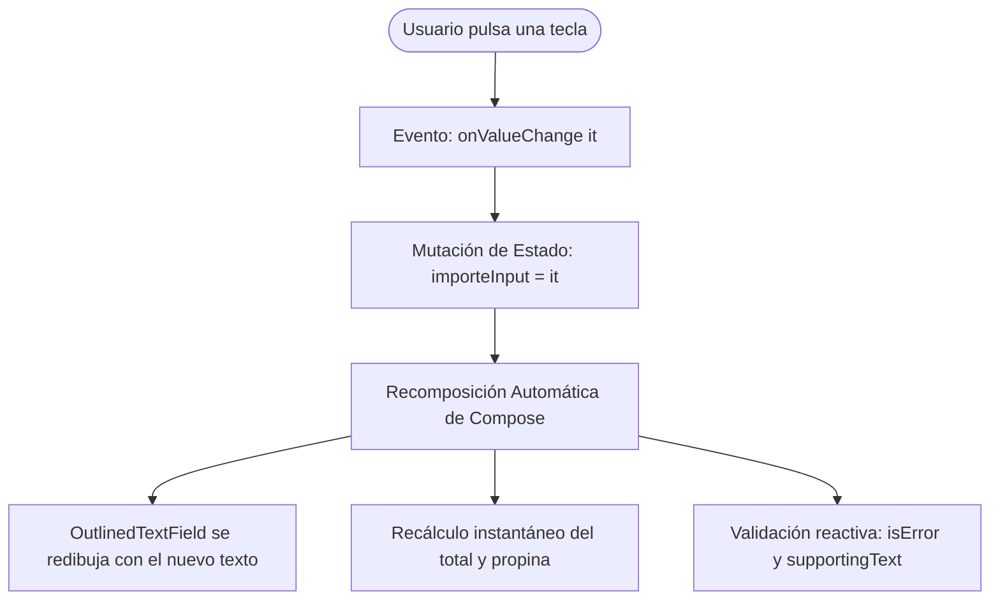
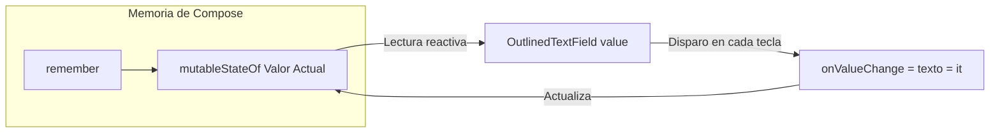
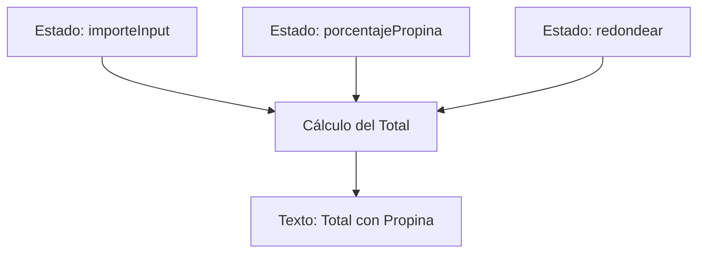

# **Codelab 2: Dominio del Estado y Cajas de Texto (TextField & Validación)**

En este codelab aprenderás uno de los conceptos más cruciales y transformadores del desarrollo con Jetpack Compose: **el Estado (`State`) y el flujo unidireccional de datos (*Unidirectional Data Flow*)**.

Descubrirás de forma práctica cómo los campos de texto (`OutlinedTextField`) no almacenan su propio texto como hacían las vistas imperativas antiguas (`EditText` en XML o `JTextField` en Java Swing), sino que dependen íntegramente de un estado observable externo que desencadena el ciclo de **Recomposición**.

---

## 1. ¿Qué vas a construir?

Construirás una **Calculadora Reactiva de Propinas y Descuentos** (*Tip & Discount Calculator*), inspirada en el codelab canónico *Tip Time* de Google:



Al finalizar este codelab, serás capaz de:

- Explicar por qué una variable normal de Kotlin no produce cambios en la pantalla de Compose.
- Utilizar `remember` y `mutableStateOf` para preservar el estado entre recomposiciones.
- Vincular un `OutlinedTextField` mediante el contrato `value` y `onValueChange`.
- Validar entradas numéricas en tiempo real y emitir avisos de error (`isError`).
- Integrar conmutadores (`Switch`) y deslizadores (`Slider`) que alteran el resultado en vivo.
- Aplicar el patrón **State Hoisting** para crear componentes reutilizables y testeables.

---

## 2. El Experimento del Fallo: ¿Por qué falla una variable normal?

Para interiorizar este concepto, observa este fragmento de código erróneo:

```kotlin
// ❌ CÓDIGO INCORRECTO: NO HACE NADA AL PULSAR TECLAS
@Composable
fun CampoTextoFallido() {
    var texto = "" // Variable Kotlin estándar

    OutlinedTextField(
        value = texto,
        onValueChange = { nuevoValor ->
            texto = nuevoValor // Se ejecuta, ¡pero Compose no se entera!
        },
        label = { Text("Escribe aquí") }
    )
}
```

### ¿Qué ocurre internamente?

1. Al pulsar una letra (ej. `'H'`), el teclado dispara la lambda `onValueChange("H")`.
2. La variable local `texto` pasa a valer `"H"`.
3. **El problema:** Una variable estándar de Kotlin no emite ninguna señal de cambio. Compose no sabe que el dato ha mutado y, por tanto, **no vuelve a ejecutar la función (`Recomposición`)**.
4. La pantalla sigue mostrando el valor inicial vacío `""`. El alumno cree que el teclado está roto, pero es un fallo de diseño de estado.

---

## 3. Paso 1: Tu primer `OutlinedTextField` reactivo

Para que Compose reaccione a los cambios, debemos envolver el dato en un objeto observable `MutableState<T>` y protegerlo frente a recomposiciones con `remember`:

```kotlin
// ✅ CÓDIGO CORRECTO: Compose observa cada mutación
var texto by remember { mutableStateOf("") }
```



Crea el archivo `app/src/main/java/com/dam/pmdmlab03/codelabs/codelab02_formulario/CalculadoraPropinasScreen.kt`:

```kotlin
package com.dam.pmdmlab03.codelabs.codelab02_formulario

import androidx.compose.foundation.layout.Column
import androidx.compose.foundation.layout.fillMaxWidth
import androidx.compose.foundation.layout.padding
import androidx.compose.material3.MaterialTheme
import androidx.compose.material3.OutlinedTextField
import androidx.compose.material3.Text
import androidx.compose.runtime.Composable
import androidx.compose.runtime.getValue
import androidx.compose.runtime.mutableStateOf
import androidx.compose.runtime.remember
import androidx.compose.runtime.setValue
import androidx.compose.ui.Modifier
import androidx.compose.ui.unit.dp

@Composable
fun PrimerPasoTextField() {
    var entradaUsuario by remember { mutableStateOf("") }

    Column(modifier = Modifier.padding(16.dp)) {
        OutlinedTextField(
            value = entradaUsuario,
            onValueChange = { nuevoTexto -> entradaUsuario = nuevoTexto },
            label = { Text("Importe de la cuenta") },
            modifier = Modifier.fillMaxWidth()
        )

        Text(
            text = "Has escrito: $entradaUsuario",
            style = MaterialTheme.typography.bodyLarge,
            modifier = Modifier.padding(top = 8.dp)
        )
    }
}
```

---

## 4. Paso 2: Teclados, Iconos y Decoradores de Material 3

En una aplicación profesional, debemos adaptar el teclado al tipo de datos (evitando que el usuario tenga que cambiar manualmente al teclado numérico) y ofrecer botones de acción para limpiar el contenido.

Material 3 proporciona propiedades clave en `OutlinedTextField`:

- `keyboardOptions`: Define el tipo de teclado (`KeyboardType.Number`, `KeyboardType.Email`, etc.).
- `leadingIcon`: Icono descriptivo al inicio del campo (ej. símbolo de moneda `€` o `$`).
- `trailingIcon`: Icono interactivo al final (ej. aspa para vaciar el texto cuando no esté vacío).

```kotlin
OutlinedTextField(
    value = importeInput,
    onValueChange = { importeInput = it },
    label = { Text("Total de la cuenta") },
    leadingIcon = {
        Icon(Icons.Filled.AttachMoney, contentDescription = "Moneda")
    },
    trailingIcon = {
        if (importeInput.isNotEmpty()) {
            IconButton(onClick = { importeInput = "" }) {
                Icon(Icons.Filled.Clear, contentDescription = "Borrar texto")
            }
        }
    },
    keyboardOptions = KeyboardOptions(
        keyboardType = KeyboardType.Number,
        imeAction = ImeAction.Done
    ),
    singleLine = true,
    modifier = Modifier.fillMaxWidth()
)
```

---

## 5. Paso 3: Validación Reactiva y Mensajes de Error

¿Qué ocurre si el usuario introduce letras o un número negativo? Material 3 gestiona estados de validación mediante:

1. **`isError: Boolean`:** Si es `true`, tiñe el borde y la etiqueta del input con `MaterialTheme.colorScheme.error`.
2. **`supportingText: @Composable (() -> Unit)?`:** Texto de ayuda al pie del input que explica el motivo del fallo.

```kotlin
val esNumeroValido = importeInput.isEmpty() || (importeInput.toDoubleOrNull() != null && importeInput.toDouble() >= 0)

OutlinedTextField(
    value = importeInput,
    onValueChange = { importeInput = it },
    isError = !esNumeroValido,
    supportingText = {
        if (!esNumeroValido) {
            Text(
                text = "Introduce un importe numérico válido mayor o igual a 0",
                color = MaterialTheme.colorScheme.error
            )
        } else {
            Text("Introduce el total sin propina")
        }
    },
    modifier = Modifier.fillMaxWidth()
)
```

---

## 6. Paso 4: Controles Adicionales que Modifican el Estado (`Switch` y `Slider`)

El estado en Compose no se limita a cajas de texto. Todos los componentes interactivos de Material 3 siguen el mismo contrato declarativo:

- **`Switch`:** Recibe `checked: Boolean` y emite `onCheckedChange: (Boolean) -> Unit`.
- **`Slider`:** Recibe `value: Float` y emite `onValueChange: (Float) -> Unit`.



---

## 7. Paso 5: Implementación Completa con State Hoisting

A continuación se muestra la pantalla completa estructurada en dos capas:

1. **`CalculadoraPropinasContent` (Stateless):** No guarda estado propio, recibe datos y lambdas. Ideal para pruebas y vistas previas.
2. **`CalculadoraPropinasScreen` (Stateful):** Gestiona las variables con `remember` y orquesta los cálculos.

??? example "Ver código completo: CalculadoraPropinasScreen.kt"

    ```kotlin
    package com.dam.pmdmlab03.codelabs.codelab02_formulario

    import androidx.compose.foundation.layout.Arrangement
    import androidx.compose.foundation.layout.Column
    import androidx.compose.foundation.layout.Row
    import androidx.compose.foundation.layout.Spacer
    import androidx.compose.foundation.layout.fillMaxSize
    import androidx.compose.foundation.layout.fillMaxWidth
    import androidx.compose.foundation.layout.height
    import androidx.compose.foundation.layout.padding
    import androidx.compose.foundation.text.KeyboardOptions
    import androidx.compose.material.icons.Icons
    import androidx.compose.material.icons.filled.Clear
    import androidx.compose.material.icons.filled.Euro
    import androidx.compose.material.icons.filled.Percent
    import androidx.compose.material3.CardDefaults
    import androidx.compose.material3.ElevatedCard
    import androidx.compose.material3.HorizontalDivider
    import androidx.compose.material3.Icon
    import androidx.compose.material3.IconButton
    import androidx.compose.material3.MaterialTheme
    import androidx.compose.material3.OutlinedTextField
    import androidx.compose.material3.Slider
    import androidx.compose.material3.Surface
    import androidx.compose.material3.Switch
    import androidx.compose.material3.Text
    import androidx.compose.runtime.Composable
    import androidx.compose.runtime.getValue
    import androidx.compose.runtime.mutableFloatStateOf
    import androidx.compose.runtime.mutableStateOf
    import androidx.compose.runtime.remember
    import androidx.compose.runtime.setValue
    import androidx.compose.ui.Alignment
    import androidx.compose.ui.Modifier
    import androidx.compose.ui.text.font.FontWeight
    import androidx.compose.ui.text.input.ImeAction
    import androidx.compose.ui.text.input.KeyboardType
    import androidx.compose.ui.tooling.preview.Preview
    import androidx.compose.ui.unit.dp
    import com.dam.pmdmlab03.ui.theme.PMDMLab03Theme
    import java.util.Locale
    import kotlin.math.ceil

    @Composable
    fun CalculadoraPropinasScreen(modifier: Modifier = Modifier) {
        var importeInput by remember { mutableStateOf("") }
        var porcentajePropina by remember { mutableFloatStateOf(10f) }
        var redondearAlAlza by remember { mutableStateOf(false) }

        val importe = importeInput.toDoubleOrNull() ?: 0.0
        val importePropinaBruta = importe * (porcentajePropina / 100)
        val totalBruto = importe + importePropinaBruta
        val totalFinal = if (redondearAlAlza) ceil(totalBruto) else totalBruto

        val esError = importeInput.isNotEmpty() && importeInput.toDoubleOrNull() == null

        CalculadoraPropinasContent(
            importeInput = importeInput,
            onImporteChange = { importeInput = it },
            porcentajePropina = porcentajePropina,
            onPorcentajeChange = { porcentajePropina = it },
            redondearAlAlza = redondearAlAlza,
            onRedondearChange = { redondearAlAlza = it },
            propinaCalculada = importePropinaBruta,
            totalCalculado = totalFinal,
            esError = esError,
            modifier = modifier
        )
    }

    @Composable
    fun CalculadoraPropinasContent(
        importeInput: String,
        onImporteChange: (String) -> Unit,
        porcentajePropina: Float,
        onPorcentajeChange: (Float) -> Unit,
        redondearAlAlza: Boolean,
        onRedondearChange: (Boolean) -> Unit,
        propinaCalculada: Double,
        totalCalculado: Double,
        esError: Boolean,
        modifier: Modifier = Modifier
    ) {
        Surface(
            modifier = modifier.fillMaxSize(),
            color = MaterialTheme.colorScheme.background
        ) {
            Column(
                modifier = Modifier
                    .fillMaxSize()
                    .padding(20.dp),
                verticalArrangement = Arrangement.spacedBy(16.dp)
            ) {
                Text(
                    text = "Calculadora de Propinas",
                    style = MaterialTheme.typography.headlineMedium,
                    color = MaterialTheme.colorScheme.primary
                )

                Text(
                    text = "Experimenta cómo cada pulsación de tecla y ajuste de estado recalculan la interfaz en tiempo real.",
                    style = MaterialTheme.typography.bodyMedium,
                    color = MaterialTheme.colorScheme.onSurfaceVariant
                )

                HorizontalDivider()

                // 1. Campo de texto con validación y borrado
                OutlinedTextField(
                    value = importeInput,
                    onValueChange = onImporteChange,
                    label = { Text("Importe de la cuenta") },
                    leadingIcon = { Icon(Icons.Filled.Euro, contentDescription = null) },
                    trailingIcon = {
                        if (importeInput.isNotEmpty()) {
                            IconButton(onClick = { onImporteChange("") }) {
                                Icon(Icons.Filled.Clear, contentDescription = "Limpiar campo")
                            }
                        }
                    },
                    isError = esError,
                    supportingText = {
                        if (esError) {
                            Text("Introduce un valor numérico válido (ej. 25.50)")
                        } else {
                            Text("Base imponible de la factura")
                        }
                    },
                    keyboardOptions = KeyboardOptions(
                        keyboardType = KeyboardType.Decimal,
                        imeAction = ImeAction.Done
                    ),
                    singleLine = true,
                    modifier = Modifier.fillMaxWidth()
                )

                // 2. Control deslizante de porcentaje (Slider)
                Column(modifier = Modifier.fillMaxWidth()) {
                    Row(
                        modifier = Modifier.fillMaxWidth(),
                        horizontalArrangement = Arrangement.SpaceBetween
                    ) {
                        Text("Porcentaje de propina:")
                        Text(
                            text = "${porcentajePropina.toInt()}%",
                            fontWeight = FontWeight.Bold,
                            color = MaterialTheme.colorScheme.primary
                        )
                    }

                    Slider(
                        value = porcentajePropina,
                        onValueChange = onPorcentajeChange,
                        valueRange = 0f..30f,
                        steps = 5,
                        modifier = Modifier.fillMaxWidth()
                    )
                }

                // 3. Conmutador de redondeo (Switch)
                Row(
                    modifier = Modifier.fillMaxWidth(),
                    verticalAlignment = Alignment.CenterVertically,
                    horizontalArrangement = Arrangement.SpaceBetween
                ) {
                    Text(
                        text = "¿Redondear total al alza?",
                        style = MaterialTheme.typography.bodyLarge
                    )
                    Switch(
                        checked = redondearAlAlza,
                        onCheckedChange = onRedondearChange
                    )
                }

                Spacer(modifier = Modifier.height(8.dp))

                // 4. Tarjeta de resultado final destacado
                ElevatedCard(
                    modifier = Modifier.fillMaxWidth(),
                    colors = CardDefaults.elevatedCardColors(
                        containerColor = MaterialTheme.colorScheme.primaryContainer
                    )
                ) {
                    Column(
                        modifier = Modifier
                            .fillMaxWidth()
                            .padding(20.dp),
                        horizontalAlignment = Alignment.CenterHorizontally
                    ) {
                        Text(
                            text = "Propina estimada: ${String.format(Locale.getDefault(), "%.2f €", propinaCalculada)}",
                            style = MaterialTheme.typography.bodyLarge,
                            color = MaterialTheme.colorScheme.onPrimaryContainer
                        )

                        Spacer(modifier = Modifier.height(4.dp))

                        Text(
                            text = "Total a Pagar:",
                            style = MaterialTheme.typography.labelMedium,
                            color = MaterialTheme.colorScheme.onPrimaryContainer
                        )

                        Text(
                            text = String.format(Locale.getDefault(), "%.2f €", totalCalculado),
                            style = MaterialTheme.typography.headlineLarge.copy(fontWeight = FontWeight.Bold),
                            color = MaterialTheme.colorScheme.onPrimaryContainer
                        )
                    }
                }
            }
        }
    }

    // ==========================================
    // PREVIEWS DIDÁCTICAS EN INTELIJ IDEA
    // ==========================================

    @Preview(name = "Calculadora con Datos", showBackground = true)
    @Composable
    private fun CalculadoraPropinasPreviewConDatos() {
        PMDMLab03Theme {
            CalculadoraPropinasContent(
                importeInput = "50.0",
                onImporteChange = {},
                porcentajePropina = 15f,
                onPorcentajeChange = {},
                redondearAlAlza = false,
                onRedondearChange = {},
                propinaCalculada = 7.5,
                totalCalculado = 57.5,
                esError = false
            )
        }
    }

    @Preview(name = "Calculadora con Error", showBackground = true)
    @Composable
    private fun CalculadoraPropinasPreviewError() {
        PMDMLab03Theme {
            CalculadoraPropinasContent(
                importeInput = "abc",
                onImporteChange = {},
                porcentajePropina = 10f,
                onPorcentajeChange = {},
                redondearAlAlza = false,
                onRedondearChange = {},
                propinaCalculada = 0.0,
                totalCalculado = 0.0,
                esError = true
            )
        }
    }
    ```

---

## 8. Checklist de Aprendizaje

- [x] **Flujo unidireccional:** El texto tecleado en el teclado viaja por `onValueChange` y regresa al parámetro `value`.
- [x] **Recomposición selectiva:** Al deslizar el `Slider`, únicamente se recomponen los textos que leen `porcentajePropina` y el total, sin refrescar toda la pantalla.
- [x] **Validación visual:** Si el valor no es un número parseable, la interfaz activa `isError` sin cierres forzados (*crashes*).

---

## 9. Reto de Consolidación

Añade a la calculadora un selector de comensales:

1. Añade una variable de estado `var numeroPersonas by remember { mutableFloatStateOf(1f) }` controlada mediante un segundo `Slider` con rango de 1 a 10 comensales.
2. Muestra un segundo cálculo destacado: *"Total por persona: X €"*.
