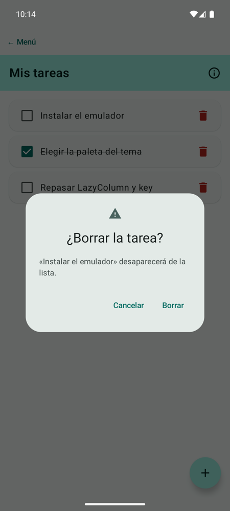
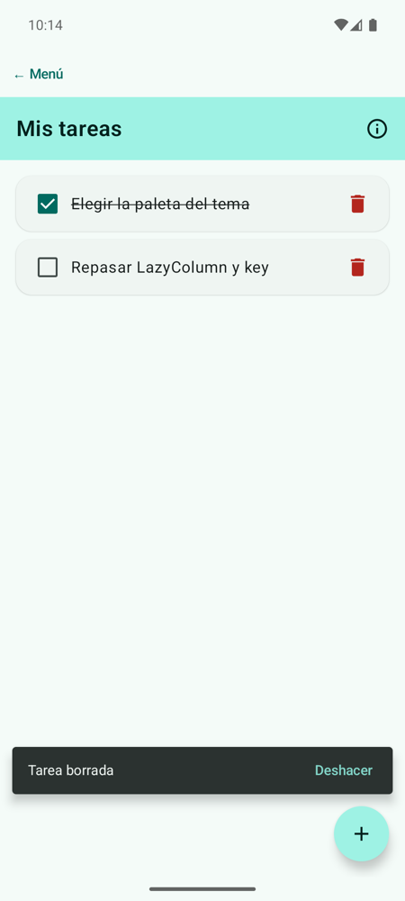

# **Codelab 3.03: Lista de Tareas con `Scaffold`**

Las pantallas de Material 3 comparten una estructura: una barra superior, el contenido, un botón flotante para la acción principal y avisos breves en la parte de abajo. `Scaffold` coloca cada una de esas piezas en su sitio. En este codelab construirás una **lista de tareas** con todas ellas: añadirás tareas con el botón flotante, pedirás confirmación antes de borrar con un **`AlertDialog`** y ofrecerás **deshacer** el borrado desde un **`Snackbar`**.

!!! info "Punto de partida: tag `c3.03-inicio`"
    Sigue en el repositorio del laboratorio, [pmdm2627-lab-ut3](https://github.com/jssdocente/pmdm2627-lab-ut3). Si terminaste el [Codelab 3.02](./02-catalogo-lazycolumn.md), continúa en tu rama. Si no, parte del tag:

    ```bash
    git checkout c3.03-inicio
    git switch -c mi-lab-3.03
    ```

    `c3.03-inicio` es `c3.02-fin`: el laboratorio con el muestrario del tema y el catálogo de cursos.

---

## 1. ¿Qué vas a construir?

Una pantalla «Mis tareas» con una `TopAppBar`, una lista de tareas que se marcan como hechas, un botón **+** que añade tareas y una papelera en cada fila. Al pulsar la papelera aparece un diálogo de confirmación; al confirmar, la tarea desaparece y un `Snackbar` ofrece **Deshacer**.

<div style="display: flex; flex-direction: row; justify-content: center; align-items: flex-start; gap: 1.5rem; flex-wrap: wrap; margin: 1.8rem 0;" markdown="1">

<figure style="margin: 0; text-align: center; max-width: 260px;" markdown="1">

{ style="border-radius: 8px; box-shadow: 0 4px 10px rgba(0,0,0,0.15); width: 100%; max-width: 250px;" }

<figcaption style="font-size: 0.85rem; margin-top: 0.5rem; color: var(--md-default-fg-color--light);"><strong>Figura 1:</strong> El diálogo antes de borrar.</figcaption>
</figure>

<figure style="margin: 0; text-align: center; max-width: 260px;" markdown="1">

{ style="border-radius: 8px; box-shadow: 0 4px 10px rgba(0,0,0,0.15); width: 100%; max-width: 250px;" }

<figcaption style="font-size: 0.85rem; margin-top: 0.5rem; color: var(--md-default-fg-color--light);"><strong>Figura 2:</strong> El <code>Snackbar</code> con la acción Deshacer.</figcaption>
</figure>

</div>

Al terminar, serás capaz de:

- Estructurar una pantalla con los huecos de `Scaffold`: `topBar`, `floatingActionButton` y `snackbarHost`.
- Aplicar el `innerPadding` al contenido para que nada quede tapado.
- Mostrar un `AlertDialog` a partir de un estado que puede ser `null`.
- Lanzar un `Snackbar` con una corrutina y reaccionar a su acción.
- Guardar en la lista objetos con id, para que `key` funcione aunque dos textos se repitan.

---

## 2. Los Huecos de `Scaffold`

`Scaffold` recibe cada pieza en un parámetro (un *slot*) y la coloca en su sitio:

<figure class="arq-fig">
--8<-- "docs/temas/03/codelabs/images/c3.03-scaffold.svg"
<figcaption>Cada pieza va en su hueco; el contenido recibe <code>innerPadding</code> para no quedar debajo de las barras.</figcaption>
</figure>

El contenido es una lambda que recibe **`innerPadding`**: el espacio que ocupan la barra superior y las barras del sistema. Si no lo aplicas, la primera tarea queda escondida debajo de la `TopAppBar`. Por eso IntelliJ IDEA marca en rojo un `Scaffold` que no usa su parámetro.

!!! info "¿Y el botón «← Menú»?"
    Las pantallas del laboratorio van dentro del `Scaffold` de `MainActivity`, que ya deja el hueco de la barra de estado. `MainActivity` aplica `consumeWindowInsets(innerPadding)`, que avisa a los `Scaffold` de dentro de que ese hueco ya está cubierto. Sin él, la `TopAppBar` de este codelab dejaría el hueco **otra vez** y verías una franja vacía encima.

La teoría completa está en [3A.1 Material Design 3, Providers y Scaffold](../a-diseno/3a.1-material-design-3-scaffold.md) y en [3A.2 Componentes interactivos y diálogos](../a-diseno/3a.2-componentes-interactivos.md).

---

## 3. Paso 1: El Modelo y la Fila de una Tarea

Crea el paquete `codelabs/codelab03_tareas` y, dentro, `TareasScreen.kt`. Cada tarea tiene un **`id`**: dos tareas pueden llamarse igual, pero nunca tener el mismo id, y es el id lo que usará la `key` de la lista.

```kotlin
// Cada tarea con su id: dos tareas pueden tener el mismo texto, pero nunca el mismo id
data class Tarea(val id: Int, val texto: String, val hecha: Boolean = false)
```

`FilaTarea` pinta una tarea con un `Checkbox`, el texto (tachado si está hecha) y la papelera. No guarda nada: avisa con `onMarcar` y `onBorrar`.

```kotlin
fun FilaTarea(
    tarea: Tarea,
    onMarcar: (Boolean) -> Unit,
    onBorrar: () -> Unit,
    modifier: Modifier = Modifier
) {
    ElevatedCard(modifier = modifier.fillMaxWidth()) {
        Row(
            modifier = Modifier.padding(horizontal = 8.dp, vertical = 4.dp),
            verticalAlignment = Alignment.CenterVertically
        ) {
            Checkbox(checked = tarea.hecha, onCheckedChange = onMarcar)
            Text(
                text = tarea.texto,
                style = MaterialTheme.typography.bodyLarge,
                textDecoration = if (tarea.hecha) TextDecoration.LineThrough else null,
                modifier = Modifier.weight(1f)
            )
            IconButton(onClick = onBorrar) {
                Icon(
                    painter = painterResource(R.drawable.ic_delete),
                    contentDescription = "Borrar ${tarea.texto}",
                    tint = MaterialTheme.colorScheme.error
                )
            }
        }
    }
}
```

---

## 4. Paso 2: La Estructura con `Scaffold`

`TareasScreen` guarda la lista de tareas y el siguiente id libre. La `TopAppBar` lleva el título y, en `actions`, un botón que muestra un resumen. El `FloatingActionButton` añade una tarea con el siguiente id:

```kotlin
Scaffold(
    modifier = modifier,
    topBar = {
        TopAppBar(
            title = { Text("Mis tareas") },
            actions = {
                IconButton(onClick = {
                    scope.launch {
                        snackbarHostState.showSnackbar("Te quedan $pendientes tareas pendientes")
                    }
                }) {
                    Icon(painterResource(R.drawable.ic_info), contentDescription = "Resumen")
                }
            },
            colors = TopAppBarDefaults.topAppBarColors(
                containerColor = MaterialTheme.colorScheme.primaryContainer,
                titleContentColor = MaterialTheme.colorScheme.onPrimaryContainer,
                actionIconContentColor = MaterialTheme.colorScheme.onPrimaryContainer
            )
        )
    },
    floatingActionButton = {
        FloatingActionButton(onClick = {
            tareas.add(Tarea(siguienteId, "Tarea nueva $siguienteId"))
            siguienteId++
        }) {
            Icon(painterResource(R.drawable.ic_add), contentDescription = "Añadir tarea")
        }
    },
    snackbarHost = { SnackbarHost(snackbarHostState) }
```

`TopAppBarDefaults.topAppBarColors` cambia los colores de la barra con roles del tema: `primaryContainer` de fondo y `onPrimaryContainer` para el texto y los iconos.

En el contenido, la lista aplica `innerPadding` y usa `key = { it.id }`:

```kotlin
) { innerPadding ->
    // innerPadding: el hueco que ocupan la barra superior y las del sistema
    if (tareas.isEmpty()) {
        Box(
            modifier = Modifier
                .fillMaxSize()
                .padding(innerPadding),
            contentAlignment = Alignment.Center
        ) {
            Text("No tienes tareas. Pulsa + para añadir una.")
        }
    } else {
        LazyColumn(
            modifier = Modifier
                .fillMaxSize()
                .padding(innerPadding),
            contentPadding = PaddingValues(16.dp),
            verticalArrangement = Arrangement.spacedBy(8.dp)
        ) {
            items(tareas, key = { it.id }) { tarea ->
                FilaTarea(
                    tarea = tarea,
                    onMarcar = { hecha ->
                        val i = tareas.indexOf(tarea)
                        tareas[i] = tarea.copy(hecha = hecha)
                    },
                    onBorrar = { tareaABorrar = tarea }
                )
            }
        }
    }
}
```

!!! warning "¿Y si la key fuera el texto?"
    Con `key = { it.texto }`, si dos tareas se llaman igual la app se cierra (`Key was already used`). Por eso la tarea tiene un `id` y la pantalla lleva la cuenta con `siguienteId`.

---

## 5. Paso 3: Confirmar con `AlertDialog`

Un diálogo en Compose no se «abre»: se **compone** mientras un estado lo pida. Aquí el estado es `tareaABorrar`, que es `null` cuando no hay nada que confirmar:

<figure class="arq-fig">
--8<-- "docs/temas/03/codelabs/images/c3.03-borrar.svg"
<figcaption>Del toque en la papelera al <code>Snackbar</code>: cada paso es un cambio de estado.</figcaption>
</figure>

La papelera solo guarda la tarea (`onBorrar = { tareaABorrar = tarea }`). Después del `Scaffold`, `tareaABorrar?.let { … }` compone el diálogo cuando no es `null`:

```kotlin
// El diálogo se muestra mientras haya una tarea pendiente de confirmar
tareaABorrar?.let { tarea ->
    AlertDialog(
        onDismissRequest = { tareaABorrar = null },
        icon = { Icon(painterResource(R.drawable.ic_warning), contentDescription = null) },
        title = { Text("¿Borrar la tarea?") },
        text = { Text("«${tarea.texto}» desaparecerá de la lista.") },
        confirmButton = {
            TextButton(onClick = {
                val posicion = tareas.indexOf(tarea)
                tareas.remove(tarea)
                tareaABorrar = null
                scope.launch {
                    val resultado = snackbarHostState.showSnackbar(
                        message = "Tarea borrada",
                        actionLabel = "Deshacer"
                    )
                    if (resultado == SnackbarResult.ActionPerformed) {
                        tareas.add(posicion.coerceAtMost(tareas.size), tarea)
                    }
                }
            }) {
                Text("Borrar")
            }
        },
        dismissButton = {
            TextButton(onClick = { tareaABorrar = null }) {
                Text("Cancelar")
            }
        }
    )
}
```

- **`onDismissRequest`** se llama al tocar fuera del diálogo o pulsar atrás: lo cerramos poniendo `tareaABorrar = null`.
- **`confirmButton`** y **`dismissButton`** son los dos botones. «Cancelar» hace lo mismo que tocar fuera.

---

## 6. Paso 4: Deshacer con `Snackbar`

`showSnackbar` es una función **`suspend`**: muestra el aviso y **espera** a que desaparezca o a que el usuario pulse la acción. Por eso no se puede llamar directamente desde un `onClick`, sino dentro de una corrutina:

- `remember { SnackbarHostState() }` es el estado del `Snackbar`, y `SnackbarHost(snackbarHostState)` lo coloca en su hueco del `Scaffold`.
- `rememberCoroutineScope()` da un ámbito de corrutinas ligado a la pantalla: si la pantalla desaparece, la corrutina se cancela sola.
- `showSnackbar(message, actionLabel)` devuelve `SnackbarResult.ActionPerformed` si se pulsó **Deshacer**. En ese caso, la tarea vuelve a su posición.

??? example "Ver código completo: `TareasScreen.kt`"

    ```kotlin
    package com.pmdm.lab.ut3.codelabs.codelab03_tareas

    import androidx.compose.foundation.layout.Arrangement
    import androidx.compose.foundation.layout.Box
    import androidx.compose.foundation.layout.PaddingValues
    import androidx.compose.foundation.layout.Row
    import androidx.compose.foundation.layout.fillMaxSize
    import androidx.compose.foundation.layout.fillMaxWidth
    import androidx.compose.foundation.layout.padding
    import androidx.compose.foundation.lazy.LazyColumn
    import androidx.compose.foundation.lazy.items
    import androidx.compose.material3.AlertDialog
    import androidx.compose.material3.Checkbox
    import androidx.compose.material3.ElevatedCard
    import androidx.compose.material3.ExperimentalMaterial3Api
    import androidx.compose.material3.FloatingActionButton
    import androidx.compose.material3.Icon
    import androidx.compose.material3.IconButton
    import androidx.compose.material3.MaterialTheme
    import androidx.compose.material3.Scaffold
    import androidx.compose.material3.SnackbarHost
    import androidx.compose.material3.SnackbarHostState
    import androidx.compose.material3.SnackbarResult
    import androidx.compose.material3.Text
    import androidx.compose.material3.TextButton
    import androidx.compose.material3.TopAppBar
    import androidx.compose.material3.TopAppBarDefaults
    import androidx.compose.runtime.Composable
    import androidx.compose.runtime.getValue
    import androidx.compose.runtime.mutableIntStateOf
    import androidx.compose.runtime.mutableStateListOf
    import androidx.compose.runtime.mutableStateOf
    import androidx.compose.runtime.remember
    import androidx.compose.runtime.rememberCoroutineScope
    import androidx.compose.runtime.setValue
    import androidx.compose.ui.Alignment
    import androidx.compose.ui.Modifier
    import androidx.compose.ui.res.painterResource
    import androidx.compose.ui.text.style.TextDecoration
    import androidx.compose.ui.tooling.preview.Preview
    import androidx.compose.ui.unit.dp
    import com.pmdm.lab.ut3.R
    import com.pmdm.lab.ut3.ui.theme.LabUt3Theme
    import kotlinx.coroutines.launch

    // Cada tarea con su id: dos tareas pueden tener el mismo texto, pero nunca el mismo id
    data class Tarea(val id: Int, val texto: String, val hecha: Boolean = false)

    @OptIn(ExperimentalMaterial3Api::class)
    @Composable
    fun TareasScreen(modifier: Modifier = Modifier) {
        val tareas = remember {
            mutableStateListOf(
                Tarea(1, "Instalar el emulador"),
                Tarea(2, "Elegir la paleta del tema", hecha = true),
                Tarea(3, "Repasar LazyColumn y key")
            )
        }
        var siguienteId by remember { mutableIntStateOf(4) }

        // La tarea que se quiere borrar: si no es null, se muestra el diálogo
        var tareaABorrar by remember { mutableStateOf<Tarea?>(null) }

        // El Snackbar necesita su estado y un ámbito de corrutinas (showSnackbar es suspend)
        val snackbarHostState = remember { SnackbarHostState() }
        val scope = rememberCoroutineScope()

        val pendientes = tareas.count { !it.hecha }

        Scaffold(
            modifier = modifier,
            topBar = {
                TopAppBar(
                    title = { Text("Mis tareas") },
                    actions = {
                        IconButton(onClick = {
                            scope.launch {
                                snackbarHostState.showSnackbar("Te quedan $pendientes tareas pendientes")
                            }
                        }) {
                            Icon(painterResource(R.drawable.ic_info), contentDescription = "Resumen")
                        }
                    },
                    colors = TopAppBarDefaults.topAppBarColors(
                        containerColor = MaterialTheme.colorScheme.primaryContainer,
                        titleContentColor = MaterialTheme.colorScheme.onPrimaryContainer,
                        actionIconContentColor = MaterialTheme.colorScheme.onPrimaryContainer
                    )
                )
            },
            floatingActionButton = {
                FloatingActionButton(onClick = {
                    tareas.add(Tarea(siguienteId, "Tarea nueva $siguienteId"))
                    siguienteId++
                }) {
                    Icon(painterResource(R.drawable.ic_add), contentDescription = "Añadir tarea")
                }
            },
            snackbarHost = { SnackbarHost(snackbarHostState) }
        ) { innerPadding ->
            // innerPadding: el hueco que ocupan la barra superior y las del sistema
            if (tareas.isEmpty()) {
                Box(
                    modifier = Modifier
                        .fillMaxSize()
                        .padding(innerPadding),
                    contentAlignment = Alignment.Center
                ) {
                    Text("No tienes tareas. Pulsa + para añadir una.")
                }
            } else {
                LazyColumn(
                    modifier = Modifier
                        .fillMaxSize()
                        .padding(innerPadding),
                    contentPadding = PaddingValues(16.dp),
                    verticalArrangement = Arrangement.spacedBy(8.dp)
                ) {
                    items(tareas, key = { it.id }) { tarea ->
                        FilaTarea(
                            tarea = tarea,
                            onMarcar = { hecha ->
                                val i = tareas.indexOf(tarea)
                                tareas[i] = tarea.copy(hecha = hecha)
                            },
                            onBorrar = { tareaABorrar = tarea }
                        )
                    }
                }
            }
        }

        // El diálogo se muestra mientras haya una tarea pendiente de confirmar
        tareaABorrar?.let { tarea ->
            AlertDialog(
                onDismissRequest = { tareaABorrar = null },
                icon = { Icon(painterResource(R.drawable.ic_warning), contentDescription = null) },
                title = { Text("¿Borrar la tarea?") },
                text = { Text("«${tarea.texto}» desaparecerá de la lista.") },
                confirmButton = {
                    TextButton(onClick = {
                        val posicion = tareas.indexOf(tarea)
                        tareas.remove(tarea)
                        tareaABorrar = null
                        scope.launch {
                            val resultado = snackbarHostState.showSnackbar(
                                message = "Tarea borrada",
                                actionLabel = "Deshacer"
                            )
                            if (resultado == SnackbarResult.ActionPerformed) {
                                tareas.add(posicion.coerceAtMost(tareas.size), tarea)
                            }
                        }
                    }) {
                        Text("Borrar")
                    }
                },
                dismissButton = {
                    TextButton(onClick = { tareaABorrar = null }) {
                        Text("Cancelar")
                    }
                }
            )
        }
    }

    @Composable
    fun FilaTarea(
        tarea: Tarea,
        onMarcar: (Boolean) -> Unit,
        onBorrar: () -> Unit,
        modifier: Modifier = Modifier
    ) {
        ElevatedCard(modifier = modifier.fillMaxWidth()) {
            Row(
                modifier = Modifier.padding(horizontal = 8.dp, vertical = 4.dp),
                verticalAlignment = Alignment.CenterVertically
            ) {
                Checkbox(checked = tarea.hecha, onCheckedChange = onMarcar)
                Text(
                    text = tarea.texto,
                    style = MaterialTheme.typography.bodyLarge,
                    textDecoration = if (tarea.hecha) TextDecoration.LineThrough else null,
                    modifier = Modifier.weight(1f)
                )
                IconButton(onClick = onBorrar) {
                    Icon(
                        painter = painterResource(R.drawable.ic_delete),
                        contentDescription = "Borrar ${tarea.texto}",
                        tint = MaterialTheme.colorScheme.error
                    )
                }
            }
        }
    }

    @Preview(showBackground = true)
    @Composable
    private fun TareasScreenPreview() {
        LabUt3Theme {
            TareasScreen()
        }
    }
    ```

Añade la pantalla al menú (`TAREAS` en `PantallaLab` y su rama en el `when`) y pruébala.

---

## 7. Experimenta

1. Quita `.padding(innerPadding)` de la `LazyColumn`. ¿Dónde está la primera tarea?

2. Quita `consumeWindowInsets` en `MainActivity` y abre este codelab. ¿Ves la franja vacía sobre la barra?

3. Añade `duration = SnackbarDuration.Long` a `showSnackbar` y comprueba cuánto tiempo tienes para deshacer.

4. Añade a la `TopAppBar` un segundo botón que abra otro `AlertDialog` para vaciar la lista.

!!! success "Solución: tag `c3.03-fin`"
    Compara tu código con el tag [`c3.03-fin`](https://github.com/jssdocente/pmdm2627-lab-ut3/tree/c3.03-fin) (`git diff c3.03-fin`). Es también el punto de partida del [Codelab 3.04](./04-propinas-formulario.md).

---

## 8. Resumen y Checklist

- [ ] La pantalla usa `Scaffold` con `topBar`, `floatingActionButton` y `snackbarHost`.
- [ ] El contenido aplica `innerPadding`.
- [ ] Las tareas tienen `id` y la lista usa `key = { it.id }`.
- [ ] El diálogo se compone a partir de `tareaABorrar` y se cierra al tocar fuera o con Cancelar.
- [ ] El `Snackbar` se lanza con `scope.launch` y **Deshacer** devuelve la tarea a su sitio.
