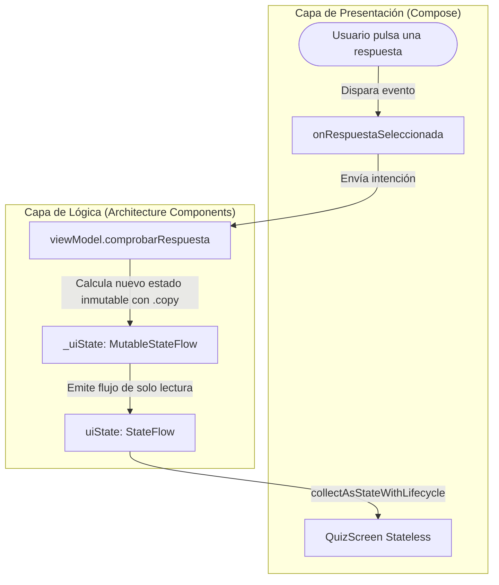
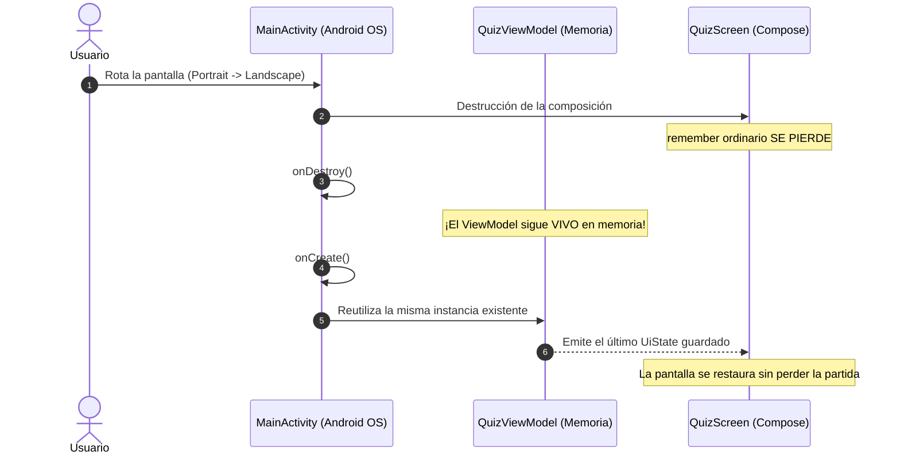

# **Codelab 3: Arquitectura de UI con ViewModel y StateFlow (Patrón UDF)**

En los codelabs anteriores aprendiste a gestionar el estado local dentro de una función componible con `remember { mutableStateOf(...) }`. Sin embargo, en aplicaciones reales de producción este enfoque presenta una debilidad crítica: **¿qué ocurre cuando el usuario rota la pantalla de su teléfono o el sistema operativo destruye la Activity para liberar memoria?**

En este codelab aprenderás a aplicar la **Arquitectura oficial de la Capa de UI de Google**, desacoplando la lógica de negocio de la interfaz gráfica mediante **`ViewModel`**, **`UiState` inmutable** y flujos asíncronos reactivos con **`StateFlow`**.

---

## 1. ¿Qué vas a construir?

Construirás una **Aplicación de Concurso de Preguntas Rápidas** (*Quiz Game*), inspirada en el codelab oficial *Unscramble* de Google:



Al finalizar este codelab, serás capaz de:

- Demostrar experimentalmente cómo `remember` pierde sus datos al rotar la pantalla y cómo `ViewModel` los preserva intactos.
- Modelar toda la información de una pantalla en una única `data class UiState` inmutable.
- Implementar el patrón **Unidirectional Data Flow (UDF)** con `MutableStateFlow` y `asStateFlow()`.
- Consumir estados en Compose de forma segura para el ciclo de vida mediante `collectAsStateWithLifecycle()`.
- Crear vistas previas inmediatas (`@Preview`) sin necesidad de instanciar un ViewModel real.

---

## 2. El Experimento de la Rotación: ¿Por qué `remember` no basta?

Cuando un usuario gira su smartphone de vertical (*Portrait*) a horizontal (*Landscape*), Android destruye por completo la `MainActivity` y la vuelve a instanciar desde cero para cargar los recursos adaptados.

1. **`remember` ordinario:** Se almacena en la tabla de composición ligada a la instancia de la Activity. Al destruirse la Activity, **todo el estado se resetea a sus valores iniciales**.
2. **`rememberSaveable`:** Permite guardar datos primitivos simples en el `Bundle` del sistema, pero falla con colecciones grandes o lógica asíncrona de red/base de datos.
3. **`ViewModel`:** Se almacena en un ámbito desacoplado del ciclo de vida de la Activity (*ViewModelStore*). Sobrevive a rotaciones, cambios de tema y cambio de idioma del sistema operativo.



---

## 3. Paso 1: Modelar la Pantalla con `UiState` Inmutable

En la arquitectura moderna recomendada por Google, una pantalla debe representar una **fotografía instantánea inmutable** de su estado.

Crea el archivo `app/src/main/java/com/dam/pmdmlab03/codelabs/codelab02_formulario/QuizUiState.kt`:

```kotlin
package com.dam.pmdmlab03.codelabs.codelab02_formulario

/**
 * Fotografía inmutable de la pantalla del concurso.
 * Representa la Única Fuente de la Verdad (Single Source of Truth).
 */
data class QuizUiState(
    val preguntaActual: String = "",
    val opciones: List<String> = emptyList(),
    val indicePregunta: Int = 0,
    val totalPreguntas: Int = 0,
    val puntuacion: Int = 0,
    val esRespuestaCorrecta: Boolean? = null,
    val opcionSeleccionada: String? = null,
    val partidaFinalizada: Boolean = false
) {
    val progreso: Float
        get() = if (totalPreguntas > 0) (indicePregunta + 1).toFloat() / totalPreguntas.toFloat() else 0f
}
```

---

## 4. Paso 2: Crear el `ViewModel` y el Patrón UDF

El `ViewModel` debe custodiar dos variables de estado:
1. `_uiState`: Una variable privada `MutableStateFlow` que sólo el ViewModel puede alterar.
2. `uiState`: Una propiedad pública de solo lectura `StateFlow` expuesta mediante `.asStateFlow()`.

Crea el archivo `app/src/main/java/com/dam/pmdmlab03/codelabs/codelab02_formulario/QuizViewModel.kt`:

??? example "Ver código completo: QuizViewModel.kt"

    ```kotlin
    package com.dam.pmdmlab03.codelabs.codelab02_formulario

    import androidx.lifecycle.ViewModel
    import kotlinx.coroutines.flow.MutableStateFlow
    import kotlinx.coroutines.flow.StateFlow
    import kotlinx.coroutines.flow.asStateFlow
    import kotlinx.coroutines.flow.update

    data class Pregunta(
        val enunciado: String,
        val opciones: List<String>,
        val respuestaCorrecta: String
    )

    class QuizViewModel : ViewModel() {

        private val bancoPreguntas = listOf(
            Pregunta(
                enunciado = "¿Qué función preserva el estado ante recomposiciones en Compose?",
                opciones = listOf("remember", "saveState", "retainState", "keep"),
                respuestaCorrecta = "remember"
            ),
            Pregunta(
                enunciado = "¿Qué componente se utiliza para listas largas y eficientes?",
                opciones = listOf("ScrollView", "LazyColumn", "RecyclerView", "ColumnList"),
                respuestaCorrecta = "LazyColumn"
            ),
            Pregunta(
                enunciado = "¿Dónde sobrevive el estado ante la rotación de pantalla?",
                opciones = listOf("remember", "MutableList", "ViewModel", "Composable"),
                respuestaCorrecta = "ViewModel"
            )
        )

        private val _uiState = MutableStateFlow(QuizUiState())
        val uiState: StateFlow<QuizUiState> = _uiState.asStateFlow()

        init {
            iniciarPartida()
        }

        fun iniciarPartida() {
            val primera = bancoPreguntas.first()
            _uiState.value = QuizUiState(
                preguntaActual = primera.enunciado,
                opciones = primera.opciones,
                indicePregunta = 0,
                totalPreguntas = bancoPreguntas.size,
                puntuacion = 0,
                esRespuestaCorrecta = null,
                opcionSeleccionada = null,
                partidaFinalizada = false
            )
        }

        fun seleccionarOpcion(opcion: String) {
            val estadoActual = _uiState.value
            if (estadoActual.opcionSeleccionada != null || estadoActual.partidaFinalizada) return

            val pregunta = bancoPreguntas[estadoActual.indicePregunta]
            val acierto = opcion == pregunta.respuestaCorrecta

            _uiState.update { anterior ->
                anterior.copy(
                    opcionSeleccionada = opcion,
                    esRespuestaCorrecta = acierto,
                    puntuacion = if (acierto) anterior.puntuacion + 10 else anterior.puntuacion
                )
            }
        }

        fun siguientePregunta() {
            val siguienteIndice = _uiState.value.indicePregunta + 1

            if (siguienteIndice < bancoPreguntas.size) {
                val siguiente = bancoPreguntas[siguienteIndice]
                _uiState.update { anterior ->
                    anterior.copy(
                        preguntaActual = siguiente.enunciado,
                        opciones = siguiente.opciones,
                        indicePregunta = siguienteIndice,
                        esRespuestaCorrecta = null,
                        opcionSeleccionada = null
                    )
                }
            } else {
                _uiState.update { it.copy(partidaFinalizada = true) }
            }
        }
    }
    ```

---

## 5. Paso 3: Conexión Segura con `collectAsStateWithLifecycle`

En Jetpack Compose existe la extensión clásica `.collectAsState()`, pero la documentación oficial de Android recomienda utilizar:

```kotlin
val uiState by viewModel.uiState.collectAsStateWithLifecycle()
```

!!! tip "Diferencia Vital de Rendimiento"
    - `collectAsState()` sigue recolectando datos incluso cuando la aplicación está en segundo plano o la pantalla está apagada, consumiendo batería innecesariamente.
    - `collectAsStateWithLifecycle()` pausa la suscripción automáticamente en `onStop()` y la reanuda en `onStart()`, optimizando los recursos del dispositivo.

---

## 6. Paso 4: Implementación de la Pantalla `QuizScreen.kt`

Abre o crea `app/src/main/java/com/dam/pmdmlab03/codelabs/codelab02_formulario/QuizScreen.kt`:

??? example "Ver código completo: QuizScreen.kt"

    ```kotlin
    package com.dam.pmdmlab03.codelabs.codelab02_formulario

    import androidx.compose.foundation.layout.Arrangement
    import androidx.compose.foundation.layout.Column
    import androidx.compose.foundation.layout.Row
    import androidx.compose.foundation.layout.Spacer
    import androidx.compose.foundation.layout.fillMaxSize
    import androidx.compose.foundation.layout.fillMaxWidth
    import androidx.compose.foundation.layout.height
    import androidx.compose.foundation.layout.padding
    import androidx.compose.material3.AlertDialog
    import androidx.compose.material3.Button
    import androidx.compose.material3.ButtonDefaults
    import androidx.compose.material3.CardDefaults
    import androidx.compose.material3.ElevatedCard
    import androidx.compose.material3.FilledTonalButton
    import androidx.compose.material3.HorizontalDivider
    import androidx.compose.material3.LinearProgressIndicator
    import androidx.compose.material3.MaterialTheme
    import androidx.compose.material3.OutlinedButton
    import androidx.compose.material3.Surface
    import androidx.compose.material3.Text
    import androidx.compose.runtime.Composable
    import androidx.compose.runtime.getValue
    import androidx.compose.ui.Alignment
    import androidx.compose.ui.Modifier
    import androidx.compose.ui.text.font.FontWeight
    import androidx.compose.ui.text.style.TextAlign
    import androidx.compose.ui.tooling.preview.Preview
    import androidx.compose.ui.unit.dp
    import androidx.lifecycle.compose.collectAsStateWithLifecycle
    import androidx.lifecycle.viewmodel.compose.viewModel
    import com.dam.pmdmlab03.ui.theme.PMDMLab03Theme

    // ==========================================
    // COMPONIBLE STATEFUL: Inyecta el ViewModel
    // ==========================================
    @Composable
    fun QuizScreen(
        modifier: Modifier = Modifier,
        viewModel: QuizViewModel = viewModel()
    ) {
        val uiState by viewModel.uiState.collectAsStateWithLifecycle()

        QuizContent(
            uiState = uiState,
            onOpcionClick = viewModel::seleccionarOpcion,
            onSiguienteClick = viewModel::siguientePregunta,
            onReiniciarClick = viewModel::iniciarPartida,
            modifier = modifier
        )
    }

    // ==========================================
    // COMPONIBLE STATELESS: Puro y Testeable
    // ==========================================
    @Composable
    fun QuizContent(
        uiState: QuizUiState,
        onOpcionClick: (String) -> Unit,
        onSiguienteClick: () -> Unit,
        onReiniciarClick: () -> Unit,
        modifier: Modifier = Modifier
    ) {
        Surface(
            modifier = modifier.fillMaxSize(),
            color = MaterialTheme.colorScheme.background
        ) {
            Column(
                modifier = Modifier
                    .fillMaxSize()
                    .padding(20.dp),
                verticalArrangement = Arrangement.SpaceBetween
            ) {
                // Cabecera de Progreso
                Column(modifier = Modifier.fillMaxWidth()) {
                    Text(
                        text = "Codelab 3: ViewModel y StateFlow",
                        style = MaterialTheme.typography.titleMedium,
                        color = MaterialTheme.colorScheme.primary
                    )

                    Spacer(modifier = Modifier.height(8.dp))

                    Row(
                        modifier = Modifier.fillMaxWidth(),
                        horizontalArrangement = Arrangement.SpaceBetween
                    ) {
                        Text("Pregunta ${uiState.indicePregunta + 1} de ${uiState.totalPreguntas}")
                        Text("Puntos: ${uiState.puntuacion}", fontWeight = FontWeight.Bold)
                    }

                    Spacer(modifier = Modifier.height(8.dp))

                    LinearProgressIndicator(
                        progress = { uiState.progreso },
                        modifier = Modifier.fillMaxWidth().height(8.dp)
                    )
                }

                // Tarjeta con el enunciado
                ElevatedCard(
                    modifier = Modifier.fillMaxWidth(),
                    colors = CardDefaults.elevatedCardColors(
                        containerColor = MaterialTheme.colorScheme.surfaceVariant
                    )
                ) {
                    Text(
                        text = uiState.preguntaActual,
                        style = MaterialTheme.typography.headlineSmall,
                        textAlign = TextAlign.Center,
                        modifier = Modifier.padding(24.dp).fillMaxWidth()
                    )
                }

                // Opciones de respuesta
                Column(
                    modifier = Modifier.fillMaxWidth(),
                    verticalArrangement = Arrangement.spacedBy(8.dp)
                ) {
                    uiState.opciones.forEach { opcion ->
                        val yaRespondido = uiState.opcionSeleccionada != null
                        val esEsta = uiState.opcionSeleccionada == opcion

                        val colorBoton = when {
                            esEsta && uiState.esRespuestaCorrecta == true -> ButtonDefaults.buttonColors(
                                containerColor = MaterialTheme.colorScheme.primary
                            )
                            esEsta && uiState.esRespuestaCorrecta == false -> ButtonDefaults.buttonColors(
                                containerColor = MaterialTheme.colorScheme.error
                            )
                            else -> ButtonDefaults.filledTonalButtonColors()
                        }

                        FilledTonalButton(
                            onClick = { onOpcionClick(opcion) },
                            enabled = !yaRespondido,
                            colors = colorBoton,
                            modifier = Modifier.fillMaxWidth().height(52.dp)
                        ) {
                            Text(text = opcion, style = MaterialTheme.typography.bodyLarge)
                        }
                    }
                }

                // Botón de avance
                Button(
                    onClick = onSiguienteClick,
                    enabled = uiState.opcionSeleccionada != null,
                    modifier = Modifier.fillMaxWidth().height(50.dp)
                ) {
                    Text("Siguiente Pregunta")
                }
            }

            // Diálogo de fin de concurso
            if (uiState.partidaFinalizada) {
                AlertDialog(
                    onDismissRequest = {},
                    title = { Text("¡Concurso Completado! 🏆") },
                    text = { Text("Has obtenido un total de ${uiState.puntuacion} puntos.") },
                    confirmButton = {
                        Button(onClick = onReiniciarClick) {
                            Text("Jugar otra vez")
                        }
                    }
                )
            }
        }
    }

    // ==========================================
    // PREVIEWS EN INTELIJ IDEA
    // ==========================================

    @Preview(name = "Quiz en Marcha", showBackground = true)
    @Composable
    private fun QuizPreviewEnMarcha() {
        PMDMLab03Theme {
            QuizContent(
                uiState = QuizUiState(
                    preguntaActual = "¿Qué función preserva el estado en Compose?",
                    opciones = listOf("remember", "saveState", "retainState", "keep"),
                    indicePregunta = 0,
                    totalPreguntas = 3,
                    puntuacion = 10,
                    esRespuestaCorrecta = null,
                    opcionSeleccionada = null
                ),
                onOpcionClick = {},
                onSiguienteClick = {},
                onReiniciarClick = {}
            )
        }
    }
    ```

---

## 7. Checklist de Aprendizaje

- [x] **Inmutabilidad total:** El componible nunca hace `uiState.puntuacion = 20`. El estado solo se actualiza en el ViewModel mediante `.copy()`.
- [x] **Flujo unidireccional (UDF):** La UI pasa eventos (`onOpcionClick`) y consume el estado (`uiState`).
- [x] **Supervivencia a rotaciones:** Puedes rotar el emulador a horizontal (`Ctrl + F11` / `Cmd + F11`) y comprobar que la pregunta actual y la puntuación se conservan intactas.

---

## 8. Reto de Consolidación

Añade un temporizador de 15 segundos por pregunta:
1. En el `QuizViewModel`, utiliza una corrutina con `viewModelScope.launch` y `delay(1000)` para decrementar un contador `segundosRestantes` en el `UiState`.
2. Si el contador llega a 0 sin responder, pasa automáticamente la pregunta como errónea y desactiva las opciones.
