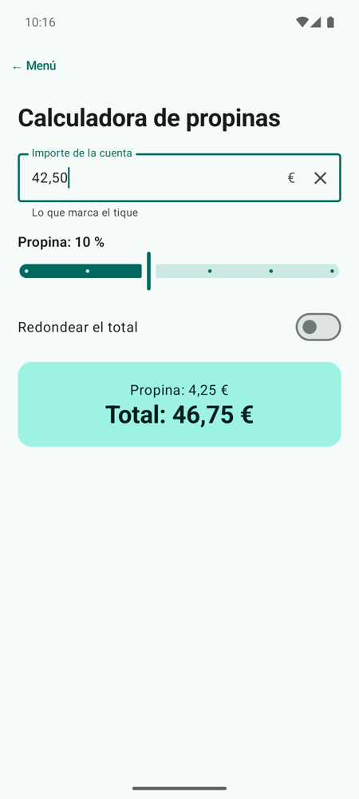
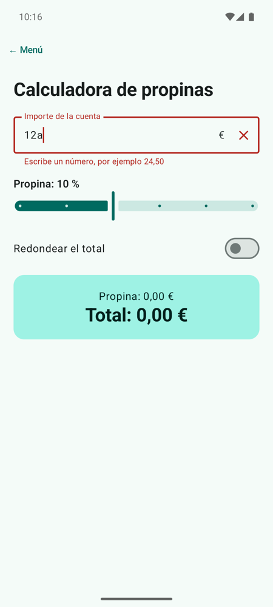

# **Codelab 3.04: Calculadora de Propinas, Formularios y Validación**

Casi todas las apps piden datos: un nombre, un importe, una fecha. En este codelab construirás una **calculadora de propinas** con un campo de texto que valida lo que escribes, un `Slider` para el porcentaje y un `Switch` para redondear. Aplicarás el **state hoisting** de la UT2 a un formulario completo y escribirás tus primeros **tests de interfaz**.

!!! info "Punto de partida: tag `c3.04-inicio`"
    Sigue en el repositorio del laboratorio, [pmdm2627-lab-ut3](https://github.com/jssdocente/pmdm2627-lab-ut3). Si terminaste el [Codelab 3.03](./03-tareas-scaffold.md), continúa en tu rama. Si no, parte del tag:

    ```bash
    git checkout c3.04-inicio
    git switch -c mi-lab-3.04
    ```

    `c3.04-inicio` es `c3.03-fin`: el laboratorio con el tema, el catálogo y la lista de tareas.

---

## 1. ¿Qué vas a construir?

Escribes el importe de la cuenta, eliges el porcentaje de propina y decides si redondear. La tarjeta inferior muestra la propina y el total al momento. Si escribes algo que no es un número, el campo se pone en rojo y explica qué esperaba.

<div style="display: flex; flex-direction: row; justify-content: center; align-items: flex-start; gap: 1.5rem; flex-wrap: wrap; margin: 1.8rem 0;" markdown="1">

<figure style="margin: 0; text-align: center; max-width: 260px;" markdown="1">

{ style="border-radius: 8px; box-shadow: 0 4px 10px rgba(0,0,0,0.15); width: 100%; max-width: 250px;" }

<figcaption style="font-size: 0.85rem; margin-top: 0.5rem; color: var(--md-default-fg-color--light);"><strong>Figura 1:</strong> 42,50 € con un 10 % de propina.</figcaption>
</figure>

<figure style="margin: 0; text-align: center; max-width: 260px;" markdown="1">

{ style="border-radius: 8px; box-shadow: 0 4px 10px rgba(0,0,0,0.15); width: 100%; max-width: 250px;" }

<figcaption style="font-size: 0.85rem; margin-top: 0.5rem; color: var(--md-default-fg-color--light);"><strong>Figura 2:</strong> El campo en estado de error.</figcaption>
</figure>

</div>

Al terminar, serás capaz de:

- Usar `OutlinedTextField` con etiqueta, sufijo, icono para borrar, texto de ayuda y estado de error.
- Elegir el teclado adecuado con `KeyboardOptions`.
- Controlar un `Slider` y un `Switch` desde el estado.
- Calcular **valores derivados** en lugar de guardarlos.
- Separar `PropinasScreen` (con estado) de `PropinasContent` (sin estado) y probar la pantalla con un test de interfaz.

---

## 2. Un Campo de Texto también Sigue el Estado

En la UT2 viste que [una variable normal no repinta la pantalla](../../02/codelabs/02-contador-incremental.md) y que el estado se guarda con `remember`. Con un campo de texto pasa exactamente lo mismo, y sorprende más:

```kotlin
OutlinedTextField(value = "", onValueChange = { })   // ¡no deja escribir!
```

Un `TextField` **no guarda lo que escribes**. Muestra `value` y, en cada tecla, te avisa con `onValueChange` del texto nuevo. Si no guardas ese texto en un estado y se lo devuelves en `value`, la pantalla vuelve a pintar el valor antiguo y parece que el teclado no funciona. Es el mismo patrón que el contador: **el estado baja, los eventos suben**.

<figure class="arq-fig">
--8<-- "docs/temas/03/codelabs/images/c3.04-hoisting.svg"
<figcaption><code>PropinasScreen</code> guarda tres estados y calcula el resto; <code>PropinasContent</code> solo pinta y avisa.</figcaption>
</figure>

La teoría de los componentes de formulario está en [3A.2 Componentes interactivos y diálogos](../a-diseno/3a.2-componentes-interactivos.md).

---

## 3. Paso 1: La Pantalla con Estado

Crea el paquete `codelabs/codelab04_propinas` y, dentro, `PropinasScreen.kt`. `PropinasScreen` guarda **solo** lo que el usuario cambia: el texto, el porcentaje y el interruptor. Todo lo demás se **deriva** en cada recomposición:

```kotlin
fun PropinasScreen(modifier: Modifier = Modifier) {
    var importeTexto by rememberSaveable { mutableStateOf("") }
    var porcentaje by rememberSaveable { mutableFloatStateOf(10f) }
    var redondear by rememberSaveable { mutableStateOf(false) }

    // Valores derivados: no se guardan, se recalculan en cada recomposición
    val importe = importeTexto.replace(',', '.').toDoubleOrNull()
    val hayError = importeTexto.isNotEmpty() && importe == null
    val propina = (importe ?: 0.0) * porcentaje / 100
    val total = (importe ?: 0.0) + propina
    val totalFinal = if (redondear) ceil(total) else total

    PropinasContent(
        importeTexto = importeTexto,
        onImporteChange = { importeTexto = it },
        hayError = hayError,
        porcentaje = porcentaje,
        onPorcentajeChange = { porcentaje = it },
        redondear = redondear,
        onRedondearChange = { redondear = it },
        propina = propina,
        total = totalFinal,
        modifier = modifier
    )
}
```

- `importeTexto` es un `String`, no un `Double`: el usuario puede escribir `"4"`, `"42,"` o `"42,5"` y todos son pasos válidos.
- `replace(',', '.')` acepta la coma decimal española, y `toDoubleOrNull()` devuelve `null` si el texto no es un número.
- `hayError` solo es `true` si hay algo escrito y no es un número: un campo vacío no es un error.

!!! tip "No guardes lo que puedes calcular"
    Si guardaras `propina` y `total` en estados, tendrías que acordarte de actualizarlos cada vez que cambia el importe, el porcentaje o el redondeo. Calculados, siempre son correctos.

---

## 4. Paso 2: El Formulario sin Estado

`PropinasContent` recibe todos los valores y una lambda por cada cambio.

### El campo de texto

```kotlin
// 1. Campo de texto: el valor viene de fuera y cada tecla llama a onValueChange
OutlinedTextField(
    value = importeTexto,
    onValueChange = onImporteChange,
    label = { Text("Importe de la cuenta") },
    suffix = { Text("€") },
    trailingIcon = {
        if (importeTexto.isNotEmpty()) {
            IconButton(onClick = { onImporteChange("") }) {
                Icon(painterResource(R.drawable.ic_close), contentDescription = "Borrar importe")
            }
        }
    },
    isError = hayError,
    supportingText = {
        Text(if (hayError) "Escribe un número, por ejemplo 24,50" else "Lo que marca el tique")
    },
    keyboardOptions = KeyboardOptions(
        keyboardType = KeyboardType.Decimal,
        imeAction = ImeAction.Done
    ),
    singleLine = true,
    modifier = Modifier.fillMaxWidth()
)
```

| Parámetro | Qué hace |
| :--- | :--- |
| `label` | La etiqueta, que sube al borde al escribir |
| `suffix` | Texto fijo al final del valor (el símbolo del euro) |
| `trailingIcon` | Un icono a la derecha; aquí, un botón para borrar que solo aparece si hay texto |
| `isError` | Pinta el campo con el color `error` del tema |
| `supportingText` | El texto de ayuda de debajo, que cambia si hay error |
| `keyboardOptions` | Abre el teclado numérico con decimales y cambia la tecla Intro por «Hecho» |
| `singleLine` | Impide los saltos de línea |

### El `Slider` y el `Switch`

Funcionan igual que el campo de texto: reciben el valor y avisan del cambio. El `Slider` va de 0 a 25 y `steps = 4` crea cuatro paradas intermedias, de 5 en 5:

```kotlin
// 2. Slider: el porcentaje de propina, de 0 a 25 en saltos de 5
Column {
    Text(
        text = "Propina: ${porcentaje.toInt()} %",
        style = MaterialTheme.typography.titleMedium
    )
    Slider(
        value = porcentaje,
        onValueChange = onPorcentajeChange,
        valueRange = 0f..25f,
        steps = 4
    )
}
```

El `Switch` es aún más sencillo: `Switch(checked = redondear, onCheckedChange = onRedondearChange)`.

### El resultado con el formato del idioma

`formatearEuros` muestra dos decimales. El separador depende del idioma (coma en español, punto en inglés), así que la pantalla le pasa el idioma con el que se muestra la app, `LocalConfiguration.current.locales[0]`:

```kotlin
// Pasa un importe a texto con dos decimales: 7.5 -> "7,50 €" en español, "7.50 €" en inglés
fun formatearEuros(importe: Double, idioma: Locale = Locale.getDefault()): String =
    String.format(idioma, "%.2f €", importe)
```

??? example "Ver código completo: `PropinasScreen.kt` (con las dos `@Preview`)"

    ```kotlin
    package com.pmdm.lab.ut3.codelabs.codelab04_propinas

    import androidx.compose.foundation.layout.Arrangement
    import androidx.compose.foundation.layout.Column
    import androidx.compose.foundation.layout.Row
    import androidx.compose.foundation.layout.fillMaxSize
    import androidx.compose.foundation.layout.fillMaxWidth
    import androidx.compose.foundation.layout.padding
    import androidx.compose.foundation.rememberScrollState
    import androidx.compose.foundation.text.KeyboardOptions
    import androidx.compose.foundation.verticalScroll
    import androidx.compose.material3.Card
    import androidx.compose.material3.CardDefaults
    import androidx.compose.material3.Icon
    import androidx.compose.material3.IconButton
    import androidx.compose.material3.MaterialTheme
    import androidx.compose.material3.OutlinedTextField
    import androidx.compose.material3.Slider
    import androidx.compose.material3.Switch
    import androidx.compose.material3.Text
    import androidx.compose.runtime.Composable
    import androidx.compose.runtime.getValue
    import androidx.compose.runtime.mutableFloatStateOf
    import androidx.compose.runtime.mutableStateOf
    import androidx.compose.runtime.saveable.rememberSaveable
    import androidx.compose.runtime.setValue
    import androidx.compose.ui.Alignment
    import androidx.compose.ui.Modifier
    import androidx.compose.ui.platform.LocalConfiguration
    import androidx.compose.ui.res.painterResource
    import androidx.compose.ui.text.input.ImeAction
    import androidx.compose.ui.text.input.KeyboardType
    import androidx.compose.ui.tooling.preview.Preview
    import androidx.compose.ui.unit.dp
    import com.pmdm.lab.ut3.R
    import com.pmdm.lab.ut3.ui.theme.LabUt3Theme
    import java.util.Locale
    import kotlin.math.ceil

    // Pasa un importe a texto con dos decimales: 7.5 -> "7,50 €" en español, "7.50 €" en inglés
    fun formatearEuros(importe: Double, idioma: Locale = Locale.getDefault()): String =
        String.format(idioma, "%.2f €", importe)

    // Con estado: guarda lo que escribe el usuario y calcula el resultado
    @Composable
    fun PropinasScreen(modifier: Modifier = Modifier) {
        var importeTexto by rememberSaveable { mutableStateOf("") }
        var porcentaje by rememberSaveable { mutableFloatStateOf(10f) }
        var redondear by rememberSaveable { mutableStateOf(false) }

        // Valores derivados: no se guardan, se recalculan en cada recomposición
        val importe = importeTexto.replace(',', '.').toDoubleOrNull()
        val hayError = importeTexto.isNotEmpty() && importe == null
        val propina = (importe ?: 0.0) * porcentaje / 100
        val total = (importe ?: 0.0) + propina
        val totalFinal = if (redondear) ceil(total) else total

        PropinasContent(
            importeTexto = importeTexto,
            onImporteChange = { importeTexto = it },
            hayError = hayError,
            porcentaje = porcentaje,
            onPorcentajeChange = { porcentaje = it },
            redondear = redondear,
            onRedondearChange = { redondear = it },
            propina = propina,
            total = totalFinal,
            modifier = modifier
        )
    }

    // Sin estado: recibe los valores y avisa de los cambios con lambdas
    @Composable
    fun PropinasContent(
        importeTexto: String,
        onImporteChange: (String) -> Unit,
        hayError: Boolean,
        porcentaje: Float,
        onPorcentajeChange: (Float) -> Unit,
        redondear: Boolean,
        onRedondearChange: (Boolean) -> Unit,
        propina: Double,
        total: Double,
        modifier: Modifier = Modifier
    ) {
        // El idioma con el que se muestra la app: decide si los decimales llevan coma o punto
        val idioma = LocalConfiguration.current.locales[0]

        Column(
            modifier = modifier
                .fillMaxSize()
                .verticalScroll(rememberScrollState())
                .padding(20.dp),
            verticalArrangement = Arrangement.spacedBy(16.dp)
        ) {
            Text(text = "Calculadora de propinas", style = MaterialTheme.typography.headlineMedium)

            // 1. Campo de texto: el valor viene de fuera y cada tecla llama a onValueChange
            OutlinedTextField(
                value = importeTexto,
                onValueChange = onImporteChange,
                label = { Text("Importe de la cuenta") },
                suffix = { Text("€") },
                trailingIcon = {
                    if (importeTexto.isNotEmpty()) {
                        IconButton(onClick = { onImporteChange("") }) {
                            Icon(painterResource(R.drawable.ic_close), contentDescription = "Borrar importe")
                        }
                    }
                },
                isError = hayError,
                supportingText = {
                    Text(if (hayError) "Escribe un número, por ejemplo 24,50" else "Lo que marca el tique")
                },
                keyboardOptions = KeyboardOptions(
                    keyboardType = KeyboardType.Decimal,
                    imeAction = ImeAction.Done
                ),
                singleLine = true,
                modifier = Modifier.fillMaxWidth()
            )

            // 2. Slider: el porcentaje de propina, de 0 a 25 en saltos de 5
            Column {
                Text(
                    text = "Propina: ${porcentaje.toInt()} %",
                    style = MaterialTheme.typography.titleMedium
                )
                Slider(
                    value = porcentaje,
                    onValueChange = onPorcentajeChange,
                    valueRange = 0f..25f,
                    steps = 4
                )
            }

            // 3. Switch: redondear el total hacia arriba
            Row(
                modifier = Modifier.fillMaxWidth(),
                verticalAlignment = Alignment.CenterVertically,
                horizontalArrangement = Arrangement.SpaceBetween
            ) {
                Text(text = "Redondear el total", style = MaterialTheme.typography.bodyLarge)
                Switch(checked = redondear, onCheckedChange = onRedondearChange)
            }

            // 4. Resultado
            Card(
                modifier = Modifier.fillMaxWidth(),
                colors = CardDefaults.cardColors(
                    containerColor = MaterialTheme.colorScheme.primaryContainer
                )
            ) {
                Column(
                    modifier = Modifier
                        .fillMaxWidth()
                        .padding(20.dp),
                    horizontalAlignment = Alignment.CenterHorizontally
                ) {
                    Text(text = "Propina: ${formatearEuros(propina, idioma)}")
                    Text(
                        text = "Total: ${formatearEuros(total, idioma)}",
                        style = MaterialTheme.typography.headlineMedium
                    )
                }
            }
        }
    }

    @Preview(name = "Con datos", showBackground = true)
    @Composable
    private fun PropinasConDatosPreview() {
        LabUt3Theme {
            PropinasContent(
                importeTexto = "50", onImporteChange = {}, hayError = false,
                porcentaje = 15f, onPorcentajeChange = {},
                redondear = false, onRedondearChange = {},
                propina = 7.5, total = 57.5
            )
        }
    }

    @Preview(name = "Con error", showBackground = true)
    @Composable
    private fun PropinasConErrorPreview() {
        LabUt3Theme {
            PropinasContent(
                importeTexto = "abc", onImporteChange = {}, hayError = true,
                porcentaje = 10f, onPorcentajeChange = {},
                redondear = false, onRedondearChange = {},
                propina = 0.0, total = 0.0
            )
        }
    }
    ```

Las dos vistas previas usan `PropinasContent` con valores inventados: una con datos y otra con error. Es la ventaja de separar la parte sin estado.

Añade la pantalla al menú (`PROPINAS` en `PantallaLab` y su rama en el `when`).

---

## 5. Paso 3: Tests de Interfaz

Un test de interfaz abre un composable en el emulador, actúa sobre él como lo haría un usuario y comprueba lo que se ve. Van en `src/androidTest` y usan `createComposeRule()`:

```kotlin
package com.pmdm.lab.ut3.codelabs.codelab04_propinas

import androidx.compose.ui.test.assertIsDisplayed
import androidx.compose.ui.test.junit4.v2.createComposeRule
import androidx.compose.ui.test.onNodeWithText
import androidx.compose.ui.test.performTextInput
import com.pmdm.lab.ut3.ui.theme.LabUt3Theme
import org.junit.Rule
import org.junit.Test

class PropinasScreenTest {

    @get:Rule
    val composeTestRule = createComposeRule()

    @Test
    fun escribirUnImporte_muestraElTotalConLaPropina() {
        composeTestRule.setContent {
            LabUt3Theme { PropinasScreen() }
        }

        composeTestRule.onNodeWithText("Importe de la cuenta").performTextInput("50")

        // 50 € más el 10 % que viene marcado. substring: vale "55,00 €" y "55.00 €"
        composeTestRule.onNodeWithText("Total: 55", substring = true).assertIsDisplayed()
    }

    @Test
    fun escribirLetras_muestraElMensajeDeError() {
        composeTestRule.setContent {
            LabUt3Theme { PropinasScreen() }
        }

        composeTestRule.onNodeWithText("Importe de la cuenta").performTextInput("abc")

        composeTestRule.onNodeWithText("Escribe un número, por ejemplo 24,50").assertIsDisplayed()
    }
}
```

- **`onNodeWithText`** busca un elemento por su texto, incluida la etiqueta del campo.
- **`performTextInput`** escribe en el campo, como el teclado.
- **`assertIsDisplayed`** falla si el texto no aparece en pantalla.
- **`substring = true`** acepta el texto aunque no coincida entero: así el test pasa con «55,00 €» y con «55.00 €».

Con el emulador abierto, ejecútalos con el icono ▶ junto a la clase o desde el terminal:

```bash
./gradlew connectedAndroidTest
```

---

## 6. Experimenta

1. Quita `importeTexto = it` de `onImporteChange` e intenta escribir.

2. Cambia `KeyboardType.Decimal` por `KeyboardType.Text` y compara el teclado.

3. Guarda `total` en un `rememberSaveable` en lugar de calcularlo. ¿Qué tienes que hacer para que se actualice al mover el `Slider`?

4. Añade un segundo `Slider` con el número de personas (de 1 a 10) y muestra cuánto paga cada una.

!!! success "Solución: tag `c3.04-fin`"
    Compara tu código con el tag [`c3.04-fin`](https://github.com/jssdocente/pmdm2627-lab-ut3/tree/c3.04-fin) (`git diff c3.04-fin`). Es también el punto de partida del [Codelab 3.05](./05-navegacion-navigation3.md).

---

## 7. Resumen y Checklist

- [ ] El campo de texto muestra `value` y guarda cada cambio con `onValueChange`.
- [ ] El campo usa `label`, `suffix`, `trailingIcon`, `isError`, `supportingText` y `KeyboardOptions`.
- [ ] `hayError`, `propina` y `total` se calculan; solo se guardan el texto, el porcentaje y el redondeo.
- [ ] `PropinasContent` no tiene estado y tiene dos `@Preview` (con datos y con error).
- [ ] `./gradlew connectedAndroidTest` pasa los dos tests de `PropinasScreenTest`.
