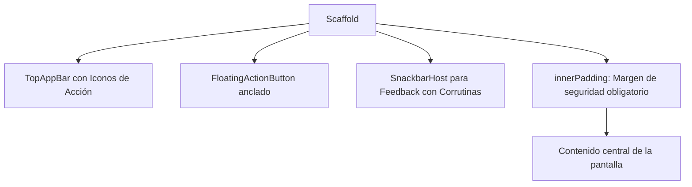
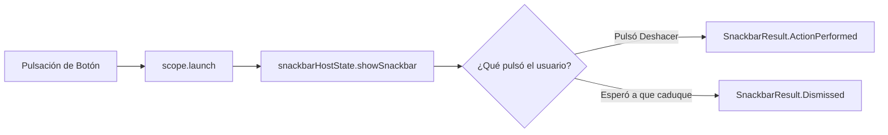

# **Codelab 4: Estructura de Pantalla con Scaffold, AppBars y Feedback**

En este codelab aprenderás a ensamblar pantallas completas que respetan la jerarquía visual de **Material Design 3** mediante el contenedor fundamental de Jetpack Compose: **`Scaffold`**.

Aprenderás a colocar barras superiores de navegación (`TopAppBar`), botones de acción flotantes (`FloatingActionButton`) y a gestionar notificaciones temporales (**`Snackbar`**) utilizando corrutinas de Kotlin y diálogos modales de confirmación (**`AlertDialog`**).

---

## 1. ¿Qué vas a construir?

Construirás una **Pantalla de Gestor de Notas y Tareas Rápidas**, donde el usuario puede registrar elementos, recibir avisos temporales con acción "Deshacer" y solicitar confirmación modal antes de borrar datos:



Al finalizar este codelab, serás capaz de:

- Estructurar pantallas complejas utilizando los *slots* oficiales de `Scaffold`.
- Explicar por qué es obligatorio consumir el parámetro `innerPadding`.
- Disparar mensajes emergentes `Snackbar` mediante corrutinas de Kotlin (`CoroutineScope`).
- Implementar diálogos modales de confirmación con `AlertDialog`.
- Probar las interacciones mediante `@Preview` en IntelliJ IDEA.

---

## 2. Anatomía de `Scaffold`: El Esqueleto de Material 3

`Scaffold` es un componible de alto nivel que implementa la estructura básica de layout visual de Material Design. En lugar de organizar manualmente columnas y filas con cálculos de posición, `Scaffold` expone **ranuras (*slots*) predefinidas**:

```kotlin
Scaffold(
    topBar = { /* Barra superior de navegación */ },
    bottomBar = { /* Barra inferior NavigationBar */ },
    floatingActionButton = { /* Botón de acción flotante */ },
    floatingActionButtonPosition = FabPosition.End,
    snackbarHost = { /* Anfitrión de notificaciones Snackbar */ }
) { innerPadding ->
    // ¡Tu contenido principal debe aplicar este padding!
    Box(modifier = Modifier.padding(innerPadding)) {
        // ...
    }
}
```

---

## 3. El Peligro Crítico de Ignorar `innerPadding`

!!! danger "¡El error visual #1 en proyectos de Compose!"
    Muchos estudiantes ignoran la lambda `{ innerPadding -> ... }` y colocan su contenido directamente con `Modifier.fillMaxSize()`.  
    **Consecuencia inmediata:** El contenido superior de la pantalla se dibujará **debajo de la TopAppBar**, quedando totalmente tapado e inaccesible al tacto.

`innerPadding` contiene los márgenes exactos de la barra superior y de la barra inferior para que tu diseño nunca colisione con las barras del sistema operativo.

---

## 4. Paso 1: Configurar la `TopAppBar` y el Menú de Acciones

Material 3 proporciona `TopAppBar`, `CenterAlignedTopAppBar`, `MediumTopAppBar` y `LargeTopAppBar`.

Crea el archivo `app/src/main/java/com/dam/pmdmlab03/codelabs/codelab01_scaffold/ScaffoldDemoScreen.kt`:

```kotlin
@OptIn(ExperimentalMaterial3Api::class)
@Composable
fun MiTopAppBar(
    onBuscarClick: () -> Unit,
    onInfoClick: () -> Unit
) {
    TopAppBar(
        title = {
            Text(
                text = "Mis Tareas M3",
                style = MaterialTheme.typography.titleLarge
            )
        },
        actions = {
            IconButton(onClick = onBuscarClick) {
                Icon(Icons.Filled.Search, contentDescription = "Buscar")
            }
            IconButton(onClick = onInfoClick) {
                Icon(Icons.Filled.Info, contentDescription = "Información")
            }
        },
        colors = TopAppBarDefaults.topAppBarColors(
            containerColor = MaterialTheme.colorScheme.primaryContainer,
            titleContentColor = MaterialTheme.colorScheme.onPrimaryContainer,
            actionIconContentColor = MaterialTheme.colorScheme.onPrimaryContainer
        )
    )
}
```

---

## 5. Paso 2: El Botón Flotante (`FloatingActionButton`)

El botón de acción flotante (FAB) representa la acción principal y más destacada de una pantalla (ej. "Añadir tarea", "Crear nota"):

```kotlin
FloatingActionButton(
    onClick = { /* Acción de creación */ },
    containerColor = MaterialTheme.colorScheme.primary,
    contentColor = MaterialTheme.colorScheme.onPrimary
) {
    Icon(Icons.Filled.Add, contentDescription = "Añadir nueva tarea")
}
```

---

## 6. Paso 3: Notificaciones Temporales con `Snackbar` y Corrutinas

Para mostrar un `Snackbar` en Compose necesitamos dos elementos esenciales:

1. **`SnackbarHostState`:** Un objeto observable que gestiona la cola de mensajes.
2. **`CoroutineScope`:** Las notificaciones `Snackbar` son operaciones asíncronas bloqueantes (esperan a que pasen unos segundos o a que el usuario pulse un botón). Por tanto, **sólo pueden lanzarse dentro de una corrutina**.



```kotlin
val snackbarHostState = remember { SnackbarHostState() }
val scope = rememberCoroutineScope()

// Dentro del evento onClick de un botón:
scope.launch {
    val resultado = snackbarHostState.showSnackbar(
        message = "Elemento eliminado con éxito",
        actionLabel = "Deshacer",
        duration = SnackbarDuration.Short
    )

    when (resultado) {
        SnackbarResult.ActionPerformed -> {
            // El usuario pulsó en "Deshacer": restaurar datos
        }
        SnackbarResult.Dismissed -> {
            // El aviso desapareció tras 4 segundos
        }
    }
}
```

---

## 7. Paso 4: Implementación Completa de la Pantalla

Abre o crea `app/src/main/java/com/dam/pmdmlab03/codelabs/codelab01_scaffold/ScaffoldDemoScreen.kt`:

??? example "Ver código completo: ScaffoldDemoScreen.kt"

    ```kotlin
    package com.dam.pmdmlab03.codelabs.codelab01_scaffold

    import androidx.compose.foundation.layout.Arrangement
    import androidx.compose.foundation.layout.Box
    import androidx.compose.foundation.layout.Column
    import androidx.compose.foundation.layout.Row
    import androidx.compose.foundation.layout.Spacer
    import androidx.compose.foundation.layout.fillMaxSize
    import androidx.compose.foundation.layout.fillMaxWidth
    import androidx.compose.foundation.layout.height
    import androidx.compose.foundation.layout.padding
    import androidx.compose.foundation.lazy.LazyColumn
    import androidx.compose.foundation.lazy.items
    import androidx.compose.material.icons.Icons
    import androidx.compose.material.icons.filled.Add
    import androidx.compose.material.icons.filled.Delete
    import androidx.compose.material.icons.filled.Info
    import androidx.compose.material.icons.filled.Search
    import androidx.compose.material.icons.filled.Warning
    import androidx.compose.material3.AlertDialog
    import androidx.compose.material3.CardDefaults
    import androidx.compose.material3.ElevatedCard
    import androidx.compose.material3.ExperimentalMaterial3Api
    import androidx.compose.material3.FloatingActionButton
    import androidx.compose.material3.Icon
    import androidx.compose.material3.IconButton
    import androidx.compose.material3.MaterialTheme
    import androidx.compose.material3.Scaffold
    import androidx.compose.material3.SnackbarDuration
    import androidx.compose.material3.SnackbarHost
    import androidx.compose.material3.SnackbarHostState
    import androidx.compose.material3.SnackbarResult
    import androidx.compose.material3.Text
    import androidx.compose.material3.TextButton
    import androidx.compose.material3.TopAppBar
    import androidx.compose.material3.TopAppBarDefaults
    import androidx.compose.runtime.Composable
    import androidx.compose.runtime.getValue
    import androidx.compose.runtime.mutableStateListOf
    import androidx.compose.runtime.mutableStateOf
    import androidx.compose.runtime.remember
    import androidx.compose.runtime.rememberCoroutineScope
    import androidx.compose.runtime.setValue
    import androidx.compose.ui.Alignment
    import androidx.compose.ui.Modifier
    import androidx.compose.ui.tooling.preview.Preview
    import androidx.compose.ui.unit.dp
    import com.dam.pmdmlab03.ui.theme.PMDMLab03Theme
    import kotlinx.coroutines.launch

    @OptIn(ExperimentalMaterial3Api::class)
    @Composable
    fun ScaffoldDemoScreen(modifier: Modifier = Modifier) {
        val tareas = remember {
            mutableStateListOf(
                "Configurar el SDK de Android en IntelliJ",
                "Estudiar los roles semánticos de ColorScheme",
                "Resolver el reto del Ahorcado en Compose"
            )
        }

        val snackbarHostState = remember { SnackbarHostState() }
        val scope = rememberCoroutineScope()

        var elementoParaBorrar by remember { mutableStateOf<String?>(null) }
        var ultimoBorradoConIndice by remember { mutableStateOf<Pair<Int, String>?>(null) }

        Scaffold(
            topBar = {
                TopAppBar(
                    title = { Text("Gestor de Tareas M3") },
                    actions = {
                        IconButton(onClick = {
                            scope.launch {
                                snackbarHostState.showSnackbar("Búsqueda no implementada aún")
                            }
                        }) {
                            Icon(Icons.Filled.Search, contentDescription = "Buscar")
                        }
                    },
                    colors = TopAppBarDefaults.topAppBarColors(
                        containerColor = MaterialTheme.colorScheme.primaryContainer,
                        titleContentColor = MaterialTheme.colorScheme.onPrimaryContainer
                    )
                )
            },
            floatingActionButton = {
                FloatingActionButton(
                    onClick = {
                        val nuevaTarea = "Nueva tarea creada #${tareas.size + 1}"
                        tareas.add(nuevaTarea)
                        scope.launch {
                            snackbarHostState.showSnackbar("Tarea añadida con éxito")
                        }
                    },
                    containerColor = MaterialTheme.colorScheme.primary
                ) {
                    Icon(Icons.Filled.Add, contentDescription = "Añadir tarea")
                }
            },
            snackbarHost = { SnackbarHost(snackbarHostState) },
            modifier = modifier
        ) { innerPadding ->
            // ¡USO OBLIGATORIO DE INNERPADDING!
            Box(
                modifier = Modifier
                    .fillMaxSize()
                    .padding(innerPadding)
            ) {
                if (tareas.isEmpty()) {
                    Box(
                        modifier = Modifier.fillMaxSize(),
                        contentAlignment = Alignment.Center
                    ) {
                        Text(
                            text = "No tienes tareas pendientes 🎉\nPulsa en '+' para añadir una.",
                            style = MaterialTheme.typography.bodyLarge,
                            color = MaterialTheme.colorScheme.onSurfaceVariant
                        )
                    }
                } else {
                    LazyColumn(
                        modifier = Modifier
                            .fillMaxSize()
                            .padding(16.dp),
                        verticalArrangement = Arrangement.spacedBy(10.dp)
                    ) {
                        items(tareas, key = { it }) { tarea ->
                            ElevatedCard(
                                modifier = Modifier.fillMaxWidth(),
                                colors = CardDefaults.elevatedCardColors(
                                    containerColor = MaterialTheme.colorScheme.surfaceVariant
                                )
                            ) {
                                Row(
                                    modifier = Modifier
                                        .fillMaxWidth()
                                        .padding(16.dp),
                                    horizontalArrangement = Arrangement.SpaceBetween,
                                    verticalAlignment = Alignment.CenterVertically
                                ) {
                                    Text(
                                        text = tarea,
                                        style = MaterialTheme.typography.bodyLarge,
                                        modifier = Modifier.weight(1f)
                                    )

                                    IconButton(onClick = { elementoParaBorrar = tarea }) {
                                        Icon(
                                            imageVector = Icons.Filled.Delete,
                                            contentDescription = "Borrar",
                                            tint = MaterialTheme.colorScheme.error
                                        )
                                    }
                                }
                            }
                        }
                    }
                }
            }

            // Diálogo Modal de Confirmación
            elementoParaBorrar?.let { tareaABorrar ->
                AlertDialog(
                    onDismissRequest = { elementoParaBorrar = null },
                    icon = {
                        Icon(
                            imageVector = Icons.Filled.Warning,
                            contentDescription = null,
                            tint = MaterialTheme.colorScheme.error
                        )
                    },
                    title = { Text("¿Eliminar tarea?") },
                    text = { Text("Se eliminará de la lista: '$tareaABorrar'") },
                    confirmButton = {
                        TextButton(
                            onClick = {
                                val indice = tareas.indexOf(tareaABorrar)
                                if (indice != -1) {
                                    tareas.removeAt(indice)
                                    ultimoBorradoConIndice = Pair(indice, tareaABorrar)
                                    elementoParaBorrar = null

                                    // Disparo de Snackbar con opción "Deshacer"
                                    scope.launch {
                                        val resultado = snackbarHostState.showSnackbar(
                                            message = "Tarea eliminada",
                                            actionLabel = "Deshacer",
                                            duration = SnackbarDuration.Short
                                        )

                                        if (resultado == SnackbarResult.ActionPerformed) {
                                            ultimoBorradoConIndice?.let { (pos, texto) ->
                                                tareas.add(pos.coerceAtMost(tareas.size), texto)
                                            }
                                        }
                                    }
                                }
                            }
                        ) {
                            Text("Eliminar", color = MaterialTheme.colorScheme.error)
                        }
                    },
                    dismissButton = {
                        TextButton(onClick = { elementoParaBorrar = null }) {
                            Text("Cancelar")
                        }
                    }
                )
            }
        }
    }

    // ==========================================
    // PREVIEW EN INTELIJ IDEA
    // ==========================================

    @Preview(name = "Scaffold con Lista de Tareas", showBackground = true)
    @Composable
    private fun ScaffoldDemoScreenPreview() {
        PMDMLab03Theme {
            ScaffoldDemoScreen()
        }
    }
    ```

---

## 8. Checklist de Aprendizaje

- [x] **Slots de Scaffold:** La pantalla define `topBar`, `floatingActionButton` y `snackbarHost` sin solapamiento de capas.
- [x] **innerPadding aplicado:** El contenido de la lista comienza exactamente debajo de la `TopAppBar` y no colisiona con el FAB.
- [x] **Acción Deshacer funcional:** Al eliminar una tarjeta y pulsar rápidamente en "Deshacer", el elemento vuelve a aparecer en su posición.

---

## 9. Reto de Consolidación

Añade un contador en la `TopAppBar`:

1. Muestra en el subtítulo de la barra: *"Tareas pendientes: X"*.
2. Añade un botón de acción en la barra superior con el icono `DeleteSweep` que abra un `AlertDialog` preguntando si desea vaciar todas las tareas de la lista.
