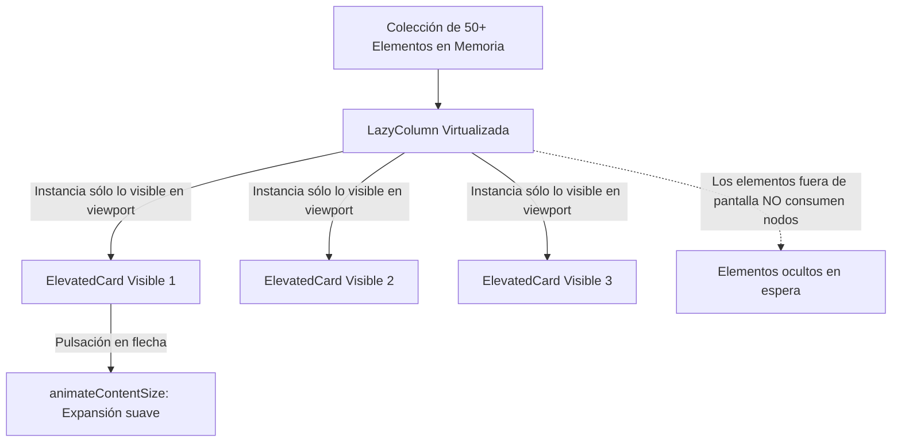

# **Codelab 5: Listas y Cuadrículas Eficientes con Lazy Layouts**

En este codelab aprenderás a diseñar pantallas capaces de renderizar colecciones de cientos o miles de elementos de forma extraordinariamente fluida (60/120 FPS) en cualquier dispositivo móvil mediante los componentes perezosos de Compose: **`LazyColumn`**, **`LazyRow`** y **`LazyVerticalGrid`**.

Comprenderás el mecanismo de virtualización (reciclaje de nodos), la importancia crítica del parámetro **`key`** para evitar recomposiciones innecesarias y cómo crear tarjetas interactivas con animaciones de expansión utilizando **`ElevatedCard`**.

---

## 1. ¿Qué vas a construir?

Construirás un **Catálogo Interactivo de Cursos y Habilidades Tecnológicas**, inspirado en el codelab oficial *Woof* de Google:



Al finalizar este codelab, serás capaz de:

- Explicar la diferencia entre `Column(Modifier.verticalScroll())` y `LazyColumn`.
- Construir listas dinámicas utilizando las funciones `items()` e `itemsIndexed()`.
- Optimizar el rendimiento de la recomposición mediante identificadores únicos (`key`).
- Aplicar animaciones sutiles de expansión con el modificador `.animateContentSize()`.
- Transformar una lista vertical en una cuadrícula de dos columnas con `LazyVerticalGrid`.

---

## 2. La Trampa de Rendimiento: `Column` vs `LazyColumn`

En Android, muchos desarrolladores intentan crear listas añadiendo un modificador de scroll a una columna estándar:

```kotlin
// ❌ CÓDIGO INEFICIENTE PARA COLECCIONES GRANDES
Column(modifier = Modifier.verticalScroll(rememberScrollState())) {
    elementos.forEach { item ->
        ItemView(item) // ¡Instancia los 1.000 elementos de golpe en el arranque!
    }
}
```

### ¿Por qué colapsa el rendimiento?

1. Si la lista contiene 500 elementos, Compose intentará medir, posicionar y renderizar los 500 componibles simultáneamente en el primer fotograma, provocando que la aplicación se congele (*jank*) o sufra un error por falta de memoria (`OutOfMemoryError`).
2. **La solución (`LazyColumn`):** `LazyColumn` actúa como una ventana deslizante (*viewport*). Si en la pantalla sólo caben 5 tarjetas a la vez, **Compose únicamente renderizará esas 5 tarjetas**. A medida que el usuario desliza el dedo, los elementos que salen se liberan y los que entran se componen bajo demanda (*lazy evaluation*).

---

## 3. Paso 1: La Clave Obligatoria (`key`)

Cuando una lista sufre modificaciones (un usuario borra un elemento o se filtra por nombre), Compose necesita saber qué tarjeta corresponde a qué objeto en memoria.

```kotlin
// ❌ SIN KEY: Si borras el primer elemento, Compose recompondrá TODOS los siguientes
LazyColumn {
    items(catalogo) { item -> TarjetaItem(item) }
}

// ✅ CON KEY ÚNICA: Compose sólo anima la eliminación del elemento borrado
LazyColumn {
    items(
        items = catalogo,
        key = { it.id } // Identificador unívoco obligatorio
    ) { item -> 
        TarjetaItem(item) 
    }
}
```

!!! tip "¿Por qué es crucial el parámetro key?"
    Si no especificas `key`, Compose utiliza por defecto la posición del elemento (`0, 1, 2...`). Al eliminar el elemento de la posición 0, el elemento 1 pasa a ser el 0, el 2 pasa a ser el 1, etc., **obligando a recomponer la lista completa** en lugar de limitarse a retirar la tarjeta eliminada.

---

## 4. Paso 2: Modelo de Datos del Catálogo

Crea el archivo `app/src/main/java/com/dam/pmdmlab03/codelabs/codelab03_catalogo/CursoModel.kt`:

??? example "Ver código completo: CursoModel.kt"

    ```kotlin
    package com.dam.pmdmlab03.codelabs.codelab03_catalogo

    import androidx.compose.material.icons.Icons
    import androidx.compose.material.icons.filled.Architecture
    import androidx.compose.material.icons.filled.Code
    import androidx.compose.material.icons.filled.DataObject
    import androidx.compose.material.icons.filled.PhoneAndroid
    import androidx.compose.material.icons.filled.Storage
    import androidx.compose.ui.graphics.vector.ImageVector

    data class CursoTecnologico(
        val id: Int,
        val titulo: String,
        val nivel: String,
        val icono: ImageVector,
        val descripcionCorta: String,
        val contenidoDetallado: String
    )

    val CATALOGO_CURSOS = listOf(
        CursoTecnologico(
            id = 1,
            titulo = "Jetpack Compose Fundamentos",
            nivel = "Básico",
            icono = Icons.Filled.PhoneAndroid,
            descripcionCorta = "Construcción declarativa de interfaces modernas en Android.",
            contenidoDetallado = "Aprende funciones Composable, modificadores de tamaño, layouts básicos (Row, Column, Box) y arquitectura reactiva con remember y mutableStateOf."
        ),
        CursoTecnologico(
            id = 2,
            titulo = "Material Design 3 & Theming",
            nivel = "Intermedio",
            icono = Icons.Filled.Architecture,
            descripcionCorta = "Diseño profesional accesible y soporte de Modo Oscuro.",
            contenidoDetallado = "Domina los roles de color semánticos de ColorScheme, escalas tipográficas adaptativas, radios de curvatura con Shapes y tokens de diseño Material You."
        ),
        CursoTecnologico(
            id = 3,
            titulo = "Arquitectura de UI con ViewModel",
            nivel = "Avanzado",
            icono = Icons.Filled.DataObject,
            descripcionCorta = "Supervivencia a rotaciones y flujo unidireccional (UDF).",
            contenidoDetallado = "Estructura pantallas con StateFlow y UiState inmutable, desacoplando la lógica de negocio de la interfaz gráfica y evitando fugas de memoria."
        ),
        CursoTecnologico(
            id = 4,
            titulo = "Persistencia Local con Room",
            nivel = "Avanzado",
            icono = Icons.Filled.Storage,
            descripcionCorta = "Bases de datos SQLite reactivas con corrutinas de Kotlin.",
            contenidoDetallado = "Mapeo relacional con @Entity, consultas seguras en tiempo de compilación con @Dao y flujos en tiempo real con Flow."
        ),
        CursoTecnologico(
            id = 5,
            titulo = "Kotlin Corrutinas y Asincronía",
            nivel = "Intermedio",
            icono = Icons.Filled.Code,
            descripcionCorta = "Programación asíncrona no bloqueante en el hilo de UI.",
            contenidoDetallado = "Gestiona suspensiones con suspend, despachadores Dispatchers.IO / Main, constructores launch / async y manejo de excepciones estructurado."
        )
    )
    ```

---

## 5. Paso 3: Tarjeta `ElevatedCard` con Animación de Expansión

Al estilo de la aplicación *Woof*, cada tarjeta mostrará su información básica y contará con un botón para desplegar u ocultar los detalles técnicos mediante la animación nativa `.animateContentSize()`:

```kotlin
ElevatedCard(
    modifier = Modifier
        .fillMaxWidth()
        .animateContentSize() // ¡Animación automática al cambiar de tamaño!
) {
    // Si 'expandido' es true, mostramos el párrafo adicional
}
```

---

## 6. Paso 4: Implementación Completa de `CatalogoLazyScreen.kt`

Abre o crea `app/src/main/java/com/dam/pmdmlab03/codelabs/codelab03_catalogo/CatalogoLazyScreen.kt`:

??? example "Ver código completo: CatalogoLazyScreen.kt"

    ```kotlin
    package com.dam.pmdmlab03.codelabs.codelab03_catalogo

    import androidx.compose.animation.animateContentSize
    import androidx.compose.foundation.layout.Arrangement
    import androidx.compose.foundation.layout.Column
    import androidx.compose.foundation.layout.PaddingValues
    import androidx.compose.foundation.layout.Row
    import androidx.compose.foundation.layout.Spacer
    import androidx.compose.foundation.layout.fillMaxSize
    import androidx.compose.foundation.layout.fillMaxWidth
    import androidx.compose.foundation.layout.height
    import androidx.compose.foundation.layout.padding
    import androidx.compose.foundation.layout.size
    import androidx.compose.foundation.lazy.LazyColumn
    import androidx.compose.foundation.lazy.items
    import androidx.compose.material.icons.Icons
    import androidx.compose.material.icons.filled.Delete
    import androidx.compose.material.icons.filled.ExpandLess
    import androidx.compose.material.icons.filled.ExpandMore
    import androidx.compose.material3.CardDefaults
    import androidx.compose.material3.ElevatedCard
    import androidx.compose.material3.HorizontalDivider
    import androidx.compose.material3.Icon
    import androidx.compose.material3.IconButton
    import androidx.compose.material3.MaterialTheme
    import androidx.compose.material3.OutlinedButton
    import androidx.compose.material3.Surface
    import androidx.compose.material3.Text
    import androidx.compose.runtime.Composable
    import androidx.compose.runtime.getValue
    import androidx.compose.runtime.mutableStateListOf
    import androidx.compose.runtime.mutableStateOf
    import androidx.compose.runtime.remember
    import androidx.compose.runtime.setValue
    import androidx.compose.ui.Alignment
    import androidx.compose.ui.Modifier
    import androidx.compose.ui.tooling.preview.Preview
    import androidx.compose.ui.unit.dp
    import com.dam.pmdmlab03.ui.theme.PMDMLab03Theme

    @Composable
    fun CatalogoLazyScreen(modifier: Modifier = Modifier) {
        val cursos = remember { mutableStateListOf(*CATALOGO_CURSOS.toTypedArray()) }

        Surface(
            modifier = modifier.fillMaxSize(),
            color = MaterialTheme.colorScheme.background
        ) {
            Column(
                modifier = Modifier
                    .fillMaxSize()
                    .padding(horizontal = 16.dp, vertical = 12.dp)
            ) {
                Text(
                    text = "Catálogo Tecnológico con LazyColumn",
                    style = MaterialTheme.typography.titleLarge,
                    color = MaterialTheme.colorScheme.primary
                )

                Text(
                    text = "Renderizado optimizado y virtualizado con clave unívoca (key).",
                    style = MaterialTheme.typography.bodyMedium,
                    color = MaterialTheme.colorScheme.onSurfaceVariant,
                    modifier = Modifier.padding(top = 2.dp, bottom = 8.dp)
                )

                HorizontalDivider()

                if (cursos.isEmpty()) {
                    Column(
                        modifier = Modifier.fillMaxSize(),
                        verticalArrangement = Arrangement.Center,
                        horizontalAlignment = Alignment.CenterHorizontally
                    ) {
                        Text(
                            text = "Has eliminado todos los cursos del catálogo.",
                            style = MaterialTheme.typography.bodyLarge
                        )
                        Spacer(modifier = Modifier.height(12.dp))
                        OutlinedButton(onClick = { cursos.addAll(CATALOGO_CURSOS) }) {
                            Text("Restaurar catálogo inicial")
                        }
                    }
                } else {
                    LazyColumn(
                        modifier = Modifier.fillMaxSize(),
                        contentPadding = PaddingValues(vertical = 12.dp),
                        verticalArrangement = Arrangement.spacedBy(12.dp)
                    ) {
                        // ¡CLAVE OBLIGATORIA PARA PREVENIR RECOMPOSICIONES MASIVAS!
                        items(
                            items = cursos,
                            key = { it.id }
                        ) { curso ->
                            CursoCardItem(
                                curso = curso,
                                onBorrar = { cursos.remove(curso) }
                            )
                        }
                    }
                }
            }
        }
    }

    @Composable
    fun CursoCardItem(
        curso: CursoTecnologico,
        onBorrar: () -> Unit,
        modifier: Modifier = Modifier
    ) {
        var expandido by remember { mutableStateOf(false) }

        ElevatedCard(
            modifier = modifier
                .fillMaxWidth()
                .animateContentSize(), // Suaviza la transición al mostrar más texto
            shape = MaterialTheme.shapes.medium,
            colors = CardDefaults.elevatedCardColors(
                containerColor = MaterialTheme.colorScheme.surfaceVariant
            )
        ) {
            Column(modifier = Modifier.padding(16.dp)) {
                Row(
                    modifier = Modifier.fillMaxWidth(),
                    verticalAlignment = Alignment.CenterVertically
                ) {
                    Icon(
                        imageVector = curso.icono,
                        contentDescription = null,
                        modifier = Modifier.size(40.dp),
                        tint = MaterialTheme.colorScheme.primary
                    )

                    Column(
                        modifier = Modifier
                            .weight(1f)
                            .padding(horizontal = 12.dp)
                    ) {
                        Text(
                            text = curso.titulo,
                            style = MaterialTheme.typography.titleMedium,
                            color = MaterialTheme.colorScheme.onSurfaceVariant
                        )
                        Text(
                            text = "Nivel: ${curso.nivel}",
                            style = MaterialTheme.typography.labelSmall,
                            color = MaterialTheme.colorScheme.secondary
                        )
                    }

                    // Botón de expansión (estilo Woof)
                    IconButton(onClick = { expandido = !expandido }) {
                        Icon(
                            imageVector = if (expandido) Icons.Filled.ExpandLess else Icons.Filled.ExpandMore,
                            contentDescription = if (expandido) "Mostrar menos" else "Mostrar más"
                        )
                    }

                    // Botón de eliminación
                    IconButton(onClick = onBorrar) {
                        Icon(
                            imageVector = Icons.Filled.Delete,
                            contentDescription = "Eliminar de la lista",
                            tint = MaterialTheme.colorScheme.error
                        )
                    }
                }

                Text(
                    text = curso.descripcionCorta,
                    style = MaterialTheme.typography.bodyMedium,
                    modifier = Modifier.padding(top = 8.dp)
                )

                // Contenido condicional visible únicamente al expandir
                if (expandido) {
                    Spacer(modifier = Modifier.height(10.dp))
                    HorizontalDivider(color = MaterialTheme.colorScheme.outlineVariant)
                    Spacer(modifier = Modifier.height(10.dp))

                    Text(
                        text = "Detalles del temario:",
                        style = MaterialTheme.typography.labelLarge,
                        color = MaterialTheme.colorScheme.primary
                    )
                    Text(
                        text = curso.contenidoDetallado,
                        style = MaterialTheme.typography.bodySmall,
                        color = MaterialTheme.colorScheme.onSurfaceVariant,
                        modifier = Modifier.padding(top = 4.dp)
                    )
                }
            }
        }
    }

    // ==========================================
    // PREVIEWS EN INTELIJ IDEA
    // ==========================================

    @Preview(name = "Catálogo con Cursos", showBackground = true)
    @Composable
    private fun CatalogoLazyScreenPreview() {
        PMDMLab03Theme {
            CatalogoLazyScreen()
        }
    }
    ```

---

## 7. Checklist de Aprendizaje

- [x] **Virtualización demostrada:** El catálogo sólo instancia las tarjetas que caben en el alto de la pantalla, sin saturar la memoria RAM.
- [x] **Clave única (`key`) activa:** Al pulsar el icono de papelera sobre el tercer curso, sólo esa fila se elimina suavemente, sin recomponer ni parpadear el resto de elementos.
- [x] **Animación de tamaño:** Al pulsar sobre el icono de flecha, la tarjeta se expande con una suave transición visual gracias a `.animateContentSize()`.

---

## 8. Reto de Consolidación

Convierte la lista en una cuadrícula de dos columnas:
1. Sustituye `LazyColumn` por `LazyVerticalGrid(columns = GridCells.Fixed(2))`.
2. Adapta la tarjeta `CursoCardItem` para que los textos e iconos se presenten de forma equilibrada en formato vertical dentro de cada celda de la cuadrícula.
